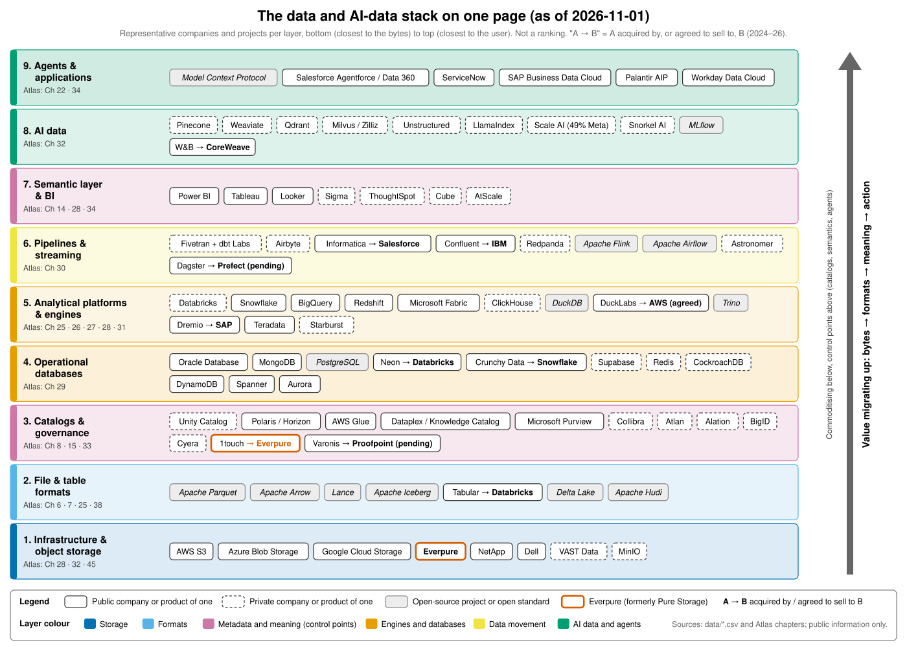

# AI Data Atlas（AI 数据图谱）

> **说明：** 本文件是 AI Data Atlas 的简体中文参考译本。位于仓库根目录的英文原版为权威版本；数据（`data/`）、脚本（`scripts/`）和元文件（`meta/`）与英文版共用，未作翻译。文中数字截至 2026-11-01。

**数据库、数据管道、数据平台与 AI 数据栈：技术如何运作、企业如何赚钱，以及这一切如何与存储交汇。**

本图谱是一个托管在 GitHub 上的知识库，共 50 章，外加由两章组成的第 0 部分导读。读者定位是一位加入 **Everpure**（原 Pure Storage；NYSE: P，原代码 PSTG）的企业发展与战略专业人士（CFA、MBA、法律背景，具有半导体和 AI 基础设施并购经验），而 Everpure 正从存储向上层栈延伸，进入数据管理与数据智能领域。配套仓库 *Everpure Tech Atlas* 已覆盖存储硬件与协议，因此本图谱不再重复讲解存储；凡涉及存储之处，各章会以简短的 **存储桥接（Storage bridge）** 方框加以说明。

本图谱可直接在 github.com 上阅读（原生渲染 Mermaid），也可作为 MkDocs Material 站点浏览（运行 `mkdocs serve`，或使用 `.github/workflows/deploy.yml` 中的 GitHub Pages 工作流）。



*一页纸市场地图（第 0.2 章）。价值正沿着技术栈向上迁移：从存储和计算，转向目录、语义上下文与智能体。*

<a id="start-here"></a>
## 从这里开始

| 如果你有…… | 阅读内容 | 目标 |
|---|---|---|
| **2 小时** | [0.1 如何使用](docs/00-start-here/ch00-1-how-to-use.md) → [0.2 市场地图](docs/00-start-here/ch00-2-market-map.md) → [1 数据栈全景图](docs/01-data-systems-foundations/ch01-data-stack-map.md) → [7 开放表格式](docs/01-data-systems-foundations/ch07-open-table-formats.md) → [8 目录](docs/01-data-systems-foundations/ch08-catalogs-and-metastores.md) → [27 Databricks 对比 Snowflake](docs/04-company-deep-dives/ch27-databricks-vs-snowflake.md) → [45 存储向上层栈延伸](docs/06-history-and-future/ch45-storage-moving-up-the-stack.md) → [49 30 秒讲清楚](docs/07-conversation-toolkit/ch49-explain-in-30-seconds.md) | 在首次会议中从容应对 |
| **2 天** | 第 1–4 部分，然后阅读第 [35](docs/05-business-and-economics/ch35-business-models.md)–[37](docs/05-business-and-economics/ch37-public-comps-valuation.md) 章和第 [45](docs/06-history-and-future/ch45-storage-moving-up-the-stack.md) 章 | 能在白板上讲解任意一层（L2），并读懂数据公司的损益表 |
| **2 周** | 全部内容，外加 [48 问题库](docs/07-conversation-toolkit/ch48-question-bank.md) 和 [50 闪卡与速查表](docs/07-conversation-toolkit/ch50-self-test-cheat-sheets.md) 中的练习 | 主导合作伙伴、尽职调查与创始人对话 |

全书使用的深度标签：**L1** 词汇，**L2** 机制（默认），**L3** 实现（仅出现在"深入阅读"方框中）。术语定义见[术语表](../glossary.md)。

<a id="contents-and-progress"></a>
## 目录与进度

<!-- AUTO:CONTENTS START -->
**52 章 · 208,622 个正文词 · 484 个图表 · 447 个未解决的 [VERIFY] 标记**（统计来自 `scripts/qa_report.py`；正文词数不含表格、代码/Mermaid、图注和脚注）。

| 部分 | 章节 | 正文词数 | 图表数 | [VERIFY] | 已审阅 |
|---|---|---|---|---|---|
| 第 0 部分 | [0.1 如何使用本图谱](docs/00-start-here/ch00-1-how-to-use.md) | 1,760 | 5 | 0 | ✓ |
| 第 0 部分 | [0.2 一页纸市场地图](docs/00-start-here/ch00-2-market-map.md) | 2,053 | 4 | 0 | ✓ |
| 第 1 部分 | [1. 数据栈全景图](docs/01-data-systems-foundations/ch01-data-stack-map.md) | 3,429 | 10 | 4 | ✓ |
| 第 1 部分 | [2. 数据模型](docs/01-data-systems-foundations/ch02-data-models.md) | 3,230 | 7 | 4 | ✓ |
| 第 1 部分 | [3. 数据库内部如何工作](docs/01-data-systems-foundations/ch03-database-internals.md) | 4,485 | 10 | 1 | ✓ |
| 第 1 部分 | [4. 分布式数据库](docs/01-data-systems-foundations/ch04-distributed-databases.md) | 4,408 | 10 | 5 | ✓ |
| 第 1 部分 | [5. 分析引擎](docs/01-data-systems-foundations/ch05-analytical-engines.md) | 3,437 | 8 | 2 | ✓ |
| 第 1 部分 | [6. 文件格式：从 CSV 到 Parquet、Arrow 与 Lance](docs/01-data-systems-foundations/ch06-file-formats.md) | 2,993 | 7 | 2 | ✓ |
| 第 1 部分 | [7. 开放表格式：Iceberg、Delta Lake 与 Hudi](docs/01-data-systems-foundations/ch07-open-table-formats.md) | 3,634 | 9 | 1 | ✓ |
| 第 1 部分 | [8. 目录与元数据存储：新的控制点](docs/01-data-systems-foundations/ch08-catalogs-and-metastores.md) | 2,660 | 6 | 8 | ✓ |
| 第 2 部分 | [9. 数据管道模式](docs/02-pipelines-and-governance/ch09-pipeline-patterns.md) | 3,503 | 10 | 3 | ✓ |
| 第 2 部分 | [10. 数据摄取与集成](docs/02-pipelines-and-governance/ch10-ingestion-and-integration.md) | 2,758 | 8 | 8 | ✓ |
| 第 2 部分 | [11. 流处理与事件平台](docs/02-pipelines-and-governance/ch11-streaming-and-event-platforms.md) | 3,681 | 10 | 5 | ✓ |
| 第 2 部分 | [12. 数据转换与编排](docs/02-pipelines-and-governance/ch12-transformation-and-orchestration.md) | 3,319 | 7 | 3 | ✓ |
| 第 2 部分 | [13. 数据质量、可观测性与数据血缘](docs/02-pipelines-and-governance/ch13-data-quality-observability-lineage.md) | 3,448 | 8 | 5 | ✓ |
| 第 2 部分 | [14. 语义层与 BI](docs/02-pipelines-and-governance/ch14-semantic-layers-and-bi.md) | 2,900 | 7 | 5 | ✓ |
| 第 2 部分 | [15. 数据治理、安全与隐私](docs/02-pipelines-and-governance/ch15-governance-security-privacy.md) | 4,434 | 8 | 10 | ✓ |
| 第 3 部分 | [16. AI 数据生命周期](docs/03-ai-data-stack/ch16-ai-data-lifecycle.md) | 3,660 | 6 | 1 | ✓ |
| 第 3 部分 | [17. 非结构化数据处理](docs/03-ai-data-stack/ch17-unstructured-data-processing.md) | 3,160 | 10 | 11 | ✓ |
| 第 3 部分 | [18. 嵌入（向量）与向量检索](docs/03-ai-data-stack/ch18-embeddings-and-vector-search.md) | 4,467 | 11 | 6 | ✓ |
| 第 3 部分 | [19. 检索架构：RAG、混合检索、GraphRAG 与上下文工程](docs/03-ai-data-stack/ch19-retrieval-architectures.md) | 3,785 | 11 | 6 | ✓ |
| 第 3 部分 | [20. 训练数据供应链](docs/03-ai-data-stack/ch20-training-data-supply-chain.md) | 3,652 | 8 | 20 | ✓ |
| 第 3 部分 | [21. ML 平台、特征存储与 LLMOps](docs/03-ai-data-stack/ch21-ml-platforms-feature-stores-llmops.md) | 3,436 | 9 | 0 | ✓ |
| 第 3 部分 | [22. 智能体与数据](docs/03-ai-data-stack/ch22-agents-and-data.md) | 4,328 | 10 | 4 | ✓ |
| 第 3 部分 | [23. 实时分析与 HTAP](docs/03-ai-data-stack/ch23-real-time-analytics-htap.md) | 3,366 | 9 | 10 | ✓ |
| 第 3 部分 | [24. 数据栈与计算和存储的交汇](docs/03-ai-data-stack/ch24-data-meets-compute-and-storage.md) | 3,641 | 11 | 3 | ✓ |
| 第 4 部分 | [25. Databricks](docs/04-company-deep-dives/ch25-databricks.md) | 5,346 | 13 | 6 | ✓ |
| 第 4 部分 | [26. Snowflake](docs/04-company-deep-dives/ch26-snowflake.md) | 6,449 | 16 | 29 | ✓ |
| 第 4 部分 | [27. Databricks 与 Snowflake 正面对比](docs/04-company-deep-dives/ch27-databricks-vs-snowflake.md) | 4,026 | 11 | 16 | ✓ |
| 第 4 部分 | [28. 超大规模云厂商的数据平台：AWS、Google、Microsoft 与 Oracle](docs/04-company-deep-dives/ch28-hyperscaler-data-platforms.md) | 5,371 | 10 | 26 | ✓ |
| 第 4 部分 | [29. 运营型数据库厂商](docs/04-company-deep-dives/ch29-operational-database-vendors.md) | 4,557 | 11 | 40 | ✓ |
| 第 4 部分 | [30. 数据移动与流处理公司](docs/04-company-deep-dives/ch30-data-movement-streaming-companies.md) | 4,371 | 10 | 25 | ✓ |
| 第 4 部分 | [31. 分析引擎挑战者与传统平台](docs/04-company-deep-dives/ch31-analytical-engine-challengers-legacy.md) | 4,473 | 8 | 21 | ✓ |
| 第 4 部分 | [32. AI 原生数据公司](docs/04-company-deep-dives/ch32-ai-native-data-companies.md) | 4,760 | 11 | 24 | ✓ |
| 第 4 部分 | [33. 数据治理、目录与数据安全公司](docs/04-company-deep-dives/ch33-governance-catalog-security-companies.md) | 3,647 | 9 | 15 | ✓ |
| 第 4 部分 | [34. 应用巨头的数据平台](docs/04-company-deep-dives/ch34-application-giants-data-platforms.md) | 3,827 | 12 | 38 | ✓ |
| 第 5 部分 | [35. 商业模式：按用量计费、订阅、开放核心与云托管](docs/05-business-and-economics/ch35-business-models.md) | 3,881 | 9 | 1 | ✓ |
| 第 5 部分 | [36. 单位经济效益与 KPI](docs/05-business-and-economics/ch36-unit-economics-kpis.md) | 4,124 | 11 | 9 | ✓ |
| 第 5 部分 | [37. 上市可比公司与估值](docs/05-business-and-economics/ch37-public-comps-valuation.md) | 3,412 | 15 | 6 | ✓ |
| 第 5 部分 | [38. 以开源为战略](docs/05-business-and-economics/ch38-open-source-strategy.md) | 3,316 | 8 | 6 | ✓ |
| 第 5 部分 | [39. 数据行业并购史，2010–2026](docs/05-business-and-economics/ch39-ma-history.md) | 4,782 | 11 | 1 | ✓ |
| 第 5 部分 | [40. 市场进入与合作伙伴关系](docs/05-business-and-economics/ch40-gtm-partnerships.md) | 2,964 | 9 | 7 | ✓ |
| 第 5 部分 | [41. 市场规模与增长驱动因素](docs/05-business-and-economics/ch41-market-sizing.md) | 1,782 | 7 | 6 | ✓ |
| 第 6 部分 | [42. 数据库史，1960 年代–2026](docs/06-history-and-future/ch42-history-of-databases.md) | 4,723 | 7 | 10 | ✓ |
| 第 6 部分 | [43. 现代数据栈：兴起、拆分与再整合](docs/06-history-and-future/ch43-modern-data-stack.md) | 2,304 | 6 | 5 | ✓ |
| 第 6 部分 | [44. 未来趋势，2026–2032](docs/06-history-and-future/ch44-future-trends.md) | 4,325 | 9 | 11 | ✓ |
| 第 6 部分 | [45. 对向上层栈延伸的存储公司的启示](docs/06-history-and-future/ch45-storage-moving-up-the-stack.md) | 2,765 | 8 | 15 | ✓ |
| 第 7 部分 | [46. 与数据平台产品经理、工程师、合作伙伴及创始人对话](docs/07-conversation-toolkit/ch46-talking-with-data-people.md) | 3,865 | 7 | 0 | ✓ |
| 第 7 部分 | [47. 数据基础设施标的的技术与商业尽职调查清单](docs/07-conversation-toolkit/ch47-diligence-checklist.md) | 3,671 | 6 | 1 | ✓ |
| 第 7 部分 | [48. 问题库：154 个问题](docs/07-conversation-toolkit/ch48-question-bank.md) | 8,292 | 15 | 0 | ✓ |
| 第 7 部分 | [49. 30 秒讲清楚](docs/07-conversation-toolkit/ch49-explain-in-30-seconds.md) | 4,676 | 7 | 0 | ✓ |
| 第 7 部分 | [50. 自测与速查表](docs/07-conversation-toolkit/ch50-self-test-cheat-sheets.md) | 13,286 | 19 | 2 | ✓ |
<!-- AUTO:CONTENTS END -->

<a id="how-the-numbers-work"></a>
## 数字的处理方式

- **每个数字都有标签**：GAAP、非 GAAP、公司披露的年化运行率、媒体报道或估算。财年均明确标注（Snowflake 的 FY2027 = Feb 2026–Jan 2027，即 2026 年 2 月至 2027 年 1 月）。
- **单一事实来源：** [`data/`](../data) 存放权威 CSV 文件（`public_comps.csv`、`private_funding.csv`、`ma_deals.csv`、`company_financials.csv`、`market_sizes.csv`，以及各章专用数据集）。每一行都带有 `source` 和 `as_of` 字段。
- **图表由数据重新生成：** `python3 scripts/make_charts.py` 会重建 `docs/assets/charts/` 中的所有 PNG。
- **除脚注另有说明外，数字均截至 2026-11-01。** 集成人员在构建后期重新核对过的事实汇总于 [`meta/verified-facts.md`](../meta/verified-facts.md)。
- **局限性：** 研究仅使用了网络搜索（构建环境屏蔽了直接抓取网页），因此脚注引用的是搜索结果中出现的原始 URL。凡无法确认的内容均带有行内 `[VERIFY: …]` 标记，并列于 [`meta/open-questions.md`](../meta/open-questions.md)。战略类章节仅使用公开信息，并以"战略团队可能评估的选项"的方式表述。

<a id="repository-map"></a>
## 仓库结构

```
README.md            你在这里
CLAUDE.md            构建所用的常设规则与执行模式
PROGRESS.md          构建进度追踪（状态、词数、图表数、VERIFY 计数）
glossary.md          docs/glossary.md 的生成副本
mkdocs.yml           MkDocs Material 配置（Mermaid、搜索、导航）
docs/                各章节（00–07）、术语表、assets/{charts,diagrams}
data/                CSV：可比公司、融资轮次、并购交易、财务数据、市场规模
scripts/             make_charts.py、wordcount.py、lint_mermaid.sh、check_links.py、qa_report.py 等
meta/                大纲、风格指南、模板、资料来源、决策记录、待解问题、审阅记录
.github/workflows/   deploy.yml：构建 MkDocs 并发布到 GitHub Pages
```

<a id="quality-checks"></a>
## 质量检查

```bash
python3 scripts/wordcount.py        # 每章 / 每部分 / 总计的正文词数
scripts/lint_mermaid.sh             # 用 mmdc 渲染每个 Mermaid 代码块
python3 scripts/check_links.py      # 内部链接与锚点
python3 scripts/qa_report.py        # 模板合规性、图表密度、VERIFY 计数
python3 scripts/make_charts.py      # 从 data/ 重新生成所有图表
```

发布站点的方法：在仓库设置中将 **Pages → Source → GitHub Actions** 设为数据源；推送到 `main` 和 `claude/**` 分支时，工作流会自动构建。
