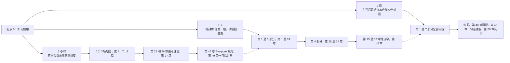
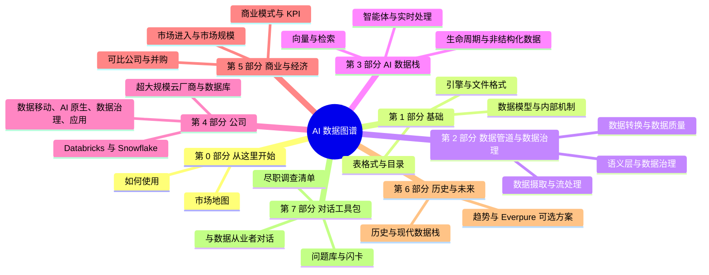

# 0.1 如何使用本图谱
> **深度：** L1 · **阅读时间：** 约 8 分钟 · **最后核实：** 2026-11-01 · **前置阅读：** 无

## 要点速览（TL;DR）

- AI Data Atlas 用八个部分解读数据行业：数据库、数据管道、目录和 AI 数据栈如何运作（第 1–3 部分），谁在销售这些产品、如何赚钱（第 4–5 部分），行业从何而来、去往何方（第 6 部分），以及如何在会议中谈论这一切（第 7 部分）。
- 本图谱为加入 Everpure（原 Pure Storage）的战略与企业发展读者而写。它假定你熟悉金融、并购和存储硬件，但不假定你了解查询优化器（query optimizer）或向量索引如何工作。
- 大多数章节以 **L2**（机制深度）撰写：足以在白板上画出思路并判断取舍。实现细节（**L3**）仅出现在简短的"深入阅读"方框中。
- 每个数字都带有脚注、日期和标签：**GAAP**、**非 GAAP**、**公司披露的年化运行率**、**媒体报道**或**估算**。数字截至 **2026-11-01**。凡我们无法确认的内容，均带有方括号中的 `VERIFY: …` 标记。
- 按可用时间选择路径：**2 小时**应对首次会议，**2 天**能在白板上讲解任意一层并读懂数据公司的损益表，**2 周**能主导合作伙伴、尽职调查和创始人对话。

## 适合谁读

主要读者是一位拥有 CFA、MBA 和法律背景的战略与企业发展专业人士，做过半导体和 AI 基础设施并购，正在加入 Everpure，而公司正从存储阵列转向数据管理与数据智能。这位读者能为企业估值、读懂 10-Q、设计交易结构。他们需要的是对存储*之上*那一层的熟悉度：为什么 Databricks 据报道花了约 $2B 收购一家表格式背后的公司，为什么目录值得争夺，以及为什么 Databricks、Snowflake 和各大超大规模云厂商都在 2025–26 年收购或自建了 Postgres 服务。

因此，本图谱略过读者已经掌握的内容，不再重复讲解存储。凡涉及存储概念之处，简短的 **存储桥接（Storage bridge）** 方框会指向配套的 *Everpure Tech Atlas*，随后继续推进。本图谱还借用读者熟悉的领域做类比：存储器层次结构、晶圆良率、特许权使用费与年金、队列分析。这些以 **类比（Bridge）** 方框呈现。

另外三类读者也能从中受益。从基础设施转向数据领域的产品经理可以把第 1–3 部分当作系统入门。希望了解自身工作商业背景的工程师可以从第 4 部分读起。投资者可以单独阅读第 5 部分（商业模式、KPI、可比公司、并购）；[可比公司](../05-business-and-economics/ch37-public-comps-valuation.md)和[并购史](../05-business-and-economics/ch39-ma-history.md)两章即使不读技术章节也能独立使用。

## 深度标签（L1/L2/L3）

每章开头都标明其深度。这些标签描述的是解释深入到哪一层，而不是章节的难易程度。

| 标签 | 含义 | 读完后你能做什么 | 出现位置 |
|---|---|---|---|
| **L1 – 词汇** | 定义术语，并能在句子中正确使用 | 跟上对话而不迷失 | 术语表、要点速览、第 0 部分、[第 49 章](../07-conversation-toolkit/ch49-explain-in-30-seconds.md)的一句话讲解 |
| **L2 – 机制**（默认） | 白板层面：如何运作、为什么一种设计胜过另一种、成本是多少 | 画出来、追问第二个问题、判断厂商说法 | 几乎每一章的正文 |
| **L3 – 实现** | 内部机制、代码路径、文件布局、查询引擎源码 | 细致核查工程师的说法 | 仅出现在 `> **深入（L3）。**` 方框中 |

*图 0.1.1 — 深度阶梯。本图谱旨在让商业读者在所有领域达到 L2，而在任何领域都无需达到 L3，简短的可选方框除外。*

L2 的实用检验标准是"第二个问题"。任何人都能说"Iceberg 是一种开放表格式（open table format）"。L2 读者则能追问"你们的目录由谁运行，压缩（compaction）怎么处理？"，并能分辨好答案与含糊答案。每章的 **对话手册（Conversation playbook）** 都列出了这些第二个问题，以及好的回答听起来是什么样子。

## 章节的结构

每一章都遵循三种强制模板之一，因此你总能知道该去哪里找内容。

- **概念章节**（第 1、2、3、5、6 部分）依次为：要点速览、为何重要（商业视角与 Everpure 视角）、工作原理、设计选择与权衡、主要参与者、历史与发展轨迹、关键数字、可选的存储桥接、对话手册、深入阅读、关键术语和资料来源。
- **公司章节**（第 4 部分）以一行状态信息开头（上市或私有、总部、成立日期、最新估值或市值及其口径和日期），依次为：要点速览、概览表、起源故事、产品与技术、盈利模式、财务数据、客户与市场进入、并购与投资、竞争地位、看多逻辑、看空逻辑、与 Everpure 的相关性、对话手册和资料来源。
- **工具包章节**（第 7 部分）是按主题组织的参考材料，但保留要点速览、关键术语和资料来源三个部分。

所有章节贯穿四项约定。第一，**脚注**：每个定量或具有时效性的说法都有脚注，注明来源、URL、发布日期和检索日期。优先使用一手来源（SEC 文件、财报新闻稿、项目文档、论文）；私有公司则使用媒体报道，并相应标注。第二，**标签**：每个财务数字都说明它属于哪类数字，使用下表中的五种标签。第三，方括号中的 **`VERIFY: …` 标记**：标出我们无法从可核查来源确认的任何事实；每一项也记录在 `meta/open-questions.md` 中。第四，**截至日期**：市值和估值倍数每天都在变化，因此每个数字都标有日期，章节开头也标有"最后核实"日期。

| 标签 | 含义 | 本图谱中的示例 | 应赋予多少权重 |
|---|---|---|---|
| **GAAP** | SEC 文件或财报新闻稿中经审计或审阅的数字 | Snowflake 产品收入约 $1.49B，Q2 FY2027[^sf-q2] | 高；可在各申报公司之间比较 |
| **非 GAAP** | 公司调整后的数字，通常剔除股权激励和摊销 | Snowflake 非 GAAP 营业利润率 15.3%，对比 GAAP −17.0%[^sf-q2] | 有用，但务必检查两者差距 |
| **公司披露的年化运行率** | 私有或上市公司自行计算的年化数字，未经审计 | Databricks ">$7B 收入年化运行率"[^db-aug26] | 方向性参考；定义各不相同 |
| **媒体报道** | 由商业媒体报道，未经公司确认 | Databricks–Tabular 约 $2B（2024）[^ma-csv] | 中等；寻找两个来源 |
| **估算** | 我们的计算或分析师估算，注明方法 | Snowflake 为 16.9x EV/未来 12 个月收入[^comps] | 可靠程度取决于输入数据 |

*图 0.1.2 — 五种数字标签。先看标签再看数字：$7B 的年化运行率与 $7B 的 GAAP 收入是两种不同的说法。*

## 学习路径

本图谱共 50 章，外加本第 0 部分，很少有读者在第一周就需要读完全部内容。下面三条路径是递进的：每一条都以前一条为基础。

*图 0.1.3 — 三条学习路径。每一条都是前一条的超集；虚线箭头表示扩展阅读时从哪里接续。*

| 路径 | 步骤 | 阅读内容 | 本步目标 |
|---|---|---|---|
| **2 小时** | 1 | [1. 数据栈全景图](../01-data-systems-foundations/ch01-data-stack-map.md) | 了解四大工作负载类别，并跟随一笔订单走完每一层 |
| | 2 | [0.2 一页纸市场地图](ch00-2-market-map.md) | 为每一层标上公司名称，看清价值正向何处移动 |
| | 3 | [7. 开放表格式](../01-data-systems-foundations/ch07-open-table-formats.md) | 理解 Iceberg 和 Delta 为何把对象存储变成了数据库 |
| | 4 | [8. 目录与元数据存储](../01-data-systems-foundations/ch08-catalogs-and-metastores.md) | 看清为什么控制点（control point）是目录，而不是格式 |
| | 5 | [25. Databricks — 要点速览](../04-company-deep-dives/ch25-databricks.md#tldr) 和 [26. Snowflake — 要点速览](../04-company-deep-dives/ch26-snowflake.md#tldr) | 把两家头部公司的规模、估值和战略记在脑中 |
| | 6 | [27. Databricks 对比 Snowflake](../04-company-deep-dives/ch27-databricks-vs-snowflake.md) | 在同口径基础上比较两者，避开年化运行率陷阱 |
| | 7 | [45. 存储向上层栈延伸](../06-history-and-future/ch45-storage-moving-up-the-stack.md) | 把这一主题映射到 Everpure 的公开举措和可选方案上 |
| | 8 | [49. 30 秒讲清楚](../07-conversation-toolkit/ch49-explain-in-30-seconds.md) | 演练第一天就会用到的一句话讲解 |
| **2 天** | 第 1 天 | 第 1–3 部分：[第 1 章](../01-data-systems-foundations/ch01-data-stack-map.md)至[第 24 章](../03-ai-data-stack/ch24-data-meets-compute-and-storage.md) | 在 L2 层面白板讲解每一层：引擎、格式、数据管道、数据治理、检索、智能体 |
| | 第 2 天 | 第 4 部分：[第 25 章](../04-company-deep-dives/ch25-databricks.md)至[第 34 章](../04-company-deep-dives/ch34-application-giants-data-platforms.md) | 了解每组厂商的产品、盈利模式和竞争地位 |
| | 第 2 天 | [35. 商业模式](../05-business-and-economics/ch35-business-models.md)、[36. 单位经济效益](../05-business-and-economics/ch36-unit-economics-kpis.md)、[37. 可比公司与估值](../05-business-and-economics/ch37-public-comps-valuation.md) | 带着正确的标签读懂数据公司的损益表、KPI 和估值倍数 |
| | 第 2 天 | [45. 存储向上层栈延伸](../06-history-and-future/ch45-storage-moving-up-the-stack.md) | 把整个技术栈与 Everpure 的可选方案联系起来 |
| **2 周** | 第 1 周 | 按顺序阅读第 0–4 部分，包括"深入阅读"方框 | 在所有领域建立 L2 熟悉度，并在岗位需要之处达到 L3 |
| | 第 2 周 | 第 5–7 部分：[第 35 章](../05-business-and-economics/ch35-business-models.md)至[第 47 章](../07-conversation-toolkit/ch47-diligence-checklist.md) | 补充经济学、并购史、历史与未来，以及尽职调查清单 |
| | 第 2 周 | 练习：[48. 问题库](../07-conversation-toolkit/ch48-question-bank.md)、[49. 30 秒讲清楚](../07-conversation-toolkit/ch49-explain-in-30-seconds.md)、[50. 自测与速查表](../07-conversation-toolkit/ch50-self-test-cheat-sheets.md) | 用问题和闪卡检验记忆，直到能独立主持会议 |

*图 0.1.4 — 路径表。2 小时路径约为 90 分钟阅读，外加看图的时间；2 天路径大约需要 12–14 小时。*

2 小时路径围绕一个在全书中反复出现的论点展开。开放格式让数据变得可移植。权力转移到了运行目录及其之上语义上下文的一方。智能体如今是这些上下文快速增长的新消费者（尚无厂商披露其占比有多大）。如果你能讲清这条链条，并为其标上公司名称，就能在首次会议中从容应对。

本图谱分为八个部分。下面的思维导图展示了每一部分涵盖的内容；第 4 部分的深度研究是篇幅最长的单一板块。

*图 0.1.5 — 八个部分。第 1–3 部分解读技术，第 4 部分解读其所有者，第 5 部分解读经济学，第 6 部分解读发展方向，第 7 部分说明如何在对话中运用。*

## 如何解读数字

在引用本图谱中的数字时，三个习惯可以避免大多数错误。

**核对财年。** 许多数据公司并不按日历年报告。Snowflake 和 MongoDB 的财年在 1 月 31 日结束，因此 FY2027 指 2026 年 2 月至 2027 年 1 月。Microsoft 的财年在 6 月 30 日结束，Oracle 在 5 月 31 日，Everpure 则在最接近 2 月 1 日的那个星期日。各章总会写明具体月份，因为对 Snowflake 而言"Q2"是 5–7 月，而对 Datadog 而言是 4–6 月。

**核对衡量的是什么。** [年度经常性收入](../glossary.md#annual-recurring-revenue)（ARR）是把已签约订阅年化。[收入年化运行率](../glossary.md#revenue-run-rate)是把最近一个月或一个季度已确认的收入年化。[产品收入](../glossary.md#product-revenue)是 Snowflake 的按用量计费收入项，不含专业服务；总收入则包含专业服务。这些指标不可互换，而私有公司通常报告最好看的那一个。

**核对任何估值倍数的口径。** 一个算例可以说明原因。Databricks 于 2026 年 8 月以 $190B（1,900 亿美元）的投后估值融资，并披露收入年化运行率超过 $7B，因此其估值约为年化运行率的 27x。[^db-aug26] Snowflake 的交易价格为 16.9x [EV/未来 12 个月收入](../glossary.md#ev-to-ntm-revenue)（截至 2026-10-30）。[^comps] 前者是私有公司股权的[投后估值](../glossary.md#post-money-valuation)，除以一个未经审计、由公司自行定义的年化运行率。后者是上市公司的[企业价值](../glossary.md#enterprise-value)，除以由业绩指引推算的前瞻收入。27x 与 16.9x 之间的差距是真实存在的，但其中一部分仅仅源于分子和分母的不同。[第 27 章](../04-company-deep-dives/ch27-databricks-vs-snowflake.md)和[第 37 章](../05-business-and-economics/ch37-public-comps-valuation.md)会进行规范的比较。

> **类比：金融。** 对待公司披露的年化运行率，就像对待 CIM（保密信息备忘录）中管理层调整后的 EBITDA：有参考价值，方向上正确，但永远不能替代经审计的数字。本图谱对两者都加了标签，便于你自行打折扣。

## 数据与图表的运作方式

出现在多个章节中的数字统一存放在一处：`data/` 下的 CSV 文件。它们是单一事实来源，各章必须按原样引用。

- `data/public_comps.csv` 收录 26 家上市公司的市值、企业价值、前瞻收入、估值倍数、增长率和利润率，每项都附有口径和截至日期。
- `data/private_funding.csv` 收录 110 轮私募融资的金额、投后估值，以及该估值是公司披露还是媒体报道。
- `data/ma_deals.csv` 收录 146 笔精选交易：其中 143 笔发生于 2010 年至 2026 年 10 月，即[第 39 章](../05-business-and-economics/ch39-ma-history.md)分析的样本，另有第 42 章使用的三笔 2007 年 BI 交易；每笔交易都记录了金额、金额口径（已披露、媒体报道或未披露）、状态、交易逻辑和结果。
- `data/company_financials.csv` 和 `data/market_sizes.csv` 收录已报告的财务数据和分析师市场规模数据。`data/ch28_cloud_segments.csv` 等章节专用文件则补充仅由某一章使用的数据序列。

每个文件的每一行都有 `source` 和 `as_of` 两列。图表绝不手工绘制。`scripts/make_charts.py` 读取这些 CSV，使用 `scripts/charts/` 中的各章脚本和一套共享的色盲友好配色，重新生成 `docs/assets/charts/` 中的所有 PNG。如果某个数字发生变化，就更新 CSV 并重建图表，因此正文与图表不会出现偏差。密集的分层示意图（例如 [0.2](ch00-2-market-map.md) 中的市场地图）是存放在 `docs/assets/diagrams/` 中的原创 SVG；流程图和时间线则是直接写在各章中的 Mermaid 图。

## 局限性

请把本图谱当作一份来源充分的简报，而不是经过审计的参考资料。有四项局限性值得注意。

**研究仅依赖网络搜索。** 研究环境允许网络搜索，但屏蔽了对大多数网站的直接网页抓取。因此，事实取自搜索引擎对所引页面的摘要，并尽可能在至少两条结果之间交叉核对，而非逐一完整阅读每个来源。关键财务数字在搜索结果中出现 SEC 文件和财报新闻稿时，均已据此复核。部分优先级较低的数据行仅依赖单一的二手摘要，这些都标注为媒体报道或标记为待核实。

**VERIFY 标记是未决事项。** 全书仍有数百个此类标记；实时计数见 README，由 `scripts/qa_report.py` 生成。标记并不意味着说法有误，而是意味着我们无法从可核查的来源确认它。在把此类数字摆到交易对手面前之前，请亲自查阅一手来源。

**数字是截至 2026-11-01 的快照。** 市值、估值倍数和私募估值每天都在变化，产品名称在每场厂商大会上都会更改（仅 2026 年 6 月，Snowflake 就更名了两款 AI 产品）。每个数字的截至日期能告诉你它可能有多陈旧。

**仅使用公开信息。** 涉及 Everpure 战略的内容均以"战略团队可能评估的选项"的方式表述，且仅基于公开信息。本文任何内容均不反映 Everpure 的非公开计划，也不构成投资建议。

## 关键术语

- [收入年化运行率（Revenue run-rate）](../glossary.md#revenue-run-rate) —— 最近一个期间的收入年化后的数字；对私有公司而言，由公司披露且未经审计。
- [年度经常性收入（Annual recurring revenue）](../glossary.md#annual-recurring-revenue) —— 以年度数字表示的已签约订阅收入。
- [产品收入（Product revenue）](../glossary.md#product-revenue) —— Snowflake 的按用量计费收入项，不含专业服务。
- [非 GAAP 营业利润率（Non-GAAP operating margin）](../glossary.md#non-gaap-operating-margin) —— 经公司调整后的营业利润率，通常剔除股权激励费用。
- [投后估值（Post-money valuation）](../glossary.md#post-money-valuation) —— 私有公司在一轮融资完成后立即隐含的股权价值。
- [企业价值（Enterprise value）](../glossary.md#enterprise-value) —— 股权价值加债务减现金；大多数上市公司估值倍数的分子。
- [EV/未来 12 个月收入（EV to NTM revenue）](../glossary.md#ev-to-ntm-revenue) —— 企业价值除以未来十二个月的收入。
- [湖仓一体（Lakehouse）](../glossary.md#lakehouse) —— 存放在对象存储上、可被多种引擎查询的开放表。
- [技术目录（Technical catalog）](../glossary.md#technical-catalog) —— 将表名映射到元数据并授予访问权限的服务；本图谱中反复出现的控制点。
- **GAAP** —— 美国公认会计准则；用于已报告、经审计或审阅数字的标签（术语表条目已暂存）。
- **财年（Fiscal year）** —— 公司的 12 个月报告期，通常与日历年不一致（术语表条目已暂存）。
- **深度标签（Depth label）** —— 本图谱用于标示解释深入程度的 L1/L2/L3 标记（术语表条目已暂存）。

## 资料来源

[^sf-q2]: Snowflake Inc. via Business Wire, "Snowflake Reports Financial Results for the Second Quarter of Fiscal 2027," https://secure.businesswire.com/news/home/20260902386235/en/Snowflake-Reports-Financial-Results-for-the-Second-Quarter-of-Fiscal-2027，发布 2026-09-02；检索 2026-11-01。Q2 FY2027 = May–Jul 2026（2026 年 5–7 月）。数值以 `data/company_financials.csv` 中的记录为准。
[^db-aug26]: Databricks, "Databricks Grows >80% YoY, Surpasses $7B Revenue Run-Rate…," https://www.databricks.com/company/newsroom/press-releases/databricks-grows-80-yoy-surpasses-7b-revenue-run-rate-scales，发布 2026-08-13；检索 2026-11-01。公司披露、未经审计的年化运行率；$190B 投后估值依据 `data/private_funding.csv`。
[^ma-csv]: AI Data Atlas 数据集 `data/ma_deals.csv`，Databricks–Tabular 行，引用 TechCrunch, "Databricks reportedly paid $2 billion in Tabular acquisition," https://techcrunch.com/2024/08/14/databricks-reportedly-paid-2-billion-in-tabular-acquisition，发布 2024-08-14；检索 2026-11-01。媒体报道；Databricks 从未披露交易价格。
[^comps]: AI Data Atlas 数据集 `data/public_comps.csv`，Snowflake 行（EV $106.31B，未来 12 个月收入 $6.3B 为基于业绩指引的估算，16.9x），引用 https://stockanalysis.com/stocks/snow/statistics/，截至 2026-10-30；检索 2026-11-01。估算。
