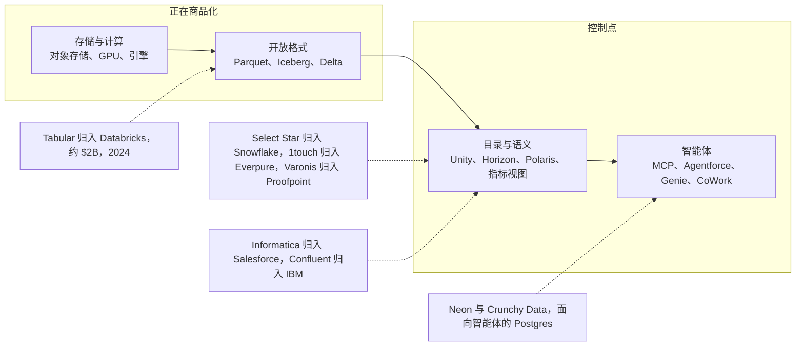

# 0.2 一页纸市场地图
> **深度：** L1 · **阅读时间：** 约 9 分钟 · **最后核实：** 2026-11-01 · **前置阅读：** [0.1 如何使用本图谱](ch00-1-how-to-use.md)

## 要点速览（TL;DR）

- 数据与 AI 数据行业可以画成 **九个层级**，底层是对象存储（object storage），顶层是智能体（agent）与应用。本图谱中的每家公司都位于其中一层或多层，而最大的那些公司正试图占据全部九层。
- 两家具备规模的独立厂商合计价值约 **$300B**（3,000 亿美元）：Databricks 的 **投后估值为 $190B**，对应 **公司披露的年化运行率 >$7B**（2026 年 8 月）；Snowflake 的 **市值为 $107.88B**（2026-10-30）。[^db-aug26][^comps] 超大规模云厂商（hyperscaler）位于两者之下和身旁，其云业务在 2026 年 9 月季度增长了 39–103%。[^amzn-q3][^msft-q1][^goog-q3]
- **价值正沿着技术栈向上迁移。** 存储容量和通用计算正在商品化。开放格式（Iceberg、Delta、Parquet）使数据变得可移植，因此控制权转移到了位于其上的目录（catalog）、语义层（semantic layer）和智能体接口。
- 技术栈的中间层在 2025–26 年被纷纷出售。Informatica 归入 Salesforce（约 $8B），Confluent 归入 IBM（约 $11B），Dremio 归入 SAP，Neon 归入 Databricks，AWS 也签署了收购 DuckLabs 的协议。私人资本则集中流向少数赢家：VAST Data（$30B）、Scale AI（隐含约 $29B）、ClickHouse（$15B）和 Cyera（$12B）。[^ma][^funding]
- Everpure 的公开举措位于第 1 层（存储），自 **$125.0M** 收购 1touch 以来，已延伸至第 3 层（数据发现、数据分类与语义上下文）。[^ep-1touch] [第 45 章](../06-history-and-future/ch45-storage-moving-up-the-stack.md)阐述了相关可选方案。

## 地图

下面这张地图就是一页纸上的整本图谱。请自下而上阅读：每一层都依赖于其下一层，而每往上一层，就离提出问题的人或智能体更近一步。

![数据与 AI 数据栈的分层市场地图，共九条水平带。自下而上依次为：基础设施与对象存储（AWS S3、Azure Blob、Google Cloud Storage、Everpure、NetApp、Dell、VAST Data、MinIO）；文件与表格式（Parquet、Arrow、Lance、Iceberg、被 Databricks 收购的 Tabular、Delta Lake、Hudi）；目录与数据治理（Unity Catalog、Polaris 与 Horizon、Glue、Dataplex、Purview、Collibra、Atlan、Alation、BigID、Cyera、被 Everpure 收购的 1touch、待出售给 Proofpoint 的 Varonis）；运营型数据库（Oracle、MongoDB、PostgreSQL、归入 Databricks 的 Neon、归入 Snowflake 的 Crunchy Data、Supabase、Redis、CockroachDB、DynamoDB、Spanner、Aurora）；分析平台与引擎（Databricks、Snowflake、BigQuery、Redshift、Fabric、ClickHouse、DuckDB、归入 AWS 的 DuckLabs、Trino、Starburst、归入 SAP 的 Dremio、Teradata）；数据管道与流处理（Fivetran 与 dbt Labs、Airbyte、归入 Salesforce 的 Informatica、归入 IBM 的 Confluent、Redpanda、Flink、Airflow、Astronomer、归入 Prefect 的 Dagster）；语义层与 BI（Power BI、Tableau、Looker、Sigma、ThoughtSpot、Cube、AtScale）；AI 数据（Pinecone、Weaviate、Qdrant、Milvus 与 Zilliz、Unstructured、LlamaIndex、Scale AI、Snorkel AI、MLflow、归入 CoreWeave 的 Weights and Biases）；以及智能体与应用（Model Context Protocol、Salesforce Agentforce 与 Data 360、ServiceNow、SAP Business Data Cloud、Palantir AIP、Workday Data Cloud）。右侧一个高箭头表示价值向上迁移。Everpure 和 1touch 以朱红色轮廓标出](../assets/diagrams/ch00-market-map.svg)

*图 0.2.1 — SV-1，一页纸市场地图。九个层级，约 80 家具名公司和项目，以及一个发展方向：价值正从字节转向位于其上的元数据、语义和智能体。标签边框表示上市（实线）、私有（虚线）和开源（灰色）状态；"A → B"表示 2024–26 年的一笔收购。*

三条阅读规则会有所帮助。第一，**层级不等于市场**。一家公司出现在其主要产品所在的位置，但 Databricks 和 Snowflake 如今在九层中的大多数层都有产品，而每家超大规模云厂商几乎在所有层都有产品。第二，**颜色表示层级的角色**。紫色标记两个"语义"层（目录与语义），本图谱认为控制权正在这里积聚。第三，**箭头讲述整合的故事**。大多数"→"标签是在截至 2026 年 10 月的 18 个月内添加的，而且大多从一家独立的专业厂商指向一个平台。

下表补充了每一层的状态和最新估值，数据取自本图谱的数据集。

| 层级 | 代表性公司（状态） | 最新估值或市值（口径，日期） | 深度研究 |
|---|---|---|---|
| 1. 基础设施与对象存储 | Amazon/AWS、Microsoft/Azure、Alphabet/Google Cloud、Everpure、NetApp、Dell（上市）；VAST Data、MinIO（私有） | Amazon $2,600B、Microsoft $3,880B、Alphabet $3,440B 市值（2026-10-30）；Everpure $43.79B、NetApp $42.24B（2026-10-01）；VAST $30B 投后估值（2026 年 4 月，公司披露）[^comps][^funding] | [28](../04-company-deep-dives/ch28-hyperscaler-data-platforms.md)、[32](../04-company-deep-dives/ch32-ai-native-data-companies.md)、[45](../06-history-and-future/ch45-storage-moving-up-the-stack.md) |
| 2. 文件与表格式 | Parquet、Arrow、Iceberg、Hudi（Apache 项目）；Delta Lake（Linux Foundation）；Lance（LanceDB，私有） | 项目本身没有估值；Tabular → Databricks 约 $2B（2024 年 6 月，媒体报道）[^ma] | [6](../01-data-systems-foundations/ch06-file-formats.md)、[7](../01-data-systems-foundations/ch07-open-table-formats.md) |
| 3. 目录与数据治理 | Unity Catalog（Databricks）、Horizon/Polaris（Snowflake/Apache）、Glue、Dataplex、Purview；Collibra、Atlan、Alation、BigID、Cyera（私有）；Varonis（上市） | Cyera $12B（2026 年 6 月，媒体报道）；Collibra $5.25B（2021 年 11 月，媒体报道）；Alation $1.7B（2022 年 11 月，媒体报道）；BigID $1B（2024 年 3 月，公司披露）；Atlan $750M（2024 年 5 月，公司披露）；1touch → Everpure $125.0M（GAAP）；Varonis → Proofpoint 交易价值约 $6.3B、股权价值约 $5.71B（待完成，预计 1H 2027 交割）[^funding][^ma][^ep-1touch] | [33](../04-company-deep-dives/ch33-governance-catalog-security-companies.md) |
| 4. 运营型数据库 | Oracle、MongoDB（上市）；Supabase、Redis、Cockroach Labs（私有）；DynamoDB、Aurora、Spanner（超大规模云厂商服务） | Oracle $382.45B（2026-10-23）；MongoDB $29.5B（2026-10-20）；Supabase $10.65B（2026 年 10 月，媒体报道，单一来源；2026 年 6 月 F 轮时为 $10.5B，媒体报道）；Cockroach Labs $5B（2021 年 12 月，媒体报道）；Neon → Databricks 约 $1B（媒体报道）；Crunchy Data → Snowflake $164.5M（依据 10-Q）[^comps][^funding][^ma] | [29](../04-company-deep-dives/ch29-operational-database-vendors.md) |
| 5. 分析平台与引擎 | Databricks、ClickHouse、Starburst（私有）；Snowflake、Teradata（上市）；BigQuery、Redshift、Fabric（超大规模云厂商） | Databricks $190B 投后估值（2026-08-13，公司披露）；Snowflake $107.88B，16.9x EV/未来 12 个月收入（2026-10-30，估算）；ClickHouse $15B（2026 年 1 月，媒体报道）；Starburst $3.35B（2022 年 2 月，媒体报道）；Teradata $3.19B（2026-10-28）；Dremio → SAP（已完成）和 DuckLabs → AWS（已签协议，尚未完成）金额未披露[^db-aug26][^comps][^funding][^ma] | [25](../04-company-deep-dives/ch25-databricks.md)、[26](../04-company-deep-dives/ch26-snowflake.md)、[27](../04-company-deep-dives/ch27-databricks-vs-snowflake.md)、[31](../04-company-deep-dives/ch31-analytical-engine-challengers-legacy.md) |
| 6. 数据管道与流处理 | Fivetran + dbt Labs、Airbyte、Redpanda、Astronomer（私有）；Flink、Airflow（Apache 项目） | Confluent → IBM 约 $11B EV（2026 年 3 月完成）；Informatica → Salesforce 约 $8B 股权价值（2025 年 11 月完成）；最后一次独立估值为 Fivetran $5.6B（2021）和 dbt Labs $4.2B（2022），公司披露；Airbyte $1.5B（2021）；Redpanda $1B（2025 年 4 月）；Astronomer $775M（2025 年 5 月，媒体报道）[^ma][^funding] | [30](../04-company-deep-dives/ch30-data-movement-streaming-companies.md) |
| 7. 语义层与 BI | Power BI（Microsoft）、Tableau（Salesforce）、Looker（Google）；Sigma、Omni、ThoughtSpot、Cube、AtScale（私有） | Sigma $3B（2026 年 5 月，媒体报道）；Omni $1.5B（2026 年 4 月，公司披露）；ThoughtSpot、Cube 和 AtScale 的估值未收录于数据集[^funding] | [14](../02-pipelines-and-governance/ch14-semantic-layers-and-bi.md)、[34](../04-company-deep-dives/ch34-application-giants-data-platforms.md) |
| 8. AI 数据 | Pinecone、Weaviate、Qdrant、Zilliz、Unstructured、LlamaIndex、Snorkel AI、Scale AI（私有）；MLflow（开源） | Scale AI 隐含约 $29B（Meta 以 $14.3B 收购 49%，2025 年 6 月，媒体报道）；Snorkel AI $3.5B（2026 年 9 月，公司披露）；Pinecone $750M（2023 年 4 月，媒体报道）；W&B → CoreWeave 约 $1.7B（媒体报道）[^funding][^ma] | [32](../04-company-deep-dives/ch32-ai-native-data-companies.md) |
| 9. 智能体与应用 | Palantir、SAP、Salesforce、ServiceNow、Workday（上市）；Model Context Protocol（开放标准） | Palantir $442.43B、SAP $273.8B、Salesforce $188.61B（2026-10-30）；ServiceNow $142.4B（2026-10-01）；Workday $45.99B（2026-10-16）[^comps] | [22](../03-ai-data-stack/ch22-agents-and-data.md)、[34](../04-company-deep-dives/ch34-application-giants-data-platforms.md) |

*图 0.2.2 — 按层级列示公司。最大的价值集中在底部（超大规模云厂商）和顶部（应用与智能体平台）；中间层则是 2025–26 年交易发生的地方。2021–22 年的私募估值尚未重新定价，应视为过时数据。*

## 逐层解读

**1. 基础设施与对象存储。** 每个现代数据平台都把持久化副本保存在对象存储中：云上是 AWS S3、Azure Blob Storage 或 Google Cloud Storage，本地部署则是 Everpure（FlashBlade）、NetApp、Dell、VAST Data 或 MinIO 提供的 S3 兼容系统。超大规模云厂商在容量上占据主导，并正在把数据库功能直接加入存储 API，例如 S3 Tables 和 S3 Vectors（[第 24 章](../03-ai-data-stack/ch24-data-meets-compute-and-storage.md)）。存储同业都在向上延伸：VAST 自建了数据库和引擎，NetApp 收购了 DataPelago，Everpure 收购了 1touch（[第 28 章](../04-company-deep-dives/ch28-hyperscaler-data-platforms.md)、[第 32 章](../04-company-deep-dives/ch32-ai-native-data-companies.md)、[第 45 章](../06-history-and-future/ch45-storage-moving-up-the-stack.md)）。

**2. 文件与表格式。** Apache Parquet 在磁盘上按列布局数据；Apache Arrow 在内存中做同样的事；Lance 则面向 AI 训练和向量检索所需的随机访问。在此之上，[开放表格式（open table format）](../glossary.md#open-table-format)（Apache Iceberg、Delta Lake、Apache Hudi）把一个装满文件的文件夹变成一张支持原子提交和时间旅行（历史版本查询）的表。这些是开放项目而不是公司，因此价值是在其周边被捕获的。当 Databricks 以媒体报道的约 $2B 收购由 Iceberg 创建者创立的 Tabular 公司[^ma]，且每个主要平台都学会了读写 Iceberg 之后，"格式之争"便告终结（[第 7 章](../01-data-systems-foundations/ch07-open-table-formats.md)、[第 25 章](../04-company-deep-dives/ch25-databricks.md)、[第 38 章](../05-business-and-economics/ch38-open-source-strategy.md)）。

**3. 目录与数据治理。** [技术目录（technical catalog）](../glossary.md#technical-catalog)，例如 Unity Catalog、Snowflake Horizon（及 Apache Polaris）、AWS Glue、Google Dataplex 或 Microsoft Purview，决定哪张表是当前版本以及谁可以读取它。[业务目录（business catalog）](../glossary.md#business-catalog)（Collibra、Alation、Atlan）帮助人们发现并信任数据。数据安全厂商（Cyera、BigID、Varonis）负责发现敏感数据并对其分类。各大平台免费提供自己的目录以争夺控制权，这挤压了独立厂商的空间；而安全领域的买家愿意为数据分类支付高价，Proofpoint 待完成的 Varonis 交易就是明证（交易价值约 $6.3B，股权价值约 $5.71B；预计 1H 2027 交割）。[^ma] Everpure 对 1touch 的收购就位于这一层（[第 8 章](../01-data-systems-foundations/ch08-catalogs-and-metastores.md)、[第 33 章](../04-company-deep-dives/ch33-governance-catalog-security-companies.md)）。

**4. 运营型数据库。** Oracle 和 MongoDB 是大型上市厂商。PostgreSQL 是开源标准，而超大规模云厂商运行的数据库数量最多（Aurora、DynamoDB、Spanner）。2025–26 年的主线是 Postgres 圈地战：Databricks 收购了 Neon（约 $1B，媒体报道）并将其重新推出为 Lakebase，Snowflake 收购了 Crunchy Data（依据其 10-Q 为 $164.5M），Supabase 的估值则达到媒体报道的 $10.5B（2026 年 6 月；另有单一来源报道称 2026 年 10 月为 $10.65B）。[^ma][^funding] 这一论点基于 Neon 公司披露的一个数字：其平台上超过 80% 的数据库由智能体创建。如果大多数新数据库是由智能体而非人创建的，那么为它们提供服务的无服务器 Postgres 就会成为一个新的控制点（[第 29 章](../04-company-deep-dives/ch29-operational-database-vendors.md)、[第 22 章](../03-ai-data-stack/ch22-agents-and-data.md)）。

**5. 分析平台与引擎。** 这是规模最大的独立利润池。Databricks 和 Snowflake 与 BigQuery、Redshift 和 Microsoft Fabric 竞争，也与 ClickHouse、DuckDB 和 Trino（由 Starburst 商业化）等开放引擎竞争。独立厂商正在被吸收：SAP 收购了 Dremio，AWS 同意收购 DuckDB 背后的公司 DuckLabs。ClickHouse 是突围而出的挑战者，估值 $15B，公司披露的 ARR 超过 $250M。Teradata 则展示了传统厂商的交易水平：在约 1% 的增长下，约为 1.7x EV/收入（以过去收入作为近似），市值 $3.19B（[第 25 章](../04-company-deep-dives/ch25-databricks.md)、[第 26 章](../04-company-deep-dives/ch26-snowflake.md)、[第 27 章](../04-company-deep-dives/ch27-databricks-vs-snowflake.md)、[第 31 章](../04-company-deep-dives/ch31-analytical-engine-challengers-legacy.md)）。[^funding][^ch-arr][^comps]

**6. 数据管道与流处理。** 数据摄取（ingestion）工具（Fivetran、Airbyte、Informatica）把数据复制进来；流处理平台（经由 Confluent 的 Kafka、Redpanda、Flink）持续传输事件；编排（orchestration）工具（经由 Astronomer 的 Airflow、Dagster、Prefect）负责调度工作；dbt 负责数据转换。这一层在 18 个月内被纷纷出售：Salesforce 收购了 Informatica，IBM 收购了 Confluent，Fivetran 与 dbt Labs 合并，Prefect 同意收购 Dagster。买家想要的是为其智能体提供受治理的实时上下文，而不是管道本身（[第 30 章](../04-company-deep-dives/ch30-data-movement-streaming-companies.md)、[第 11 章](../02-pipelines-and-governance/ch11-streaming-and-event-platforms.md)）。

**7. 语义层与 BI。** BI 工具（Power BI、Tableau、Looker、Sigma、ThoughtSpot）负责绘制图表；[语义层](../glossary.md#semantic-layer)（Cube、AtScale、dbt 的 MetricFlow，或各平台自有的语义视图和指标视图）为所有工具一次性定义"收入"的含义。仪表盘正在商品化，因此价值正转向这些定义，因为一个询问"按地区划分的净收入"的智能体需要它们才能得到正确答案。风险资本仍在流向数据仓库原生的 BI：2026 年 Sigma 估值 $3B，Omni 估值 $1.5B[^funding]（[第 14 章](../02-pipelines-and-governance/ch14-semantic-layers-and-bi.md)、[第 34 章](../04-company-deep-dives/ch34-application-giants-data-platforms.md)）。

**8. AI 数据。** 这一层为模型准备数据。[向量数据库（vector database）](../glossary.md#vector-database)（Pinecone、Weaviate、Qdrant、Milvus/Zilliz）存储用于检索的嵌入（向量）；Unstructured 和 LlamaIndex 解析文档；Scale AI 和 Snorkel AI 提供训练数据；MLflow 和 Weights & Biases 追踪实验。[功能吸收（feature absorption）](../glossary.md#feature-absorption)是主要风险：向量检索如今已是 Postgres、MongoDB、Databricks、Snowflake 乃至 S3 本身的一项功能。高估值流向了训练数据供应商，而不是技术栈中间层的工具（[第 32 章](../04-company-deep-dives/ch32-ai-native-data-companies.md)、[第 18 章](../03-ai-data-stack/ch18-embeddings-and-vector-search.md)、[第 20 章](../03-ai-data-stack/ch20-training-data-supply-chain.md)）。

**9. 智能体与应用。** 在顶层，应用厂商掌握着记录系统及其对象的业务含义：Salesforce（Agentforce 与 Data 360）、ServiceNow、SAP（Business Data Cloud）、Workday（Data Cloud）和 Palantir（AIP，构建于其本体之上）。[Model Context Protocol](../glossary.md#model-context-protocol)（MCP）已成为连接智能体与数据源的标准接口。这些厂商如今通过零拷贝（zero-copy）链接而非导出的方式与 Databricks 和 Snowflake 共享数据，这使得应用层既是这些平台的客户，又是它们的竞争对手（[第 34 章](../04-company-deep-dives/ch34-application-giants-data-platforms.md)、[第 22 章](../03-ai-data-stack/ch22-agents-and-data.md)）。

## 价值正向何处迁移

本图谱的核心论点是：数据领域的[价值迁移（value migration）](../glossary.md#value-migration)是向上进行的。下面的流程图把它压缩为四个步骤，并标出了标志每一步的交易。

*图 0.2.3 — 价值迁移。每往上一步，下一层就变得更可互换，而交易则集中在控制点上：谁运行目录、语义定义和智能体接口，谁就决定数据如何被使用。*

其机制很简单。当数据存放在专有的数据仓库格式中时，数据仓库厂商拥有这些数据，可以同时对存储和计算收费。开放表格式打破了这种绑定：任何引擎现在都能读取同一对象存储上的同一张 Iceberg 表。计算变成了按查询定价的竞争性市场，存储则变成了按每 TB 每月定价的商品。仍然稀缺的，是每个引擎在读取之前都必须询问的那一层：授予提交权限和凭证的目录，以及说明一个数字含义的语义层。智能体再次抬高了赌注，因为一个基于数据采取行动的智能体，在行动之前需要受治理的上下文、权限和数据血缘。

反方观点值得重视。超大规模云厂商几乎免费提供目录，因此这个"控制点"可能永远无法直接产生收入；它的价值反而体现为留存下来的计算支出。而且存储并非纯粹的商品：[数据引力（data gravity）](../glossary.md#data-gravity)、数据主权以及迁移 PB 级数据的成本，仍然赋予持有字节的一方议价能力。这正是 Everpure 的公开战略把存储层与元数据智能结合起来，而不是舍弃其一的原因（[第 44 章](../06-history-and-future/ch44-future-trends.md)、[第 45 章](../06-history-and-future/ch45-storage-moving-up-the-stack.md)）。

> **类比：半导体。** 开放表格式之于数据，就像 JEDEC 标准之于 DRAM。一旦任何厂商的内存模组都能在任何服务器中工作，DRAM 就变成了可互换的周期性商品，价值则汇聚到决定数据去向的处理器和内存控制器上。一旦任何引擎都能读取任何厂商的 Iceberg 表，存储和引擎也会以同样的方式变得可互换，价值则汇聚到决定数据含义以及谁可以接触数据的目录和语义层上。

对 Everpure 而言，基于公开信息，这张地图提示了战略团队可能评估的三个问题。阵列级元数据能在第 3 层上走多远（来自 1touch 的 Data Intelligence）？哪些引擎合作伙伴能把第 1 层变成经过认证的湖仓一体（lakehouse）底座（Databricks 的 Storage Ecosystem，Everpure 是其具名的首发合作伙伴，另有 Dremio 和 Starburst 的参考设计）？[^storage-eco] 以及，哪些小型的第 3 层或第 8 层能力买比造更便宜？[第 45 章](../06-history-and-future/ch45-storage-moving-up-the-stack.md)将展开讨论这些可选方案。

## 用 10 张图看懂数据行业

如果你只看图，就看这十张。每个链接都指向所在章节的标志性图示。

1. **一个字节的旅程** —— [第 1 章](../01-data-systems-foundations/ch01-data-stack-map.md#the-journey-of-a-byte-one-order-end-to-end)。一笔客户订单要经过六到八个系统，智能体才能讨论它，而每一跳都会增加一份副本、一段延迟和一张账单。
2. **B 树对比 LSM 树** —— [第 3 章](../01-data-systems-foundations/ch03-database-internals.md#storage-engine-1-the-btree)。读优化引擎和写优化引擎做出相反的取舍，而这一选择决定了存储必须服务的 I/O 模式。
3. **行式与列式布局** —— [第 5 章](../01-data-systems-foundations/ch05-analytical-engines.md#row-versus-columnar-layout)。按列存储让一个分析查询只需读取三列而不是五十列，这是每个现代数据仓库的根基。
4. **Iceberg 元数据树** —— [第 7 章](../01-data-systems-foundations/ch07-open-table-formats.md#iceberg-a-tree-of-metadata)。一次提交先写入新文件，再切换一个指针，对象存储正是由此变成了事务型数据库。
5. **目录这一控制点** —— [第 8 章](../01-data-systems-foundations/ch08-catalogs-and-metastores.md#what-a-technical-catalog-actually-does)。每个引擎和智能体都必须经过目录，因此目录的所有者掌握着提交权限、凭证和策略。
6. **Kafka 日志** —— [第 11 章](../02-pipelines-and-governance/ch11-streaming-and-event-platforms.md#the-log-abstraction)。一个分区、复制的只追加日志，让任意数量的消费者按各自的节奏读取同一批事件。
7. **AI 数据生命周期** —— [第 16 章](../03-ai-data-stack/ch16-ai-data-lifecycle.md#the-master-map)。前沿实验室运行第一到第五阶段来产出模型权重；企业则运行第六到第八阶段，用自有数据包裹这些权重。
8. **HNSW 的直观理解** —— [第 18 章](../03-ai-data-stack/ch18-embeddings-and-vector-search.md#hnsw-a-skip-list-made-of-graphs)。向量检索先在稀疏层间进行几次长跳，再做一次短距离的局部搜索，以牺牲少许召回率换取大幅提速。
9. **智能体访问路径** —— [第 22 章](../03-ai-data-stack/ch22-agents-and-data.md#the-access-path-from-agent-to-bytes)。智能体只能通过 MCP、语义层和目录的策略引擎才能触达字节，因此数据治理才是真正的产品。
10. **可比公司散点图** —— [第 37 章](../05-business-and-economics/ch37-public-comps-valuation.md#evntm-against-growth-the-regression)。增长率对估值倍数差异的解释力远不到一半，而 Everpure 位于其增长率所预测的回归线下方。

## 关键数字

| 指标 | 数值 | 口径 | 期间 / 截至 |
|---|---|---|---|
| Databricks 估值 | $190B 投后估值（$5B 融资轮） | 公司披露 | 2026-08-13 完成[^db-aug26] |
| Databricks 收入年化运行率 | >$7B，同比增长 >80% | 公司披露的年化运行率，未经审计 | 财季 Q2，May–Jul 2026（2026 年 5–7 月）[^db-aug26] |
| Snowflake 产品收入 | 约 $1.49B，同比 +37%；NRR 126% | GAAP（NRR 为公司披露） | Q2 FY2027 = May–Jul 2026[^sf-q2] |
| Snowflake FY2027 产品收入指引 | $6.07B（+36%），由 $5.84B 上调 | 公司指引 | FY2027 = Feb 2026–Jan 2027；2026-09-02 发布[^sf-q2] |
| Snowflake 估值倍数 | 16.9x EV/未来 12 个月收入；市值 $107.88B | 估算（基于业绩指引推算的未来 12 个月收入） | 2026-10-30[^comps] |
| AWS | $46.0B，同比 +39%；年化运行率 $184B | GAAP 分部数据；年化运行率为公司披露 | Q3 2026（7–9 月）[^amzn-q3] |
| Microsoft Azure | 同比 +48% | 媒体对公司新闻稿的摘要报道 | Q1 FY2027 = Jul–Sep 2026[^msft-q1] |
| Google Cloud | $30.7B，同比 +103%（含 TPU 系统销售） | GAAP 分部数据 | Q3 2026（7–9 月）[^goog-q3] |
| Oracle | OCI $7.4B，+121%；RPO $664B | 媒体对公司新闻稿的摘要报道 | Q1 FY2027 = Jun–Aug 2026[^orcl-q1] |
| MongoDB 收入 | $771.8M，同比 +30% | GAAP | Q2 FY2027 = May–Jul 2026[^mdb-q2] |
| Salesforce Data 360 ARR | $2.4B（含 $1.1B Informatica Cloud ARR） | 公司披露 | Q2 FY2027 = May–Jul 2026[^crm-q2] |
| 数据库（DBMS）市场 | 2024 年 $119.7B（+13.4%）；预测 2026 年 $161B | 分析师估算 / 预测（Gartner） | 2025-05 和 2025-12 发布[^g-dbms24][^g-dbms-fc] |
| 2025–26 年最大交易 | Meta–Scale AI $14.3B 收购 49%（媒体报道）；IBM–Confluent 约 $11B EV；Salesforce–Informatica 约 $8B；Proofpoint–Varonis 交易价值约 $6.3B（股权价值约 $5.71B；待完成）；ServiceNow–Moveworks $2.85B；Veeam–Securiti $1.725B | 除另有注明外均为已披露 | 2025 年 3 月–2026 年 10 月宣布[^ma] |
| ClickHouse | 估值 $15B；ARR >$250M | 媒体报道；ARR 为公司披露 | 2026 年 1 月；2026 年 5 月[^funding][^ch-arr] |
| Everpure | 市值 $43.79B，约 8.5x EV/未来 12 个月收入；FY2027 收入指引 $5.03–5.07B；1touch 现金对价 $125.0M | 估算；公司指引；GAAP | 2026-10-01；2026-08-26；2026-05-07 完成[^comps][^ep-q2][^ep-1touch] |

*图 0.2.4 — 关键数字。每个数字都带有标签和日期；云业务的增长率主要由 AI 计算驱动，而不是由本地图上的数据产品驱动。*

## 关键术语

- [开放表格式（Open table format）](../glossary.md#open-table-format) —— 把对象存储上的文件变成事务型表的元数据层。
- [技术目录（Technical catalog）](../glossary.md#technical-catalog) —— 将表名映射到当前元数据并执行访问控制的服务。
- [业务目录（Business catalog）](../glossary.md#business-catalog) —— 帮助人们发现并信任数据的搜索、术语表与数据管理工具。
- [语义层（Semantic layer）](../glossary.md#semantic-layer) —— 受治理的指标和维度定义，可编译为正确的 SQL。
- [向量数据库（Vector database）](../glossary.md#vector-database) —— 专门用于存储嵌入（向量）并查找最近邻的数据库。
- [功能吸收（Feature absorption）](../glossary.md#feature-absorption) —— 一个独立的产品类别变成更大平台中的一项功能。
- [Model Context Protocol](../glossary.md#model-context-protocol) —— 连接 AI 智能体与工具和数据源的开放标准。
- [价值迁移（Value migration）](../glossary.md#value-migration) —— 利润从行业的一个层级转移到另一个层级。
- [数据引力（Data gravity）](../glossary.md#data-gravity) —— 由于迁移成本高昂，大型数据集对计算和应用产生的吸引力。
- [湖仓一体（Lakehouse）](../glossary.md#lakehouse) —— 存放在对象存储上、可被多种引擎查询的开放表。
- [超大规模云厂商（Hyperscaler）](../glossary.md#hyperscaler) —— 最大的几家公有云提供商之一（AWS、Microsoft Azure、Google Cloud、Oracle）。
- **市场地图（Market map）** —— 把公司放置到行业技术栈各层级中的示意图（术语表条目已暂存）。
- **控制点（Control point）** —— 所有其他组件都必须经过的层级，赋予其所有者定价权和策略制定权（术语表条目已暂存）。

## 资料来源

[^db-aug26]: Databricks, "Databricks Grows >80% YoY, Surpasses $7B Revenue Run-Rate…," https://www.databricks.com/company/newsroom/press-releases/databricks-grows-80-yoy-surpasses-7b-revenue-run-rate-scales，发布 2026-08-13；检索 2026-11-01。公司披露，未经审计。估值依据 `data/private_funding.csv`。
[^comps]: AI Data Atlas 数据集 `data/public_comps.csv`（市值、EV、EV/未来 12 个月收入），引用 stockanalysis.com 的市值与统计页面（例如 https://stockanalysis.com/stocks/snow/statistics/、https://stockanalysis.com/stocks/p/financials/ratios/、https://stockanalysis.com/stocks/orcl/market-cap/），各行截至日期为 2026-10-01 至 2026-10-30；检索 2026-11-01。估值倍数为估算；未来 12 个月收入基于业绩指引推算。
[^funding]: AI Data Atlas 数据集 `data/private_funding.csv`，以下公司的最新数据行：VAST Data (https://www.vastdata.com/press-releases/vast-series-f-financing-at-30-billion-valuation)、Cyera (https://www.securityweek.com/cyera-raises-600-million-at-12-billion-valuation/amp/)、Collibra (https://www.cnbc.com/2021/11/09/collibra-doubles-valuation-as-investors-chase-next-cloud-winner.html)、Alation (https://blocksandfiles.com/2022/11/03/alation-e-round/)、BigID、Atlan、Supabase (https://www.nbr.co.nz/tech/supabase-raises-another-us150m/)、Cockroach Labs、ClickHouse (https://www.standard-journal.com/ap/business/article_fc7656bf-059e-533c-9dae-7646b95fb9eb.html)、Starburst、Fivetran、dbt Labs、Airbyte、Redpanda、Astronomer、Sigma (https://thenextweb.com/news/sigma-computing-series-e-80-million-3-billion-valuation)、Omni (https://omni.co/blog/press-release-omni-series-c-funding)、Scale AI、Snorkel AI (https://snorkel.ai/press/snorkel-ai-raises-350m-to-scale-the-data-factory-for-frontier-ai/) 和 Pinecone；日期和估值口径以各行所载为准；检索 2026-11-01。
[^ma]: AI Data Atlas 数据集 `data/ma_deals.csv`，以下交易的数据行：Databricks–Tabular（TechCrunch, 2024-08-14）、Databricks–Neon（TechRepublic）、Snowflake–Crunchy Data（Snowflake 10-Q，截至 2025-10-31 的季度）、Salesforce–Informatica（Business Wire, 2025-11-18）、IBM–Confluent（IBM release，2026-03-17 完成）、Meta–Scale AI（TechCrunch, 2025-06-13）、ServiceNow–Moveworks（Business Wire, 2025-12-15）、Veeam–Securiti AI、CoreWeave–Weights & Biases、SAP–Dremio（SAP News, https://news.sap.com/2026/07/sap-completes-dremio-acquisition/）、AWS–DuckLabs (https://www.aboutamazon.com/news/company-news/aws-ducklabs)、Prefect–Dagster 和 Proofpoint–Varonis（Varonis 8-K exhibit, https://www.sec.gov/Archives/edgar/data/0001361113/000121390026109901/ea030861001ex99-1.htm, 2026-10-15）；检索 2026-11-01。金额口径（已披露、媒体报道、未披露）以各行记录为准。
[^ep-1touch]: Everpure, Inc., Form 10-Q for the quarter ended 2026-05-03, https://www.sec.gov/Archives/edgar/data/0001474432/000147443226000061/pstg-20260503.htm，发布 2026-06；检索 2026-11-01。$125.0M 现金对价（GAAP）；2026-02-23 宣布，2026-05-07 完成。
[^amzn-q3]: Amazon.com, Inc., Form 8-K Exhibit 99.1 (Q3 2026 results), https://www.sec.gov/Archives/edgar/data/0001018724/000101872426000038/amzn-20260930xex991.htm，发布 2026-10-29；检索 2026-11-01。GAAP 分部收入；年化运行率为公司披露。
[^msft-q1]: Runtime Wire, "Microsoft revenue hits $92.3 billion as Azure growth accelerates to 48%," https://runtimewire.com/article/microsoft-revenue-hits-92-3-billion-as-azure-growth-accelerates-to-48，发布 2026-10；检索 2026-11-01。媒体对 Microsoft FY2027 Q1 新闻稿的摘要报道（Microsoft 财年于 6 月 30 日结束）。
[^goog-q3]: Alphabet Inc., Form 8-K Exhibit 99.1 (Q3 2026 results), https://www.sec.gov/Archives/edgar/data/0001652044/000165204426000080/googexhibit991q32026.htm，发布 2026-10-28；检索 2026-11-01。GAAP 分部收入。
[^orcl-q1]: StorageNewsletter, "Oracle fiscal 1Q27 financial results," https://storagenewsletter.com/2026/09/23/oracle-fiscal-1q27-financial-results，发布 2026-09-23；检索 2026-11-01。媒体对 Oracle 新闻稿的摘要报道；Oracle 财年于 5 月 31 日结束。
[^sf-q2]: Snowflake Inc. via Business Wire, "Snowflake Reports Financial Results for the Second Quarter of Fiscal 2027," https://secure.businesswire.com/news/home/20260902386235/en/Snowflake-Reports-Financial-Results-for-the-Second-Quarter-of-Fiscal-2027，发布 2026-09-02；检索 2026-11-01。数值以 `data/company_financials.csv` 中的记录为准。
[^mdb-q2]: MongoDB, Inc., "MongoDB, Inc. Announces Second Quarter Fiscal 2027 Financial Results," https://investors.mongodb.com/news-releases/news-release-details/mongodb-inc-announces-second-quarter-fiscal-2027-financial，发布 2026-09-01；检索 2026-11-01。GAAP；FY2027 = Feb 2026–Jan 2027。
[^crm-q2]: Salesforce, Q2 FY2027 results release (investor.salesforce.com) and investor deck, https://s205.q4cdn.com/626266368/files/doc_financials/2027/q2/，发布 2026-08-26；检索 2026-11-01（经由 `meta/verified-facts.md` 第 19 项）。ARR 为公司披露；FY2027 = Feb 2026–Jan 2027。
[^g-dbms24]: Gartner, DBMS market-share abstract (2024 DBMS revenue $119.7B, +13.4%), https://www.gartner.com/en/documents/6494271，发布 2025-05；检索 2026-11-01。分析师估算；完整报告需付费。
[^g-dbms-fc]: Gartner, "Forecast: Database Management Systems, Worldwide, 2023–2029, 2025 Update," abstract, https://www.gartner.com/en/documents/7229830，发布 2025-12；检索 2026-11-01。分析师预测。
[^ch-arr]: ClickHouse via Business Wire, "ClickHouse Tops $250M ARR and 4,000 Customers…," https://www.businesswire.com/news/home/20260527813115/en/，发布 2026-05-27；检索 2026-11-01。ARR 为公司披露。
[^ep-q2]: Everpure, Inc., "Everpure Announces Second Quarter Fiscal 2027 Financial Results," https://investor.everpuredata.com/news-and-events/press-releases/press-release-details/2026/Everpure-Announces-Second-Quarter-Fiscal-2027-Financial-Results/default.aspx，发布 2026-08-26；检索 2026-11-01。FY2027 收入指引为公司指引；FY2027 ≈ Feb 2026–Jan 2027。
[^storage-eco]: Databricks blog, "Announcing the Databricks Storage Ecosystem: Governing the Enterprise Data Estate Wherever It Lives," https://www.databricks.com/blog/announcing-databricks-storage-ecosystem-governing-enterprise-data-estate-wherever-it-lives，发布 2026-06-10；检索 2026-11-01（引自第 25 章）。
