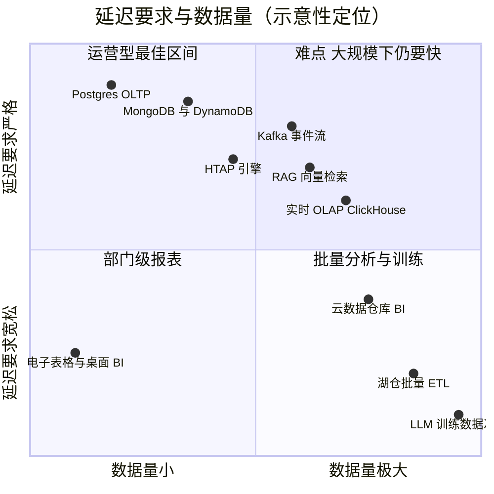
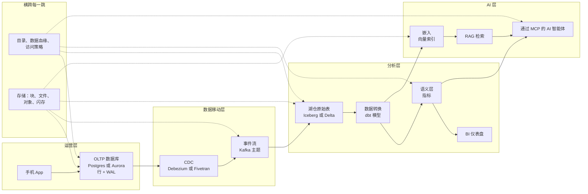
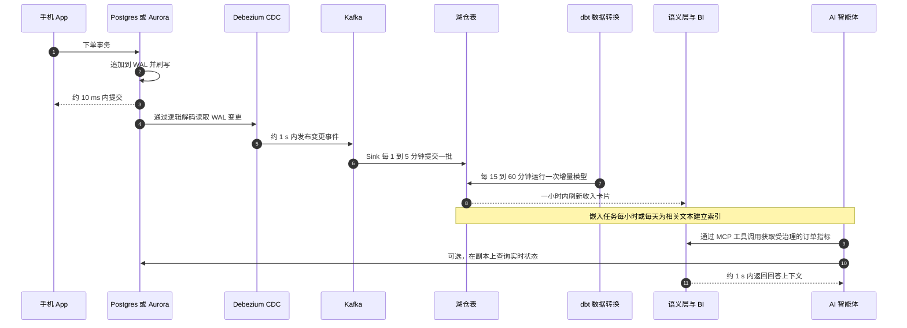

# 1. 数据技术栈全景图
> **深度：** L2 · **阅读时间：** 约 15 分钟 · **最后核实：** 2026-11-01 · **前置阅读：** 无（第一章）

## 要点速览（TL;DR）

- 企业数据工作可分为四类工作负载：**OLTP**（快速、正确地记录每一笔业务事件）、**OLAP**（扫描历史数据以回答问题）、**流处理（streaming）**（在事件发生时传输事件并做出响应）以及 **AI**（准备训练数据、对内容做嵌入与检索、为智能体提供上下文）。每一类对底层系统的要求都不同，因此各自发展出了独立的产品与厂商。
- 一笔客户订单在 AI 智能体能够谈论它之前，可能要经过六到八个系统。每经过一跳，它的形态都会改变（行、变更事件、列式文件、指标、向量），延迟会增加（从毫秒到秒，再到分钟），并且会再被复制一次。
- 技术栈之所以分化，是因为没有任何单一引擎能很好地服务所有访问模式。Stonebraker 与 Çetintemel 在 2005 年提出了这一论点，而市场在此后 15 年里证明了他们是对的。[^stonebraker]
- 大约从 2020 年起，技术栈开始重新聚合。推动这一趋势的有四股力量：湖仓一体（lakehouse，在对象存储上保存一份开放表）、HTAP、带扩展的 Postgres，以及需要在同一处同时获取运营数据与分析数据的 AI 智能体。厂商们如今争夺的是对合并后各层的控制权。
- 存储位于每一跳之下，目录与数据治理层则横跨所有环节。这两个横向层是控制权与数据引力不断积聚的地方，也是与 Everpure 最相关的部分。

## 为何重要（商业视角 + Everpure 视角）

数据行业的大多数争论，本质上都是关于一层在哪里结束、下一层从哪里开始的争论。Snowflake 对 Databricks、Postgres 对其他所有数据库、IBM 收购 Confluent、Fivetran 与 dbt Labs 合并：每一项都是在押注哪些环节会合并，以及谁将拥有合并后的那一层。IBM 于 2026-03-17 完成对 Confluent 的收购，企业价值约 $11B（已披露）。[^ibm-confluent] Fivetran 与 dbt Labs 于 2026-06-01 完成全股票合并，合并后的 ARR "接近 $600M"（公司披露）。[^fivetran-dbt] 这两笔交易都把下文所述数据旅程中的两跳压缩进了同一家厂商。只要手里有一张各跳的地图，交易逻辑就一目了然。

这张地图之所以重要还有第二个原因：预算跟着数据走。每一跳都是一个独立的费用项：数据库许可证或托管服务、按行计费的连接器费用、流处理集群、数据仓库 credits、BI 席位、向量数据库、模型 token。首席数据官的降本计划，大部分其实是一份减少环节或副本的计划。厂商推销的也是同一件事，只不过换成了"零 ETL"或"一份数据"的说法。

对 Everpure（原 Pure Storage；NYSE: P，原代码 PSTG）而言，关键在于存储并不是其中的某一跳，而是位于所有环节之下。OLTP 数据库的日志、Kafka broker 的磁盘、湖仓的对象存储、向量索引的闪存层，全都是存储，而且各自的性能特征不同。Everpure 在 2026 年的举措恰好落在这张地图正在变化的位置。它于 2026-02-23 更名，并以 $125.0M 现金收购了数据发现与分类公司 1touch（已披露；2026-05-07 完成交割）。[^everpure-1touch] 2026 年 6 月，它推出了 Data Stream 功能，在 FlashBlade 上借助 NVIDIA GPU 为 AI 数据管道对数据进行向量化。[^everpure-datastream] 这两项举措都是试图从最底层进入数据治理与 AI 环节。基于公开信息，一个战略团队会想知道：存储厂商可以可信地进入哪些环节，又应当通过合作进入哪些环节。后续章节将在 [第 24 章](../03-ai-data-stack/ch24-data-meets-compute-and-storage.md) 和 [第 45 章](../06-history-and-future/ch45-storage-moving-up-the-stack.md) 中回到这一话题。

## 工作原理

### 四类工作负载

**工作负载（workload）**是指软件读写数据的模式。四种模式几乎涵盖了全部企业数据工作，而它们把系统设计拉向相反的方向。

[OLTP](../glossary.md#oltp)（联机事务处理）记录业务事件：一笔订单、一次付款、一次库存调整。每个事务只涉及少量行，必须在毫秒级完成，并且绝不能丢失或重复执行。成千上万的用户同时进行这类操作。代表系统：PostgreSQL、MySQL、Oracle Database、SQL Server、Amazon Aurora、MongoDB、DynamoDB。其核心设计手段是[预写日志](../glossary.md#write-ahead-log)（WAL）：在数据库确认成功之前，每一项变更都会被追加到持久存储上的顺序日志中，因此即使崩溃也不会丢失已确认的订单。[第 3 章](ch03-database-internals.md) 和 [第 4 章](ch04-distributed-databases.md) 会做更深入的讨论。

[OLAP](../glossary.md#olap)（联机分析处理）回答跨越历史数据的问题，例如"过去三年按地区、按周统计的收入"。每个查询读取数百万乃至数十亿行，但只涉及少数几列，运行这类查询的是少数分析师或仪表盘。其设计手段是列式存储、压缩与并行扫描。代表系统：Snowflake、Databricks SQL、BigQuery、Redshift、ClickHouse、DuckDB，以及在[对象存储](../glossary.md#object-storage)上使用 Iceberg、Delta 等[开放表格式](../glossary.md#open-table-format)的[湖仓一体](../glossary.md#lakehouse)模式。参见 [第 5 章](ch05-analytical-engines.md)、[第 6 章](ch06-file-formats.md) 和 [第 7 章](ch07-open-table-formats.md)。

[事件流](../glossary.md#event-streaming)在系统之间持续传输事件，让软件能在数秒内做出反应：欺诈检测、库存告警、向数据仓库供数。其核心抽象是一个只追加、分区的日志，许多读取方可以按各自的节奏消费。LinkedIn 2011 年的 Kafka 论文描述了这一抽象，至今仍是范本。[^kafka] 代表系统：Apache Kafka（Confluent，现属 IBM）、Redpanda、Amazon Kinesis，以及用于流处理的 Apache Flink。参见 [第 11 章](../02-pipelines-and-governance/ch11-streaming-and-event-platforms.md)。

**AI 工作负载**是最新的一类，实际上包含三种子模式。*训练数据准备*受吞吐量约束，需要对以非结构化数据为主的海量数据进行扫描与转换。*嵌入与向量检索*把文本、图像和记录转换为[嵌入（向量）](../glossary.md#embedding)，并存入[向量索引](../glossary.md#vector-index)，以在数十毫秒内完成最近邻查找。*智能体上下文*是最新的子模式：[AI 智能体](../glossary.md#ai-agent)调用工具获取受治理的最新事实，而[模型上下文协议](../glossary.md#model-context-protocol)（MCP）已成为这类调用的标准接口。这一类工作负载的重要性超出了初看时的印象。一项被广泛引用、由 Box 赞助的 IDC 估算认为，2022 年各组织生成的数据中约 90% 是非结构化数据。[^idc] 经典的 OLTP 到 OLAP 数据管道从来不是为这类数据而建的。参见 [第 16 章](../03-ai-data-stack/ch16-ai-data-lifecycle.md)、[第 18 章](../03-ai-data-stack/ch18-embeddings-and-vector-search.md) 和 [第 22 章](../03-ai-data-stack/ch22-agents-and-data.md)。

| 维度 | OLTP（运营型） | OLAP（分析型） | 流处理 / 事件 | AI（准备、检索、智能体） |
|---|---|---|---|---|
| 核心问题 | "正确记录这一事件" | "在全部历史中发生了什么？" | "现在正在发生什么，谁需要知道？" | "哪些内容相关，模型应该看到什么？" |
| 典型延迟目标 | 每个事务个位数到数十毫秒 | 每个查询亚秒到数分钟 | 端到端毫秒到秒级 | 检索数十到数百毫秒；训练准备数小时到数天 |
| 每次操作涉及的数据 | 少量行 | 数百万到数十亿行，少数几列 | 一次一个事件，持续不断 | 批量准备：整个语料库；检索：top-k 文本块 |
| 并发度 | 数千到数百万用户 | 数十到数千个查询 | 每个主题有大量生产者与消费者 | 智能体每个任务可发出大量小查询 |
| 新鲜度 | 本身就是事实来源 | 滞后数分钟到一天 | 滞后数秒 | 滞后数分钟到数天，除非智能体查询实时系统 |
| 典型数据量 | GB 到数十 TB | TB 到 PB | 每天流转 TB 级，保留数天到数周 | 训练集达 PB 级；检索需数十亿向量 |
| 存储布局 | 行式页面、B 树或 LSM 树索引、WAL | 列式文件（Parquet），压缩、分区 | 只追加的分区日志段 | 准备阶段用文件与对象；向量用图或聚类索引 |
| 主要成本驱动因素 | 预置 IOPS、内存、高可用 | 每次扫描的计算（credits/DBU）、规模化存储 | Broker 计算、网络、跨可用区复制 | 用于嵌入与推理的 GPU；索引内存或闪存 |
| 代表系统 | Postgres、Aurora、MySQL、Oracle、MongoDB、DynamoDB | Snowflake、Databricks、BigQuery、Redshift、ClickHouse | Kafka、Confluent、Redpanda、Kinesis、Flink | Pinecone、pgvector、Elasticsearch、S3 Vectors、LanceDB、MCP 服务器 |

*图 1.1 — 四类工作负载的优化目标截然相反：OLTP 追求小而快且正确的写入；OLAP 追求宽表扫描；流处理追求持续传输；AI 追求在以非结构化为主的内容中找到相关性。*

*图 1.2 — 大多数工作负载位于对角线附近；右上象限（超大数据量且延迟要求严格）是成本高昂的前沿地带，流处理、实时 OLAP 和向量检索如今都在这里竞争。*

> **类比：存储器层次结构。** 可以把这四类工作负载看作缓存层次结构中的各个层级。OLTP 是寄存器堆和 L1 缓存：容量小、数据热、延迟预算极小，正确性高于一切。数据仓库或湖仓是 DRAM，再往下是 NAND：容量大得多，以宽幅顺序扫描方式读取，每字节更便宜，也能容忍更高的延迟。存放在冷对象存储中的归档历史数据则相当于磁带和 HDD 层。连比例都相当吻合：一次 DRAM 访问约 100 ns，而一次 SSD 随机读取约 150 µs，慢约 1,500 倍。[^dean] OLTP 提交与数据仓库查询之间也相差类似的倍数。与芯片设计一样，数据按照温度在各层之间升级和降级，而大部分成本工程都在于让热数据保持小规模。

### 一个字节的旅程：一笔订单的端到端路径

以一家中等规模的在线零售商为例（示意）。下文所有时间与副本数量均为典型云部署下的**示意性估算**，并非对任何特定厂商的实测。一位客户在 10:00:00.000 于手机 App 中点击"下单"。

*图 1.3 — 一个字节的旅程（SV-2）：一笔订单依次经过运营层、数据移动层、分析层和 AI 层，而目录层与存储层贯穿于每一跳之下。*

**第 1 跳 — App 到 OLTP（约 5–20 ms）。** App 调用订单服务。该服务对 Postgres 或 Aurora（如果订单以文档形式存储，则为 MongoDB）执行一个事务：插入订单行、插入订单明细、扣减库存、记录支付授权。在数据库回复"已提交"之前，它会把变更追加到 WAL 并刷写到持久存储。数据形态：行式页面中少量规范化的行。负责方：应用团队与运营型数据库厂商（[第 29 章](../04-company-deep-dives/ch29-operational-database-vendors.md)）。Aurora 还维护只读副本，AWS 称其复制延迟通常远低于 100 ms。[^aurora] 这是客户唯一需要等待的一跳。

**第 2 跳 — OLTP 到变更数据捕获（约 0.5–2 s）。** [变更数据捕获](../glossary.md#change-data-capture)（CDC）读取数据库自身的日志，而不是查询表。例如，Debezium 的 Postgres 连接器从 WAL 读取逻辑解码输出，把每一条已提交的行变更转换为一个变更事件，默认每张表对应一个 Kafka 主题。[^debezium] 形态发生变化：一行变成了一个*事件*，包含变更前后的值、操作类型和日志位置。Fivetran 等托管工具按计划执行同样的工作。其文档列明，Enterprise 和 Business Critical 套餐支持 1 分钟同步，其他套餐为 5 分钟同步。[^fivetran] 负责方：数据集成厂商（[第 9 章](../02-pipelines-and-governance/ch09-pipeline-patterns.md)、[第 10 章](../02-pipelines-and-governance/ch10-ingestion-and-integration.md)）。

**第 3 跳 — 流（增加毫秒级延迟，保留数天）。** 事件落入一个已复制的 Kafka 分区。欺诈评分、数据仓库加载程序、库存服务等下游读取方各自按自己的节奏读取。Kafka broker 的延迟很小。Confluent 自己在 2020 年的基准测试报告称，在 200 MB/s 下 p99 延迟为 5 ms（厂商自行测试）。[^confluent-bench] 形态：不可变、有序的日志记录。负责方：流处理平台（[第 30 章](../04-company-deep-dives/ch30-data-movement-streaming-companies.md)）。

**第 4 跳 — 落入湖仓或数据仓库（数秒到数分钟）。** 一个 sink 把事件写入对象存储上的 Iceberg 或 Delta 表，或写入数据仓库的原生表。这是第一次重大的形态变化：逐行的事件变成了*列式 Parquet 文件*加表元数据。如果每个事件都提交一次，就会产生数百万个小文件，因此写入方会进行批处理，这也是为什么这一跳是一个在新鲜度与效率之间权衡的调节旋钮。Snowflake 称其高性能 Snowpipe Streaming 的摄取到可查询时间为 5–10 秒。[^snowpipe] 湖仓每一到五分钟进行一次批量提交是常见做法（示意）。负责方：Databricks、Snowflake、超大规模云厂商（[第 25 章](../04-company-deep-dives/ch25-databricks.md)、[第 26 章](../04-company-deep-dives/ch26-snowflake.md)、[第 28 章](../04-company-deep-dives/ch28-hyperscaler-data-platforms.md)）。

**第 5 跳 — 数据转换（数分钟到一小时）。** dbt 模型（以依赖图组织的 SQL 文件）对原始变更事件进行清洗：去重、应用删除、把订单与客户和产品维度关联，并生成 `fct_orders` 之类整洁的事实表。这就是 [ELT](../glossary.md#elt) 模式：先加载，再在数据仓库内部转换。每 15–60 分钟运行一次增量任务是典型做法（示意）。负责方：数据转换与编排工具（[第 12 章](../02-pipelines-and-governance/ch12-transformation-and-orchestration.md)）。

**第 6 跳 — 语义层与 BI（每个仪表盘查询约 1–5 s）。** [语义层](../glossary.md#semantic-layer)对"净收入"或"活跃客户"只定义一次，从而让每个仪表盘和每个智能体都用同样的方式计算。订单变成了一个*聚合值*：对今天收入卡片的一份贡献。负责方：BI 与语义层厂商（[第 14 章](../02-pipelines-and-governance/ch14-semantic-layers-and-bi.md)）。

**第 7 跳 — 嵌入与索引（数分钟到一天）。** 为了 AI 用途，订单的文本上下文会被切块、由模型生成嵌入，并写入向量索引。这些上下文包括产品描述、客户日后提交的客服工单以及适用的退货政策。形态：每个文本块对应一个由数百到数千个数字组成的*向量*，外加用于过滤的元数据。负责方：向量数据库、搜索与云厂商。Amazon 的 S3 Vectors 自 2025 年 12 月正式发布（GA），宣称每个索引最多支持 2B 个向量，查询延迟约 100 ms（公司披露）。[^s3-vectors] 参见 [第 17 章](../03-ai-data-stack/ch17-unstructured-data-processing.md) 和 [第 18 章](../03-ai-data-stack/ch18-embeddings-and-vector-search.md)。

**第 8 跳 — 检索与智能体（每个回答约 1–10 s）。** 三天后，客户问客服智能体："我的订单到哪了？那件夹克可以退吗？"智能体使用[检索增强生成](../glossary.md#retrieval-augmented-generation)（RAG）从向量索引中取出退货政策文本块；它调用一个 MCP 工具获取受治理的"订单状态"指标，或查询 OLTP 副本获取实时状态，然后组织答案。负责方：模型提供商、智能体平台，以及每一家推出 MCP 服务器的数据厂商（[第 19 章](../03-ai-data-stack/ch19-retrieval-architectures.md)、[第 22 章](../03-ai-data-stack/ch22-agents-and-data.md)）。

*图 1.4 — 订单示例的时间线（示意）：客户只需等待第一跳；之后的每一跳都以牺牲新鲜度换取更便宜、更广泛的访问。*

| 跳 | 数据形态 | 新增延迟（示意） | 相对成本驱动因素 | 该层的负责方 |
|---|---|---|---|---|
| 1. App → OLTP | 规范化的行 + WAL 记录 | 5–20 ms | 预置 IOPS、内存、高可用副本 | 运营型数据库厂商、超大规模云厂商 |
| 2. CDC | 变更事件（变更前/后、操作、日志位置） | 0.5 s 到 5 分钟 | 按行或按连接器收费 | 集成厂商、开源项目 |
| 3. 流 | 有序、已复制的日志记录 | 毫秒级（另加保留期） | Broker、网络、跨可用区流量 | 流处理平台 |
| 4. 落地 | 列式 Parquet 文件 + 表元数据 | 数秒到数分钟 | 对象存储、摄取计算 | 湖仓与数据仓库厂商 |
| 5. 数据转换 | 清洗后的事实表与维度表 | 15–60 分钟 | 每次运行的数据仓库计算 | 数据转换工具 |
| 6. 语义层/BI | 指标与聚合值 | 每个查询 1–5 s | 查询计算、BI 席位 | BI 与语义层厂商 |
| 7. 嵌入/索引 | 向量 + 元数据 | 数分钟到一天 | GPU 或 API 嵌入、索引内存/闪存 | 向量数据库、搜索、云厂商 |
| 8. 检索/智能体 | 提示词中的检索文本块 + 工具结果 | 每个回答 1–10 s | 模型 token、检索查询 | 模型与智能体平台 |

*图 1.5 — 每一跳都会改变数据的形态，并带来一个新的负责方和一张新的账单；到最后，这笔订单在各系统中大约存在六到八份副本（示意）。*

> **类比：晶圆穿过晶圆厂。** 一个字节的旅程就像一片晶圆依次经过各道工序。每一步（光刻、刻蚀、沉积、测试）都会增加下一步所依赖的价值，增加成本和周期时间，也会产生一个可能损失良率的环节。一次破坏 CDC 的模式变更就是一次失败的刻蚀，所有下游步骤都会继承这个缺陷。晶圆厂经济学揭示的两条教训，数据团队如今也在学习：交接越少，周期时间越短，良率损失越少；而量测（在这里指数据血缘与数据质量检查）只有覆盖每一个步骤，才能收回成本。

### 数据治理与目录位于何处

数据治理不是某一跳，而是一个触及每一跳的横向层。[数据目录](../glossary.md#data-catalog)记录每张表、每个主题、每个索引是什么、归谁所有以及是如何派生而来的（数据血缘）。策略引擎决定谁可以读取哪一列，例如对分析师隐藏客户的卡号，但对支付服务不隐藏。目录在开放湖仓中更加重要：当许多引擎读取同一批 Iceberg 表时，目录就成为提交表版本和执行访问控制的唯一场所。如今，策略往往在多个环节被重复实现：数据库授权、Kafka ACL、数据仓库角色、向量存储过滤器。这种重复正是数据治理厂商的机会，也是在技术栈底层对数据进行分类的存储厂商的机会。参见 [第 8 章](ch08-catalogs-and-metastores.md)、[第 13 章](../02-pipelines-and-governance/ch13-data-quality-observability-lineage.md) 和 [第 15 章](../02-pipelines-and-governance/ch15-governance-security-privacy.md)。
