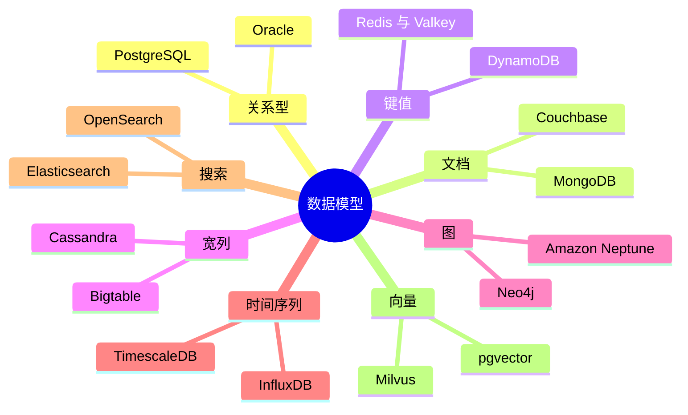

# 2. 数据模型
> **深度：** L2 · **阅读时间：** 约 14 分钟 · **最后核实：** 2026-11-01 · **前置阅读：** [第 1 章 — 数据技术栈全景图](ch01-data-stack-map.md)

## 要点速览（TL;DR）

- **数据模型（data model）**是数据库保存数据的形态：表、文档、键值对、宽行、图、带时间戳的数据点、倒排索引或向量。这种形态决定了哪些问题问起来便宜、哪些问起来昂贵。没有哪种模型对所有问题都便宜。
- [关系模型](../glossary.md#relational-model)（Codd，1970）至今仍是默认选择。PostgreSQL 在 2024 年和 2025 年的 Stack Overflow 开发者调查中均位列使用率第一，DB-Engines 2026 年 7 月的流行度排名前四位也都是关系型引擎。[^codd][^so24][^so25][^dbe-jul]
- NoSQL 模型（文档、键值、宽列、图）各自放弃了关系模型的部分通用性，以换取规模、灵活性或遍历速度。搜索模型和向量模型做的是 SQL 从未为之设计的事情：它们按相关性或相似度对结果排序，而不是返回精确匹配。
- 行业正在向**多模型（multi-model）**引擎收敛。Postgres 在一个引擎中运行 JSONB 文档、pgvector 嵌入和 PostGIS 几何数据；MongoDB 在 Atlas 中提供向量检索，并自 2026 年 6 月起在其自管理的 Community Edition 中也提供该功能。[^pgvector][^mdb-vs] 流行的概括是"SQL 赢了"，但更准确的说法是 SQL 吸收了其他模型。
- **Everpure 视角：**数据模型决定 I/O 模式。键值和图工作负载发出小块随机读，分析发出大块顺序扫描，向量检索介于两者之间。AI 还提高了非结构化数据和向量的价值，这正是 Everpure 2026 年推出的 Data Intelligence 和 Data Stream 所瞄准的方向。[^ep-ds]

## 为何重要（商业视角 + Everpure 视角）

本书涉及的每一家数据库厂商，在销售产品之前首先销售的是一种数据模型。MongoDB 卖的是文档，Neo4j 卖的是图，Elastic 卖的是倒排索引，Pinecone 卖的是向量，Oracle 卖的是关系。当一个战略团队问某个品类能否独立生存时，它实际上是在问：这种模型是否足够与众不同，以至于通用引擎无法简单地把它作为一项功能加进来。第 29 章会逐个厂商地讨论这个问题（[第 29 章](../04-company-deep-dives/ch29-operational-database-vendors.md)）。

AI 改变了每种模型的价值。在大语言模型出现之前，钱都在结构化的行里：订单、账簿、库存。合同、工单、通话记录、图像等非结构化内容以低成本存储，却很少被查询。[嵌入（向量）](../glossary.md#embedding)把这些内容转换为可按语义检索的向量，非结构化数据因此第一次变得可查询。图模型的价值也在上升，因为 GraphRAG 之类的检索系统利用实体关系为模型提供更好的上下文（[第 19 章](../03-ai-data-stack/ch19-retrieval-architectures.md)）。

对 Everpure 而言，这种联系是具体的。Everpure 于 2026 年 5 月 7 日完成对 1touch 的收购，并把这项技术重新推出为 **Data Intelligence**，用于发现和分类结构化与非结构化数据。2026 年 6 月 17 日，它宣布推出 **Data Stream**，在 FlashBlade 上借助 NVIDIA GPU 为 AI 数据管道对选定数据进行向量化。[^ep-1touch][^ep-ds] 这两款产品都位于数据模型与存储交汇之处。一个战略团队应当了解客户的数据最终会落入哪种模型，以及该模型会产生什么样的 I/O。

## 工作原理

### 全景图



*图 2.1 — 八种数据模型，每种各列两个代表性产品。如今大多数旗舰产品都支持不止一种模型，因此这里列出的是每个产品的主要模型。*

### 关系型：表、键、连接

Edgar Codd 在 1970 年的论文中提出，把数据存储为**关系（relation）**，即由行组成的表。行与行之间通过值而不是物理指针相互关联。[^codd] 每一行都有一个[主键](../glossary.md#primary-key)。另一张表中的[外键](../glossary.md#foreign-key)引用它，而[连接（join）](../glossary.md#join)在查询时把相关的行重新组合起来。[规范化](../glossary.md#normalization)让每个事实只存储一次，因此更新只需在一处进行，各副本也就不会彼此偏离。

SQL 是一种[声明式查询](../glossary.md#declarative-query)语言：你描述想要的结果，由查询优化器选择索引、连接顺序和算法。正是这种分离，让一个 1970 年代的构想能够先后运行在大型机、x86 服务器上，如今又运行在云对象存储上。硬件变了，查询不必变。[第 3 章](ch03-database-internals.md) 解释引擎内部发生了什么。

```sql
SELECT p.name, SUM(ol.qty * ol.unit_price) AS revenue
FROM order_line ol
JOIN orders o   ON o.order_id = ol.order_id
JOIN product p  ON p.product_id = ol.product_id
WHERE o.order_date >= CURRENT_DATE - INTERVAL '30 days'
GROUP BY p.name ORDER BY revenue DESC LIMIT 10;
```

**擅长：**跨多个实体的事务、完整性约束，以及没人事先计划过的临时性问题。**旗舰产品：**Oracle、MySQL、SQL Server、PostgreSQL。**不宜使用的情形：**数据没有稳定的模式、连接必须以低延迟跨越数千台机器，或者主要问题是一次十跳的关系遍历。

> **类比：半导体。** 规范化就像对物料清单（BOM）去重。在一份干净的 BOM 中，一颗 0402 电容的料号和规格只存在于一条主记录中，所有使用它的电路板都指向这条记录。如果把规格复制到每块板的 BOM 上，那么一次供应商变更就意味着要修改数百行，漏改一行就会发错料。外键就是料号引用，而连接就是 BOM 展开。

### 文档：JSON 与读时模式

[文档数据库](../glossary.md#document-database)存储自包含的类 JSON 记录。MongoDB 以 BSON 格式存储它们，每个文档上限为 16 MiB。[^mdb-limits] 模式存在于应用程序中而非数据库中，这被称为[读时模式（schema-on-read）](../glossary.md#schema-on-read)。团队可以在不执行迁移的情况下新增字段。

关键的设计决策是**内嵌还是引用**。一起读取且增长有限的数据，例如订单的明细行，应当内嵌；被共享或无限增长的数据，例如商品的评论，应当引用。MongoDB 的建模指南也做了同样的划分。[^mdb-limits]

```javascript
db.orders.find({ customer_id: 42 }).sort({ order_date: -1 }).limit(5)
```

**擅长：**一次读取整个聚合、演进中的模式，以及让数据保持应用本来使用的形态。**旗舰产品：**MongoDB、Couchbase、Amazon DocumentDB。**不宜使用的情形：**以多对多关系为主，或需要跨实体的临时性分析。高度内嵌的设计会把这些操作变成应用侧的连接。

### 键值：数据中心规模的哈希表

[键值存储](../glossary.md#key-value-store)只做一件事：给定一个键，返回一个值。Redis 把数据保存在内存中，并增加了列表、集合、有序集合等数据结构。DynamoDB 借鉴了 Amazon 2007 年 Dynamo 论文的思想，但没有沿用其无主（leaderless）设计：每个分区都有一个通过 Multi-Paxos 选举出的主副本。它通过对[分区键](../glossary.md#partition-key)做哈希，把数据项分散到各个分区。[^ddb-atc] 它将单个数据项上限设为 400 KB，分区键上限设为 2,048 字节。[^ddb][^dynamo]

```text
GET session:7f3a9c      ->  {"user":42,"cart":[...],"ttl":1800}
```

**擅长：**缓存、会话、购物车、特征查找和限流器，适用于任何事先知道键且延迟最为关键的场景。**旗舰产品：**Redis、Valkey、DynamoDB、Memcached。**不宜使用的情形：**需要按键以外的任何条件进行查询。届时每一种新的访问模式都需要一个手工构建的二级索引。

> **类比：半导体。** 键值存储就是一张哈希表，用硬件术语说就是 CAM 或 TLB 查找。你给出一个标签，在常数时间内拿回对应条目。你无法在不遍历的情况下向 TLB 询问"进程 7 拥有的、脏位已置位的所有页"。键值数据库具有同样的特性。

许可证在这个品类中很重要。Redis 于 2024 年 3 月放弃了 BSD 许可证，Linux Foundation 将其分叉为 **Valkey**，而 Redis 8 于 2025 年 5 月增加了 AGPLv3 作为第三种许可选项。[^redis]
