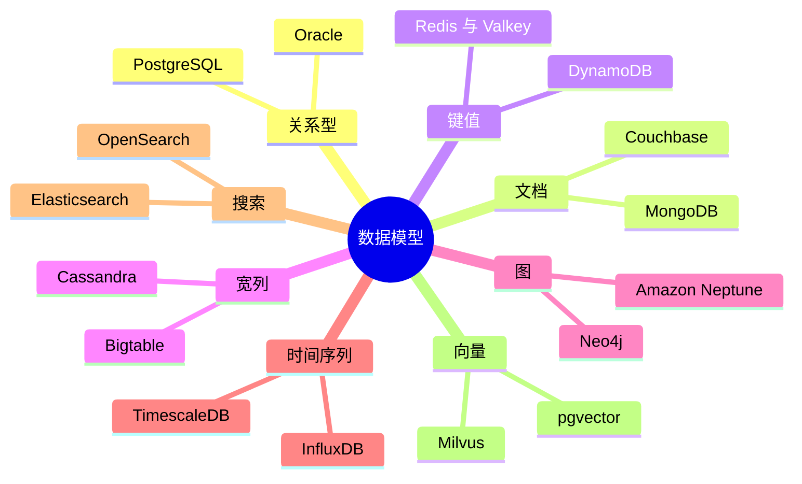
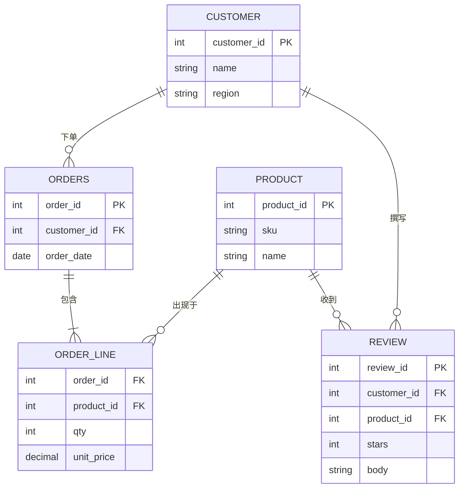
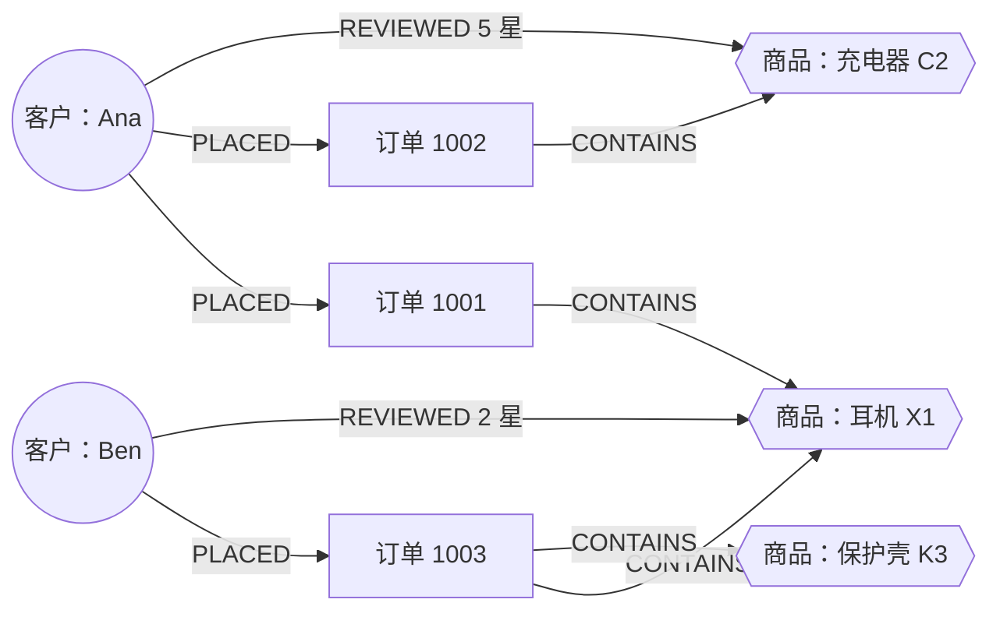
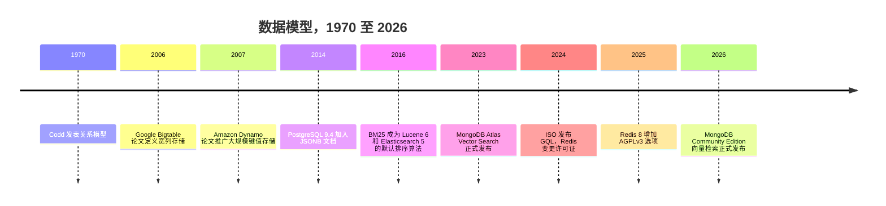

# 2. 数据模型
> **深度：** L2 · **阅读时间：** 约 14 分钟 · **最后核实：** 2026-11-01 · **前置阅读：** [第 1 章 — 数据技术栈全景图](ch01-data-stack-map.md)

## 要点速览（TL;DR）

- **数据模型（data model）**是数据库保存数据的形态：表、文档、键值对、宽行、图、带时间戳的数据点、倒排索引或向量。这种形态决定了哪些问题问起来便宜、哪些问起来昂贵。没有哪种模型对所有问题都便宜。
- [关系模型](../glossary.md#relational-model)（Codd，1970）至今仍是默认选择。PostgreSQL 在 2024 年和 2025 年的 Stack Overflow 开发者调查中均位列使用率第一，DB-Engines 2026 年 7 月的流行度排名前四位也都是关系型引擎。[^codd][^so24][^so25][^dbe-jul]
- NoSQL 模型（文档、键值、宽列、图）各自放弃了关系模型的部分通用性，以换取规模、灵活性或遍历速度。搜索模型和向量模型做的是 SQL 从未为之设计的事情：它们按相关性或相似度对结果排序，而不是返回精确匹配。
- 行业正在向**多模型（multi-model）**引擎收敛。Postgres 在一个引擎中运行 JSONB 文档、pgvector 嵌入和 PostGIS 几何数据；MongoDB 在 Atlas 中提供向量检索，并自 2026 年 6 月起在其自管理的 Community Edition 中也提供该功能。[^pgvector][^mdb-vs] 流行的概括是"SQL 赢了"，但更准确的说法是 SQL 吸收了其他模型。
- **Everpure 视角：**数据模型决定 I/O 模式。键值和图工作负载发出小块随机读，分析发出大块顺序扫描，向量检索介于两者之间。AI 还提高了非结构化数据和向量的价值，这正是 Everpure 2026 年推出的 Data Intelligence 和 Data Stream 所瞄准的方向。[^ep-ds]

## 为何重要（商业视角 + Everpure 视角）

本书涉及的每一家数据库厂商，在销售产品之前首先销售的是一种数据模型。MongoDB 卖的是文档，Neo4j 卖的是图，Elastic 卖的是倒排索引，Pinecone 卖的是向量，Oracle 卖的是关系。当一个战略团队问某个品类能否独立生存时，它实际上是在问：这种模型是否足够与众不同，以至于通用引擎无法简单地把它作为一项功能加进来。第 29 章会逐个厂商地讨论这个问题（[第 29 章](../04-company-deep-dives/ch29-operational-database-vendors.md)）。

AI 改变了每种模型的价值。在大语言模型出现之前，钱都在结构化的行里：订单、账簿、库存。合同、工单、通话记录、图像等非结构化内容以低成本存储，却很少被查询。[嵌入（向量）](../glossary.md#embedding)把这些内容转换为可按语义检索的向量，非结构化数据因此第一次变得可查询。图模型的价值也在上升，因为 GraphRAG 之类的检索系统利用实体关系为模型提供更好的上下文（[第 19 章](../03-ai-data-stack/ch19-retrieval-architectures.md)）。

对 Everpure 而言，这种联系是具体的。Everpure 于 2026 年 5 月 7 日完成对 1touch 的收购，并把这项技术重新推出为 **Data Intelligence**，用于发现和分类结构化与非结构化数据。2026 年 6 月 17 日，它宣布推出 **Data Stream**，在 FlashBlade 上借助 NVIDIA GPU 为 AI 数据管道对选定数据进行向量化。[^ep-1touch][^ep-ds] 这两款产品都位于数据模型与存储交汇之处。一个战略团队应当了解客户的数据最终会落入哪种模型，以及该模型会产生什么样的 I/O。

## 工作原理

### 全景图



*图 2.1 — 八种数据模型，每种各列两个代表性产品。如今大多数旗舰产品都支持不止一种模型，因此这里列出的是每个产品的主要模型。*

### 关系型：表、键、连接

Edgar Codd 在 1970 年的论文中提出，把数据存储为**关系（relation）**，即由行组成的表。行与行之间通过值而不是物理指针相互关联。[^codd] 每一行都有一个[主键](../glossary.md#primary-key)。另一张表中的[外键](../glossary.md#foreign-key)引用它，而[连接（join）](../glossary.md#join)在查询时把相关的行重新组合起来。[规范化](../glossary.md#normalization)让每个事实只存储一次，因此更新只需在一处进行，各副本也就不会彼此偏离。

SQL 是一种[声明式查询](../glossary.md#declarative-query)语言：你描述想要的结果，由查询优化器选择索引、连接顺序和算法。正是这种分离，让一个 1970 年代的构想能够先后运行在大型机、x86 服务器上，如今又运行在云对象存储上。硬件变了，查询不必变。[第 3 章](ch03-database-internals.md) 解释引擎内部发生了什么。

```sql
SELECT p.name, SUM(ol.qty * ol.unit_price) AS revenue
FROM order_line ol
JOIN orders o   ON o.order_id = ol.order_id
JOIN product p  ON p.product_id = ol.product_id
WHERE o.order_date >= CURRENT_DATE - INTERVAL '30 days'
GROUP BY p.name ORDER BY revenue DESC LIMIT 10;
```

**擅长：**跨多个实体的事务、完整性约束，以及没人事先计划过的临时性问题。**旗舰产品：**Oracle、MySQL、SQL Server、PostgreSQL。**不宜使用的情形：**数据没有稳定的模式、连接必须以低延迟跨越数千台机器，或者主要问题是一次十跳的关系遍历。

> **类比：半导体。** 规范化就像对物料清单（BOM）去重。在一份干净的 BOM 中，一颗 0402 电容的料号和规格只存在于一条主记录中，所有使用它的电路板都指向这条记录。如果把规格复制到每块板的 BOM 上，那么一次供应商变更就意味着要修改数百行，漏改一行就会发错料。外键就是料号引用，而连接就是 BOM 展开。

### 文档：JSON 与读时模式

[文档数据库](../glossary.md#document-database)存储自包含的类 JSON 记录。MongoDB 以 BSON 格式存储它们，每个文档上限为 16 MiB。[^mdb-limits] 模式存在于应用程序中而非数据库中，这被称为[读时模式（schema-on-read）](../glossary.md#schema-on-read)。团队可以在不执行迁移的情况下新增字段。

关键的设计决策是**内嵌还是引用**。一起读取且增长有限的数据，例如订单的明细行，应当内嵌；被共享或无限增长的数据，例如商品的评论，应当引用。MongoDB 的建模指南也做了同样的划分。[^mdb-limits]

```javascript
db.orders.find({ customer_id: 42 }).sort({ order_date: -1 }).limit(5)
```

**擅长：**一次读取整个聚合、演进中的模式，以及让数据保持应用本来使用的形态。**旗舰产品：**MongoDB、Couchbase、Amazon DocumentDB。**不宜使用的情形：**以多对多关系为主，或需要跨实体的临时性分析。高度内嵌的设计会把这些操作变成应用侧的连接。

### 键值：数据中心规模的哈希表

[键值存储](../glossary.md#key-value-store)只做一件事：给定一个键，返回一个值。Redis 把数据保存在内存中，并增加了列表、集合、有序集合等数据结构。DynamoDB 借鉴了 Amazon 2007 年 Dynamo 论文的思想，但没有沿用其无主（leaderless）设计：每个分区都有一个通过 Multi-Paxos 选举出的主副本。它通过对[分区键](../glossary.md#partition-key)做哈希，把数据项分散到各个分区。[^ddb-atc] 它将单个数据项上限设为 400 KB，分区键上限设为 2,048 字节。[^ddb][^dynamo]

```text
GET session:7f3a9c      ->  {"user":42,"cart":[...],"ttl":1800}
```

**擅长：**缓存、会话、购物车、特征查找和限流器，适用于任何事先知道键且延迟最为关键的场景。**旗舰产品：**Redis、Valkey、DynamoDB、Memcached。**不宜使用的情形：**需要按键以外的任何条件进行查询。届时每一种新的访问模式都需要一个手工构建的二级索引。

> **类比：半导体。** 键值存储就是一张哈希表，用硬件术语说就是 CAM 或 TLB 查找。你给出一个标签，在常数时间内拿回对应条目。你无法在不遍历的情况下向 TLB 询问"进程 7 拥有的、脏位已置位的所有页"。键值数据库具有同样的特性。

许可证在这个品类中很重要。Redis 于 2024 年 3 月放弃了 BSD 许可证，Linux Foundation 将其分叉为 **Valkey**，而 Redis 8 于 2025 年 5 月增加了 AGPLv3 作为第三种许可选项。[^redis]

### 宽列：按键排序的稀疏行

Google 2006 年的 Bigtable 论文定义了一种**宽列（wide-column）**模型：一个从行键、列和时间戳映射到值的稀疏、有序映射。[^bigtable] Cassandra 把 Bigtable 的存储布局与 Dynamo 风格的分区结合起来，HBase 则是 Bigtable 的开源克隆。你需要围绕查询来设计表。分区键决定数据落在哪个节点，聚簇键（clustering key）决定行在分区内的排序。

```sql
-- Cassandra CQL：每个客户一个分区，最新的订单排在最前
SELECT * FROM orders_by_customer WHERE customer_id = 42 LIMIT 20;
```

**擅长：**极高的写入速率、多区域可用性、按时间排序的事件和物联网遥测数据。**旗舰产品：**Cassandra、ScyllaDB、Bigtable、HBase。**不宜使用的情形：**查询不可预测。一个不以分区键开头的问题会变成对整个集群的扫描。[第 4 章](ch04-distributed-databases.md) 介绍这一模型背后的分片与复制机制。

### 图：把关系作为一等数据

[属性图（property graph）](../glossary.md#property-graph)存储**节点**和**边**，两者都可以带有属性。[图遍历](../glossary.md#graph-traversal)直接沿着边从一个节点走到另一个节点，因此其成本随所触及的边数增长，而不是随整张表的大小增长。另一种图模型是 [RDF](../glossary.md#rdf)，它存储主语–谓语–宾语三元组，使用 SPARQL 查询，常见于生命科学和政府领域的知识图谱。

Neo4j 的 Cypher 曾是事实上的属性图语言。2024 年 4 月，ISO 发布了 **[GQL](../glossary.md#gql)**（ISO/IEC 39075:2024），这是继 SQL 之后第一种新的 ISO 数据库语言。其模式匹配语法大量借鉴了 Cypher 的 MATCH 子句，并吸收了 Oracle 的 PGQL 和 G-CORE 研究语言的意见。[^gql] Neo4j 在 2025.06 版本中推出了 Cypher 25，并表示 Cypher 现已覆盖 GQL 的大部分强制性特性。[^neo4j]

```cypher
MATCH (:Product {sku:'X1'})<-[:CONTAINS]-(:Order)<-[:PLACED]-(c:Customer)
      -[:PLACED]->(:Order)-[:CONTAINS]->(rec:Product)
WHERE rec.sku <> 'X1'
RETURN rec.name, count(DISTINCT c) AS buyers ORDER BY buyers DESC LIMIT 5;
```

**擅长：**欺诈团伙识别、推荐、网络与供应链拓扑、身份解析，以及用于 GraphRAG 的知识图谱。**旗舰产品：**Neo4j、Amazon Neptune、TigerGraph。**不宜使用的情形：**工作负载以聚合为主，例如按月求和。图引擎的扫描速度很慢，在这类查询上关系型或列式引擎会胜过它们。

> **类比：半导体。** 图遍历就像在片上网络（NoC）中路由一个数据包。每个路由器只知道它的邻居，数据包逐个 tile 跳转。延迟取决于跳数以及下一个 tile 是否在本地，而与芯片上有多少个 tile 无关。关系型的多跳查询则更像是在每一跳都从头重建路由表。

### 时间序列、搜索与向量

**时间序列。** [时间序列数据库](../glossary.md#time-series-database)存储以时间以及主机、传感器等标签为键、以追加为主的测量值。它会压缩相似值的连续序列，并对旧数据进行降采样。典型查询是求某个时间窗口内的速率、百分位数或移动平均。旗舰产品采取三种路径：InfluxDB 是专门构建的，TimescaleDB 是 Postgres 扩展，Prometheus 是拥有自己的 PromQL 语言的指标引擎。**不宜使用的情形：**数据没有时间戳，或必须原地更新。

```text
rate(http_requests_total{service="checkout"}[5m])     # PromQL
```

**搜索。** [倒排索引](../glossary.md#inverted-index)把每个词项映射到包含它的文档列表，就像书末的索引一样。Apache Lucene 负责构建这些索引，Elasticsearch、OpenSearch 和 Solr 都运行在 Lucene 之上。结果按 [BM25](../glossary.md#bm25) 排序：当某个查询词在一篇文档中出现频繁、但在整个语料库中较为罕见时，该文档得分更高，同时会对文档长度进行校正。BM25 在 Lucene 6 和 Elasticsearch 5 中取代了经典的 TF-IDF，成为默认算法。[^bm25] **不宜使用的情形：**需要它充当记录系统（system of record）。搜索索引通常以近实时方式刷新，并从主数据库重建。

**向量。** 向量存储保存嵌入，即由模型生成的、包含数百到数千个浮点数的数组，使得含义相近的内容在空间中彼此靠近。例如，OpenAI 的 text-embedding-3-small 输出 1,536 维向量。[^openai-emb] 查询的形式是"找到这个向量的 *k* 个最近邻"。在规模化场景下，这需要 HNSW 之类的[近似最近邻（ANN）](../glossary.md#approximate-nearest-neighbor)索引，以牺牲少量召回率换取数量级的速度提升。[^hnsw] **不宜使用的情形：**需要精确匹配，例如 SKU、日期范围或账户 ID。向量度量的是相似性而非同一性，而且存储成本高昂。[第 18 章](../03-ai-data-stack/ch18-embeddings-and-vector-search.md) 介绍各种索引结构。

```sql
SELECT review_id, body FROM review
ORDER BY embedding <=> $query_embedding LIMIT 10;   -- pgvector 余弦距离
```

## 实例演示：一个领域，四种模型

以一家拥有**客户**、**订单**、**商品**和**评论**的零售商为例。同样的事实可以用四种方式建模，而每种模型都能低成本地回答一组不同的问题。

**关系型。** 共有五张规范化的表。每条订单明细引用一个商品，每条评论引用一个客户和一个商品。



*图 2.2 — 关系型版本中每个事实只存储一次，并通过连接重新组装订单，因此任何新问题都可以在不修改模式的情况下得到回答。*

**文档。** 一个订单文档内嵌其明细行，以及购买时每个商品名称和价格的快照。这是有意为之的[反规范化](../glossary.md#denormalization)，因为即便日后商品目录发生变化，发票也不能随之改变。评论存放在各自的集合中并引用商品 ID，因为一个热门商品可能积累数十万条评论，很快就会超出 16 MiB 的文档上限。[^mdb-limits]

**图。** 客户、订单和商品成为节点，PLACED（下单）、CONTAINS（包含）和 REVIEWED（评论）成为边。



*图 2.3 — 在图版本中，"购买了 X1 的客户还购买了……"是从一个节点出发、走四条边的遍历，其成本不会随订单表的规模增长。*

**向量。** 每条评论正文和商品描述都会生成嵌入。客服分析师现在可以查询"描述耳机过热的评论"，并得到"贴近耳朵时会发烫"或"电池摸起来温热"之类的评论。这些评论与查询没有任何共同关键词，因此 SQL 的 `LIKE` 和 BM25 都会漏掉它们。

| 问题 | 关系型 | 文档 | 图 | 向量 |
|---|---|---|---|---|
| 最近 30 天按商品统计收入 | **便宜**（连接 + 分组） | 中等（对内嵌明细行运行聚合管道） | 昂贵（以扫描为主） | 不适用 |
| 显示订单 1001 及其明细行 | 中等（三表连接） | **最便宜**（读取一个文档） | 中等（一跳展开） | 不适用 |
| "购买了 X1 的人还购买了……" | 昂贵（自连接随历史数据增长） | 昂贵（应用侧连接） | **便宜**（有界遍历） | 仅能近似（共同嵌入） |
| 关于过热的评论，措辞不限 | 无法实现（仅支持关键词） | 没有搜索索引则无法实现 | 无法实现 | **便宜**（k-NN 检索） |
| 在所有地方修改某个商品的价格 | **便宜**（一行） | 快照*不应*改变；实时价格字段需要扇出式更新 | 便宜（一个节点属性） | 仅当文本变化时才需重新嵌入 |
| 强制"每条评论都对应一个真实客户" | **内置**（外键） | 应用代码 | 部分支持（模式约束因产品而异） | 不适用 |

*图 2.4 — 同一领域的四种建模方式。每种模型让一组不同的问题变得便宜，因此严肃的应用最终都会组合使用其中几种。*

## 设计选择与权衡

| 模型 | 数据形态 | 查询模式 | 一致性（典型默认） | 扩展方式 | 代表厂商 | 与 AI 的相关性 |
|---|---|---|---|---|---|---|
| 关系型 | 规范化的表，固定模式 | 临时 SQL、连接、聚合 | 强一致，ACID | 优先纵向扩展；横向扩展靠分布式 SQL | Oracle、PostgreSQL、MySQL、SQL Server | 记录系统；文本转 SQL 的目标；智能体数据库 |
| 文档 | 嵌套的 JSON 聚合 | 按键或索引获取或更新一个聚合 | 单文档强一致；多文档事务可选 | 水平分片 | MongoDB、Couchbase、DocumentDB | 用于应用与 LLM 元数据的灵活存储；内置向量检索 |
| 键值 | 键下的不透明值 | 点查询的 get 或 put | 可调；跨区域时通常为最终一致 | 哈希分区，近乎线性 | Redis、Valkey、DynamoDB | 特征存储的在线层、提示词缓存与语义缓存 |
| 宽列 | 按分区键和聚簇键组织的稀疏行 | 分区键查找与范围扫描 | 可按查询调节 | 无主节点、多区域 | Cassandra、ScyllaDB、Bigtable、HBase | 大规模事件与特征日志 |
| 图 | 节点、边、属性（或 RDF 三元组） | 多跳遍历、模式匹配 | 单集群引擎中为强一致 | 难以分片；多为纵向扩展 | Neo4j、Neptune、TigerGraph | 知识图谱、GraphRAG、实体解析 |
| 时间序列 | 时间戳加标签加数值 | 窗口聚合、降采样 | 以追加为主；要求宽松 | 按时间和标签分区 | InfluxDB、TimescaleDB、Prometheus | GPU 与集群遥测；模型监控 |
| 搜索 | 分词后的文本、倒排索引 | 关键词相关性（BM25）、分面 | 近实时刷新 | 分片索引 | Elasticsearch、OpenSearch、Solr | 混合检索中的词法部分 |
| 向量 | 稠密浮点数组加元数据 | 带过滤条件的 k-NN 相似度检索 | 索引刷新通常为最终一致 | 索引内存是约束 | Pinecone、Milvus、Weaviate、pgvector | 面向 RAG 和智能体的语义检索 |
| 多模型 | 在一个引擎中支持上述任意模型 | SQL、JSON、向量、地理信息混合查询 | 继承宿主引擎 | 继承宿主引擎 | Postgres 加扩展、MongoDB Atlas、Oracle | 为现有应用加入 AI 阻力最小的方式 |

*图 2.5 — 模型适配度比较。"与 AI 的相关性"这一列解释了为什么向量、图和搜索这些曾经的小众模型如今具有战略意义。*

**为专业厂商做最强版本论证。** "Postgres 包揽一切"的理由很充分：你只需一个运营界面、一个安全模型，事务还能同时覆盖行、JSON 和向量。pgvector 0.8.0（2024 年 11 月）增加了迭代索引扫描，因此带过滤条件的向量查询可以持续搜索，直到获得足够多的匹配结果。[^pgvector] 反方论点是：通用引擎在极端场景下会落败，即高 QPS 下的数十亿向量、跨多区域的亚毫秒查找，或 PB 级的日志搜索。专业产品守住了这些阵地，其成本结构也正是为此而建。常见的规律是：通用引擎默认胜出，而一旦某个工作负载的规模或延迟足以证明有必要引入第二个系统，专业厂商就会胜出。

## 主要参与者

- **关系型：**Oracle、Microsoft SQL Server、MySQL、PostgreSQL 及其众多托管变体，以及 [第 4 章](ch04-distributed-databases.md) 介绍的分布式 SQL 引擎。
- **文档：**MongoDB 是该品类的领导者，现已成为多模型数据库。其 Atlas Vector Search 于 2023 年 12 月正式发布（GA），自管理 Community Edition 的向量检索于 2026 年 6 月 30 日正式发布。[^mdb-vs]
- **键值：**Redis Inc. 与由 Linux Foundation 支持的 Valkey 分叉、Amazon DynamoDB，以及 Memcached。[^redis]
- **宽列：**Apache Cassandra（以及 DataStax，IBM 对其的收购于 2025 年 5 月 28 日完成交割）、[^datastax] ScyllaDB、Google Bigtable、Apache HBase。
- **图：**Neo4j、Amazon Neptune、TigerGraph；以及 Stardog、Ontotext GraphDB 等 RDF 存储。
- **时间序列：**InfluxData（InfluxDB）、Timescale（TimescaleDB）[VERIFY: Timescale 于 2025 年更名为 TigerData]，以及隶属 CNCF 的 Prometheus。
- **搜索：**Elastic（Elasticsearch）、隶属 Linux Foundation 的 OpenSearch、Apache Solr。三者都运行在 Lucene 之上。[^bm25]
- **向量：**纯向量厂商 Pinecone、Milvus/Zilliz、Weaviate 和 Qdrant，以及上述几乎所有引擎内置的向量功能。参见 [第 18 章](../03-ai-data-stack/ch18-embeddings-and-vector-search.md) 和 [第 32 章](../04-company-deep-dives/ch32-ai-native-data-companies.md)。

**市场背景。** DB-Engines（现由 Redgate 运营）每月根据网络提及、招聘信息、搜索热度和问答活跃度对各系统进行排名。这些是流行度信号，而不是收入。一份关于 2026 年 7 月排名的二手报道列出的第一至第四名依次为 Oracle、MySQL、SQL Server 和 PostgreSQL，其后是 MongoDB、Snowflake 和 Databricks。[^dbe-jul] 2026 年上半年，PostgreSQL 的得分增幅最大（+21.97 分），其次是 Databricks（+16.04）和 MongoDB（+11.24）。[^dbe-h1] 开发者使用情况也呈现同样的趋势。在 Stack Overflow 调查中，PostgreSQL 在全体受访者中的使用率从 2024 年的 48.7% 升至 2025 年媒体报道的 55.6%，领先于 MySQL。[^so24][^so25]

## 历史与发展轨迹



*图 2.6 — 这条弧线从一种模型（1970）走向众多专业模型（2006–2016），再回到多模型引擎（2014 年起），而 AI 正在加速这种融合。*

这条弧线分为三幕。**第一幕（1970s–2000s）：**关系型一统天下。Codd 的模型加上 SQL 击败了此前的层次型和网状数据库，因为声明式查询把"你要问什么"与"数据如何存储"分离开来。[^codd] **第二幕（2000 年代中期–2010s）：**互联网规模的公司撞上了单节点关系型数据库的极限，并发表了新的设计。Bigtable 和 Dynamo 成为 Cassandra、HBase 和 DynamoDB 的模板，文档存储则凭借模式灵活性赢得了开发者。[^bigtable][^dynamo] **第三幕（2014 年至今）：**融合。PostgreSQL 在 9.4（2014）中加入 JSONB，扩展又带来了地理空间（PostGIS）和向量（pgvector）支持。[^pg-jsonb][^pgvector] 与此同时，NoSQL 领导者们加入了类 SQL 查询语言、事务和向量检索。[^mdb-vs]

"SQL 赢了"的说法在*接口*层面大体正确，在*引擎*层面只对了一半。SQL 和关系表赢得了记录系统。但胜出的产品把其他模型吸收为数据类型和索引类型：一个 JSONB 列、一个向量列、一个图查询标准。下一轮竞争的焦点是这些模型在哪里运行。越来越多的答案是：运行在对象存储之上的开放表格式上（[第 7 章](ch07-open-table-formats.md)），并基于同一份数据构建向量索引和图索引。

> **Everpure 视角：模型决定 I/O。** 键值查找、图遍历和 OLTP 索引探测发出的是小块随机读，每次几 KB，受延迟和 IOPS 约束。对列式文件的分析扫描读取大段连续范围，受吞吐量约束。向量检索介于两者之间。内存中的 HNSW 索引在热路径上避开了存储，但 DiskANN 等驻留在闪存上的设计会把每次查询变成几十次 4 KB 随机读 [VERIFY: DiskANN 每次查询的典型读取次数]。AI 工作负载还扩大了值得保留的数据量：原始文档、它们的嵌入，以及说明每份数据是什么的元数据。这正是 Data Intelligence（分类与上下文）和 Data Stream（向量化）所定位要填补的空白。[^ep-ds][^ep-1touch]

## 关键数字

| 指标 | 数值 | 口径 | 来源 / 日期 |
|---|---|---|---|
| MongoDB 文档大小上限 | 16 MiB | 厂商文档中的限制 | MongoDB 手册[^mdb-limits] |
| DynamoDB 数据项大小 / 分区键上限 | 400 KB / 2,048 字节 | 厂商文档中的限制 | AWS 文档[^ddb] |
| PostgreSQL 使用率，Stack Overflow 调查 | 48.7%（2024）→ 55.6%（2025），全体受访者 | 调查；2025 年数据为媒体报道 | Stack Overflow 2024、2025[^so24][^so25] |
| PostgreSQL 在 DB-Engines 的得分增幅，2026 年上半年 | +21.97 分（增幅最大） | 流行度指数，非收入 | Redgate，2026-06[^dbe-h1] |
| PostgreSQL / MongoDB 的 DB-Engines 排名 | 第 4 / 第 5（2026 年 7 月） | 流行度指数；二手报道 | HelloGitHub，2026-07[^dbe-jul] |
| GQL 标准 | ISO/IEC 39075:2024，2024 年 4 月 | 标准发布 | ISO[^gql] |
| BM25 默认参数 | k1 = 1.2，b = 0.75 | Lucene 默认值 | Apache Lucene[^bm25] |
| text-embedding-3-small 的嵌入大小 | 1,536 维 ≈ 6 KB（float32） | 厂商规格；字节大小为估算（1,536 × 4 字节） | OpenAI，2024-01-25[^openai-emb] |
| 100 万个此类向量的原始大小 | ≈ 6.1 GB（不含索引开销） | 估算（算术推导） | 推导自[^openai-emb] |
| pgvector HNSW 索引上限（vector 类型） | 2,000 维 | 项目文档 | pgvector[^pgvector] |

*图 2.7 — 几个值得记住的硬性限制和采用信号。向量大小的算术是在存储话题的对话中最可能被问到的。*

## 存储桥接

> **存储桥接。** 同样 1 TB 的数据，因模型不同而表现迥异。作为键值或图数据，它会产生数百万次小块随机读。作为用于分析的 Parquet，它以数 MB 的顺序块流式读取。作为嵌入，它会让源文本的体积膨胀好几倍，因为 1,536 个浮点数约占 6 KB，而它们所编码的段落可能还不到 1 KB。在为客户的 AI 项目做容量规划时，要问清楚数据将落入哪些模型。关于介质与协议的细节，请参阅配套的 *Everpure Tech Atlas*。

## 对话手册

**向产品经理提出的问题**
1. "你们客户的哪些查询如今需要第二个数据库？要原生吸收那种模型需要付出什么？"
2. "当客户加入向量检索时，他们是购买专业向量数据库，还是在已在运行的数据库中开启一项功能？是什么因素左右了这一决定？"
3. "你们看到的 AI 数据中，有多少是等待分类的非结构化内容，又有多少是已经建模的行？"

**向工程师提出的问题**
1. "这个工作负载的主要 I/O 模式是什么：点查询、遍历、扫描还是 k-NN？读取大小的分布如何？"
2. "记录系统在哪里，哪些索引（搜索、向量、图）是从它派生出来的？它们可以滞后多久？"
3. "关于向量：你们使用什么维度、精度和索引类型？索引放在 RAM 里还是闪存上？"

**好的回答听起来是什么样的：**先说出访问模式，再谈产品；把记录系统与派生索引区分开来；对规模进行量化：行数、维度、每秒查询数、p99 延迟。

**不要这样说**
- "NoSQL 就是没有模式。"模式依然存在，只是转移到了应用代码中，在那里更难治理。
- "图数据库不过就是连接。"在十跳路径上做连接，成本随表的大小增长；遍历的成本则随实际触及的边数增长。
- "向量数据库会取代搜索。"生产环境中的检索通常是混合检索：BM25 负责精确词项，向量负责语义（[第 19 章](../03-ai-data-stack/ch19-retrieval-architectures.md)）。
- "SQL 赢了，所以其他模型都死了。"SQL 赢得的是接口。其他模型以数据类型、索引类型以及在极端场景中的专业引擎的形式存活了下来。

## 深入阅读

> **深入（L3）。** 阅读 Codd 1970 年的论文，了解数据独立性的最初论证。[^codd] 阅读 Bigtable 和 Dynamo 论文，了解宽列和键值系统背后的存储设计。[^bigtable][^dynamo] Malkov 和 Yashunin 的 HNSW 论文解释了为什么基于图的向量索引需要大量 RAM。[^hnsw] Neo4j 的 GQL 一致性附录逐项列出了 Cypher 与该标准之间的差距。[^neo4j] 关于每种模型之下的存储引擎（B 树、LSM 树、MVCC），请继续阅读 [第 3 章](ch03-database-internals.md)。

## 关键术语

- [关系模型](../glossary.md#relational-model)：以通过键值相互关联的行组成的表来表示数据，并以声明式方式查询。
- [主键](../glossary.md#primary-key)：唯一标识一行的一列或多列。
- [外键](../glossary.md#foreign-key)：引用另一张表主键的列。
- [连接（join）](../glossary.md#join)：按匹配的键组合多张表中各行的操作。
- [规范化](../glossary.md#normalization)：对表进行结构化设计，使每个事实只存储一次。
- [反规范化](../glossary.md#denormalization)：有意复制数据，使读取更便宜。
- [声明式查询](../glossary.md#declarative-query)：只说明想要的结果、把实现方法交给查询优化器的查询。
- [文档数据库](../glossary.md#document-database)：存储自包含的类 JSON 记录的数据库。
- [读时模式](../glossary.md#schema-on-read)：在读取数据时解释其结构，而不是在写入时强制执行。
- [键值存储](../glossary.md#key-value-store)：按键检索不透明值的数据库。
- [分区键](../glossary.md#partition-key)：经过哈希以决定由哪个节点存储某条记录的属性。
- [宽列存储](../glossary.md#wide-column-store)：按分区键分组、按聚簇键排序的稀疏行。
- [属性图](../glossary.md#property-graph)：节点和边都带有键值属性的图。
- [RDF](../glossary.md#rdf)：由主语–谓语–宾语三元组构成的图模型，使用 SPARQL 查询。
- [图遍历](../glossary.md#graph-traversal)：沿着边从一个节点走到另一个节点以回答查询。
- [GQL](../glossary.md#gql)：ISO/IEC 39075:2024 标准属性图查询语言。
- [时间序列数据库](../glossary.md#time-series-database)：针对带时间戳、以追加为主的测量值进行优化的存储。
- [倒排索引](../glossary.md#inverted-index)：从每个词项到包含它的文档的映射。
- [BM25](../glossary.md#bm25)：基于 Lucene 的搜索中标准的关键词相关性评分函数。
- [嵌入（向量）](../glossary.md#embedding)：由模型生成、含义相近者彼此靠近的向量。
- [近似最近邻](../glossary.md#approximate-nearest-neighbor)：以牺牲少量召回率换取速度的快速相似度检索。
- [多模型数据库](../glossary.md#multi-model-database)：支持多种数据模型的单一引擎。

## 资料来源

[^codd]: E. F. Codd, "A Relational Model of Data for Large Shared Data Banks," *Communications of the ACM* 13(6), 377–387, https://doi.org/10.1145/362384.362685，发布于 1970-06；检索于 2026-11-01（经典引用，未重新抓取）。
[^so24]: Stack Overflow, "2024 Developer Survey — Technology: Databases," https://survey.stackoverflow.co/2024/technology#1-databases，发布于 2024-07；数据（全体受访者 48.7%）引自 DevClass 的报道, https://www.devclass.com/development/2024/08/02/little-sign-of-migration-from-c-or-c-to-rust-in-latest-dev-survey-but-postgresql-is-winning-against-mysql/1622783，发布于 2024-08-02；检索于 2026-11-01。
[^so25]: Stack Overflow, "2025 Developer Survey — Technology: Databases," https://survey.stackoverflow.co/2025/technology#1-databases，发布于 2025-07；55.6%（全体受访者）和 58.2%（专业开发者）引自 Vonng 的报道, "StackOverflow 2025 survey: PostgreSQL," https://blog.vonng.com/en/pg/so2025-pg/，发布于 2025；媒体报道，并非直接读取自调查页面 [VERIFY: 对照 survey.stackoverflow.co 核实 2025 年的确切百分比]；检索于 2026-11-01。
[^dbe-jul]: HelloGitHub, "2026 年 7 月数据库排行榜"（DB-Engines 2026 年 7 月排名的报道）, https://hellogithub.com/report/db-engines，发布于 2026-07；为 https://db-engines.com/en/ranking 的二手报道 [VERIFY: 核实 db-engines.com 上的当前排名]；检索于 2026-11-01。
[^dbe-h1]: Redgate, "DB-Engines: PostgreSQL leads H1 2026 database growth as data platforms gain momentum," https://www.red-gate.com/our-company/newsroom/press-releases/db-engines-postgresql-leads-h1-2026-database-growth-as-data-platforms-gain-momentum/，发布于 2026-06；检索于 2026-11-01。
[^gql]: ISO, "ISO/IEC 39075:2024 Information technology — Database languages — GQL," https://www.iso.org/standard/76120.html，发布于 2024-04；The New Stack, "GQL: A New ISO Standard for Querying Graph Databases," https://thenewstack.io/gql-a-new-iso-standard-for-querying-graph-databases/，发布于 2024；检索于 2026-11-01。
[^neo4j]: Neo4j, "Cypher Manual — GQL conformance," https://neo4j.com/docs/cypher-manual/current/appendix/gql-conformance/，无日期（2026.06 版）；Neo4j, "Neo4j 2026.02 release notes," https://neo4j.com/release-notes/database/neo4j-2026-02/，发布于 2026-03-06；检索于 2026-11-01。
[^mdb-limits]: MongoDB, "MongoDB Limits and Thresholds" and "Data Modeling — Embedded vs. References," https://www.mongodb.com/docs/manual/reference/limits/ 和 https://www.mongodb.com/docs/manual/data-modeling/，无日期；检索于 2026-11-01（16 MiB 数据经多个二手来源印证；文档未重新抓取）。
[^mdb-vs]: Constellation Research, "MongoDB Atlas Vector Search, Atlas Search Nodes generally available," https://www.constellationr.com/insights/news/mongodb-atlas-vector-search-atlas-search-nodes-generally-available，发布于 2023-12-04；MongoDB, "Now GA: MongoDB Search and Vector Search for Community Edition," https://www.mongodb.com/products/updates/now-ga-mongodb-search-and-vector-search-for-community-edition/，发布于 2026-06-30；检索于 2026-11-01。
[^ddb]: Amazon Web Services, "Constraints in Amazon DynamoDB," https://docs.aws.amazon.com/amazondynamodb/latest/developerguide/Constraints.html，无日期；检索于 2026-11-01。
[^ddb-atc]: M. Elhemali et al., "Amazon DynamoDB: A Scalable, Predictably Performant, and Fully Managed NoSQL Database Service," USENIX ATC 2022, https://www.usenix.org/conference/atc22/presentation/elhemali，发布于 2022-07；检索于 2026-11-01（经典引用，未重新抓取）。
[^datastax]: AI Data Atlas, `data/ma_deals.csv`（IBM–DataStax，2025-02-25 宣布，2025-05-28 完成交割，交易条款未披露），引用 DBTA, "IBM Officially Closes Acquisition of DataStax," https://www.dbta.com/Editorial/News-Flashes/IBM-Officially-Closes-Acquisition-of-DataStax-169711.aspx，发布于 2025-05/06；检索于 2026-11-01。
[^dynamo]: G. DeCandia et al., "Dynamo: Amazon's Highly Available Key-value Store," SOSP 2007, https://doi.org/10.1145/1294261.1294281，发布于 2007-10；检索于 2026-11-01（经典引用，未重新抓取）。
[^bigtable]: F. Chang et al., "Bigtable: A Distributed Storage System for Structured Data," OSDI 2006, https://research.google/pubs/bigtable-a-distributed-storage-system-for-structured-data/，发布于 2006-11；检索于 2026-11-01（经典引用，未重新抓取）。
[^redis]: Phoronix, "Redis 8.0 Released: Now Tri-Licensed With AGPLv3," https://www.phoronix.com/news/Redis-8.0-Goes-AGPLv3，发布于 2025-05-01；SD Times, "Open source wins again! Redis adds GNU AGPL license to its offering," https://sdtimes.com/os/open-source-wins-again-redis-adds-gnu-agpl-license-to-its-offering/，发布于 2025-05；检索于 2026-11-01。
[^bm25]: Elastic, "Elasticsearch Reference 5.0 — Similarity module," https://www.elastic.co/guide/en/elasticsearch/reference/5.0/similarity.html，发布于 2016-10；Apache Lucene, "BM25Similarity" API docs（默认值 k1 = 1.2，b = 0.75）, https://lucene.apache.org/core/9_0_0/core/org/apache/lucene/search/similarities/BM25Similarity.html，无日期；检索于 2026-11-01（Lucene 文档未重新抓取）。
[^pgvector]: PostgreSQL Global Development Group, "pgvector 0.8.0 Released!," https://www.postgresql.org/about/news/pgvector-080-released-2952/，发布于 2024-11；pgvector 项目 README（索引维度上限）, https://github.com/pgvector/pgvector，无日期；检索于 2026-11-01（README 未重新抓取）。
[^pg-jsonb]: PostgreSQL Global Development Group, "PostgreSQL 9.4 release notes," https://www.postgresql.org/docs/release/9.4.0/，发布于 2014-12-18；检索于 2026-11-01（经典引用，未重新抓取）。
[^openai-emb]: OpenAI, "New embedding models and API updates," https://openai.com/index/new-embedding-models-and-api-updates/，发布于 2024-01-25；检索于 2026-11-01（未重新抓取）。
[^hnsw]: Y. Malkov and D. Yashunin, "Efficient and robust approximate nearest neighbor search using Hierarchical Navigable Small World graphs," arXiv:1603.09320, https://arxiv.org/abs/1603.09320，发布于 2016-03；检索于 2026-11-01（经典引用）。
[^ep-ds]: Everpure via PR Newswire, "Everpure Unveils Data-Primacy Architecture for the AI Era," https://www.prnewswire.com/news-releases/everpure-unveils-data-primacy-architecture-for-the-ai-era-302803097.html，发布于 2026-06-17；Computer Weekly, "Everpure aims to bridge AI data gap with Universal Data Intelligence," https://www.computerweekly.com/news/366644438/Everpure-aims-to-bridge-AI-data-gap-with-Universal-Data-Intelligence，发布于 2026-06；检索于 2026-11-01。
[^ep-1touch]: Everpure, Inc., Form 10-Q for the quarter ended 2026-05-03, SEC EDGAR, https://www.sec.gov/Archives/edgar/data/0001474432/000147443226000061/pstg-20260503.htm，发布于 2026-06；Cleary Gottlieb, "Everpure Completes Acquisition of 1touch," https://www.clearygottlieb.com/news-and-insights/news-listing/everpure-completes-acquisition-of-1touch，发布于 2026-05-11；检索于 2026-11-01。
