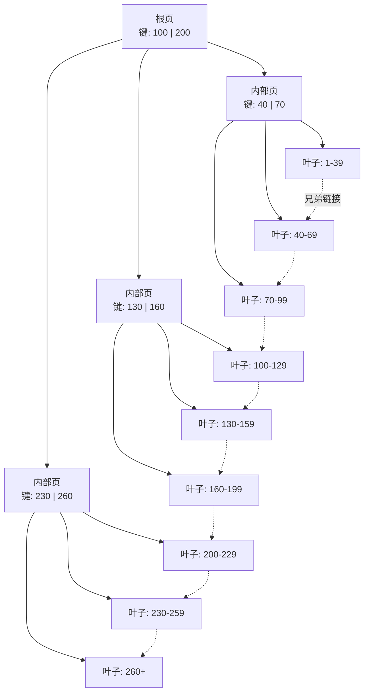
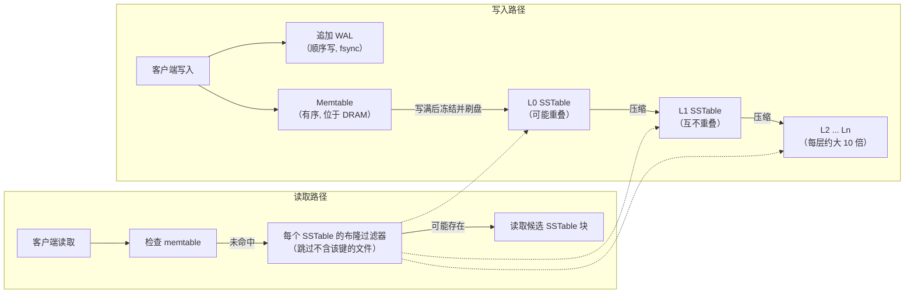
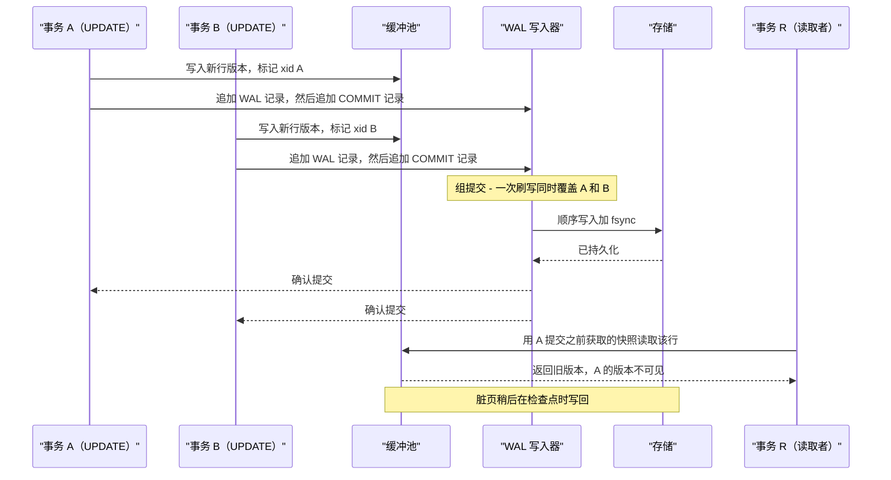
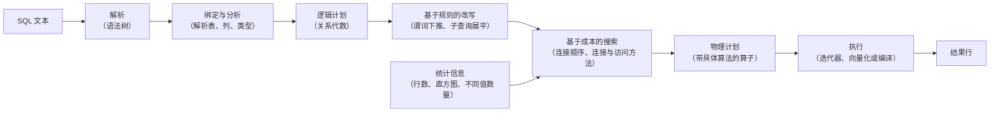
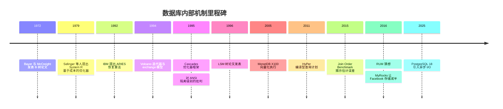

# 3. 数据库内部如何运作
> **深度：** L2 · **阅读时间：** 约 19 分钟 · **最后核实：** 2026-11-01 · **前置阅读：** [第 2 章 — 数据模型](ch02-data-models.md)

<a id="tldr"></a>
## 要点速览（TL;DR）

- 数据库是两台拼装在一起的"机器"。**存储引擎（storage engine）**决定字节在磁盘和内存中如何摆放；**查询处理器**把 SQL 请求转换成分步执行计划并运行它。大多数关于性能的争论，以及许多厂商的宣传，其实都只涉及其中一半。
- 存储引擎有两种主流设计。[B 树（B-tree）](../glossary.md#b-tree)原地更新固定大小的页，针对读取做了优化（PostgreSQL、MySQL InnoDB、Oracle、SQL Server）。[LSM 树（LSM-tree）](../glossary.md#lsm-tree)先在内存中缓冲写入，再写出不可变的有序文件，并在后台合并它们（RocksDB、Cassandra）。两者都不能完胜。[RUM 猜想（RUM conjecture）](../glossary.md#rum-conjecture)指出，在读取成本、更新成本和内存/空间开销三者中，最多只能同时优化两项。
- 持久性来自[预写日志（WAL）](../glossary.md#write-ahead-log)：先把变更写入一份顺序日志，用 `fsync` 强制落到稳定介质上，再惰性地更新数据页。因此，提交延迟主要由 WAL 刷盘延迟决定，而这是一项存储属性。
- 并发能力来自 [MVCC](../glossary.md#mvcc)（多版本并发控制）：写入者创建新的行版本，读取者因此永远不必等待。PostgreSQL 把旧版本留在表中，用 [vacuum](../glossary.md#vacuum) 清理；Oracle 和 InnoDB 则把旧版本保存在[撤销日志（undo log）](../glossary.md#undo-log)中。[隔离级别（isolation level）](../glossary.md#isolation-level)决定应用程序能看到哪些异常。
- [查询优化器（query optimizer）](../glossary.md#query-optimizer)本质上是一个编译器。它把 SQL 改写为若干候选计划，依据统计信息估算各自成本，再选出最便宜的一个。它最大的弱点是[基数估计（cardinality estimation）](../glossary.md#cardinality-estimation)：一旦行数猜错，选中的计划可能比最优计划慢十倍甚至一百倍。

<a id="why-this-matters-business--everpure-lens"></a>
## 为何重要（商业 + Everpure 视角）

本书中的每一款产品都建立在这些机制之上。Snowflake、Databricks、MongoDB、新兴的"面向智能体的 Postgres"服务以及向量数据库，都在做同样几项选择：B 树还是 LSM，原地更新还是仅追加，撤销日志还是版本链，迭代器执行还是向量化执行。当一家厂商宣称"数据摄取快 10 倍"时，诚实的翻译通常是"我们选择了 LSM 风格的写入路径，把成本转移到了后台压缩上"。知道成本转移到了哪里，就是提出一个犀利的尽职调查问题与只能点头附和之间的区别。

对于一家存储公司，这些内部机制决定了落到存储阵列上的 I/O 模式。B 树数据库会发出随机的 8–16 KB 页读写，外加一串小规模的顺序 WAL 写入，而这些写入的 `fsync` 延迟直接位于提交路径上。LSM 数据库在压缩过程中会发出大块的顺序读写，其量往往是应用自身写入量的数倍。这三种特征（随机页 I/O、对延迟敏感的日志刷盘、压缩带宽）解释了为什么数据库整合会成为全闪存阵列的第一个杀手级工作负载，也解释了为什么"更快的存储"能让某些数据库大幅提速，而对另一些几乎毫无帮助。

<a id="how-it-works"></a>
## 工作原理

<a id="everything-is-a-page"></a>
### 一切皆是页

数据库读取的不是行，而是**页**（也称为块），即作为 I/O 和缓存单位的固定大小数据块。PostgreSQL 的默认页大小为 8 kB，在编译时设定。[^pg-page] InnoDB 的默认页大小为 16 KB，在实例初始化时选定。[^innodb-limits] 行、索引条目以及空闲空间的记录信息全都存放在页内。

[缓冲池（buffer pool）](../glossary.md#buffer-pool)是数据库自己的页 DRAM 缓存。假设一个查询请求 `orders` 表的第 4,711 页：如果该页在缓冲池中（命中），读取只需纳秒到微秒级；如果不在（未命中），引擎就要从存储中读取该页并淘汰掉其他页，通常使用类 LRU 策略。被修改过的（"脏"）页由后台写入进程在之后以及检查点时写回，而不是在提交时写回。PostgreSQL 有意保持适中的缓冲池规模，并把操作系统的页缓存当作第二层；InnoDB 则倾向于直接掌控服务器的大部分内存。工作集能装进缓冲池的数据库表现得就像内存数据库；装不进去的，则变成了一场存储基准测试。

<a id="storage-engine-1-the-btree"></a>
### 存储引擎之一：B+ 树

B 树由 Rudolf Bayer 和 Edward McCreight 于 1972 年发表（最早于 1970 年以 Boeing 内部报告的形式流传），它把键有序地保存在一棵由页构成、矮而宽的树中。[^bayer72] 几乎所有生产系统都使用 **B+ 树**变体：内部页只保存分隔键和子节点指针，所有数据（或行指针）都放在叶子页中，叶子页之间从左到右串成链表，这样范围扫描就能横向遍历，而无需回到根节点。



*图 3.1 — B+ 树只需三四次页读取就能找到任意键；叶子之间的兄弟链接让范围扫描变成一次顺序遍历。*

一次查找先读根页，每层沿一个指针向下，最终落到叶子页。由于每页能容纳数百个键，这棵树极其矮浅。以 8 kB 页、每条目约 16 字节计算，一个内部页大约可扇出 500 个子节点（估算）。于是三层树（根、一层内部节点、叶子）可容纳约 500 × 500 × 500 ≈ 1.25 亿个键，四层树约 600 亿个。实际运行中，根层和内部层始终驻留在缓冲池中，因此在十亿行的表上做一次点查询，大约只需要一次存储读取来获取叶子页；在 PostgreSQL 这类堆组织表中，还需再读一次来获取行本身。

写入是**原地**进行的。更新一行意味着找到它所在的叶子页，在内存中修改，最终把整页写回。向已满的叶子页插入会触发**页分裂（page split）**：一半条目移到新页，一个新的分隔键被推入父页，而父页也可能随之分裂。分裂让树保持平衡，但会留下部分空闲的页（随机插入时通常约三分之二满），并把一次小小的逻辑变更变成一次或多次整页写入。这就是 B 树的"写入税"。

在商业上，有两种形态值得关注。InnoDB 使用**聚簇**索引：表*本身就是*主键 B+ 树，完整的行存放在叶子中，因此二级索引保存的是主键，通过二级索引查找需要两次树遍历。PostgreSQL 把行存放在无序的**堆**中，包括主键在内的每个索引都是一棵独立的 B 树，指向堆中的位置（元组 ID）。两者没有绝对的优劣：聚簇有利于主键范围扫描，而堆让二级索引更便宜、更新更简单。

> **类比：半导体。** B 树的扇出与缓存行大小遵循同一条设计规则。CPU 一次取 64 字节，是因为内存访问的成本主要在延迟而非带宽，所以要让每次往返尽可能多地带回有用字节。B 树的页就是存储的"缓存行"：一旦为一次设备往返付出了代价，就拉回 8–16 KB 数据，在其上做数百次比较。更大的页能提高扇出、降低树高，但当你只需要一行时就会浪费带宽；这与更长的缓存行会加剧伪共享和过度预取是同一种权衡。

<a id="storage-engine-2-the-lsm-tree"></a>
### 存储引擎之二：LSM 树

日志结构合并树（log-structured merge-tree）由 Patrick O'Neil、Edward Cheng 和 Dieter Gawlick 于 1991 年设计，并与 Elizabeth O'Neil 一起于 1996 年发表。[^oneil96] 它的出发点是：在高强度插入流下维护 B 树索引大约会让 I/O 翻倍，因为每次插入都是一次随机页更新。LSM 树则改为在内存中批量积攒变更，顺序写出，稍后再合并。



*图 3.2 — LSM 树把随机写转换为顺序写，代价是后台压缩和跨多个文件的读取。*

一次写入会去两个地方：追加到 WAL 以保证持久性，同时插入 **memtable**（内存表），一种有序的内存结构。memtable 写满后会被冻结，并作为一个不可变的**有序字符串表**（[SSTable](../glossary.md#sstable)）刷到磁盘上；对应的 WAL 段随后即可删除。[^rocksdb-overview] 磁盘上的任何内容都不会被原地修改。一次更新只是某个键在更新文件中的一个更新版本；一次删除则是一个"墓碑（tombstone）"标记。

随着时间推移，文件不断累积，于是一个后台进程——[压缩（compaction）](../glossary.md#compaction)——会把相互重叠的文件归并排序成更大的文件，丢弃被覆盖的版本和墓碑，并把数据沿着层级逐级下推。在 RocksDB 默认的分层（leveled）方案中，每一层大约是上一层的十倍。Cassandra 沿用了同样的"memtable—提交日志—SSTable"模式，这一模式继承自 Google 的 Bigtable 设计。[^cassandra]

代价落在读取上。一个键可能位于 memtable，也可能位于若干层中的任意一层，因此一次点查询可能要探查多个文件。有两种手段让这一代价尚可承受：一是每个文件配备的[布隆过滤器（Bloom filter）](../glossary.md#bloom-filter)，这是一种紧凑的概率型位图，能回答"肯定不在这里"或"可能在这里"，从而让大多数文件无需 I/O 就被跳过；二是把过滤器和索引缓存在 DRAM 中。[^rocksdb-overview] 但范围扫描仍需合并来自每一层的数据流。

工程师用三个放大系数来描述这些成本。[写放大（write amplification）](../glossary.md#write-amplification)是应用每写入 1 字节、实际写入存储的字节数。[读放大（read amplification）](../glossary.md#read-amplification)是每次查找所需的 I/O 次数。[空间放大（space amplification）](../glossary.md#space-amplification)是每字节有效数据所占用的存储字节数。RocksDB 分层压缩的写放大通常被报告为 20–30 倍 [VERIFY: 核实 RocksDB 博客 2022-10-31 中"20–30x"的措辞]；Facebook 早期的一个模型将其估算为大约层数的十倍。[^rocksdb-align][^fms14] 另一种"分级（tiered）"或"通用（universal）"压缩写入更少，但读取更多，且需要更多的预留空间。Athanassoulis 等人 2016 年提出的 [RUM 猜想](../glossary.md#rum-conjecture)把这种两难形式化：在读取、更新和内存开销中优化任意两项，都会让第三项受损。[^rum16] B 树位于读优化的一角；LSM 树更靠近更新优化的一角；压缩策略则是在两者之间调节的旋钮。

回报可以相当可观。Facebook 在 2016 年报告称，把 MySQL 从 InnoDB 迁移到基于 RocksDB 的 MyRocks 引擎后，相同数据的存储占用比压缩后的 InnoDB 减少了 50%，主要原因是不可变的变长文件比固定大小的页压缩和打包效果更好。[^myrocks16] 其 2020 年的 VLDB 论文报告，主用户数据库的实例规模缩小了 62.3%（公司披露）。[^myrocks20]

> **类比：NAND 闪存。** LSM 压缩*就是*上移了一层的闪存转换层（FTL）垃圾回收。SSD 无法原地覆写一个 NAND 页；它把新数据写入新页，把旧页标记为无效，之后再把块中仍然有效的页复制出去，以便擦除整个块。LSM 引擎对文件做的是同样的事：把新版本写到别处，把旧版本标记为过时，并定期把有效键向前复制，从而可以整份删除文件。两者都为"永不原地更新"这一特权付出了写放大的代价，也都在超额配置（预留容量）与放大之间做权衡。这些放大是**相乘**的：1 GB 应用写入 × 20 倍 LSM 写放大 × 1.5 倍设备写放大（示意）意味着 30 GB 的 NAND 编程周期。好的一面是，LSM 的输出是大块、顺序且整份删除的，这接近 FTL 的理想模式；而 B 树分散的 8–16 KB 原地写入，恰恰是最能加重设备端垃圾回收负担的模式。选择存储引擎，在某种程度上就是选择由哪一层来做垃圾回收。

<a id="indexes-beyond-the-primary-key"></a>
### 主键之外的索引

**主索引**按键来组织表。[二级索引（secondary index）](../glossary.md#secondary-index)是建立在另一列上（比如 `orders.customer_id`）、指回行的额外结构；每增加一个二级索引都会增加写入成本，因为每次插入也必须更新它。[覆盖索引（covering index）](../glossary.md#covering-index)包含查询所需的全部列，引擎只需读索引就能作答而无需访问表，这往往是最有效的单项调优手段。B 树之外，**哈希索引**提供常数时间的等值查找，但不支持范围查询；[位图索引（bitmap index）](../glossary.md#bitmap-index)为每个不同值保存一个位向量，适合分析场景中基数较低的列；[倒排索引（inverted index）](../glossary.md#inverted-index)把每个词或数组元素映射到包含它的行，全文检索以及 PostgreSQL 的 GIN（通用倒排索引）正是借此处理 JSON 和数组。向量索引是最新的一类；参见[第 18 章](../03-ai-data-stack/ch18-embeddings-and-vector-search.md)。

<a id="the-write-ahead-log-durability-without-random-writes"></a>
### 预写日志：无需随机写入的持久性

WAL 规则很简单：描述某数据页变更的日志记录刷入稳定存储之后，该数据页的变更才可以写到磁盘。[^pg-wal] 提交时，数据库只强制刷写日志——一次顺序追加——而非那些分散的脏页。崩溃之后，它从最近的检查点开始向前重放日志（"重做/redo"），以重建任何丢失的页变更，并回滚那些从未提交的事务。（PostgreSQL 不需要单独的撤销阶段：它的提交日志只是把这些事务的行版本标记为已中止，使其保持不可见。）日志才是真相之源；数据文件只是日志的一份缓存。

由于每次提交都要等待一次日志的 `fsync`（或等效操作），提交延迟大致等于存储设备的刷写延迟。[组提交（group commit）](../glossary.md#group-commit)可以摊薄这一成本：当许多事务同时提交时，一次刷写就能让它们全部持久化。对于排在一次进行中的刷写之后的提交，PostgreSQL 会自动这样做；`commit_delay`（默认关闭）和 `commit_siblings`（默认需有 5 个并发事务才启用延迟）只是让它多等一会儿以凑成更大的组。RocksDB 同样会把多个写入者合并为一次日志 `fsync`。[^pg-wal-config][^rocksdb-overview] 共享日志也正是流式复制和变更数据捕获（CDC）所接入的地方，这把本章与[第 9 章](../02-pipelines-and-governance/ch09-pipeline-patterns.md)联系了起来。

> **类比：文件系统日志。** 日志式文件系统（ext4、XFS、NTFS）把同样的思路用于元数据：先把意图写入日志，再原地更新，崩溃后重放日志。PostgreSQL 文档指出，由于 WAL 已经能恢复数据文件内容，数据库自身的可靠性并不需要日志式文件系统。[^pg-wal] 两者同时运行，就像为同一批货物投保两次。

> **深入（L3）。** 经典的恢复算法是 IBM 的 ARIES（Mohan 等，1992）。[^aries92] 它分三个阶段：*分析*（从最近的检查点扫描日志，找出脏页和进行中的事务）、*重做*（"重演历史"，让每一条已记录的变更——无论是否已提交——都被重新应用）以及*撤销*（回滚失败者，同时写入补偿日志记录，使恢复过程中的崩溃本身也可恢复）。每个页都保存其最近一次变更的日志序列号（LSN），因此重做是幂等的。ARIES 的"steal, no-force"策略（脏页可以在提交前写出；提交时不必写出页）正是缓冲池和 WAL 可以独立调优的原因。

<a id="transactions-acid-and-isolation"></a>
### 事务、ACID 与隔离

[ACID](../glossary.md#acid) 是一份契约：**原子性**（要么全做、要么全不做，由日志提供保障）、**一致性**（约束始终成立）、**隔离性**（并发事务看不到彼此尚未完成的工作）以及**持久性**（已提交即意味着能在崩溃后幸存，同样由日志保障）。隔离性代价最高，因此数据库提供了一份[隔离级别](../glossary.md#isolation-level)菜单，每个级别由其仍然允许的异常来定义。Berenson、Gray 等人 1995 年的论文表明 ANSI 定义并不完整，并命名了[快照隔离（snapshot isolation）](../glossary.md#snapshot-isolation)——它阻止了经典异常，却仍允许[写偏斜（write skew）](../glossary.md#write-skew)。[^berenson95]

| 隔离级别 | 脏读 | 不可重复读 | 幻读 | 丢失更新 / 写偏斜 | 在哪些系统中是默认级别 |
|---|---|---|---|---|---|
| 读未提交（Read uncommitted） | 可能 | 可能 | 可能 | 可能 | 很少使用；PostgreSQL 会默默将其视为读已提交 |
| 读已提交（Read committed） | 防止 | 可能 | 可能 | 可能 | PostgreSQL、Oracle、SQL Server |
| 可重复读（Repeatable read，ANSI，基于锁） | 防止 | 防止 | 可能 | 写偏斜由锁防止 | MySQL InnoDB 的默认级别沿用此名，但普通读取使用 MVCC 快照，而 `UPDATE` 和加锁读取看到的是最新已提交行，因此它弱于快照隔离，可能丢失更新 |
| 快照隔离（Snapshot isolation） | 防止 | 防止 | 防止 | 防止丢失更新；**可能出现写偏斜** | PostgreSQL 的"可重复读"；Oracle 的"可串行化" |
| 可串行化（Serializable） | 防止 | 防止 | 防止 | 防止 | CockroachDB；PostgreSQL 在显式请求时通过可串行化快照隔离（SSI）实现 |

*图 3.3 — 隔离级别是一份"允许哪些异常"的菜单；大多数数据库默认使用读已提交，而它比许多应用开发者设想的要弱。*

写偏斜是高管们应当记住的那种异常。两位医生在值班，规则是至少要有一人留守。两人各自开启一个事务，检查对方仍在值班，然后签退。在快照隔离下，两次检查读取的是同一个快照，两次写入触及的是不同的行，两者都成功提交——结果没有人值班。只有真正的可串行化，或者对被检查的行加显式锁（例如 `SELECT ... FOR UPDATE`），才能捕获这种情况。[^pg-iso][^berenson95]

<a id="mvcc-two-ways-to-keep-old-versions"></a>
### MVCC：保存旧版本的两种方式

MVCC 让每个事务在其他事务写入的同时读取一个一致的快照，因此读不阻塞写，写也不阻塞读。[^pg-mvcc] 设计问题在于旧版本存放在哪里。

**PostgreSQL** 在每次更新时都向堆中写入一个完整的新行版本（元组），并用取代它的事务 ID 标记旧版本。每个读取者都会把这些事务 ID 与自己的快照比对，以判断可见性。旧元组会留在表中，直到 **vacuum** 将其回收。好处是回滚快、读取近期数据简单；坏处是表和索引膨胀、更新时的写放大（索引可能需要新增指向新元组的条目），以及一项运维苦差——一旦疏忽，就会演变成事务 ID 回卷（wraparound）的紧急事故。

**Oracle 和 InnoDB** 原地更新行，并把*旧*镜像复制到**撤销日志**中。需要旧版本的读取者沿撤销链向回追溯。当不再有活动事务需要旧的撤销记录时，后台的 **purge（清除）** 进程会将其丢弃；一个长时间运行的事务会"钉住"这段历史，迫使读取者重建越来越旧的版本，当清除滞后过大时，InnoDB 甚至会限流写入。[^innodb-purge] 表保持紧凑，但回滚和读取旧快照的成本更高。

<a id="locking-versus-optimistic-concurrency"></a>
### 加锁与乐观并发

MVCC 处理的是读写冲突；写写冲突仍需一套策略。**悲观**并发——最常见的是[两阶段锁（two-phase locking）](../glossary.md#two-phase-locking)——在接触数据之前获取锁，并持有到提交为止，因此冲突的事务需要等待（偶尔会发生死锁，引擎通过中止其中一个事务来打破死锁）。[乐观并发控制（optimistic concurrency control）](../glossary.md#optimistic-concurrency-control)让事务不加锁地运行，在提交时再做校验；如果别人修改了数据，失败的一方就中止并重试。冲突罕见且事务短小时，乐观策略胜出；在热点争用下，悲观策略胜出，因为乐观系统会把算力浪费在重试上。分布式数据库（[第 4 章](ch04-distributed-databases.md)）在这一点上分道扬镳。Spanner 采用悲观锁，并以 wound-wait 方式避免死锁。CockroachDB 把类锁的写意图（write intent）与时间戳排序及客户端重试结合起来。TiDB 在 2020 年把默认模式从乐观改为悲观，因为在争用下重试代价太大。Aurora DSQL 则完全是乐观的。



*图 3.4 — 一次提交只需等待一次顺序日志刷写，而这次刷写由组内所有事务共享；数据页稍后才写到存储，MVCC 让旧版本对较早的快照保持可见。*

<a id="query-processing-from-sql-to-a-running-plan"></a>
### 查询处理：从 SQL 到运行中的计划

SQL 是声明式的：它说明你想要*什么*，而非*如何*得到。查询处理器分五个阶段填补这一空白。



*图 3.5 — 优化器位于查询生命周期的中段，其好坏完全取决于输入给它的统计信息。*

**解析**检查语法。**绑定**根据目录（catalog）解析名称，并检查类型和权限。其结果是一份**逻辑计划**：由扫描、过滤、连接和聚合构成的算子树，尚未选定具体算法。**优化**分两层。基于规则的改写应用那些几乎总是有益的变换，例如把过滤条件下推到连接之下。随后，基于成本的搜索枚举各种备选方案（先扫描哪张表、走索引还是全表扫描、哈希连接还是嵌套循环），并依据统计信息估算每个方案的成本。最便宜的那个就成为**物理计划**。

基于成本的方法可追溯到 IBM 的 System R 优化器，由 Patricia Selinger 等人在 1979 年描述。[^selinger79] 它的核心思想至今仍运行在 PostgreSQL、Oracle 和 SQL Server 内部：结合 I/O 与 CPU 的成本模型、针对每个谓词的选择率估计，以及对连接顺序的动态规划（先为每个两表子集找出最佳计划，再以此构建三表计划，依此类推），同时保留后续步骤可以利用的"有趣顺序（interesting orders）"。Goetz Graefe 的 Volcano（1994）和 Cascades（1995）框架把优化推广为一种带备忘（memoization）的、规则驱动的自顶向下搜索；Cascades 的后继者驱动着 SQL Server 以及许多较新的引擎。[^volcano94][^cascades95]

薄弱环节在于**基数估计**：猜测每一步会产生多少行。估计依赖于若干简化假设，尤其是列之间相互独立、值呈均匀分布。Leis 等人 2015 年的 Join Order Benchmark（基于真实 IMDB 数据的 113 条查询）发现，工业级估计器经常出现大幅误差，这些误差的影响远大于成本模型细节，而且会在多个连接之间层层累积。[^leis15]

> **类比：编译器。** 优化器就是一个编译器。SQL 是源代码；物理计划是机器码；改写规则是常量折叠、循环外提之类的编译遍（pass）；连接顺序搜索是指令调度；表统计信息则是基于剖析的优化（PGO）。就像使用过时剖析数据的编译器一样，使用过时统计信息的优化器会自信满满地生成错误代码。`ANALYZE`（刷新统计信息）相当于数据库版的"重新运行剖析器"。

**执行**有三种风格。经典的 **Volcano/迭代器**模型同样出自 Graefe，每个算子暴露一个 `next()`，每次从子算子拉取一行：简单且易于组合，但每一行都要付出数次虚函数调用的代价。[^volcano94] [向量化执行（vectorized execution）](../glossary.md#vectorized-execution)由 MonetDB/X100 于 2005 年提出，每次调用传递一批（大约一千个）值，使紧凑的循环能够利用 CPU 缓存和 SIMD 指令。[^x100] [查询编译（query compilation）](../glossary.md#query-compilation)由 HyPer 在 2011 年推广，它为整个计划生成机器码，让数值始终留在寄存器中。[^hyper11] 向量化引擎和编译型引擎主导着分析领域，相关内容见[第 5 章](ch05-analytical-engines.md)；大多数事务型数据库仍使用迭代器，因为它们的查询只触及少量行。

<a id="worked-example-one-join-two-plans"></a>
## 实例演算：一个连接，两种计划

一家零售商想按客户统计挪威地区的收入：

```sql
SELECT c.name, SUM(o.amount)
FROM customers c JOIN orders o ON o.customer_id = c.id
WHERE c.country = 'NO'
GROUP BY c.name;
```

假设（均为示意）：100 万客户占 12,500 页，5,000 万订单占 625,000 页，`orders.customer_id` 上有索引，统计信息显示 0.5% 的客户在挪威——即 5,000 名客户，每人约 50 笔订单。采用 PostgreSQL 风格的成本单位：一次顺序页读取成本为 1.0，一次随机页读取为 4.0，处理一行为 0.01。[^pg-cost]

| 计划 | 步骤 | 主要 I/O | 估算成本（单位） |
|---|---|---|---|
| A. 哈希连接 | 扫描 customers，把 5,000 名挪威客户放入哈希表；扫描全部 50M 笔订单并探测 | 637,500 个顺序页；处理 51M 行 | ≈ 640,000 I/O + 510,000 CPU ≈ **1.15M** |
| B1. 索引嵌套循环，订单分散存放 | 扫描 customers；对 5,000 名客户中的每一位，探测索引（约 2 页），并从 50 个随机堆页中取出 50 笔订单 | 12,500 个顺序页 + 260,000 个随机页 | ≈ 12,500 + 1,040,000 + 12,500 ≈ **1.07M** |
| B2. 索引嵌套循环，订单按客户聚簇 | 同上，但每位客户的 50 笔订单位于约 1 页内 | 12,500 个顺序页 + 15,000 个随机页 | ≈ 12,500 + 60,000 + 12,500 ≈ **85,000** |
| 估计错误时的 B1 | 统计信息过时：实际有 200,000 名挪威客户 | ≈ 10.4M 个随机页 | ≈ **42M**（约比 A 差 36 倍） |

*图 3.6 — 同一条 SQL 的不同计划可相差一个数量级以上；决定胜负的是物理数据布局和基数估计，而不是查询文本。*

三点启示。第一，计划的选择取决于 SQL 中并未包含的事实，例如订单在物理上如何排布（PostgreSQL 将其记录为列的"相关性（correlation）"）。第二，嵌套循环计划在估计准确时表现出色，估计错误时则是灾难，这也是一些引擎会在运行时切换策略的原因。第三，在闪存上，4.0 的随机页惩罚可以说过高了；使用高速存储的团队通常会调低 `random_page_cost`，从而让优化器偏向索引计划。

`EXPLAIN` 命令会显示所选计划。阅读时要由内向外：缩进最深的行最先执行；（借助 `EXPLAIN ANALYZE`）比较估计的 `rows` 与实际行数，就能找出估计在哪里出了偏差。

```text
HashAggregate  (cost=1153000..1153050 rows=5000)
  ->  Hash Join  (cost=25060..1151000 rows=250000)
        Hash Cond: (o.customer_id = c.id)
        ->  Seq Scan on orders o  (cost=0..1125000 rows=50000000)
        ->  Hash  (cost=25000..25000 rows=5000)
              ->  Seq Scan on customers c  (cost=0..25000 rows=5000)
                    Filter: (country = 'NO')
```

*示意输出，并非来自真实系统。*

<a id="design-choices-and-trade-offs"></a>
## 设计选择与权衡

| 维度 | B 树 / B+ 树 | LSM 树 |
|---|---|---|
| 写入路径 | 原地更新页；随机 8–16 KB 写入；页分裂 | 追加到 WAL 和 memtable；大块顺序刷写 |
| 读取路径 | 一条从根到叶的路径；热树约需 1 次存储读取 | memtable 加若干层；布隆过滤器避免大多数探查 |
| 写放大 | 中等：每次小改动都要写整页，外加 WAL | 分层压缩下较高（通常 10–30 倍），分级压缩下较低 |
| 读放大 | 低且可预测 | 较高，尤其是范围扫描和未命中查找 |
| 空间放大 | 随机插入后页往往有三分之一是空的；PostgreSQL 存在 MVCC 膨胀 | 分层压缩下较低；分级压缩下较高；压缩效果好 |
| SSD 磨损与 I/O 模式 | 分散的小块覆写加重设备端垃圾回收 | 由主机做垃圾回收；设备看到的是顺序写和整文件删除，但写入总字节数更高 |
| 延迟可预测性 | 稳定；检查点时出现尖峰 | 压缩跟不上时出现写停顿；尾延迟需要调优 |
| 最适合的工作负载 | 读密集型 OLTP、范围查询、混合负载 | 写密集型数据摄取、时间序列、大规模键值、元数据存储 |
| 代表性产品 | PostgreSQL、MySQL InnoDB、Oracle、SQL Server、MongoDB WiredTiger（默认） | RocksDB、Cassandra、ScyllaDB、MyRocks、TiKV、CockroachDB（Pebble） |

*图 3.7 — B 树和 LSM 树位于 RUM 三角形的不同角落；正确的选择取决于工作负载的读写比例，以及存储能吸收多少写放大。*

为双方构建最强版本论证（steelman）很重要。B 树的拥护者指出，数十年的调优积累、可预测的延迟以及出色的范围扫描，解释了为何每一个主流关系型数据库仍默认采用它，而且 99% 以上的缓冲池命中率让写入税尚可容忍。LSM 的拥护者则回应说，在超大规模下，写入量和存储成本占主导地位，MyRocks 将存储占用减半是实打实的真金白银。混合方案颇能说明问题：InnoDB 的变更缓冲（change buffer）会推迟二级索引更新并批量应用，这是 B 树引擎内部的一种 LSM 式思路（尽管 MySQL 8.4 已将其默认关闭）；而 LSM 引擎则把过滤器和索引常驻内存，以夺回读取性能。前沿方向是可调引擎，能够针对不同工作负载沿 RUM 曲线移动。

<a id="whos-who"></a>
## 主要参与者

| 引擎或系统 | 存储结构 | MVCC / 版本管理 | 定位说明 |
|---|---|---|---|
| PostgreSQL | 堆，加独立的 B 树、GIN、GiST、BRIN 索引 | 元组版本存于堆中；vacuum | 默认的开源 OLTP 引擎；Lakebase、Snowflake Postgres 及众多分支的基础 |
| MySQL InnoDB | 基于主键的聚簇 B+ 树 | 撤销日志；purge | Web 规模 OLTP 的主力；归 Oracle 所有 |
| Oracle Database | B 树、堆表和索引组织表 | 撤销段 | 企业级在位者；功能集最深厚 |
| Microsoft SQL Server | B+ 树（行存储）加列存储 | 默认加锁；可选行版本控制 | Cascades 系优化器 |
| RocksDB | LSM 树（分层或通用压缩） | 每个键带序列号 | 嵌入在数十个系统中的引擎 |
| Apache Cassandra / ScyllaDB | LSM 树 | 带时间戳的单元格、墓碑 | 宽列、写密集、多区域 |
| CockroachDB / TiDB（TiKV） | 分布式 SQL 层之下的 LSM（Pebble / RocksDB） | MVCC 时间戳 | 分布式 SQL；见第 4 章 |
| MongoDB WiredTiger | 默认 B 树 | MVCC 快照 | 文档数据库存储层 |

*图 3.8 — 几乎每一款数据库产品，都是同样几种存储与并发选择的重新组合。*

这些系统的厂商及其商业模式见[第 29 章](../04-company-deep-dives/ch29-operational-database-vendors.md)；分析引擎见[第 5 章](ch05-analytical-engines.md)；磁盘上的文件格式见[第 6 章](ch06-file-formats.md)。

<a id="history-and-trajectory"></a>
## 历史与发展轨迹



*图 3.9 — 核心思想已有数十年历史；近来的进展主要在于让它们适应闪存、多核和云对象存储。*

这条演进轨迹可分为三个阶段。从 20 世纪 70 年代到 90 年代中期，IBM 和学术实验室奠定了经典：B 树、基于成本的优化、ARIES 日志、隔离理论。[^bayer72][^selinger79][^aries92][^berenson95] 从 90 年代末到 2010 年代，廉价闪存和 Web 规模的写入量让 LSM 树重获新生，分析需求则推动执行模型走向向量化和编译。[^oneil96][^x100][^hyper11] 自 2010 年代中期以来，工作重心变成了让经典适配新硬件。2025 年 9 月发布的 PostgreSQL 18 新增了一套异步 I/O 子系统，项目方称其从存储读取的速度最高可提升 3 倍，从而不再依赖操作系统的预读。[^pg18] 预计这类进展会越来越多：为保持 NVMe 深队列满载而编写的引擎、从执行反馈中学习的优化器，以及直接写入对象存储的存储引擎——这正是[第 7 章](ch07-open-table-formats.md)的主题。更长的历史叙事见[第 42 章](../06-history-and-future/ch42-history-of-databases.md)。

<a id="numbers-that-matter"></a>
## 关键数字

| 指标 | 数值 | 依据 | 来源 / 日期 |
|---|---|---|---|
| PostgreSQL 默认页大小 | 8 kB | 项目文档（编译时默认值） | PostgreSQL 18 文档[^pg-page] |
| InnoDB 默认页大小 | 16 KB（初始化时可配置为 4–64 KB） | 厂商文档 | MySQL 8.4 手册[^innodb-limits] |
| 约 1 亿个键、8 kB 页时的 B+ 树高度 | 3–4 层 | 估算（扇出约 500） | 本章 |
| RocksDB 分层压缩写放大 | 通常为 20–30 倍 | 厂商博客，近似值 | RocksDB 博客，2022-10-31[^rocksdb-align] |
| MyRocks 相对压缩后 InnoDB 的存储占用 | 减少 50% | 公司披露 | Facebook Engineering，2016-08-31[^myrocks16] |
| MyRocks 实例规模缩减（主用户数据库） | 62.3% | 公司披露，同行评审论文 | PVLDB 13(12)，2020[^myrocks20] |
| PostgreSQL 18 异步 I/O 读取加速 | 最高 3 倍 | 项目方披露的基准测试 | PostgreSQL 新闻稿，2025-09-25[^pg18] |
| PostgreSQL 规划器 `random_page_cost` / `seq_page_cost` 默认值 | 4.0 / 1.0 | 项目文档 | PostgreSQL 18 文档[^pg-cost] |
| Join Order Benchmark 规模 | 113 条查询，每条含 3–16 个连接 | 学术基准测试 | Leis 等，PVLDB 2015[^leis15] |

*图 3.10 — 关键数字都很小且是物理性的：页大小、树高和放大系数决定了 I/O 账单。*

<a id="storage-bridge"></a>
## 存储桥接

> **存储桥接。** 数据库以三种截然不同的方式冲击存储。B 树引擎在缓冲池未命中时发出随机 8–16 KB 页读取，因此中等队列深度下的读延迟决定查询速度。每次提交都要等待一次小规模顺序 WAL 写入加 `fsync`，因此低队列深度下的写确认延迟直接限制了每秒事务数，这也是为什么日志卷是数据中心里对延迟最敏感的 I/O。LSM 引擎还会增加持续的压缩带宽——往往是应用写入速率的数倍——与前台 I/O 争抢资源。数据缩减与这三者都有交互：LSM 文件本身已经压缩得很好，而页稀疏的基于页的引擎往往能在阵列上获得更高的缩减率。阵列如何处理这些模式，参见配套的 *Everpure Tech Atlas*。

<a id="conversation-playbook"></a>
## 对话手册

**向产品经理提出的三个问题**

1. "你们的存储引擎基于 B 树还是 LSM？是什么工作负载让你们做出这个选择？"好的回答会说出目标客户的读写比例，并坦承他们接受了哪些代价（例如压缩停顿或较慢的范围扫描）。
2. "客户默认得到的是什么隔离级别？他们可能遇到哪些异常？"好的回答是具体的（"默认快照隔离；可选可串行化，但要以吞吐量为代价"），而不是"我们完全符合 ACID"。
3. "你们每条查询的成本来自哪里：I/O、CPU 还是网络？"好的回答会把定价与主导资源联系起来，并体现出对放大效应的认识。

**向工程师提出的三个问题**

1. "端到端的写放大是多少，包括设备在内？"好的回答会分别量化引擎放大和设备放大，并解释压缩调优。
2. "你们如何处理基数估计误差？"好的回答会提到扩展统计信息、运行时计划自适应或反馈回路，以及它们仍然吃力的那些查询。
3. "你们的提交延迟预算是多少？其中存储刷写时间占多少？"出色的回答清楚其平台的 `fsync` 延迟，以及组提交在负载下的表现。

**不要这样说**

- "LSM 树比 B 树快。"它们在写入上更快，代价是读取、空间或后台 I/O。
- "ACID 意味着事务之间不会相互干扰。"大多数数据库默认使用读已提交，而它允许多种异常。
- "MVCC 意味着没有锁。"写入者之间仍然会对行加锁。
- "更快的存储会让每个数据库都更快。"工作集能装进缓冲池的数据库受限于 CPU 或锁；存储对提交和缓存未命中帮助最大。
- "优化器会选出最佳计划。"它选的是它*估计*最便宜的计划，而估计常常是错的。

<a id="going-deeper"></a>
## 深入阅读

- 先读 Selinger 等（1979），了解每个基于成本的优化器至今仍遵循的模板；再读 Leis 等（2015），看看估计究竟差了多远。[^selinger79][^leis15]
- RUM 论文篇幅短小、通俗易读，提供了一个评估任何新索引或存储引擎主张的框架。[^rum16]
- ARIES 论文很长，但仅其引言就解释了 steal/no-force，以及 LSN 为何能让恢复变得安全。[^aries92]
- 若想获得动手直觉，可在 PostgreSQL 上运行 `EXPLAIN (ANALYZE, BUFFERS)`，比较每个节点的估计行数与实际行数。

<a id="key-terms"></a>
## 关键术语

- [B 树（B-tree）](../glossary.md#b-tree) — 一种由页构成、矮而宽的有序树；B+ 树变体把所有数据放在相互链接的叶子中。
- [LSM 树（LSM-tree）](../glossary.md#lsm-tree) — 一种在内存中缓冲写入、并在后台合并不可变有序文件的存储结构。
- [Memtable（内存表）](../glossary.md#memtable) — LSM 树在内存中的有序写缓冲区。
- [SSTable](../glossary.md#sstable) — 由 LSM 刷写或压缩产生的不可变、有序的磁盘文件。
- [压缩（Compaction）](../glossary.md#compaction) — 在后台合并 LSM 文件，以丢弃旧版本并限制读取成本。
- [布隆过滤器（Bloom filter）](../glossary.md#bloom-filter) — 一种紧凑的概率型结构，给出"肯定不存在"或"可能存在"的判断。
- [写放大（Write amplification）](../glossary.md#write-amplification) — 每逻辑写入 1 字节所对应的物理写入字节数。
- [读放大（Read amplification）](../glossary.md#read-amplification) — 每次逻辑查找所执行的存储读取次数。
- [空间放大（Space amplification）](../glossary.md#space-amplification) — 每字节有效数据所占用的存储字节数。
- [RUM 猜想（RUM conjecture）](../glossary.md#rum-conjecture) — 认为读取、更新和内存开销无法同时最小化的论断。
- [页分裂（Page split）](../glossary.md#page-split) — 把已满的 B 树页一分为二，并更新其父页。
- [扇出（Fan-out）](../glossary.md#fan-out) — B 树每个内部页的子节点数。
- [缓冲池（Buffer pool）](../glossary.md#buffer-pool) — 数据库在内存中的数据页缓存。
- [预写日志（Write-ahead log）](../glossary.md#write-ahead-log) — 先于数据页刷写的顺序日志，用于持久性和恢复。
- [组提交（Group commit）](../glossary.md#group-commit) — 用一次日志刷写让多个事务同时持久化。
- [Fsync](../glossary.md#fsync) — 强制把缓冲中的写入落到稳定存储的系统调用。
- [检查点（Checkpoint）](../glossary.md#checkpoint) — 刷写脏页的时间点，恢复可以从这里开始。
- [ARIES](../glossary.md#aries) — IBM 基于预写日志的"分析—重做—撤销"恢复算法。
- [ACID](../glossary.md#acid) — 原子性、一致性、隔离性、持久性。
- [隔离级别（Isolation level）](../glossary.md#isolation-level) — 数据库所允许的一组并发异常。
- [快照隔离（Snapshot isolation）](../glossary.md#snapshot-isolation) — 每个事务读取一个一致的快照；能防止大多数异常，但允许写偏斜。
- [写偏斜（Write skew）](../glossary.md#write-skew) — 两个事务读取重叠的数据、写入互不相交的行，共同破坏了某条规则。
- [MVCC](../glossary.md#mvcc) — 保留多个行版本，使读取者与写入者互不阻塞。
- [Vacuum](../glossary.md#vacuum) — PostgreSQL 回收失效元组版本的进程。
- [撤销日志（Undo log）](../glossary.md#undo-log) — 存放行的先前镜像，用于回滚和读取旧快照。
- [两阶段锁（Two-phase locking）](../glossary.md#two-phase-locking) — 按需获取锁，仅在提交后释放。
- [乐观并发控制（Optimistic concurrency control）](../glossary.md#optimistic-concurrency-control) — 不加锁运行，在提交时校验。
- [二级索引（Secondary index）](../glossary.md#secondary-index) — 建立在非主键列上的索引。
- [覆盖索引（Covering index）](../glossary.md#covering-index) — 包含查询所需全部列的索引。
- [位图索引（Bitmap index）](../glossary.md#bitmap-index) — 每个不同值对应一个位向量，适合低基数列。
- [倒排索引（Inverted index）](../glossary.md#inverted-index) — 从每个词项或元素映射到包含它的行。
- [查询优化器（Query optimizer）](../glossary.md#query-optimizer) — 为查询选择执行计划的组件。
- [基数估计（Cardinality estimation）](../glossary.md#cardinality-estimation) — 预测计划中每一步产生多少行。
- [Volcano 模型（Volcano model）](../glossary.md#volcano-model) — 通过 `next()` 调用逐行执行的迭代器模型。
- [向量化执行（Vectorized execution）](../glossary.md#vectorized-execution) — 每次算子调用处理一批值。
- [查询编译（Query compilation）](../glossary.md#query-compilation) — 为查询计划生成机器码。
- [EXPLAIN](../glossary.md#explain) — 显示查询所选计划的 SQL 命令。

<a id="sources"></a>
## 资料来源

[^bayer72]: R. Bayer and E. McCreight, "Organization and Maintenance of Large Ordered Indexes," *Acta Informatica* 1, 173–189, Springer, https://doi.org/10.1007/BF00288683, 1972 年发布；2026-11-01 检索。
[^oneil96]: P. O'Neil, E. Cheng, D. Gawlick, E. O'Neil, "The Log-Structured Merge-Tree (LSM-Tree)," *Acta Informatica* 33(4), 351–385, Springer, https://link.springer.com/article/10.1007/s002360050048 (PDF: https://www.cs.umb.edu/~poneil/lsmtree.pdf), 1996-06 发布；2026-11-01 检索。
[^aries92]: C. Mohan, D. Haderle, B. Lindsay, H. Pirahesh, P. Schwarz, "ARIES: A Transaction Recovery Method Supporting Fine-Granularity Locking and Partial Rollbacks Using Write-Ahead Logging," *ACM TODS* 17(1), 94–162, IBM Research, https://research.ibm.com/publications/aries-a-transaction-recovery-method-supporting-fine-granularity-locking-and-partial-rollbacks-using-write-ahead-logging, 1992-03 发布；2026-11-01 检索。
[^selinger79]: P. G. Selinger, M. M. Astrahan, D. D. Chamberlin, R. A. Lorie, T. G. Price, "Access Path Selection in a Relational Database Management System," *Proc. ACM SIGMOD*, https://dl.acm.org/doi/10.1145/582095.582099, 1979 年发布；2026-11-01 检索。
[^volcano94]: G. Graefe, "Volcano — An Extensible and Parallel Query Evaluation System," *IEEE TKDE* 6(1), 120–135, https://15721.courses.cs.cmu.edu/spring2016/papers/graefe-ieee1994.pdf, 1994-02 发布；2026-11-01 检索。
[^cascades95]: G. Graefe, "The Cascades Framework for Query Optimization," *IEEE Data Engineering Bulletin* 18(3), 19–29, https://www.madgik.di.uoa.gr/sites/default/files/2018-06/ieee_deb_v18.3.pp10-18.pdf, 1995-09 发布；2026-11-01 检索。
[^rum16]: M. Athanassoulis, M. Kester, L. Maas, R. Stoica, S. Idreos, A. Ailamaki, M. Callaghan, "Designing Access Methods: The RUM Conjecture," *EDBT 2016*, 461–466, https://stratos.seas.harvard.edu/publications/designing-access-methods-rum-conjecture, 2016-03 发布；2026-11-01 检索。
[^berenson95]: H. Berenson, P. Bernstein, J. Gray, J. Melton, E. O'Neil, P. O'Neil, "A Critique of ANSI SQL Isolation Levels," *Proc. ACM SIGMOD 1995*, 1–10, https://arxiv.org/abs/cs/0701157, 1995-05 发布；2026-11-01 检索。
[^rocksdb-overview]: RocksDB project (Meta), "RocksDB Overview," GitHub wiki, https://github.com/facebook/rocksdb/wiki/RocksDB-Overview, 持续更新的文档（无日期）；2026-11-01 检索。
[^rocksdb-align]: RocksDB project, "Reduce Write Amplification by Aligning Compaction Output File Boundaries," RocksDB blog, https://rocksdb.org/blog/2022/10/31/align-compaction-output-file.html, 2022-10-31 发布；2026-11-01 检索。20–30 倍这一数字为近似值，且取决于工作负载。
[^fms14]: S. Dong (Facebook), "RocksDB" talk, Flash Memory Summit, https://old.flashmemorysummit.com/English/Collaterals/Proceedings/2014/20140805_D12_Dong.pdf, 2014-08-05 发布；2026-11-01 检索。
[^myrocks16]: Facebook Engineering, "MyRocks: A space- and write-optimized MySQL database," https://engineering.fb.com/2016/08/31/core-infra/myrocks-a-space-and-write-optimized-mysql-database/, 2016-08-31 发布；2026-11-01 检索。
[^myrocks20]: Y. Matsunobu, S. Dong, H. Lee, "MyRocks: LSM-Tree Database Storage Engine Serving Facebook's Social Graph," *PVLDB* 13(12), 3217–3230, https://www.vldb.org/pvldb/vol13/p3217-matsunobu.pdf, 2020-08 发布；2026-11-01 检索。
[^cassandra]: Apache Software Foundation, "Storage Engine," Apache Cassandra documentation, https://cassandra.apache.org/doc/latest/cassandra/architecture/storage-engine.html, 持续更新的文档（无日期）；2026-11-01 检索。
[^pg-mvcc]: PostgreSQL Global Development Group, "13.1. Introduction" (Concurrency Control), PostgreSQL 18 documentation, https://www.postgresql.org/docs/18/mvcc-intro.html, 持续更新的文档（v18）；2026-11-01 检索。
[^pg-iso]: PostgreSQL Global Development Group, "Transaction Isolation," PostgreSQL documentation, https://www.postgresql.org/docs/18/transaction-iso.html, 持续更新的文档（v18）；2026-11-01 检索。
[^pg-wal]: PostgreSQL Global Development Group, "Write-Ahead Logging (WAL)," PostgreSQL documentation, https://www.postgresql.org/docs/18/wal-intro.html, 持续更新的文档（v18）；2026-11-01 检索。
[^pg-wal-config]: PostgreSQL Global Development Group, "Write Ahead Log" runtime configuration (`commit_delay`, `commit_siblings`, `wal_sync_method`), https://www.postgresql.org/docs/18/runtime-config-wal.html, 持续更新的文档（v18）；2026-11-01 检索。
[^pg-page]: PostgreSQL Global Development Group, "Database Page Layout," PostgreSQL 18 documentation, https://www.postgresql.org/docs/18/storage-page-layout.html, 持续更新的文档（v18）；2026-11-01 检索。
[^pg-cost]: PostgreSQL Global Development Group, "Query Planning" runtime configuration (planner cost constants), https://www.postgresql.org/docs/18/runtime-config-query.html, 持续更新的文档（v18）；2026-11-01 检索。
[^pg18]: PostgreSQL Global Development Group, "PostgreSQL 18 Released!", press release, https://www.postgresql.org/about/news/postgresql-18-released-3142/, 2025-09-25 发布；2026-11-01 检索。
[^innodb-limits]: Oracle, "InnoDB Limits," MySQL 8.4 Reference Manual, https://docs.oracle.com/cd/E17952_01/mysql-8.4-en/innodb-limits.html, 持续更新的文档（v8.4）；2026-11-01 检索。
[^innodb-purge]: Oracle, "Purge Configuration," MySQL Reference Manual, https://dev.mysql.com/doc/refman/8.0/en/innodb-purge-configuration.html, 持续更新的文档（v8.0）；2026-11-01 检索。
[^leis15]: V. Leis, A. Gubichev, A. Mirchev, P. Boncz, A. Kemper, T. Neumann, "How Good Are Query Optimizers, Really?", *PVLDB* 9(3), 204–215, https://courses.cs.washington.edu/courses/cse544/20wi/papers/how-good-vldb-2015.pdf, 2015-11 发布；2026-11-01 检索。
[^x100]: P. Boncz, M. Zukowski, N. Nes, "MonetDB/X100: Hyper-Pipelining Query Execution," *CIDR 2005*, https://event.cwi.nl/lsde/papers/vectorwise.pdf, 2005-01 发布；2026-11-01 检索。
[^hyper11]: T. Neumann, "Efficiently Compiling Efficient Query Plans for Modern Hardware," *PVLDB* 4(9), 539–550, https://portal.fis.tum.de/en/publications/efficiently-compiling-efficient-query-plans-for-modern-hardware/, 2011-06 发布；2026-11-01 检索。
