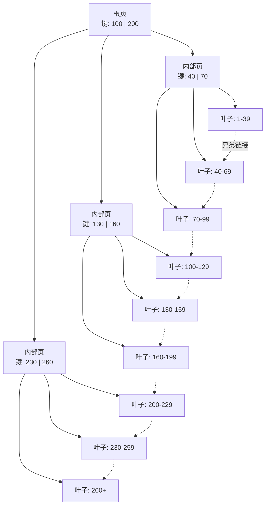
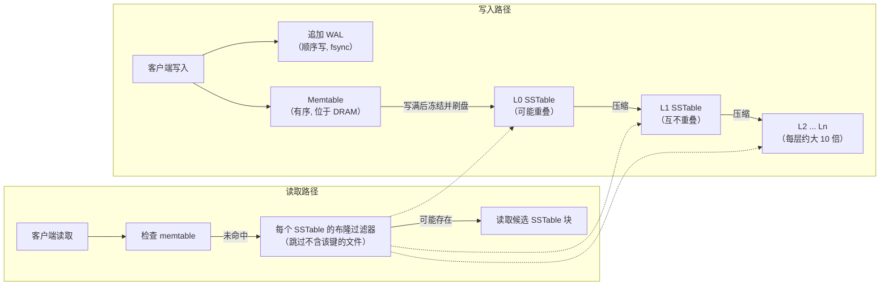

# 3. 数据库内部如何运作
> **深度：** L2 · **阅读时间：** 约 19 分钟 · **最后核实：** 2026-11-01 · **前置阅读：** [第 2 章 — 数据模型](ch02-data-models.md)

## 要点速览（TL;DR）

- 数据库是两台拼装在一起的"机器"。**存储引擎（storage engine）**决定字节在磁盘和内存中如何摆放；**查询处理器**把 SQL 请求转换成分步执行计划并运行它。大多数关于性能的争论，以及许多厂商的宣传，其实都只涉及其中一半。
- 存储引擎有两种主流设计。[B 树（B-tree）](../glossary.md#b-tree)原地更新固定大小的页，针对读取做了优化（PostgreSQL、MySQL InnoDB、Oracle、SQL Server）。[LSM 树（LSM-tree）](../glossary.md#lsm-tree)先在内存中缓冲写入，再写出不可变的有序文件，并在后台合并它们（RocksDB、Cassandra）。两者都不能完胜。[RUM 猜想（RUM conjecture）](../glossary.md#rum-conjecture)指出，在读取成本、更新成本和内存/空间开销三者中，最多只能同时优化两项。
- 持久性来自[预写日志（WAL）](../glossary.md#write-ahead-log)：先把变更写入一份顺序日志，用 `fsync` 强制落到稳定介质上，再惰性地更新数据页。因此，提交延迟主要由 WAL 刷盘延迟决定，而这是一项存储属性。
- 并发能力来自 [MVCC](../glossary.md#mvcc)（多版本并发控制）：写入者创建新的行版本，读取者因此永远不必等待。PostgreSQL 把旧版本留在表中，用 [vacuum](../glossary.md#vacuum) 清理；Oracle 和 InnoDB 则把旧版本保存在[撤销日志（undo log）](../glossary.md#undo-log)中。[隔离级别（isolation level）](../glossary.md#isolation-level)决定应用程序能看到哪些异常。
- [查询优化器（query optimizer）](../glossary.md#query-optimizer)本质上是一个编译器。它把 SQL 改写为若干候选计划，依据统计信息估算各自成本，再选出最便宜的一个。它最大的弱点是[基数估计（cardinality estimation）](../glossary.md#cardinality-estimation)：一旦行数猜错，选中的计划可能比最优计划慢十倍甚至一百倍。

## 为何重要（商业 + Everpure 视角）

本书中的每一款产品都建立在这些机制之上。Snowflake、Databricks、MongoDB、新兴的"面向智能体的 Postgres"服务以及向量数据库，都在做同样几项选择：B 树还是 LSM，原地更新还是仅追加，撤销日志还是版本链，迭代器执行还是向量化执行。当一家厂商宣称"数据摄取快 10 倍"时，诚实的翻译通常是"我们选择了 LSM 风格的写入路径，把成本转移到了后台压缩上"。知道成本转移到了哪里，就是提出一个犀利的尽职调查问题与只能点头附和之间的区别。

对于一家存储公司，这些内部机制决定了落到存储阵列上的 I/O 模式。B 树数据库会发出随机的 8–16 KB 页读写，外加一串小规模的顺序 WAL 写入，而这些写入的 `fsync` 延迟直接位于提交路径上。LSM 数据库在压缩过程中会发出大块的顺序读写，其量往往是应用自身写入量的数倍。这三种特征（随机页 I/O、对延迟敏感的日志刷盘、压缩带宽）解释了为什么数据库整合会成为全闪存阵列的第一个杀手级工作负载，也解释了为什么"更快的存储"能让某些数据库大幅提速，而对另一些几乎毫无帮助。

## 工作原理

### 一切皆是页

数据库读取的不是行，而是**页**（也称为块），即作为 I/O 和缓存单位的固定大小数据块。PostgreSQL 的默认页大小为 8 kB，在编译时设定。[^pg-page] InnoDB 的默认页大小为 16 KB，在实例初始化时选定。[^innodb-limits] 行、索引条目以及空闲空间的记录信息全都存放在页内。

[缓冲池（buffer pool）](../glossary.md#buffer-pool)是数据库自己的页 DRAM 缓存。假设一个查询请求 `orders` 表的第 4,711 页：如果该页在缓冲池中（命中），读取只需纳秒到微秒级；如果不在（未命中），引擎就要从存储中读取该页并淘汰掉其他页，通常使用类 LRU 策略。被修改过的（"脏"）页由后台写入进程在之后以及检查点时写回，而不是在提交时写回。PostgreSQL 有意保持适中的缓冲池规模，并把操作系统的页缓存当作第二层；InnoDB 则倾向于直接掌控服务器的大部分内存。工作集能装进缓冲池的数据库表现得就像内存数据库；装不进去的，则变成了一场存储基准测试。

### 存储引擎之一：B+ 树

B 树由 Rudolf Bayer 和 Edward McCreight 于 1972 年发表（最早于 1970 年以 Boeing 内部报告的形式流传），它把键有序地保存在一棵由页构成、矮而宽的树中。[^bayer72] 几乎所有生产系统都使用 **B+ 树**变体：内部页只保存分隔键和子节点指针，所有数据（或行指针）都放在叶子页中，叶子页之间从左到右串成链表，这样范围扫描就能横向遍历，而无需回到根节点。

*图 3.1 — B+ 树只需三四次页读取就能找到任意键；叶子之间的兄弟链接让范围扫描变成一次顺序遍历。*

一次查找先读根页，每层沿一个指针向下，最终落到叶子页。由于每页能容纳数百个键，这棵树极其矮浅。以 8 kB 页、每条目约 16 字节计算，一个内部页大约可扇出 500 个子节点（估算）。于是三层树（根、一层内部节点、叶子）可容纳约 500 × 500 × 500 ≈ 1.25 亿个键，四层树约 600 亿个。实际运行中，根层和内部层始终驻留在缓冲池中，因此在十亿行的表上做一次点查询，大约只需要一次存储读取来获取叶子页；在 PostgreSQL 这类堆组织表中，还需再读一次来获取行本身。

写入是**原地**进行的。更新一行意味着找到它所在的叶子页，在内存中修改，最终把整页写回。向已满的叶子页插入会触发**页分裂（page split）**：一半条目移到新页，一个新的分隔键被推入父页，而父页也可能随之分裂。分裂让树保持平衡，但会留下部分空闲的页（随机插入时通常约三分之二满），并把一次小小的逻辑变更变成一次或多次整页写入。这就是 B 树的"写入税"。

在商业上，有两种形态值得关注。InnoDB 使用**聚簇**索引：表*本身就是*主键 B+ 树，完整的行存放在叶子中，因此二级索引保存的是主键，通过二级索引查找需要两次树遍历。PostgreSQL 把行存放在无序的**堆**中，包括主键在内的每个索引都是一棵独立的 B 树，指向堆中的位置（元组 ID）。两者没有绝对的优劣：聚簇有利于主键范围扫描，而堆让二级索引更便宜、更新更简单。

> **类比：半导体。** B 树的扇出与缓存行大小遵循同一条设计规则。CPU 一次取 64 字节，是因为内存访问的成本主要在延迟而非带宽，所以要让每次往返尽可能多地带回有用字节。B 树的页就是存储的"缓存行"：一旦为一次设备往返付出了代价，就拉回 8–16 KB 数据，在其上做数百次比较。更大的页能提高扇出、降低树高，但当你只需要一行时就会浪费带宽；这与更长的缓存行会加剧伪共享和过度预取是同一种权衡。

### 存储引擎之二：LSM 树

日志结构合并树（log-structured merge-tree）由 Patrick O'Neil、Edward Cheng 和 Dieter Gawlick 于 1991 年设计，并与 Elizabeth O'Neil 一起于 1996 年发表。[^oneil96] 它的出发点是：在高强度插入流下维护 B 树索引大约会让 I/O 翻倍，因为每次插入都是一次随机页更新。LSM 树则改为在内存中批量积攒变更，顺序写出，稍后再合并。

*图 3.2 — LSM 树把随机写转换为顺序写，代价是后台压缩和跨多个文件的读取。*

一次写入会去两个地方：追加到 WAL 以保证持久性，同时插入 **memtable**（内存表），一种有序的内存结构。memtable 写满后会被冻结，并作为一个不可变的**有序字符串表**（[SSTable](../glossary.md#sstable)）刷到磁盘上；对应的 WAL 段随后即可删除。[^rocksdb-overview] 磁盘上的任何内容都不会被原地修改。一次更新只是某个键在更新文件中的一个更新版本；一次删除则是一个"墓碑（tombstone）"标记。

随着时间推移，文件不断累积，于是一个后台进程——[压缩（compaction）](../glossary.md#compaction)——会把相互重叠的文件归并排序成更大的文件，丢弃被覆盖的版本和墓碑，并把数据沿着层级逐级下推。在 RocksDB 默认的分层（leveled）方案中，每一层大约是上一层的十倍。Cassandra 沿用了同样的"memtable—提交日志—SSTable"模式，这一模式继承自 Google 的 Bigtable 设计。[^cassandra]

代价落在读取上。一个键可能位于 memtable，也可能位于若干层中的任意一层，因此一次点查询可能要探查多个文件。有两种手段让这一代价尚可承受：一是每个文件配备的[布隆过滤器（Bloom filter）](../glossary.md#bloom-filter)，这是一种紧凑的概率型位图，能回答"肯定不在这里"或"可能在这里"，从而让大多数文件无需 I/O 就被跳过；二是把过滤器和索引缓存在 DRAM 中。[^rocksdb-overview] 但范围扫描仍需合并来自每一层的数据流。

工程师用三个放大系数来描述这些成本。[写放大（write amplification）](../glossary.md#write-amplification)是应用每写入 1 字节、实际写入存储的字节数。[读放大（read amplification）](../glossary.md#read-amplification)是每次查找所需的 I/O 次数。[空间放大（space amplification）](../glossary.md#space-amplification)是每字节有效数据所占用的存储字节数。RocksDB 分层压缩的写放大通常被报告为 20–30 倍 [VERIFY: 核实 RocksDB 博客 2022-10-31 中"20–30x"的措辞]；Facebook 早期的一个模型将其估算为大约层数的十倍。[^rocksdb-align][^fms14] 另一种"分级（tiered）"或"通用（universal）"压缩写入更少，但读取更多，且需要更多的预留空间。Athanassoulis 等人 2016 年提出的 [RUM 猜想](../glossary.md#rum-conjecture)把这种两难形式化：在读取、更新和内存开销中优化任意两项，都会让第三项受损。[^rum16] B 树位于读优化的一角；LSM 树更靠近更新优化的一角；压缩策略则是在两者之间调节的旋钮。

回报可以相当可观。Facebook 在 2016 年报告称，把 MySQL 从 InnoDB 迁移到基于 RocksDB 的 MyRocks 引擎后，相同数据的存储占用比压缩后的 InnoDB 减少了 50%，主要原因是不可变的变长文件比固定大小的页压缩和打包效果更好。[^myrocks16] 其 2020 年的 VLDB 论文报告，主用户数据库的实例规模缩小了 62.3%（公司披露）。[^myrocks20]

> **类比：NAND 闪存。** LSM 压缩*就是*上移了一层的闪存转换层（FTL）垃圾回收。SSD 无法原地覆写一个 NAND 页；它把新数据写入新页，把旧页标记为无效，之后再把块中仍然有效的页复制出去，以便擦除整个块。LSM 引擎对文件做的是同样的事：把新版本写到别处，把旧版本标记为过时，并定期把有效键向前复制，从而可以整份删除文件。两者都为"永不原地更新"这一特权付出了写放大的代价，也都在超额配置（预留容量）与放大之间做权衡。这些放大是**相乘**的：1 GB 应用写入 × 20 倍 LSM 写放大 × 1.5 倍设备写放大（示意）意味着 30 GB 的 NAND 编程周期。好的一面是，LSM 的输出是大块、顺序且整份删除的，这接近 FTL 的理想模式；而 B 树分散的 8–16 KB 原地写入，恰恰是最能加重设备端垃圾回收负担的模式。选择存储引擎，在某种程度上就是选择由哪一层来做垃圾回收。

### 主键之外的索引

**主索引**按键来组织表。[二级索引（secondary index）](../glossary.md#secondary-index)是建立在另一列上（比如 `orders.customer_id`）、指回行的额外结构；每增加一个二级索引都会增加写入成本，因为每次插入也必须更新它。[覆盖索引（covering index）](../glossary.md#covering-index)包含查询所需的全部列，引擎只需读索引就能作答而无需访问表，这往往是最有效的单项调优手段。B 树之外，**哈希索引**提供常数时间的等值查找，但不支持范围查询；[位图索引（bitmap index）](../glossary.md#bitmap-index)为每个不同值保存一个位向量，适合分析场景中基数较低的列；[倒排索引（inverted index）](../glossary.md#inverted-index)把每个词或数组元素映射到包含它的行，全文检索以及 PostgreSQL 的 GIN（通用倒排索引）正是借此处理 JSON 和数组。向量索引是最新的一类；参见[第 18 章](../03-ai-data-stack/ch18-embeddings-and-vector-search.md)。

### 预写日志：无需随机写入的持久性

WAL 规则很简单：描述某数据页变更的日志记录刷入稳定存储之后，该数据页的变更才可以写到磁盘。[^pg-wal] 提交时，数据库只强制刷写日志——一次顺序追加——而非那些分散的脏页。崩溃之后，它从最近的检查点开始向前重放日志（"重做/redo"），以重建任何丢失的页变更，并回滚那些从未提交的事务。（PostgreSQL 不需要单独的撤销阶段：它的提交日志只是把这些事务的行版本标记为已中止，使其保持不可见。）日志才是真相之源；数据文件只是日志的一份缓存。

由于每次提交都要等待一次日志的 `fsync`（或等效操作），提交延迟大致等于存储设备的刷写延迟。[组提交（group commit）](../glossary.md#group-commit)可以摊薄这一成本：当许多事务同时提交时，一次刷写就能让它们全部持久化。对于排在一次进行中的刷写之后的提交，PostgreSQL 会自动这样做；`commit_delay`（默认关闭）和 `commit_siblings`（默认需有 5 个并发事务才启用延迟）只是让它多等一会儿以凑成更大的组。RocksDB 同样会把多个写入者合并为一次日志 `fsync`。[^pg-wal-config][^rocksdb-overview] 共享日志也正是流式复制和变更数据捕获（CDC）所接入的地方，这把本章与[第 9 章](../02-pipelines-and-governance/ch09-pipeline-patterns.md)联系了起来。

> **类比：文件系统日志。** 日志式文件系统（ext4、XFS、NTFS）把同样的思路用于元数据：先把意图写入日志，再原地更新，崩溃后重放日志。PostgreSQL 文档指出，由于 WAL 已经能恢复数据文件内容，数据库自身的可靠性并不需要日志式文件系统。[^pg-wal] 两者同时运行，就像为同一批货物投保两次。

> **深入（L3）。** 经典的恢复算法是 IBM 的 ARIES（Mohan 等，1992）。[^aries92] 它分三个阶段：*分析*（从最近的检查点扫描日志，找出脏页和进行中的事务）、*重做*（"重演历史"，让每一条已记录的变更——无论是否已提交——都被重新应用）以及*撤销*（回滚失败者，同时写入补偿日志记录，使恢复过程中的崩溃本身也可恢复）。每个页都保存其最近一次变更的日志序列号（LSN），因此重做是幂等的。ARIES 的"steal, no-force"策略（脏页可以在提交前写出；提交时不必写出页）正是缓冲池和 WAL 可以独立调优的原因。
