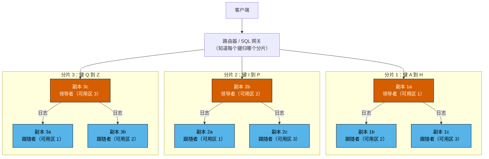
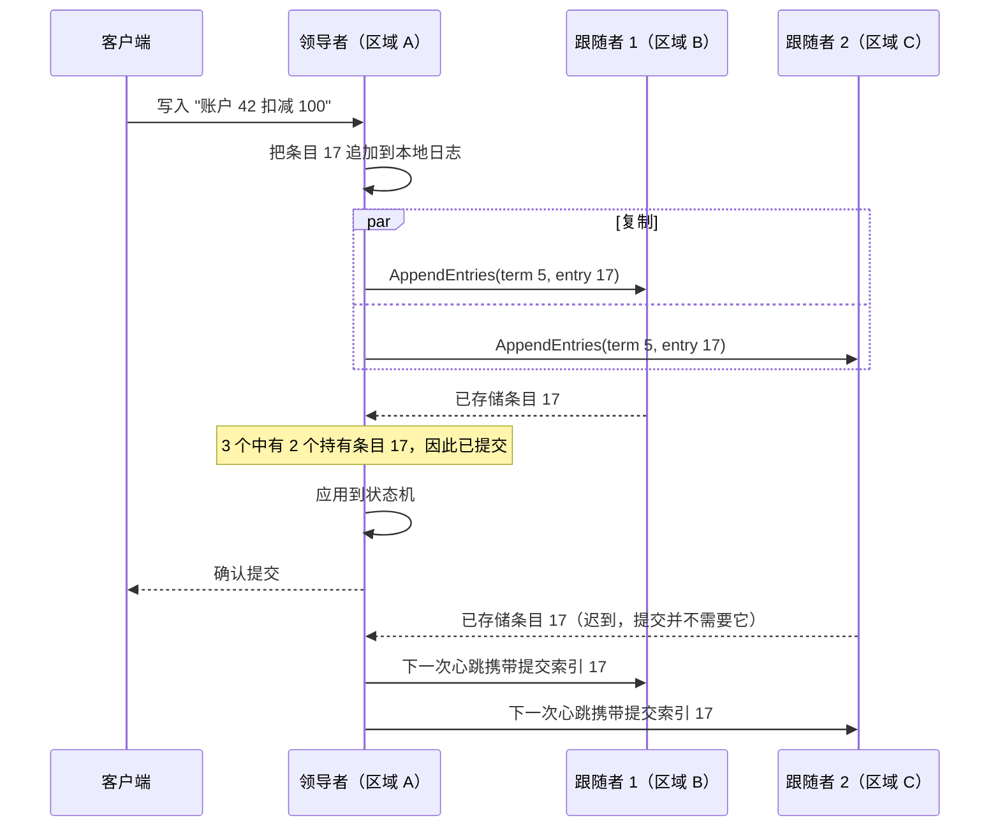
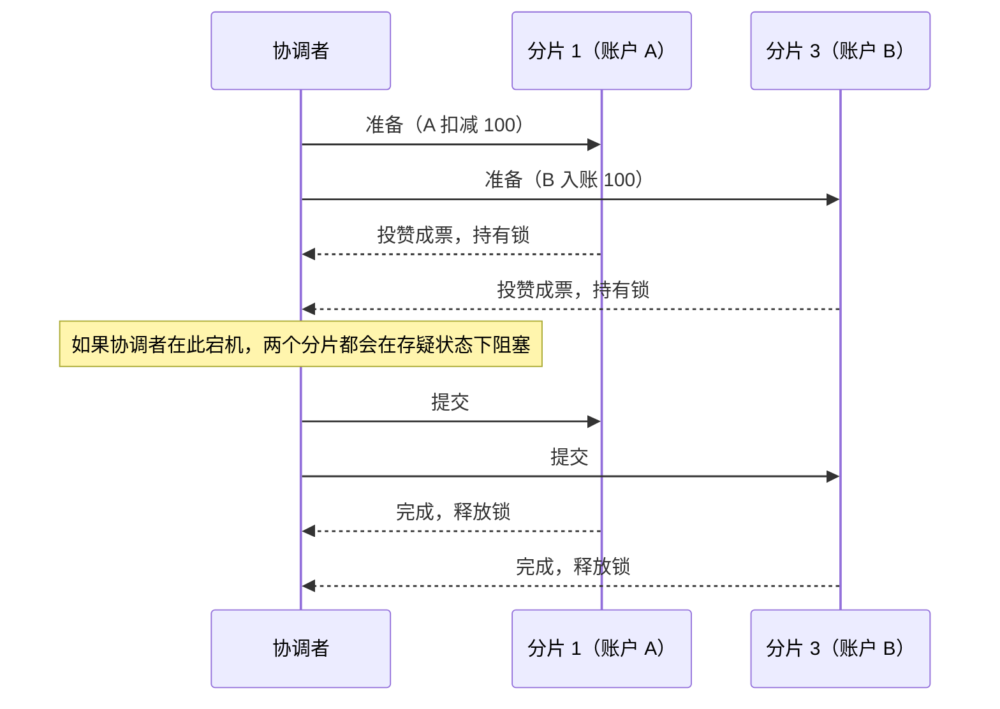
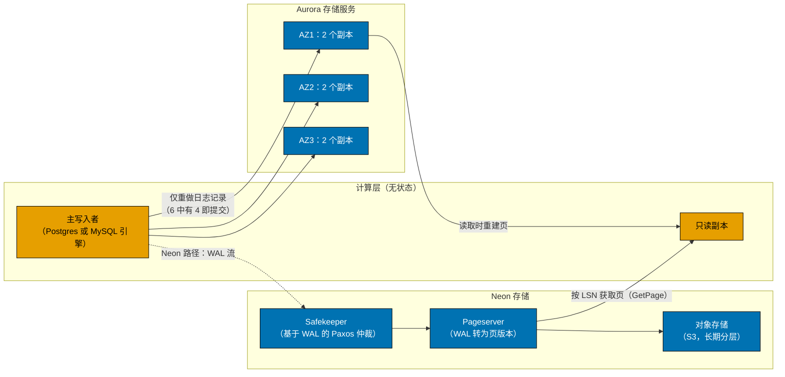
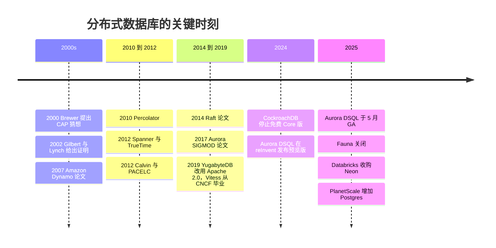

# 4. 分布式数据库
> **深度：** L2 · **阅读时间：** 约 19 分钟 · **最后核实：** 2026-11-01 · **前置阅读：** [第 3 章 — 数据库内部机制](ch03-database-internals.md)

## 要点速览（TL;DR）

- 数据库走向分布式有三个原因：一台机器太小；一台机器是单点故障；或者数据必须存放在多个地方，无论是出于延迟考虑，还是出于法律上的[数据主权（data sovereignty）](../glossary.md#data-sovereignty)要求。每一种分布式设计，都是在这些目标与光速之间做权衡。
- 几乎所有工作都由两种机制完成。**[分片（sharding）](../glossary.md#sharding)**拆分数据，让系统能够扩展。**[复制（replication）](../glossary.md#replication)**复制数据，让系统能够在故障中存活。复制是两者中更难的一个，因为副本会逐渐偏离（[复制延迟（replication lag）](../glossary.md#replication-lag)），除非系统付出代价让它们保持一致。
- 这种一致的达成被称为**[共识（consensus）](../glossary.md#consensus)**，在实践中指的就是 [Paxos](../glossary.md#paxos) 或 [Raft](../glossary.md#raft)。一次写入在多数副本存储之后即告提交。五个副本可以承受两次故障，每次写入需要一次到最近多数派的往返。
- 跨分片的事务需要在共识之上再加一层原子提交协议。经典方案是**[两阶段提交（two-phase commit）](../glossary.md#two-phase-commit)**——协调者一旦宕机它就会阻塞——再加上一种在时间上为事务排序的方法。Spanner 用 GPS 和原子钟（**[TrueTime](../glossary.md#truetime)**）排序。CockroachDB 和 YugabyteDB 使用[混合逻辑时钟（hybrid logical clock）](../glossary.md#hybrid-logical-clock)。TiDB 使用一个中心化的时间戳服务。Aurora DSQL 则采用乐观并发控制，再加上 AWS 微秒级精度的时钟服务。
- 商业现实："分布式 SQL"或 [NewSQL](../glossary.md#newsql) 在技术上已经成熟，但与单节点 Postgres 相比，商业上仍属小众。Cockroach Labs 在 2024 年终止了免费的自托管 Core 版。Fauna——一个受 Calvin 启发的分布式数据库服务——在 2025 年以资本密集度为由关闭。与此同时，超大规模云厂商（Spanner、Aurora DSQL）以及"日志即数据库"的解耦式设计（Aurora、Neon）正获取越来越大的价值份额。

## 为何重要（商业 + Everpure 视角）

支付、账本、库存、身份、电信用户记录、游戏钱包以及智能体记忆，都需要同时满足两点：数据必须保持正确，服务必须在数据中心宕机时依然在线。一家厂商能否同时做到这两点、以何种延迟做到，决定着真实的采购结果。这正是银行愿意为 Spanner 或 CockroachDB 付费、而不是手动给 MySQL 分片的原因，也是为什么"多区域双活（active-active）"的说法值得仔细盘问。CAP 定理、共识和时钟设计，就是这些说法所使用的词汇。一位能问出"领导者在哪里？一次提交需要几次往返？"的高管，可以穿透大部分营销话术。

对于 Everpure（原 Pure Storage；纽交所代码 P，原为 PSTG）而言，相关的转变在于架构。云原生的操作型数据库越来越多地把持久性*下沉*到专门构建的存储服务中。Amazon Aurora 开创了这一模式，Neon（现为 Databricks Lakebase）照搬了它。数据库层只传送其[预写日志（WAL）](../glossary.md#write-ahead-log)，由存储把日志转换为页。这种设计让存储语义——而非数据库引擎——成为真相之源。这是本章与存储业务交集最清晰的地方（参见下文的存储桥接，以及[第 28 章](../04-company-deep-dives/ch28-hyperscaler-data-platforms.md)和[第 29 章](../04-company-deep-dives/ch29-operational-database-vendors.md)中的相关厂商）。

## 工作原理

### 为什么要分布式

在现代硬件上，一台调优良好的 Postgres 服务器就能处理大量工作；[第 3 章](ch03-database-internals.md)解释了原因。离开单机有三个理由：

1. **规模。** 工作集、写入速率或存储量超出了一台机器的承载能力。难点在于写入。读取可以分流到副本上，但每次写入最终都必须落到拥有该行的那个节点上。
2. **可用性。** 一台机器、一个机架或一个区域终将发生故障。要在整个区域丢失后存活，至少需要在另一个区域保存副本，通常需要两个（见下文的多数派算术）。
3. **地理与主权。** 法兰克福的用户不应等待一次到弗吉尼亚的往返，而且一些监管机构要求某些行永远不得离开某一司法管辖区。这让*数据放置*变成了模式层面的决策。

这三者之下的约束都是物理学。光在光纤中每毫秒大约传播 200 km，因此一条 6,000 km 的线路在任何软件运行之前，每次往返就要耗费约 60 ms。[^physics] 没有任何协议能突破这一点。协议只能决定一次提交需要*多少次*这样的往返，以及由*哪些*用户来承担。

### 分区（分片）

分片把每一行分配到众多分区之一，再把每个分区分配给一个节点。有两种基本方案：

- **哈希分区**对键应用哈希函数，并把哈希值映射到某个分片。负载分布均匀，但范围扫描（"客户 42 上周的所有订单"）会触及每一个分片。Amazon 的 **Dynamo** 论文推广了**[一致性哈希（consistent hashing）](../glossary.md#consistent-hashing)**：它把节点和键放在一个环上，每个键存储在顺时针方向的下一个节点上。这样增加一个节点只需移动约 1/N 的键，而不是全部重新洗牌。Dynamo 还为每个物理节点分配许多"虚拟节点"，以便在硬件变化时保持负载均衡。[^dynamo]
- **范围分区**保持键的有序，并把它们切分成连续的范围。Bigtable、Spanner、CockroachDB、TiKV 和 YugabyteDB（可选）都采用这种方式。范围扫描保持本地化，热点范围可以自动拆分。代价是单调递增的键（如时间戳或自增 ID）会把每一次新写入都发送到*最后*一个范围。

这种"最后一个范围"的堆积就是**[热点（hot spot）](../glossary.md#hot-spot)**，而热点是分片系统在生产中最常见的故障。一个名人账户、一个商户或一个"今天"分区就能让单个节点饱和，而集群其余部分却在空转。补救措施包括对键前缀做哈希或加盐、拆分热点范围，以及围绕热点键进行建模（例如为每个商户设置许多子账户）。**重新分片（resharding）**——即在提供服务的同时迁移数据——才是真正的工程投入所在。像 Spanner 和 CockroachDB 那样能自动拆分和再平衡范围的系统，与手动分片的 MySQL 相比，免去了沉重的运维负担。Vitess——YouTube 的 MySQL 分片层——之所以存在，很大程度上就是为了让这种负担变得可控。[^vitess]

### 复制

每个分片都会被复制到多个节点。设计分为三大类：

- **领导者—跟随者（单领导者）。** 一个副本接受写入，并把它的日志流式传送给跟随者。Postgres 流复制和 MySQL 复制都是这样工作的。复制可以是**同步**的，即领导者在确认客户端之前等待一个跟随者（安全但较慢）；也可以是**异步**的，即领导者先确认、后传送（快速，但故障切换可能丢失已确认的写入）。领导者与跟随者之间的差距就是**复制延迟**。这就是为什么用户更新了个人资料、从副本刷新页面后，看到的却还是旧版本。
- **[多领导者复制（multi-leader replication）](../glossary.md#multi-leader-replication)。** 多个副本（通常每个区域一个）接受写入并相互交换。本地写入很快。代价是冲突：两个区域可能在同一时刻扣减同一个账户。"最后写入者胜出"会悄无声息地丢弃其中一次更新，这对账本来说是不可接受的。
- **[无领导者复制（leaderless replication）](../glossary.md#leaderless-replication)**（Dynamo 风格）。客户端向 N 个副本写入，一旦 W 个副本确认即视为写入成功。它从 R 个副本读取，如果 R + W > N，读取集合就会与最新的写入集合重叠。常见的 Dynamo 配置是 N=3、R=2、W=2。Dynamo 还使用"宽松仲裁（sloppy quorum）"和提示移交（hinted handoff）在故障期间保持可写，代价是出现暂时分歧的版本，需要由应用来调和。[^dynamo]

*图 4.1 — 分片提供规模，复制提供生存能力。三个分片、每个分片三个副本，共九个副本；每个分片的领导者放在不同的可用区，使写入负载和故障影响均匀分散。*

> **类比：缓存一致性（MESI）。** 复制延迟是芯片设计者熟知的一个问题的分布式版本。在多核 CPU 中，MESI 协议保持一个缓存行的各个副本的一致性：某个核心在写入之前，必须使所有其他副本失效，这需要付出嗅探或目录往返的代价。这就是一致性流量限制了插槽数量的原因，也是 x86 允许核心自己的存储操作先停留在存储缓冲区、然后才被其他核心看到的原因。存储缓冲区就是微缩版的异步复制，而内存屏障就是一次同步提交。数据库面对的是同样的选择，只不过时间尺度是毫秒而非纳秒：要么为保持副本一致而在每次写入时付出一次往返，要么接受一个读取者可能看到陈旧数据的时间窗口。

### 共识：副本如何达成一致

单领导者复制引出一个显而易见的问题：由谁决定谁是领导者？领导者在写入进行到一半时宕机会怎样？**共识**协议回答了这个问题。它们让一组副本即使在部分成员崩溃或消息延迟的情况下，也能就一份有序的命令日志达成一致。

**Paxos** 最先出现。Leslie Lamport 在 2001 年的重述《Paxos Made Simple》中描述了两个阶段。第一阶段，提议者从多数接受者那里获得承诺。第二阶段，它请求它们接受一个值，被多数接受的值即被选定。[^paxos] 生产系统运行的是带稳定领导者的"Multi-Paxos"，因此稳态下每次写入只需一次往返。Spanner 把数据分片到许多 Paxos 组中。[^spanner]

**Raft**（Ongaro 和 Ousterhout，2014）的设计目标是更易于理解和实现，并且在很大程度上做到了。CockroachDB、TiKV、YugabyteDB 和 etcd 都使用它。[^raft] Raft 由三部分组成：

1. **领导者选举。** 时间被划分为编号的*任期（term）*。在随机化超时内没有收到领导者消息的跟随者会成为候选者并请求投票。赢得多数票的候选者成为该任期的领导者，随机化则让选票分裂的情况很少发生。
2. **日志复制。** 领导者把每条客户端命令追加到自己的日志中，并通过 AppendEntries 消息发送给跟随者。
3. **多数提交。** 一旦多数节点（包括领导者在内）存储了该条目，它就被*提交*。领导者应用它并答复客户端。候选者只有在其日志至少与多数节点一样新时才能赢得选举，因此新领导者总是持有所有已提交的条目。

*图 4.2 — 一次 Raft 提交只需从领导者到最近多数派的一次往返，因此最慢的副本不会拖慢客户端。这就是为什么决定写入延迟的是领导者的放置位置，而不是副本数量。*

算术很重要。要容忍 *f* 个崩溃的副本，需要 *2f + 1* 个副本，因此三个副本能承受一次故障，五个能承受两次。要在整个区域丢失后存活，就至少需要三个区域（或者两个完整区域，加上放在第三个位置、用于打破平局的轻量级"见证（witness）"副本）。仅有两个区域时，任何一个发生故障后都无法维持多数。

> **类比：三模冗余。** 用于航空电子和航天的容错芯片采用三模冗余（TMR）：电路的三个副本输入一个多数表决器，因此一个故障模块会被投票否决。共识仲裁建立在同样的 2f + 1 逻辑之上，但有两点不同。第一，TMR 表决器是同步的，每个时钟周期都会表决。共识则必须在异步网络上工作，在那里一个缓慢的副本与一个宕机的副本无法区分，这就是它依赖超时和任期的原因。第二，TMR 屏蔽的是*错误*输出，而 Raft 和 Paxos 假设副本只会以停止运行的方式失效。要容忍主动撒谎的（拜占庭）节点，需要 3f + 1 个副本以及额外的消息轮次。这正是拜占庭容错系统——以及在此之上还要支持开放成员资格的公有区块链——每笔交易的成本远高于数据库的原因之一。

### 跨分片的分布式事务

共识让*单个分片*变得可靠。但一笔在分片 1 上扣减账户 A、在分片 3 上为账户 B 入账的支付，还需要两个分片*一起*提交或中止。

**两阶段提交（2PC）**是经典答案。协调者请求每个参与者*准备（prepare）*；每个参与者把变更以临时方式持久化、持有锁，并投出赞成或反对票。如果全部为赞成票，协调者就发送*提交（commit）*。其弱点在于阻塞。如果协调者在参与者投赞成票之后崩溃，参与者无法安全地自行提交或中止，只能持有锁、处于"存疑（in doubt）"状态，直到协调者恢复。现代系统通过让协调者和每个参与者都成为一个共识组来消除阻塞，这样宕机的机器只需由同一组的新领导者接替即可。Spanner 正是这样做的：2PC 运行在 Paxos 组之上。[^spanner]

*图 4.3 — 两阶段提交增加了一次往返和一个阻塞窗口。像 Spanner 那样把每个参与者和协调者都作为复制的共识组运行，就能把"协调者宕机"从一次服务中断变成一次领导者选举。*

第二个问题是**时间上的排序**。为了支持快照读取和可串行化，每个事务都需要一个符合真实世界顺序的时间戳。然而各台机器的时钟并不一致，主要系统采取了四种方法：

- **Spanner 的 TrueTime。** 每个 Google 数据中心都有配备 GPS 接收器和原子钟的时间主服务器。TrueTime API 返回的是一个*区间*（最早，最晚），而非单一时刻。在 2012 年的论文中，不确定度 ε 以锯齿状在约 1 到 7 ms 之间摆动，平均约 4 ms。[^spanner] 事务取区间上限作为其提交时间戳，然后等待不确定度过去（"提交等待/commit wait"），再释放锁。结果是**[外部一致性（external consistency）](../glossary.md#external-consistency)**：如果在真实时间中 T1 在 T2 开始之前提交，那么在全球范围内 T1 的时间戳都更小。代价是每个写事务需要等待几毫秒，外加专用硬件。
- **混合逻辑时钟（HLC）。** CockroachDB 和 YugabyteDB 把普通的 NTP 同步物理时间与一个逻辑计数器结合起来；每当节点看到带有更晚时间戳的消息时，计数器就向前推进。[^hlc] 这不需要专用硬件。取而代之的是，系统假设一个*最大时钟偏移*（根据所引文档，CockroachDB 默认为 500 ms `[VERIFY: CockroachDB 25.x/26.x 中的当前默认值]`）。如果一次读取在其不确定性窗口内遇到某个值，它可能需要重启。[^crdb-clock] 代价是偶尔的重试，以及对不共享数据的事务而言比 Spanner 略弱的保证。好处是它可以在任何云上运行。
- **中心化时间戳授时器（timestamp oracle）。** Google 为增量网页索引构建的 Percolator 在 Bigtable 之上运行 2PC，时间戳来自一个授时服务。[^percolator] TiDB 采用了这一模型。其 Placement Driver（PD）本身通过 Raft 复制，以批量方式分发严格递增的时间戳。[^tikv-tso] 这种方法简单且正确，但在多区域部署中，每个事务都要往返一次授时器领导者所在的位置。
- **确定性排序（Calvin）。** Calvin（耶鲁大学，2012）先就*事务输入的顺序*达成一致，每批次只需一轮共识。随后每个副本以确定性方式执行该批次，无需 2PC。[^calvin] 这消除了提交时的协调，但要求事先知道每个事务的读写集合。其最知名的商业后继者 Fauna 已于 2025 年 5 月关闭服务。[^fauna]

Amazon 的 **Aurora DSQL** 结合了其中几种思路。事务以乐观方式无锁运行。提交时，一组*裁决器（adjudicator）*检查冲突，一个复制的*日志（journal）*使提交持久化。快照读取使用 AWS Time Sync Service，AWS 称其精度达到微秒级。[^dsql-arch] 读取保持本地化，协调只在提交时发生一次。在热点键上，这种设计会把锁等待转化为中止和客户端重试。

> **类比：TrueTime 与 GPS 驯服振荡器。** TrueTime 是把数据中心的授时实践变成了一项数据库保证。电信和交易所的数据中心早已用 GPS 驯服石英或铷振荡器，并通过 PTP（IEEE 1588）分发时间，借助网卡中的硬件时间戳获得亚微秒级的一致。Spanner 的 ε 锯齿就是振荡器保持（holdover）漂移：在两次同步轮询之间，本地时钟的误差界按假定的最坏漂移率扩大，重新同步时再骤然回落。[^spanner] 更好的授时硬件会直接缩小 ε，而更小的 ε 意味着更短的提交等待。这一联系解释了为什么 AWS 微秒级的时间服务是 Aurora DSQL 的基础构件，也解释了为什么时钟质量已经成为一项数据库特性。

### CAP、PACELC 与一致性模型

**[CAP 定理（CAP theorem）](../glossary.md#cap-theorem)**起初是 Eric Brewer 在 2000 年提出的猜想，2002 年由 Gilbert 和 Lynch 证明。它指出，当网络发生*分区*时，一个复制系统必须在一致性（每次读取都能看到最新写入，形式化地说即线性一致性）与可用性（发往存活节点的每个请求都能得到应答）之间做出选择。[^gilbert-lynch] Brewer 后来强调，分区很少发生，而这一选择只在分区期间才需要做出。[^brewer12] Daniel Abadi 的 **[PACELC](../glossary.md#pacelc)** 表述补充了每天都很重要的那种情况：如果发生分区（Partition），在可用性（Availability）与一致性（Consistency）之间选择；否则（Else），在延迟（Latency）与一致性（Consistency）之间选择。[^abadi] 即使网络完美无缺，同步达成一致也要付出往返的代价。

| 系统 | 分区时（PA / PC） | 否则（EL / EC） | 实践中的含义 |
|---|---|---|---|
| Amazon Dynamo（2007 年论文） | PA | EL | 始终可写；冲突版本稍后由应用调和[^abadi] |
| Apache Cassandra（默认可调参数） | PA | EL | 可调仲裁；轻量级事务可用，但需额外成本[^abadi] |
| Riak | PA | EL | Dynamo 的后继者[^abadi] |
| MongoDB（Abadi 的分类，默认配置） | PA | EC | 每个分片单一主节点；行为在很大程度上取决于写关注（write concern）设置[^abadi] |
| Yahoo PNUTS | PC | EL | 每条记录一个主节点；副本可能提供陈旧读取[^abadi] |
| VoltDB / H-Store | PC | EC | 强一致、内存型、分区式[^abadi] |
| Google Spanner | PC | EC | Paxos 多数派加提交等待；少数派一侧变为不可用[^spanner] |
| CockroachDB / YugabyteDB | PC | EC | 每个 range 或 tablet 一个 Raft 多数派；可选跟随者读取，以获得有界陈旧度 |
| TiDB | PC | EC | 每个 region 一个 Raft 组，加中心化时间戳授时器[^tikv-tso] |
| Aurora DSQL | PC | EC | 跨区域强一致；代价在提交时支付[^dsql-ga] |
| Postgres 主节点加异步副本 | 在故障切换时做出选择 | EL | 提升一个滞后的副本可以恢复可用性，但可能丢失已确认的写入 |

*图 4.4 — 真正值得关注的是"否则"这一列。大多数 NewSQL 系统属于 PC/EC：为了在罕见的分区期间避免异常，它们每天在每次提交上都付出延迟。分类针对的是默认配置；大多数系统都可调。*

**一致性模型**描述读取者可能观察到的内容。从强到弱依次为：

- **[线性一致（Linearizable）](../glossary.md#linearizability)：** 每个操作看起来都在其开始和结束之间的某一瞬间生效，与真实时间相符。Spanner 的外部一致性把这一点扩展到了多行事务。
- **顺序一致（Sequential）：** 所有客户端以相同顺序看到操作，且每个客户端自己的操作保持程序顺序，但这一顺序不必与真实时间相符。
- **因果一致（Causal）：** 如果一个操作可能影响了另一个操作（我读了你的帖子，然后回复），那么所有人都按这个顺序看到它们。不相关的操作在不同地方可能以不同顺序出现。
- **[最终一致（Eventual）](../glossary.md#eventual-consistency)：** 如果写入停止，副本最终会收敛。对于在此期间读取者会看到什么，不作任何承诺。

每往下一级都减少了协调，从而减少了延迟。大多数缺陷都源于开发者假设了比系统实际提供的更强的模型。

### 解耦："日志即数据库"

家族树的另一个分支保留*单一*写入者，但把*存储*分布出去。Amazon Aurora（SIGMOD 2017）观察到，传统数据库会把同样的数据写好几遍：日志、页、双写缓冲区和副本。Aurora 的计算节点**只把重做日志记录**写入一个分布式存储服务。存储在三个可用区中保存六个副本，六个中有四个持有某次写入时即确认该写入，读取则需三个副本。由存储节点——而不是数据库——按需从日志重建页。[^aurora] 借助这一仲裁机制，Aurora 在丢失整个可用区后仍能继续接受写入，在丢失一个可用区再加一个节点后仍能继续提供读取（并能自我修复），而数据库实例之间不需要任何共识流量。Neon 把同样的思路用于开源 Postgres。*Safekeeper* 使用 Paxos 持久地存储 WAL，*pageserver* 把 WAL 转换为带版本的页，冷数据则进入 S3 之类的对象存储。计算变为无状态，可以缩容到零，这使项目可以通过指向更早的日志位置来为数据库创建分支。[^neon]

*图 4.5 — 在解耦式设计中，计算层只传送其日志，存储服务则负责持久性、复制和页的物化。数据库最难的工作由此转移到了存储系统中。*

## 实例演算：跨三个区域的支付账本

设想一家钱包服务商，用户分布在美国东部、美国西部和欧洲西部三个区域。它每秒处理 5,000 笔支付，每笔支付扣减一个账户并为另一个账户入账。假设往返时间约为：东部—西部 65 ms、东部—欧洲 75 ms、西部—欧洲 135 ms（与光纤距离相符的估算[^physics]）。不变量很简单：任何余额都不得为负，任何已确认的支付都不得丢失。

| 方案 | 欧洲用户看到的提交延迟 | 区域丢失：面临风险的数据 | 能否保护"余额不为负"？ |
|---|---|---|---|
| 美国东部单一主节点，异步副本 | 约 75 ms（到主节点的一次往返） | 延迟窗口内的一切。按 200 ms 延迟 × 5,000/s 计 ≈ 1,000 笔已确认支付 | 故障切换前可以；有损故障切换后，余额可能出错 |
| 单一主节点，美国西部同步副本 | 约 75 + 65 ≈ 140 ms | 无（RPO 为零），但若副本所在区域宕机，可用性会下降 | 可以 |
| 多领导者，每个区域一个写入者 | 本地，几毫秒 | 较小的异步窗口 | **不能。** 两个区域的并发扣款可能使账户透支；最后写入者胜出会让钱凭空消失 |
| 无领导者仲裁，跨区域 N=3，W=2 | 约 75 ms（最近的另一个区域） | 对已达到 W 的写入而言无风险 | 单靠它不行；需要按键的比较并设置（compare-and-set）或基于 Paxos 的轻量级事务 |
| 每个分片 Raft 或 Paxos，领导者位于美国东部（CockroachDB、YugabyteDB、Spanner） | 到达领导者约 75 ms + 领导者到多数派约 65 ms ≈ 140 ms；Spanner 还要加上提交等待，当两个账户位于不同分片时再加上 2PC 往返 | 无 | 可以，可串行化 |
| 同上，但领导者放在每个账户的归属区域（"按行区域化/regional by row"） | 本地用户：约 65–75 ms（一次多数派往返）；跨区域转账：更多 | 无 | 可以 |
| 乐观式，多区域（Aurora DSQL） | 读取在本地；提交时一轮跨区域往返 | 对已提交事务而言无风险 | 可以；热点账户在争用下会中止并重试 |

*图 4.6 — 在三个区域中保证正确性，每次提交至少要付出一次跨区域往返。唯一的问题是由哪些用户来承担，以及故障模式是"慢"还是"错"。*

给高管的结论：**每一个能让账本保持正确的方案，都会为部分用户在提交路径上加入 60–140 ms 的物理延迟。** 更便宜的方案并不是同一件事的更快版本，它们放弃了不变量。工程上的功力在于放置。把每个账户的领导者放在其所有者附近，让大部分支付在区域内完成，并把那个收取全部入账 10% 的商户当作一个建模问题（把它的余额拆分为许多子账户），而不是数据库问题。在任何协议下，热点账户都是热点。

## 设计选择与权衡

| 选择 | 方案 A | 方案 B | 为"较弱"方案构建的最强版本论证 |
|---|---|---|---|
| 分区 | 哈希：负载均匀，范围扫描差 | 范围：扫描本地化，顺序键导致尾部热点 | 结合一致性哈希的哈希分区让再平衡几乎零成本，适合键值类工作负载 |
| 复制时机 | 同步：不丢写入，较慢 | 异步：快速，故障切换有损 | 大多数企业可以为罕见的区域故障容忍几秒钟的数据丢失，以换取每天更低的延迟和成本 |
| 写入拓扑 | 每个分片单一领导者 | 多领导者或无领导者 | 协作型或仅追加型数据（购物车、点赞、CRDT 文档）可以无冲突合并，并获得本地写入 |
| 时钟 | TrueTime（硬件支撑） | HLC 或中心化授时器 | HLC 可在任何云上运行，无需专用硬件；授时器在单一区域内简单且快速 |
| 并发 | 悲观锁 | 乐观（DSQL） | 乐观方式避免了锁的往返，在冲突罕见时胜出 |
| 架构 | 无共享（shared-nothing）分布式 SQL | 单一写入者 + 解耦式存储（Aurora、Neon） | 单一写入者覆盖了绝大多数应用；解耦式架构带来快速故障切换、分支和缩容到零，而没有分布式事务的复杂性 |

*图 4.7 — 分布式设计是一份关于往返次数的菜单。每一个"更强"的选项，都是用延迟、成本或运维复杂度来换取正确性或全球规模。*

## 主要参与者

| 系统（所有者） | 共识 | 时钟方法 | SQL 方言 | 许可证 | 部署方式 | 知名用户（公开） |
|---|---|---|---|---|---|---|
| Google Spanner | 每个 split 一个 Paxos 组 | TrueTime（GPS + 原子钟） | GoogleSQL；PostgreSQL 接口 `[VERIFY: 当前 PG 方言功能覆盖范围]` | 专有 | Google Cloud 托管 | Google 的 F1 广告后端[^spanner] |
| CockroachDB（Cockroach Labs） | 每个 range 一个 Raft 组 | HLC，最大偏移界限 | 兼容 PostgreSQL 线协议 | CockroachDB Enterprise（源码可得）；自 2024 年 11 月起对收入低于 $10M 的公司提供免费层[^crdb-license] | 自托管；CockroachDB Cloud | Netflix（380+ 个集群，厂商披露）、Hard Rock Digital[^crdb-netflix] |
| YugabyteDB（Yugabyte） | 每个 tablet 一个 Raft 组 | HLC | 兼容 PostgreSQL（YSQL），另有类 Cassandra 的 YCQL | 数据库自 2019 年起采用 Apache 2.0；管理工具采用 Polyform[^yb-license] | 自托管；托管云 | Kroger、Paramount+（厂商案例研究）[^yb-customers] |
| TiDB（PingCAP） | 每个 region 一个 Raft 组（TiKV） | PD 中的中心化时间戳授时器（Percolator 模型） | 兼容 MySQL | Apache 2.0[^tikv-tso] | 自托管；TiDB Cloud | Pinterest（HBase 迁移，厂商案例研究）[^tidb-pinterest] |
| Aurora DSQL（AWS） | 复制日志；乐观裁决 `[VERIFY: AWS 文档所述的复制协议]` | AWS Time Sync Service（微秒级） | 兼容 PostgreSQL 的子集 | 专有 | AWS 无服务器；2025 年 5 月 GA[^dsql-ga] | 未找到旗舰级公开参考客户 `[VERIFY]` |
| Vitess / PlanetScale | 无全局共识；每个分片使用 MySQL 复制 | 无全局时钟（每分片 MySQL） | MySQL | Vitess 采用 Apache 2.0，已从 CNCF 毕业；PlanetScale 是商业服务[^vitess] | 自托管 Vitess；PlanetScale 云（自 2025 年起也支持 Postgres）[^planetscale] | YouTube（Vitess 的发源地）[^vitess] |

*图 4.8 — NewSQL 领域沿两条轴线分化：用谁的时钟，上谁的云。Spanner 和 DSQL 只在超大规模云厂商上提供，而 CockroachDB、YugabyteDB 和 TiDB 可以在任何地方运行；与 Postgres 或 MySQL 的兼容性决定了大多数迁移。*

各家的定位如下：

- **Spanner** 是参考设计，也是最早建立在硬件支撑的全球时间之上的数据库（Aurora DSQL 所依赖的 AWS Time Sync Service 是第二个超大规模云厂商的例子）。在 Google Cloud 内部它是自然之选，同时也把客户绑定在 Google Cloud 上。
- **CockroachDB** 是最成熟的云中立、Postgres 风格的分布式 SQL 数据库，具备强大的多区域放置功能。2024 年的许可证变更意味着大型自托管用户现在必须付费，公司认为这为研发提供了资金。[^crdb-license]
- **YugabyteDB** 以更深的 Postgres 兼容性（它复用了 Postgres 的查询层）和宽松的许可证参与竞争。
- **TiDB** 带来了 MySQL 生态，并增加了 TiFlash 列式副本，以支持混合事务分析处理（HTAP）查询（见[第 5 章](ch05-analytical-engines.md)）。它在亚洲和大型互联网公司中最为强势。
- **Aurora DSQL** 是 AWS 的无服务器产品：无需规划服务器规模，采用乐观并发，具备多区域强一致性。AWS 将其宣传为"最快的分布式 SQL 数据库"；这是公司自己的说法。[^dsql-ga] AWS 还给出了单区域 99.99%、跨区域 99.999% 的可用性设计目标。[^dsql-ga] 它的隔离级别是快照隔离（AWS 称之为强快照隔离，相当于 PostgreSQL 的可重复读），而非可串行化，[^dsql-arch]因此对于跨行的不变量，写偏斜（[第 3 章](ch03-database-internals.md)）仍然可能发生。它的 Postgres 兼容性只是一个子集，因此在规划迁移之前要先核查功能差距。
- **Vitess 和 PlanetScale** 是对 MySQL 做分片，而非取代它。PlanetScale 此后又推出了运行在本地 NVMe"Metal"节点上的 Postgres 服务，押注许多团队更想要一个快速的单写入者 Postgres，而不是分布式事务。[^planetscale]
- **Neon 和 Aurora** 代表着解耦式单写入者这一替代路线。Neon 被 Databricks 以约 $1B 收购（媒体报道，2025 年 5 月宣布），现以 Lakebase 的名义提供。[^neon-deal] [Postgres 复兴](../03-ai-data-stack/ch22-agents-and-data.md)主要沿着这一分支展开，而不是通过分布式 SQL。

**采用现实。** 开发者压倒性地选择普通的 Postgres。对 2025 年 Stack Overflow 开发者调查的二手解读显示，约 55.6% 的受访者使用 PostgreSQL，在所有数据库中最高。[^so2025] 分布式 SQL 在单一写入者确实无法应付、或区域性宕机不可接受的场景中胜出：支付、游戏、电信、超大型 SaaS。在其他场景中，团队会纵向扩展、增加只读副本，并尽量推迟分片。融资记录显示了这种压力。Cockroach Labs 最后一次确认定价的融资是以 $5B 估值融资 $278M（媒体报道，2021 年 12 月），此后未发现新的融资轮次。[^crdb-series-f] Fauna 的管理层表示，全球数据库服务的资本密集度太高，难以继续独立融资（媒体报道）。[^fauna]

## 历史与发展轨迹

*图 4.9 — 理论在 2014 年前已经尘埃落定。此后的故事是商业性的：超大规模云厂商把这些思想产品化，而独立厂商则收紧许可证或退出市场。*

思想演进的轨迹从不可能性结论走向工程实践。CAP（2000–2002）[^gilbert-lynch]首先为 Dynamo、Cassandra 和 Riak 这一波 NoSQL 浪潮提供了为可用性而放弃一致性的理由。[^dynamo] 随后 Spanner（2012）表明，有了好的时钟，全球一致性是负担得起的。[^spanner] Raft（2014）让普通团队也能实现共识，从而催生了 CockroachDB、TiDB 和 YugabyteDB。[^raft] Aurora（2017）则展示了一条平行路径：保留一个写入者，把存储分布出去。[^aurora]

商业上的演进则没那么整齐。Cockroach Labs 在 2019 年从 Apache 2.0 转向 Business Source License。2024 年 8 月，它宣布将终止免费的自托管 Core 版。从 24.3 版（2024 年 11 月）起只有单一的 Enterprise 许可证，对个人、学生以及年收入低于 $10M 的企业免费，但免费用户必须开启遥测。[^crdb-license] YugabyteDB 在 2019 年走了相反的方向，把数据库完全改为 Apache 2.0。[^yb-license] AWS 让 Aurora DSQL 从 re:Invent 2024 上的预览版，到 2025 年 5 月 27 日正式 GA，发布时覆盖八个区域。[^dsql-ga] 值得关注的趋势是整合。超大规模云厂商把分布式 SQL 捆绑进自己的云，数据平台收购 Postgres 公司（Neon、Crunchy Data；见[第 29 章](../04-company-deep-dives/ch29-operational-database-vendors.md)），而独立厂商必须证明自己的价格相对于"Postgres 加一套好的故障切换方案"是合理的。

## 关键数字

| 指标 | 数值 | 依据 | 来源 / 日期 |
|---|---|---|---|
| 承受 *f* 次崩溃故障所需副本数 | 2f + 1（1 次需 3 个，2 次需 5 个） | 协议属性 | Raft，2014[^raft] |
| TrueTime 不确定度 ε | 约 1–7 ms 锯齿，典型值约 4 ms | 论文报告（2012） | Spanner OSDI 2012[^spanner] |
| Aurora 存储仲裁 | 6 个副本 / 3 个可用区；写入 6 中取 4，读取 6 中取 3 | 论文报告 | Aurora SIGMOD 2017[^aurora] |
| CockroachDB 默认最大时钟偏移 | 500 ms | 厂商文档 / 博客 | Cockroach Labs[^crdb-clock] |
| 光纤传播 | 约每 ms 200 km（≈ 每 100 km 1 ms RTT） | 估算（物理） | [^physics] |
| Aurora DSQL GA | 2025 年 5 月 27 日；发布时 8 个区域 | 公司披露 | AWS[^dsql-ga] |
| Aurora DSQL 可用性设计目标 | 单区域 99.99%；多区域 99.999% | 公司披露 | AWS[^dsql-ga] |
| CockroachDB Enterprise Free 资格 | 年收入低于 $10M | 公司披露 | Cockroach Labs，2024[^crdb-license] |
| Cockroach Labs 最后一次确认的融资 | $278M F 轮，投后估值 $5B（2021 年 12 月） | 媒体报道 | CNBC 2021-12-16[^crdb-series-f] |
| Databricks–Neon | 约 $1B（2025 年 5 月宣布） | 媒体报道 | TechRepublic[^neon-deal] |
| Netflix 的 CockroachDB 规模 | 380+ 个集群 | 厂商披露 | Cockroach Labs，RoachFest 2024[^crdb-netflix] |
| PostgreSQL 使用率，Stack Overflow 2025 调查 | 约 55.6% 的受访者 | 媒体报道（二手解读） `[VERIFY: 对照官方调查页面]` | [^so2025] |

*图 4.10 — 决定系统行为的数字是往返次数、仲裁规模和时钟界限，而不是节点数量。*

## 存储桥接

> **存储桥接。** "日志即数据库"类设计（Aurora、Neon/Lakebase，以及在一定程度上 Aurora DSQL 的 journal）让*存储服务*负责持久性、仲裁复制、页的物化、快照和备份。这些原本是企业级阵列在数据库之下承担的工作。如今这一层归数据库厂商所有，它能感知日志，并运行在云对象存储之上。对于一家存储公司，基于公开信息，战略团队可能评估的选项包括：面向自管 Postgres 解耦的日志结构化、仲裁复制的块或对象服务；与 Postgres 系数据库的快照和分支集成；以及把本地部署的对象存储定位为 Neon 式 pageserver 所期望的"冷数据层"目标。复制与快照机制参见配套的 *Everpure Tech Atlas*。

## 对话手册

**向产品经理提出的问题**

1. "在三区域部署中，领导者默认位于哪里？从最远的区域发起一次写入，需要几次往返、多少毫秒？"
2. "你们的客户中，实际在生产环境运行多区域双活的比例是多少？与之相对，单区域加灾备的又有多少？"
3. "对于大规模自托管的客户，你们的许可证或定价如何处理？过去两年发生了哪些变化？"

**向工程师提出的问题**

1. "默认隔离级别是什么？是严格可串行化，还是仅仅可串行化？我仍可能看到哪种异常？"
2. "你们如何在时间上为事务排序（TrueTime、HLC、授时器还是乐观方式）？当某个节点的时钟漂移超出界限时会发生什么？"
3. "当协调者所在节点宕机时，一个进行中的跨分片事务会怎样？是否有 Jepsen 式测试覆盖过这种情况？"[^jepsen-tidb]

**好的回答是什么样的。** 它们会给出数字（"一次多数派往返，我们美国各区域之间约 65 ms；分片不同时 2PC 再加一次"）。它们会承认权衡（"在我们的乐观模型下，热点键会中止并重试，因此我们建议拆分高争用账户"）。它们会援引独立测试，以及附带拓扑结构的具名生产参考案例。

**不要这样说**

- "CAP 意味着三选二。"分区不是可选项。真正的选择是分区*期间*会发生什么，而在其余时间则适用 PACELC 的延迟与一致性权衡。
- "多区域双活意味着零延迟代价。"对于强一致写入，物理学不允许这样。总有人要付出跨区域往返。
- "Spanner 需要原子钟，所以其他系统都做不到一致。"HLC 和授时器系统同样是一致的。它们的区别在于对不相关事务的边缘情况保证，以及付出代价的方式（重试还是提交等待）。
- "分布式 SQL 正在取代 Postgres。"Postgres 在开发者中的份额仍在增长。今天大多数"大规模 Postgres"指的是解耦式存储上的单一写入者，而不是分布式事务。
- "CockroachDB 是开源的。"自 2024 年 11 月起，它是在带免费层的企业许可证下源码可得的软件。[^crdb-license]

## 深入阅读

> **深入（L3）。** 把 Spanner 论文的 §4（TrueTime 与提交等待）与 Raft 论文的 §5（安全性论证）对照阅读。[^spanner][^raft] 然后阅读 Aurora 2018 年的后续论文，了解如何在 I/O 和成员变更中避免共识。要了解故障模式的真实情况，Jepsen 的分析（例如 TiDB 2.1.7）展示了真实系统如何违反其宣称的保证，以及厂商如何修复。[^jepsen-tidb] 关于 HLC 和不确定性重启机制，参见 Kulkarni 等人的论文以及 Cockroach Labs 关于时钟管理的文章。[^hlc][^crdb-clock] AWS 的"Everything you don't need to know about Aurora DSQL"系列解释了裁决器、journal 和时间同步之间的分工。[^dsql-arch]

## 关键术语

- [分片（Sharding）](../glossary.md#sharding) — 把数据集拆分为存放在不同节点上的分区，使容量能够横向扩展。
- [一致性哈希（Consistent hashing）](../glossary.md#consistent-hashing) — 把节点和键放在哈希环上，使增删节点只移动一小部分键。
- [热点（Hot spot）](../glossary.md#hot-spot) — 承受不成比例流量、进而限制整个集群的分片或键。
- [复制（Replication）](../glossary.md#replication) — 在多个节点上保存数据副本，以实现持久性和可用性。
- [复制延迟（Replication lag）](../glossary.md#replication-lag) — 从领导者上发生写入到其出现在副本上的延迟。
- [多领导者复制（Multi-leader replication）](../glossary.md#multi-leader-replication) — 多个副本接受写入并相互交换，因此必须解决冲突。
- [无领导者复制（Leaderless replication）](../glossary.md#leaderless-replication) — 客户端直接对副本仲裁组进行读写（Dynamo 风格）。
- [仲裁（Quorum）](../glossary.md#quorum) — 必须确认某个操作的最少副本数，通常为多数。
- [共识（Consensus）](../glossary.md#consensus) — 副本在存在故障的情况下就一份有序日志达成一致的协议。
- [Paxos](../glossary.md#paxos) — Lamport 的共识协议；Spanner 和许多 Google 系统的基础。
- [Raft](../glossary.md#raft) — 一种易于理解的共识协议，包含领导者选举、日志复制和多数提交。
- [两阶段提交（Two-phase commit）](../glossary.md#two-phase-commit) — 一种原子提交协议（先准备，后提交），协调者失效时会阻塞。
- [TrueTime](../glossary.md#truetime) — Google 的时钟 API，返回由 GPS 和原子钟支撑的有界时间区间。
- [外部一致性（External consistency）](../glossary.md#external-consistency) — 事务顺序在全球范围内与真实时间顺序一致；Spanner 的保证。
- [混合逻辑时钟（Hybrid logical clock）](../glossary.md#hybrid-logical-clock) — 结合物理时间与逻辑计数器的时间戳，由 CockroachDB 和 YugabyteDB 使用。
- [时间戳授时器（Timestamp oracle）](../glossary.md#timestamp-oracle) — 发放严格递增事务时间戳的中心化服务（Percolator、TiDB）。
- [乐观并发控制（Optimistic concurrency control）](../glossary.md#optimistic-concurrency-control) — 事务无锁运行，在提交时检查冲突。
- [CAP 定理（CAP theorem）](../glossary.md#cap-theorem) — 在网络分区下，复制系统必须在一致性与可用性之间做出选择。
- [PACELC](../glossary.md#pacelc) — 对 CAP 的扩展：否则（无分区时），在延迟与一致性之间选择。
- [线性一致性（Linearizability）](../glossary.md#linearizability) — 每个操作看起来都在与真实时间一致的某一瞬间发生。
- [最终一致性（Eventual consistency）](../glossary.md#eventual-consistency) — 写入停止后副本会收敛，期间不作任何保证。
- [NewSQL](../glossary.md#newsql) — 在横向扩展的同时提供 SQL 和 ACID 事务的分布式数据库（也称"分布式 SQL"）。
- [解耦式存储（Disaggregated storage）](../glossary.md#disaggregated-storage) — 把无状态计算与共享存储服务分离；在 Aurora 和 Neon 中，由存储消费日志。
- [数据主权（Data sovereignty）](../glossary.md#data-sovereignty) — 要求某些数据留在特定司法管辖区内的法律要求。
- [预写日志（Write-ahead log）](../glossary.md#write-ahead-log) — 在数据页之前写入的仅追加变更记录；见第 3 章。

## 资料来源

[^physics]: 基于物理学的估算：光在石英光纤中的传播速度约为 c 的三分之二（≈200,000 km/s，即单程约每 ms 200 km，往返约每 100 km 1 ms）；实际线路还会增加路径长度和交换延迟。实例演算中的区域间 RTT 为估算值，并非实测值。作者估算；2026-11-01 检索。
[^dynamo]: G. DeCandia et al., "Dynamo: Amazon's Highly Available Key-value Store," SOSP 2007, https://www.allthingsdistributed.com/files/amazon-dynamo-sosp2007.pdf, 2007-10 发布；2026-11-01 检索。
[^vitess]: Cloud Native Computing Foundation, "CNCF announces Vitess graduation," https://www.cncf.io/announcements/2019/11/05/cloud-native-computing-foundation-announces-vitess-graduation/, 2019-11-05 发布；2026-11-01 检索。（Vitess 起源于 YouTube；Apache 2.0。）
[^paxos]: L. Lamport, "Paxos Made Simple," ACM SIGACT News 32(4), https://lamport.azurewebsites.net/pubs/paxos-simple.pdf, 2001-12 发布；2026-11-01 检索。
[^spanner]: J. C. Corbett et al., "Spanner: Google's Globally-Distributed Database," OSDI 2012, https://www.usenix.org/conference/osdi12/technical-sessions/presentation/corbett (论文副本: https://courses.cs.duke.edu/spring15/cps210/readings/spanner-osdi2012.pdf ), 2012-10 发布；2026-11-01 检索。
[^raft]: D. Ongaro and J. Ousterhout, "In Search of an Understandable Consensus Algorithm," USENIX ATC 2014, https://www.usenix.org/conference/atc14/technical-sessions/presentation/ongaro, 2014-06 发布；2026-11-01 检索。
[^hlc]: S. Kulkarni et al., "Logical Physical Clocks and Consistent Snapshots in Globally Distributed Databases," University at Buffalo tech report / OPODIS 2014, https://cse.buffalo.edu/tech-reports/2014-04.pdf, 2014 年发布；2026-11-01 检索。
[^crdb-clock]: Cockroach Labs, "Clock management in CockroachDB" (blog), https://www.cockroachlabs.com/blog/clock-management-cockroachdb/, 发布日期不详；以及 CockroachDB v20.1 docs, "Common errors," https://www.cockroachlabs.com/docs/v20.1/common-errors, 日期不详；2026-11-01 检索。
[^percolator]: D. Peng and F. Dabek, "Large-scale Incremental Processing Using Distributed Transactions and Notifications," OSDI 2010, https://www.usenix.org/conference/osdi10/large-scale-incremental-processing-using-distributed-transactions-and-notifications, 2010-10 发布；2026-11-01 检索。
[^tikv-tso]: TiKV project, "Timestamp Oracle" (deep dive), https://tikv.org/deep-dive/distributed-transaction/timestamp-oracle/, 日期不详；PingCAP docs, "TimeStamp Oracle (TSO) in TiDB," https://docs.pingcap.com/tidb/dev/tso/, 日期不详；许可证信息依据 dbdb.io, https://dbdb.io/db/tidb/revisions/9 ；2026-11-01 检索。
[^calvin]: A. Thomson et al., "Calvin: Fast Distributed Transactions for Partitioned Database Systems," SIGMOD 2012, https://cs.yale.edu/homes/thomson/publications/calvin-sigmod12.pdf, 2012-05 发布；2026-11-01 检索。
[^fauna]: InfoWorld, "Fauna to shut down FaunaDB service in May," https://www.infoworld.com/article/3853569/fauna-to-shut-down-faunadb-service-in-may.html, 2025-03 发布；Fauna, "Fauna Service End of Life FAQ," https://docs.fauna.com/fauna/current/eol-faq, 2025 年发布；2026-11-01 检索。
[^dsql-arch]: AWS Database Blog, "Everything you don't need to know about Amazon Aurora DSQL: Part 2 – Shallow view," https://aws.amazon.com/blogs/database/everything-you-dont-need-to-know-about-amazon-aurora-dsql-part-2-shallow-view, 2025 年发布；2026-11-01 检索。
[^dsql-ga]: AWS, "Amazon Aurora DSQL is now generally available" (What's New), https://aws.amazon.com/about-aws/whats-new/2025/05/amazon-aurora-dsql-generally-available, 2025-05-27 发布；AWS press release via Business Wire, https://www.businesswire.com/news/home/20250527678337/en, 2025-05-27 发布；2026-11-01 检索。
[^gilbert-lynch]: S. Gilbert and N. Lynch, "Brewer's Conjecture and the Feasibility of Consistent, Available, Partition-Tolerant Web Services," ACM SIGACT News 33(2), https://dl.acm.org/doi/10.1145/564585.564601, 2002-06 发布；2026-11-01 检索。
[^brewer12]: E. Brewer, "CAP Twelve Years Later: How the 'Rules' Have Changed," IEEE Computer (republished by InfoQ), https://www.infoq.com/articles/cap-twelve-years-later-how-the-rules-have-changed/, 2012-05 发布；2026-11-01 检索。
[^abadi]: D. Abadi, "Consistency Tradeoffs in Modern Distributed Database System Design," IEEE Computer 45(2), https://www.cs.umd.edu/~abadi/papers/abadi-pacelc.pdf, 2012-02 发布；2026-11-01 检索。
[^aurora]: A. Verbitski et al., "Amazon Aurora: Design Considerations for High Throughput Cloud-Native Relational Databases," SIGMOD 2017, https://pdos.csail.mit.edu/6.824/papers/aurora.pdf, 2017-05 发布；2026-11-01 检索。另见 W. Vogels, "Amazon Aurora ascendant," https://www.allthingsdistributed.com/2019/03/amazon-aurora-design-cloud-native-relational-database.html, 2019-03 发布。
[^neon]: Neon, "Neon architecture" (docs), https://neon.tech/docs/introduction/architecture-overview, 日期不详；Neon blog, "Get page at LSN," https://neon.com/blog/get-page-at-lsn, 日期不详；2026-11-01 检索。
[^crdb-license]: Cockroach Labs, "Enterprise license update," https://cockroachlabs.com/enterprise-license-update, 2024-08-15 发布；SiliconANGLE, "Cockroach Labs changes self-hosting license to single enterprise model," https://siliconangle.com/2024/08/15/cockroach-labs-changes-self-hosting-license-single-enterprise-model/, 2024-08-15 发布；The Register, https://www.theregister.com/2024/08/19/cockroachdb_abandons_open_core/, 2024-08-19 发布；It's FOSS（许可证历史、遥测）, https://itsfoss.com/news/cockcroachdb-no-open-source/, 2024-08 发布；2026-11-01 检索。
[^crdb-netflix]: Cockroach Labs, "Netflix DBaaS: RoachFest24 recap," https://www.cockroachlabs.com/blog/netflix-dbaas-roachfest24-recap/, 2024 年发布；Cockroach Labs, "Hard Rock Digital" case study, https://cockroachlabs.com/customers/hard-rock-digital, 日期不详；2026-11-01 检索。厂商披露。
[^yb-license]: Yugabyte, "Why We Changed YugabyteDB Licensing to 100% Open Source," https://www.yugabyte.com/blog/why-we-changed-yugabyte-db-licensing-to-100-open-source/, 2019-07 发布；TDWI, https://tdwi.org/Articles/2019/07/16/YugaByte-Open-Source.aspx, 2019-07-16 发布；2026-11-01 检索。
[^yb-customers]: Yugabyte, "Success stories," https://www.yugabyte.com/success-stories, 日期不详；Yugabyte, "Kroger Customer Success Story," https://www.yugabyte.com/wp-content/uploads/2022/08/Kroger-Customer-Success-Story.pdf, 2022-08 发布；2026-11-01 检索。厂商披露。
[^tidb-pinterest]: PingCAP, "Pinterest lowers infrastructure costs 80% with TiDB" (case study), https://www.pingcap.com/case-study/pinterest-lowers-infrastructure-costs-80-with-tidb/, 日期不详；PingCAP event page, https://www.pingcap.com/event/how-pinterest-used-tidb-to-modernize-their-hbase-workloads/, 日期不详；2026-11-01 检索。厂商披露。
[^planetscale]: PlanetScale, "PlanetScale for Postgres is now GA," https://planetscale.com/blog/planetscale-for-postgres-is-generally-available, 2025 年发布；InfoQ, "PlanetScale Metal Postgres," https://infoq.com/news/2025/10/planetscale-metal-postgres, 2025-10 发布；2026-11-01 检索。
[^neon-deal]: TechRepublic, "Databricks to Acquire Neon in $1 Billion Deal," https://www.techrepublic.com/article/news-databricks-neon-acquisition/, 2025-05-15 发布；2026-11-01 检索（与 `data/ma_deals.csv` 一致）。
[^so2025]: Stack Overflow 2025 开发者调查的二手解读：data-bene.io, "Most Desired Database Three Years Running," https://www.data-bene.io/en/blog/most-desired-database-three-years-running-postgresqls-developer-appeal/, 2025 年发布；Vonng, "PostgreSQL in the 2025 SO survey," https://blog.vonng.com/en/pg/so2025-pg/, 2025 年发布；2026-11-01 检索。未检索官方调查页面；各来源对 55.6% 指的是全部受访者还是专业开发者说法不一。
[^crdb-series-f]: CNBC, "Software start-up Cockroach Labs doubles valuation in latest funding," https://www.cnbc.com/2021/12/16/software-start-up-cockroach-labs-doubles-valuation-in-latest-funding.html, 2021-12-16 发布；2026-11-01 检索（与 `data/private_funding.csv` 一致）。
[^jepsen-tidb]: Jepsen (K. Kingsbury), "TiDB 2.1.7," https://jepsen.io/analyses/tidb-2.1.7, 2019 年发布；2026-11-01 检索。
