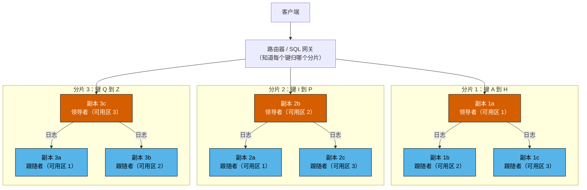
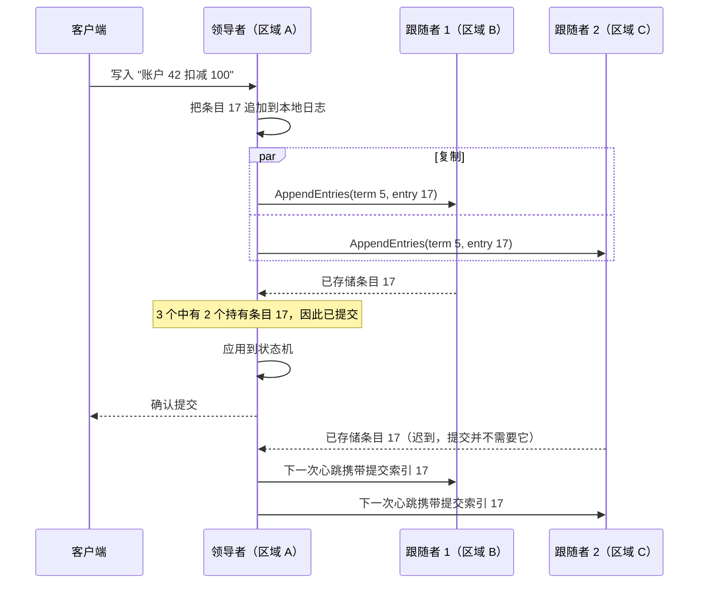
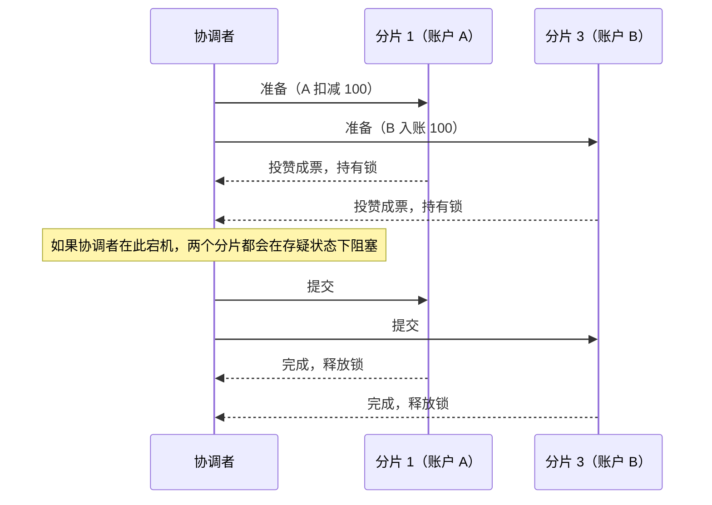
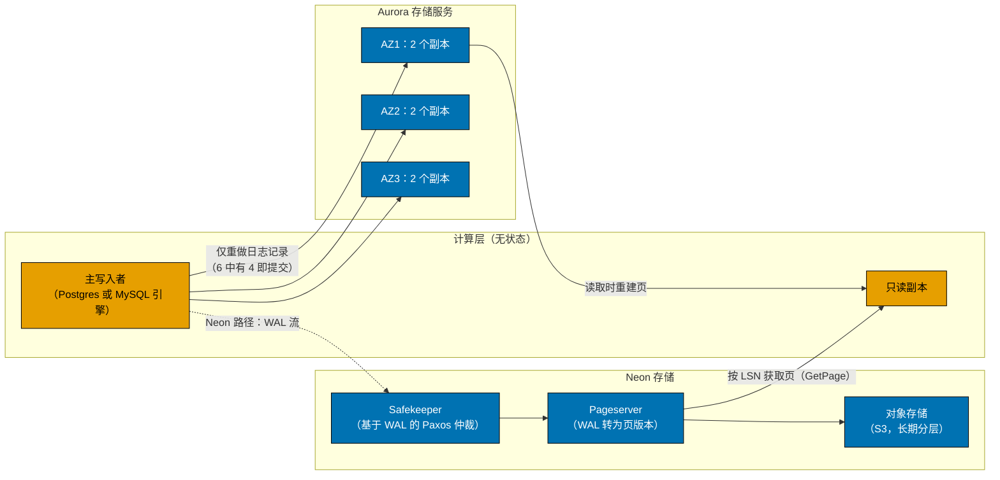

# 4. 分布式数据库
> **深度：** L2 · **阅读时间：** 约 19 分钟 · **最后核实：** 2026-11-01 · **前置阅读：** [第 3 章 — 数据库内部机制](ch03-database-internals.md)

## 要点速览（TL;DR）

- 数据库走向分布式有三个原因：一台机器太小；一台机器是单点故障；或者数据必须存放在多个地方，无论是出于延迟考虑，还是出于法律上的[数据主权（data sovereignty）](../glossary.md#data-sovereignty)要求。每一种分布式设计，都是在这些目标与光速之间做权衡。
- 几乎所有工作都由两种机制完成。**[分片（sharding）](../glossary.md#sharding)**拆分数据，让系统能够扩展。**[复制（replication）](../glossary.md#replication)**复制数据，让系统能够在故障中存活。复制是两者中更难的一个，因为副本会逐渐偏离（[复制延迟（replication lag）](../glossary.md#replication-lag)），除非系统付出代价让它们保持一致。
- 这种一致的达成被称为**[共识（consensus）](../glossary.md#consensus)**，在实践中指的就是 [Paxos](../glossary.md#paxos) 或 [Raft](../glossary.md#raft)。一次写入在多数副本存储之后即告提交。五个副本可以承受两次故障，每次写入需要一次到最近多数派的往返。
- 跨分片的事务需要在共识之上再加一层原子提交协议。经典方案是**[两阶段提交（two-phase commit）](../glossary.md#two-phase-commit)**——协调者一旦宕机它就会阻塞——再加上一种在时间上为事务排序的方法。Spanner 用 GPS 和原子钟（**[TrueTime](../glossary.md#truetime)**）排序。CockroachDB 和 YugabyteDB 使用[混合逻辑时钟（hybrid logical clock）](../glossary.md#hybrid-logical-clock)。TiDB 使用一个中心化的时间戳服务。Aurora DSQL 则采用乐观并发控制，再加上 AWS 微秒级精度的时钟服务。
- 商业现实："分布式 SQL"或 [NewSQL](../glossary.md#newsql) 在技术上已经成熟，但与单节点 Postgres 相比，商业上仍属小众。Cockroach Labs 在 2024 年终止了免费的自托管 Core 版。Fauna——一个受 Calvin 启发的分布式数据库服务——在 2025 年以资本密集度为由关闭。与此同时，超大规模云厂商（Spanner、Aurora DSQL）以及"日志即数据库"的解耦式设计（Aurora、Neon）正获取越来越大的价值份额。

## 为何重要（商业 + Everpure 视角）

支付、账本、库存、身份、电信用户记录、游戏钱包以及智能体记忆，都需要同时满足两点：数据必须保持正确，服务必须在数据中心宕机时依然在线。一家厂商能否同时做到这两点、以何种延迟做到，决定着真实的采购结果。这正是银行愿意为 Spanner 或 CockroachDB 付费、而不是手动给 MySQL 分片的原因，也是为什么"多区域双活（active-active）"的说法值得仔细盘问。CAP 定理、共识和时钟设计，就是这些说法所使用的词汇。一位能问出"领导者在哪里？一次提交需要几次往返？"的高管，可以穿透大部分营销话术。

对于 Everpure（原 Pure Storage；纽交所代码 P，原为 PSTG）而言，相关的转变在于架构。云原生的操作型数据库越来越多地把持久性*下沉*到专门构建的存储服务中。Amazon Aurora 开创了这一模式，Neon（现为 Databricks Lakebase）照搬了它。数据库层只传送其[预写日志（WAL）](../glossary.md#write-ahead-log)，由存储把日志转换为页。这种设计让存储语义——而非数据库引擎——成为真相之源。这是本章与存储业务交集最清晰的地方（参见下文的存储桥接，以及[第 28 章](../04-company-deep-dives/ch28-hyperscaler-data-platforms.md)和[第 29 章](../04-company-deep-dives/ch29-operational-database-vendors.md)中的相关厂商）。

## 工作原理

### 为什么要分布式

在现代硬件上，一台调优良好的 Postgres 服务器就能处理大量工作；[第 3 章](ch03-database-internals.md)解释了原因。离开单机有三个理由：

1. **规模。** 工作集、写入速率或存储量超出了一台机器的承载能力。难点在于写入。读取可以分流到副本上，但每次写入最终都必须落到拥有该行的那个节点上。
2. **可用性。** 一台机器、一个机架或一个区域终将发生故障。要在整个区域丢失后存活，至少需要在另一个区域保存副本，通常需要两个（见下文的多数派算术）。
3. **地理与主权。** 法兰克福的用户不应等待一次到弗吉尼亚的往返，而且一些监管机构要求某些行永远不得离开某一司法管辖区。这让*数据放置*变成了模式层面的决策。

这三者之下的约束都是物理学。光在光纤中每毫秒大约传播 200 km，因此一条 6,000 km 的线路在任何软件运行之前，每次往返就要耗费约 60 ms。[^physics] 没有任何协议能突破这一点。协议只能决定一次提交需要*多少次*这样的往返，以及由*哪些*用户来承担。

### 分区（分片）

分片把每一行分配到众多分区之一，再把每个分区分配给一个节点。有两种基本方案：

- **哈希分区**对键应用哈希函数，并把哈希值映射到某个分片。负载分布均匀，但范围扫描（"客户 42 上周的所有订单"）会触及每一个分片。Amazon 的 **Dynamo** 论文推广了**[一致性哈希（consistent hashing）](../glossary.md#consistent-hashing)**：它把节点和键放在一个环上，每个键存储在顺时针方向的下一个节点上。这样增加一个节点只需移动约 1/N 的键，而不是全部重新洗牌。Dynamo 还为每个物理节点分配许多"虚拟节点"，以便在硬件变化时保持负载均衡。[^dynamo]
- **范围分区**保持键的有序，并把它们切分成连续的范围。Bigtable、Spanner、CockroachDB、TiKV 和 YugabyteDB（可选）都采用这种方式。范围扫描保持本地化，热点范围可以自动拆分。代价是单调递增的键（如时间戳或自增 ID）会把每一次新写入都发送到*最后*一个范围。

这种"最后一个范围"的堆积就是**[热点（hot spot）](../glossary.md#hot-spot)**，而热点是分片系统在生产中最常见的故障。一个名人账户、一个商户或一个"今天"分区就能让单个节点饱和，而集群其余部分却在空转。补救措施包括对键前缀做哈希或加盐、拆分热点范围，以及围绕热点键进行建模（例如为每个商户设置许多子账户）。**重新分片（resharding）**——即在提供服务的同时迁移数据——才是真正的工程投入所在。像 Spanner 和 CockroachDB 那样能自动拆分和再平衡范围的系统，与手动分片的 MySQL 相比，免去了沉重的运维负担。Vitess——YouTube 的 MySQL 分片层——之所以存在，很大程度上就是为了让这种负担变得可控。[^vitess]

### 复制

每个分片都会被复制到多个节点。设计分为三大类：

- **领导者—跟随者（单领导者）。** 一个副本接受写入，并把它的日志流式传送给跟随者。Postgres 流复制和 MySQL 复制都是这样工作的。复制可以是**同步**的，即领导者在确认客户端之前等待一个跟随者（安全但较慢）；也可以是**异步**的，即领导者先确认、后传送（快速，但故障切换可能丢失已确认的写入）。领导者与跟随者之间的差距就是**复制延迟**。这就是为什么用户更新了个人资料、从副本刷新页面后，看到的却还是旧版本。
- **[多领导者复制（multi-leader replication）](../glossary.md#multi-leader-replication)。** 多个副本（通常每个区域一个）接受写入并相互交换。本地写入很快。代价是冲突：两个区域可能在同一时刻扣减同一个账户。"最后写入者胜出"会悄无声息地丢弃其中一次更新，这对账本来说是不可接受的。
- **[无领导者复制（leaderless replication）](../glossary.md#leaderless-replication)**（Dynamo 风格）。客户端向 N 个副本写入，一旦 W 个副本确认即视为写入成功。它从 R 个副本读取，如果 R + W > N，读取集合就会与最新的写入集合重叠。常见的 Dynamo 配置是 N=3、R=2、W=2。Dynamo 还使用"宽松仲裁（sloppy quorum）"和提示移交（hinted handoff）在故障期间保持可写，代价是出现暂时分歧的版本，需要由应用来调和。[^dynamo]

*图 4.1 — 分片提供规模，复制提供生存能力。三个分片、每个分片三个副本，共九个副本；每个分片的领导者放在不同的可用区，使写入负载和故障影响均匀分散。*

> **类比：缓存一致性（MESI）。** 复制延迟是芯片设计者熟知的一个问题的分布式版本。在多核 CPU 中，MESI 协议保持一个缓存行的各个副本的一致性：某个核心在写入之前，必须使所有其他副本失效，这需要付出嗅探或目录往返的代价。这就是一致性流量限制了插槽数量的原因，也是 x86 允许核心自己的存储操作先停留在存储缓冲区、然后才被其他核心看到的原因。存储缓冲区就是微缩版的异步复制，而内存屏障就是一次同步提交。数据库面对的是同样的选择，只不过时间尺度是毫秒而非纳秒：要么为保持副本一致而在每次写入时付出一次往返，要么接受一个读取者可能看到陈旧数据的时间窗口。

### 共识：副本如何达成一致

单领导者复制引出一个显而易见的问题：由谁决定谁是领导者？领导者在写入进行到一半时宕机会怎样？**共识**协议回答了这个问题。它们让一组副本即使在部分成员崩溃或消息延迟的情况下，也能就一份有序的命令日志达成一致。

**Paxos** 最先出现。Leslie Lamport 在 2001 年的重述《Paxos Made Simple》中描述了两个阶段。第一阶段，提议者从多数接受者那里获得承诺。第二阶段，它请求它们接受一个值，被多数接受的值即被选定。[^paxos] 生产系统运行的是带稳定领导者的"Multi-Paxos"，因此稳态下每次写入只需一次往返。Spanner 把数据分片到许多 Paxos 组中。[^spanner]

**Raft**（Ongaro 和 Ousterhout，2014）的设计目标是更易于理解和实现，并且在很大程度上做到了。CockroachDB、TiKV、YugabyteDB 和 etcd 都使用它。[^raft] Raft 由三部分组成：

1. **领导者选举。** 时间被划分为编号的*任期（term）*。在随机化超时内没有收到领导者消息的跟随者会成为候选者并请求投票。赢得多数票的候选者成为该任期的领导者，随机化则让选票分裂的情况很少发生。
2. **日志复制。** 领导者把每条客户端命令追加到自己的日志中，并通过 AppendEntries 消息发送给跟随者。
3. **多数提交。** 一旦多数节点（包括领导者在内）存储了该条目，它就被*提交*。领导者应用它并答复客户端。候选者只有在其日志至少与多数节点一样新时才能赢得选举，因此新领导者总是持有所有已提交的条目。

*图 4.2 — 一次 Raft 提交只需从领导者到最近多数派的一次往返，因此最慢的副本不会拖慢客户端。这就是为什么决定写入延迟的是领导者的放置位置，而不是副本数量。*

算术很重要。要容忍 *f* 个崩溃的副本，需要 *2f + 1* 个副本，因此三个副本能承受一次故障，五个能承受两次。要在整个区域丢失后存活，就至少需要三个区域（或者两个完整区域，加上放在第三个位置、用于打破平局的轻量级"见证（witness）"副本）。仅有两个区域时，任何一个发生故障后都无法维持多数。

> **类比：三模冗余。** 用于航空电子和航天的容错芯片采用三模冗余（TMR）：电路的三个副本输入一个多数表决器，因此一个故障模块会被投票否决。共识仲裁建立在同样的 2f + 1 逻辑之上，但有两点不同。第一，TMR 表决器是同步的，每个时钟周期都会表决。共识则必须在异步网络上工作，在那里一个缓慢的副本与一个宕机的副本无法区分，这就是它依赖超时和任期的原因。第二，TMR 屏蔽的是*错误*输出，而 Raft 和 Paxos 假设副本只会以停止运行的方式失效。要容忍主动撒谎的（拜占庭）节点，需要 3f + 1 个副本以及额外的消息轮次。这正是拜占庭容错系统——以及在此之上还要支持开放成员资格的公有区块链——每笔交易的成本远高于数据库的原因之一。

### 跨分片的分布式事务

共识让*单个分片*变得可靠。但一笔在分片 1 上扣减账户 A、在分片 3 上为账户 B 入账的支付，还需要两个分片*一起*提交或中止。

**两阶段提交（2PC）**是经典答案。协调者请求每个参与者*准备（prepare）*；每个参与者把变更以临时方式持久化、持有锁，并投出赞成或反对票。如果全部为赞成票，协调者就发送*提交（commit）*。其弱点在于阻塞。如果协调者在参与者投赞成票之后崩溃，参与者无法安全地自行提交或中止，只能持有锁、处于"存疑（in doubt）"状态，直到协调者恢复。现代系统通过让协调者和每个参与者都成为一个共识组来消除阻塞，这样宕机的机器只需由同一组的新领导者接替即可。Spanner 正是这样做的：2PC 运行在 Paxos 组之上。[^spanner]

*图 4.3 — 两阶段提交增加了一次往返和一个阻塞窗口。像 Spanner 那样把每个参与者和协调者都作为复制的共识组运行，就能把"协调者宕机"从一次服务中断变成一次领导者选举。*

第二个问题是**时间上的排序**。为了支持快照读取和可串行化，每个事务都需要一个符合真实世界顺序的时间戳。然而各台机器的时钟并不一致，主要系统采取了四种方法：

- **Spanner 的 TrueTime。** 每个 Google 数据中心都有配备 GPS 接收器和原子钟的时间主服务器。TrueTime API 返回的是一个*区间*（最早，最晚），而非单一时刻。在 2012 年的论文中，不确定度 ε 以锯齿状在约 1 到 7 ms 之间摆动，平均约 4 ms。[^spanner] 事务取区间上限作为其提交时间戳，然后等待不确定度过去（"提交等待/commit wait"），再释放锁。结果是**[外部一致性（external consistency）](../glossary.md#external-consistency)**：如果在真实时间中 T1 在 T2 开始之前提交，那么在全球范围内 T1 的时间戳都更小。代价是每个写事务需要等待几毫秒，外加专用硬件。
- **混合逻辑时钟（HLC）。** CockroachDB 和 YugabyteDB 把普通的 NTP 同步物理时间与一个逻辑计数器结合起来；每当节点看到带有更晚时间戳的消息时，计数器就向前推进。[^hlc] 这不需要专用硬件。取而代之的是，系统假设一个*最大时钟偏移*（根据所引文档，CockroachDB 默认为 500 ms `[VERIFY: CockroachDB 25.x/26.x 中的当前默认值]`）。如果一次读取在其不确定性窗口内遇到某个值，它可能需要重启。[^crdb-clock] 代价是偶尔的重试，以及对不共享数据的事务而言比 Spanner 略弱的保证。好处是它可以在任何云上运行。
- **中心化时间戳授时器（timestamp oracle）。** Google 为增量网页索引构建的 Percolator 在 Bigtable 之上运行 2PC，时间戳来自一个授时服务。[^percolator] TiDB 采用了这一模型。其 Placement Driver（PD）本身通过 Raft 复制，以批量方式分发严格递增的时间戳。[^tikv-tso] 这种方法简单且正确，但在多区域部署中，每个事务都要往返一次授时器领导者所在的位置。
- **确定性排序（Calvin）。** Calvin（耶鲁大学，2012）先就*事务输入的顺序*达成一致，每批次只需一轮共识。随后每个副本以确定性方式执行该批次，无需 2PC。[^calvin] 这消除了提交时的协调，但要求事先知道每个事务的读写集合。其最知名的商业后继者 Fauna 已于 2025 年 5 月关闭服务。[^fauna]

Amazon 的 **Aurora DSQL** 结合了其中几种思路。事务以乐观方式无锁运行。提交时，一组*裁决器（adjudicator）*检查冲突，一个复制的*日志（journal）*使提交持久化。快照读取使用 AWS Time Sync Service，AWS 称其精度达到微秒级。[^dsql-arch] 读取保持本地化，协调只在提交时发生一次。在热点键上，这种设计会把锁等待转化为中止和客户端重试。

> **类比：TrueTime 与 GPS 驯服振荡器。** TrueTime 是把数据中心的授时实践变成了一项数据库保证。电信和交易所的数据中心早已用 GPS 驯服石英或铷振荡器，并通过 PTP（IEEE 1588）分发时间，借助网卡中的硬件时间戳获得亚微秒级的一致。Spanner 的 ε 锯齿就是振荡器保持（holdover）漂移：在两次同步轮询之间，本地时钟的误差界按假定的最坏漂移率扩大，重新同步时再骤然回落。[^spanner] 更好的授时硬件会直接缩小 ε，而更小的 ε 意味着更短的提交等待。这一联系解释了为什么 AWS 微秒级的时间服务是 Aurora DSQL 的基础构件，也解释了为什么时钟质量已经成为一项数据库特性。

### CAP、PACELC 与一致性模型

**[CAP 定理（CAP theorem）](../glossary.md#cap-theorem)**起初是 Eric Brewer 在 2000 年提出的猜想，2002 年由 Gilbert 和 Lynch 证明。它指出，当网络发生*分区*时，一个复制系统必须在一致性（每次读取都能看到最新写入，形式化地说即线性一致性）与可用性（发往存活节点的每个请求都能得到应答）之间做出选择。[^gilbert-lynch] Brewer 后来强调，分区很少发生，而这一选择只在分区期间才需要做出。[^brewer12] Daniel Abadi 的 **[PACELC](../glossary.md#pacelc)** 表述补充了每天都很重要的那种情况：如果发生分区（Partition），在可用性（Availability）与一致性（Consistency）之间选择；否则（Else），在延迟（Latency）与一致性（Consistency）之间选择。[^abadi] 即使网络完美无缺，同步达成一致也要付出往返的代价。

| 系统 | 分区时（PA / PC） | 否则（EL / EC） | 实践中的含义 |
|---|---|---|---|
| Amazon Dynamo（2007 年论文） | PA | EL | 始终可写；冲突版本稍后由应用调和[^abadi] |
| Apache Cassandra（默认可调参数） | PA | EL | 可调仲裁；轻量级事务可用，但需额外成本[^abadi] |
| Riak | PA | EL | Dynamo 的后继者[^abadi] |
| MongoDB（Abadi 的分类，默认配置） | PA | EC | 每个分片单一主节点；行为在很大程度上取决于写关注（write concern）设置[^abadi] |
| Yahoo PNUTS | PC | EL | 每条记录一个主节点；副本可能提供陈旧读取[^abadi] |
| VoltDB / H-Store | PC | EC | 强一致、内存型、分区式[^abadi] |
| Google Spanner | PC | EC | Paxos 多数派加提交等待；少数派一侧变为不可用[^spanner] |
| CockroachDB / YugabyteDB | PC | EC | 每个 range 或 tablet 一个 Raft 多数派；可选跟随者读取，以获得有界陈旧度 |
| TiDB | PC | EC | 每个 region 一个 Raft 组，加中心化时间戳授时器[^tikv-tso] |
| Aurora DSQL | PC | EC | 跨区域强一致；代价在提交时支付[^dsql-ga] |
| Postgres 主节点加异步副本 | 在故障切换时做出选择 | EL | 提升一个滞后的副本可以恢复可用性，但可能丢失已确认的写入 |

*图 4.4 — 真正值得关注的是"否则"这一列。大多数 NewSQL 系统属于 PC/EC：为了在罕见的分区期间避免异常，它们每天在每次提交上都付出延迟。分类针对的是默认配置；大多数系统都可调。*

**一致性模型**描述读取者可能观察到的内容。从强到弱依次为：

- **[线性一致（Linearizable）](../glossary.md#linearizability)：** 每个操作看起来都在其开始和结束之间的某一瞬间生效，与真实时间相符。Spanner 的外部一致性把这一点扩展到了多行事务。
- **顺序一致（Sequential）：** 所有客户端以相同顺序看到操作，且每个客户端自己的操作保持程序顺序，但这一顺序不必与真实时间相符。
- **因果一致（Causal）：** 如果一个操作可能影响了另一个操作（我读了你的帖子，然后回复），那么所有人都按这个顺序看到它们。不相关的操作在不同地方可能以不同顺序出现。
- **[最终一致（Eventual）](../glossary.md#eventual-consistency)：** 如果写入停止，副本最终会收敛。对于在此期间读取者会看到什么，不作任何承诺。

每往下一级都减少了协调，从而减少了延迟。大多数缺陷都源于开发者假设了比系统实际提供的更强的模型。

### 解耦："日志即数据库"

家族树的另一个分支保留*单一*写入者，但把*存储*分布出去。Amazon Aurora（SIGMOD 2017）观察到，传统数据库会把同样的数据写好几遍：日志、页、双写缓冲区和副本。Aurora 的计算节点**只把重做日志记录**写入一个分布式存储服务。存储在三个可用区中保存六个副本，六个中有四个持有某次写入时即确认该写入，读取则需三个副本。由存储节点——而不是数据库——按需从日志重建页。[^aurora] 借助这一仲裁机制，Aurora 在丢失整个可用区后仍能继续接受写入，在丢失一个可用区再加一个节点后仍能继续提供读取（并能自我修复），而数据库实例之间不需要任何共识流量。Neon 把同样的思路用于开源 Postgres。*Safekeeper* 使用 Paxos 持久地存储 WAL，*pageserver* 把 WAL 转换为带版本的页，冷数据则进入 S3 之类的对象存储。计算变为无状态，可以缩容到零，这使项目可以通过指向更早的日志位置来为数据库创建分支。[^neon]

*图 4.5 — 在解耦式设计中，计算层只传送其日志，存储服务则负责持久性、复制和页的物化。数据库最难的工作由此转移到了存储系统中。*

## 实例演算：跨三个区域的支付账本

设想一家钱包服务商，用户分布在美国东部、美国西部和欧洲西部三个区域。它每秒处理 5,000 笔支付，每笔支付扣减一个账户并为另一个账户入账。假设往返时间约为：东部—西部 65 ms、东部—欧洲 75 ms、西部—欧洲 135 ms（与光纤距离相符的估算[^physics]）。不变量很简单：任何余额都不得为负，任何已确认的支付都不得丢失。

| 方案 | 欧洲用户看到的提交延迟 | 区域丢失：面临风险的数据 | 能否保护"余额不为负"？ |
|---|---|---|---|
| 美国东部单一主节点，异步副本 | 约 75 ms（到主节点的一次往返） | 延迟窗口内的一切。按 200 ms 延迟 × 5,000/s 计 ≈ 1,000 笔已确认支付 | 故障切换前可以；有损故障切换后，余额可能出错 |
| 单一主节点，美国西部同步副本 | 约 75 + 65 ≈ 140 ms | 无（RPO 为零），但若副本所在区域宕机，可用性会下降 | 可以 |
| 多领导者，每个区域一个写入者 | 本地，几毫秒 | 较小的异步窗口 | **不能。** 两个区域的并发扣款可能使账户透支；最后写入者胜出会让钱凭空消失 |
| 无领导者仲裁，跨区域 N=3，W=2 | 约 75 ms（最近的另一个区域） | 对已达到 W 的写入而言无风险 | 单靠它不行；需要按键的比较并设置（compare-and-set）或基于 Paxos 的轻量级事务 |
| 每个分片 Raft 或 Paxos，领导者位于美国东部（CockroachDB、YugabyteDB、Spanner） | 到达领导者约 75 ms + 领导者到多数派约 65 ms ≈ 140 ms；Spanner 还要加上提交等待，当两个账户位于不同分片时再加上 2PC 往返 | 无 | 可以，可串行化 |
| 同上，但领导者放在每个账户的归属区域（"按行区域化/regional by row"） | 本地用户：约 65–75 ms（一次多数派往返）；跨区域转账：更多 | 无 | 可以 |
| 乐观式，多区域（Aurora DSQL） | 读取在本地；提交时一轮跨区域往返 | 对已提交事务而言无风险 | 可以；热点账户在争用下会中止并重试 |

*图 4.6 — 在三个区域中保证正确性，每次提交至少要付出一次跨区域往返。唯一的问题是由哪些用户来承担，以及故障模式是"慢"还是"错"。*

给高管的结论：**每一个能让账本保持正确的方案，都会为部分用户在提交路径上加入 60–140 ms 的物理延迟。** 更便宜的方案并不是同一件事的更快版本，它们放弃了不变量。工程上的功力在于放置。把每个账户的领导者放在其所有者附近，让大部分支付在区域内完成，并把那个收取全部入账 10% 的商户当作一个建模问题（把它的余额拆分为许多子账户），而不是数据库问题。在任何协议下，热点账户都是热点。
