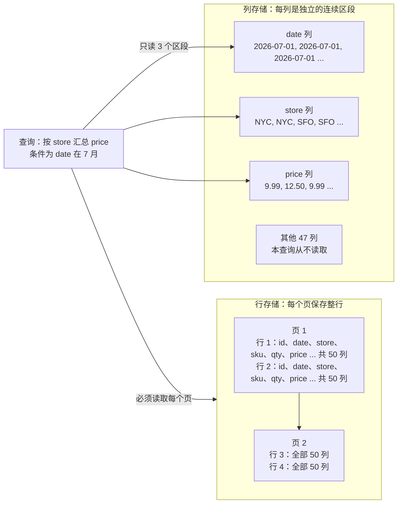
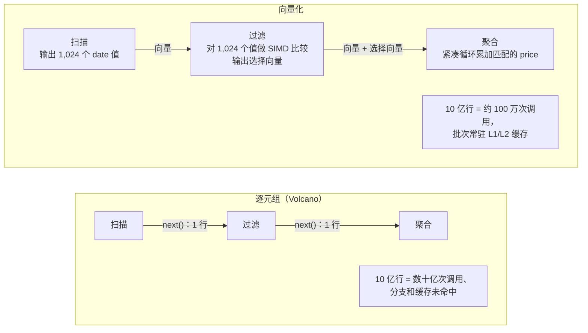

# 5. 分析引擎
> **深度：** L2 · **阅读时间：** 约 15 分钟 · **最后核实：** 2026-11-01 · **前置阅读：** [第 3 章 — 数据库内部原理](ch03-database-internals.md)

## 要点速览（TL;DR）

- 分析型查询只涉及少数几列，却要跨越数十亿行。**按列存储**数据可以让引擎只读取这几列，而且相似的值彼此相邻，压缩效果很好。两者叠加，通常能把扫描的字节数减少一到两个数量级（见下文算例）。
- 现代引擎要么以**每批约一千个值**的方式处理数据（向量化执行，从 MonetDB/X100 到 DuckDB、ClickHouse、Velox、Photon），要么**把每条查询编译成机器码**（HyPer、Spark 全阶段代码生成）。两种做法的目的都是让 CPU 持续从缓存获取数据，而不是因等待内存而停顿。
- 2000 年代的 MPP 数据仓库（Teradata、Netezza、Greenplum、早期 Redshift）采用**无共享（shared-nothing）**架构：每个节点各自拥有一片数据。这种设计在读取上扩展性很好，但调整集群规模意味着要在物理上重新分布数据。
- Snowflake 2016 年的设计把**对象存储当作持久化磁盘**，使用带本地 SSD 缓存的无状态计算集群，并由一个独立的服务层负责元数据。弹性扩缩容、并发隔离和按用量付费都源自这一个决策。BigQuery（其 Dremel 血统在 Google 内部更早就实现了存储解耦）、Redshift RA3 和 Databricks 都收敛到了同一模式。
- 引擎正在拆解为可复用的组件：**Arrow** 负责内存格式，**Velox/DataFusion** 负责执行，Parquet/Iceberg 负责存储。性能正在商品化，战略控制点（control point）转向存储吞吐、缓存和目录（catalog）。

## 为何重要（商业视角 + Everpure 视角）

分析引擎是大多数数据平台收入的计量之处。Snowflake 的 credit、BigQuery 的 slot 和 Databricks 的 DBU，主要计量的都是扫描、连接和聚合所耗费的计算时间。引擎效率决定了厂商的毛利率（gross margin），也决定了客户每条查询要付多少钱。因此，支出跟随的是引擎的设计选择，而不是它的市场宣传。

对一家存储公司而言，从无共享 MPP 向**存算分离（separation of storage and compute）**的转变，是本书中最重要的架构变化。一旦计算变成无状态、数据迁移到对象存储（object storage），瓶颈就不再是单块磁盘的 IOPS，而变成对象存储层的**聚合吞吐量**加上其前端缓存的命中率。这是一个存储问题：无论引擎是 Snowflake、Trino 还是 Spark，谁能提供快速、可扩展的对象存储和智能缓存层，谁就处在引擎的关键路径上。Everpure 公开的合作伙伴资料已经展示了这一模式的一个版本：一套在 FlashBlade 对象存储上的 Iceberg 表之上运行 Starburst 引擎的参考架构。[^ep-starburst] 基于公开信息，战略团队可能评估的选项包括：与更多引擎做认证、缓存层产品，以及让本地部署的对象存储成为开放表格式（open table format）的一等"数据库磁盘"（[第 7 章](ch07-open-table-formats.md)）。

## 工作原理

### 行式与列式布局

事务型数据库（[第 3 章](ch03-database-internals.md)）把每一行连续地存储在一个页上，因为订单录入系统读写的是整行：取出 42 号客户，更新订单。分析则把这种访问模式翻转过来。"第三季度各区域总收入"需要大约五十列中的三列（日期、区域、金额），但要覆盖该季度的每一行。在行存储中，磁盘和内存系统必须把全部五十列都搬运经过 CPU，才能拿到所需的三列。

[列式](../glossary.md#columnar-storage)引擎把每一列存放在各自独立的连续区段中。查询只读取日期、区域和金额这几个区段，其余 47 列完全跳过。这一思路由来已久（Sybase IQ、KDB、MonetDB），但 Stonebraker、Abadi 等人 2005 年的 C-Store 论文奠定了其现代论据。该论文将读优化的列存储与一个小型写优化存储相结合，并用一个"元组搬运器"（tuple mover）把两者合并；论文报告，在 TPC-H 子集上相较商用行存储有大幅加速。[^cstore] C-Store 后来成为 Vertica，HP 于 2011 年将其收购。[^ma-vertica]

*图 5.1 — 同一张表分别按行和按列布局：一条三列查询在行存储中要读取每一个字节，而在列存储中只需读取三个区段。*

> **类比：内存层次结构。** 这就是数据库版的**结构体数组（AoS）与数组结构体（SoA）**之争。一个对一百万个结构体中的某一字段求和的 GPU 内核，如果结构体是交错存放的（AoS），每条缓存行和每次 DRAM 突发传输的大部分都被浪费。把该字段连续存放（SoA），取回的每个字节都有用，预取器也能看到整齐的步长。列存储就是在磁盘、内存和缓存中的 SoA。

### 压缩与编码

把相似的值放在一起使其易于压缩，列存储会针对每一列选择**轻量级编码**：

- **[字典编码](../glossary.md#dictionary-encoding)（dictionary encoding）**用小整数编码替换重复的字符串。一个有 200 个不同取值的"国家"列，每行只需一个字节，而不是一个字符串。
- **[游程编码](../glossary.md#run-length-encoding)（run-length encoding，RLE）**存储"NYC × 40,000"，而不是 40,000 份副本。它对已排序或低基数的列非常有效。
- **[增量编码](../glossary.md#delta-encoding)（delta encoding）**存储与前一个值的差值。时间戳和顺序 ID 都会变成很小的数字。
- **[位打包](../glossary.md#bit-packing)（bit-packing）**让每个值只占用最大值所需的位数。小于 1,000 的数字用 10 位即可容纳，而不是 32 位或 64 位。

在此之上再叠加通用压缩编解码器（LZ4、Zstandard）。Abadi、Madden 和 Ferreira 在 SIGMOD 2006 的论文中表明，更大的收益不在于节省磁盘，而在于算子可以**直接在压缩数据上运算**：对一个 RLE 游程求和只需一次乘法，对字典编码列的过滤比较的是整数而非字符串。[^abadi06] 能期待多大的压缩比取决于数据本身。作为厂商，ClickHouse 将典型分析数据在列式形态下的压缩比描述为 5–10×，而行式页压缩为 1.5–3×，低基数列则远超 30×。[^ch-compress] 应把这些视为经验法则，而非保证。

### 跳过数据：区域映射与延迟物化

最便宜的字节是从未读取的字节。引擎会为每个数据块存储小型摘要，例如每列的最小值和最大值。这些摘要称为**[区域映射](../glossary.md#zone-map)（zone map）**（Snowflake 按*微分区*保存，Parquet 按行组保存）。一条过滤到 2026 年 7 月的查询会先检查摘要，凡是日期范围不覆盖 7 月的数据块都直接跳过，无需打开。Snowflake 的每个微分区包含 50–500 MB 未压缩数据，其元数据包括每列的取值范围，查询规划器正是用它来做这种裁剪。[^sf-mp] 当数据按过滤列聚簇时，裁剪效果最好。一张按日期排序的表在日期上裁剪得非常漂亮，而在客户 ID 上几乎无法裁剪。

**[延迟物化](../glossary.md#late-materialization)（late materialization）**把同样的逻辑推进到查询内部。引擎先在日期列上执行过滤，生成匹配行位置的列表，然后才去取这些位置上的 price 和 store 值。宽行被尽可能晚地拼接（"物化"）起来，往往只在最终结果时才做。

### 执行查询：向量化与编译

经典引擎使用 **Volcano 迭代器模型**：每个算子对其子算子调用 `next()`，一次拉取一行。这很优雅，但在现代 CPU 上，逐行的函数调用、分支预测失败和指针追逐的开销远超运算本身。由此出现了两种应对方案。

**[向量化执行](../glossary.md#vectorized-execution)（vectorized execution）。** MonetDB/X100 论文（Boncz、Zukowski 和 Nes，CIDR 2005）保留了迭代器结构，但传递的是值的**向量**，其大小以能常驻 CPU 缓存为准。论文报告，在 100 GB TPC-H 上的原始执行速度比此前技术快一到两个数量级。[^x100] 每个算子变成对数组的紧凑循环，编译器可将其转化为 [SIMD](../glossary.md#simd) 指令，CPU 也能对其流水线化。该论文后来获得了 CIDR 首个时间检验奖（Test of Time award）。[^x100-tot] X100 演变为 Vectorwise，其血统延续到 DuckDB、ClickHouse、Snowflake、Velox 和 Photon。DuckDB 的默认向量大小为 2,048 个值。[^duckdb-vec]

*图 5.2 — 向量化引擎把逐行开销分摊到一个缓存大小、约一千个值的批次上；一次调用完成一千次的工作。*

> **类比：SIMD 通道。** 一个 512 位向量寄存器可容纳十六个 32 位值，因此一条指令可比较十六个日期。向量化引擎的写法是让批次上的内层循环映射到这些通道上，就像 GPU 的 warp 把一条指令施加到多个线程上一样。批次大小是一个缓存容量决策：要大到足以分摊开销，又要小到让工作集留在 L1/L2 而不溢出到 DRAM。

**[查询编译](../glossary.md#query-compilation)（query compilation）。** Thomas Neumann 2011 年的 HyPer 论文走了另一条路。它为每条查询生成机器码（通过 LLVM），把多个算子融合成单个循环，使值保留在 CPU 寄存器中。论文报告其性能常常可与手写 C++ 相媲美。[^hyper] Spark 2.0 的"全阶段代码生成"（whole-stage code generation）在 JVM 上应用了这一思路。Databricks 报告逐行开销大幅下降，例如一个过滤操作从 15 ns 降到约 1.1 ns（公司披露的基准测试）。[^spark-cg]

哪一种胜出？一项 2018 年的研究在同一系统内实现了两者，结论是二者均不占绝对优势。编译代码在计算密集型查询上执行的指令更少，而向量化代码更善于隐藏内存延迟，例如在哈希连接中。[^kersten] 业界出于实际原因大多选择了向量化：它更易于调试和性能剖析，避免了短查询上的编译延迟，并能在运行时针对每个批次自适应调整。Databricks 在 Photon 上选择了向量化 C++ 设计，而没有扩展 Spark 的代码生成，理由正是这种自适应性。[^photon]
