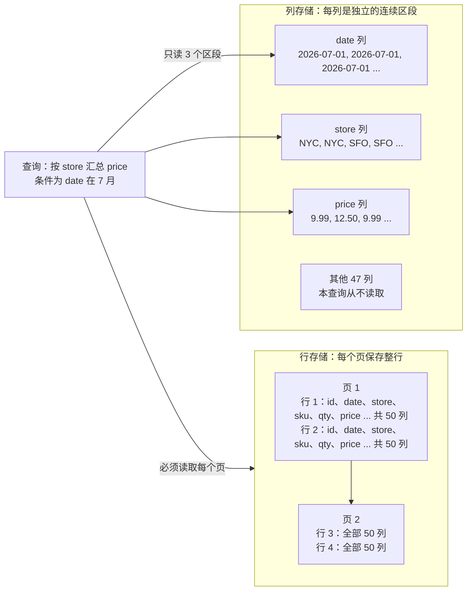
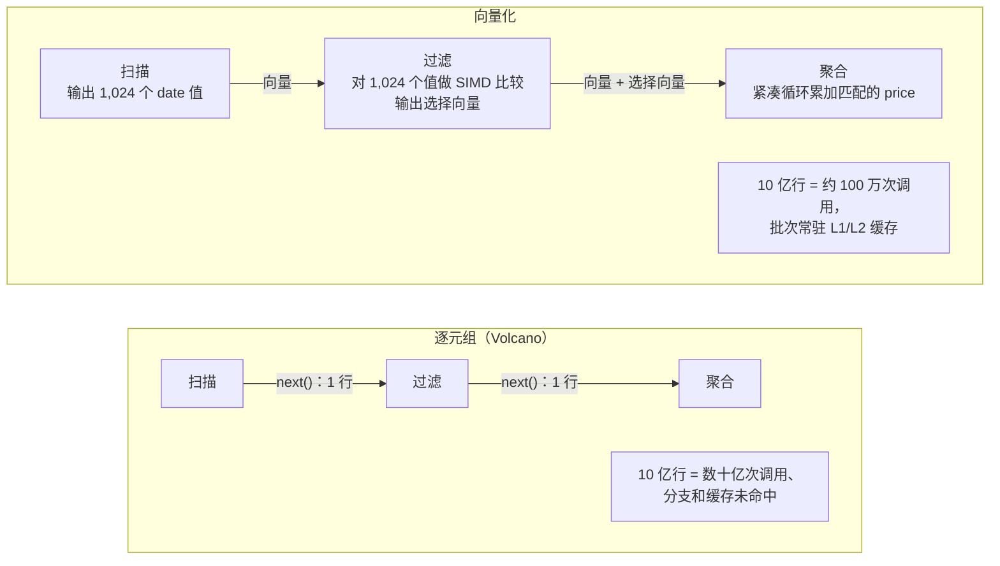
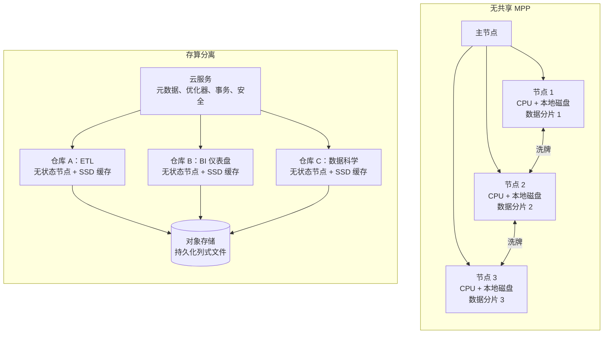
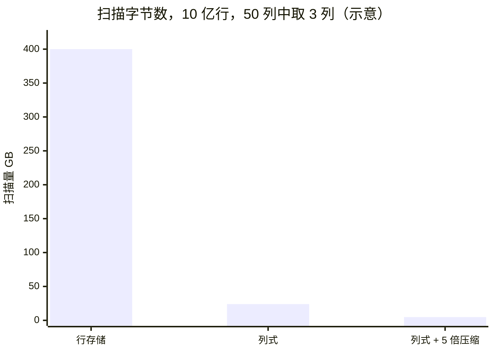
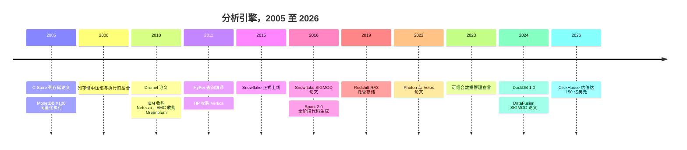

# 5. 分析引擎
> **深度：** L2 · **阅读时间：** 约 15 分钟 · **最后核实：** 2026-11-01 · **前置阅读：** [第 3 章 — 数据库内部原理](ch03-database-internals.md)

## 要点速览（TL;DR）

- 分析型查询只涉及少数几列，却要跨越数十亿行。**按列存储**数据可以让引擎只读取这几列，而且相似的值彼此相邻，压缩效果很好。两者叠加，通常能把扫描的字节数减少一到两个数量级（见下文算例）。
- 现代引擎要么以**每批约一千个值**的方式处理数据（向量化执行，从 MonetDB/X100 到 DuckDB、ClickHouse、Velox、Photon），要么**把每条查询编译成机器码**（HyPer、Spark 全阶段代码生成）。两种做法的目的都是让 CPU 持续从缓存获取数据，而不是因等待内存而停顿。
- 2000 年代的 MPP 数据仓库（Teradata、Netezza、Greenplum、早期 Redshift）采用**无共享（shared-nothing）**架构：每个节点各自拥有一片数据。这种设计在读取上扩展性很好，但调整集群规模意味着要在物理上重新分布数据。
- Snowflake 2016 年的设计把**对象存储当作持久化磁盘**，使用带本地 SSD 缓存的无状态计算集群，并由一个独立的服务层负责元数据。弹性扩缩容、并发隔离和按用量付费都源自这一个决策。BigQuery（其 Dremel 血统在 Google 内部更早就实现了存储解耦）、Redshift RA3 和 Databricks 都收敛到了同一模式。
- 引擎正在拆解为可复用的组件：**Arrow** 负责内存格式，**Velox/DataFusion** 负责执行，Parquet/Iceberg 负责存储。性能正在商品化，战略控制点（control point）转向存储吞吐、缓存和目录（catalog）。

## 为何重要（商业视角 + Everpure 视角）

分析引擎是大多数数据平台收入的计量之处。Snowflake 的 credit、BigQuery 的 slot 和 Databricks 的 DBU，主要计量的都是扫描、连接和聚合所耗费的计算时间。引擎效率决定了厂商的毛利率（gross margin），也决定了客户每条查询要付多少钱。因此，支出跟随的是引擎的设计选择，而不是它的市场宣传。

对一家存储公司而言，从无共享 MPP 向**存算分离（separation of storage and compute）**的转变，是本书中最重要的架构变化。一旦计算变成无状态、数据迁移到对象存储（object storage），瓶颈就不再是单块磁盘的 IOPS，而变成对象存储层的**聚合吞吐量**加上其前端缓存的命中率。这是一个存储问题：无论引擎是 Snowflake、Trino 还是 Spark，谁能提供快速、可扩展的对象存储和智能缓存层，谁就处在引擎的关键路径上。Everpure 公开的合作伙伴资料已经展示了这一模式的一个版本：一套在 FlashBlade 对象存储上的 Iceberg 表之上运行 Starburst 引擎的参考架构。[^ep-starburst] 基于公开信息，战略团队可能评估的选项包括：与更多引擎做认证、缓存层产品，以及让本地部署的对象存储成为开放表格式（open table format）的一等"数据库磁盘"（[第 7 章](ch07-open-table-formats.md)）。

## 工作原理

### 行式与列式布局

事务型数据库（[第 3 章](ch03-database-internals.md)）把每一行连续地存储在一个页上，因为订单录入系统读写的是整行：取出 42 号客户，更新订单。分析则把这种访问模式翻转过来。"第三季度各区域总收入"需要大约五十列中的三列（日期、区域、金额），但要覆盖该季度的每一行。在行存储中，磁盘和内存系统必须把全部五十列都搬运经过 CPU，才能拿到所需的三列。

[列式](../glossary.md#columnar-storage)引擎把每一列存放在各自独立的连续区段中。查询只读取日期、区域和金额这几个区段，其余 47 列完全跳过。这一思路由来已久（Sybase IQ、KDB、MonetDB），但 Stonebraker、Abadi 等人 2005 年的 C-Store 论文奠定了其现代论据。该论文将读优化的列存储与一个小型写优化存储相结合，并用一个"元组搬运器"（tuple mover）把两者合并；论文报告，在 TPC-H 子集上相较商用行存储有大幅加速。[^cstore] C-Store 后来成为 Vertica，HP 于 2011 年将其收购。[^ma-vertica]

*图 5.1 — 同一张表分别按行和按列布局：一条三列查询在行存储中要读取每一个字节，而在列存储中只需读取三个区段。*

> **类比：内存层次结构。** 这就是数据库版的**结构体数组（AoS）与数组结构体（SoA）**之争。一个对一百万个结构体中的某一字段求和的 GPU 内核，如果结构体是交错存放的（AoS），每条缓存行和每次 DRAM 突发传输的大部分都被浪费。把该字段连续存放（SoA），取回的每个字节都有用，预取器也能看到整齐的步长。列存储就是在磁盘、内存和缓存中的 SoA。

### 压缩与编码

把相似的值放在一起使其易于压缩，列存储会针对每一列选择**轻量级编码**：

- **[字典编码](../glossary.md#dictionary-encoding)（dictionary encoding）**用小整数编码替换重复的字符串。一个有 200 个不同取值的"国家"列，每行只需一个字节，而不是一个字符串。
- **[游程编码](../glossary.md#run-length-encoding)（run-length encoding，RLE）**存储"NYC × 40,000"，而不是 40,000 份副本。它对已排序或低基数的列非常有效。
- **[增量编码](../glossary.md#delta-encoding)（delta encoding）**存储与前一个值的差值。时间戳和顺序 ID 都会变成很小的数字。
- **[位打包](../glossary.md#bit-packing)（bit-packing）**让每个值只占用最大值所需的位数。小于 1,000 的数字用 10 位即可容纳，而不是 32 位或 64 位。

在此之上再叠加通用压缩编解码器（LZ4、Zstandard）。Abadi、Madden 和 Ferreira 在 SIGMOD 2006 的论文中表明，更大的收益不在于节省磁盘，而在于算子可以**直接在压缩数据上运算**：对一个 RLE 游程求和只需一次乘法，对字典编码列的过滤比较的是整数而非字符串。[^abadi06] 能期待多大的压缩比取决于数据本身。作为厂商，ClickHouse 将典型分析数据在列式形态下的压缩比描述为 5–10×，而行式页压缩为 1.5–3×，低基数列则远超 30×。[^ch-compress] 应把这些视为经验法则，而非保证。

### 跳过数据：区域映射与延迟物化

最便宜的字节是从未读取的字节。引擎会为每个数据块存储小型摘要，例如每列的最小值和最大值。这些摘要称为**[区域映射](../glossary.md#zone-map)（zone map）**（Snowflake 按*微分区*保存，Parquet 按行组保存）。一条过滤到 2026 年 7 月的查询会先检查摘要，凡是日期范围不覆盖 7 月的数据块都直接跳过，无需打开。Snowflake 的每个微分区包含 50–500 MB 未压缩数据，其元数据包括每列的取值范围，查询规划器正是用它来做这种裁剪。[^sf-mp] 当数据按过滤列聚簇时，裁剪效果最好。一张按日期排序的表在日期上裁剪得非常漂亮，而在客户 ID 上几乎无法裁剪。

**[延迟物化](../glossary.md#late-materialization)（late materialization）**把同样的逻辑推进到查询内部。引擎先在日期列上执行过滤，生成匹配行位置的列表，然后才去取这些位置上的 price 和 store 值。宽行被尽可能晚地拼接（"物化"）起来，往往只在最终结果时才做。

### 执行查询：向量化与编译

经典引擎使用 **Volcano 迭代器模型**：每个算子对其子算子调用 `next()`，一次拉取一行。这很优雅，但在现代 CPU 上，逐行的函数调用、分支预测失败和指针追逐的开销远超运算本身。由此出现了两种应对方案。

**[向量化执行](../glossary.md#vectorized-execution)（vectorized execution）。** MonetDB/X100 论文（Boncz、Zukowski 和 Nes，CIDR 2005）保留了迭代器结构，但传递的是值的**向量**，其大小以能常驻 CPU 缓存为准。论文报告，在 100 GB TPC-H 上的原始执行速度比此前技术快一到两个数量级。[^x100] 每个算子变成对数组的紧凑循环，编译器可将其转化为 [SIMD](../glossary.md#simd) 指令，CPU 也能对其流水线化。该论文后来获得了 CIDR 首个时间检验奖（Test of Time award）。[^x100-tot] X100 演变为 Vectorwise，其血统延续到 DuckDB、ClickHouse、Snowflake、Velox 和 Photon。DuckDB 的默认向量大小为 2,048 个值。[^duckdb-vec]

*图 5.2 — 向量化引擎把逐行开销分摊到一个缓存大小、约一千个值的批次上；一次调用完成一千次的工作。*

> **类比：SIMD 通道。** 一个 512 位向量寄存器可容纳十六个 32 位值，因此一条指令可比较十六个日期。向量化引擎的写法是让批次上的内层循环映射到这些通道上，就像 GPU 的 warp 把一条指令施加到多个线程上一样。批次大小是一个缓存容量决策：要大到足以分摊开销，又要小到让工作集留在 L1/L2 而不溢出到 DRAM。

**[查询编译](../glossary.md#query-compilation)（query compilation）。** Thomas Neumann 2011 年的 HyPer 论文走了另一条路。它为每条查询生成机器码（通过 LLVM），把多个算子融合成单个循环，使值保留在 CPU 寄存器中。论文报告其性能常常可与手写 C++ 相媲美。[^hyper] Spark 2.0 的"全阶段代码生成"（whole-stage code generation）在 JVM 上应用了这一思路。Databricks 报告逐行开销大幅下降，例如一个过滤操作从 15 ns 降到约 1.1 ns（公司披露的基准测试）。[^spark-cg]

哪一种胜出？一项 2018 年的研究在同一系统内实现了两者，结论是二者均不占绝对优势。编译代码在计算密集型查询上执行的指令更少，而向量化代码更善于隐藏内存延迟，例如在哈希连接中。[^kersten] 业界出于实际原因大多选择了向量化：它更易于调试和性能剖析，避免了短查询上的编译延迟，并能在运行时针对每个批次自适应调整。Databricks 在 Photon 上选择了向量化 C++ 设计，而没有扩展 Spark 的代码生成，理由正是这种自适应性。[^photon]

### 横向扩展：MPP 无共享架构

当一台机器不够用时，**[大规模并行处理](../glossary.md#massively-parallel-processing)（massively parallel processing，MPP）**引擎会把表分布到许多节点上。在 Teradata、Netezza、Greenplum 和最初的 Redshift 所采用的**[无共享](../glossary.md#shared-nothing)（shared-nothing）**设计中，每个节点在自己的磁盘上拥有一片按哈希分区的数据。查询在每一片上并行执行，部分结果在协调节点汇合。读取几乎可以线性扩展，这正是该设计在 2000 年代主导数据仓库市场的原因。IBM 于 2010 年以 $1.7B 收购 Netezza（已披露），EMC 同年收购 Greenplum（条款未披露）。[^ma-netezza][^ma-greenplum] Redshift 本身就是基于授权的 ParAccel MPP 代码构建的。[^ma-paraccel]

痛点在于耦合。在非分区键上做连接会强制触发**[数据洗牌](../glossary.md#shuffle)（shuffle）**：行在网络上重新分布，使匹配的键落到同一个节点上。存储和计算按固定比例配置，因此需要更多磁盘的客户必须购买更多 CPU，反之亦然。最痛苦的是，**调整集群规模意味着重新分布数据**：从 10 个节点扩到 20 个节点要对每一行重新哈希并搬移。并发也是共享的：一个繁重的数据科学作业与 CFO 的仪表盘争抢同一批节点。

### 存算分离：Snowflake 的设计

Snowflake 的 SIGMOD 2016 论文（Dageville 等）描述了一种被其称为多集群、共享数据（multi-cluster, shared-data）的架构，从零开始为云而建。开发始于 2012 年末，服务于 2015 年 6 月正式上线（GA）。[^snowflake16] 其关键举措：

1. **对象存储（Amazon S3）是持久化层。** 表数据以不可变的列式文件存放在 S3 上。S3 的延迟和每请求开销都高于本地磁盘，但它提供实际上无限的容量、高持久性和巨大的聚合吞吐量。
2. **计算是无状态的"[虚拟仓库](../glossary.md#virtual-warehouse)"（virtual warehouse）。** 一个仓库是一组云实例构成的集群，可在数秒到数分钟内创建、调整规模或挂起。它不保存持久数据，因此调整规模无需搬移数据。
3. **本地 SSD 是缓存，而非记录系统。** 每个工作节点缓存其最近读取过的文件列。文件通过一致性哈希分配给工作节点，因此重复查询会命中热缓存，空闲的工作节点还可以从慢节点那里"窃取"文件。
4. **云服务层**负责元数据、事务、优化、访问控制以及用于裁剪的最小/最大值统计信息。它由所有客户的仓库共享。

*图 5.3 — 在无共享 MPP 中，数据驻留在计算节点内部，因此扩展需要搬移数据；在存算分离架构中，多个相互独立的集群读取对象存储中同一份共享副本。*

为什么这是一次突破？一个架构决策衍生出三项商业属性。**弹性：**凌晨 4 点的 ETL 作业可以在一个大型仓库上运行 20 分钟，然后将其关闭。**并发隔离：**财务、市场和数据科学团队各自拥有基于同一份数据的独立仓库，谁的查询都不会拖慢别人。**按用量付费：**没有任何计算运行时，客户只需支付存储费用。正是这最后一项属性使按用量计费（consumption pricing）成为可能，连同其全部好处与波动性（[第 26 章](../04-company-deep-dives/ch26-snowflake.md)）。

这一设计也改变了存储层的角色。对象存储成为**数据库的磁盘**，引擎的性能问题被重新定义为如何隐藏对象存储的延迟。手段包括大块顺序读取、大量并行请求、激进的缓存，以及通过裁剪从根本上减少要取回的文件。**吞吐量比 IOPS 更重要。** 例如，S3 文档写明，每个分区前缀的基线为每秒至少 5,500 个读请求，并会随着负载分散而进一步扩展。[^s3perf] 因此，引擎会针对许多对象发出大量并行的范围读取。

业界其余厂商都收敛到了这一设计。**Google BigQuery** 源自 Dremel（VLDB 2010），后者将列式存储与多层服务树相结合，可在数秒内扫描万亿行规模的表。[^dremel10] 其十年回顾论文描述了向解耦存储以及**独立的内存洗牌层**的演进，使中间结果也存放在计算工作节点之外。这一设计支撑了 BigQuery 的无服务器、基于 slot 的模式。[^dremel20] **Amazon Redshift RA3**（2019 年 12 月发布）增加了"托管存储"：本地 SSD 保存热数据，S3 保存其余数据，计算和存储分开计价。[^ra3-launch][^ra3] **Databricks** 在客户自己对象存储中的 Parquet/Delta 文件之上运行 Photon。[^photon]

> **类比：解耦内存。** 存算分离是 CXL 内存池化在机架内所做之事的数据中心级版本：将容量与处理器解耦，使两者能各自独立扩展和利用，代价是接受额外的延迟。每个虚拟仓库中的 SSD 缓存扮演着 NAND 前端 DRAM 缓存的角色。命中率决定了用户看到的是本地磁盘的速度，还是对象存储的延迟。

### 可组合数据栈

最新的转变是走向开放、可复用的引擎组件。**Apache Arrow** 标准化了内存中的列式格式，使引擎和工具之间交换批次无需转换（[第 6 章](ch06-file-formats.md)）。**Velox**（Meta，VLDB 2022）是一个 C++ 向量化执行库，在论文发表时已与 Meta 内部十几个系统集成或正在集成，包括 Presto 和 Spark。[^velox] **Apache DataFusion** 是一个基于 Arrow 构建的 Rust 查询引擎，专为嵌入新产品而设计。[^datafusion] 2023 年的《可组合数据管理系统宣言》（Composable Data Management System Manifesto）主张，业界应停止为每个系统重复构建解析器、优化器和执行器，转而用共享组件来组装。[^manifesto] 其含义是：快速的向量化执行本身已不再构成护城河。

## 算例：10 亿行销售数据，50 列中取 3 列

**示意性算术，并非基准测试。** 假设一张 `sales` 表有 10 亿行、50 列，未压缩时每个列值平均 8 字节。查询按 `store` 汇总一个月的 `price`，因此涉及 `date`、`store` 和 `price`。

- **行存储：**每个页都包含全部 50 列，因此扫描读取 1B × 50 × 8 B = **400 GB**。即便页压缩达到 2×（在上述 1.5–3× 范围内），仍约有 200 GB。
- **列存储，未压缩：**读取 3 列：1B × 3 × 8 B = **24 GB**，是行存储字节数的 6%。
- **列存储加编码，假设压缩比 5×**（厂商经验法则的下限）：**4.8 GB**。`store` 使用字典编码，`date` 使用 RLE 或增量编码，`price` 使用位打包。
- **再加上区域映射裁剪：**如果表中存有按日期聚簇的 36 个月数据，只有大约一个月的微分区会保留下来，约 **0.13 GB**。

假设扫描吞吐量为 10 GB/s，上述情形分别约需 40 秒、2.4 秒、0.5 秒和约百分之一秒。在按用量计费的数据仓库中，这大致也就是成本之比。

*图 5.4 — 列裁剪（字节数减少约 17×）与压缩（再减少 5×）叠加，在区域映射裁剪之前就能让读取的数据量减少约 80×（示意性假设）。*

## 设计选择与权衡

| 选择 | 选项 A | 选项 B | A 胜出的场景 | B 胜出的场景 |
|---|---|---|---|---|
| 布局 | 行式 | 列式 | 点查询、频繁更新（OLTP） | 对少数列的扫描和聚合 |
| 执行 | 向量化 | 编译（JIT） | 内存受限型工作、连接、短查询、自适应性 | 对缓存常驻数据的计算密集型表达式 |
| 架构 | 无共享 MPP | 存算分离 | 稳定、可预测的负载；本地磁盘上延迟最低 | 负载尖峰、多团队、弹性扩展、按用量付费 |
| 数据放置 | 专有托管存储 | 客户存储桶中的开放文件（Parquet/Iceberg） | 深度优化、运维更简单 | 避免锁定；多个引擎共用一份副本 |
| 部署 | 无服务器（BigQuery 式 slot） | 客户自定规模的集群 | 突发且不可预测的查询 | 成本可预测、可调优控制 |

*图 5.5 — 每一种引擎设计都是对工作负载形态的押注：没有哪个选项能在全部五个维度上胜出。*

今天支持无共享架构的最强论据是：对于稳定的热工作集，本地 NVMe 比远程对象存储更快，每条查询的成本也更低。这正是 ClickHouse 和实时引擎（[第 23 章](../03-ai-data-stack/ch23-real-time-analytics-htap.md)）保留本地存储选项的原因，也是每一种存算分离设计都依赖 SSD 缓存的原因。反对完全分离的最强论据是成本可见性：弹性计算让超支变得容易，按用量计费的账单对客户和厂商而言都波动较大。

| 引擎 | 执行模型 | 存储 | 弹性 | 开源 | 最佳适用场景 |
|---|---|---|---|---|---|
| Snowflake | 向量化、列式、推送式（push-based）[^snowflake16] | 对象存储上的托管列式文件；Iceberg 表 | 按仓库调整规模、挂起、多集群 | 否（引擎）；Polaris 目录属于 Apache | 受治理的企业级 SQL 数据仓库，多团队并发 |
| Google BigQuery | Dremel 树，解耦的内存洗牌[^dremel20] | Google 分布式存储，托管列式 | 无服务器 slot | 否 | 超大规模的无服务器即席分析 |
| Amazon Redshift | 带代码生成查询段的 MPP [VERIFY: Redshift 当前的编译模型] | RA3 托管存储：SSD 缓存加 S3[^ra3] | 调整规模、并发扩展、无服务器 | 否 | AWS 原生数据仓库 |
| Databricks Photon | Spark API 之下的向量化 C++[^photon] | 客户对象存储中的 Delta/Iceberg/Parquet | 弹性集群、无服务器 SQL | 否（Spark、Delta 开源） | 湖仓 ETL 加开放文件上的 SQL |
| ClickHouse | 向量化列式 | 本地磁盘或对象存储上的 MergeTree | 自管理或云服务 | 是 | 实时、高并发分析，可观测性 |
| DuckDB | 向量化、进程内、2,048 值向量[^duckdb-vec] | 本地文件、对象存储上的 Parquet/Iceberg | 单机 | 是（MIT；DuckDB Foundation） | 笔记本电脑与嵌入式分析 |
| Trino | 面向外部数据的分布式 MPP 式 SQL | 任意数据湖或联邦数据源；自身不存储数据 | 集群扩展（Starburst 提供托管服务） | 是 | 跨多数据源的联邦查询与数据湖查询 |
| Apache Druid / Apache Pinot | 基于段（segment）并带索引，列式 | 本地段加对象存储上的深度存储 | 集群扩展 | 是 | 基于新鲜事件的亚秒级、面向用户的仪表盘 |
| Velox / DataFusion | 向量化库[^velox][^datafusion] | 取决于宿主引擎 | 不适用（组件） | 是 | 构建新引擎的基础组件 |

*图 5.6 — 引擎格局：封闭的云数据仓库在托管弹性上竞争，开放引擎在可嵌入性和开放性上竞争。各行描述的是架构，而非基准测试排名。*

## 主要参与者

- **云数据仓库：**Snowflake，存算分离的参考设计（[第 26 章](../04-company-deep-dives/ch26-snowflake.md)）；Google BigQuery（无服务器）；Amazon Redshift（MPP 传承，现为 RA3 和无服务器）；Microsoft Fabric/Synapse。
- **湖仓引擎：**Databricks Photon 和 Spark SQL，在客户存储桶中的开放格式之上运行（[第 7 章](ch07-open-table-formats.md)）。
- **挑战者与开放引擎：**ClickHouse，2026 年 1 月以 $15B 估值融资 $400M（媒体报道），[^clickhouse-val] 以及 DuckDB/MotherDuck（AWS 于 2026 年 8 月签署最终协议收购 DuckDB Labs，条款未披露；DuckDB 本身仍在 DuckDB Foundation 之下保持 MIT 许可），[^aws-ducklabs] Trino/Starburst、Dremio（2026 年被 SAP 收购）、Firebolt，以及实时引擎 Druid/Imply 和 Pinot/StarTree（[第 31 章](../04-company-deep-dives/ch31-analytical-engine-challengers-legacy.md)、[第 23 章](../03-ai-data-stack/ch23-real-time-analytics-htap.md)）。
- **传统 MPP：**Teradata、Netezza（IBM）、Greenplum（经由 VMware 归属 Broadcom）、Vertica（经由 Micro Focus 归属 OpenText）[VERIFY: Vertica 当前的所有者]。它们拥有庞大的装机基础，但正面临持续向云迁移的压力。
- **组件：**Apache Arrow、Velox、DataFusion。它们位于上述许多系统之下，并日益成为共享的底层基座。

## 历史与发展轨迹

*图 5.7 — 二十年引擎史：列存储和向量化思想出现于 2005 年；云在 2015 年带来了弹性；2020 年代的主题是开放、可组合的组件。*

这条演进弧线分为三幕。**第一幕（2005–2012）：列式与向量化思想**源自学术界（C-Store、X100），并在一体机中实现商业化（Vertica、Vectorwise、Netezza），随后被既有巨头收购。[^cstore][^x100][^ma-netezza] **第二幕（2012–2020）：云实现存算分离。** Snowflake（2015 年 GA）、BigQuery 以及之后的 Redshift RA3（2019）把数据仓库变成了弹性服务。[^snowflake16][^ra3-launch] **第三幕（2020 至今）：开放与可组合。** Photon（2022）把数据仓库级的执行能力带到开放文件上，Velox 和 DataFusion 把执行器变成了库，DuckDB 于 2024 年 6 月发布 1.0。[^photon][^velox][^duckdb10] 这一轨迹指向的是：引擎成为对象存储上开放表的可互换消费者。价值随之流向目录（[第 8 章](ch08-catalogs-and-metastores.md)）、数据治理，以及为引擎供数的存储层和缓存层（[第 24 章](../03-ai-data-stack/ch24-data-meets-compute-and-storage.md)）。

## 关键数字

| 指标 | 数值 | 口径 | 来源/日期 |
|---|---|---|---|
| 典型列式压缩比 vs 行式页压缩比 | 5–10× vs 1.5–3×；低基数列 >30× | 厂商披露的经验法则 | ClickHouse，无日期[^ch-compress] |
| ClickBench 1 亿行数据集大小 | ClickHouse 中 9.26 GiB vs PostgreSQL 中约 100 GiB | 厂商披露 | ClickHouse，无日期[^ch-compress] |
| X100 在 100 GB TPC-H 上的加速 | 相较此前技术快 1–2 个数量级 | 作者报告（论文） | CIDR 2005[^x100] |
| Spark 2.0 过滤操作每行开销 | 15 ns → 约 1.1 ns | 公司披露的基准测试 | Databricks，2016-05-23[^spark-cg] |
| DuckDB 默认向量大小 | 2,048 个值 | 官方文档 | DuckDB 文档，无日期[^duckdb-vec] |
| Snowflake 微分区大小 | 50–500 MB（未压缩） | 官方文档 | Snowflake 文档，无日期[^sf-mp] |
| S3 基线请求速率 | 每个分区前缀每秒 ≥3,500 次写入 / ≥5,500 次读取 | 官方文档 | AWS，无日期[^s3perf] |
| Photon 客户加速 | 部分工作负载 >10× | 公司披露（论文） | SIGMOD 2022[^photon] |
| IBM 收购 Netezza 价格 | $1.7B（2010） | 已披露 | WilmerHale，2010-09-22[^ma-netezza] |
| ClickHouse 估值 | $15B（D 轮，$400M） | 媒体报道 | Bloomberg，2026-01-16[^clickhouse-val] |

## 存储桥接

> **存储桥接。** 存算分离把分析瓶颈从本地磁盘的 IOPS 转移到了**对象存储吞吐量**，并使**缓存层**（每个计算集群中的本地 NVMe，或对象存储前端的共享缓存）成为最主要的性能杠杆。在本地部署环境中，对应的问题是：快速的对象存储能否以类似云的聚合带宽和可预测的延迟，为 Trino、Spark 或 Snowflake 式引擎供数。协议与硬件细节请参见[第 24 章](../03-ai-data-stack/ch24-data-meets-compute-and-storage.md)以及配套的 *Everpure Tech Atlas*。

## 对话手册

**向产品经理提的问题**

1. "你们客户的计算时长中，用于扫描、连接和等待对象存储的各占多大比例？缓存命中率会如何改变这一比例？"
2. "当客户的数据放在其自有存储桶中的 Iceberg 里时，相比你们的托管存储，性能上会损失什么？你们如何缩小这一差距？"
3. "哪些引擎组件是你们自己构建的，哪些取自 Arrow、Velox 或 DataFusion？在执行层商品化之后，你们的差异化在哪里？"

**向工程师提的问题**

1. "你们的执行器是向量化的、编译的还是混合的？批次大小是多少？为什么是这个大小？"
2. "你们如何做裁剪：只用区域映射，还是也用布隆过滤器和聚簇？当数据未按过滤列排序时，裁剪效果会怎样？"
3. "你们对对象存储发出的请求大小和并行度是多少？每个节点需要多大吞吐量才能让 CPU 保持忙碌？"

**好的回答听起来是什么样的：**具体且有实测依据。例如，给出明确的请求大小、每个节点在途的请求数，以及在仪表盘工作负载上实测的缓存命中率。好的回答会承认权衡：编译代码在运算密集型查询上胜出，本地 NVMe 在热工作集上胜过 S3。它们会把扫描效率与彻底避免读取的字节区分开来。

**不要这样说**

- "列式总是更快。"它在点查询和单行更新上更差，这就是 OLTP 仍保持行式的原因（[第 3 章](ch03-database-internals.md)）。
- "Snowflake 发明了存算分离。"它普及的是云原生版本；Dremel/BigQuery 更早就在 Google 内部实现了存储解耦。[^dremel20]
- "对象存储对分析来说太慢了。"借助并行范围读取、裁剪和缓存，它已是默认的底层基座；延迟是被隐藏了，而不是被避免了。
- "向量化就是 GPU。"它指的是 CPU SIMD 和批处理；GPU 引擎是另一个话题（[第 24 章](../03-ai-data-stack/ch24-data-meets-compute-and-storage.md)）。
- "压缩就是为了节省磁盘。"在分析场景中，它主要是为了扫描更少的字节并直接在编码数据上运算。

## 深入阅读

> **深入（L3）。** 先阅读 MonetDB/X100 原始论文，了解为什么批次大小应与缓存大小相匹配；再阅读 Kersten 等人（VLDB 2018）对向量化引擎与编译引擎的受控对比。[^x100][^kersten] 关于云架构，Snowflake SIGMOD 2016 论文中有关工作节点缓存、一致性哈希和文件窃取的章节简短易读。[^snowflake16] 关于可组合的未来，可以对比 Velox 的算子接口与 DataFusion 的 Rust `ExecutionPlan` trait。[^velox][^datafusion]

## 关键术语

- [列式存储](../glossary.md#columnar-storage)（columnar storage）— 把每一列的值连续存储，使查询只读取所需的列。
- [字典编码](../glossary.md#dictionary-encoding)（dictionary encoding）— 用小整数编码加一张查找表来替换重复值。
- [游程编码](../glossary.md#run-length-encoding)（run-length encoding）— 将一个值只存一次，并附上连续重复的次数。
- [增量编码](../glossary.md#delta-encoding)（delta encoding）— 存储相邻值之间的差值，而不是值本身。
- [位打包](../glossary.md#bit-packing)（bit-packing）— 用所需的最少位数存储整数。
- [区域映射](../glossary.md#zone-map)（zone map）— 按数据块记录的最小/最大值（及类似）统计信息，用于跳过不可能匹配过滤条件的数据。
- [延迟物化](../glossary.md#late-materialization)（late materialization）— 推迟完整行的拼装，直到过滤条件已削减数据量之后。
- [向量化执行](../glossary.md#vectorized-execution)（vectorized execution）— 每次算子调用处理一个缓存大小的值批次。
- [查询编译](../glossary.md#query-compilation)（query compilation）— 为每条查询生成机器码，使算子融合为紧凑循环。
- [SIMD](../glossary.md#simd) — 单指令多数据：一条 CPU 指令同时作用于多个值。
- [大规模并行处理](../glossary.md#massively-parallel-processing)（massively parallel processing）— 把一条查询分散到多个节点上，每个节点处理一片数据。
- [无共享](../glossary.md#shared-nothing)（shared-nothing）— 每个节点拥有自己的 CPU、内存和磁盘的架构。
- [数据洗牌](../glossary.md#shuffle)（shuffle）— 按键在节点间重新分布行，使相关的行汇聚以完成连接或聚合。
- [存算分离](../glossary.md#separation-of-storage-and-compute)（separation of storage and compute）— 把持久数据保存在共享存储中，而无状态计算独立扩展。
- [虚拟仓库](../glossary.md#virtual-warehouse)（virtual warehouse）— Snowflake 中可独立调整规模的无状态计算集群。
- [微分区](../glossary.md#micro-partition)（micro-partition）— Snowflake 的不可变列式存储单元，附带按列的元数据。
- [托管存储](../glossary.md#managed-storage)（managed storage）— 数据仓库背后由厂商运营的分层存储（SSD 缓存加对象存储），如 Redshift RA3。
- [可组合数据栈](../glossary.md#composable-data-stack)（composable data stack）— 用 Arrow、Velox 和 DataFusion 等共享、可互换的组件构建数据系统。

## 资料来源

[^cstore]: M. Stonebraker, D. J. Abadi et al., "C-Store: A Column-oriented DBMS," Proceedings of the 31st VLDB Conference, pp. 553–564, https://dsl.cds.iisc.ac.in/~course/DBMS/papers/cstore.pdf （作者副本；DOI 10.1145/3226595.3226638），发布 2005；检索 2026-11-01。
[^ma-vertica]: TechCrunch, "HP acquires data management and real-time analytics company Vertica," https://techcrunch.com/2011/02/14/hp-acquires-data-management-and-real-time-analytics-company-vertica/ ，发布 2011-02-14；检索 2026-11-01（经由 `data/ma_deals.csv`）。
[^abadi06]: D. J. Abadi, S. R. Madden, M. C. Ferreira, "Integrating Compression and Execution in Column-Oriented Database Systems," SIGMOD 2006, https://courses.cs.duke.edu/spring08/cps399.28/papers/sigmod06-AbadiMaddenEtAl-cstore.pdf （DOI 10.1145/1142473.1142548），发布 2006-06；检索 2026-11-01。
[^ch-compress]: ClickHouse, "Database compression: encodings, codecs and ratios," https://clickhouse.com/engineering-resources/database-compression ，无日期；检索 2026-11-01。厂商内容；压缩比为厂商披露。
[^sf-mp]: Snowflake documentation, "Micro-partitions & Data Clustering," https://docs.snowflake.com/en/user-guide/tables-clustering-micropartitions ，无日期；检索 2026-11-01。
[^x100]: P. Boncz, M. Zukowski, N. Nes, "MonetDB/X100: Hyper-Pipelining Query Execution," CIDR 2005, https://cs.brown.edu/courses/cs227/archives/2008/Papers/ColumnStores/MonetDB.pdf ，发布 2005-01；检索 2026-11-01。
[^x100-tot]: CWI, "Test of Time Award for paper on vectorized execution," https://www.cwi.nl/en/news/test-of-time-award-for-paper-on-vectorized-execution/ ，发布 2024-01；检索 2026-11-01。
[^duckdb-vec]: DuckDB documentation, "Vector" (internals), https://duckdb.org/docs/internals/vector ，无日期；检索 2026-11-01。
[^hyper]: T. Neumann, "Efficiently Compiling Efficient Query Plans for Modern Hardware," PVLDB 4(9): 539–550, https://event.cwi.nl/lsde/papers/hyper.pdf （DOI 10.14778/2002938.2002944），发布 2011；检索 2026-11-01。
[^spark-cg]: S. Agarwal, D. Liu, R. Xin, "Apache Spark as a Compiler: Joining a Billion Rows per Second on a Laptop," Databricks blog, https://databricks.com/blog/2016/05/23/apache-spark-as-a-compiler-joining-a-billion-rows-per-second-on-a-laptop.html ，发布 2016-05-23；检索 2026-11-01。每行数据为公司披露。
[^kersten]: T. Kersten, V. Leis, A. Kemper, T. Neumann, A. Pavlo, P. Boncz, "Everything You Always Wanted to Know About Compiled and Vectorized Queries But Were Afraid to Ask," PVLDB 11(13): 2209–2222, https://ir.cwi.nl/pub/28470/28470.pdf （DOI 10.14778/3275366.3275370），发布 2018；检索 2026-11-01。
[^photon]: A. Behm et al., "Photon: A Fast Query Engine for Lakehouse Systems," SIGMOD 2022, https://www.databricks.com/wp-content/uploads/2022/07/Photon-A-Fast-Query-Engine-for-Lakehouse-Systems.pdf ，发布 2022-06；检索 2026-11-01。据 BigDATAwire 报道获最佳工业论文奖（Best Industry Paper），https://www.bigdatawire.com/2022/06/30/databricks-scores-acm-sigmod-awards-for-spark-and-photon ，2022-06-30。
[^ma-netezza]: WilmerHale, "Netezza to be acquired for $1.7 billion in cash," https://www.wilmerhale.com/en/insights/news/netezza-to-be-acquired-for-1-7-billion-in-cash-september-22-2010 ，发布 2010-09-22；检索 2026-11-01（经由 `data/ma_deals.csv`）。
[^ma-greenplum]: EMC press release, "EMC to acquire Greenplum," https://corporate.delltechnologies.com/en-us/newsroom/announcements/2010/07/20100706-01.htm ，发布 2010-07-06；检索 2026-11-01（经由 `data/ma_deals.csv`）。
[^ma-paraccel]: VentureBeat, "Actian buys ParAccel," https://venturebeat.com/2013/04/25/actian-buys-paraccel ，发布 2013-04-25；检索 2026-11-01（经由 `data/ma_deals.csv`）。
[^snowflake16]: B. Dageville et al., "The Snowflake Elastic Data Warehouse," SIGMOD 2016, https://www.snowflake.com/resource/sigmod-2016-paper-snowflake-elastic-data-warehouse/ （副本：https://www.cs.purdue.edu/homes/csjgwang/CloudNativeDB/SnowflakeSIGMOD16.pdf ），发布 2016-06；检索 2026-11-01。
[^s3perf]: AWS re:Post Knowledge Center, "S3 object key naming pattern and request-rate performance," https://repost.aws/knowledge-center/s3-object-key-naming-pattern ，无日期；检索 2026-11-01。
[^dremel10]: S. Melnik et al., "Dremel: Interactive Analysis of Web-Scale Datasets," PVLDB 3(1): 330–339, https://research.google/pubs/pub36632/ ，发布 2010-09；检索 2026-11-01。
[^dremel20]: S. Melnik et al., "Dremel: A Decade of Interactive SQL Analysis at Web Scale," PVLDB 13(12): 3461–3472, https://www.vldb.org/pvldb/vol13/p3461-melnik.pdf ，发布 2020；检索 2026-11-01。
[^ra3-launch]: AWS What's New, "Amazon Redshift introduces RA3 nodes with managed storage enabling independent compute and storage scaling," https://aws.amazon.com/about-aws/whats-new/2019/12/amazon-redshift-announces-ra3-nodes-managed-storage/ ，发布 2019-12；检索 2026-11-01。
[^ra3]: AWS, "Amazon Redshift RA3 instances with managed storage," https://aws.amazon.com/redshift/features/ra3 ，无日期；以及 Amazon Redshift Management Guide, "Amazon Redshift provisioned clusters," https://docs.aws.amazon.com/redshift/latest/mgmt/working-with-clusters.html ，无日期；检索 2026-11-01。
[^velox]: P. Pedreira et al., "Velox: Meta's Unified Execution Engine," PVLDB 15(12): 3372–3384, https://www.vldb.org/pvldb/vol15/p3372-pedreira.pdf ，发布 2022；检索 2026-11-01。另见 Meta Engineering, "Velox: an open source execution engine," https://engineering.fb.com/2023/03/09/open-source/velox-open-source-execution-engine/ ，2023-03-09。
[^datafusion]: A. Lamb et al., "Apache Arrow DataFusion: A Fast, Embeddable, Modular Analytic Query Engine," SIGMOD 2024, https://doi.org/10.1145/3626246.3653368 ，发布 2024-06；检索 2026-11-01。
[^manifesto]: P. Pedreira, O. Erling, K. Karanasos, S. Schneider, W. McKinney, S. R. Valluri, M. Zait, J. Nadeau, "The Composable Data Management System Manifesto," PVLDB 16(10): 2679–2685, https://www.vldb.org/pvldb/vol16/p2679-pedreira.pdf ，发布 2023；检索 2026-11-01。
[^duckdb10]: M. Raasveldt, H. Mühleisen, "Announcing DuckDB 1.0.0," DuckDB blog, https://duckdb.org/2024/06/03/announcing-duckdb-100.html ，发布 2024-06-03；检索 2026-11-01。
[^clickhouse-val]: Bloomberg, "ClickHouse Lands $15 Billion Valuation in AI Database Race," https://bloomberg.com/news/articles/2026-01-16/clickhouse-lands-15-billion-valuation-in-ai-database-race ，发布 2026-01-16；检索 2026-11-01（经由 `data/private_funding.csv`）。
[^aws-ducklabs]: Amazon, "AWS to acquire DuckLabs," https://www.aboutamazon.com/news/company-news/aws-ducklabs ，发布约 2026-08-25/26；检索 2026-11-01（经由 `meta/verified-facts.md` 第 13 项及 `meta/research-briefing.md` 整合者备注）。条款未披露。
[^ep-starburst]: Everpure, "Technology Alliance Partners: Starburst," https://www.everpuredata.com/la/partners/technology-alliance-partners/starburst.html ，无日期；检索 2026-11-01（经由 `meta/research-briefing.md`）。
