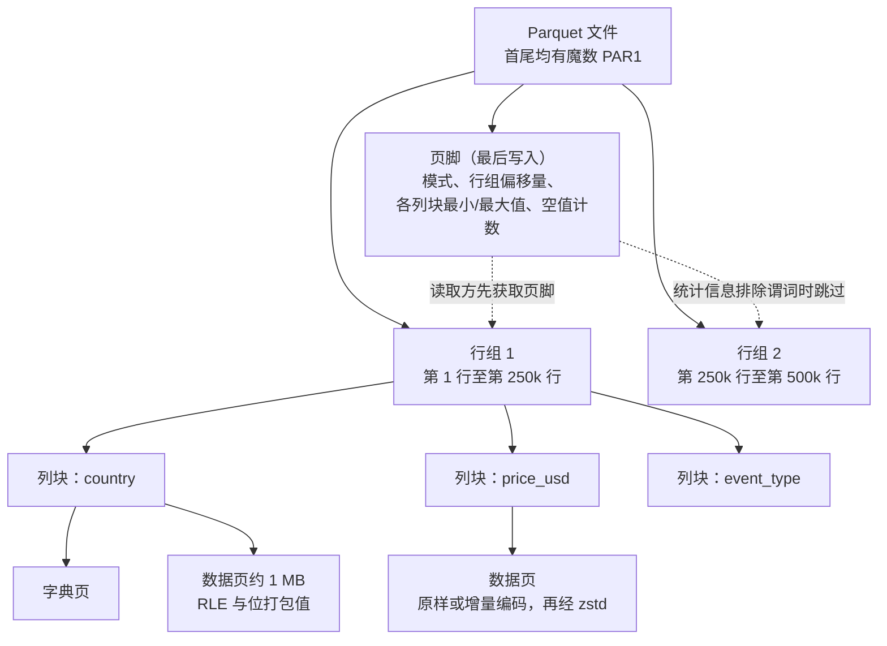
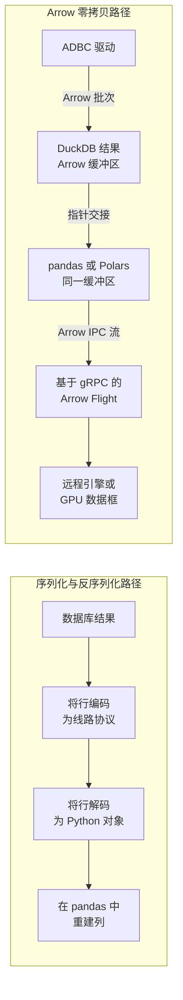
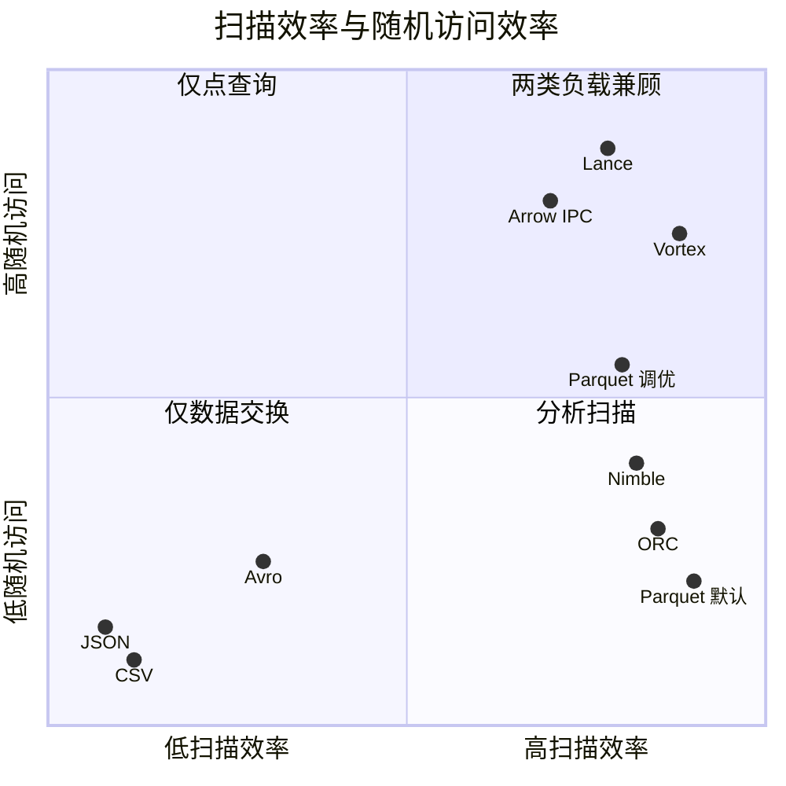
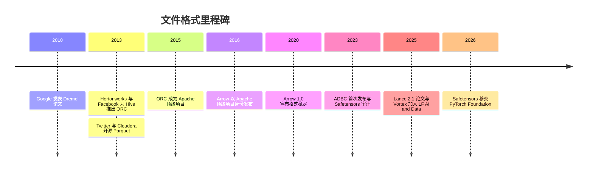

# 6. 文件格式：从 CSV 到 Parquet、Arrow 和 Lance
> **深度：** L2 · **阅读时间：** 约 13 分钟 · **最后核实：** 2026-11-01 · **前置阅读：** [第 5 章 — 分析引擎](ch05-analytical-engines.md)

## 要点速览（TL;DR）

- 文件格式（file format）决定字节如何排布，而这种排布锁定了此后每一次查询的成本。文本格式（CSV、JSON）通用，但不带类型、不保存统计信息，并且要在解析上耗费 CPU。列式二进制格式（Parquet、ORC）让引擎只读取查询所需的列和行范围。
- **Apache Parquet** 是默认的分析型文件格式。Twitter 和 Cloudera 于 2013 年在 Google Dremel 论文的基础上创建了它。一个 Parquet 文件包含行组，行组包含列块，列块包含页，而最后写入的页脚记录了模式和最小/最大值统计信息。
- **Apache Arrow** 是与之配套的*内存*标准。当两个引擎都使用 Arrow 时，它们无需转换即可传递数据，从而消除了过去在工具之间交接数据时占主导的序列化开销。
- AI 工作负载恰恰考验 Parquet 最不擅长的一点：对单行的快速随机访问，例如在训练数据混洗（shuffle）、向量检索和多模态大对象（blob）场景中。**Lance**、**Vortex** 和 **Nimble** 是主要挑战者。Parquet 守住了生态，挑战者则在特定访问模式上胜出。
- 对存储而言，格式选择就是工作负载选择。Parquet 扫描表现为高吞吐的大块顺序范围读取。Lance 式的机器学习访问表现为高 IOPS 的小块随机读取。小文件过多则对两者都有害。

## 为何重要（商业视角 + Everpure 视角）

[第 7 章](ch07-open-table-formats.md)中的开放表格式（open table format，Iceberg、Delta、Hudi）是元数据层。它们底下的数据几乎总是存放在对象存储（object storage）上的 Parquet 文件。谁控制这些文件的写入方式，谁就同时控制了扫描成本、云出口流量费（egress fees）、缓存命中率，以及日益重要的——图形处理器（GPU）集群的供数速度。围绕格式的争夺看似是技术问题，实际上决定了数据能否在不同引擎之间保持可移植。正是这种可移植性，使 Snowflake、Databricks、Google 和 AWS 最终都读取同样的 Parquet 文件（[第 5 章](ch05-analytical-engines.md)）。

对 Everpure（前身为 Pure Storage；NYSE: P）而言，文件格式是数据栈与存储系统之间的 I/O 契约。基于 Parquet 的商业智能（BI）查询会转化为少量大块、对齐的范围读取，此时吞吐量占优。从 Lance 数据集中混洗样本的训练作业，或探测嵌入向量（embedding）的向量索引（[第 18 章](../03-ai-data-stack/ch18-embeddings-and-vector-search.md)），则会转化为大量小块随机读取，此时延迟和 IOPS 占优。基于公开信息，战略团队可以把格式的采用情况作为先行指标，用来判断客户下一步将需要哪种 I/O 特征（[第 24 章](../03-ai-data-stack/ch24-data-meets-compute-and-storage.md)）。

## 工作原理

### 文本格式：通用而昂贵

CSV 和换行分隔 JSON（[NDJSON](../glossary.md#ndjson)，每行一个 JSON 对象）没有需要学习的二进制布局，所有工具都能读取。这种可移植性要付出三项代价。**解析 CPU**：每个数字都以字符形式存储，因此每次读取都要把文本重新转换成整数和浮点数，每个引号和转义字符都要检查。**没有类型或模式**：读取方必须猜测 `"0042"` 是字符串还是数字，而不同读取方会猜得不一样。**没有元数据**：文件没有统计信息，也没有索引，因此回答"德国有多少笔购买？"的唯一办法就是读完每一个字节。JSON 还在每一行重复每个字段名，这就是为什么同样数据的 NDJSON 文件通常比 CSV 更大。

### 行式二进制：Avro 与流处理世界

[Apache Avro](../glossary.md#apache-avro) 以二进制方式存储记录，一整行接着一整行。Avro 容器文件以一个文件头开始，其中以 JSON 形式嵌入了写入方的模式。数据随后以块的形式排列，每块以一个 16 字节的同步标记结尾，因此分布式引擎可以在块边界处切分文件。[^avro-spec] Avro 最出色的特性是**[模式演进](../glossary.md#schema-evolution)（schema evolution）**。规范规定了使用较新模式的读取方如何与用较旧模式写入的数据相协调：带默认值的新增字段、被删除的字段以及类型拓宽。[^avro-spec]

这一特性使 Avro 成为 Kafka 天然的载荷格式。Confluent 的[模式注册表](../glossary.md#schema-registry)（Schema Registry）为每个主题保存版本历史，并拒绝会破坏消费者的生产者变更。其兼容性模式包括向后（backward）、向前（forward）和完全（full），默认是 BACKWARD；它现在除 Avro 外还支持 Protobuf 和 JSON Schema。[^confluent-sr] 经验法则是：行式适合一次写入一个事件，列式适合一次读取数百万个事件。

### 列式文件：ORC 与 Parquet

两种列式格式在 Hadoop 时代的同一年诞生。**[Apache ORC](../glossary.md#apache-orc)** 来自 Hortonworks 与 Facebook 的合作，是 2013 年加速 Hive 的"Stinger"计划的一部分，并于 2015 年 4 月成为 Apache 顶级项目。[^stinger][^orc-tlp] **[Apache Parquet](../glossary.md#apache-parquet)** 来自 Twitter 和 Cloudera。两家于 2012 年秋联手，2013 年 3 月开源，2013 年 7 月发布 1.0。[^twitter-parquet] Parquet 处理嵌套数据的技巧（重复级别和定义级别）直接来自 Google 2010 年的 Dremel 论文，该论文展示了如何把嵌套记录存储在扁平列中。[^dremel] Twitter 报告称，其大型数据集改用 Parquet 后体积缩小了约三分之一。它还报告，只需少数几列的扫描，耗时仅为原来的一小部分。[^twitter-parquet]

Parquet 文件是一个层次结构：

*图 6.1 — Parquet 文件由行组、列块、页逐层组成。末尾的页脚是一张地图，让读取方能跳过文件的大部分内容。*

- **[行组](../glossary.md#row-group)（row group）**是若干行构成的水平切片，通常为 128 MB 或更大。
- 在每个行组内，每一列都有自己连续的**[列块](../glossary.md#column-chunk)（column chunk）**。
- 每个列块被切分为**页**（Java 写入器中默认约 1 MB）。页是编码和压缩的单位。[^parquet-defaults]
- 页中的值先**编码**、再**压缩**。[字典编码](../glossary.md#dictionary-encoding)（dictionary encoding）把重复的字符串换成小整数。[游程编码](../glossary.md#run-length-encoding)（run-length encoding）把重复值折叠起来。随后再用 Snappy 或 [Zstandard](../glossary.md#zstandard) 等通用编解码器处理结果。
- **页脚**保存模式、每个列块的字节偏移量以及各列块的统计信息（最小值、最大值、空值计数）。

查询引擎会先读取页脚，通常只需一次针对文件最后几 KB 的小范围请求。随后它使用两项技巧。**投影（projection）**只获取查询所指定的列块。**[谓词下推](../glossary.md#predicate-pushdown)（predicate pushdown）**用每个行组的最小/最大值统计信息与 `WHERE` 子句比对，跳过不可能匹配的行组。如果查询是 `WHERE event_date = '2026-10-31'`，而某个行组的日期范围是 1 月到 3 月，引擎就根本不会读取该行组。

> **类比：最后写成的目录。** 页脚放在末尾，是因为写入方只有在列块落盘之后才知道其偏移量和统计信息，这很像书的索引要在页码固定后才排版。代价是 Parquet 文件无法原地追加。每次变更都会产生一个新文件，而这正是表格式所填补的空白（[第 7 章](ch07-open-table-formats.md)）。

> **类比：半导体与内存。** 行组和页的大小扮演着 DRAM 突发长度和缓存行的角色。每次读取应搬运足够多的连续字节，以覆盖固定的每请求开销（一次对象存储 GET 或一次磁盘寻道），但又不能多到取回随后被丢弃的数据。同样的道理也用于让文件系统的 I/O 大小对齐 NAND 的页和擦除块。一个行组应能装入一个存储 I/O 单元，这就是为什么 Parquet 文档在历史上把 512 MB–1 GB 的行组与一个 HDFS 块绑定。[^parquet-config]

### 算例：100 万条 JSON 事件 → Parquet

为本章，我们生成了 1,000,000 条合成点击流事件（10 个字段：各类 ID、时间戳、事件类型、国家、设备、价格和延迟）。我们将其写成 NDJSON，再用 PyArrow 26.0 转换为行组大小为 25 万行的 Parquet。随后，我们在一台 4 vCPU 的云沙箱上、在操作系统缓存已预热的情况下，对一条查询"购买事件的分国家收入"计时。[^sandbox]

| 表示形式 | 大小 | 相对 NDJSON 的比率 | 查询时间（3 次取最佳） | 查询加速 |
|---|---|---|---|---|
| NDJSON，Python `json` 循环 | 204.6 MB | 1.0x | 2.95 s | 1x |
| NDJSON，Arrow 多线程 C++ 解析器 | 204.6 MB | 1.0x | 0.46 s | 约 6x |
| Parquet + Snappy，读取 10 列中的 3 列 | 27.1 MB | 缩小 7.5x | 0.025 s | 相对 Python 约 115x，相对 Arrow-JSON 约 18x |
| Parquet + Zstandard，读取 10 列中的 3 列 | 17.2 MB | 缩小 11.9x | 0.027 s | 相对 Python 约 110x，相对 Arrow-JSON 约 17x |

*图 6.2 — 在本次沙箱运行中（实测，合成数据），把 100 万条 JSON 事件转换为 Parquet 后体积缩小 7.5–12x，即使与快速 JSON 解析器相比，3 列查询也快了 17–18x。Zstandard 以少量 CPU 为代价，比 Snappy 少约 37% 的字节。*

有三点经验可以推广。第一，大部分收益来自*不读取*十列中的七列以及不解析文本，而不是来自压缩。第二，编解码器的选择对存储和出口流量成本的影响大于对本地磁盘速度的影响：Zstandard 与 Snappy 速度相当，体积却小了三分之一。一项已发表的 DuckDB 基准测试在 1,120 万行出租车数据上对 CSV 发现了同样的规律：Zstandard 压缩的 Parquet 比 CSV 小 6.8x，Snappy 压缩的 Parquet 小 5.1x（厂商执行的基准测试）。[^motherduck] 第三，整个页脚只占 5.6 KB，因此远程读取方只需一次小 GET 即可规划后续读取。字段基数低的合成数据比典型生产日志压缩得更好，因此应把这些比率视为中等偏上的情形，而不是承诺。

### Apache Arrow：人人共用的一种内存布局

Parquet 是数据在磁盘上静置的方式。[Apache Arrow](../glossary.md#apache-arrow) 则是数据在内存中存活的方式：一种与语言无关的列式布局，为值、有效性位图和偏移量设置固定缓冲区。在 Arrow 出现之前，把结果从数据库移到 pandas 意味着要把每个值逐行转换成接收程序的对象。这一序列化/反序列化步骤往往比查询本身还耗时。有了 Arrow，生产方和消费方共享同一种布局。交接数据只需传递指针，或在网络上原样流式传输原始缓冲区。

*图 6.3 — 旧路径在每一跳都要复制并转换数据。Arrow 路径从引擎到数据框再到网络始终保持同一种布局，因此一次交接的成本只是一个指针，而不是一次转换。*

核心格式周围还有三个组件。**Arrow IPC** 格式在进程之间、跨网络原样流式传输这些缓冲区。**[Arrow Flight](../glossary.md#arrow-flight)** 是一种基于 gRPC 的协议，用于在服务之间传输 Arrow 流，Flight SQL 则在其上增加了一层数据库查询能力。该项目于 2019 年 10 月公开推出 Flight，Flight SQL 随后在 Arrow 7.0（2022 年 2 月）中推出。[^flight] **[ADBC](../glossary.md#adbc)**（Arrow Database Connectivity）是一种客户端 API，是 JDBC/ODBC 的列式对应物。其首批库于 2023 年 1 月发布，规范此后已达到 1.1.0 版。[^adbc] Arrow 于 2016 年 2 月跳过孵化阶段直接成为 Apache 顶级项目，并于 2020 年 7 月以 1.0 版宣布格式稳定。[^arrow-tlp][^arrow-1]

> **类比：共享内存与 DMA。** Arrow 零拷贝的工作方式类似直接内存访问（DMA）。网卡可以写入一个 CPU 随后直接读取的缓冲区，无需中转复制，因为双方对字节存放的位置达成了一致。Arrow 就是分析软件之间的这种约定：DuckDB、Polars 和 GPU 数据框库都可以指向同一批缓冲区。节省下来的是内存带宽和 CPU 周期，与 DMA 节省的资源相同。

### AI 时代的格式：当随机访问变得重要

Parquet 是为扫描而设计的。获取第 7,341,002 行意味着要定位其所在行组，为每个所需列至少解码一个约 1 MB 的页（往往还要解压），再丢弃几乎所有其他内容。这对 BI 没问题，但对以下工作负载代价高昂：

- **机器学习训练混洗**：每一步读取一个随机的小批量样本。
- **向量检索**：索引返回 100 个候选 ID，必须逐个获取它们的嵌入向量和元数据。
- **多模态数据**：图像、音频和视频与其标签存放在一起，大对象使行组变得笨重。

**[Lance](../glossary.md#lance)** 来自 LanceDB，是一种列式文件格式加上一个带版本管理的表层，专为这些工作而设计。其 2025 年的设计论文认为，随机访问的成本来自*结构编码*（即嵌套和空值的排布方式），而不是列式存储本身。Lance 2.1 会根据值的宽度在两种编码之间切换。同一篇论文还报告，经过*调优*的 Parquet 配置在随机访问上可以比 Parquet 默认配置快 60x 以上，代价是一定的扫描速度和内存。这是为 Parquet 辩护的最有力论据。[^lance-paper] LanceDB 这家公司于 2025 年 6 月完成 $30M A 轮融资（媒体报道）。[^lancedb-funding]

**[Vortex](../glossary.md#vortex)** 起源于 SpiralDB，于 2025 年 8 月作为孵化项目捐赠给 LF AI & Data Foundation（Linux Foundation）。它涵盖内存、文件和 IPC 格式，并在全过程中保持数据压缩，获得了 Microsoft、Snowflake 和 Palantir 的支持。[^vortex-lf] 其项目资料声称随机访问读取比 Parquet 快 100–200x（厂商声称）。Spice AI 的"Cayenne"加速器即构建于其上。[^vortex-repo][^spice] **[Nimble](../glossary.md#nimble)** 是 Meta 面向超宽机器学习特征表（可能有数千列）的开源格式。它使用级联编码，并保持元数据轻量。第三方跟踪方仍将其描述为尚无稳定版本；一位 Iceberg 评审者最近也暂缓添加 Nimble 文件类型枚举，直到 Iceberg 规范正式接纳它。[^nimble-presto][^nimble-iceberg] `[VERIFY: 截至 2026-11 Nimble 的发布状态与许可证]`

"Parquet 已经过时"的争论目前主要停留在学术层面。一项 2023 年的 VLDB 研究（Pavlo、McKinney 等）发现 Parquet 与 ORC 之间没有明确的赢家。它还发现两种格式在机器学习和 GPU 解码上都效率不高，并建议默认使用字典编码以及解码更快的整数编码。[^empirical] 同一团队的 F3 提案走得更远：每个文件都携带 WebAssembly 解码器，这样新编码就不会破坏旧的读取方。其作者认为 Lance 和 Nimble 重复了 Parquet 的布局错误。[^f3] 反方观点是：Parquet 真正的资产是其读取器生态，而且其默认配置可以调优。

模型权重和训练语料有各自的格式。**[Safetensors](../glossary.md#safetensors)** 以一个 JSON 文件头加可内存映射的原始缓冲区来存储张量。它取代了基于 pickle 的检查点，后者在加载时可能执行任意代码。Trail of Bits 于 2023 年对其进行了审计，Hugging Face 于 2026 年 4 月将其捐赠给 PyTorch Foundation。[^safetensors-audit][^safetensors-pt] **[WebDataset](../glossary.md#webdataset)** 把训练样本打包进 tar 分片，使读取保持顺序。混洗在分片层面进行，样本再在内存缓冲区中进一步混洗。[^webdataset][^dali] TensorFlow 的 TFRecord 是更早的同类记录流格式。

*图 6.4 — 定性定位（作者依据所引论文和厂商声称作出的判断）。AI 时代的格式试图抵达默认 Parquet 留空的右上角。*

### 格式选择如何塑造 I/O

在对象存储上，一次 Parquet 扫描就是一串 HTTP 范围 GET：一次读页脚，然后每个所需列块各一次或多次。引擎会合并相邻范围并大量并行发出请求，因此存储系统看到的是大块、以顺序为主的读取，此时吞吐量最重要。相反的失败模式是**[小文件问题](../glossary.md#small-files-problem)（small files problem）**。每隔几秒写一个 2 MB 文件的流式数据摄取会产生数以百万计的文件。每个文件都要付出一次页脚读取、一条元数据记录和一次请求，这会挤压请求速率上限（S3 文档写明，每个分区前缀的基线为每秒 5,500 次 GET/HEAD 和 3,500 次 PUT/COPY/POST/DELETE 请求）[^s3-perf]，也会拖累表格式的查询规划。[压缩合并](../glossary.md#compaction)（compaction）会把它们重写为更大的文件。当前的默认值集中在一个狭窄区间：Iceberg 的目标数据文件为 512 MB，Databricks 会随着表的增长把 Delta 文件从 256 MB 自动调整到 1 GB，DuckDB 在每个行组 10 万–100 万行时表现最佳。[^iceberg-config][^databricks-size][^duckdb-formats] 机器学习训练则恰好相反：每一步都有大量小块随机读取，这就是为什么数据集要么被分片以便顺序读取（WebDataset），要么以随机访问格式（Lance）存放在低延迟闪存上。

## 设计选择与权衡

| 格式 | 存储方向 | 模式 | 压缩 | 随机访问 | 生态 | 最佳适用场景 | 治理归属 |
|---|---|---|---|---|---|---|---|
| CSV | 行式，文本 | 无（至多有表头） | 仅外部压缩（gzip） | 差 | 通用 | 导出、人工交接 | 事实标准（RFC 4180） |
| JSON / NDJSON | 行式，文本 | 无，键名自描述 | 仅外部压缩 | 差 | 通用 | API、日志、半结构化数据落地 | IETF/ECMA 标准 |
| Avro | 行式，二进制 | 内嵌，严格的演进规则 | 块级编解码器 | 差（按块寻址） | Kafka、流处理、CDC | 事件流、已注册模式的主题 | Apache |
| ORC | 列式 | 内嵌 | 编码 + zlib/zstd | 中等（索引） | Hive、Trino、部分 Spark | Hive 时代的数据仓库 | Apache |
| Parquet | 列式（混合） | 页脚 | 编码 + Snappy/zstd | 默认较弱，调优后更好 | 所有引擎和云 | 湖仓分析、表格式 | Apache |
| Arrow（IPC/Feather） | 列式，内存中 | 内嵌 | 可选 LZ4/zstd | 强（固定偏移量） | DuckDB、Polars、pandas、Spark、GPU | 数据交换、缓存、传输 | Apache |
| Lance | 列式 + 表层 | 内嵌，带版本 | 自适应编码 | 强（设计目标） | LanceDB、Arrow，持续增长 | 机器学习数据集、向量、多模态 | 厂商主导的开源（LanceDB） |
| Vortex / Nimble | 列式 | 内嵌 | 级联/自适应编码 | 强（Vortex 声称）/ 中等 | 早期 | 下一代分析 / 宽机器学习表 | Linux Foundation（Vortex）/ Meta 主导（Nimble） |

*图 6.5 — 没有哪种格式能在每一列都胜出。Parquet 胜在生态，Avro 胜在模式演进，Arrow 胜在数据交换，Lance 胜在随机访问。*

继续使用 Parquet 的最强版本论证（steelman）是：每一个数据仓库、湖仓引擎和表格式都能读取它，而经过调优的写入器可以弥合大部分随机访问差距。迁移的最强版本论证是：新写入的数据如今由 AI 工作负载驱动。一种为随机访问、大对象和版本管理而构建的格式，可以避免在向量数据库或一堆 tar 分片中再保留一份数据副本。

## 主要参与者

- **Apache Parquet / ORC 社区**：Parquet 是湖仓的默认格式，ORC 如今的覆盖面较小。
- **Apache Arrow PMC**：Dremio（现为 SAP 旗下）与 Wes McKinney 共同发起了该项目，McKinney 后来先后供职于 Voltron Data 和 Posit；此外还有众多贡献者。[^arrow-tlp] `[VERIFY: McKinney 当前的任职机构]`
- **LanceDB**：Lance 格式加一个向量/多模态数据库。
- **SpiralDB**：创建了 Vortex，现归属 LF AI & Data。
- **Meta**：Nimble，与 Velox 引擎配套构建。
- **Confluent**（Schema Registry）、**Hugging Face**（Safetensors）和 **NVIDIA**（面向 WebDataset/TFRecord 的 DALI 加载器）是与格式相邻的参与者。

## 历史与发展轨迹

*图 6.6 — 分析型格式在 2016 年前已基本定型；2023–2026 年的浪潮围绕 AI 访问模式和模型制品展开。*

Avro 由 Hadoop 的创造者 Doug Cutting 于 2009 年作为 Hadoop 子项目发起，并于 2010 年成为 Apache 顶级项目。Parquet 于 2014 年进入 Apache 孵化器，并于 2015 年 4 月成为顶级项目，与 ORC 同月。[^asf-tlp] 未来最可能的路径是共存。Parquet 仍是 Iceberg 和 Delta 之下的交换层，而表格式日益接受底层的其他文件类型，正如 Iceberg 中关于 Nimble 枚举的讨论所显示的那样。[^nimble-iceberg]

## 关键数字

| 指标 | 数值 | 口径 | 来源 / 日期 |
|---|---|---|---|
| 推荐的 Parquet 行组大小 | 512 MB–1 GB | 项目指引（HDFS 时代） | Apache Parquet 文档，无日期[^parquet-config] |
| parquet-mr 默认行组 / 页大小 | 128 MB / 1 MB | 库默认值 | parquet-mr，经由 Hive 邮件列表[^parquet-defaults] |
| Iceberg 目标数据文件大小 | 512 MB | 默认属性 | Apache Iceberg 文档[^iceberg-config] |
| Databricks Delta 自动调优文件大小 | 随表增长 256 MB → 1 GB | 厂商默认值 | Databricks 文档[^databricks-size] |
| DuckDB 推荐行组大小 | 10 万–100 万行 | 厂商指引 | DuckDB 文档[^duckdb-formats] |
| Twitter 改用 Parquet 后的体积缩减 | 缩小约 1/3 | 公司报告，2013 | Le Dem / Twitter[^twitter-parquet] |
| 调优 vs 默认 Parquet 的随机访问 | 快 >60x | LanceDB 作者的预印本 | arXiv 2025-04-21[^lance-paper] |
| Vortex 相对 Parquet 的随机访问 | 100–200x | 厂商声称 | Vortex 代码仓库[^vortex-repo] |
| 100 万条 JSON 事件 → Parquet zstd | 204.6 MB → 17.2 MB（11.9x） | 实测，合成数据，本章 | 沙箱运行 2026-11-01[^sandbox] |
| CSV → Parquet zstd（1,120 万行出租车数据） | 缩小 6.8x | 厂商基准测试 | MotherDuck[^motherduck] |

*图 6.7 — 文件大小指引趋向于数百 MB 到 1 GB 的文件。随机访问加速大多为厂商自测，且对照的 Parquet 基线各不相同，比较时需谨慎。*

## 存储桥接

> **存储桥接。** Parquet 分析会转化为大块并行范围 GET，奖励的是流式吞吐和良好的预取。Lance 和向量工作负载会转化为小块随机读取，此时尾延迟和 IOPS 起主导作用。压缩合并是一种后台重写工作负载，其流量可与前台流量相当。为 AI 湖仓提供服务的存储系统必须在同一个命名空间上同时应对这三者。关于对象存储和闪存在这些模式下的表现，请参见配套的 *Everpure Tech Atlas*。

## 对话手册

**向产品经理提的问题**
1. 你们客户最大的数据集实际使用哪些文件格式？Lance 或 Vortex 是否开始出现在 RFP 中？
2. 你们把压缩合并和文件大小管理视为产品功能，还是客户自己的问题？
3. 在你们的数据管道中，数据在哪个环节离开 Arrow 并被序列化？代价是多少？

**向工程师提的问题**
1. 你们写入的行组和页大小是多少？是针对扫描还是针对点查询调优的？
2. 一条典型查询对每个文件发出多少次范围请求？你们的合并阈值是多少？
3. 在训练中，你们是在分片层面还是样本层面做混洗？到达存储的 I/O 大小是多少？

**好的回答听起来是什么样的：**给出具体大小（"512 MB 文件、128 MB 行组、zstd 级别 3"）、实测的请求次数，并清楚说明每种布局服务于哪种工作负载。

**不要这样说**
- "Parquet 是一个数据库。"它是一种文件格式；其余工作由引擎和表格式完成。
- "列式总是更快。"对单行写入或默认配置下的点查询并非如此。
- "Arrow 是和 Parquet 一样的文件格式。"Arrow 主要是一种内存布局；其 IPC 文件只是副产品。
- "Lance 取代了 Iceberg。"Lance 包含一个表层，但大多数湖仓仍在 Parquet 之上运行 Iceberg 或 Delta。

## 深入阅读

> **深入（L3）。** 先阅读 Dremel 论文中关于重复级别/定义级别的章节，再看 Parquet 的 Thrift 页脚定义。将其与 Lance 2.1 论文中"mini-block"与"full-zip"两种结构编码，以及 F3 提案中内嵌的 Wasm 解码器进行比较。[^dremel][^lance-paper][^f3]

## 关键术语

- [NDJSON](../glossary.md#ndjson) — 换行分隔的 JSON，每行一条记录。
- [Apache Avro](../glossary.md#apache-avro) — 行式二进制格式，内嵌模式和演进规则。
- [模式演进](../glossary.md#schema-evolution)（schema evolution）— 修改模式的同时，新旧数据都保持可读。
- [模式注册表](../glossary.md#schema-registry)（Schema Registry）— 为流数据管理模式版本并强制执行兼容性的服务。
- [Apache ORC](../glossary.md#apache-orc) — Hive 时代的列式文件格式。
- [Apache Parquet](../glossary.md#apache-parquet) — 分析领域默认的开放列式文件格式。
- [行组](../glossary.md#row-group)（row group）— Parquet 文件的水平切片。
- [列块](../glossary.md#column-chunk)（column chunk）— 一个行组内某一列的数据。
- [字典编码](../glossary.md#dictionary-encoding)（dictionary encoding）— 用整数编码替换重复值。
- [游程编码](../glossary.md#run-length-encoding)（run-length encoding）— 将重复值只存一次并附上计数。
- [Zstandard](../glossary.md#zstandard) — 高压缩比的通用压缩编解码器。
- [谓词下推](../glossary.md#predicate-pushdown)（predicate pushdown）— 利用统计信息跳过过滤条件不可能匹配的数据。
- [Apache Arrow](../glossary.md#apache-arrow) — 标准的内存列式布局。
- [Arrow Flight](../glossary.md#arrow-flight) — 用于流式传输 Arrow 数据的 gRPC 协议。
- [ADBC](../glossary.md#adbc) — Arrow 原生的数据库客户端 API。
- [Lance](../glossary.md#lance) — 面向 AI 数据、利于随机访问的列式格式和表层。
- [Vortex](../glossary.md#vortex) — 由 LF AI and Data 托管的压缩列式格式。
- [Nimble](../glossary.md#nimble) — Meta 面向宽机器学习表的列式格式。
- [Safetensors](../glossary.md#safetensors) — 安全、可内存映射的张量文件格式。
- [WebDataset](../glossary.md#webdataset) — 面向顺序训练读取的 tar 分片格式。
- [小文件问题](../glossary.md#small-files-problem)（small files problem）— 小数据文件过多所带来的开销。
- [压缩合并](../glossary.md#compaction)（compaction）— 把小文件重写为更大的文件。

## 资料来源

[^avro-spec]: Apache Software Foundation, "Apache Avro 1.10.0 Specification" (Object Container Files; Schema Resolution), https://avro.apache.org/docs/1.10.0/spec.pdf ，发布 2020；检索 2026-11-01。
[^confluent-sr]: Confluent, "Schema Evolution and Compatibility for Schema Registry on Confluent Platform," https://docs.confluent.io/platform/current/schema-registry/fundamentals/schema-evolution.html ，无日期；检索 2026-11-01。
[^stinger]: SiliconANGLE, "Hortonworks announces three new Apache projects: Stinger, Tez, Hadoop gateway," https://siliconangle.com/2013/02/20/hortonworks-announces-three-new-apache-projects-stinger-tez-hadoop-gateware/ ，发布 2013-02-20；检索 2026-11-01。
[^orc-tlp]: Apache ORC, "ORC becomes an Apache Top Level Project," https://orc.apache.org/news/2015/04/22/orc-as-tlp/ ，发布 2015-04-22；检索 2026-11-01。
[^twitter-parquet]: Julien Le Dem (Twitter), "Dremel made simple with Parquet," 原载 Twitter Engineering blog, blog.twitter.com/2013/dremel-made-simple-with-parquet（2013）；作者镜像 https://sympathetic.ink/2013/09/11/Dremel-made-simple-with-Parquet.html ，发布 2013-09-11；项目时间线来自 "Parquet" presentation, Data IO Philadelphia, https://www.slideshare.net/slideshow/parquet-data-io-philadelphia-2013/27747309 ，2013；检索 2026-11-01。
[^dremel]: S. Melnik et al., "Dremel: Interactive Analysis of Web-Scale Datasets," Proc. VLDB Endowment 3(1–2), Google Research, https://research.google/pubs/pub36632/ ，发布 2010；检索 2026-11-01。
[^parquet-defaults]: parquet-mr 配置默认值（parquet.block.size = 134217728；parquet.page.size = 1048576），引自 Apache Hive 用户邮件列表, https://mail-archive.com/user@hive.apache.org/msg15531.html ，无日期（二手来源）；并经 Apache Sedona docs 佐证, https://sedona.apache.org/1.4.1/tutorial/storing-blobs-in-parquet/ ，无日期；检索 2026-11-01。
[^parquet-config]: Apache Parquet, "Configurations"（行组大小指引）, https://parquet.apache.org/docs/file-format/configurations/ ，无日期；检索 2026-11-01。
[^sandbox]: AI Data Atlas，作者实测：1,000,000 条合成 NDJSON 事件（带种子的随机生成器，10 个字段），用 PyArrow 26.0.0 转换（row_group_size = 250,000），查询为过滤 event_type = purchase 并按 country 汇总 price_usd，3 次运行取最佳，4 vCPU x86-64 Linux 沙箱，页缓存已预热；运行于 2026-11-01。估算级别；并非厂商基准测试。
[^motherduck]: MotherDuck, "CSV vs Parquet benchmark," https://motherduck.com/learn/csv-vs-parquet-benchmark/ ，无日期；检索 2026-11-01。
[^adbc]: Apache Arrow, "Apache Arrow ADBC 0.1.0 (Libraries) Release," https://arrow.apache.org/blog/2023/01/12/adbc-0.1.0-release ，发布 2023-01-12；以及 "ADBC: Arrow Database Connectivity," https://arrow.apache.org/docs/format/ADBC.html ，无日期；检索 2026-11-01。
[^arrow-tlp]: Dremio, "The Origin and History of Apache Arrow," https://www.dremio.com/blog/origin-and-history-of-apache-arrow ，无日期（文中称顶级项目宣布日期为 2016-02-17）；检索 2026-11-01。
[^arrow-1]: Apache Arrow, "Apache Arrow 1.0.0 Release," https://arrow.apache.org/blog/2020/07/24/1.0.0-release/ ，发布 2020-07-24；检索 2026-11-01。
[^lance-paper]: W. Pace, C. She, L. Xu, W. Jones, A. Lockett, J. Wang, R. Shah (LanceDB), "Lance: Efficient Random Access in Columnar Storage through Adaptive Structural Encodings," arXiv:2504.15247, https://arxiv.org/abs/2504.15247v1 ，发布 2025-04-21；检索 2026-11-01。
[^lancedb-funding]: AI Data Atlas，`data/private_funding.csv`（LanceDB A 轮，2025-06-24，$30M），来源为 PitchBook profile https://pitchbook.com/profiles/company/493221-61 ；`meta/research-briefing.md` 称 Theory Ventures 为领投方，而 CSV 行中领投方仍标注为未确认；检索 2026-11-01。
[^vortex-lf]: Linux Foundation, "LF AI & Data Foundation Hosts Vortex Project to Power High Performance Data Access for AI and Analytics," https://www.linuxfoundation.org/press/lf-ai-data-foundation-hosts-vortex-project-to-power-high-performance-data-access-for-ai-and-analytics ，发布 2025-08-06；检索 2026-11-01。
[^vortex-repo]: vortex-data, "Vortex" GitHub repository, https://github.com/vortex-data/vortex ，无日期（厂商声称的基准测试）；检索 2026-11-01。
[^spice]: Spice AI, "Introducing Spice Cayenne: The Next-Generation Data Accelerator Built on Vortex," https://spice.ai/blog/introducing-spice-cayenne-data-accelerator ，无日期；检索 2026-11-01。
[^nimble-presto]: Presto Foundation, "Nimble, a new file format for large datasets"（演讲）, https://prestodb.io/videos/nimble-a-new-file-format-for-large-datasets/ ，无日期；检索 2026-11-01。
[^nimble-iceberg]: Apache Iceberg C++, "feat: add Nimble to FileFormatType," pull request #879, https://github.com/apache/iceberg-cpp/pull/879 ，无日期；检索 2026-11-01。
[^empirical]: X. Zeng, Y. Hui, J. Shen, A. Pavlo, W. McKinney, H. Zhang, "An Empirical Evaluation of Columnar Storage Formats," PVLDB 17(2): 148–161, https://www.vldb.org/pvldb/vol17/p148-zeng.pdf ，发布 2023；检索 2026-11-01。
[^f3]: X. Zeng et al., "F3: The Open-Source Data File Format for the Future," 代码与论文链接见 https://github.com/future-file-format/f3 ，无日期（所列会议为 SIGMOD 2026 / PACMMOD 2025）；检索 2026-11-01。
[^safetensors-audit]: Hugging Face, "Audit shows that safetensors is safe and ready to become the default," https://huggingface.co/blog/safetensors-security-audit ，发布 2023-05；Trail of Bits 报告日期 2023-05-03, https://www.trailofbits.com/documents/2023-03-eleutherai-huggingface-safetensors-securityreview%20(2).pdf ；检索 2026-11-01。
[^safetensors-pt]: Phoronix, "Hugging Face Contributes Safetensors To PyTorch Foundation To Secure AI Model Execution," https://www.phoronix.com/news/PyTorch-Safetensors ，发布 2026-04-08；检索 2026-11-01。
[^webdataset]: WebDataset project, PyPI package description, https://pypi.org/project/webdataset/0.1.37 ，无日期；检索 2026-11-01。
[^dali]: NVIDIA, "DALI: Webdataset reader" documentation, https://docs.nvidia.com/deeplearning/dali/archives/dali_2_2_0/user-guide/dali_dynamic/operations/nvidia.dali.experimental.dynamic.readers.Webdataset.html ，无日期；检索 2026-11-01。
[^flight]: Apache Arrow, "Introducing Apache Arrow Flight: A Framework for Fast Data Transport," https://arrow.apache.org/blog/2019/10/13/introducing-arrow-flight/ ，发布 2019-10-13；Apache Arrow, "Introducing Apache Arrow Flight SQL," https://arrow.apache.org/blog/2022/02/16/introducing-arrow-flight-sql/ ，发布 2022-02-16；检索 2026-11-01（评审者对既定事实的引用；URL 未重新抓取）。
[^asf-tlp]: Apache Software Foundation, "The Apache Software Foundation Announces Apache Parquet as a Top-Level Project," 新闻稿，发布 2015-04-27；Apache Avro 项目历史（2009 年为 Hadoop 子项目，2010 年成为顶级项目）, https://avro.apache.org/ ；检索 2026-11-01（评审者对 2025 年前既定事实的引用；页面未重新抓取）。
[^s3-perf]: AWS, "Best practices design patterns: optimizing Amazon S3 performance," https://docs.aws.amazon.com/AmazonS3/latest/userguide/optimizing-performance.html ，持续更新的文档；检索 2026-11-01。
[^iceberg-config]: Apache Iceberg, "Configuration" (write.target-file-size-bytes = 536870912), https://iceberg.apache.org/docs/1.6.0/configuration ，无日期；检索 2026-11-01。
[^databricks-size]: Databricks, "Configure Delta Lake to control data file size," https://docs.databricks.com/aws/en/tables/tune-file-size ，无日期；检索 2026-11-01。
[^duckdb-formats]: DuckDB, "File Formats" performance guide, https://duckdb.org/docs/current/guides/performance/file_formats.html ，无日期；检索 2026-11-01。
