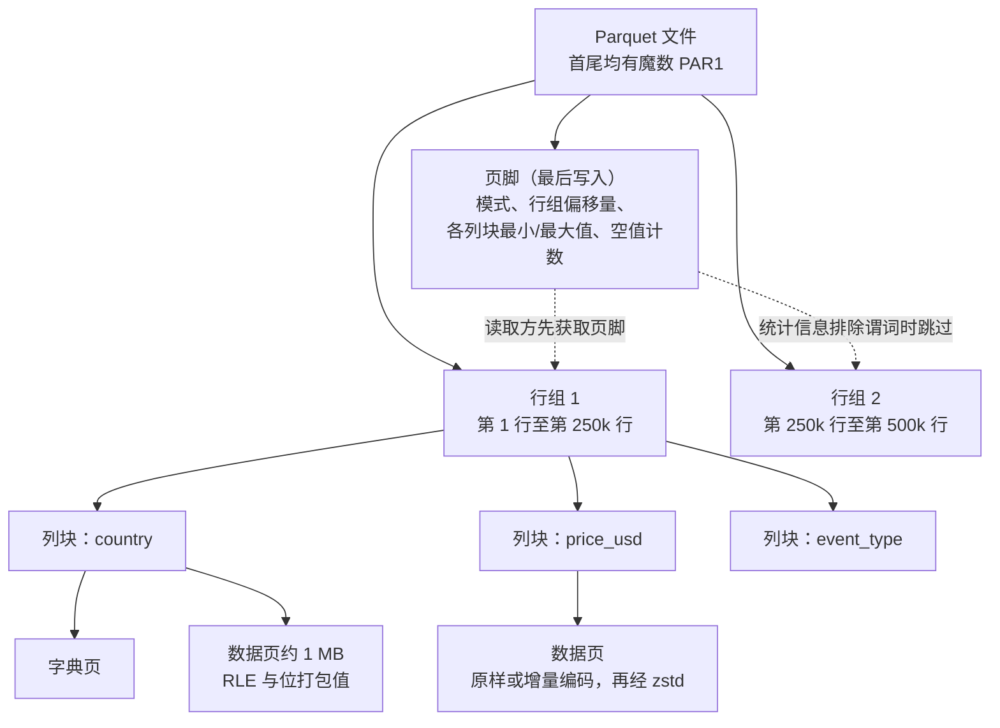
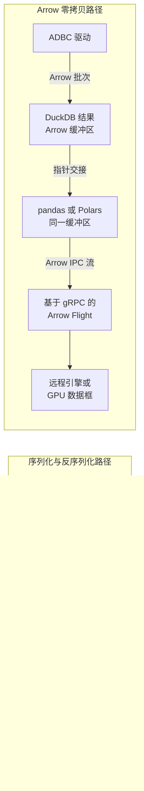

# 6. 文件格式：从 CSV 到 Parquet、Arrow 和 Lance
> **深度：** L2 · **阅读时间：** 约 13 分钟 · **最后核实：** 2026-11-01 · **前置阅读：** [第 5 章 — 分析引擎](ch05-analytical-engines.md)

## 要点速览（TL;DR）

- 文件格式（file format）决定字节如何排布，而这种排布锁定了此后每一次查询的成本。文本格式（CSV、JSON）通用，但不带类型、不保存统计信息，并且要在解析上耗费 CPU。列式二进制格式（Parquet、ORC）让引擎只读取查询所需的列和行范围。
- **Apache Parquet** 是默认的分析型文件格式。Twitter 和 Cloudera 于 2013 年在 Google Dremel 论文的基础上创建了它。一个 Parquet 文件包含行组，行组包含列块，列块包含页，而最后写入的页脚记录了模式和最小/最大值统计信息。
- **Apache Arrow** 是与之配套的*内存*标准。当两个引擎都使用 Arrow 时，它们无需转换即可传递数据，从而消除了过去在工具之间交接数据时占主导的序列化开销。
- AI 工作负载恰恰考验 Parquet 最不擅长的一点：对单行的快速随机访问，例如在训练数据混洗（shuffle）、向量检索和多模态大对象（blob）场景中。**Lance**、**Vortex** 和 **Nimble** 是主要挑战者。Parquet 守住了生态，挑战者则在特定访问模式上胜出。
- 对存储而言，格式选择就是工作负载选择。Parquet 扫描表现为高吞吐的大块顺序范围读取。Lance 式的机器学习访问表现为高 IOPS 的小块随机读取。小文件过多则对两者都有害。

## 为何重要（商业视角 + Everpure 视角）

[第 7 章](ch07-open-table-formats.md)中的开放表格式（open table format，Iceberg、Delta、Hudi）是元数据层。它们底下的数据几乎总是存放在对象存储（object storage）上的 Parquet 文件。谁控制这些文件的写入方式，谁就同时控制了扫描成本、云出口流量费（egress fees）、缓存命中率，以及日益重要的——图形处理器（GPU）集群的供数速度。围绕格式的争夺看似是技术问题，实际上决定了数据能否在不同引擎之间保持可移植。正是这种可移植性，使 Snowflake、Databricks、Google 和 AWS 最终都读取同样的 Parquet 文件（[第 5 章](ch05-analytical-engines.md)）。

对 Everpure（前身为 Pure Storage；NYSE: P）而言，文件格式是数据栈与存储系统之间的 I/O 契约。基于 Parquet 的商业智能（BI）查询会转化为少量大块、对齐的范围读取，此时吞吐量占优。从 Lance 数据集中混洗样本的训练作业，或探测嵌入向量（embedding）的向量索引（[第 18 章](../03-ai-data-stack/ch18-embeddings-and-vector-search.md)），则会转化为大量小块随机读取，此时延迟和 IOPS 占优。基于公开信息，战略团队可以把格式的采用情况作为先行指标，用来判断客户下一步将需要哪种 I/O 特征（[第 24 章](../03-ai-data-stack/ch24-data-meets-compute-and-storage.md)）。

## 工作原理

### 文本格式：通用而昂贵

CSV 和换行分隔 JSON（[NDJSON](../glossary.md#ndjson)，每行一个 JSON 对象）没有需要学习的二进制布局，所有工具都能读取。这种可移植性要付出三项代价。**解析 CPU**：每个数字都以字符形式存储，因此每次读取都要把文本重新转换成整数和浮点数，每个引号和转义字符都要检查。**没有类型或模式**：读取方必须猜测 `"0042"` 是字符串还是数字，而不同读取方会猜得不一样。**没有元数据**：文件没有统计信息，也没有索引，因此回答"德国有多少笔购买？"的唯一办法就是读完每一个字节。JSON 还在每一行重复每个字段名，这就是为什么同样数据的 NDJSON 文件通常比 CSV 更大。

### 行式二进制：Avro 与流处理世界

[Apache Avro](../glossary.md#apache-avro) 以二进制方式存储记录，一整行接着一整行。Avro 容器文件以一个文件头开始，其中以 JSON 形式嵌入了写入方的模式。数据随后以块的形式排列，每块以一个 16 字节的同步标记结尾，因此分布式引擎可以在块边界处切分文件。[^avro-spec] Avro 最出色的特性是**[模式演进](../glossary.md#schema-evolution)（schema evolution）**。规范规定了使用较新模式的读取方如何与用较旧模式写入的数据相协调：带默认值的新增字段、被删除的字段以及类型拓宽。[^avro-spec]

这一特性使 Avro 成为 Kafka 天然的载荷格式。Confluent 的[模式注册表](../glossary.md#schema-registry)（Schema Registry）为每个主题保存版本历史，并拒绝会破坏消费者的生产者变更。其兼容性模式包括向后（backward）、向前（forward）和完全（full），默认是 BACKWARD；它现在除 Avro 外还支持 Protobuf 和 JSON Schema。[^confluent-sr] 经验法则是：行式适合一次写入一个事件，列式适合一次读取数百万个事件。

### 列式文件：ORC 与 Parquet

两种列式格式在 Hadoop 时代的同一年诞生。**[Apache ORC](../glossary.md#apache-orc)** 来自 Hortonworks 与 Facebook 的合作，是 2013 年加速 Hive 的"Stinger"计划的一部分，并于 2015 年 4 月成为 Apache 顶级项目。[^stinger][^orc-tlp] **[Apache Parquet](../glossary.md#apache-parquet)** 来自 Twitter 和 Cloudera。两家于 2012 年秋联手，2013 年 3 月开源，2013 年 7 月发布 1.0。[^twitter-parquet] Parquet 处理嵌套数据的技巧（重复级别和定义级别）直接来自 Google 2010 年的 Dremel 论文，该论文展示了如何把嵌套记录存储在扁平列中。[^dremel] Twitter 报告称，其大型数据集改用 Parquet 后体积缩小了约三分之一。它还报告，只需少数几列的扫描，耗时仅为原来的一小部分。[^twitter-parquet]

Parquet 文件是一个层次结构：

*图 6.1 — Parquet 文件由行组、列块、页逐层组成。末尾的页脚是一张地图，让读取方能跳过文件的大部分内容。*

- **[行组](../glossary.md#row-group)（row group）**是若干行构成的水平切片，通常为 128 MB 或更大。
- 在每个行组内，每一列都有自己连续的**[列块](../glossary.md#column-chunk)（column chunk）**。
- 每个列块被切分为**页**（Java 写入器中默认约 1 MB）。页是编码和压缩的单位。[^parquet-defaults]
- 页中的值先**编码**、再**压缩**。[字典编码](../glossary.md#dictionary-encoding)（dictionary encoding）把重复的字符串换成小整数。[游程编码](../glossary.md#run-length-encoding)（run-length encoding）把重复值折叠起来。随后再用 Snappy 或 [Zstandard](../glossary.md#zstandard) 等通用编解码器处理结果。
- **页脚**保存模式、每个列块的字节偏移量以及各列块的统计信息（最小值、最大值、空值计数）。

查询引擎会先读取页脚，通常只需一次针对文件最后几 KB 的小范围请求。随后它使用两项技巧。**投影（projection）**只获取查询所指定的列块。**[谓词下推](../glossary.md#predicate-pushdown)（predicate pushdown）**用每个行组的最小/最大值统计信息与 `WHERE` 子句比对，跳过不可能匹配的行组。如果查询是 `WHERE event_date = '2026-10-31'`，而某个行组的日期范围是 1 月到 3 月，引擎就根本不会读取该行组。

> **类比：最后写成的目录。** 页脚放在末尾，是因为写入方只有在列块落盘之后才知道其偏移量和统计信息，这很像书的索引要在页码固定后才排版。代价是 Parquet 文件无法原地追加。每次变更都会产生一个新文件，而这正是表格式所填补的空白（[第 7 章](ch07-open-table-formats.md)）。

> **类比：半导体与内存。** 行组和页的大小扮演着 DRAM 突发长度和缓存行的角色。每次读取应搬运足够多的连续字节，以覆盖固定的每请求开销（一次对象存储 GET 或一次磁盘寻道），但又不能多到取回随后被丢弃的数据。同样的道理也用于让文件系统的 I/O 大小对齐 NAND 的页和擦除块。一个行组应能装入一个存储 I/O 单元，这就是为什么 Parquet 文档在历史上把 512 MB–1 GB 的行组与一个 HDFS 块绑定。[^parquet-config]

### 算例：100 万条 JSON 事件 → Parquet

为本章，我们生成了 1,000,000 条合成点击流事件（10 个字段：各类 ID、时间戳、事件类型、国家、设备、价格和延迟）。我们将其写成 NDJSON，再用 PyArrow 26.0 转换为行组大小为 25 万行的 Parquet。随后，我们在一台 4 vCPU 的云沙箱上、在操作系统缓存已预热的情况下，对一条查询"购买事件的分国家收入"计时。[^sandbox]

| 表示形式 | 大小 | 相对 NDJSON 的比率 | 查询时间（3 次取最佳） | 查询加速 |
|---|---|---|---|---|
| NDJSON，Python `json` 循环 | 204.6 MB | 1.0x | 2.95 s | 1x |
| NDJSON，Arrow 多线程 C++ 解析器 | 204.6 MB | 1.0x | 0.46 s | 约 6x |
| Parquet + Snappy，读取 10 列中的 3 列 | 27.1 MB | 缩小 7.5x | 0.025 s | 相对 Python 约 115x，相对 Arrow-JSON 约 18x |
| Parquet + Zstandard，读取 10 列中的 3 列 | 17.2 MB | 缩小 11.9x | 0.027 s | 相对 Python 约 110x，相对 Arrow-JSON 约 17x |

*图 6.2 — 在本次沙箱运行中（实测，合成数据），把 100 万条 JSON 事件转换为 Parquet 后体积缩小 7.5–12x，即使与快速 JSON 解析器相比，3 列查询也快了 17–18x。Zstandard 以少量 CPU 为代价，比 Snappy 少约 37% 的字节。*

有三点经验可以推广。第一，大部分收益来自*不读取*十列中的七列以及不解析文本，而不是来自压缩。第二，编解码器的选择对存储和出口流量成本的影响大于对本地磁盘速度的影响：Zstandard 与 Snappy 速度相当，体积却小了三分之一。一项已发表的 DuckDB 基准测试在 1,120 万行出租车数据上对 CSV 发现了同样的规律：Zstandard 压缩的 Parquet 比 CSV 小 6.8x，Snappy 压缩的 Parquet 小 5.1x（厂商执行的基准测试）。[^motherduck] 第三，整个页脚只占 5.6 KB，因此远程读取方只需一次小 GET 即可规划后续读取。字段基数低的合成数据比典型生产日志压缩得更好，因此应把这些比率视为中等偏上的情形，而不是承诺。

### Apache Arrow：人人共用的一种内存布局

Parquet 是数据在磁盘上静置的方式。[Apache Arrow](../glossary.md#apache-arrow) 则是数据在内存中存活的方式：一种与语言无关的列式布局，为值、有效性位图和偏移量设置固定缓冲区。在 Arrow 出现之前，把结果从数据库移到 pandas 意味着要把每个值逐行转换成接收程序的对象。这一序列化/反序列化步骤往往比查询本身还耗时。有了 Arrow，生产方和消费方共享同一种布局。交接数据只需传递指针，或在网络上原样流式传输原始缓冲区。

*图 6.3 — 旧路径在每一跳都要复制并转换数据。Arrow 路径从引擎到数据框再到网络始终保持同一种布局，因此一次交接的成本只是一个指针，而不是一次转换。*

核心格式周围还有三个组件。**Arrow IPC** 格式在进程之间、跨网络原样流式传输这些缓冲区。**[Arrow Flight](../glossary.md#arrow-flight)** 是一种基于 gRPC 的协议，用于在服务之间传输 Arrow 流，Flight SQL 则在其上增加了一层数据库查询能力。该项目于 2019 年 10 月公开推出 Flight，Flight SQL 随后在 Arrow 7.0（2022 年 2 月）中推出。[^flight] **[ADBC](../glossary.md#adbc)**（Arrow Database Connectivity）是一种客户端 API，是 JDBC/ODBC 的列式对应物。其首批库于 2023 年 1 月发布，规范此后已达到 1.1.0 版。[^adbc] Arrow 于 2016 年 2 月跳过孵化阶段直接成为 Apache 顶级项目，并于 2020 年 7 月以 1.0 版宣布格式稳定。[^arrow-tlp][^arrow-1]

> **类比：共享内存与 DMA。** Arrow 零拷贝的工作方式类似直接内存访问（DMA）。网卡可以写入一个 CPU 随后直接读取的缓冲区，无需中转复制，因为双方对字节存放的位置达成了一致。Arrow 就是分析软件之间的这种约定：DuckDB、Polars 和 GPU 数据框库都可以指向同一批缓冲区。节省下来的是内存带宽和 CPU 周期，与 DMA 节省的资源相同。
