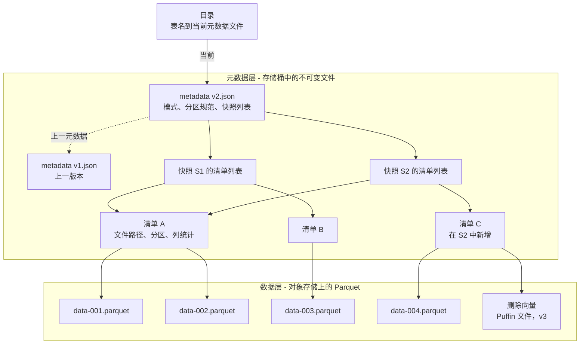

# 7. 开放表格式：Iceberg、Delta Lake 与 Hudi
> **深度：** L2 · **阅读时间：** 约 16 分钟 · **最后核实：** 2026-11-01 · **前置阅读：** [第 6 章 — 文件格式](ch06-file-formats.md)、[第 5 章 — 分析引擎](ch05-analytical-engines.md)

## 要点速览（TL;DR）

- [对象存储（object storage）](../glossary.md#object-storage)上的一个装满 [Parquet](../glossary.md#parquet) 文件的文件夹并不是一张表。它没有原子性的多文件提交，在作业写入期间无法提供一致视图，也没有安全修改模式的方法。[开放表格式（open table format）](../glossary.md#open-table-format)增加了一个元数据层，同时解决这三个问题。
- 所有格式的核心机制都相同。数据文件不可变。一次提交会写入新文件和新元数据，而只有当某个小指针或某条日志记录被原子性地替换时，表才会向前推进。这次替换是一次[比较并交换（compare-and-swap）](../glossary.md#compare-and-swap)，因此并发写入者使用[乐观并发控制（optimistic concurrency control）](../glossary.md#optimistic-concurrency-control)：失败的一方重新读取并重试。
- Apache Iceberg（源自 Netflix）存储一棵元数据文件树，并依赖目录（catalog）完成替换。Delta Lake（源自 Databricks）存储一份有序的 JSON 提交日志，并定期生成检查点。Apache Hudi（源自 Uber）维护一条针对 upsert 和流处理优化的时间线。Paimon 和 DuckLake 是较新的变体。
- 2020–2024 年的"格式之战"以趋同告终，而不是决出一个赢家。Databricks 以媒体报道的约 $2B 收购了 Tabular（2024 年 6 月）。[^tabular] Snowflake、AWS 和 Google 现在都原生写入 Iceberg，Microsoft 的 OneLake 通过元数据转换将其 Delta 表以 Iceberg 形式暴露，而 Delta 也可以通过 UniForm 暴露 Iceberg 元数据。议价能力已经上移一层，转移到了目录（[第 8 章](ch08-catalogs-and-metastores.md)）。
- 表格式并非没有代价。流式写入者会产生小文件和成堆的快照，因此每张表都需要压缩合并、快照过期和孤立文件清理。剩余的大部分产品差异化以及大部分运营成本，都集中在这项维护工作上。

## 为何重要（商业 + Everpure 视角）

表格式是[湖仓一体（lakehouse）](../glossary.md#lakehouse)得以存在的原因。在它出现之前，企业只有两个选择：要么把数据放在数据仓库的专有存储里——快速、安全，但归厂商所有；要么把数据放在开放的数据湖里——便宜、开放，但不可靠。表格式在客户自有存储桶中的开放文件之上，提供数据库级别的保障（[ACID](../glossary.md#acid) 提交、[快照隔离（snapshot isolation）](../glossary.md#snapshot-isolation)、[时间旅行（time travel，历史版本查询）](../glossary.md#time-travel)）。一旦这一点成立，数据就不必再存放在引擎内部，各引擎转而竞争查询客户已经持有的数据。Databricks 正是基于这一论点建立了自己的业务（[第 25 章](../04-company-deep-dives/ch25-databricks.md)）。Snowflake 则不得不适应它（[第 26 章](../04-company-deep-dives/ch26-snowflake.md)）。

商业利害关系由此而来。谁定义了格式，谁就设定了更换引擎的成本。这解释了为什么一家仅获得 $37M 风险投资的公司能以媒体报道的约 $2B 出售，[^tabular] 也解释了为什么每家超大规模云厂商现在都推出了托管 Iceberg 服务。

对 Everpure 而言，影响是直接的。有了表格式，对象存储不再是被动的归档，而成为分析型数据库的持久层。存储系统此时不仅保存表的数据，还保存其元数据文件，而它的一致性语义正是提交得以安全的前提。存储层的两项动作显示了趋势所在：AWS 于 2024 年 12 月推出 S3 Tables，这是直接内置于 S3 的托管 Iceberg 服务。[^s3tables] MinIO 的 AIStor 现在在其对象存储中内置了 Iceberg REST 目录。[^ice-vendors] 对任何本地部署的 S3 平台（包括 FlashBlade）来说，问题在于：它是表"所在"的地方，还是仅仅是表的字节"存放"的地方。下文的"存储桥接"会讨论这一点。

## 工作原理

### 一个装满 Parquet 文件的文件夹不是一张表

假设一个夜间作业向 `s3://lake/orders/date=2026-10-31/` 写入 400 个新的 Parquet 文件。可能出现三类问题。

1. **没有原子提交。** 如果作业在写完 250 个文件后失败，读取者会看到不完整的一天。对象存储没有多对象事务，也没有原子性的目录重命名，因此无法表达"400 个文件要么全有、要么全无"。
2. **列举很慢，而且不是快照。** 为了找到文件，引擎需要列举前缀。S3 每次 LIST 调用最多返回 1,000 个键，[^s3-list] 因此一张有 200 万个文件的表在读取任何数据之前至少需要 2,000 次顺序调用。金钱成本微不足道：在 S3 Standard 上，LIST 请求每 1,000 次收费 $0.005，所以这大约只要一美分。[^s3-pricing] 但时间成本不小。假设每次调用 30 ms（估算），查询规划约需一分钟。更糟糕的是，在另一个作业写入期间获取的列表是新旧状态的混合。
3. **没有模式契约。** 每个 Parquet 文件都携带自己的模式（[第 6 章](ch06-file-formats.md)）。重命名一列意味着重写每个文件，或者教会每个读取者一套约定。Hive 时代的解决办法是把表视为一个目录、由元数据存储（metastore）记录其分区，但它继承了上述全部三个问题。[^hudi-otf]

所有表格式的设计洞见都是：**不再询问存储系统表里有什么，而是在元数据中显式记录。** 表就是元数据所列出的那些文件，除此之外的一切均不可见。

### 核心技巧：不可变文件加一个原子指针

每种格式都遵循同样的两阶段模式。第一步，写入者写入新的数据文件和新的元数据文件，此时任何人都看不到它们。第二步，通过原子性地推进一个指向表最新状态的引用来发布它们。在 Iceberg 中，由目录将指针替换为指向新元数据文件。[^ice-spec] 在 Delta Lake 中，写入者创建下一个编号的日志文件；如果该编号已存在，创建必须失败。[^delta-protocol] 由于文件从不就地修改，已加载版本 41 的读取者即使在版本 42 写入期间，也能保持对版本 41 的一致视图。这就是无锁的快照隔离。

> **类比：半导体。** 这种提交就是作用于单个字的硬件**比较并交换**。写入者可以在旁边做任意多的工作，然后用一条指令发布："仅当头指针仍等于 Y 时，才将其设为 X"。无锁数据结构的工作方式与此相同，失败模式也相同：争用导致重试，而不是死锁。

### Iceberg：一棵元数据树

Iceberg 把表建模为一棵树，由目录持有根指针。[^ice-spec]

*图 7.1 — 一次 Iceberg 提交新增少量叶子节点和一个新的根，然后替换目录指针。未改变的清单（A）在快照之间共享，这使得提交成本很低，时间旅行几乎免费。*

自上而下：

- **目录**将表名映射到当前[表元数据文件（table metadata file）](../glossary.md#table-metadata-file)的位置。指针替换在这里发生。
- **元数据文件**（JSON）保存模式历史、分区规范、属性以及快照列表。
- 每个**快照**指向一个[清单列表（manifest list）](../glossary.md#manifest-list)。该列表记录每个[清单（manifest）](../glossary.md#manifest)及其分区范围摘要，使规划器无需打开大多数清单就能跳过它们。
- 每个**清单**（Avro）列出数据文件及其分区值和逐列的最小/最大统计信息。引擎在读取任何 Parquet 之前，就根据这些统计信息在文件级别进行剪枝。

因此，为三年数据中的某一天规划查询只需少量小规模读取：一个元数据文件、一个清单列表，以及范围重叠的少数几个清单。它不需要成千上万次 LIST 调用。规范明确了这一目标：无论表有多大，规划一次扫描所需的远程调用次数都是常数。[^ice-spec]

> **类比：内存层次结构。** 元数据树就像文件的**页表**。一个虚拟地址（表名加谓词）经过几级间接寻址被解析为物理位置（Parquet 对象）。清单列表摘要扮演 TLB 的角色，让引擎跳过整棵子树。复制根页表项而非页面本身，也正是写时复制文件系统瞬间生成快照的方式。

对用户而言，Iceberg 有两项最重要的特性。[隐藏分区（hidden partitioning）](../glossary.md#hidden-partitioning)指表中存储的是诸如 `day(order_ts)` 或 `bucket(16, customer_id)` 这样的变换。查询按 `order_ts` 过滤，Iceberg 自行推导出分区过滤条件，因此分析师无需了解物理布局。[分区演进（partition evolution）](../glossary.md#partition-evolution)指变换可以改变，例如随着数据量增长从按月分区改为按日分区，而无需重写旧数据。旧文件保留旧规范，新文件使用新规范。[^ice-spec] [模式演进（schema evolution）](../glossary.md#schema-evolution)之所以安全，是因为列是通过数字字段 ID 而非名称来跟踪的。重命名只是一次元数据编辑，已删除列的 ID 永不复用。
