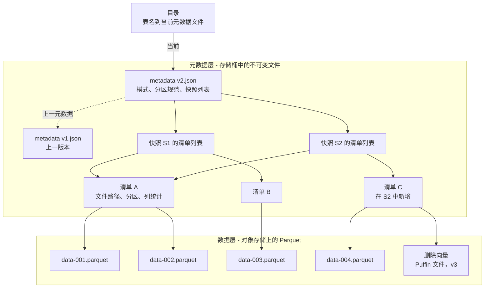
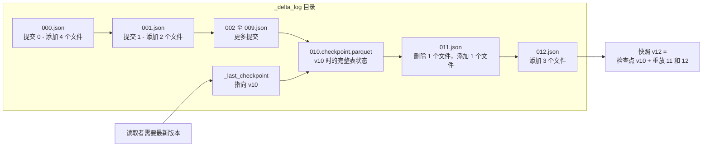
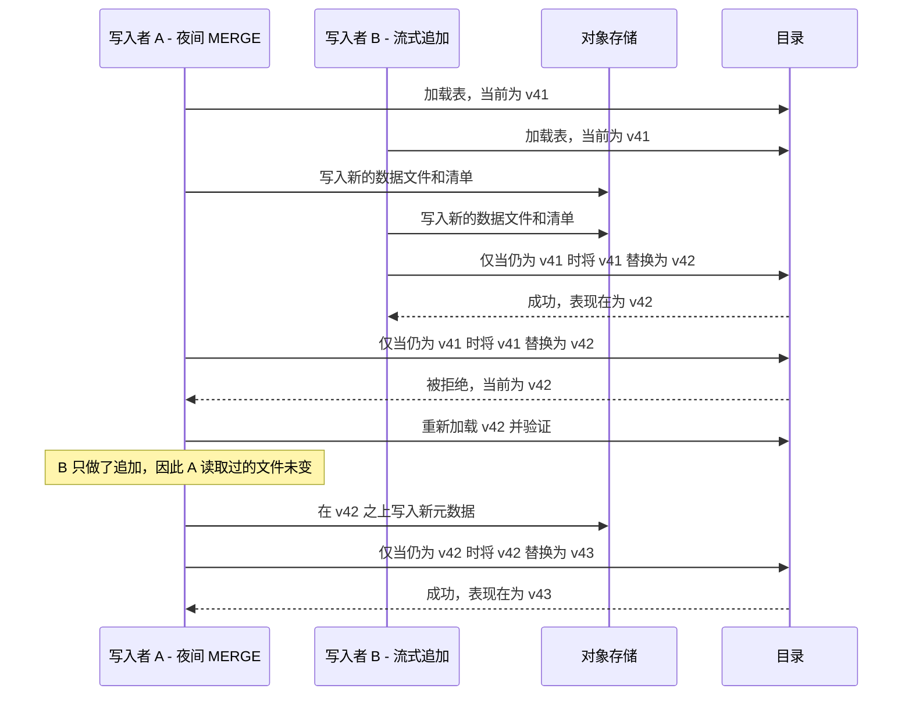
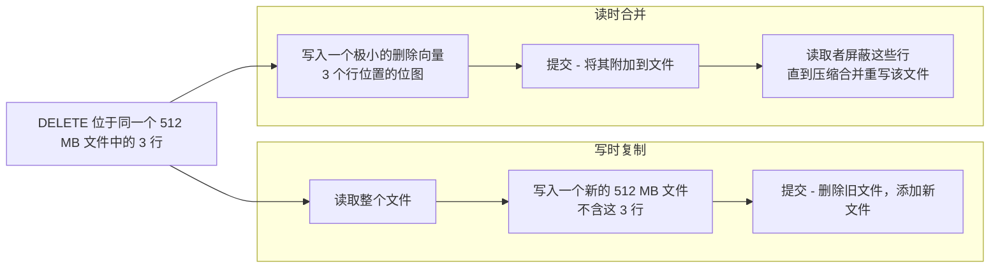
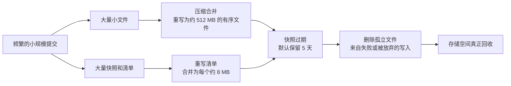
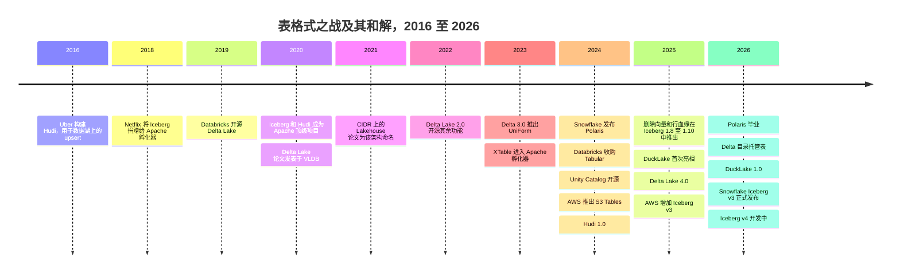

# 7. 开放表格式：Iceberg、Delta Lake 与 Hudi
> **深度：** L2 · **阅读时间：** 约 16 分钟 · **最后核实：** 2026-11-01 · **前置阅读：** [第 6 章 — 文件格式](ch06-file-formats.md)、[第 5 章 — 分析引擎](ch05-analytical-engines.md)

## 要点速览（TL;DR）

- [对象存储（object storage）](../glossary.md#object-storage)上的一个装满 [Parquet](../glossary.md#parquet) 文件的文件夹并不是一张表。它没有原子性的多文件提交，在作业写入期间无法提供一致视图，也没有安全修改模式的方法。[开放表格式（open table format）](../glossary.md#open-table-format)增加了一个元数据层，同时解决这三个问题。
- 所有格式的核心机制都相同。数据文件不可变。一次提交会写入新文件和新元数据，而只有当某个小指针或某条日志记录被原子性地替换时，表才会向前推进。这次替换是一次[比较并交换（compare-and-swap）](../glossary.md#compare-and-swap)，因此并发写入者使用[乐观并发控制（optimistic concurrency control）](../glossary.md#optimistic-concurrency-control)：失败的一方重新读取并重试。
- Apache Iceberg（源自 Netflix）存储一棵元数据文件树，并依赖目录（catalog）完成替换。Delta Lake（源自 Databricks）存储一份有序的 JSON 提交日志，并定期生成检查点。Apache Hudi（源自 Uber）维护一条针对 upsert 和流处理优化的时间线。Paimon 和 DuckLake 是较新的变体。
- 2020–2024 年的"格式之战"以趋同告终，而不是决出一个赢家。Databricks 以媒体报道的约 $2B 收购了 Tabular（2024 年 6 月）。[^tabular] Snowflake、AWS 和 Google 现在都原生写入 Iceberg，Microsoft 的 OneLake 通过元数据转换将其 Delta 表以 Iceberg 形式暴露，而 Delta 也可以通过 UniForm 暴露 Iceberg 元数据。议价能力已经上移一层，转移到了目录（[第 8 章](ch08-catalogs-and-metastores.md)）。
- 表格式并非没有代价。流式写入者会产生小文件和成堆的快照，因此每张表都需要压缩合并、快照过期和孤立文件清理。剩余的大部分产品差异化以及大部分运营成本，都集中在这项维护工作上。

## 为何重要（商业 + Everpure 视角）

表格式是[湖仓一体（lakehouse）](../glossary.md#lakehouse)得以存在的原因。在它出现之前，企业只有两个选择：要么把数据放在数据仓库的专有存储里——快速、安全，但归厂商所有；要么把数据放在开放的数据湖里——便宜、开放，但不可靠。表格式在客户自有存储桶中的开放文件之上，提供数据库级别的保障（[ACID](../glossary.md#acid) 提交、[快照隔离（snapshot isolation）](../glossary.md#snapshot-isolation)、[时间旅行（time travel，历史版本查询）](../glossary.md#time-travel)）。一旦这一点成立，数据就不必再存放在引擎内部，各引擎转而竞争查询客户已经持有的数据。Databricks 正是基于这一论点建立了自己的业务（[第 25 章](../04-company-deep-dives/ch25-databricks.md)）。Snowflake 则不得不适应它（[第 26 章](../04-company-deep-dives/ch26-snowflake.md)）。

商业利害关系由此而来。谁定义了格式，谁就设定了更换引擎的成本。这解释了为什么一家仅获得 $37M 风险投资的公司能以媒体报道的约 $2B 出售，[^tabular] 也解释了为什么每家超大规模云厂商现在都推出了托管 Iceberg 服务。

对 Everpure 而言，影响是直接的。有了表格式，对象存储不再是被动的归档，而成为分析型数据库的持久层。存储系统此时不仅保存表的数据，还保存其元数据文件，而它的一致性语义正是提交得以安全的前提。存储层的两项动作显示了趋势所在：AWS 于 2024 年 12 月推出 S3 Tables，这是直接内置于 S3 的托管 Iceberg 服务。[^s3tables] MinIO 的 AIStor 现在在其对象存储中内置了 Iceberg REST 目录。[^ice-vendors] 对任何本地部署的 S3 平台（包括 FlashBlade）来说，问题在于：它是表"所在"的地方，还是仅仅是表的字节"存放"的地方。下文的"存储桥接"会讨论这一点。

## 工作原理

### 一个装满 Parquet 文件的文件夹不是一张表

假设一个夜间作业向 `s3://lake/orders/date=2026-10-31/` 写入 400 个新的 Parquet 文件。可能出现三类问题。

1. **没有原子提交。** 如果作业在写完 250 个文件后失败，读取者会看到不完整的一天。对象存储没有多对象事务，也没有原子性的目录重命名，因此无法表达"400 个文件要么全有、要么全无"。
2. **列举很慢，而且不是快照。** 为了找到文件，引擎需要列举前缀。S3 每次 LIST 调用最多返回 1,000 个键，[^s3-list] 因此一张有 200 万个文件的表在读取任何数据之前至少需要 2,000 次顺序调用。金钱成本微不足道：在 S3 Standard 上，LIST 请求每 1,000 次收费 $0.005，所以这大约只要一美分。[^s3-pricing] 但时间成本不小。假设每次调用 30 ms（估算），查询规划约需一分钟。更糟糕的是，在另一个作业写入期间获取的列表是新旧状态的混合。
3. **没有模式契约。** 每个 Parquet 文件都携带自己的模式（[第 6 章](ch06-file-formats.md)）。重命名一列意味着重写每个文件，或者教会每个读取者一套约定。Hive 时代的解决办法是把表视为一个目录、由元数据存储（metastore）记录其分区，但它继承了上述全部三个问题。[^hudi-otf]

所有表格式的设计洞见都是：**不再询问存储系统表里有什么，而是在元数据中显式记录。** 表就是元数据所列出的那些文件，除此之外的一切均不可见。

### 核心技巧：不可变文件加一个原子指针

每种格式都遵循同样的两阶段模式。第一步，写入者写入新的数据文件和新的元数据文件，此时任何人都看不到它们。第二步，通过原子性地推进一个指向表最新状态的引用来发布它们。在 Iceberg 中，由目录将指针替换为指向新元数据文件。[^ice-spec] 在 Delta Lake 中，写入者创建下一个编号的日志文件；如果该编号已存在，创建必须失败。[^delta-protocol] 由于文件从不就地修改，已加载版本 41 的读取者即使在版本 42 写入期间，也能保持对版本 41 的一致视图。这就是无锁的快照隔离。

> **类比：半导体。** 这种提交就是作用于单个字的硬件**比较并交换**。写入者可以在旁边做任意多的工作，然后用一条指令发布："仅当头指针仍等于 Y 时，才将其设为 X"。无锁数据结构的工作方式与此相同，失败模式也相同：争用导致重试，而不是死锁。

### Iceberg：一棵元数据树

Iceberg 把表建模为一棵树，由目录持有根指针。[^ice-spec]

*图 7.1 — 一次 Iceberg 提交新增少量叶子节点和一个新的根，然后替换目录指针。未改变的清单（A）在快照之间共享，这使得提交成本很低，时间旅行几乎免费。*

自上而下：

- **目录**将表名映射到当前[表元数据文件（table metadata file）](../glossary.md#table-metadata-file)的位置。指针替换在这里发生。
- **元数据文件**（JSON）保存模式历史、分区规范、属性以及快照列表。
- 每个**快照**指向一个[清单列表（manifest list）](../glossary.md#manifest-list)。该列表记录每个[清单（manifest）](../glossary.md#manifest)及其分区范围摘要，使规划器无需打开大多数清单就能跳过它们。
- 每个**清单**（Avro）列出数据文件及其分区值和逐列的最小/最大统计信息。引擎在读取任何 Parquet 之前，就根据这些统计信息在文件级别进行剪枝。

因此，为三年数据中的某一天规划查询只需少量小规模读取：一个元数据文件、一个清单列表，以及范围重叠的少数几个清单。它不需要成千上万次 LIST 调用。规范明确了这一目标：无论表有多大，规划一次扫描所需的远程调用次数都是常数。[^ice-spec]

> **类比：内存层次结构。** 元数据树就像文件的**页表**。一个虚拟地址（表名加谓词）经过几级间接寻址被解析为物理位置（Parquet 对象）。清单列表摘要扮演 TLB 的角色，让引擎跳过整棵子树。复制根页表项而非页面本身，也正是写时复制文件系统瞬间生成快照的方式。

对用户而言，Iceberg 有两项最重要的特性。[隐藏分区（hidden partitioning）](../glossary.md#hidden-partitioning)指表中存储的是诸如 `day(order_ts)` 或 `bucket(16, customer_id)` 这样的变换。查询按 `order_ts` 过滤，Iceberg 自行推导出分区过滤条件，因此分析师无需了解物理布局。[分区演进（partition evolution）](../glossary.md#partition-evolution)指变换可以改变，例如随着数据量增长从按月分区改为按日分区，而无需重写旧数据。旧文件保留旧规范，新文件使用新规范。[^ice-spec] [模式演进（schema evolution）](../glossary.md#schema-evolution)之所以安全，是因为列是通过数字字段 ID 而非名称来跟踪的。重命名只是一次元数据编辑，已删除列的 ID 永不复用。

### Delta Lake：一份提交日志

Delta Lake 使用日志而不是树。每张表都有一个 `_delta_log/` 目录，其中是编号为 0、1、2 等的 JSON 文件。每个文件是一次原子提交，列出"添加文件"和"删除文件"操作。为避免读取者重放成千上万个 JSON 文件，写入者会定期写入一个 Parquet [检查点（checkpoint）](../glossary.md#delta-checkpoint)，汇总该版本时整张表的状态。[^delta-protocol] 参考实现默认每 10 次提交生成一次检查点。[^delta-config]

*图 7.2 — Delta 通过加载最新检查点并重放其后的少数 JSON 提交来重建表。原子步骤是创建下一个编号的文件，因此对象存储必须支持"仅在不存在时创建"。*

这一设计选择反映了 Delta 的起源。2020 年的 VLDB 论文主张，日志应与数据一起存放在对象存储中，读取表时无需单独的元数据存储。[^delta-vldb] 代价是存储系统必须在文件创建上提供互斥。S3 多年来并不支持这一点，Delta 的 S3 多写入者模式需要借助 DynamoDB 作为外部锁。[^delta-storage] S3 于 2024 年 8 月增加了条件写入，在很大程度上弥补了这一差距。[^s3-cond]

更重要的变化发生在 2026 年。Delta Lake 4.1 引入了**[目录托管表（catalog-managed tables）](../glossary.md#catalog-managed-table)**，由目录（首先是 Unity Catalog）批准每次提交并成为事实来源。[^delta-cmt] Delta 项目将此描述为向 Iceberg 首创的模式看齐。在提交路径上，两种设计已经趋同：在两者中，都由目录来裁决。

### Hudi 与 Paimon：为 upsert 和流而生

Apache Hudi 于 2016 年在 Uber 构建，用于支持更新和删除的近实时数据摄取。这早于另外两种格式。[^hudi-otf] 它的[时间线（timeline）](../glossary.md#hudi-timeline)把每个操作（提交、压缩合并、聚簇、清理、回滚）记录为一个"瞬时点"（instant），其状态从 requested 到 inflight 再到 completed。[^hudi-timeline] Hudi 1.0（2024 年 12 月）重建了时间线，并为流式写入者增加了非阻塞并发控制。[^hudi-10] Hudi 与 Iceberg 的区别在于范围。它不仅提供格式，还附带存储引擎：使 upsert 成本低廉的记录级索引，以及无需单独调度器即可完成压缩合并和清理的内置表服务。Apache Paimon 源自 Flink 的表存储（table store），将 [LSM 树（LSM-tree）](../glossary.md#lsm-tree)（[第 3 章](ch03-database-internals.md)中介绍的写优化结构）应用于数据湖存储。它适合由 Flink 馈送的高频变更日志表，并且可以为批处理读取者输出兼容 Iceberg 的元数据。[^paimon]

### 两个写入者，一次重试

*图 7.3 — 乐观并发。两个写入者并行完成各自代价高昂的工作。只有最后的指针替换是串行的，如果失败方的输入未被改动，它可以低成本地重试。*

重试之所以成本低，是因为写入者 A 已写入的数据文件仍然有效，只需重写其上的元数据。[^ice-spec] 只有当两个写入者触及相同文件时，重试才会变成真正的失败，例如两个 MERGE 作业更新同一分区。Iceberg 的 Java 库默认在放弃前重试 4 次。[^ice-config] 运维上的教训是：按分区隔离写入者，或者通过一个服务统一路由。大量每隔几秒就向同一张热表提交的流式写入者，会把时间都花在重试上。

### 行级变更：写时复制与读时合并

文件不可变，因此一条删除三行的 `DELETE` 必须以某种方式表达。有两种策略，其名称来自 Hudi 的表类型。[^hudi-otf]

*图 7.4 — 写时复制让写入代价高、读取干净。读时合并让写入成本低，但在压缩合并运行之前，把成本转嫁给每一个读取者。*

[写时复制（copy-on-write）](../glossary.md#copy-on-write)仍是 Iceberg 对 DELETE、UPDATE 和 MERGE 的默认方式。[^ice-config] [读时合并（merge-on-read）](../glossary.md#merge-on-read)则分阶段演进。Iceberg v2 增加了两类[删除文件（delete files）](../glossary.md#delete-file)：位置删除（文件加行号）和[等值删除（equality deletes）](../glossary.md#equality-delete)（"所有 id = 5 的行"）。等值删除对流式写入者成本低，对读取者成本高。Iceberg v3 用二进制[删除向量（deletion vectors）](../glossary.md#deletion-vector)取代了位置删除文件：这些是存储在 Puffin 文件中的 Roaring 位图，每个数据文件最多一个。[^ice-spec] 这与 Delta 在 2023 年推出的思路相同。[^delta-dv] v4 规范草案更进一步，禁止写入新的等值删除。[^ice-spec] Iceberg 1.12（2026 年 9 月）增加了一个 Flink 维护任务，将流式等值删除转换为删除向量。[^ice-112]

### 维护：没人写进幻灯片的运营成本

表格式规定了一张有效的表应当是什么样子，但它并不负责让表保持健康。举一个算例（估算）：一个有 8 个写入任务、每分钟提交一次的流式作业，每次提交产生 8 个文件，即每天 11,520 个文件和 1,440 个快照。如果每个文件约 5 MB，而 Iceberg 的目标文件大小为 512 MB，[^ice-config] 那么这张表的文件数大约是应有数量的 100 倍，查询规划和扫描都会相应变慢。这就是[小文件问题（small-files problem）](../glossary.md#small-files-problem)。

*图 7.5 — 删除一行并不会释放任何字节，直到压缩合并和快照过期运行之后。决定何时回收存储的是保留策略，而不是 DELETE 语句。这对存储账单和 GDPR 删除义务都很重要。*

[压缩合并（compaction）](../glossary.md#compaction)把小文件重写为大的有序文件。Iceberg 1.12 增加了用于多列排序的 Hilbert 曲线聚簇。[^ice-112] [快照过期（snapshot expiration）](../glossary.md#snapshot-expiration)会删除早于保留窗口的历史（Iceberg 默认 5 天），只有这样，未被引用的文件才能被删除。[^ice-config] Delta 的对应操作是 OPTIMIZE 和 VACUUM，默认在已删除文件被物理移除前保留 7 天。[^delta-batch] 商业上的要点在于，这项工作必须在某处运行：在引擎厂商那里、在 S3 Tables 之类的托管服务中，或者在客户自己的调度器里。谁运行它，谁就掌控成本和性能，而这已成为各类托管表产品之间的主战场。

> **深入（L3）。** Iceberg 为每次提交分配一个*序列号*。删除文件只作用于序列号相同或更低的数据文件，因此重试的提交只需要一个新的清单列表，现有清单可以复用。v4 草案用单一的"根清单"（root manifest）和自适应树取代清单列表，使小规模流式提交不再需要重写大块元数据。[^ice-spec] Delta 在这方面的对应研究前沿是带 sidecar 文件的 V2 检查点和日志压缩。[^delta-protocol]

## 设计选择与权衡

| 维度 | Apache Iceberg | Delta Lake | Apache Hudi | Apache Paimon | DuckLake |
|---|---|---|---|---|---|
| 起源 / 管理方 | Netflix → ASF | Databricks → Linux Foundation | Uber → ASF；Onehouse 是主要厂商 | Flink Table Store → ASF | DuckDB 团队（开放规范） |
| 元数据形态 | 树：metadata.json → 清单列表 → 清单 | 有序 JSON 日志 + Parquet 检查点 | 时间线 + 内部元数据表 | LSM 层级 + 快照/清单文件 | SQL 数据库中的表 |
| 原子提交方式 | 目录指针替换 | 对下一个日志文件执行 put-if-absent，或由目录完成（4.1+） | 存储上的时间线瞬时点文件 | 原子发布快照 N+1，冲突时重试 | 一次 SQL 事务 |
| 行级删除 | v2 删除文件；v3 删除向量 | 删除向量（2023） | 读时合并日志文件 + 记录索引 | 读取/压缩合并时进行 LSM 合并 | 在目录中记录删除；小规模变更内联存储 |
| 分区 | 隐藏的、可演进的变换 | 列或液态聚簇（liquid clustering） | 列 + 聚簇 | 分桶 + 分区 | 分区键，包括兼容 Iceberg 的分桶 |
| 流处理 / upsert | 良好；等值删除正逐步淘汰 | 良好（Spark Structured Streaming） | 最核心的设计重心 | 对 Flink 变更日志最强 | 内联机制吸收极小写入 |
| 维护 | 交给引擎和厂商 | OPTIMIZE / VACUUM，在 Databricks 上自动执行 | 内置表服务 | 内置压缩合并 | 内置，外加 CHECKPOINT |
| 生态广度（2026 年 11 月） | 最广；REST 目录规范是通用 API | 广；以 Spark 为中心，其他引擎使用 Delta Kernel | 较窄；聚焦 Spark/Flink | 以 Flink 为中心，正在增长 | 年轻；DuckDB 加 Spark/Trino/DataFusion 客户端 |
| 当前版本 | 规范 v1–v3 已采纳，v4 尚未采纳；Java 1.12.0（新表默认 `format-version` 仍为 2） | Delta 4.4.x | Hudi 1.2.x（表版本 9） | Paimon 2.1 | DuckLake 1.1 规范 |

*图 7.6 — 五种设计的主要区别在于"事实"存放在哪里（文件、日志、时间线、LSM 或数据库），以及项目自身承担了多少表维护工作。来源：各项目规范和发布说明。*[^ice-spec][^delta-protocol][^hudi-timeline][^paimon][^ducklake-10][^ducklake-11]

**各方的最强版本论证（steelman）。** *Iceberg：* 它拥有最精确的规范和最中立于厂商的治理，几乎所有引擎和云现在都能写入它。它的弱点是把维护留给别人，这对厂商是优势，对自建者是负担。*Delta：* 它经由 Databricks 在大规模场景中经受了最多实战检验，也是最容易推理的模型。日志便于为流处理和变更数据馈送（change data feed）进行追踪读取。它的弱点是历史上被认为受 Databricks 控制。*Hudi：* 对于大量变更数据捕获（CDC）upsert 来说，它是最佳答案，因为它的索引无需扫描即可找到要更新的行。它的弱点是复杂性和较小的生态。*Paimon：* 如果 Flink 是技术栈的中心，它是自然之选。*DuckLake：* 它主张，既然无论如何都需要一个目录数据库，那么把所有元数据都放在其中会更快、更简单，尤其是对于小规模、高频的提交。[^ducklake-manifesto] 反方观点是，它在读取路径上重新引入了数据库这一依赖，在最大规模下会成为可扩展性和可用性问题。

## 主要参与者

| 参与者 | 在这一层中的角色 | 定位（2026 年 11 月） |
|---|---|---|
| Apache Iceberg 社区 | 规范 + 参考库（Java、Python、Rust、Go、C++） | 事实上的交换格式；1.12.0 包含来自 142 位贡献者的 777 次提交[^ice-112] |
| Databricks | 创建了 Delta；收购了 Tabular（Iceberg 的创始人团队） | 原生 Delta；Unity Catalog 同时治理 Delta 和 Iceberg；UniForm 写入 Iceberg 元数据[^ice-vendors][^delta-uniform] |
| Snowflake | Iceberg 表（托管和外部）；创建了 Polaris | Horizon Catalog 暴露 Iceberg REST 端点；Polaris 于 2026 年初毕业成为 ASF 顶级项目（ASF 于 2026-03-05 宣布），截至 2026-09-28 已发布 1.8.0 版本[^ice-vendors][^polaris-tlp] |
| AWS | S3 Tables、Glue、Athena、EMR、Redshift | 内置于存储的托管 Iceberg；自 2025 年 12 月起支持 v3[^s3tables][^aws-v3] |
| Google Cloud | BigLake metastore、BigLake tables for Apache Iceberg | 跨 BigQuery 和 Spark 的 Iceberg REST 目录[^ice-vendors] |
| Microsoft | Fabric 中的 OneLake | 原生 Delta 存储，通过 REST 目录和 XTable 支持 Iceberg[^ice-vendors][^hudi-otf] |
| Onehouse | 商业化 Hudi；XTable 联合创始方 | 多格式"一次写入、任意读取"叙事[^hudi-otf] |
| DuckDB Labs / MotherDuck | DuckLake；DuckDB 读写 Iceberg 和 Delta | 中小规模数据，基于 SQL 目录的反向设计。AWS 签署了收购 DuckDB Labs 的最终协议（约 2026-08-25），条款未披露；DuckDB 和 DuckLake 在 DuckDB Foundation 下保持 MIT 许可[^ducklake-10][^duckdb-delta][^aws-ducklabs] |
| Dremio（2026 年起归属 SAP）、Starburst、Cloudera | Iceberg 优先的引擎和目录 | SAP 对 Dremio 的收购（2026-05-04 宣布，约 2026 年 7 月完成，条款未披露）将一个领先的 Iceberg 引擎纳入了一家应用软件厂商[^sap-dremio] |
| ClickHouse、StarRocks、Doris | 读取湖表的实时引擎 | ClickHouse 于 2026 年集成了 Rust Delta Kernel[^delta-clickhouse] |

*图 7.7 — 每个主要平台现在都能读取 Iceberg，大多数能原生写入。它们之间的区别在于各自围绕 Iceberg 包装的目录和维护服务。*

引擎支持在很大程度上已成为清单上的勾选项。Spark 和 Flink 能读写全部四种 Apache/LF 格式。Trino 提供 Iceberg、Delta 和 Hudi 的连接器，而 Hudi 的 Trino 连接器已于 2026 年迁入 Hudi 代码仓库。[^hudi-rel12] DuckDB 支持写入 Iceberg（自 2025 年末）和 Delta（自 2026 年 5 月）。[^duckdb-iceberg][^duckdb-delta] 真正有意思的差异现在体现在功能深度上：哪些引擎支持 v3 删除向量、行血缘（row lineage）和 variant 类型，以及哪些引擎能够通过某个特定目录写入。

## 历史与发展轨迹

*图 7.8 — 四年的竞争（2020–2024）之后是两年的趋同。和解是通过收购和转换层实现的，而不是由某一种格式击败其他格式。*

**第一阶段：三个起源（2016–2021）。** Uber 需要 upsert，Netflix 需要为庞大的 Hive 表提供正确的元数据，Databricks 需要为 Spark 客户提供可靠的表。各方各自构建了答案。[^hudi-otf][^duckdb-iceberg] Iceberg 于 2020 年 5 月成为 Apache 顶级项目，Hudi 于 2020 年 6 月紧随其后。[^iceberg-tlp][^hudi-tlp] 随后，2021 年的 CIDR 论文主张，开放格式加上事务性元数据层可以取代独立的数据仓库，并将这一结果命名为湖仓一体。[^lakehouse-cidr]

**第二阶段：战争（2020 年–2024 年年中）。** 对于不想壮大 Databricks 的厂商来说，Iceberg 成了中立之选，包括 Tabular（由 Iceberg 在 Netflix 的创造者创立）、Snowflake、AWS 和 Dremio。Databricks 的回应是在 2022 年开源 Delta 的其余部分，[^delta-2] 并在 Delta 3.0（2023 年 10 月）中推出 UniForm，在 Delta 日志旁同时写入 Iceberg 元数据。[^delta-3] Onehouse、Microsoft 和 Google 支持 XTable，它可以在不复制数据的情况下在格式之间转换元数据。XTable 于 2023 年 12 月进入 Apache 孵化器，截至 2026 年 11 月仍在孵化中。[^delta-uniform][^xtable]

**第三阶段：和解（2024 年 6 月起）。** 2024 年 6 月第一周，Snowflake 发布了开放的 Iceberg REST 目录 Polaris，[^sf-polaris] Databricks 同意收购 Tabular。[^tabular] Unity Catalog 于同月开源。[^uc-oss] AWS 于 2024 年 12 月推出 S3 Tables，声称与自管理表相比查询速度最高快 3 倍、每秒事务数最高多 10 倍（厂商声称）。[^s3tables] 随后各格式开始趋同。据 Databricks 自己的说法，其工程师与来自 Snowflake 和其他厂商的贡献者一起，帮助把 Delta 的删除向量、行跟踪和 variant 类型带入了 Iceberg v3，[^dbx-v3] Snowflake 于 2026 年 5 月将该规范版本正式发布（据二手来源）。Delta 4.0（2025）预览了目录托管表，Delta 4.1 则像 Iceberg 一样让目录成为提交的裁决者。[^delta-40][^delta-cmt] Iceberg 的 REST 目录于 2026 年 5 月开始在服务器端进行扫描规划。[^ice-111]

> **类比：金融。** 表格式是一种行业标准，而谁控制标准，谁就控制**转换成本**。如果你的数据所在的格式只有你的引擎写得好，客户离开的成本就是一次完整迁移。如果数据处于中立格式，这一成本几乎降为零，引擎只能在价格和性能上竞争。Databricks 支付了约相当于 Tabular 约 $37M 实收资本 54 倍的价格（估算，基于媒体报道的约 $2B 价格），[^tabular] 以确保 Iceberg 无法成为其竞争对手的护城河。应当把这一价格理解为对其核心业务的保险费，而不是收入倍数。租金并没有消失，而是转移到了目录上——目录负责身份、权限、提交，如今还负责扫描规划。这正是[第 8 章](ch08-catalogs-and-metastores.md)作为本章续篇的原因。

**下一步走向。** 有三个值得关注的趋势，均在[第 44 章](../06-history-and-future/ch44-future-trends.md)中讨论。第一，*目录吸收格式*：提交、规划、凭证和维护都迁入目录服务。第二，*Iceberg v4* 带来用于低成本小规模提交的自适应元数据树、相对路径和约束。[^ice-spec] 第三，*DuckLake 式设计*将元数据保存在数据库中。Iceberg REST 目录的服务器端规划是朝这一立场迈出的一步，尽管双方对此的表述不同。[^ducklake-manifesto][^ice-111]

## 关键数字

| 指标 | 数值 | 口径 | 来源 / 日期 |
|---|---|---|---|
| Databricks–Tabular 收购价 | 约 $2B（WSJ：$1–2B）；Tabular 曾融资约 $37M | 媒体报道；Databricks 未披露 | TechCrunch 2024-08-14[^tabular] |
| Iceberg 默认目标数据文件大小 | 512 MB | 项目默认值 | Iceberg 文档，2026[^ice-config] |
| Iceberg 清单合并目标 | 8 MB | 项目默认值 | Iceberg 文档，2026[^ice-config] |
| Iceberg 过期操作的默认快照保留 | 5 天，至少 1 个快照 | 项目默认值 | Iceberg 文档，2026[^ice-config] |
| Iceberg 提交失败前的重试次数 | 4 | 项目默认值 | Iceberg 文档，2026[^ice-config] |
| Delta 检查点间隔 | 每 10 次提交 | 参考实现默认值 | Delta 源代码，2026[^delta-config] |
| Delta 日志保留 / 已删除文件保留 | 30 天 / 7 天 | 项目默认值 | Delta 文档，2026[^delta-batch] |
| S3 LIST 分页大小 | 每次调用 1,000 个键 | AWS API 限制 | AWS 文档[^s3-list] |
| S3 每前缀请求速率 | 3,500 次写入/秒和 5,500 次读取/秒 | AWS 披露 | AWS 文档[^s3-perf] |
| S3 Tables 对比自管理 Iceberg | 查询速度最高 3 倍，TPS 最高 10 倍 | 厂商声称 | AWS，2024-12-03[^s3tables] |
| Delta Lake 采用情况 | >10,000 家公司；>60% 的 Fortune 500 | 公司披露 | Delta 博客，2024-06-06[^delta-uniform] |
| Iceberg 1.12.0 发布规模 | 777 次提交，142 位贡献者 | 项目披露 | Iceberg 博客，2026-10-05[^ice-112] |
| DuckLake 内联阈值 | 默认 10 行 | 项目默认值 | DuckLake 1.0，2026-04-13[^ducklake-10] |

*图 7.9 — 这些默认值（512 MB 文件、5 天快照、10 次提交一个检查点）才是运营成本和查询速度真正被设定的地方。问一问客户改动过其中哪些。*

## 存储桥接

> **存储桥接。** 表格式把数据库的正确性移入了对象存储。存储必须提供强读后写一致性（S3 自 2020 年 12 月起提供），[^s3-consistency] 理想情况下还要支持条件性的"不存在时创建"写入。它还必须在大规模顺序数据扫描的同时，处理大量小规模元数据读写。对于 FlashBlade 这样的本地部署 S3 平台，战略选择在于：是继续充当别人目录之下的存储桶（当前 Dremio 和 Starburst 的参考架构），[^everpure-lake] 还是效仿 S3 Tables 和 MinIO AIStor 提供表感知服务：Iceberg REST 目录、自动压缩合并和快照过期，以及按表分配的凭证。这些是战略团队基于公开信息可能评估的选项。有关对象协议和性能的细节，请参阅配套的《Everpure Tech Atlas》。

## 对话手册

**向产品经理提的问题**

1. "你们的客户在生产环境中实际写入的是哪些表格式和目录？自 2024 年年中以来，这一构成发生了怎样的变化？"
2. "谁为你们的客户运行压缩合并和快照过期：你们、引擎厂商还是客户自己？你们对此收费吗？"
3. "你们在 Iceberg v3 功能（删除向量、行血缘、variant）上处于什么位置？你们生态中哪些引擎落后了？"

**向工程师提的问题**

1. "你们如何实现原子提交：目录 CAS、条件 PUT 还是外部锁？发生冲突重试时会怎样？"
2. "你们针对流式摄取的小文件策略是什么？压缩合并前后的文件大小分布如何？"
3. "考虑到快照和时间旅行，你们如何保证被删除的行在保留策略期限内被物理清除？"

**好的回答听起来是什么样的。** 它们对提交原语有具体描述（"基于 ETag 提交的 REST 目录"、"对下一条日志记录执行 put-if-absent"），对保留数字也有具体说明（"我们保留 7 天快照，每小时压缩合并到约 512 MB"）。它们承认读时合并在压缩合并运行前会拖慢读取，并把目录而不是文件格式视为真正的集成点。

**不要这样说**

- "Iceberg 赢了，所以 Delta 已死。" Delta 仍然是 Databricks 在超大规模下的原生格式，而 UniForm 和目录托管表让两者的区别变得不那么重要。
- "Iceberg 是一种文件格式。" Parquet 才是文件格式。Iceberg 是关于许多文件的元数据。
- "删除行就删除了数据。" 要等到压缩合并、快照过期和文件清理全部运行之后才算。
- "开放格式意味着没有锁定。" 锁定转移到了目录及其权限、凭证和维护服务上。
- "S3 Tables 取代了 Databricks/Snowflake。" 它是面向 Iceberg 的托管存储和维护服务，查询仍由引擎完成。

## 深入阅读

- Iceberg 表规范，尤其是"Optimistic Concurrency"、"Scan Planning"以及关于版本差异的附录 E。[^ice-spec]
- Delta 的 `PROTOCOL.md`，尤其是"Checkpoints"和"Catalog-managed tables"。[^delta-protocol]
- Armbrust 等人的 *Delta Lake*（VLDB 2020）和 *Lakehouse*（CIDR 2021）。[^delta-vldb][^lakehouse-cidr]
- DuckLake 宣言，它是对基于文件的元数据最有力的批评。[^ducklake-manifesto]
- Hudi 的时间线和并发控制文档，了解流式表上的非阻塞并发。[^hudi-timeline]

## 关键术语

- [开放表格式（Open table format）](../glossary.md#open-table-format) — 将对象存储上的文件转变为事务性表的元数据层和提交协议。
- [快照隔离（Snapshot isolation）](../glossary.md#snapshot-isolation) — 每个读取者看到一个一致的已提交版本，不受进行中写入的影响。
- [时间旅行（Time travel）](../glossary.md#time-travel) — 按某个较早的快照或版本查询表。
- [表元数据文件（Table metadata file）](../glossary.md#table-metadata-file) — Iceberg 的 JSON 根文件，保存模式、分区规范和快照列表。
- [清单列表（Manifest list）](../glossary.md#manifest-list) — Iceberg 中列出某个快照的各清单及其分区摘要的文件。
- [清单（Manifest）](../glossary.md#manifest) — Iceberg 中列出数据文件及其分区值和列统计信息的文件。
- [Delta 日志（Delta log）](../glossary.md#delta-log) — Delta Lake 中由 JSON 提交文件组成的有序目录。
- [Delta 检查点（Delta checkpoint）](../glossary.md#delta-checkpoint) — 某个 Delta 版本下完整表状态的 Parquet 摘要。
- [Hudi 时间线（Hudi timeline）](../glossary.md#hudi-timeline) — Hudi 的操作日志，每个操作从 requested 到 inflight 再到 completed。
- [隐藏分区（Hidden partitioning）](../glossary.md#hidden-partitioning) — 分区值由列变换推导，因此查询无需引用分区。
- [分区演进（Partition evolution）](../glossary.md#partition-evolution) — 在不重写现有数据的情况下更改表的分区方案。
- [模式演进（Schema evolution）](../glossary.md#schema-evolution) — 随时间安全地添加、删除、重命名或拓宽列。
- [比较并交换（Compare-and-swap）](../glossary.md#compare-and-swap) — 表提交所依赖的原子性"仅在未改变时更新"操作。
- [乐观并发控制（Optimistic concurrency control）](../glossary.md#optimistic-concurrency-control) — 写入者无锁执行，若另一次提交胜出则重试。
- [写时复制（Copy-on-write）](../glossary.md#copy-on-write) — 通过重写整个数据文件来应用行变更。
- [读时合并（Merge-on-read）](../glossary.md#merge-on-read) — 单独记录变更，在读取时再应用。
- [删除文件（Delete file）](../glossary.md#delete-file) — Iceberg v2 中按位置或按值记录已删除行的文件。
- [等值删除（Equality delete）](../glossary.md#equality-delete) — 以列值表达的删除，写入成本低、读取成本高。
- [删除向量（Deletion vector）](../glossary.md#deletion-vector) — 标记某个数据文件中已删除行位置的位图。
- [小文件问题（Small-files problem）](../glossary.md#small-files-problem) — 由过多偏小的数据文件导致的性能衰退。
- [压缩合并（Compaction）](../glossary.md#compaction) — 将小文件或含大量删除的文件重写为更少、更大的文件。
- [快照过期（Snapshot expiration）](../glossary.md#snapshot-expiration) — 移除旧快照，以便删除未被引用的文件。
- [目录托管表（Catalog-managed table）](../glossary.md#catalog-managed-table) — 由其目录批准提交的 Delta 表。
- [湖仓一体（Lakehouse）](../glossary.md#lakehouse) — 在对象存储上的开放文件之上提供数据仓库级的管理。
- [ACID](../glossary.md#acid) — 事务的原子性、一致性、隔离性和持久性保障。
- [LSM 树（LSM-tree）](../glossary.md#lsm-tree) — 缓冲并合并有序段的写优化结构。
- [Parquet](../glossary.md#parquet) — 所有表格式之下占主导地位的开放列式文件格式。
- [对象存储（Object storage）](../glossary.md#object-storage) — 通过 HTTP 访问的不可变对象的扁平键值存储，例如 S3。

## 资料来源

[^tabular]: TechCrunch, "Databricks reportedly paid $2 billion in Tabular acquisition," https://techcrunch.com/2024/08/14/databricks-reportedly-paid-2-billion-in-tabular-acquisition，发布 2024-08-14；检索 2026-11-01。WSJ 区间（$1–2B）及 Tabular 约 $37M 的融资额记录于 `data/ma_deals.csv` 和 `meta/research-notes-ma-2020s.md`。交易于 2024-06-04 宣布；价格为媒体报道，Databricks 从未披露。
[^ice-spec]: Apache Iceberg, "Iceberg Table Spec"（格式版本、乐观并发、行级删除、分区、删除向量、v4 草案），https://iceberg.apache.org/spec/（源文件：https://github.com/apache/iceberg/blob/main/format/spec.md），持续更新文档，最后更新 2026-10-30；检索 2026-11-01。
[^ice-config]: Apache Iceberg, "Configuration"（表属性和默认值），https://github.com/apache/iceberg/blob/main/docs/docs/configuration.md，持续更新文档；检索 2026-11-01。
[^ice-112]: Apache Iceberg PMC, "Apache Iceberg 1.12.0 Release," https://github.com/apache/iceberg/blob/main/site/docs/blog/posts/2026-10-05-iceberg-1.12.0-release.md，发布 2026-10-05（发布页面上的发布日期为 2026-09-29）；检索 2026-11-01。
[^ice-111]: Apache Iceberg PMC, "Apache Iceberg 1.11.0 Release," https://github.com/apache/iceberg/blob/main/site/docs/blog/posts/2026-05-19-iceberg-1.11.0-release.md，发布 2026-05-19；检索 2026-11-01。
[^ice-vendors]: Apache Iceberg, "Vendors Supporting Iceberg Tables"（AWS、Databricks、Google Cloud、Microsoft OneLake、MinIO AIStor、Snowflake、ClickHouse 条目），https://github.com/apache/iceberg/blob/main/site/docs/vendors.md，持续更新文档；检索 2026-11-01。
[^delta-protocol]: Delta Lake, "Delta Transaction Log Protocol"（PROTOCOL.md），https://github.com/delta-io/delta/blob/master/PROTOCOL.md，持续更新文档，最后更新 2026-10-30；检索 2026-11-01。
[^delta-config]: Delta Lake, `DeltaConfig.scala`（`checkpointInterval` 默认值 10），https://github.com/delta-io/delta/blob/master/spark/src/main/scala/org/apache/spark/sql/delta/DeltaConfig.scala，检索 2026-11-01。
[^delta-batch]: Delta Lake documentation, "Table batch reads and writes — data retention"（logRetentionDuration 30 天；deletedFileRetentionDuration 7 天），https://github.com/delta-io/delta/blob/master/docs/src/content/docs/delta-batch.mdx，检索 2026-11-01。
[^delta-storage]: Delta Lake documentation, "Storage configuration"（S3 互斥与 DynamoDB LogStore），https://github.com/delta-io/delta/blob/master/docs/src/content/docs/delta-storage.mdx，检索 2026-11-01。
[^delta-cmt]: B. Mathew, S. Sandre, S. Haines, "The next evolution of Delta — Catalog-Managed Tables," Delta Lake blog, https://github.com/delta-io/website/tree/main/src/content/blog/2026-02-02-delta-catalog-managed-tables，发布 2026-02-26；检索 2026-11-01。
[^delta-dv]: N. Karpov, "Delta Lake Deletion Vectors," Delta Lake blog, https://github.com/delta-io/website/tree/main/src/content/blog/2023-07-05-deletion-vectors，发布 2023-07-05；检索 2026-11-01。
[^delta-uniform]: J. Brito, K. Weller, "Unifying the open table formats with Delta Lake Universal Format (UniForm) and Apache XTable," Delta Lake blog, https://delta.io/blog/unifying-open-table/，发布 2024-06-06；检索 2026-11-01。采用情况数据为公司披露。
[^delta-2]: T. Das, D. Lee, "Delta 2.0 — The Foundation of your Data Lakehouse is Open," Delta Lake blog, https://github.com/delta-io/website/tree/main/src/content/blog/2022-08-02-delta-2-0-the-foundation-of-your-data-lake-is-open，发布 2022-08-02；检索 2026-11-01。
[^delta-3]: C. Akerly, "Delta Lake 3.0.0," Delta Lake blog, https://delta.io/blog/delta-lake-3-0/，发布 2023-10-17；检索 2026-11-01。
[^delta-clickhouse]: M. Peignon, K. Sumarokova, R. Marin, "Integrating the Rust Delta Kernel into ClickHouse," Delta Lake blog, https://github.com/delta-io/website/tree/main/src/content/blog/2026-05-18-integrating-the-rust-delta-kernel-into-clickhouse，发布 2026-05-18；检索 2026-11-01。
[^delta-vldb]: M. Armbrust et al., "Delta Lake: High-Performance ACID Table Storage over Cloud Object Stores," PVLDB 13(12), https://www.vldb.org/pvldb/vol13/p3411-armbrust.pdf，发布 2020-08；检索 2026-11-01。
[^lakehouse-cidr]: M. Armbrust, A. Ghodsi, R. Xin, M. Zaharia, "Lakehouse: A New Generation of Open Platforms that Unify Data Warehousing and Advanced Analytics," CIDR 2021, https://www.cidrdb.org/cidr2021/papers/cidr2021_paper17.pdf，发布 2021-01；检索 2026-11-01。
[^hudi-otf]: V. Chandar, "What is an Open Table Format?," Apache Hudi blog, https://hudi.apache.org/blog/2026/07/14/what-is-an-open-table-format，发布 2026-07-14；检索 2026-11-01。（由 Hudi 创建者撰写；比较性论断应视为参与方观点。）
[^hudi-timeline]: Apache Hudi documentation, "Timeline," https://hudi.apache.org/docs/timeline，持续更新文档；检索 2026-11-01。
[^hudi-rel12]: Apache Hudi, "Release 1.2"（1.2.0 和 1.2.1 发布说明、表版本 9、Trino 连接器迁移），https://hudi.apache.org/releases/release-1.2，最后修改 2026-09-30；检索 2026-11-01。
[^paimon]: Apache Paimon documentation（主键表、LSM 存储、Iceberg 兼容性），https://paimon.apache.org/（源代码：https://github.com/apache/paimon），最新版本 2.1.0；检索 2026-11-01。自 2024 年起为顶级项目，依据上文引用的 Hudi 博客；并发控制依据 https://github.com/apache/paimon/blob/master/docs/docs/concepts/concurrency-control.md。
[^polaris-tlp]: Apache Polaris, "Apache Polaris Graduates to Top Level Project!," https://github.com/apache/polaris/blob/main/site/content/blog/2026/02/19/graduation-tlp.md，发布 2026-02-19；ASF, "The Apache Software Foundation Graduates Two Open Source Projects from Incubator," https://news.apache.org/foundation/entry/the-apache-software-foundation-graduates-two-open-source-projects-from-incubator，发布 2026-03-05；Polaris 1.8.0 版本（2026-09-28）以及 Iceberg 规范/Java 默认值状态依据 `meta/research-briefing.md` 整合者注释（第 7 章，2026-11-01）；检索 2026-11-01。
[^xtable]: Apache XTable (Incubating), README, https://github.com/apache/incubator-xtable，最新版本 0.4.0-incubating；检索 2026-11-01。
[^ducklake-manifesto]: M. Raasveldt, H. Mühleisen, "The DuckLake Manifesto: SQL as a Lakehouse Format," https://ducklake.select/manifesto/，发布 2025-05-27；检索 2026-11-01。
[^ducklake-10]: DuckDB team, "DuckLake 1.0: The Lakehouse Format Built on SQL Reaches Production-Readiness," https://ducklake.select/2026/04/13/ducklake-10/，发布 2026-04-13；检索 2026-11-01。
[^ducklake-11]: P. Holanda, "What's New in DuckLake 1.1," https://ducklake.select/2026/10/21/ducklake-11/，发布 2026-10-21；检索 2026-11-01。
[^duckdb-iceberg]: DuckDB, "Iceberg writes in DuckDB"（提及 Iceberg 源自 Netflix），https://duckdb.org/2025/11/28/iceberg-writes-in-duckdb.html，发布 2025-11-28；检索 2026-11-01。
[^duckdb-delta]: B. Fleis, "Delta Grows Up: Writes, Unity Catalog, and Time Travel," DuckDB blog, https://duckdb.org/2026/05/07/delta-uc-updates.html，发布 2026-05-07；检索 2026-11-01。
[^s3tables]: AWS News Blog, "New Amazon S3 Tables: Storage optimized for analytics workloads," https://aws.amazon.com/blogs/aws/new-amazon-s3-tables-storage-optimized-for-analytics-workloads/，发布 2024-12-03；检索 2026-11-01。性能数据为厂商声称。
[^s3-cond]: AWS, "Amazon S3 now supports conditional writes," https://aws.amazon.com/about-aws/whats-new/2024/08/amazon-s3-conditional-writes/，发布 2024-08-20；检索 2026-11-01。
[^s3-list]: AWS, "ListObjectsV2 — Amazon S3 API Reference"（MaxKeys 最多 1,000），https://docs.aws.amazon.com/AmazonS3/latest/API/API_ListObjectsV2.html，持续更新文档；检索 2026-11-01。
[^s3-perf]: AWS, "Best practices design patterns: optimizing Amazon S3 performance," https://docs.aws.amazon.com/AmazonS3/latest/userguide/optimizing-performance.html，持续更新文档；检索 2026-11-01。
[^s3-pricing]: AWS, "Amazon S3 pricing"（S3 Standard PUT/COPY/POST/LIST 请求，美国东部），https://aws.amazon.com/s3/pricing/，持续更新文档；检索 2026-11-01。[VERIFY: 当前 LIST 价格是否仍为每 1,000 次请求 $0.005]
[^aws-v3]: AWS Big Data Blog, "AWS analytics at re:Invent 2025: unifying data, AI and governance at scale," https://aws.amazon.com/blogs/big-data/aws-analytics-at-reinvent-2025-unifying-data-ai-and-governance-at-scale，发布 2025-12；检索 2026-11-01（经由 `meta/research-briefing.md`）。
[^sf-polaris]: Snowflake, "Snowflake Unveils Polaris Catalog and Emphasizes Commitment to Interoperability…," 新闻稿, https://www.snowflake.com/en/news/press-releases/snowflake-unveils-polaris-catalog-and-emphasizes-commitment-to-interoperability-with-aws-google-cloud-microsoft-azure-salesforce-and-more/，发布 2024-06-03；同一新闻稿经 Business Wire 转发，https://www.businesswire.com/news/home/20240603483144/en/（如第 8 章所引）；检索 2026-11-01。
[^dbx-v3]: Databricks blog, "Iceberg v3: moving the ecosystem towards unification," https://www.databricks.com/en/blog/iceberg-v3-moving-ecosystem-towards-unification，发布 2025-06；检索 2026-11-01（经由 `meta/research-briefing.md`）。Snowflake 的 v3 正式发布（2026-05-07）依据二手来源：Atlan, https://atlan.com/know/snowflake/apache-iceberg-v3/，2026。
[^everpure-lake]: Dremio 合作伙伴页面, https://www.dremio.com/partners/pure-storage/，以及 Pure/Dremio 解决方案简介, https://dremio.com/wp-content/uploads/2024/10/Dremio-Pure-Storage-Solutions-Brief-1.pdf，2024-10；Everpure Starburst 合作伙伴页面, https://www.everpuredata.com/la/partners/technology-alliance-partners/starburst.html，日期不详；检索 2026-11-01（经由 `meta/research-briefing.md`）。
[^aws-ducklabs]: Amazon, "AWS to acquire DuckLabs," https://www.aboutamazon.com/news/company-news/aws-ducklabs，发布约 2026-08-25/26；检索 2026-11-01（经由 `meta/verified-facts.md` 第 13 项）。条款未披露。
[^sap-dremio]: Dremio newsroom, "SAP to Acquire Dremio…," https://www.dremio.com/newsroom/sap-to-acquire-dremio-to-unify-sap-and-non-sap-data-to-power-agentic-ai/，发布 2026-05-04；检索 2026-11-01（经由 `meta/research-briefing.md`）。
[^s3-consistency]: AWS, "Amazon S3 now delivers strong read-after-write consistency automatically for all applications," https://aws.amazon.com/about-aws/whats-new/2020/12/amazon-s3-now-delivers-strong-read-after-write-consistency-automatically-for-all-applications/，发布 2020-12-01；检索 2026-11-01。
[^uc-oss]: Unity Catalog OSS 代码仓库, https://github.com/unitycatalog/unitycatalog，检索 2026-11-01；于 2024 年 6 月在 LF AI & Data 下开源，依据 `meta/research-briefing.md`（Databricks blog, "What's new with Unity Catalog at Data + AI Summit 2026," https://www.databricks.com/blog/whats-new-unity-catalog-data-ai-summit-2026，2026-06）。
[^hudi-10]: V. Chandar, "Announcing Apache Hudi 1.0 and the Next Generation of Data Lakehouses," Apache Hudi blog, https://hudi.apache.org/blog/2024/12/16/announcing-hudi-1-0-0，发布 2024-12-16；检索 2026-11-01。
[^iceberg-tlp]: The Apache Software Foundation, "The Apache Software Foundation Announces Apache Iceberg as a Top-Level Project," ASF 公告，发布 2020-05-19；检索 2026-11-01（审阅者对 2025 年以前既定事实的引用；页面未重新抓取）。
[^hudi-tlp]: The Apache Software Foundation, "The Apache Software Foundation Announces Apache Hudi as a Top-Level Project," https://blogs.apache.org/foundation/entry/the-apache-software-foundation-announces64，发布 2020-06-04；检索 2026-11-01。
[^delta-40]: C. Akerly, R. Pack, "Delta Lake 4.0," Delta Lake blog, https://github.com/delta-io/website/tree/main/src/content/blog/2025-09-25-Delta-Lake-4.0，发布 2025-10-20；检索 2026-11-01。
