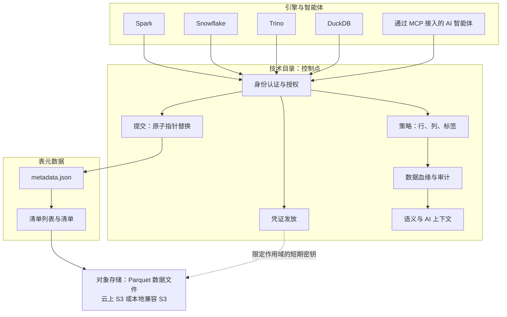
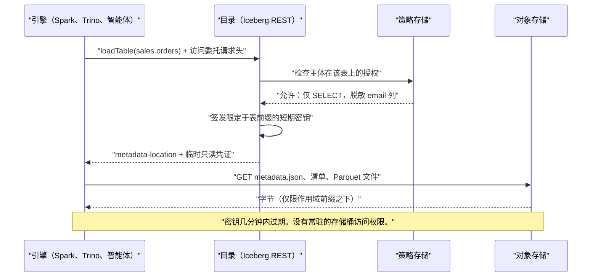

# 8. 目录与元数据存储：新的控制点
> **深度：** L2 · **阅读时间：** 约 11 分钟 · **最后核实：** 2026-11-01 · **前置阅读：** [第 7 章 — 开放表格式](ch07-open-table-formats.md)

## 要点速览（TL;DR）

- [技术目录（technical catalog）](../glossary.md#technical-catalog)（或称[元数据存储（metastore）](../glossary.md#metastore)）把 `sales.orders` 这样的名称映射到一张开放表的当前元数据文件。它还存储模式和分区信息、让提交具备原子性、执行访问策略，并且越来越多地向引擎发放短期存储凭证。
- [业务目录（business catalog）](../glossary.md#business-catalog)（Collibra、Alation、Atlan）是另一类产品。它通过搜索、术语表和数据管理员（stewardship）工作流，帮助人们*找到并信任*数据。它不在读写路径上。
- 演进脉络从 [Hive Metastore](../glossary.md#hive-metastore)（约 2010 年，基于关系型数据库的 Thrift API）到 AWS Glue（2017 年），再到厂商中立的 [Iceberg REST 目录（Iceberg REST catalog）](../glossary.md#iceberg-rest-catalog) API（2022 年推出）。2024 年起又出现了 Unity Catalog OSS、Apache Polaris 以及每家超大规模云厂商各自的目录。
- Iceberg 和 Delta 等开放格式让*文件*变得可移植。权力则流向了运营目录的一方，因为每个引擎都必须向它申请提交权限、凭证和策略。由此引发了"开放格式、封闭目录"之争。
- 战略利害关系还在不断上升。目录如今是数据血缘、使用遥测以及面向 AI 智能体的语义上下文汇聚的地方。这就是为什么 Databricks 收购了 Tabular、Snowflake 把 Polaris 捐给了 Apache，而 AWS、Google 和 Microsoft 几乎免费提供各自的目录。

## 为何重要（商业 + Everpure 视角）

[第 7 章](ch07-open-table-formats.md)以一个重要细节结尾：一次 Iceberg 提交只是对一个指针的原子替换，而这个指针由目录持有。因此，一旦存储成为大宗商品（对象存储），表布局成为开放标准（Iceberg、Delta），湖仓一体中剩下的稀缺之物就是那个决定*表的哪个版本是当前版本*以及*谁可以操作它*的服务。每个引擎的每一次查询都要先经过这个服务。

对高管而言，合适的心智模型是一条收费公路。数据平台过去通过专有存储格式锁定客户，开放格式移除了这根杠杆。目录则带回了一根更柔和、但可以说更有价值的杠杆：运营目录的厂商能看到每一次访问、执行每一条策略，并掌握 AI 智能体写出正确查询所需的上下文。更换目录意味着重新指向每个引擎、重建每项授权、重新接通数据血缘。这比迁移数 PB 数据便宜，但也绝非小事。

对 Everpure 来说，目录层在两个方面很重要。第一，FlashBlade 上的 Iceberg 湖仓只有在目录能够向本地部署的 S3 端点发放凭证时才能运行。这使目录兼容性成为存储销售中的一个资质勾选项。第二，对 1touch 的收购（现金对价 $125.0M，于 2026 年 5 月 7 日完成，依据 10-Q）带来了数据发现、数据分类和语义上下文技术。[^ep-10q] 这恰恰是目录会摄取的那类元数据。战略团队基于公开信息可能评估的一个选项是：将 Everpure Data Intelligence 定位为各目录（Unity、Polaris/Horizon、Glue）的*元数据供应方*，而不是目录的竞争者。

## 工作原理

### 技术目录实际上做什么

技术目录承担六项职能。可以把它们看作同一服务的六个层次：

1. **命名空间解析。** 它把 `prod.sales.orders` 转换为一个位置：目录 → [命名空间（namespace）](../glossary.md#namespace)（数据库/模式）→ 表 → 当前 `metadata.json` 的对象存储路径。这次查找就是[元数据指针（metadata pointer）](../glossary.md#metadata-pointer)。
2. **模式和分区信息。** 在 Hive 时代的系统中，目录存储完整的分区列表。在 Iceberg 中，大部分信息移入了清单文件，目录只保留指针和少量属性。
3. **原子提交。** 当两个写入者竞争时，目录执行一次比较并交换："*仅当*指针仍为 v41 时，才将其从 v41 更新为 v42。"失败方重试。这是单靠对象存储无法跨引擎安全完成的唯一操作。
4. **访问控制。** 对目录、模式、表、列和行的授权，在每次加载和提交时都要检查。
5. **[凭证发放（credential vending）](../glossary.md#credential-vending)。** 目录不再向每个引擎提供永久的存储桶密钥，而是签发作用域限定在某张表存储前缀上的短期凭证。
6. **审计、数据血缘与上下文。** 由于每次访问都经过它，目录可以记录谁读了什么、构建血缘图，并附加描述、标签和指标。最后这一类正是 AI 智能体获取事实依据（grounding）的地方。

*图 8.1 — SV-7：每个引擎和智能体都必须经过目录才能查找、修改或读取一张表，因此运营目录的一方掌握提交权、凭证、策略和上下文。*

> **类比：DNS 加证书颁发机构。** 目录扮演湖仓的 DNS 角色：它把人类可读的名称解析为当前元数据的地址。它同时也是证书颁发机构，签发存储会认可的短期、限定作用域的凭证。同时控制这两者，你就控制了整个网络，即使你一台服务器（这里指数据文件）都不拥有。半导体背景的读者也可以把它想象成内存管理单元（MMU）：每一次 load 和 store 在触及 DRAM 之前，都要在那里完成地址转换和权限检查。

### 技术目录与业务目录

这两类产品共用一个词，除此之外几乎没有共同点。技术目录是热路径上的基础设施，以毫秒和正确的提交来衡量。业务目录是面向分析师、数据管理员和合规团队的交互型系统（system of engagement）。它爬取技术目录、BI 工具和数据管道，然后添加术语表（"什么算活跃客户"）、归属、认证徽章和搜索。两层正在趋同。Databricks 和 Snowflake 正在为 Unity 和 Horizon 增加数据发现和业务语义（Snowflake 于 2025 年末收购 Select Star 正是出于这一目的）。[^ma-csv] 业务目录厂商则将自己重新定位为面向智能体的"上下文层"。数据治理工作流见[第 15 章](../02-pipelines-and-governance/ch15-governance-security-privacy.md)，相关厂商见[第 33 章](../04-company-deep-dives/ch33-governance-catalog-security-companies.md)。

### 凭证发放，逐步解析

凭证发放是把目录从"电话簿"变成"守门人"的机制。在 Iceberg REST 协议中，客户端通过发送 `X-Iceberg-Access-Delegation` 请求头并取值 `vended-credentials` 来表明它需要委托访问；也可以取值 `remote-signing`，即由目录对每个存储请求签名。[^irc-spec][^minio-irc] 各实现会把临时密钥的作用域限定在表的前缀上，并且授予的权限永远不超过调用者自身的权限。只读用户只会得到只读密钥。[^minio-irc]

*图 8.2 — 凭证发放意味着引擎从不持有常驻存储密钥；由目录逐个请求决定引擎可以读取哪些字节。*

其商业后果不易察觉，但影响巨大。在凭证发放出现之前，数据团队必须在存储桶上为每个引擎分配独立的身份与访问管理（IAM）角色，治理分散在两个地方，并且会逐渐失去同步。有了凭证发放，存储桶*只信任目录*，目录的策略成为唯一的事实来源。这是良好的安全实践。但这也意味着，目录厂商如今掌握着你对象存储的钥匙。

> **深入（L3）。** REST 规范是 Iceberg 代码仓库中的一个 OpenAPI YAML 文件（`open-api/rest-catalog-open-api.yaml`）。一份 2026 年的兼容性评估统计出 35 个操作，包括 `loadTable`、`commitTransaction` 以及较新的服务器端扫描规划。[^irc-spec][^irc-report] 支持该协议的引擎无需任何厂商 SDK。Iceberg 将该协议记录为 Hive Thrift 接口的继任者。[^irc-spec]

## 设计选择与权衡

| 维度 | 技术目录 | 业务目录 |
|---|---|---|
| 主要用户 | 引擎、数据管道、智能体 | 分析师、数据管理员、合规团队 |
| 是否在读写路径上？ | 是：每次加载和提交 | 否：爬取并标注 |
| 核心对象 | 命名空间、表、快照、授权 | 术语表条目、归属人、认证、血缘视图 |
| 故障模式 | 宕机会使所有查询停止 | 宕机会使搜索和工作流停止 |
| 示例 | Hive Metastore、Glue、Unity、Polaris、Horizon、Lakekeeper | Collibra、Alation、Atlan、Informatica（Salesforce） |
| 定价逻辑 | 捆绑或按请求计费 | 按席位/按资产订阅 |

*图 8.3 — 技术目录位于热路径上，通常被捆绑提供；业务目录位于热路径旁边，以订阅方式销售。两者正在向"面向智能体的上下文"趋同。*

买方需要做出的主要架构选择：

- **平台原生目录与中立目录。** 平台目录（Databricks 上的 Unity、Snowflake 上的 Horizon、AWS 上的 Glue）提供最深度的集成：细粒度策略、数据血缘和优化开箱即用。中立目录（Polaris、Lakekeeper、Gravitino）则保留引擎选择的开放性。原生方案的最强论证是：治理的强度取决于最弱的那个引擎。由单一厂商端到端执行列脱敏，胜过一个部分引擎会忽略其策略的中立目录。
- **Iceberg 优先与多格式。** Unity Catalog 在 Delta 上成长起来，后来增加了 Iceberg。Polaris 和 Lakekeeper 原生支持 Iceberg。OneLake 存储 Delta，并通过转换暴露 Iceberg 元数据。[^onelake-irc] 多格式目录减少了迁移痛苦，但增加了转换中的边缘情况。
- **联邦与整合。** [目录联邦（catalog federation）](../glossary.md#catalog-federation)让一个目录能够治理注册在另一个目录中的表。Unity Catalog 于 2025 年 6 月宣布支持联邦到 Glue、Hive Metastore 和 Snowflake Horizon（公开预览）。[^uc-2025] 联邦是务实的做法，但每多一跳，策略就多一个可能在转换中丢失的地方。
- **版本化历史与线性历史。** Nessie 增加了类似 git 的跨多表分支、标签和合并，便于在发布前先在分支上测试数据管道。[^nessie] 大多数目录对每张表只保留一条线性历史。

## 主要参与者

| 目录 | 起源 | 开源 / 许可证 | Iceberg REST | Delta 支持 | 治理深度 | 厂商中立性 |
|---|---|---|---|---|---|---|
| Hive Metastore | Facebook，后归 Apache（约 2010 年） | 是，Apache 2.0 | 否（Thrift API） | 部分（路径注册） | 基础授权 | 高，但已老化 |
| AWS Glue Data Catalog / SageMaker Lakehouse | AWS（2017 年 8 月正式发布） | 否，托管服务 | 是，`glue.<region>.amazonaws.com/iceberg`；由 Lake Formation 发放凭证[^glue-irc] | 是，可注册 [VERIFY: Glue 对 Delta 的引擎覆盖范围] | Lake Formation 行/列授权 | 以 AWS 为中心 |
| Unity Catalog | Databricks（2024 年 6 月发布 OSS 版本） | OSS，Apache 2.0，隶属 LF AI and Data；托管版本功能更丰富[^uc-oss] | 是：截至 2025 年 6 月读取已正式发布，写入为预览[^uc-2025] | 原生 | 深：ABAC、数据血缘、AI 资产、Domains（2026）[^uc-2026] | Databricks 主导 |
| Apache Polaris / Snowflake Open Catalog | Snowflake（2024 年 6 月），2026 年成为 Apache 顶级项目 | 是，Apache 2.0，由 ASF 治理[^polaris-tlp] | 原生（参考级） | 通用表 [VERIFY: 通过 Polaris 通用表支持 Delta] | RBAC、凭证发放 | 高（ASF） |
| Snowflake Horizon Catalog | Snowflake | 否，托管服务（内嵌 Polaris） | 是，读取已正式发布，写入为预览[^horizon-irc] | 有限 [VERIFY: Horizon 对 Delta 的支持] | 深：脱敏、标签、数据血缘、Select Star 数据发现 | Snowflake 主导 |
| Google BigLake metastore / Knowledge Catalog | Google | 否，托管服务 | 是，2025 年 11 月正式发布，由管理员启用凭证发放[^biglake-irc] | 有限 [VERIFY: BigLake 对 Delta 的支持] | Knowledge Catalog 数据血缘、质量、发现[^gcp-kc] | 以 GCP 为中心 |
| Microsoft OneLake catalog | Microsoft Fabric | 否，托管服务 | 预览，只读元数据[^onelake-irc] | 原生（Delta 是 OneLake 的格式） | Fabric 治理、Purview [VERIFY: OneLake catalog 的治理功能及推出日期] | 以 Azure 为中心 |
| Apache Gravitino | Datastrato，2025 年 6 月成为 Apache 顶级项目 | 是，Apache 2.0[^gravitino] | 是（REST 服务） | 通过多格式目录 [VERIFY: Gravitino 对 Delta 的支持] | 跨数据源的统一元数据 | 高（ASF） |
| Project Nessie | Dremio | 是，Apache 2.0 | 是 | 有限 [VERIFY: Nessie 对 Delta 的支持] | 类 git 版本管理 | 中；能力已并入 Polaris[^polaris-nessie] |
| Lakekeeper | Vakamo | 是，Apache 2.0，Rust[^lakekeeper] | 原生 | 否（仅 Iceberg） | 凭证发放、远程签名、变更事件 | 高 |

*图 8.4 — 每个主要平台现在都支持 Iceberg REST，因此 API 不再是差异化因素。竞争已经转向治理深度以及由谁掌控路线图。表中单元格汇总了截至 2026-11-01 的公开文档；Delta 相关单元格核实程度最低。*

**一句话定位。** *Databricks* 把 Unity Catalog 作为其平台的重心，并将其扩展到治理模型、AI 函数和智能体流量（Unity AI Gateway，2026）。[^uc-2026] *Snowflake* 分散押注：Horizon 是功能丰富的专有层，Polaris 是中立的开源层，让 Snowflake 可以宣称自己不锁定数据。*AWS* 把 Glue、Lake Formation 和 S3 Tables 捆绑进存储账单。*Google* 和 *Microsoft* 将目录与 BigQuery 和 Fabric 绑定。*Gravitino*、*Nessie* 和 *Lakekeeper* 是独立派：技术可信，商业包装单薄。
