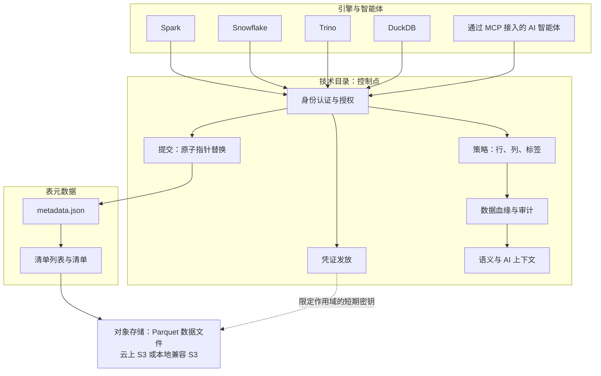
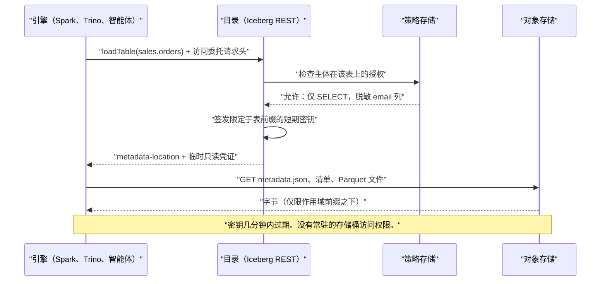
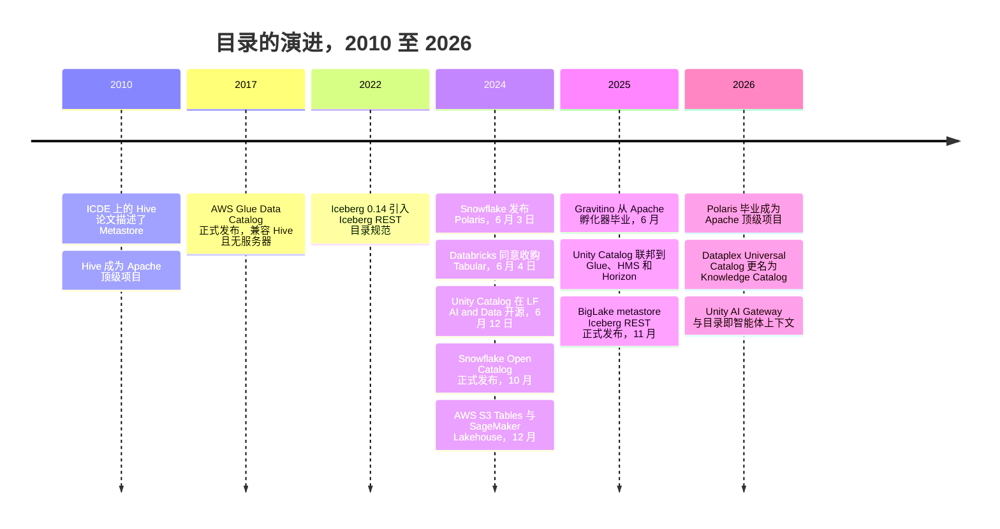

# 8. 目录与元数据存储：新的控制点
> **深度：** L2 · **阅读时间：** 约 11 分钟 · **最后核实：** 2026-11-01 · **前置阅读：** [第 7 章 — 开放表格式](ch07-open-table-formats.md)

## 要点速览（TL;DR）

- [技术目录（technical catalog）](../glossary.md#technical-catalog)（或称[元数据存储（metastore）](../glossary.md#metastore)）把 `sales.orders` 这样的名称映射到一张开放表的当前元数据文件。它还存储模式和分区信息、让提交具备原子性、执行访问策略，并且越来越多地向引擎发放短期存储凭证。
- [业务目录（business catalog）](../glossary.md#business-catalog)（Collibra、Alation、Atlan）是另一类产品。它通过搜索、术语表和数据管理员（stewardship）工作流，帮助人们*找到并信任*数据。它不在读写路径上。
- 演进脉络从 [Hive Metastore](../glossary.md#hive-metastore)（约 2010 年，基于关系型数据库的 Thrift API）到 AWS Glue（2017 年），再到厂商中立的 [Iceberg REST 目录（Iceberg REST catalog）](../glossary.md#iceberg-rest-catalog) API（2022 年推出）。2024 年起又出现了 Unity Catalog OSS、Apache Polaris 以及每家超大规模云厂商各自的目录。
- Iceberg 和 Delta 等开放格式让*文件*变得可移植。权力则流向了运营目录的一方，因为每个引擎都必须向它申请提交权限、凭证和策略。由此引发了"开放格式、封闭目录"之争。
- 战略利害关系还在不断上升。目录如今是数据血缘、使用遥测以及面向 AI 智能体的语义上下文汇聚的地方。这就是为什么 Databricks 收购了 Tabular、Snowflake 把 Polaris 捐给了 Apache，而 AWS、Google 和 Microsoft 几乎免费提供各自的目录。

## 为何重要（商业 + Everpure 视角）

[第 7 章](ch07-open-table-formats.md)以一个重要细节结尾：一次 Iceberg 提交只是对一个指针的原子替换，而这个指针由目录持有。因此，一旦存储成为大宗商品（对象存储），表布局成为开放标准（Iceberg、Delta），湖仓一体中剩下的稀缺之物就是那个决定*表的哪个版本是当前版本*以及*谁可以操作它*的服务。每个引擎的每一次查询都要先经过这个服务。

对高管而言，合适的心智模型是一条收费公路。数据平台过去通过专有存储格式锁定客户，开放格式移除了这根杠杆。目录则带回了一根更柔和、但可以说更有价值的杠杆：运营目录的厂商能看到每一次访问、执行每一条策略，并掌握 AI 智能体写出正确查询所需的上下文。更换目录意味着重新指向每个引擎、重建每项授权、重新接通数据血缘。这比迁移数 PB 数据便宜，但也绝非小事。

对 Everpure 来说，目录层在两个方面很重要。第一，FlashBlade 上的 Iceberg 湖仓只有在目录能够向本地部署的 S3 端点发放凭证时才能运行。这使目录兼容性成为存储销售中的一个资质勾选项。第二，对 1touch 的收购（现金对价 $125.0M，于 2026 年 5 月 7 日完成，依据 10-Q）带来了数据发现、数据分类和语义上下文技术。[^ep-10q] 这恰恰是目录会摄取的那类元数据。战略团队基于公开信息可能评估的一个选项是：将 Everpure Data Intelligence 定位为各目录（Unity、Polaris/Horizon、Glue）的*元数据供应方*，而不是目录的竞争者。

## 工作原理

### 技术目录实际上做什么

技术目录承担六项职能。可以把它们看作同一服务的六个层次：

1. **命名空间解析。** 它把 `prod.sales.orders` 转换为一个位置：目录 → [命名空间（namespace）](../glossary.md#namespace)（数据库/模式）→ 表 → 当前 `metadata.json` 的对象存储路径。这次查找就是[元数据指针（metadata pointer）](../glossary.md#metadata-pointer)。
2. **模式和分区信息。** 在 Hive 时代的系统中，目录存储完整的分区列表。在 Iceberg 中，大部分信息移入了清单文件，目录只保留指针和少量属性。
3. **原子提交。** 当两个写入者竞争时，目录执行一次比较并交换："*仅当*指针仍为 v41 时，才将其从 v41 更新为 v42。"失败方重试。这是单靠对象存储无法跨引擎安全完成的唯一操作。
4. **访问控制。** 对目录、模式、表、列和行的授权，在每次加载和提交时都要检查。
5. **[凭证发放（credential vending）](../glossary.md#credential-vending)。** 目录不再向每个引擎提供永久的存储桶密钥，而是签发作用域限定在某张表存储前缀上的短期凭证。
6. **审计、数据血缘与上下文。** 由于每次访问都经过它，目录可以记录谁读了什么、构建血缘图，并附加描述、标签和指标。最后这一类正是 AI 智能体获取事实依据（grounding）的地方。

*图 8.1 — SV-7：每个引擎和智能体都必须经过目录才能查找、修改或读取一张表，因此运营目录的一方掌握提交权、凭证、策略和上下文。*

> **类比：DNS 加证书颁发机构。** 目录扮演湖仓的 DNS 角色：它把人类可读的名称解析为当前元数据的地址。它同时也是证书颁发机构，签发存储会认可的短期、限定作用域的凭证。同时控制这两者，你就控制了整个网络，即使你一台服务器（这里指数据文件）都不拥有。半导体背景的读者也可以把它想象成内存管理单元（MMU）：每一次 load 和 store 在触及 DRAM 之前，都要在那里完成地址转换和权限检查。

### 技术目录与业务目录

这两类产品共用一个词，除此之外几乎没有共同点。技术目录是热路径上的基础设施，以毫秒和正确的提交来衡量。业务目录是面向分析师、数据管理员和合规团队的交互型系统（system of engagement）。它爬取技术目录、BI 工具和数据管道，然后添加术语表（"什么算活跃客户"）、归属、认证徽章和搜索。两层正在趋同。Databricks 和 Snowflake 正在为 Unity 和 Horizon 增加数据发现和业务语义（Snowflake 于 2025 年末收购 Select Star 正是出于这一目的）。[^ma-csv] 业务目录厂商则将自己重新定位为面向智能体的"上下文层"。数据治理工作流见[第 15 章](../02-pipelines-and-governance/ch15-governance-security-privacy.md)，相关厂商见[第 33 章](../04-company-deep-dives/ch33-governance-catalog-security-companies.md)。

### 凭证发放，逐步解析

凭证发放是把目录从"电话簿"变成"守门人"的机制。在 Iceberg REST 协议中，客户端通过发送 `X-Iceberg-Access-Delegation` 请求头并取值 `vended-credentials` 来表明它需要委托访问；也可以取值 `remote-signing`，即由目录对每个存储请求签名。[^irc-spec][^minio-irc] 各实现会把临时密钥的作用域限定在表的前缀上，并且授予的权限永远不超过调用者自身的权限。只读用户只会得到只读密钥。[^minio-irc]

*图 8.2 — 凭证发放意味着引擎从不持有常驻存储密钥；由目录逐个请求决定引擎可以读取哪些字节。*

其商业后果不易察觉，但影响巨大。在凭证发放出现之前，数据团队必须在存储桶上为每个引擎分配独立的身份与访问管理（IAM）角色，治理分散在两个地方，并且会逐渐失去同步。有了凭证发放，存储桶*只信任目录*，目录的策略成为唯一的事实来源。这是良好的安全实践。但这也意味着，目录厂商如今掌握着你对象存储的钥匙。

> **深入（L3）。** REST 规范是 Iceberg 代码仓库中的一个 OpenAPI YAML 文件（`open-api/rest-catalog-open-api.yaml`）。一份 2026 年的兼容性评估统计出 35 个操作，包括 `loadTable`、`commitTransaction` 以及较新的服务器端扫描规划。[^irc-spec][^irc-report] 支持该协议的引擎无需任何厂商 SDK。Iceberg 将该协议记录为 Hive Thrift 接口的继任者。[^irc-spec]

## 设计选择与权衡

| 维度 | 技术目录 | 业务目录 |
|---|---|---|
| 主要用户 | 引擎、数据管道、智能体 | 分析师、数据管理员、合规团队 |
| 是否在读写路径上？ | 是：每次加载和提交 | 否：爬取并标注 |
| 核心对象 | 命名空间、表、快照、授权 | 术语表条目、归属人、认证、血缘视图 |
| 故障模式 | 宕机会使所有查询停止 | 宕机会使搜索和工作流停止 |
| 示例 | Hive Metastore、Glue、Unity、Polaris、Horizon、Lakekeeper | Collibra、Alation、Atlan、Informatica（Salesforce） |
| 定价逻辑 | 捆绑或按请求计费 | 按席位/按资产订阅 |

*图 8.3 — 技术目录位于热路径上，通常被捆绑提供；业务目录位于热路径旁边，以订阅方式销售。两者正在向"面向智能体的上下文"趋同。*

买方需要做出的主要架构选择：

- **平台原生目录与中立目录。** 平台目录（Databricks 上的 Unity、Snowflake 上的 Horizon、AWS 上的 Glue）提供最深度的集成：细粒度策略、数据血缘和优化开箱即用。中立目录（Polaris、Lakekeeper、Gravitino）则保留引擎选择的开放性。原生方案的最强论证是：治理的强度取决于最弱的那个引擎。由单一厂商端到端执行列脱敏，胜过一个部分引擎会忽略其策略的中立目录。
- **Iceberg 优先与多格式。** Unity Catalog 在 Delta 上成长起来，后来增加了 Iceberg。Polaris 和 Lakekeeper 原生支持 Iceberg。OneLake 存储 Delta，并通过转换暴露 Iceberg 元数据。[^onelake-irc] 多格式目录减少了迁移痛苦，但增加了转换中的边缘情况。
- **联邦与整合。** [目录联邦（catalog federation）](../glossary.md#catalog-federation)让一个目录能够治理注册在另一个目录中的表。Unity Catalog 于 2025 年 6 月宣布支持联邦到 Glue、Hive Metastore 和 Snowflake Horizon（公开预览）。[^uc-2025] 联邦是务实的做法，但每多一跳，策略就多一个可能在转换中丢失的地方。
- **版本化历史与线性历史。** Nessie 增加了类似 git 的跨多表分支、标签和合并，便于在发布前先在分支上测试数据管道。[^nessie] 大多数目录对每张表只保留一条线性历史。

## 主要参与者

| 目录 | 起源 | 开源 / 许可证 | Iceberg REST | Delta 支持 | 治理深度 | 厂商中立性 |
|---|---|---|---|---|---|---|
| Hive Metastore | Facebook，后归 Apache（约 2010 年） | 是，Apache 2.0 | 否（Thrift API） | 部分（路径注册） | 基础授权 | 高，但已老化 |
| AWS Glue Data Catalog / SageMaker Lakehouse | AWS（2017 年 8 月正式发布） | 否，托管服务 | 是，`glue.<region>.amazonaws.com/iceberg`；由 Lake Formation 发放凭证[^glue-irc] | 是，可注册 [VERIFY: Glue 对 Delta 的引擎覆盖范围] | Lake Formation 行/列授权 | 以 AWS 为中心 |
| Unity Catalog | Databricks（2024 年 6 月发布 OSS 版本） | OSS，Apache 2.0，隶属 LF AI and Data；托管版本功能更丰富[^uc-oss] | 是：截至 2025 年 6 月读取已正式发布，写入为预览[^uc-2025] | 原生 | 深：ABAC、数据血缘、AI 资产、Domains（2026）[^uc-2026] | Databricks 主导 |
| Apache Polaris / Snowflake Open Catalog | Snowflake（2024 年 6 月），2026 年成为 Apache 顶级项目 | 是，Apache 2.0，由 ASF 治理[^polaris-tlp] | 原生（参考级） | 通用表 [VERIFY: 通过 Polaris 通用表支持 Delta] | RBAC、凭证发放 | 高（ASF） |
| Snowflake Horizon Catalog | Snowflake | 否，托管服务（内嵌 Polaris） | 是，读取已正式发布，写入为预览[^horizon-irc] | 有限 [VERIFY: Horizon 对 Delta 的支持] | 深：脱敏、标签、数据血缘、Select Star 数据发现 | Snowflake 主导 |
| Google BigLake metastore / Knowledge Catalog | Google | 否，托管服务 | 是，2025 年 11 月正式发布，由管理员启用凭证发放[^biglake-irc] | 有限 [VERIFY: BigLake 对 Delta 的支持] | Knowledge Catalog 数据血缘、质量、发现[^gcp-kc] | 以 GCP 为中心 |
| Microsoft OneLake catalog | Microsoft Fabric | 否，托管服务 | 预览，只读元数据[^onelake-irc] | 原生（Delta 是 OneLake 的格式） | Fabric 治理、Purview [VERIFY: OneLake catalog 的治理功能及推出日期] | 以 Azure 为中心 |
| Apache Gravitino | Datastrato，2025 年 6 月成为 Apache 顶级项目 | 是，Apache 2.0[^gravitino] | 是（REST 服务） | 通过多格式目录 [VERIFY: Gravitino 对 Delta 的支持] | 跨数据源的统一元数据 | 高（ASF） |
| Project Nessie | Dremio | 是，Apache 2.0 | 是 | 有限 [VERIFY: Nessie 对 Delta 的支持] | 类 git 版本管理 | 中；能力已并入 Polaris[^polaris-nessie] |
| Lakekeeper | Vakamo | 是，Apache 2.0，Rust[^lakekeeper] | 原生 | 否（仅 Iceberg） | 凭证发放、远程签名、变更事件 | 高 |

*图 8.4 — 每个主要平台现在都支持 Iceberg REST，因此 API 不再是差异化因素。竞争已经转向治理深度以及由谁掌控路线图。表中单元格汇总了截至 2026-11-01 的公开文档；Delta 相关单元格核实程度最低。*

**一句话定位。** *Databricks* 把 Unity Catalog 作为其平台的重心，并将其扩展到治理模型、AI 函数和智能体流量（Unity AI Gateway，2026）。[^uc-2026] *Snowflake* 分散押注：Horizon 是功能丰富的专有层，Polaris 是中立的开源层，让 Snowflake 可以宣称自己不锁定数据。*AWS* 把 Glue、Lake Formation 和 S3 Tables 捆绑进存储账单。*Google* 和 *Microsoft* 将目录与 BigQuery 和 Fabric 绑定。*Gravitino*、*Nessie* 和 *Lakekeeper* 是独立派：技术可信，商业包装单薄。

## 历史与发展轨迹

*图 8.5 — 十五年间，目录从一个附属的关系型数据库演变为战略控制点；2024 年的"目录之夏"把大部分转变压缩进了 6 月的十天之内。*

**Hive 时代（2008–2017）。** Facebook 构建 Hive 以便在 Hadoop 上运行 SQL。其 2010 年的 ICDE 论文描述了一个 Metastore：一个由关系型数据库（MySQL 或 Postgres）支撑的 Thrift 服务，记录表、列以及每一个分区。[^hive-icde] Hive 于 2010 年末成为 Apache 顶级项目。[^hive-tlp] 这一设计在云规模下老化得很糟糕。每个分区是一行，列举调用要为每个分区传输一份完整的存储描述符。拥有数万个分区的表会导致客户端超时，后端数据库成为瓶颈。[^hive-7223][^lakefs-hms] 元数据存储也无法让多文件提交具备原子性。这一缺口正是表格式被发明出来的核心原因。

**托管时代（2017–2022）。** AWS Glue Data Catalog 于 2017 年 8 月正式发布。它兼容 Hive、无服务器，并由 Athena、EMR 和 Redshift Spectrum 共享。[^glue-ga] 它的定价为整个行业树立了模板：前一百万个对象免费，此后每月每 100,000 个对象 $1.00。[^glue-pricing] 即便在大规模下，这笔费用与计算成本相比也只是零头，这表明目录将成为一种引流产品（loss leader）。

**开放 API 时代（2022–2024）。** Iceberg 社区于 2022 年在 Iceberg 0.14 中引入了 REST 目录规范。它首次定义了一份厂商中立的 HTTP 契约，涵盖加载、提交和凭证。[^irc-dremio] 任何支持 REST 的引擎现在都能使用任何兼容的目录，就像任何浏览器都能使用任何 DNS 服务器一样。

**目录之夏（2024 年 6 月）。** 2024 年 6 月 3 日，Snowflake 发布了 Polaris，这是一个 Iceberg REST 目录，Snowflake 承诺在 90 天内将其开源。[^polaris-pr] 次日，Databricks 宣布将收购 Tabular，这家公司由 Iceberg 的创造者创立（约 40 名员工）。[^tabular-pr] Databricks 未披露价格；媒体报道约为 $2B。[^ma-csv] 6 月 12 日，Databricks 在 LF AI & Data Foundation 下开源了 Unity Catalog，并表示该产品已服务超过 10,000 家组织（公司披露）。[^uc-oss] Snowflake 于 2024 年 10 月推出了托管的 Snowflake Open Catalog。[^open-catalog] 12 月，AWS 推出 S3 Tables，这是原生支持 Iceberg 的存储桶，与自管理表相比查询速度最高快 3 倍、每秒事务数最高多 10 倍（公司披露的声称）。[^s3tables-pr] 随后，SageMaker Lakehouse 作为统一的、兼容 Iceberg 的目录推出。[^sm-lakehouse]

**整合期（2025–2026）。** Gravitino 于 2025 年 6 月从 Apache 孵化器毕业。[^gravitino] Polaris 于 2026 年初紧随其后：孵化器记录的毕业日期为 2 月 15 日，项目和厂商博客于 2 月 19 日宣布，ASF 于 2026 年 3 月 5 日正式宣布。[^polaris-tlp] Polaris 1.4 于 2026 年 4 月发布，改进了多租户能力，[^polaris-14] 截至 2026-09-28，该项目已发布 1.8.0 版本。[^polaris-18] Google 于 2025 年 11 月正式发布 BigLake metastore 的 Iceberg REST 端点，并于 2026 年 4 月 10 日将 Dataplex Universal Catalog 更名为 Knowledge Catalog。[^biglake-irc][^gcp-kc] Snowflake 的 Horizon 现在向外部引擎暴露 Iceberg REST，并计划于 2026 年按每百万次调用 0.5 credits 进行请求计费。[^horizon-irc] Unity Catalog OSS 在 LF AI & Data 中的阶段（沙箱还是孵化）无法确认。[VERIFY: Unity Catalog OSS 在 LF AI and Data 中的成熟度阶段]

### 为什么这些交易合乎逻辑

- **Databricks–Tabular。** 以媒体报道接近 $2B 的价格收购一家约 40 人的公司，Databricks 买下的是对 Iceberg 路线图重心的控制权，而不是收入。[^tabular-pr][^ma-csv] 它恰在 Snowflake 发布 Polaris 之际，让一家可信的"中立 Iceberg 目录"公司退出了竞争。它还把 Iceberg 的创造者带入了 Delta–Iceberg 趋同工作。用金融术语说，这是为控制点支付的一笔防御性期权溢价。
- **Snowflake–Polaris。** Snowflake 历史上的护城河是专有存储。一旦客户要求 Iceberg，可信的做法就是在 ASF 治理下*免费放出*目录层。这让"中立"成为一项源自 Snowflake 的资产，同时通过功能更丰富的 Horizon 层和计算来变现。
- **超大规模云厂商的捆绑。** 对 AWS、Google 和 Microsoft 而言，目录是存储和计算的互补品。免费或近乎免费的目录会把 Iceberg 数据吸引到它们的对象存储和引擎中，这是经典的"让互补品商品化"打法。

> **类比：金融。** 把目录控制权当作一种特许权使用费（royalty）头寸来看待。目录所有者直接赚到的钱很少，但它持有对下游每一美元的永续期权：哪个引擎成为默认选择、哪个治理附加产品被售出、哪个 AI 助手获得上下文。和特许权使用费一样，价值在于它所覆盖的基础的广度，而不在于费用本身。

**下一步走向。** 目录正在变成 AI 智能体的事实依据层（grounding layer）。描述、经认证的指标、数据血缘和使用统计，正是文本转 SQL（text-to-SQL）智能体避免自信地给出错误答案所需要的（见[第 22 章](../03-ai-data-stack/ch22-agents-and-data.md)和[第 14 章](../02-pipelines-and-governance/ch14-semantic-layers-and-bi.md)）。谁拥有这些上下文，谁就拥有智能体体验，这就是为什么"开放格式、封闭目录"如今是一个现实的采购问题。针对平台的看空逻辑（bear case）是：REST API 让目录可以互换，而联邦削弱了任何单一所有者的掌控力。

## 关键数字

| 指标 | 数值 | 口径 | 来源 / 日期 |
|---|---|---|---|
| Databricks 为 Tabular 支付的价格 | 约 $2B（WSJ：$1–2B） | 媒体报道；Databricks 未披露 | TechCrunch 2024-08-14[^ma-csv] |
| 交易时 Tabular 团队规模 | 约 40 人 | 公司披露 | Databricks 新闻稿 2024-06-04[^tabular-pr] |
| Unity Catalog 组织数 | >10,000 | 公司披露，2024 年 6 月 | Databricks 新闻稿 2024-06-12[^uc-oss] |
| Glue Data Catalog 存储价格 | 前 1M 个对象免费；超出部分每月每 100K 个对象 $1.00 | 标价 | AWS 定价页面[^glue-pricing] |
| Horizon Iceberg REST API 计费 | 每百万次调用 0.5 credits（计划于 2026 年） | 标价，可能变动 | Snowflake 文档[^horizon-irc] |
| S3 Tables 对比自管理 | 查询速度最高 3 倍，TPS 最高 10 倍 | 公司披露的声称 | AWS 新闻稿 2024-12-03[^s3tables-pr] |
| Polaris 孵化期产出 | 约 100 位贡献者、6 个版本、>2,800 个 PR | 第三方汇总 | Fivetran 博客 2026-02[^fivetran-polaris] |
| Iceberg REST 规范规模 | 35 个操作 | 第三方统计 | 兼容性报告 2026[^irc-report] |
| Everpure–1touch | 现金对价 $125.0M | GAAP（10-Q） | Everpure 10-Q，截至 2026-05-03 的季度[^ep-10q] |

*图 8.6 — 目录的直接收入微乎其微（Glue 每 100,000 个对象只收几美元），而围绕它的交易却高达数十亿美元：价值在于控制权，而不在于费用。*

## 存储桥接

> **存储桥接。** 对于本地部署的湖仓，目录必须能够为兼容 S3 的端点（而不仅仅是 AWS）签发限定作用域的凭证或对请求进行远程签名。Lakekeeper 和 MinIO AIStor 等实现已经能够针对非 AWS 对象存储发放前缀级凭证或远程签名请求。[^lakekeeper][^minio-irc] 对 FlashBlade 而言，资质认证问题包括：STS 式临时凭证、按前缀的策略，以及在大量小规模元数据读取下的请求签名性能。有关 S3 协议和 FlashBlade 的细节，请参阅配套的《Everpure Tech Atlas》。战略选项见[第 45 章](../06-history-and-future/ch45-storage-moving-up-the-stack.md)。

## 对话手册

**向产品经理提的三个问题**

1. "哪个目录是你们 Iceberg 表的记录系统？哪些引擎可以向它提交，而不仅仅是读取？" 好的回答会为每个领域指定一个目录，并明确列出写入方。薄弱的回答是"全部都可以"（多目录并发写入存在数据损坏风险）。
2. "如果离开你们的平台厂商，你们需要重建什么：授权、数据血缘、标签、指标定义？" 好的回答表明团队已经为退出定过价，并且知道数据文件可以自由迁移，而策略不能。
3. "你们的 AI 智能体从哪里获取表描述和经认证的指标？" 好的回答会指向目录或语义层，而不是塞满模式转储的提示词。

**向工程师提的三个问题**

1. "你们的引擎拿到的是发放的凭证，还是常驻的存储桶密钥？" 好的情况：使用短存活时间（TTL）密钥和前缀作用域限定的凭证发放。危险信号是每个引擎共享长期密钥。
2. "你们如何处理提交冲突和表维护（压缩合并、快照过期）？" 好的情况：由目录或托管服务处理乐观重试和定期维护。
3. "你们测试过联邦吗？哪些策略能在跨越后保留下来？" 好的回答会承认行过滤和脱敏常常无法跨目录传递。

**"不要这样说"**

- "Iceberg 意味着没有锁定。" 格式是开放的；目录、其策略和上下文则未必。
- "Collibra 和 Unity Catalog 是竞争对手。" 它们大多是互补关系：一个是业务目录，一个是技术目录，尽管两者的重叠正在扩大。
- "Hive Metastore 已经死了。" 仍有大量表位于它之后，现代目录也会联邦到它。
- "Polaris 是 Snowflake 的目录。" 它是 Apache 顶级项目。Snowflake 的专有目录是 Horizon，后者内嵌了 Polaris。

## 深入阅读

- 阅读 Iceberg REST OpenAPI 规范，追踪 `loadTable` → `commitTable`，准确看清原子性和凭证所在的位置。[^irc-spec]
- 比较 Unity Catalog、Polaris 和 Lakekeeper 如何把授权映射到所发放凭证的作用域，以及各自在何处执行行和列策略（目录还是引擎）。
- Hive 的 ICDE 2010 论文篇幅很短，说明了为什么"分区存于关系型数据库"的设计必须被取代。[^hive-icde]

## 关键术语

- [元数据存储（Metastore）](../glossary.md#metastore) — 为查询引擎存储表定义和位置的服务；Hive 时代对技术目录的称呼。
- [技术目录（Technical catalog）](../glossary.md#technical-catalog) — 位于读写路径上的服务，将表名解析为当前元数据、裁决提交并执行访问控制。
- [业务目录（Business catalog）](../glossary.md#business-catalog) — 面向人的数据发现、术语表和数据管理工具（Collibra、Alation、Atlan）。
- [Hive Metastore](../glossary.md#hive-metastore) — Hive 基于 Thrift 加关系型数据库的元数据服务，至今仍被广泛使用并被联邦接入。
- [Iceberg REST 目录（Iceberg REST catalog）](../glossary.md#iceberg-rest-catalog) — 任何引擎都可用来加载和提交 Iceberg 表的开放 HTTP/OpenAPI 契约。
- [凭证发放（Credential vending）](../glossary.md#credential-vending) — 目录向经授权的引擎签发短期、限定于表的存储凭证。
- [远程签名（Remote signing）](../glossary.md#remote-signing) — 目录对每个存储请求进行签名，而不是分发凭证。
- [目录联邦（Catalog federation）](../glossary.md#catalog-federation) — 一个目录发现并治理注册在另一个目录中的表。
- [命名空间（Namespace）](../glossary.md#namespace) — 在目录中对表进行分组的层级容器（数据库或模式）。
- [元数据指针（Metadata pointer）](../glossary.md#metadata-pointer) — 目录中关于哪个元数据文件是表当前版本的记录。

## 资料来源

[^ep-10q]: Everpure, Inc., Form 10-Q for the quarter ended 2026-05-03, SEC EDGAR, https://www.sec.gov/Archives/edgar/data/0001474432/000147443226000061/pstg-20260503.htm，发布 2026-06；检索 2026-11-01。另见 Cleary Gottlieb, "Everpure Completes Acquisition of 1touch," https://www.clearygottlieb.com/news-and-insights/news-listing/everpure-completes-acquisition-of-1touch，发布 2026-05-11；检索 2026-11-01。
[^ma-csv]: Atlas 数据集 `data/ma_deals.csv`（行：Databricks–Tabular；Snowflake–Select Star），引用 TechCrunch, "Databricks reportedly paid $2 billion in Tabular acquisition," https://techcrunch.com/2024/08/14/databricks-reportedly-paid-2-billion-in-tabular-acquisition，发布 2024-08-14，以及 Snowflake blog, https://www.snowflake.com/en/blog/snowflake-acquire-select-star/，发布 2025-11-24；检索 2026-11-01。
[^irc-spec]: Apache Iceberg, "REST Catalog Spec," https://iceberg.apache.org/rest-catalog-spec/，日期不详（持续更新的规范）；检索 2026-11-01。
[^minio-irc]: MinIO, "Iceberg REST Catalog Settings (AIStor Tables)," https://docs.min.io/aistor/reference/aistor-server/settings/aistor-tables/iceberg-rest/，日期不详；检索 2026-11-01。
[^irc-report]: Data Lakehouse Hub, "The 2026 Iceberg REST Catalog Compatibility Report," https://datalakehousehub.com/blog/iceberg-rest-catalog-compatibility-report-2026，发布 2026；检索 2026-11-01（第三方）。
[^irc-dremio]: Dremio, "Apache Iceberg REST Catalog: what it is and how to use it," https://www.dremio.com/blog/apache-iceberg-rest-catalog-what-it-is-and-how-to-use-it/，日期不详；检索 2026-11-01。
[^onelake-irc]: Microsoft Learn, "OneLake table APIs for Iceberg," https://learn.microsoft.com/en-us/fabric/onelake/table-apis/onelake-iceberg-table-apis，日期不详；以及 Fabric blog, "OneLake Table APIs (Preview)," https://blog.fabric.microsoft.com/en-us/blog/now-in-preview-onelake-table-apis；检索 2026-11-01。
[^uc-2025]: Databricks blog, "What's new with Databricks Unity Catalog at Data + AI Summit 2025," https://www.databricks.com/blog/whats-new-databricks-unity-catalog-data-ai-summit-2025，发布 2025-06；检索 2026-11-01。
[^uc-2026]: Databricks blog, "What's new with Unity Catalog at Data + AI Summit 2026," https://www.databricks.com/blog/whats-new-unity-catalog-data-ai-summit-2026，发布 2026-06；检索 2026-11-01。
[^nessie]: Ilum documentation, "Project Nessie catalog," https://ilum.cloud/docs/features/catalogs/nessie/，日期不详；检索 2026-11-01。项目主页：projectnessie.org。
[^glue-irc]: AWS Storage Blog, "Access data in Amazon S3 Tables using PyIceberg through the AWS Glue Iceberg REST endpoint," https://aws.amazon.com/blogs/storage/access-data-in-amazon-s3-tables-using-pyiceberg-through-the-aws-glue-iceberg-rest-endpoint/，日期不详；检索 2026-11-01。
[^uc-oss]: Databricks press release, "Databricks Open Sources Unity Catalog, Creating the Industry's Only Universal Catalog for Data and AI," https://www.databricks.com/company/newsroom/press-releases/databricks-open-sources-unity-catalog-creating-industrys-only-open，发布 2024-06-12；检索 2026-11-01。
[^polaris-tlp]: Apache Polaris blog, "Apache Polaris graduates to top-level project," https://polaris.apache.org/blog/2026/02/19/apache-polaris-graduates-to-top-level-project/，发布 2026-02-19；ASF, "The Apache Software Foundation Graduates Two Open Source Projects from Incubator," https://news.apache.org/foundation/entry/the-apache-software-foundation-graduates-two-open-source-projects-from-incubator，发布 2026-03-05；Apache Incubator 状态页面, https://incubator.apache.org/projects/polaris.html；检索 2026-11-01。
[^horizon-irc]: Snowflake documentation, "Access Apache Iceberg tables with an external engine through Snowflake Horizon Catalog," https://docs.snowflake.com/en/user-guide/tables-iceberg-access-using-external-query-engine-snowflake-horizon，日期不详；检索 2026-11-01。
[^biglake-irc]: Google Cloud blog, "BigLake metastore now supports Iceberg REST Catalog," https://cloud.google.com/blog/products/data-analytics/biglake-metastore-now-supports-iceberg-rest-catalog/，发布 2025-11-19；以及 Google Cloud docs, "Use the BigLake metastore Iceberg REST catalog," https://docs.cloud.google.com/biglake/docs/blms-rest-catalog；检索 2026-11-01。
[^gcp-kc]: Google Cloud docs, "Knowledge Catalog (formerly Dataplex) overview" 及发布说明, https://docs.cloud.google.com/dataplex/docs/overview 和 https://docs.cloud.google.com/dataplex/docs/release-notes，访问 2026-11-01；Atlan, "Google Knowledge Catalog," https://atlan.com/know/ai-agent/gcp/google-knowledge-catalog/，发布 2026；检索 2026-11-01。
[^gravitino]: Apache Gravitino blog, "Gravitino becomes a top-level project," https://gravitino.apache.org/blog/gravitino-top-level-project，发布 2025-06；ASF, "The Apache Software Foundation Announces Two New Top-Level Projects," https://news.apache.org/foundation/entry/the-apache-software-foundation-announces-two-new-top-level-projects，发布 2025-06；检索 2026-11-01。
[^polaris-nessie]: Dremio blog, "Polaris Catalog, to be merged with Nessie, now available on GitHub," https://www.dremio.com/?p=21675，发布 2024-07；以及 FOSS Force, "Snowflake open sources Apache Iceberg-related Polaris data catalog," https://fossforce.com/2024/07/snowflake-open-sources-apache-iceberg-related-polaris-data-catalog/，发布 2024-07；检索 2026-11-01。
[^lakekeeper]: Lakekeeper, GitHub 代码仓库及文档, https://github.com/lakekeeper/lakekeeper 和 https://docs.lakekeeper.io，日期不详；检索 2026-11-01。
[^hive-icde]: A. Thusoo et al., "Hive – A Petabyte Scale Data Warehouse Using Hadoop," IEEE ICDE 2010，副本见 https://courses.cs.washington.edu/courses/csep544/21sp/papers/hive-icde-2010.pdf，发布 2010；检索 2026-11-01。
[^hive-tlp]: Apache Hive, "Hive Contributors Meeting Minutes 2010-10-25," https://hive.apache.org/community/meetings/development-contributorsmeetings-hivecontributorsminutes101025/，发布 2010-10-25；检索 2026-11-01。
[^hive-7223]: Apache JIRA, "HIVE-7223"（关于让 Metastore 分区列举更紧凑的提案），https://issues.apache.org/jira/browse/HIVE-7223，日期不详；检索 2026-11-01。
[^lakefs-hms]: lakeFS blog, "Hive Metastore – it didn't age well," https://lakefs.io/blog/hive-metastore-it-didnt-age-well/，日期不详；检索 2026-11-01。
[^glue-ga]: AWS What's New, "Amazon Athena now integrates with AWS Glue," https://aws.amazon.com/about-aws/whats-new/2017/08/amazon-athena-now-integrates-with-aws-glue，发布 2017-08-14；检索 2026-11-01。
[^glue-pricing]: AWS, "AWS Glue pricing," https://aws.amazon.com/glue/pricing/，日期不详（标价页面）；检索 2026-11-01。
[^polaris-pr]: Snowflake via Business Wire, "Snowflake Unveils Polaris Catalog and Emphasizes Commitment to Interoperability with AWS, Google Cloud, Microsoft Azure, Salesforce, and More," https://www.businesswire.com/news/home/20240603483144/en/，发布 2024-06-03；检索 2026-11-01。
[^tabular-pr]: Databricks press release, "Databricks Agrees to Acquire Tabular, the Company Founded by the Original Creators of Apache Iceberg," https://www.databricks.com/company/newsroom/press-releases/databricks-agrees-acquire-tabular-company-founded-original-creators，发布 2024-06-04；检索 2026-11-01。
[^open-catalog]: Snowflake blog, "Govern an Open Lakehouse with Snowflake Open Catalog, a Managed Service for Apache Polaris," https://www.snowflake.com/en/blog/govern-open-lakehouse-snowflake-open-catalog/，发布 2024-10-18；检索 2026-11-01。
[^s3tables-pr]: Amazon via Business Wire, re:Invent 2024 关于 Amazon S3 Tables 的公告, https://www.businesswire.com/news/home/20241203462924/en，发布 2024-12-03；检索 2026-11-01。
[^sm-lakehouse]: AWS News Blog, "Amazon S3 Tables integration with Amazon SageMaker Lakehouse is now generally available," https://aws.amazon.com/blogs/aws/amazon-s3-tables-integration-with-amazon-sagemaker-lakehouse-is-now-generally-available，发布 2025-03-13；检索 2026-11-01。
[^polaris-14]: Snowflake engineering blog, "What's New in Apache Polaris 1.4: Advanced Multi-Tenancy and Streamlined Deployment," https://www.snowflake.com/en/engineering-blog/apache-polaris-1-4-release/，发布 2026-04-23；检索 2026-11-01。
[^polaris-18]: `meta/research-briefing.md`，来自第 7 章撰稿人的整合者注释（Apache Polaris 最新版本 1.8.0，日期 2026-09-28，依据 Apache Polaris 发布页面），2026-11-01；检索 2026-11-01。
[^fivetran-polaris]: Fivetran blog, "The impact of Apache Polaris graduating to top-level Apache project," https://www.fivetran.com/blog/the-impact-of-apache-polaris-graduating-to-top-level-apache-project，发布 2026-02；检索 2026-11-01（第三方）。
