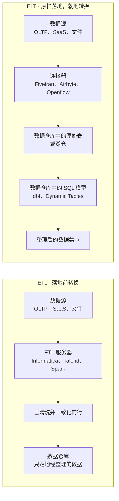
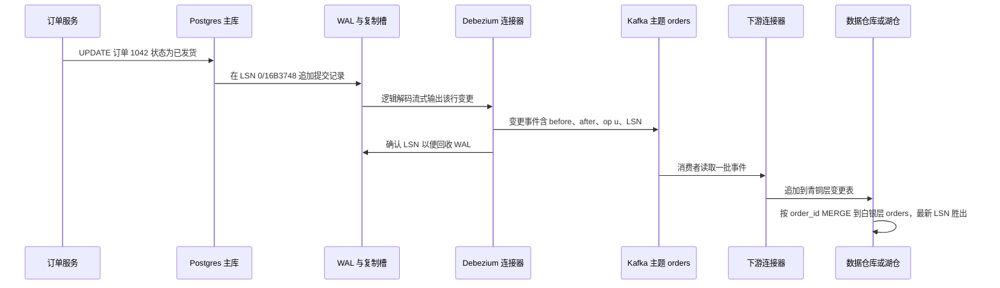
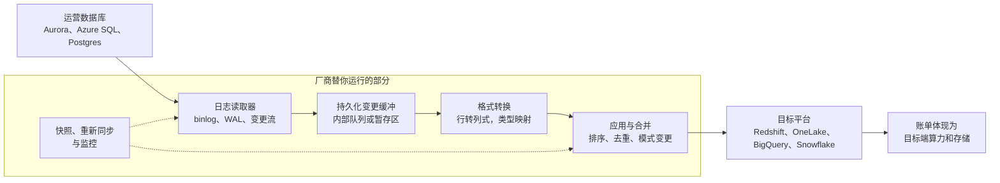
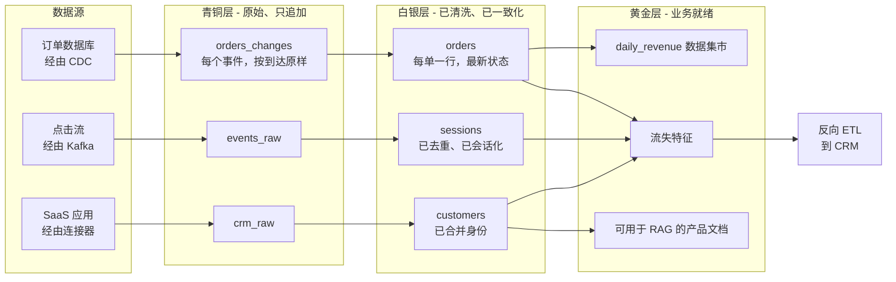

# 9. 数据管道模式
> **深度：** L2 · **阅读时间：** 约 15 分钟 · **最后核实：** 2026-11-01 · **前置阅读：** [第 1 章 — 数据技术栈全景图](../01-data-systems-foundations/ch01-data-stack-map.md)

## 要点速览（TL;DR）

- 数据管道（pipeline）的本质是制造副本。每一种模式都是对三个问题的不同回答：数据在哪里做转换、多久移动一次、如何检测变更。大多数成本、新鲜度与故障方面的权衡，都源自这三个答案。
- 当云数据仓库让算力变得廉价且具备弹性之后，[ELT](../glossary.md#elt) 取代 [ETL](../glossary.md#etl) 成为默认方案。2012 年 Amazon 将 Redshift 定价为每 TB 每年不到 $1,000，而 AWS 估算自建数据仓库的成本为 $19,000–25,000。[^redshift-2012] 但在两种情况下 ETL 仍占优：敏感数据必须在落地前清洗掉，或者数据仓库算力是你所拥有的最昂贵资源。
- 基于日志的[变更数据捕获](../glossary.md#change-data-capture)（CDC）读取的是数据库的[预写日志](../glossary.md#write-ahead-log)（WAL），而不是查询其表。它是本章中最有价值的模式，也是整合程度最高的领域：Qlik 收购 Attunity（$560M，2019 年）、Fivetran 收购 HVR（$700M，2021 年）、Databricks 收购 Arcion（约 $100M，2023 年）。[^ma-csv]
- “[零 ETL](../glossary.md#zero-etl)（zero-ETL）”并不意味着没有数据管道，而是由厂商在其自有平台内部替你运行管道，通常是 CDC 加复制再加格式转换。你省下了工程投入，代价是被锁定。[零拷贝数据共享](../glossary.md#zero-copy-data-sharing)（zero-copy data sharing，如 Snowflake Secure Data Sharing、Delta Sharing/OpenSharing）是更有力的理念，因为它消除的是副本本身，而不仅仅是代码。
- 正确性来自两个习惯：[幂等](../glossary.md#idempotency)加载（同一次加载运行两次结果相同）以及有计划的[回填](../glossary.md#backfill)（backfill）。[奖章架构](../glossary.md#medallion-architecture)（medallion architecture，即青铜、白银、黄金三层）在很大程度上就是让这两件事成为常规操作的一种方法。

## 为何重要（商业视角 + Everpure 视角）

数据管道是数据平台赚钱和亏钱的地方。数据摄取（ingestion）厂商按移动的行数收费。例如，Fivetran 按[月活跃行数](../glossary.md#monthly-active-rows)（monthly active rows，MAR）计费，并在 2025 年 3 月把用量分档从账户级改为按每个连接计算，这让许多使用多个连接器的客户账单上涨。[^fivetran-pricing] 数据仓库对转换数据所用的算力收费，流处理平台则对常驻运行的集群收费。这一层近期最大的几笔交易是：IBM 以约 $11B 收购 Confluent（2026 年 3 月完成）、Salesforce 以约 $8B 收购 Informatica（股权价值；2025 年 11 月完成），以及 Fivetran 与 dbt Labs 的全股票合并（2026 年 6 月完成；条款未披露；合并后 ARR “接近 $600M”，公司披露）。[^ma-csv] 这三笔交易都是押注于掌控数据的流动方式。

零 ETL 与数据共享也改变了每个平台的议价地位。替你运行管道的平台，同时也决定了副本落在哪里、采用什么格式，以及离开它要付出多大代价。这就是为什么 AWS、Microsoft、Google、Snowflake 和 Databricks 如今都提供免费或几近免费的、导入其自有平台的复制服务（[第 28 章](../04-company-deep-dives/ch28-hyperscaler-data-platforms.md)）。

对 Everpure 而言，观察视角是副本。每一跳管道通常都会产生又一份完整或部分的副本：原始落地区、清洗层、业务数据集市、特征存储（feature store）、向量索引。副本数量同时推高存储占用和数据治理风险。Everpure 收购 1touch（$125M，2026 年 5 月完成）[^ma-csv]及其 Data Intelligence 产品，都定位于“无需复制”即可发现和分类数据。这让 Everpure 与零拷贝共享站在同一阵营，也让副本追踪成为战略团队自然会评估的问题。

## 工作原理

### ETL 与 ELT：转换在哪里运行

**ETL**（extract, transform, load，抽取、转换、加载）在数据加载进数据仓库之前，先在独立的服务器上进行清洗和重塑。**ELT**（extract, load, transform，抽取、加载、转换）则先加载原始数据，再在数据仓库内部用 SQL 完成转换，通常借助 dbt（[第 12 章](ch12-transformation-and-orchestration.md)）。

*图 9.1 — ETL 在数据仓库之外消耗算力，只落地经整理的数据。ELT 把所有数据原样落地，再消耗数据仓库算力做转换，从而获得完整的审计轨迹和重放能力。*

顺序之所以翻转，是出于经济原因。2000 年代，数据仓库容量是按峰值负载配置的固定一体机（Teradata、Netezza、Exadata）。花在转换上的每个 CPU 周期都是从分析师那里抢来的，因此转换工作放在更便宜的 ETL 服务器上运行。云数据仓库让算力具备弹性并按秒计费，存储也变成了廉价的对象存储（object storage）。Redshift 发布时预留实例价格低于每 TB 每年 $1,000，标志着新的成本曲线。[^redshift-2012] 一旦算力可以按需租用，转换数据最便宜的地方就是数据已经所在的地方。原样落地还意味着逻辑错误不再导致信息丢失：修正 SQL，再在原始历史数据上重新运行即可。

> **类比：半导体。** ELT 就是“把原始晶圆运到你已经拥有的晶圆厂”。如果你有一座产能富余、可按需租用的晶圆厂，就不会花钱请第三方在运输途中预处理晶圆。你会把它们运进来，在厂内加工，那里的设备、量测和审计轨迹都已齐备。ETL 则是外包预处理：当原材料带进厂区有危险（个人数据），或者自有晶圆厂机时是最稀缺的资源时，这才说得通。

**ETL 仍然占优的场景。** 有三种情况。第一是隐私：如果信用卡号或健康记录绝不能出现在分析环境中，就必须在*落地之前*把它们令牌化（tokenization）或剔除。原始 PII 一旦进入青铜层表，它也就同时存在于该表的快照、备份和每一个克隆中。第二是成本控制：在极高数据量下，用廉价的流处理器或 Spark 作业先做过滤或预聚合，成本可能远低于在高端数据仓库里存储并扫描全部数据。第三是监管边界：数据驻留规则有时要求在源区域内完成转换。实践中，大多数现代技术栈采用的是 “EtLT”：在传输途中做轻量清理（脱敏、类型修正），重度建模则放在数据仓库中。

### 批处理、微批处理与流处理：多久移动一次

第二个选择是节奏。**批处理**作业按计划（每晚、每小时）移动一个有界的数据块。**[微批处理](../glossary.md#micro-batch)**（micro-batch）引擎（Spark Structured Streaming 的默认模式、Snowflake Dynamic Tables）每隔几秒到几分钟运行一次相同逻辑。**流处理**（streaming）引擎（Apache Flink、Kafka Streams、Spark 的实时模式）则在每个事件到达时立即处理（[第 11 章](ch11-streaming-and-event-platforms.md)）。

| 维度 | 批处理 | 微批处理 | 流处理 |
|---|---|---|---|
| 典型新鲜度 | 数小时到一天 | 数秒到数分钟 | 毫秒到秒级 |
| 成本特征 | 突发式；两次运行之间算力闲置 | 平稳；频繁的小作业 | 常驻集群加状态存储 |
| 运维复杂度 | 最低；重跑作业即可 | 中等；检查点和小文件 | 最高；状态、水位线、带状态升级 |
| 故障恢复 | 重跑该时间窗口 | 从上一个检查点重启 | 恢复状态快照并从日志偏移量重放 |
| 迟到与乱序数据 | 若窗口关闭得足够晚即可吸收 | 水位线加周期性合并 | 水位线、允许迟到时长、撤回 |
| 精确一次 | 通过幂等覆盖某个分区即可轻松实现 | 检查点加幂等或事务型下游 | 事务日志加对下游的两阶段提交 |
| 对湖表的小文件压力 | 低 | 高；需要合并压缩 | 最高；需要合并压缩和缓冲 |
| 典型工具 | Airflow 加 Spark 或 dbt、数据仓库任务 | Spark Structured Streaming、Dynamic Tables、Lakeflow Spark Declarative Pipelines（原 Delta Live Tables） | Flink、Kafka Streams、Spark 实时模式 |
| 适用场景 | 财务结账、报表、机器学习训练集 | 运营看板、小时级到分钟级 CDC | 欺诈评分、个性化、告警 |

*图 9.2 — 每向更低延迟迈进一步，都是以常驻成本和更困难的恢复换取新鲜度。大多数企业应默认采用微批处理，并按用例逐一论证是否需要真正的流处理。*

> **类比：数据中心网络。** 批处理就是**存储转发交换**：先接收完整帧、校验，再发送出去。它简单、经过错误校验，但会增加延迟。流处理是**直通交换**：报头一到就开始转发。延迟最低，但错误会在任何人察觉之前传播到下游。微批处理则像带有小缓冲区的交换机，大多数生产网络和数据平台最终都落在这里。

**事件时间、水位线与迟到数据（L2）。** 流处理之所以难，是因为事件会迟到且乱序到达。一部离线的手机会在购买发生两小时后才上传记录。Google 的 Dataflow 论文（Akidau 等，VLDB 2015）确立了这套术语。[^dataflow] [事件时间](../glossary.md#event-time)（event time）是事情实际发生的时间；处理时间是系统看到它的时间。[水位线](../glossary.md#watermark)（watermark）是引擎持续更新的估计，即“截至时间 T 的所有事件大概率都已到达”。当水位线越过某个窗口（比如 10:00–10:05）的结束时刻，引擎就输出结果。此后到达的事件就是[迟到数据](../glossary.md#late-data)（late data）：要么被丢弃，要么在窗口允许迟到更新时触发修正后的结果。论文的核心论点是：完整性从来不是免费的。你必须在正确性、延迟与成本构成的三角中选定一个点。同一团队 2026 年的回顾文章认为，以事件时间为基础的框架经受住了考验，但业界大体上收敛到两种完整性形式：在流可见之处使用水位线，在流不可见之处使用快照一致的表刷新。[^dataflow-rev]

**[精确一次语义](../glossary.md#exactly-once-semantics)（exactly-once semantics）。** 没有任何网络能把一条消息恰好投递一次，因为超时后的重试会产生重复。系统通过把至少一次投递与去重或事务相结合，实现“等效一次”。Kafka 在 2017 年的 0.11 版本中加入了幂等生产者和事务（KIP-98）。[^kafka-eos] Debezium 3.3（2025 年 10 月）为其核心源连接器加入了精确一次支持，构建在 Kafka Connect 于 Kafka 3.3 中获得的精确一次源框架之上（KIP-618，2022 年）。[^debezium-33] 只有当*下游*（sink）同样是幂等或事务型的，端到端保证才成立，例如以主键和日志位置为键的 `MERGE`。对任何声称实现了精确一次的人，这就是唯一需要追问的问题。

### 变更数据捕获：如何检测变更

CDC 回答的是“自上次以来发生了什么变化？”实现方式有三种。

- **基于查询的 CDC** 运行 `SELECT … WHERE updated_at > :last_run`。它简单，且不需要数据库权限，但会漏掉硬删除，依赖每个应用都正确设置 `updated_at`，还会给生产数据库增加扫描负载。
- **基于触发器的 CDC** 添加数据库触发器，把每次变更写入一张影子表。它能捕获删除，但会拖慢每一笔事务，DBA 也不喜欢它。
- **基于日志的 CDC** 读取数据库本来就为崩溃恢复和复制而写的日志：Postgres 的预写日志（WAL）、MySQL 的 binlog、Oracle 的 redo 日志。它按提交顺序捕获每一次插入、更新和删除，对源端负载很小。Debezium（开源，基于 Kafka Connect）、Oracle GoldenGate（2009 年被收购）、[^goldengate] AWS Database Migration Service（2016 年 GA）、[^dms] Fivetran HVR 和 Qlik Replicate 都采用这种方式。

*图 9.3 — 基于日志的 CDC 把数据库自身的恢复日志变成有序的事件流。最后一步以主键和日志位置为键的 MERGE，正是让重放无害的关键。*

> **类比：内存系统。** 基于查询的 CDC 相当于重新扫描整块磁盘来找出变化。基于日志的 CDC 则是**读取文件系统日志**，或者更贴近你熟悉的领域，相当于缓存一致性系统中的**总线嗅探**（bus snooping）。每个缓存监听总线上已有的写流量，而不是轮询内存，从而以几乎不给写入方增加成本的方式保持一致。两者的隐患也相同：如果嗅探方落后，协议要么必须停顿，要么嗅探方必须从头重新同步。

这个隐患正是基于日志的 CDC 的主要运维风险。在 Postgres 中，复制槽会迫使主库保留 WAL，直到消费者确认为止。如果 CDC 连接器停摆一个周末，WAL 会持续增长，可能写满生产数据库的磁盘。这会把一次分析故障变成一次应用故障。模式变更是第二个风险：一个被重命名的列必须贯穿主题、下游以及每一个下游模型。

**快照加流（回填）。** 日志只保存近期历史，因此新的 CDC 管道要先做一次全表快照，然后切换到日志。难点在于既不能锁表，又不能丢失或重复在复制期间发生的变更。Netflix 的 DBLog（2020 年）的解法是按主键分块读取表，并在每个块前后向日志中插入低水位和高水位标记。在该窗口内被日志修改过的行，以日志为准，优先于分块副本。[^dblog] Debezium 以“增量快照”的名义采用了这一方法（1.6 版，2021 年），通过向源数据库写入一行信号记录来触发。[^debezium-incr] 同样的机制也让你可以在流处理持续进行的同时，随时对某一张表重新回填。

### 反向 ETL：闭环

[反向 ETL](../glossary.md#reverse-etl)（reverse ETL）把建模后的数据从数据仓库*推送出去*，送进运营工具：把流失评分推入 Salesforce、把受众推入广告平台、把产品使用情况推入 Zendesk。从机制上看，它就是对数据仓库运行的 CDC。工具计算出某个模型自上次同步以来哪些行发生了变化，然后调用目标系统的 API，并处理限流和重试。Hightouch 和 Census 在 2020 年前后定义了这一品类。Fivetran 于 2025 年 5 月同意收购 Census（金额未披露；交割日期未单独公布），[^census-deal]以便把数据摄取和数据激活作为一个产品来销售。Hightouch 转向 AI 驱动的营销，并于 2026 年 4 月以 $2.75B 估值完成 $150M 的 D 轮融资（媒体报道）。[^hightouch] 反向 ETL 也会增加副本：同一张客户表现在同时存在于数据仓库和五个 SaaS 工具中，每处都有各自的保留和访问规则。

### 零 ETL：你看不见的管道

AWS 在 2022 年 11 月的 re:Invent 上推出了“零 ETL”，首个功能是 Aurora 到 Redshift 的复制。[^aws-zetl-2022] 它于 2023 年 11 月针对 Aurora MySQL 正式发布（GA），除底层资源外不额外收费。[^aws-zetl-ga] DynamoDB 到 Redshift 于 2024 年 10 月跟进，如今这一系列已通过 AWS Glue 覆盖 SaaS 应用、S3 Tables 和自管数据库。[^aws-zetl-more] 每个平台都有对应产品：

- **Microsoft Fabric mirroring（镜像）** 把 Azure SQL、Cosmos DB、Snowflake 等复制到 OneLake 中，存为 Delta 表。复制算力免费，每购买一个容量单位附带 1 TB 免费镜像存储，因此 F64 包含 64 TB。[^fabric-mirror]
- **Google Datastream** 把来自 MySQL、PostgreSQL、Oracle 和 SQL Server 的 CDC 直接应用到 BigQuery（BigQuery 目标端于 2023 年 4 月 GA）。[^gcp-datastream] BigQuery **联邦查询**更进一步，可以就地查询 Cloud SQL 或 Spanner。[^bq-federated]
- **Snowflake Postgres mirroring** 于 2026 年 10 月 GA。一个 CDC 工作进程大约每 15 秒把一批数据推入 Snowflake 可读取的 Iceberg 变更日志表。[^sf-pg-mirror]
- **Databricks Lakehouse Federation** 把外部数据库注册为 Unity Catalog 中只读的“外部目录”（foreign catalogs），并通过 JDBC 下推查询，完全不产生副本。[^dbx-federation]
- **Salesforce–Snowflake 零拷贝** 通过共享而非导出，让 Salesforce Data 360（2025 年 10 月由 Data Cloud 更名而来）与 Snowflake 的表互相可见。[^sf-sfdc]

*图 9.4 — 零 ETL 就是 CDC、缓冲、格式转换与合并，由目标端厂商打包并运行。工程工作从你的组织架构图上消失了，但副本及其成本依然存在，而且如今位于单一厂商的平台之内。*

坦率的评估是：对于同一厂商内部、从数据库到数据仓库的复制，零 ETL 确实很方便，而且去掉了一层脆弱的连接器代码。但它的“免费”就像打印机的“免费”一样。源端和目标端都必须是该厂商的产品，转换选项很少，数据以厂商偏好的格式和目录落地。日后要迁出，就意味着要重建那条你从未需要自己构建的管道。镜像到开放格式（Fabric 写 Delta，Snowflake 镜像写 Iceberg）可以缓和这种锁定。联邦查询则通过完全不复制进一步缓和，但代价是查询延迟以及对源系统的负载。

### 数据共享：无副本的管道

共享是消除副本，而不是隐藏副本。在 2017 年推出的 Snowflake Secure Data Sharing 中，提供方授予另一个账户对其表的读取权限。数据既不被复制也不被移动，消费方只为查询所用的算力付费。[^sf-sharing][^sf-sharing-2017] Delta Sharing（2021 年）通过开放的 REST 协议实现同样的功能：服务器向接收方提供指向底层 Parquet 文件的短期签名 URL，因此任何引擎都能读取。2026 年 6 月，Databricks 将其作为 **OpenSharing** 捐赠给 Linux Foundation，并扩展到支持 Iceberg 接收方以及模型等 AI 资产。[^opensharing] 约束来自物理层面：跨云或跨区域共享仍需复制，出口流量费（egress fees）也会重新出现。

### 奖章架构、幂等性与回填

[奖章架构](../glossary.md#medallion-architecture)是 Databricks 为一种分层约定起的名字，这种约定适用于任何湖仓或数据仓库。[^dbx-medallion] 青铜层保存原样到达的数据，只追加，类型往往较宽松。白银层保存经清洗、去重、一致化的实体。黄金层保存业务级的聚合与特征（底层的表格式见[第 7 章](../01-data-systems-foundations/ch07-open-table-formats.md)）。

*图 9.5 — 青铜层保留一切，因此其上的任何一层都可以重建。白银层通过去重和合并让重放变得安全。黄金层服务于人、模型和智能体。每一层也都是一份副本。*

青铜层的意义在于可重放性。如果某个白银层转换存在一个持续了三周的错误，你修正它，然后从青铜层重新计算白银层和黄金层。这种**回填**只有在每一步都是**幂等**的情况下才安全。加载操作覆盖某个分区，或按键执行 `MERGE`，而不是盲目追加，这样运行两次也不会改变任何东西。实用规则：每次写入都以自然标识符或基于日志的标识符为键；按事件时间分区处理；让“重跑 2026-10-01 至 2026-10-21”成为一条编排器命令；绝不让回填和在线管道同时写入同一个分区（[第 12 章](ch12-transformation-and-orchestration.md)）。
