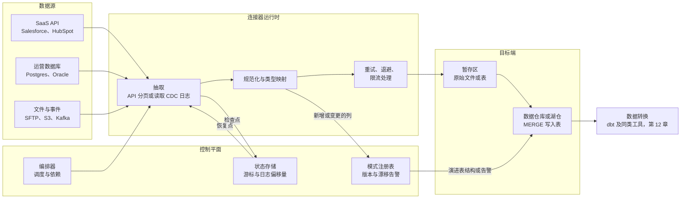
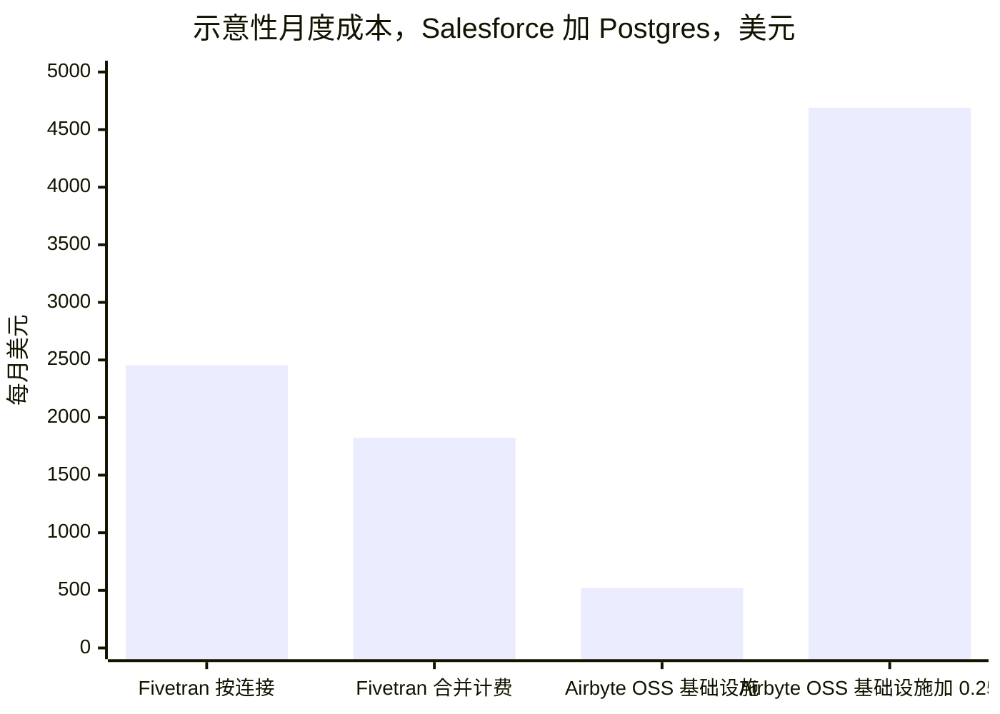

# 10. 数据摄取与集成
> **深度：** L2 · **阅读时间：** 约 12 分钟 · **最后核实：** 2026-11-01 · **前置阅读：** [第 9 章 — 数据管道模式](ch09-pipeline-patterns.md)

## 要点速览（TL;DR）

- 数据摄取（ingestion）工具把数据从公司无法掌控的系统（SaaS API、运营数据库、文件、事件流）中复制出来，落地到数据仓库或湖仓（lakehouse）中。复制本身很简单，难的是围绕它的一切：增量同步、[模式漂移](../glossary.md#schema-drift)（schema drift）、限流、重试和类型映射，而且要在数百个各自按自己节奏变化的数据源上重复这些工作。
- [连接器](../glossary.md#connector)（connector）既是资产，也同样是负债。Fivetran 和 Airbyte 都宣称拥有 700+ 个连接器，[^ft-700][^ab-700]而每当上游 API 变化时，每一个连接器都必须打补丁。连接器数量之所以构成护城河，是因为竞争对手要追平它就得支付同样的维护账单；出于同样的原因，它也是一个成本中心。
- 各厂商的计价单位各不相同，且无法干净地互相换算：Fivetran 按每个连接计量[月活跃行数](../glossary.md#monthly-active-rows)（MAR），Airbyte 销售容量（“Data Workers”）或积分，Informatica 销售可共享的 Informatica 处理单元（IPU），Matillion 销售积分，超大规模云厂商则按计算时长或数据量计费。Fivetran 在 2025 年 3 月和 2026 年 1 月的调整，使小型连接相对更贵。[^ft-2025][^ft-2026]
- 独立厂商这一层正从三个方向受到挤压。平台捆绑了“够用”的连接器（Databricks Lakeflow Connect、Snowflake Openflow、AWS/Azure/Google 的工具）。AI 辅助的连接器构建工具降低了长尾连接器的成本。整合完成了剩下的部分：Fivetran 与 dbt Labs 合并（2026 年 6 月完成，合并后 ARR “接近 $600M”，公司披露），[^ft-dbt-close] Salesforce 于 2025 年 11 月完成了约 $8B 的 Informatica 收购。[^infa-close]
- 对 Everpure 而言，数据摄取决定了数据落在哪里。托管 SaaS 管道默认写入云数据仓库和云对象存储；可自托管的工具则是本地 S3 得以成为落地区的途径。

## 为何重要（商业视角 + Everpure 视角）

每一个分析或 AI 系统都始于一份副本。在模型能够回答关于销售管道收入的问题之前，必须有人把商机记录从 Salesforce 中拉出来、把发票从 NetSuite 中拉出来、把订单行从 Postgres 中拉出来，并保持这些副本的新鲜度。[第 9 章](ch09-pipeline-patterns.md)介绍了相关模式（[ELT](../glossary.md#elt)、[变更数据捕获](../glossary.md#change-data-capture)、批处理与流处理）。本章介绍实现这些模式的工具，以及围绕它们成长起来的业务。

这项业务值得高管关注，原因有三。第一，它是典型的按用量计费市场，其单位经济学可以从公开价目表中看到，因此是研究计价单位如何塑造客户行为的绝佳案例（见[第 35 章](../05-business-and-economics/ch35-business-models.md)）。第二，它正在快速整合，买方是两侧的平台：数据仓库、应用厂商和数据转换工具。第三，数据摄取层是决定数据位置控制权的地方：谁运行管道，谁就选择落地区。

第三点正是 Everpure 的视角。一条把 Salesforce 数据直接写入云数据仓库的管道，不给本地存储留任何角色。一条把开放格式文件（Parquet、Iceberg）写入客户自选的 S3 兼容存储桶的管道，则让存储决策保持开放。下文的“存储桥接”部分介绍了相关选项。

## 工作原理

### 连接器究竟做什么

连接器是一个职责狭窄的小程序：从某一类数据源读取数据，并以标准形态输出记录。在实践中，一个生产级连接器要处理七件事。

1. **认证与发现。** 它登录（OAuth、API 密钥、数据库凭据），然后列出可用的对象和字段。
2. **初始加载（[回填](../glossary.md#backfill)）。** 它复制历史数据，往往多达数百万行，同时不超出数据源的限流上限。
3. **[增量同步](../glossary.md#incremental-sync)（incremental sync）。** 回填完成后，它只获取发生变化的部分。对 API 而言，这意味着按 `updated_at` 之类的游标字段过滤。对数据库而言，这意味着通过 CDC 读取事务日志（Postgres WAL、MySQL binlog、Oracle redo），这样也能捕获时间戳查询会漏掉的删除。
4. **状态。** 它把进度（一个时间戳、一个日志序列号）记录在[状态存储](../glossary.md#state-store)（state store）中，以便崩溃后能够无缺口、无重复地恢复。
5. **模式处理。** 当 Salesforce 管理员添加一个自定义字段，或开发者加宽某一列时，连接器会检测到这种漂移，然后要么在下游添加该列，要么阻断同步，要么向某人发出告警。
6. **规范化。** 它把嵌套 JSON 展平，把源端类型映射为目标端类型（例如把 Oracle `NUMBER` 映射为 Snowflake `NUMBER(38,0)`），并添加同步时间、软删除标记等元数据列。
7. **韧性。** 它在超时时重试，被限流时（HTTP 429 响应）退避，并保持加载[幂等](../glossary.md#idempotency)，使重试的批次不会被重复计算。

*图 10.1 — 连接器只是中间的那个小方框。大部分工程工作和大部分故障，都位于它周围的控制平面：让恢复变得安全的状态存储，以及决定源端变化时如何处理的模式注册表。*

目标端这一步比看上去更重要。大多数工具会先把一个批次写入暂存区，然后在数据仓库中运行 `MERGE`（upsert）。这个合并消耗的是客户的数据仓库算力，因此高频同步除了出现在数据摄取账单上，也会体现在 Snowflake 或 Databricks 的账单上。向事件平台进行流式摄取是另一个问题，见[第 11 章](ch11-streaming-and-event-platforms.md)。

> **深入（L3）。** CDC 最难的问题是快照与日志之间的交接。连接器必须在日志持续推进的同时，对一张表做一致性快照，然后只重放快照日志位置之后的变更。Debezium 式的“增量快照”把分块读表与日志事件交错进行，并按主键去重。Postgres 还带来一个运维陷阱：未被读取的逻辑复制槽会无限期地把 WAL 保留在源端磁盘上，因此一个停滞的连接器可能写满生产数据库的存储卷。

### 长尾的经济学

连接器业务遵循幂律分布。少数几个数据源（Salesforce、Postgres、MySQL、SQL Server、Google Ads、NetSuite）占了移动行数的大部分。另外数百个（小众营销工具、HR 系统、垂直 SaaS）每个只对少数客户重要，但每个客户都会有那么几个。一个缺少客户那三个冷门数据源的厂商就会丢掉订单，哪怕它把大数据源处理得很好。

因此，厂商们在目录广度上竞赛。Fivetran 称拥有 700+ 个全托管连接器；[^ft-700] Airbyte 的网站现在也写着 700+，其中大多数由社区构建或在其开源计划下维护。[^ab-700] Estuary 称可连接 200+ 个系统。[^estuary]

> **类比：设备驱动程序。** 连接器目录就像操作系统的驱动程序库。每种新外设都需要驱动，没有人会为了驱动而购买操作系统，但缺少驱动会阻碍购买。维护永无止境：每一次固件修订（在这里则是每一次 API 版本弃用）都可能让昨天还正常的驱动失效。Windows 在 1990 年代的优势，部分来自为它编写的数千个驱动，连接器目录也会积累起类似的资产。它的维护成本极高，而它也正是客户留下来的原因。

成本端是投资者容易低估的部分。一个 SaaS 厂商更改分页方案、弃用某个 API 版本或收紧限流，就会迫使所有连接器厂商同时按照该 SaaS 厂商的时间表进行修复。这项工作不会随使用量减少而缩减，因为一个只有十个客户的长尾连接器所需的维护量与热门连接器大致相同。这就是为什么两家领先者都试图把长尾推给别人。Airbyte 依靠社区贡献，以及一个低代码 Connector Builder，后者带有一个能根据 API 文档起草连接器的 AI 助手（随 Airbyte 1.0 于 2024 年 9 月推出）。[^ab-ai] Fivetran 的 Connector SDK 自 2025 年 6 月起正式可用，让客户编写 Python 连接器，由 Fivetran 像对待自有连接器一样托管、重试和计量。[^ft-sdk] dlt（dltHub）等 Python 原生库以及更早的 Singer/Meltano 生态走得更远，把连接器视为数据团队自己拥有的代码。

### 计价单位：实际计量的是什么

| 厂商 / 产品 | 计价单位 | 账单驱动因素 | 口径与来源 |
|---|---|---|---|
| Fivetran | 月活跃行数（MAR），自 2025 年 3 月起**按每个连接**分档 | 每个连接每月插入、更新或（自 2026 年 1 月起）删除的不同行数；1 至 1M MAR 的连接收取 $5 基础费 | 目录价；Standard 档从每百万 MAR $500 降至 >1B 时的 $1.18[^ft-pricing][^ft-2025][^ft-2026] |
| Airbyte Cloud | 积分（Standard）或以 “Data Workers” 计的容量（Pro、Enterprise Flex） | 同步数据量（积分分档）或预留的并行算力（容量） | 公司定价页面；容量档仅限询价[^ab-pricing] |
| Airbyte OSS / 自管 | 免费使用；以 ELv2 许可源码开放（并非 OSI 认可的开源许可证；部分连接器为 MIT） | 你自己的 Kubernetes 算力加工程时间 | 许可证文档[^ab-license] |
| Informatica IDMC | Informatica 处理单元（IPU），预付且可共享；提供 Flex IPU 选项 | 在任何符合条件的 IDMC 服务（集成、质量、目录）中消耗的 IPU | 公司博客；单位 IPU 价格未公开[^infa-ipu] |
| Matillion | 按管道运行时长的 “task hour” 消耗积分 | 按管道类型和版本计的管道运行时长 | 公司条款；公开费率相互矛盾[^matillion] |
| AWS Glue | DPU 小时，按秒计费 | Spark/Python 作业运行时长 × 工作节点数；标准 $0.44/DPU 小时，Flex $0.29 | 目录价，US East[^glue] |
| Azure Data Factory | 每 1,000 次活动运行计费，外加数据移动的 DIU 小时 | 编排运行次数和复制吞吐量 | 目录价；见脚注[^adf] |
| Fabric Data Factory | 从预购容量中扣减的 Fabric 容量单位（CU 小时） | 复制作业和管道活动消耗 CU 小时 | Microsoft 文档[^fabric] |
| Google Datastream | 处理的 GiB 数 | CDC 数据量（前 2,500 GiB 为 $2.00/GiB，最低降至 $0.80）加回填（500 GiB 免费额度之后 $0.40/GiB） | 目录价[^datastream] |
| Databricks Lakeflow Connect / Snowflake Openflow | 平台算力（DBU / 积分） | 按平台自身计量表计算的摄取算力 | 产品文档[^lakeflow][^openflow-ga] |

*图 10.2 — 只有 Fivetran 和 Datastream 计量的是数据本身。其他所有厂商计量的都是算力或预付容量，这把同步效率低下的风险从厂商转移给了客户。*

> **类比：金融。** MAR 定价是一种**按活跃订户收取的版权费**：Fivetran 对本月发生变化的每一行收费，而不是对所持有的行存量收费，就像内容授权方按活跃订户向分销商收费，而不是按覆盖的家庭户数收费。2025–2026 年的调整增加了**每条合同线的最低版权费**（$5 基础费），并停止在各条线之间合并计算用量。和任何按线计的最低收费一样，它们对小线路的“税负”最重。

### 实例演示：Salesforce 加 Postgres

本例为示意。假设均已列明，仅使用目录价，不含任何协议折扣。

**假设。** 一家中型公司同步 (a) Salesforce，每月约有 2M 条不同记录发生变化；(b) 一个生产 Postgres 数据库，其订单和事件表每月约有 20M 个不同的变更行。采用 Fivetran Standard 方案的公开分档表：1M 以内每百万 MAR $500，1M 至 4M 每百万 $170，4M 至 16M 为 $58，16M 至 64M 为 $19.70。[^ft-pricing]

**Fivetran，现行规则（按连接）。** Salesforce：$500 + 1 × $170 = **$670**/月。Postgres：$500 + 3 × $170 + 12 × $58 + 4 × $19.70 = **$1,785**/月。合计约 **$2,455/月，约 $29.5K/年**（估算）。

**同一分档表，按账户级合并。** 合并 22M MAR 约为 **$1,824/月**。因此，按连接分档让这位客户多付约 35%（估算）。这里是把现行分档表套用到旧的账户级结构上，以单独衡量分档效应；它并不是对 2025 年 3 月之前发票的还原，那时采用的是不同的费率结构。[^ft-2025]

**长尾效应更大。** 30 个各有 50K MAR 的小型营销连接，分开计费时为 30 × $25 = **$750**/月，合并计费则为 **$585**（估算）。自 2026 年 1 月起，1 至 1M MAR 之间的连接还至少要支付 $5 基础费。[^ft-2026]

**自托管 Airbyte。** 软件免费。假设使用由三台 AWS m6i.xlarge 实例组成的 Kubernetes 节点池（按需价约 $0.192/小时，假设）[^ec2]约 $420/月，再加约 $100 的日志、存储和出口流量费用（假设）：基础设施约 **$520/月**。再加上 0.25 个数据工程师，按全口径年成本 $200K 计（假设）约 $4,170/月，合计约 **$4,690/月**（估算）。数据仓库 `MERGE` 算力在两种情况下相同，未计入。

*图 10.3 — 在只有两个连接时，一旦计入工程时间，托管的 MAR 定价就优于自托管。自托管在以下情况下胜出：已经有平台团队；连接数量和数据量把 MAR 账单推到六位数；或者数据驻留要求排除了 SaaS。所有数字均为基于目录价和所述假设的估算。*

还有两点。第一，MAR **按连接呈累退性**：在同一分档表下，1B MAR 的单个 Postgres 连接每月约 $5,600，每千行不到一美分；而一个 50K MAR 的 SaaS 连接却要支付每百万 $500 的最高费率。高数据量的数据库复制按行计非常便宜，利润藏在长尾里。第二，团队自身的工程时间是“自建还是购买”电子表格中最常被遗漏的成本，而这正是托管数据摄取存在的理由。
