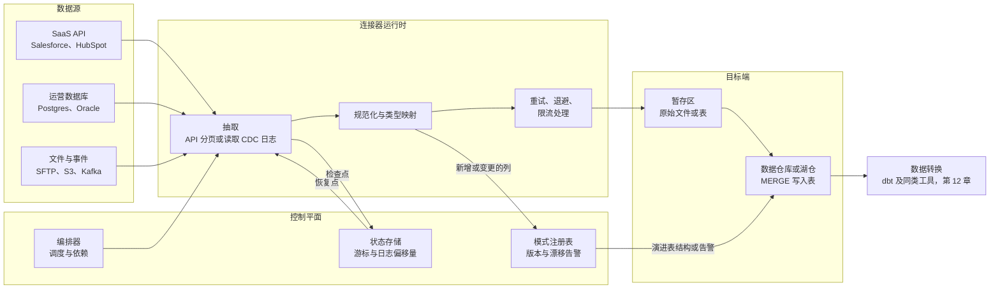
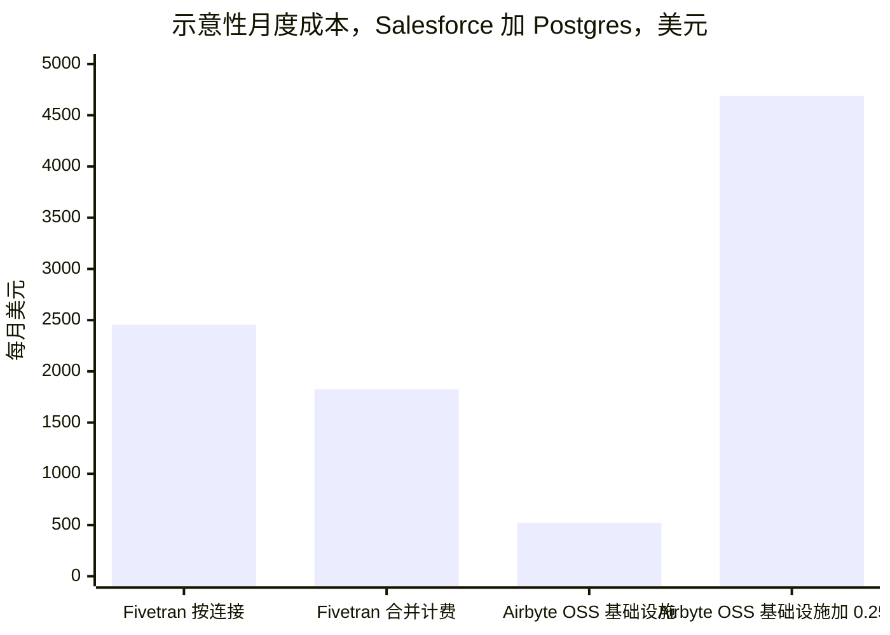
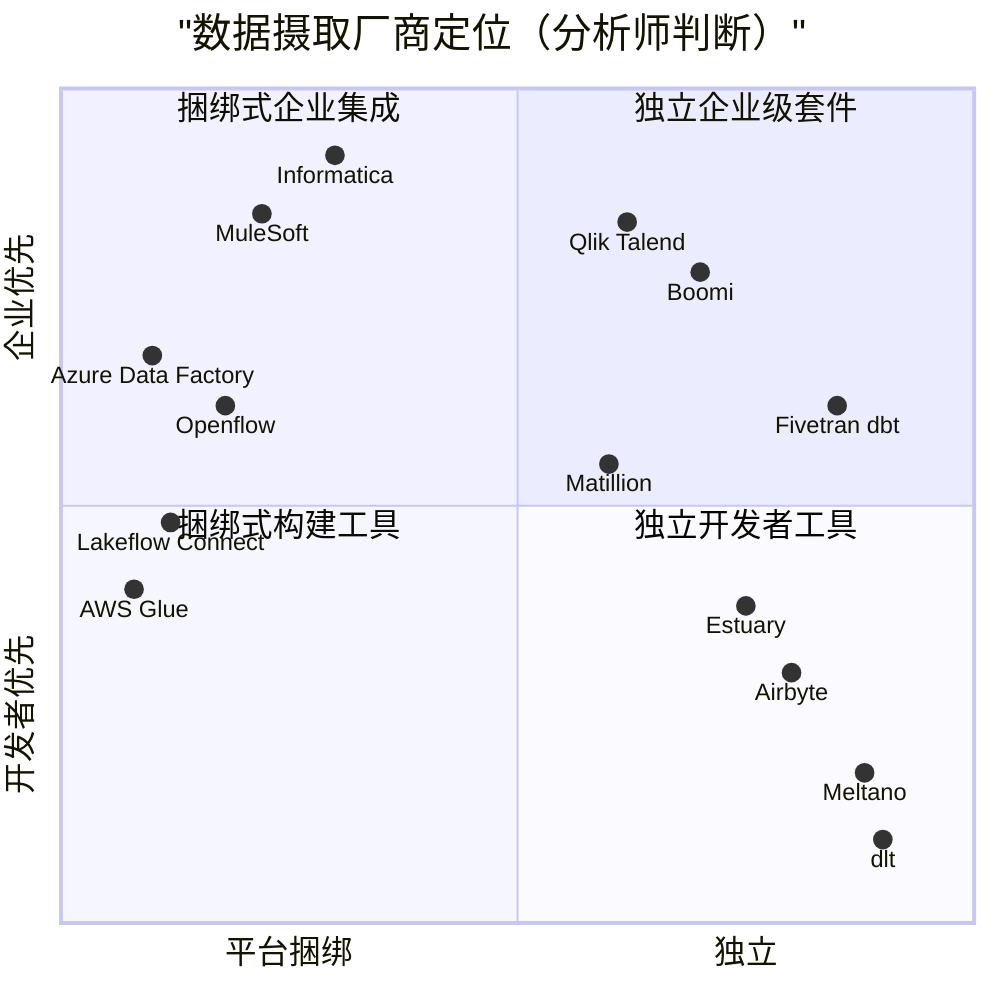
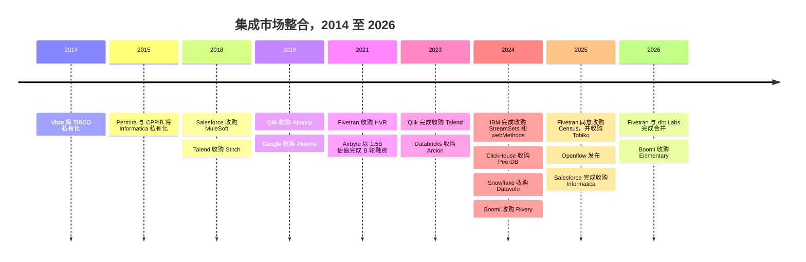

# 10. 数据摄取与集成
> **深度：** L2 · **阅读时间：** 约 12 分钟 · **最后核实：** 2026-11-01 · **前置阅读：** [第 9 章 — 数据管道模式](ch09-pipeline-patterns.md)

## 要点速览（TL;DR）

- 数据摄取（ingestion）工具把数据从公司无法掌控的系统（SaaS API、运营数据库、文件、事件流）中复制出来，落地到数据仓库或湖仓（lakehouse）中。复制本身很简单，难的是围绕它的一切：增量同步、[模式漂移](../glossary.md#schema-drift)（schema drift）、限流、重试和类型映射，而且要在数百个各自按自己节奏变化的数据源上重复这些工作。
- [连接器](../glossary.md#connector)（connector）既是资产，也同样是负债。Fivetran 和 Airbyte 都宣称拥有 700+ 个连接器，[^ft-700][^ab-700]而每当上游 API 变化时，每一个连接器都必须打补丁。连接器数量之所以构成护城河，是因为竞争对手要追平它就得支付同样的维护账单；出于同样的原因，它也是一个成本中心。
- 各厂商的计价单位各不相同，且无法干净地互相换算：Fivetran 按每个连接计量[月活跃行数](../glossary.md#monthly-active-rows)（MAR），Airbyte 销售容量（“Data Workers”）或积分，Informatica 销售可共享的 Informatica 处理单元（IPU），Matillion 销售积分，超大规模云厂商则按计算时长或数据量计费。Fivetran 在 2025 年 3 月和 2026 年 1 月的调整，使小型连接相对更贵。[^ft-2025][^ft-2026]
- 独立厂商这一层正从三个方向受到挤压。平台捆绑了“够用”的连接器（Databricks Lakeflow Connect、Snowflake Openflow、AWS/Azure/Google 的工具）。AI 辅助的连接器构建工具降低了长尾连接器的成本。整合完成了剩下的部分：Fivetran 与 dbt Labs 合并（2026 年 6 月完成，合并后 ARR “接近 $600M”，公司披露），[^ft-dbt-close] Salesforce 于 2025 年 11 月完成了约 $8B 的 Informatica 收购。[^infa-close]
- 对 Everpure 而言，数据摄取决定了数据落在哪里。托管 SaaS 管道默认写入云数据仓库和云对象存储；可自托管的工具则是本地 S3 得以成为落地区的途径。

## 为何重要（商业视角 + Everpure 视角）

每一个分析或 AI 系统都始于一份副本。在模型能够回答关于销售管道收入的问题之前，必须有人把商机记录从 Salesforce 中拉出来、把发票从 NetSuite 中拉出来、把订单行从 Postgres 中拉出来，并保持这些副本的新鲜度。[第 9 章](ch09-pipeline-patterns.md)介绍了相关模式（[ELT](../glossary.md#elt)、[变更数据捕获](../glossary.md#change-data-capture)、批处理与流处理）。本章介绍实现这些模式的工具，以及围绕它们成长起来的业务。

这项业务值得高管关注，原因有三。第一，它是典型的按用量计费市场，其单位经济学可以从公开价目表中看到，因此是研究计价单位如何塑造客户行为的绝佳案例（见[第 35 章](../05-business-and-economics/ch35-business-models.md)）。第二，它正在快速整合，买方是两侧的平台：数据仓库、应用厂商和数据转换工具。第三，数据摄取层是决定数据位置控制权的地方：谁运行管道，谁就选择落地区。

第三点正是 Everpure 的视角。一条把 Salesforce 数据直接写入云数据仓库的管道，不给本地存储留任何角色。一条把开放格式文件（Parquet、Iceberg）写入客户自选的 S3 兼容存储桶的管道，则让存储决策保持开放。下文的“存储桥接”部分介绍了相关选项。

## 工作原理

### 连接器究竟做什么

连接器是一个职责狭窄的小程序：从某一类数据源读取数据，并以标准形态输出记录。在实践中，一个生产级连接器要处理七件事。

1. **认证与发现。** 它登录（OAuth、API 密钥、数据库凭据），然后列出可用的对象和字段。
2. **初始加载（[回填](../glossary.md#backfill)）。** 它复制历史数据，往往多达数百万行，同时不超出数据源的限流上限。
3. **[增量同步](../glossary.md#incremental-sync)（incremental sync）。** 回填完成后，它只获取发生变化的部分。对 API 而言，这意味着按 `updated_at` 之类的游标字段过滤。对数据库而言，这意味着通过 CDC 读取事务日志（Postgres WAL、MySQL binlog、Oracle redo），这样也能捕获时间戳查询会漏掉的删除。
4. **状态。** 它把进度（一个时间戳、一个日志序列号）记录在[状态存储](../glossary.md#state-store)（state store）中，以便崩溃后能够无缺口、无重复地恢复。
5. **模式处理。** 当 Salesforce 管理员添加一个自定义字段，或开发者加宽某一列时，连接器会检测到这种漂移，然后要么在下游添加该列，要么阻断同步，要么向某人发出告警。
6. **规范化。** 它把嵌套 JSON 展平，把源端类型映射为目标端类型（例如把 Oracle `NUMBER` 映射为 Snowflake `NUMBER(38,0)`），并添加同步时间、软删除标记等元数据列。
7. **韧性。** 它在超时时重试，被限流时（HTTP 429 响应）退避，并保持加载[幂等](../glossary.md#idempotency)，使重试的批次不会被重复计算。

*图 10.1 — 连接器只是中间的那个小方框。大部分工程工作和大部分故障，都位于它周围的控制平面：让恢复变得安全的状态存储，以及决定源端变化时如何处理的模式注册表。*

目标端这一步比看上去更重要。大多数工具会先把一个批次写入暂存区，然后在数据仓库中运行 `MERGE`（upsert）。这个合并消耗的是客户的数据仓库算力，因此高频同步除了出现在数据摄取账单上，也会体现在 Snowflake 或 Databricks 的账单上。向事件平台进行流式摄取是另一个问题，见[第 11 章](ch11-streaming-and-event-platforms.md)。

> **深入（L3）。** CDC 最难的问题是快照与日志之间的交接。连接器必须在日志持续推进的同时，对一张表做一致性快照，然后只重放快照日志位置之后的变更。Debezium 式的“增量快照”把分块读表与日志事件交错进行，并按主键去重。Postgres 还带来一个运维陷阱：未被读取的逻辑复制槽会无限期地把 WAL 保留在源端磁盘上，因此一个停滞的连接器可能写满生产数据库的存储卷。

### 长尾的经济学

连接器业务遵循幂律分布。少数几个数据源（Salesforce、Postgres、MySQL、SQL Server、Google Ads、NetSuite）占了移动行数的大部分。另外数百个（小众营销工具、HR 系统、垂直 SaaS）每个只对少数客户重要，但每个客户都会有那么几个。一个缺少客户那三个冷门数据源的厂商就会丢掉订单，哪怕它把大数据源处理得很好。

因此，厂商们在目录广度上竞赛。Fivetran 称拥有 700+ 个全托管连接器；[^ft-700] Airbyte 的网站现在也写着 700+，其中大多数由社区构建或在其开源计划下维护。[^ab-700] Estuary 称可连接 200+ 个系统。[^estuary]

> **类比：设备驱动程序。** 连接器目录就像操作系统的驱动程序库。每种新外设都需要驱动，没有人会为了驱动而购买操作系统，但缺少驱动会阻碍购买。维护永无止境：每一次固件修订（在这里则是每一次 API 版本弃用）都可能让昨天还正常的驱动失效。Windows 在 1990 年代的优势，部分来自为它编写的数千个驱动，连接器目录也会积累起类似的资产。它的维护成本极高，而它也正是客户留下来的原因。

成本端是投资者容易低估的部分。一个 SaaS 厂商更改分页方案、弃用某个 API 版本或收紧限流，就会迫使所有连接器厂商同时按照该 SaaS 厂商的时间表进行修复。这项工作不会随使用量减少而缩减，因为一个只有十个客户的长尾连接器所需的维护量与热门连接器大致相同。这就是为什么两家领先者都试图把长尾推给别人。Airbyte 依靠社区贡献，以及一个低代码 Connector Builder，后者带有一个能根据 API 文档起草连接器的 AI 助手（随 Airbyte 1.0 于 2024 年 9 月推出）。[^ab-ai] Fivetran 的 Connector SDK 自 2025 年 6 月起正式可用，让客户编写 Python 连接器，由 Fivetran 像对待自有连接器一样托管、重试和计量。[^ft-sdk] dlt（dltHub）等 Python 原生库以及更早的 Singer/Meltano 生态走得更远，把连接器视为数据团队自己拥有的代码。

### 计价单位：实际计量的是什么

| 厂商 / 产品 | 计价单位 | 账单驱动因素 | 口径与来源 |
|---|---|---|---|
| Fivetran | 月活跃行数（MAR），自 2025 年 3 月起**按每个连接**分档 | 每个连接每月插入、更新或（自 2026 年 1 月起）删除的不同行数；1 至 1M MAR 的连接收取 $5 基础费 | 目录价；Standard 档从每百万 MAR $500 降至 >1B 时的 $1.18[^ft-pricing][^ft-2025][^ft-2026] |
| Airbyte Cloud | 积分（Standard）或以 “Data Workers” 计的容量（Pro、Enterprise Flex） | 同步数据量（积分分档）或预留的并行算力（容量） | 公司定价页面；容量档仅限询价[^ab-pricing] |
| Airbyte OSS / 自管 | 免费使用；以 ELv2 许可源码开放（并非 OSI 认可的开源许可证；部分连接器为 MIT） | 你自己的 Kubernetes 算力加工程时间 | 许可证文档[^ab-license] |
| Informatica IDMC | Informatica 处理单元（IPU），预付且可共享；提供 Flex IPU 选项 | 在任何符合条件的 IDMC 服务（集成、质量、目录）中消耗的 IPU | 公司博客；单位 IPU 价格未公开[^infa-ipu] |
| Matillion | 按管道运行时长的 “task hour” 消耗积分 | 按管道类型和版本计的管道运行时长 | 公司条款；公开费率相互矛盾[^matillion] |
| AWS Glue | DPU 小时，按秒计费 | Spark/Python 作业运行时长 × 工作节点数；标准 $0.44/DPU 小时，Flex $0.29 | 目录价，US East[^glue] |
| Azure Data Factory | 每 1,000 次活动运行计费，外加数据移动的 DIU 小时 | 编排运行次数和复制吞吐量 | 目录价；见脚注[^adf] |
| Fabric Data Factory | 从预购容量中扣减的 Fabric 容量单位（CU 小时） | 复制作业和管道活动消耗 CU 小时 | Microsoft 文档[^fabric] |
| Google Datastream | 处理的 GiB 数 | CDC 数据量（前 2,500 GiB 为 $2.00/GiB，最低降至 $0.80）加回填（500 GiB 免费额度之后 $0.40/GiB） | 目录价[^datastream] |
| Databricks Lakeflow Connect / Snowflake Openflow | 平台算力（DBU / 积分） | 按平台自身计量表计算的摄取算力 | 产品文档[^lakeflow][^openflow-ga] |

*图 10.2 — 只有 Fivetran 和 Datastream 计量的是数据本身。其他所有厂商计量的都是算力或预付容量，这把同步效率低下的风险从厂商转移给了客户。*

> **类比：金融。** MAR 定价是一种**按活跃订户收取的版权费**：Fivetran 对本月发生变化的每一行收费，而不是对所持有的行存量收费，就像内容授权方按活跃订户向分销商收费，而不是按覆盖的家庭户数收费。2025–2026 年的调整增加了**每条合同线的最低版权费**（$5 基础费），并停止在各条线之间合并计算用量。和任何按线计的最低收费一样，它们对小线路的“税负”最重。

### 实例演示：Salesforce 加 Postgres

本例为示意。假设均已列明，仅使用目录价，不含任何协议折扣。

**假设。** 一家中型公司同步 (a) Salesforce，每月约有 2M 条不同记录发生变化；(b) 一个生产 Postgres 数据库，其订单和事件表每月约有 20M 个不同的变更行。采用 Fivetran Standard 方案的公开分档表：1M 以内每百万 MAR $500，1M 至 4M 每百万 $170，4M 至 16M 为 $58，16M 至 64M 为 $19.70。[^ft-pricing]

**Fivetran，现行规则（按连接）。** Salesforce：$500 + 1 × $170 = **$670**/月。Postgres：$500 + 3 × $170 + 12 × $58 + 4 × $19.70 = **$1,785**/月。合计约 **$2,455/月，约 $29.5K/年**（估算）。

**同一分档表，按账户级合并。** 合并 22M MAR 约为 **$1,824/月**。因此，按连接分档让这位客户多付约 35%（估算）。这里是把现行分档表套用到旧的账户级结构上，以单独衡量分档效应；它并不是对 2025 年 3 月之前发票的还原，那时采用的是不同的费率结构。[^ft-2025]

**长尾效应更大。** 30 个各有 50K MAR 的小型营销连接，分开计费时为 30 × $25 = **$750**/月，合并计费则为 **$585**（估算）。自 2026 年 1 月起，1 至 1M MAR 之间的连接还至少要支付 $5 基础费。[^ft-2026]

**自托管 Airbyte。** 软件免费。假设使用由三台 AWS m6i.xlarge 实例组成的 Kubernetes 节点池（按需价约 $0.192/小时，假设）[^ec2]约 $420/月，再加约 $100 的日志、存储和出口流量费用（假设）：基础设施约 **$520/月**。再加上 0.25 个数据工程师，按全口径年成本 $200K 计（假设）约 $4,170/月，合计约 **$4,690/月**（估算）。数据仓库 `MERGE` 算力在两种情况下相同，未计入。

*图 10.3 — 在只有两个连接时，一旦计入工程时间，托管的 MAR 定价就优于自托管。自托管在以下情况下胜出：已经有平台团队；连接数量和数据量把 MAR 账单推到六位数；或者数据驻留要求排除了 SaaS。所有数字均为基于目录价和所述假设的估算。*

还有两点。第一，MAR **按连接呈累退性**：在同一分档表下，1B MAR 的单个 Postgres 连接每月约 $5,600，每千行不到一美分；而一个 50K MAR 的 SaaS 连接却要支付每百万 $500 的最高费率。高数据量的数据库复制按行计非常便宜，利润藏在长尾里。第二，团队自身的工程时间是“自建还是购买”电子表格中最常被遗漏的成本，而这正是托管数据摄取存在的理由。

## 设计选择与权衡

| 选择 | 托管 SaaS（Fivetran、Airbyte Cloud） | 自托管开源（Airbyte OSS、dlt、Meltano） | 平台捆绑（Lakeflow Connect、Openflow、Glue、ADF） | 企业级 iPaaS/ETL 套件（Informatica、Boomi、MuleSoft、Talend） |
|---|---|---|---|---|
| 谁来修复失效的连接器 | 厂商 | 你自己（或社区） | 平台厂商 | 厂商 |
| 目录广度 | 最广 | 广，但质量参差不齐 | 窄：仅覆盖头部数据源 | 广，偏重企业应用 |
| 数据驻留 | 厂商云（也有混合代理） | 任何地方，包括本地 | 平台所在的云账户之内 | SaaS 或本地代理 |
| 成本形态 | 按用量计量；随变更量上升 | 固定基础设施加人力 | 隐藏在平台算力中 | 预付承诺 |
| 锁定程度 | 中等（管道只是配置） | 低 | 高：只能落地到该平台 | 高（专有映射） |
| 最适合 | 精简团队、众多 SaaS 数据源 | 平台团队、受监管数据、高数据量 | 已绑定单一平台的客户 | 同时有应用间集成和数据需求的大型企业 |

*图 10.4 — 没有哪个选项全面占优。真正的取舍在于：是按用量向厂商付费，让它承担连接器维护；还是付钱给工程师，自己承担。*

每种替代方案的最强版本论证都很有力。**平台捆绑**胜在简单：一个只需要 Salesforce、Workday 和 SQL Server 的 Databricks 客户，可以在 Unity Catalog 中获得受治理的这些数据，而无需第二家厂商。[^lakeflow] **自托管**胜在规模化后的成本和数据主权。**企业级套件**胜在以应用间集成为主的场景。这正是 [iPaaS](../glossary.md#ipaas)（MuleSoft、Boomi：通过 API 和事件让运营应用保持同步，往往是实时的）与数据集成（Fivetran、Airbyte：批量复制到分析系统）之间的关键区别。两者正在融合，Boomi 收购 Rivery 即是例证，[^rivery]但买方和预算仍然不同。

## 主要参与者

| 厂商 | 模式 | 计价单位 | 部署方式 | 开源 | 所有者 / 状态（2026 年 11 月） | 最佳适用场景 |
|---|---|---|---|---|---|---|
| Fivetran（+ dbt Labs） | 托管 ELT 加数据转换、反向 ETL | 按连接计 MAR | SaaS；混合代理 | 否（dbt Core 为开源） | 私有；合并于 2026-06-01 完成[^ft-dbt-close] | 为精简团队提供广泛的 SaaS 覆盖 |
| Airbyte | 开放核心（open core）ELT | 积分 / Data Workers | 云、自管、OSS | 源码开放（ELv2；部分连接器为 MIT）[^ab-license] | 私有；最近一次定价轮为 2021 年 12 月 $150M B 轮，估值 $1.5B[^ab-seriesb] | 开发者团队、长尾数据源 |
| Informatica IDMC | 企业数据管理套件 | IPU | SaaS、混合 | 否 | 自 2025-11-18 起为 Salesforce 子公司[^infa-close] | 全球 2000 强、MDM 加数据质量 |
| Matillion | 带可视化设计器的 ETL/ELT | 积分 | SaaS、混合代理 | 否 | 私有 | 想要低代码的 Snowflake/Databricks 用户 |
| Qlik Talend Cloud（含 Stitch） | CDC 复制加 ETL 和数据质量 | 订阅 / 容量 | SaaS、本地 | Talend Open Studio 已停用（Qlik 于 2024-01-31 终止）[^qlik-talend] | 私有（Thoma Bravo）；Talend 收购于 2023 年 5 月完成[^qlik-talend] | 企业级 CDC（原 Attunity） |
| Boomi（含 Rivery） | iPaaS 加数据集成 | 订阅分档 | SaaS、运行时代理 | 否 | 私有；2024 年 12 月收购 Rivery，2026 年 10 月收购 Elementary[^rivery][^elementary] | 中型市场的应用加数据集成 |
| MuleSoft | API 主导的应用集成 | 订阅 / 容量 | SaaS、本地 | 否 | 自 2018 年起属于 Salesforce（$6.5B）[^mulesoft] | 应用间 API |
| Estuary | 实时 CDC 加批处理 | 数据量 | SaaS、BYOC | 部分（Flow 运行时） | 私有；2025 年 10 月 $17M A 轮（公司披露）[^estuary] | 低延迟 CDC |
| dlt（dltHub） | 管道即代码的 Python 库 | 免费库 | 任何地方 | 是（Apache 2.0） | 私有；种子轮，媒体报道 $8M[^dlthub] | 想要代码而非 UI 的工程师 |
| Databricks Lakeflow Connect | 捆绑的托管连接器 | DBU | 仅 Databricks | 否 | 产品（内含 Arcion CDC）[^arcion] | 已绑定 Databricks 的客户 |
| Snowflake Openflow | 捆绑的、基于 NiFi 的数据摄取 | Snowflake 积分加 BYOC 算力 | Snowflake 或客户 VPC | 构建于 Apache NiFi 之上 | 产品（源自 Datavolo）[^datavolo] | Snowflake 客户、非结构化数据 |
| AWS Glue / AppFlow / DMS | 无服务器 ETL、SaaS 数据流、数据库迁移与 CDC | DPU 小时 / 按数据流 / 按实例小时 | 仅 AWS | 否 | 产品 | AWS 原生环境 |

*图 10.5 — 独立厂商在广度和中立性上竞争，平台工具则凭借“已经在那里”竞争。所有者/状态截至 2026-11-01。因篇幅所限，未列入 Striim 和 SnapLogic（私有）以及 Meltano（开源，基于 Singer 规范）。*

*图 10.6 — 左上象限在 2025 年被填满：Salesforce 如今同时拥有 MuleSoft 和 Informatica，两大数据平台也都推出了自己的连接器。独立厂商位于右下方，在那里它们要与免费代码竞争。位置为作者判断，并非测量数据。*

## 历史与发展轨迹

第一代厂商（Informatica、IBM DataStage、TIBCO、Talend）向 IT 部门销售本地 ETL 服务器，按 CPU 或按连接器授权。当增长放缓时，私募股权将其中几家私有化（take-private）：Vista 收购了 TIBCO（$4.3B，2014 年），Permira 和 CPPIB 收购了 Informatica（$5.3B，2015 年）。[^tibco][^infa-pe] 云数据仓库浪潮催生了基于 ELT 和 SaaS 的第二代。Fivetran（成立于 2012 年）和 Stitch 是领头者，Airbyte 则于 2020 年作为开源挑战者跟进。这一代厂商的估值在 2021 年达到顶峰：Fivetran 融资 $565M 并以 $700M 收购 HVR，Airbyte 以 $1.5B 估值融资 $150M。[^hvr][^ab-seriesb]

此后的整合沿三个方向展开。平台收购 CDC 和连接器技术：Databricks 收购 Arcion（约 $100M，2023 年），ClickHouse 收购 PeerDB（2024 年），Snowflake 收购 Datavolo（2024 年），后者演变为 Openflow。[^arcion][^peerdb][^datavolo] 应用和基础设施厂商收购集成业务：IBM 收购 StreamSets 和 webMethods（€2.13B，2024 年 7 月完成），Salesforce 收购 Informatica。[^ibm][^infa-close] 独立厂商则自我捆绑：Fivetran 同意收购 Census（反向 ETL；交割未单独公布），并于 2025 年收购 Tobiko（SQLMesh），随后与 dbt Labs 合并。[^census][^tobiko][^ft-dbt-close]

*图 10.7 — 每一波买家都比上一波离连接器本身更远一层：先是私募股权，然后是应用厂商，再是数据平台，最后是两家最知名独立厂商的合并。资料来源：本节交易脚注及 `data/ma_deals.csv`。*

> **类比：EDA 整合。** 这一模式与芯片设计软件相似。Synopsys 和 Cadence 花了数十年收购单点工具（仿真、验证、签核），直到客户购买的是一整套流程而非单个工具。Fivetran 加 dbt 是同样的举动：数据摄取、数据转换、语义层和数据激活作为一套流程出售，合并后的公司以横跨 Snowflake、Databricks 和超大规模云厂商的中立性作为卖点。和 EDA 一样，捆绑提高了转换成本，让初创公司很难凭借单一的更好工具取胜。

**数据摄取为何受到挤压。** 三股力量压缩了独立业务的空间。(1) *捆绑：* Lakeflow Connect、Openflow、Glue 零 ETL 集成和 Fabric 复制作业覆盖了头部数据源，且不单独计费，因此独立厂商只剩下长尾和多平台买家。(2) *AI 辅助的连接器生成：* 如果模型能在几分钟内根据 API 文档起草出一个 REST 连接器，[^ab-ai]目录广度作为护城河的价值就会降低，不过维护和支持依然构成护城河。(3) *整合：* 买方希望厂商更少，Fivetran + dbt 的合并通过扩大范围而非降价来回应这一点。看空逻辑是：合并后的公司会变成一个夹在平台之间、增长放缓的拼凑式并购体。看多逻辑是：随着客户同时运行 Snowflake 和 Databricks，它的中立性会更有价值。公司详情见[第 30 章](../04-company-deep-dives/ch30-data-movement-streaming-companies.md)。

## 关键数字

| 指标 | 数值 | 口径 | 来源 / 日期 |
|---|---|---|---|
| Fivetran + dbt Labs 合并后 ARR | 接近 $600M | 公司披露，交割时 | Fivetran，2026-06-01[^ft-dbt-close] |
| Fivetran ARR（独立） | >$300M | 公司披露 | Fivetran，2024-09-27[^ft-300m] |
| Salesforce–Informatica | 股权价值约 $8B，每股 $25 现金；2025-11-18 完成 | 已披露 | Business Wire，2025-11-18[^infa-close] |
| Airbyte 最近一次定价轮 | $150M B 轮，估值 $1.5B | 公司披露 | Business Wire，2021-12-17[^ab-seriesb] |
| 连接器目录 | Fivetran 700+；Airbyte 700+ | 公司披露 | 公司网站，2026[^ft-700][^ab-700] |
| Fivetran MAR 目录费率 | 每百万 $500（首个 1M）至每百万 $1.18（>1B） | 目录价，Standard | Fivetran 定价，2026[^ft-pricing] |
| Fivetran 每连接基础费 | 1 至 1M MAR 收取 $5/月 | 目录价，自 2026-01-01 起 | Fivetran 文档[^ft-2026] |
| AWS Glue ETL | 每 DPU 小时 $0.44（Flex $0.29） | 目录价 | AWS，2026[^glue] |
| Google Datastream CDC | 前 2,500 GiB 为 $2.00/GiB，最低降至 $0.80 | 目录价 | Google Cloud，2026[^datastream] |
| Boomi–Rivery | 约 $100M | 媒体报道（Calcalist）；未披露 | 2024-12[^rivery] |

*图 10.8 — 与其所服务的平台相比，独立数据摄取市场如今规模很小。最大的独立厂商加上 dbt Labs，ARR 接近 $0.6B（公司披露，2026 年 6 月）。*

## 存储桥接

> **存储桥接。** 数据摄取决定落地区。托管 SaaS 摄取写入云数据仓库，或写入在云目录中注册的云对象存储。例如，Fivetran 在 2024 年为其数据湖目标端增加了 Unity Catalog 注册功能。[^ft-300m] 可自托管的工具（Airbyte OSS、dlt、NiFi 以及 Openflow 的自带云模式）可以把 Parquet 或 Iceberg 写入任何 S3 兼容端点，包括本地部署的 FlashBlade。基于公开信息，战略团队可能评估的选项包括：与可自托管的数据摄取工具一起提供经验证的落地区设计，以及把 Everpure 的 Data Intelligence 连接器（就地发现，而非移动）定位为对数据管道的补充。对象协议细节请参阅配套的 *Everpure Tech Atlas*。

## 对话手册

**向产品经理（PM）提问**

1. “你们的行数和收入中，分别有多大比例来自前十个连接器，多大比例来自长尾？哪一部分增长更快？”
2. “2025 年 3 月的按连接调整，以及 2026 年 1 月关于删除计费和基础费的调整，对小客户的净收入留存率（NRR）和流失有什么影响？”
3. “当客户在头部数据源上统一采用 Lakeflow Connect 或 Openflow 时，你们还能赢下什么？”

**向工程师提问**

1. “你们如何处理从快照到 CDC 的交接？有什么机制防止停滞的 Postgres 复制槽写满源端磁盘？”
2. “当数据源新增、删除某一列或更改其类型时，默认会发生什么：演进、阻断还是隔离？”
3. “每月有多少工程师工时投入到连接器维护中？其中多少是 API 版本变动，多少是缺陷？”

**好的回答听起来是什么样的。** 他们会量化维护工作（“大约三分之一的连接器工程投入用于应对上游 API 变化”）。他们会区分数据库 CDC 的经济学和 SaaS API 的经济学。他们坦承平台捆绑的连接器拿走了分布的头部，并能具体说明独立厂商仍然胜出的地方：多目标端、长尾、本地部署和受监管的数据源。

**不要这样说**

- “连接器是大宗商品。”构建一个连接器很便宜，但要针对不断变化的 API 维护数百个连接器则不然。
- “MAR 意味着你为存储的行付费。”你付费的是每个连接每月发生变化的不同行数。
- “MuleSoft 和 Fivetran 正面竞争。”前者主要通过 API 同步应用，后者把数据复制到分析系统。两者只在边缘有所重叠。
- “开源是免费的。”软件是免费的，但工程师、值班轮换和 Kubernetes 集群都不是。
- “Openflow 就是 Snowflake 版的 Fivetran。”它是一个带连接器、基于 NiFi 的数据流引擎，更接近一个可编程的管道运行时。

## 深入阅读

- Fivetran 的按用量计费文档，包括 2025 年和 2026 年的更新页面，是对 MAR 如何计数最清晰的公开解释。[^ft-2025][^ft-2026]
- Airbyte 的 Connector Builder 和 AI Assist 文档展示了低代码连接器生成能做什么、不能做什么。[^ab-ai]
- Debezium 关于增量快照的文档涵盖了 CDC 交接问题。
- Apache NiFi 的用户指南介绍了 Openflow 背后基于数据流的模型。[^datavolo]
- 关于数据摄取下游的编排和数据转换，见[第 12 章](ch12-transformation-and-orchestration.md)。

## 关键术语

- [连接器](../glossary.md#connector) — 从某一类数据源抽取数据并输出标准化记录的代码。
- [变更数据捕获](../glossary.md#change-data-capture) — 读取数据库的事务日志，以捕获插入、更新和删除。
- [回填](../glossary.md#backfill) — 增量同步开始之前的初始历史加载。
- [增量同步](../glossary.md#incremental-sync) — 只获取自上次同步以来发生变化的记录。
- [游标字段](../glossary.md#cursor-field) — 用于查找变更记录的列，如 `updated_at`。
- [状态存储](../glossary.md#state-store) — 管道记录其进度以便安全恢复的地方。
- [模式漂移](../glossary.md#schema-drift) — 数据源的列或类型发生的计划外变化。
- [模式注册表](../glossary.md#schema-registry) — 对模式进行版本管理并检查兼容性的服务。
- [幂等性](../glossary.md#idempotency) — 重复执行某一操作得到相同结果的性质。
- [限流](../glossary.md#rate-limit) — 数据源施加的每个时间窗口内 API 调用次数上限。
- [月活跃行数](../glossary.md#monthly-active-rows) — Fivetran 的计费单位：每个连接每月发生变化的不同行数。
- [Informatica 处理单元](../glossary.md#informatica-processing-unit) — Informatica 用于 IDMC 服务的预付、可共享的消耗单位。
- [DPU 小时](../glossary.md#dpu-hour) — AWS Glue 的计量单位：一个数据处理单元的算力使用一小时。
- [基于容量的定价](../glossary.md#capacity-based-pricing) — 按预留的处理容量而非数据量计费。
- [Connector SDK](../glossary.md#connector-sdk) — 用于编写由厂商运行时托管的自定义连接器的开发套件。
- [Singer](../glossary.md#singer) — 一种开放规范，定义了交换 JSON 记录的 tap 和 target。
- [iPaaS](../glossary.md#ipaas) — 集成平台即服务，用于应用间集成。
- [ELT](../glossary.md#elt) — 抽取、加载，然后在目标端内部转换。
- [反向 ETL](../glossary.md#reverse-etl) — 把数据仓库中建模后的数据同步回运营应用。

## 资料来源

[^ft-700]: Fivetran, "Fivetran vs. Airbyte" comparison page（700+ 个全托管连接器），https://www.fivetran.com/compare/fivetran-vs-airbyte，持续更新文档；检索 2026-11-01。公司披露。
[^ab-700]: Airbyte, homepage and connector catalog（700+ 个连接器），https://airbyte.com/connectors，持续更新文档；检索 2026-11-01。公司披露；Airbyte 较早的文档称 600+。
[^ft-2025]: Fivetran Docs, "Usage-Based Pricing Updates 2025"（自 2025-03-01 起按连接分档；2025 年 3 月之前签订的年度合同在续约前保持账户级），https://fivetran.com/docs/usage-based-pricing/2025-pricing-faq，发布 2025；检索 2026-11-01。
[^ft-2026]: Fivetran Docs, "Usage-Based Pricing Updates 2026"（删除和历史模式变更计入付费 MAR；1 至 1M MAR 的标准连接收取 $5 基础费；按需付费客户自 2026-01-01 起生效，年度合同在续约时生效），https://fivetran.com/docs/core-concepts/usage-based-pricing/pricing-updates/2026-pricing-updates，发布 2025-12/2026；检索 2026-11-01。
[^ft-pricing]: Fivetran, "Pricing"（Standard 方案分档表：阈值 0/1/4/16/64/250/1,000M MAR，对应每百万 $500/$170/$58/$19.70/$6.72/$2.29/$1.18；Free 方案 500K MAR），https://www.fivetran.com/pricing，持续更新文档；检索 2026-11-01。目录价；合同各异。
[^ft-dbt-close]: Fivetran, "Fivetran & dbt Labs Complete Merger to Create the Data Infrastructure for Trusted AI Agents," press release, https://www.fivetran.com/press/fivetran-dbt-labs-complete-merger-to-create-the-data-infrastructure-for-trusted-ai-agents，发布 2026-06-01；检索 2026-11-01。宣布：Business Wire, "Fivetran and dbt Labs Unite to Set the Standard for Open Data Infrastructure," https://www.businesswire.com/news/home/20251013172495/en，发布 2025-10-13。
[^ft-300m]: Fivetran, "Fivetran Surpasses $300M ARR, Driven by Growing AI and Data Movement Demand," press release, https://www.fivetran.com/press/fivetran-surpasses-300m-arr-driven-by-growing-ai-and-data-movement-demand，发布 2024-09-27；检索 2026-11-01。
[^ft-sdk]: Fivetran blog, "Fivetran Connector SDK: Unlocking every data source," https://www.fivetran.com/blog/fivetran-connector-sdk-unlocking-every-data-source，发布 2025-06-02；检索 2026-11-01。
[^infa-close]: Salesforce via Business Wire (FinancialContent), "Salesforce Completes Acquisition of Informatica," https://markets.financialcontent.com/clarkebroadcasting.mymotherlode/article/bizwire-2025-11-18-salesforce-completes-acquisition-of-informatica，发布 2025-11-18；检索 2026-11-01。交易价值：Bloomberg Law, https://news.bloomberglaw.com/tech-and-telecom-law/salesforce-agrees-to-buy-informatica-in-deal-worth-8-billion，发布 2025-05-27。
[^infa-ipu]: Informatica blogs, "Announcing Consumption Pricing for Informatica Intelligent Data Management Cloud," https://www.informatica.com/blogs/announcing-consumption-pricing-for-informatica-intelligent-data-management-cloud.html，以及 "Announcing Volume Tier Pricing and Flex IPU Consumption-Based Pricing for IDMC," https://www.informatica.com/blogs/announcing-volume-tier-pricing-and-flex-ipu-consumption-based-pricing-for-informatica-intelligent-data-management-cloud.html，未记录发布日期 [VERIFY: 日期]；检索 2026-11-01。
[^ab-pricing]: Airbyte, "Pricing"（Standard 基于积分；Pro 和 Enterprise Flex 基于 Data Workers 容量），https://www.airbyte.com/pricing，持续更新文档；检索 2026-11-01。基于容量定价的发布由 BigDATAwire 报道，https://bigdatawire.com/this-just-in/airbyte-introduces-capacity-based-pricing-for-predictable-data-movement-costs [VERIFY: 发布日期]。入门档积分价格在各二手来源中相互矛盾，此处未采用。
[^ab-license]: Airbyte Docs, "Licenses"（连接器和公开代码库采用 Elastic License 2.0，协议本身除外），https://docs.airbyte.com/community/licenses/，持续更新文档；检索 2026-11-01。Airbyte 的许可证 FAQ 仍称部分连接器为 MIT；以各连接器的 `metadata.yaml` 为准。
[^ab-seriesb]: Airbyte via Business Wire, "Airbyte Closes $150 Million Series B Funding Round Led by Altimeter Capital and Coatue Management," https://www.businesswire.com/news/home/20211217005648/en/，发布 2021-12-17；检索 2026-11-01。$1.5B 估值为公司披露。
[^ab-ai]: Airbyte via Business Wire, Airbyte 1.0 launch with AI Assistant for Connector Builder, https://www.businesswire.com/news/home/20240924140740/en，发布 2024-09-24；Airbyte Docs, "AI Assist," https://docs.airbyte.com/platform/connector-development/connector-builder-ui/ai-assist，持续更新文档；检索 2026-11-01。
[^matillion]: Matillion, "Pricing," https://matillion.com/pricing，以及 "Credit Consumption Terms," https://www.matillion.com/legal/credit-consumption-terms，持续更新文档；检索 2026-11-01。定价页面与法律条款给出的每 task hour 积分比例不同 [VERIFY: 各版本当前比例]。
[^glue]: AWS, "AWS Glue pricing"（ETL 作业每 DPU 小时 $0.44，Glue 2.0+ 按秒计费、最低 1 分钟；Flex $0.29），https://aws.amazon.com/glue/pricing/，持续更新文档；检索 2026-11-01。US East 目录价。
[^adf]: Microsoft Azure, "Data Factory pipeline pricing," https://azure.microsoft.com/en-us/pricing/details/data-factory/data-pipeline/，持续更新文档；检索 2026-11-01。计量结构已确认；美元费率（Azure 集成运行时上每 1,000 次编排运行约 $1，云数据移动每 DIU 小时 $0.25）来自二手摘要，未列入表中 [VERIFY: Azure 计算器中的费率]。
[^fabric]: Microsoft Learn, "Pricing for pipelines in Data Factory in Microsoft Fabric" 及 "Pricing for Copy job," https://learn.microsoft.com/fabric/data-factory/pricing-pipelines 及 https://learn.microsoft.com/fabric/data-factory/pricing-copy-job，持续更新文档；检索 2026-11-01。
[^datastream]: Google Cloud, "Datastream pricing," https://cloud.google.com/datastream/pricing，持续更新文档；检索 2026-11-01。目录价；因区域而异。
[^lakeflow]: Databricks Docs, "Managed connectors in Lakeflow Connect," https://docs.databricks.com/aws/en/ingestion/lakeflow-connect/，持续更新文档；Databricks blog, "Announcing General Availability of Lakeflow Connect"（Salesforce 和 Workday），https://www.databricks.com/blog/announcing-general-availability-lakeflow-connect，2025 [VERIFY: 发布日期]；检索 2026-11-01。连接器状态因云而异。
[^openflow-ga]: Snowflake Docs, release notes "May 20, 2025: Snowflake Openflow (Preview)," https://docs.snowflake.com/en/release-notes/2025/other/2025-05-20-openflow；"May 30, 2025: Snowflake Openflow (General Availability)," https://docs.snowflake.com/release-notes/2025/other/2025-05-30-openflow；"Sep 08, 2026: Second generation Openflow deployments and runtimes (General availability)," https://docs.snowflake.com/en/release-notes/2026/other/2026-09-08-openflow-gen2-deployment-runtime-ga（AWS 和 Azure）；检索 2026-11-01。
[^datavolo]: Snowflake, "Snowflake Agrees to Acquire Open Data Integration Platform, Datavolo," press release, https://www.snowflake.com/news/snowflake-agrees-to-acquire-open-data-integration-platform-datavolo/，发布 2024-11-20；检索 2026-11-01。
[^arcion]: TechCrunch, "After $43B valuation, Databricks acquires data replication startup Arcion for $100M," https://techcrunch.com/2023/10/23/after-43b-valuation-databricks-acquires-data-replication-startup-arcion-for-100m，发布 2023-10-23；检索 2026-11-01。约 $100M，含激励。
[^peerdb]: TechCrunch, "Real-time database startup ClickHouse acquires PeerDB to expand its Postgres support," https://techcrunch.com/2024/07/30/real-time-database-startup-clickhouse-acquires-peerdb-to-expand-its-postgres-support，发布 2024-07-30；检索 2026-11-01。
[^rivery]: Boomi via Business Wire, "Boomi Boosts Data Management Capabilities with Acquisition of Modern Data Integration Provider Rivery," https://www.businesswire.com/news/home/20241212909154/en，发布 2024-12-12；检索 2026-11-01。约 $100M 的价格由 Calcalist 报道（媒体报道），https://www.calcalistech.com/ctechnews/article/h1eodtavjl，2024-12；未经 Boomi 确认。
[^elementary]: BigDATAwire, "What Boomi's Acquisition of Elementary Means for Data Teams," https://www.hpcwire.com/bigdatawire/2026/10/26/what-boomis-acquisition-of-elementary-means-for-data-teams/，发布 2026-10-26；检索 2026-11-01。
[^qlik-talend]: Qlik, "Qlik Acquires Talend," press release, https://www.qlik.com/us/news/company/press-room/press-releases/qlik-acquires-talend，发布 2023-05-16；BigDATAwire, https://www.hpcwire.com/bigdatawire/2023/05/16/qlik-completes-acquisition-talend/，2023-05-16；检索 2026-11-01。条款未披露。根据 Qlik 2023 年的停止支持通知，Talend Open Studio 于 2024-01-31 停用（审校者知识，2025 年之前已确定；未重新抓取该通知）。
[^mulesoft]: Salesforce, "Salesforce Signs Definitive Agreement to Acquire MuleSoft," https://investor.salesforce.com/news/news-details/2018/Salesforce-Signs-Definitive-Agreement-to-Acquire-MuleSoft/default.aspx，发布 2018-03-20；检索 2026-11-01。
[^estuary]: Estuary Series A release via Venture Capital Access Online, "Estuary Raises $17M Series A…," https://www.vcaonline.com/news/2025102107/estuary-raises-17m-series-a-to-power-ai-for-enterprises-with-right-time-data-movement/，发布 2025-10-21（M13 领投；200+ 个系统，公司披露）；检索 2026-11-01。SiliconANGLE 的标题称该轮为 $14M，https://siliconangle.com/2025/10/21/estuary-raises-14m-try-solve-one-hardest-problems-data-movement/ [VERIFY: $17M 还是 $14M]。
[^dlthub]: why.berlin / Berlin Partner, "Python data tool dltHub lands $8M seed funding"（Bessemer 领投），https://why.berlin/n/python-data-tool-dlthub-lands-8m-seed-funding，2025 [VERIFY: 宣布日期]；检索 2026-11-01。媒体报道。
[^ec2]: AWS, "Amazon EC2 On-Demand Pricing"（m6i.xlarge，US East），https://aws.amazon.com/ec2/pricing/on-demand/，持续更新文档；检索 2026-11-01。该费率用作建模假设 [VERIFY: $0.192/小时是否仍为现价]。
[^tibco]: Financier Worldwide, "Vista Equity acquires TIBCO for $4.3bn," https://financierworldwide.com/vista-equity-acquires-tibco-for-43bn，发布 2014-09-29；检索 2026-11-01。
[^infa-pe]: Permira, "Informatica announces agreement to be acquired by the Permira funds and Canada Pension Plan Investment Board," https://www.permira.com/news-and-insights/news/informatica-announces-agreement-to-be-acquired-by-the-permira-funds-and-canada-pension-plan-investment-board/，发布 2015-04-07；检索 2026-11-01。
[^hvr]: Fivetran, "Fivetran to Acquire HVR; Announces $565 Million in Series D Funding," https://www.fivetran.com/press/fivetran-to-acquire-hvr-announces-565-million-in-series-d-funding，发布 2021-09-20；检索 2026-11-01。
[^ibm]: IBM Newsroom, "IBM Completes Acquisition of StreamSets and webMethods," https://newsroom.ibm.com/2024-07-01-IBM-Completes-Acquisition-of-StreamSets-and-webMethods,-Bolstering-its-Automation,-Data-and-AI-Portfolios，发布 2024-07-01；检索 2026-11-01。
[^census]: Business Wire, "Fivetran Signs Agreement to Acquire Census," https://www.businesswire.com/news/home/20250501266140/en，发布 2025-05-01；检索 2026-11-01。交割未单独确认。
[^tobiko]: Fivetran, "Fivetran Acquires Tobiko Data…," press release, https://www.fivetran.com/press/fivetran-acquires-tobiko-data-to-power-the-next-generation-of-advanced-ai-ready-data-transformation，发布 2025-09-03；检索 2026-11-01。
