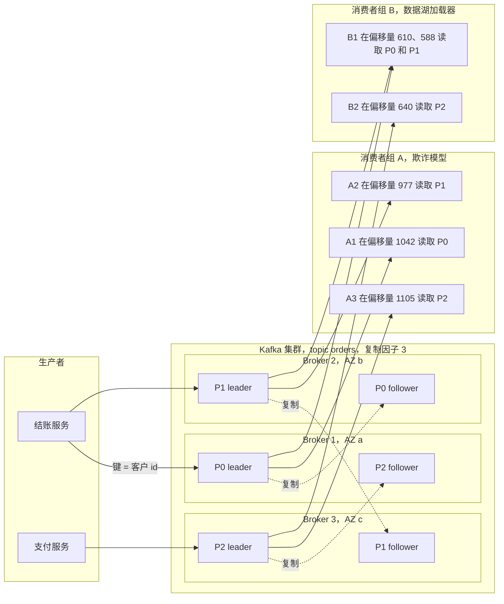
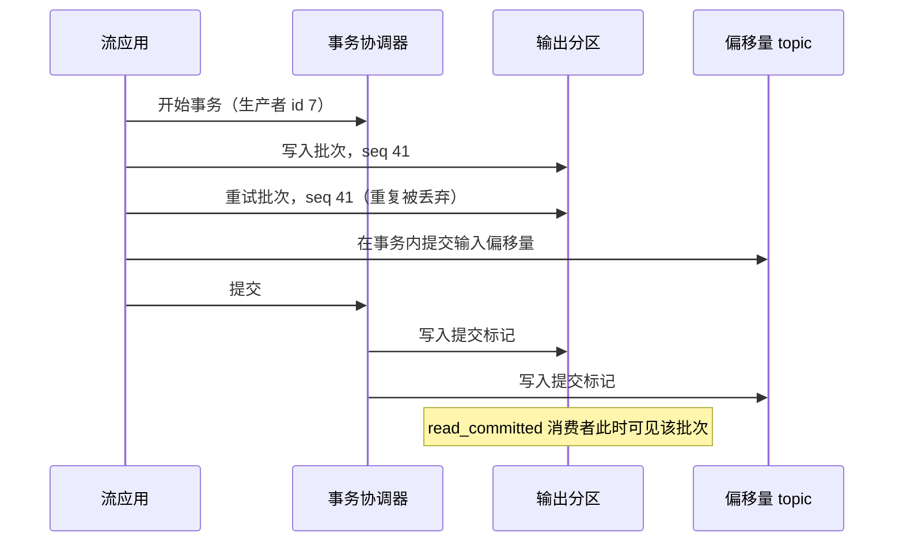
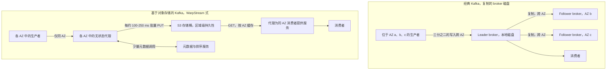

# 11. 流处理与事件平台
> **深度：** L2 · **阅读时间：** 约 12 分钟 · **最后核实：** 2026-11-01 · **前置阅读：** [第 9 章 — 数据管道模式](ch09-pipeline-patterns.md)

## 要点速览（TL;DR）

- **核心思想是日志。** Apache Kafka 把数据库内部的预写日志（write-ahead log, WAL）变成了一种共享的、只追加的、分区化的日志，任意数量的系统都可以按各自的节奏向其写入和从中读取。这一个抽象就让生产者与消费者解耦，这也是 Kafka 成为默认事件骨干的原因。[^kreps-log][^netdb]
- **架构正在围绕对象存储（object storage）重建。** 经典 Kafka 会把每个字节复制到分布在三个可用区（AZ）的三个 broker 上。在 AWS 上，跨可用区流量按每个方向 $0.01/GB 计费，因此对于高流量负载，网络账单可能超过计算账单。[^aws-xaz] WarpStream、Confluent Freight、AutoMQ、Bufstream、StreamNative Ursa、Redpanda Cloud Topics，以及 Apache Kafka 自己已获采纳的"无盘"（diskless）提案（KIP-1150），都改为直接写入 S3，以数百毫秒的延迟换取低得多的成本。[^warpstream-acq][^freight][^kip1150]
- **流正在变成表。** Confluent Tableflow 和 Redpanda Iceberg Topics 把 topic 物化为 Apache Iceberg 表，从而把经典的"Kafka → ETL 作业 → 数据湖"数据管道压缩成一个存储层面的配置项。[^tableflow][^rp-iceberg]
- **处理层正向 Flink 集中，Spark 正在追赶。** Apache Flink 是有状态、基于事件时间的流处理器的事实标准。Spark 4.1 增加了实时模式，而流式数据库（RisingWave、Materialize）则通过 SQL 物化视图提供同样的结果。[^flink-docs][^spark-rtm]
- **这门生意如今具有战略意义。** IBM 于 2026 年 3 月 17 日完成了对 Confluent 约 $11B（企业价值，公告值）的收购，把这一品类定位为企业 AI 智能体的实时数据源。Redpanda 于 2025 年 4 月以 $1B 估值（公司披露）融资 $100M。[^ibm-close][^rp-fund]

## 为何重要（业务 + Everpure 视角）

批处理数据管道（[第 9 章](ch09-pipeline-patterns.md)）回答的问题是"昨天发生了什么？"。流处理回答的是"现在正在发生什么？"。在 AI 时代，这一点比在仪表盘时代更重要，具体有四个原因：

1. **新鲜的特征。** 为一次刷卡打分的欺诈模型需要的是这张卡过去 60 秒的活动，而不是昨晚的汇总。流处理器持续计算这些滚动特征，并把它们推送到在线特征存储（feature store）。
2. **智能体触发器。** 一个等待人类提示的 AI 智能体只是聊天机器人。一个对事件做出反应的智能体（某个订单卡在履约环节、某个传感器读数漂出范围）需要一条可供订阅的事件总线。Confluent 在 2025 年末发布的"Streaming Agents"和"Real-Time Context Engine"就明确采用了这一定位。[^confluent-intel]
3. **RAG 索引的新鲜度。** 检索增强生成（RAG）系统的时效性取决于其向量索引。当产品价格或政策文件发生变化时，流式数据管道可以在几秒内重新嵌入（embedding）该变更并更新索引，而不必等待每晚的重建索引。
4. **从变更数据捕获（CDC）到向量存储。** [变更数据捕获](../glossary.md#change-data-capture)把数据库提交转化为事件流。Kafka 通常是承载者，把这些变更同时扇出到数据仓库、搜索索引和向量数据库。

对公司发展（corporate development）读者而言，市场本身也在讲述一个故事。IBM 为这一品类的领导者支付了约 9.4 倍于 Confluent 过去 12 个月 GAAP 收入的价格。Confluent 自己则收购了 WarpStream，以抵御在成本上压低它的对象存储方案。[^cflt-10q][^ibm-10q] 本章所讲的技术转变——从复制的 broker 磁盘转向对象存储——同时也是流数据字节物理落点的转变。这与 Everpure（原 Pure Storage；NYSE: P，原 PSTG）直接相关。其 2026 年 6 月推出的 **Data Stream** 产品已经把 FlashBlade 定位为为 AI 数据管道进行数据向量化和暂存的地方。[^everpure-ds]

## 工作原理

### 日志抽象

Jay Kreps 2013 年的文章《The Log》认为，朴素的提交日志——每个数据库内部早已用于恢复的结构——正是在整个公司范围内做数据集成的正确统一抽象。[^kreps-log] 日志是一个有序的、只追加的记录序列。每条记录都会获得一个顺序编号，称为**偏移量（offset）**。记录永远不会被原地更新。读取者不会删除已读内容；每个读取者只需记住自己已到达的偏移量。

Kreps、Neha Narkhede 和 Jun Rao 2011 年的 NetDB 论文描述了 LinkedIn 如何基于这一思想构建 Kafka。消息按逻辑偏移量寻址，由操作系统页缓存负责缓冲，并由消费者拉取数据，而不是由 broker 推送。[^netdb] 由于顺序追加是磁盘或 SSD 能做的最廉价的操作，单个 broker 就能在普通商用硬件上承受非常高的写入速率。

Kafka 的术语与这一设计一一对应：

- **[topic](../glossary.md#topic)** 是一个命名的日志，例如 `orders` 或 `card-swipes`。
- 一个 topic 被拆分为若干**[分区（partition）](../glossary.md#partition)**。每个分区都是一个独立的有序日志。顺序只在分区*内部*得到保证，因此生产者会选择一个键（客户 ID、卡号），把相关事件路由到同一分区。
- **[Broker](../glossary.md#broker)** 是存储分区并提供读写服务的服务器。
- 每个分区有一个 **leader** 副本，通常还有两个位于其他 broker 上的 **follower**（复制因子 3）。完全跟上进度的 follower 组成**[同步副本](../glossary.md#in-sync-replicas)**（in-sync replica, ISR）集合。配置为 `acks=all` 的写入只有在每个 ISR 成员都拿到之后才会被确认。只有当 `min.insync.replicas` 至少为 2 时，这才能防止数据丢失；否则 ISR 可能收缩到只剩 leader，`acks=all` 便会悄然退化为单副本。[^kafka-docs]
- **[消费者组（consumer group）](../glossary.md#consumer-group)** 是应用读取数据的方式。在一个组内，每个分区只分配给一个消费者，因此一个由三个消费者组成、读取三分区 topic 的组可获得三路并行。第二个组（比如欺诈模型和数据湖加载器）独立读取同样的数据，并拥有自己的偏移量。Kafka 把这些已提交的偏移量存储在一个内部 topic 中。[^kafka-docs]
- **保留策略（retention）** 决定数据保存多久：按时间（常见默认值为七天）或按大小。**[日志压缩（log compaction）](../glossary.md#log-compaction)** 是另一种选择。它只保留每个键的最新记录，从而把 topic 变成一份记录当前状态的持久化变更日志，例如"每位客户的最新地址"。[^kafka-docs]

*图 11.1 — SV-8：一个 topic 是一组跨 broker 复制的分区日志。两个消费者组独立读取同样的数据，各自跟踪自己的偏移量，正是这一点让生产者与消费者解耦。（为便于阅读，每个分区的 follower 简化为一个；复制因子 3 意味着两个。）*

**日志为何能解耦。** 生产者和消费者从不直接通信。生产者只需要 topic 接受它的写入。消费者可以很快、很慢、离线一天，或者是全新的、从偏移量零开始重放；这些都不会影响生产者或其他消费者组。在日志出现之前，把 N 个源系统连接到 M 个目的地最多需要 N×M 条点对点数据管道。中间放一个日志后，只需要 N+M 条连接。[^kreps-log] 正是这种 N+M 特性，而不是原始吞吐量，使 Kafka 从 LinkedIn 扩散到大多数大型企业。

> **类比：半导体。** 一个 Kafka 分区就是一个带有多个独立读指针的 FIFO 环形缓冲区，就像被几个 DMA 引擎按各自节奏读取的网卡接收环。不同之处在于，这个"环"位于磁盘上，按保留时间而不是按槽位数回绕。慢速读取者不会被施加背压；它只是落后，而且只有在保留期到期时仍然落后才会丢失数据。

> **类比：数据中心基础设施。** ISR 的工作方式类似 RAID-1 镜像集。当所有健康的镜像都拿到数据时，写入即完成。落后的镜像会被移出集合（阵列以"降级"状态运行），并在重新同步后被重新纳入。

> **类比：多核调度。** 消费者组看起来像跨核的工作窃取（work-stealing），但更接近*静态*分区。每个分区被固定给一个消费者，直到再平衡（rebalance）把它移走。真正的队列式共享——空闲消费者从繁忙分区中领取单条记录——直到"共享组"（share groups，KIP-932）才出现，该特性在 2026 年 2 月的 Kafka 4.2 中被宣布可用于生产。[^kafka42]

### 从 ZooKeeper 到 KRaft

在最初的十年里，Kafka 把集群元数据（哪个 broker 领导哪个分区、topic 配置、ACL）保存在一个独立的 Apache ZooKeeper 集群中。这意味着要运维两套分布式系统。它还给分区数量设了上限，因为新的控制器在故障切换后必须从 ZooKeeper 重新加载全部元数据。**[KRaft](../glossary.md#kraft)**（Kafka Raft）把元数据移入 Kafka 的内部日志，由一个控制器 Raft 法定组（quorum）进行复制。2025 年 3 月发布的 Kafka 4.0 彻底移除了 ZooKeeper。集群必须先在 3.x 版本上迁移到 KRaft（3.9 是过渡版本），才能升级。[^kafka40] Redpanda 从一开始就走了类似的路线：一个按分区运行 Raft 的单一 C++ 二进制程序，没有外部协调器。[^rp-docs]

### 精确一次：幂等性加事务

默认情况下，网络重试可能导致生产者把同一条记录写两次（"至少一次"）。2017 年随 Kafka 0.11 发布的 KIP-98 增加了两种机制：[^kip98]

1. **[幂等生产者（idempotent producer）](../glossary.md#idempotent-producer)**。每个生产者获得一个 ID，并为每个批次加盖按分区计的序列号。broker 会丢弃任何其序列号已被接受过的批次，因此重试无法产生重复。自 Kafka 3.0 起幂等性默认开启，但它只覆盖同一生产者会话内的重试：重启的生产者会获得新 ID，除非它使用 `transactional.id`，后者的 epoch 还能隔离（fence）"僵尸"实例。
2. **事务（transaction）。** 生产者可以写入多个分区，*并且*把其消费者偏移量作为一个原子单元一并提交。设置为 `read_committed` 的消费者要么看到全部这些写入，要么一条也看不到。

两者结合，为留在 Kafka 内部的"读取—处理—写入"循环提供了**[精确一次语义（exactly-once semantics）](../glossary.md#exactly-once-semantics)**。这一保证止于系统边界：如果输出写往外部数据库，该系统也必须是幂等的，或者加入事务（Flink 的两阶段提交 sink 就是这样做的）。

*图 11.2 — Kafka 中的精确一次由两种机制构成：序列号让重试无害，事务标记让多分区写入具有原子性。*

> **类比：半导体。** 幂等生产者就是幂等的 DMA 描述符：每个描述符都带有序列标签，因此重放的描述符会被识别并丢弃，而不会被写两次。事务提交标记扮演的是门铃（doorbell）写入的角色，让一批描述符一次性对设备可见。

### 先分层存储，再无盘化

Kafka 的 broker 本地磁盘使长时间保留变得昂贵。历史数据的每个字节都位于三个块存储副本上。**[分层存储（tiered storage）](../glossary.md#tiered-storage)**（KIP-405）把已关闭的日志段移到对象存储，而最近的"热"段仍留在 broker 磁盘上。它在 Kafka 3.6（2023 年 10 月）以抢先体验形式发布，并在 Kafka 3.9（2024 年 11 月）被宣布可用于生产。[^kafka39] 分层存储降低的是*存储*成本。它不触及*网络*成本，因为热层仍然跨可用区复制三份。

更新的"基于对象存储的 Kafka"设计走得更远。它们把对象存储作为主存储，并让 broker 变成无状态的。

*图 11.3 — 经典 Kafka 通过在可用区之间复制字节获得持久性。对象存储方案把持久性委托给 S3，而 S3 在其自身价格内完成跨可用区复制。这消除了跨可用区账单，但增加了写入批处理的延迟。*

WarpStream 的代理（agent）会把写入缓冲不到一秒，把合并后的文件上传到 S3，并在一个确定顺序的元数据服务中登记该文件的偏移量。任何代理都可以服务任何分区，因此扩容只需增加容器。这种设计的代价是延迟。WarpStream 自己的基准测试报告称，在低延迟的 S3 Express One Zone 层上 p99 生产延迟为 169 ms（厂商报告），而一份客户案例研究给出的数字是：在标准 S3 上生产延迟约 400 ms、端到端约 1 s。[^warpstream-bench] Confluent 将其采用同样直写对象存储方式的 Freight 集群描述为：把延迟从 100 ms 以下提高到最多一两秒，换来最高 90% 的成本降低（公司声称）。[^freight]
