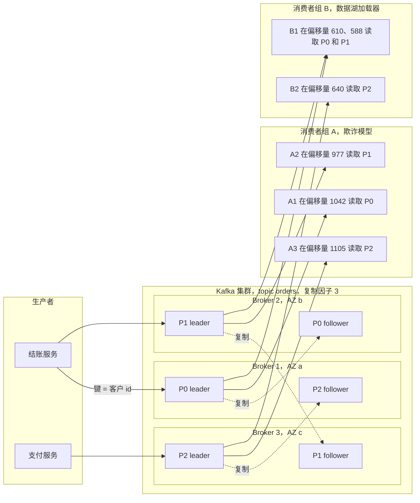
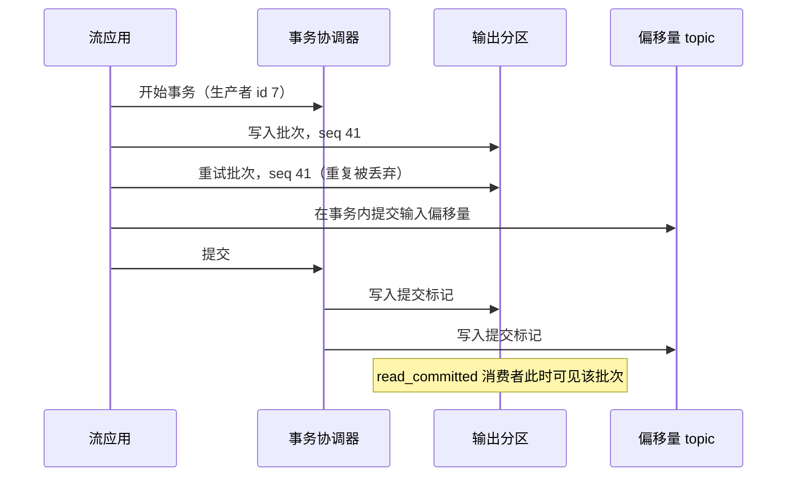
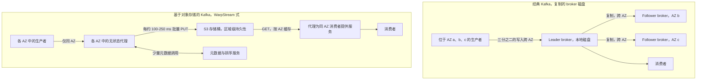
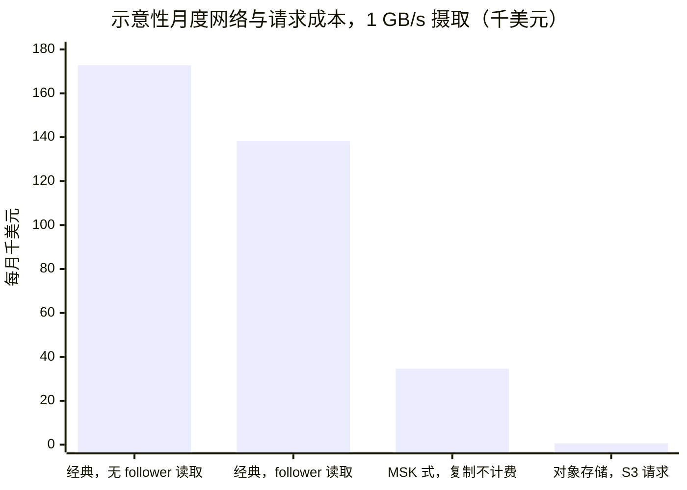
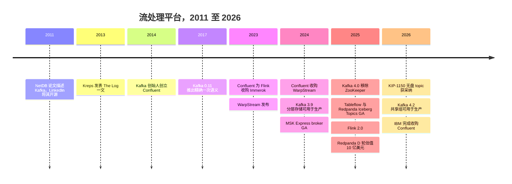

# 11. 流处理与事件平台
> **深度：** L2 · **阅读时间：** 约 12 分钟 · **最后核实：** 2026-11-01 · **前置阅读：** [第 9 章 — 数据管道模式](ch09-pipeline-patterns.md)

## 要点速览（TL;DR）

- **核心思想是日志。** Apache Kafka 把数据库内部的预写日志（write-ahead log, WAL）变成了一种共享的、只追加的、分区化的日志，任意数量的系统都可以按各自的节奏向其写入和从中读取。这一个抽象就让生产者与消费者解耦，这也是 Kafka 成为默认事件骨干的原因。[^kreps-log][^netdb]
- **架构正在围绕对象存储（object storage）重建。** 经典 Kafka 会把每个字节复制到分布在三个可用区（AZ）的三个 broker 上。在 AWS 上，跨可用区流量按每个方向 $0.01/GB 计费，因此对于高流量负载，网络账单可能超过计算账单。[^aws-xaz] WarpStream、Confluent Freight、AutoMQ、Bufstream、StreamNative Ursa、Redpanda Cloud Topics，以及 Apache Kafka 自己已获采纳的"无盘"（diskless）提案（KIP-1150），都改为直接写入 S3，以数百毫秒的延迟换取低得多的成本。[^warpstream-acq][^freight][^kip1150]
- **流正在变成表。** Confluent Tableflow 和 Redpanda Iceberg Topics 把 topic 物化为 Apache Iceberg 表，从而把经典的"Kafka → ETL 作业 → 数据湖"数据管道压缩成一个存储层面的配置项。[^tableflow][^rp-iceberg]
- **处理层正向 Flink 集中，Spark 正在追赶。** Apache Flink 是有状态、基于事件时间的流处理器的事实标准。Spark 4.1 增加了实时模式，而流式数据库（RisingWave、Materialize）则通过 SQL 物化视图提供同样的结果。[^flink-docs][^spark-rtm]
- **这门生意如今具有战略意义。** IBM 于 2026 年 3 月 17 日完成了对 Confluent 约 $11B（企业价值，公告值）的收购，把这一品类定位为企业 AI 智能体的实时数据源。Redpanda 于 2025 年 4 月以 $1B 估值（公司披露）融资 $100M。[^ibm-close][^rp-fund]

## 为何重要（业务 + Everpure 视角）

批处理数据管道（[第 9 章](ch09-pipeline-patterns.md)）回答的问题是"昨天发生了什么？"。流处理回答的是"现在正在发生什么？"。在 AI 时代，这一点比在仪表盘时代更重要，具体有四个原因：

1. **新鲜的特征。** 为一次刷卡打分的欺诈模型需要的是这张卡过去 60 秒的活动，而不是昨晚的汇总。流处理器持续计算这些滚动特征，并把它们推送到在线特征存储（feature store）。
2. **智能体触发器。** 一个等待人类提示的 AI 智能体只是聊天机器人。一个对事件做出反应的智能体（某个订单卡在履约环节、某个传感器读数漂出范围）需要一条可供订阅的事件总线。Confluent 在 2025 年末发布的"Streaming Agents"和"Real-Time Context Engine"就明确采用了这一定位。[^confluent-intel]
3. **RAG 索引的新鲜度。** 检索增强生成（RAG）系统的时效性取决于其向量索引。当产品价格或政策文件发生变化时，流式数据管道可以在几秒内重新嵌入（embedding）该变更并更新索引，而不必等待每晚的重建索引。
4. **从变更数据捕获（CDC）到向量存储。** [变更数据捕获](../glossary.md#change-data-capture)把数据库提交转化为事件流。Kafka 通常是承载者，把这些变更同时扇出到数据仓库、搜索索引和向量数据库。

对公司发展（corporate development）读者而言，市场本身也在讲述一个故事。IBM 为这一品类的领导者支付了约 9.4 倍于 Confluent 过去 12 个月 GAAP 收入的价格。Confluent 自己则收购了 WarpStream，以抵御在成本上压低它的对象存储方案。[^cflt-10q][^ibm-10q] 本章所讲的技术转变——从复制的 broker 磁盘转向对象存储——同时也是流数据字节物理落点的转变。这与 Everpure（原 Pure Storage；NYSE: P，原 PSTG）直接相关。其 2026 年 6 月推出的 **Data Stream** 产品已经把 FlashBlade 定位为为 AI 数据管道进行数据向量化和暂存的地方。[^everpure-ds]

## 工作原理

### 日志抽象

Jay Kreps 2013 年的文章《The Log》认为，朴素的提交日志——每个数据库内部早已用于恢复的结构——正是在整个公司范围内做数据集成的正确统一抽象。[^kreps-log] 日志是一个有序的、只追加的记录序列。每条记录都会获得一个顺序编号，称为**偏移量（offset）**。记录永远不会被原地更新。读取者不会删除已读内容；每个读取者只需记住自己已到达的偏移量。

Kreps、Neha Narkhede 和 Jun Rao 2011 年的 NetDB 论文描述了 LinkedIn 如何基于这一思想构建 Kafka。消息按逻辑偏移量寻址，由操作系统页缓存负责缓冲，并由消费者拉取数据，而不是由 broker 推送。[^netdb] 由于顺序追加是磁盘或 SSD 能做的最廉价的操作，单个 broker 就能在普通商用硬件上承受非常高的写入速率。

Kafka 的术语与这一设计一一对应：

- **[topic](../glossary.md#topic)** 是一个命名的日志，例如 `orders` 或 `card-swipes`。
- 一个 topic 被拆分为若干**[分区（partition）](../glossary.md#partition)**。每个分区都是一个独立的有序日志。顺序只在分区*内部*得到保证，因此生产者会选择一个键（客户 ID、卡号），把相关事件路由到同一分区。
- **[Broker](../glossary.md#broker)** 是存储分区并提供读写服务的服务器。
- 每个分区有一个 **leader** 副本，通常还有两个位于其他 broker 上的 **follower**（复制因子 3）。完全跟上进度的 follower 组成**[同步副本](../glossary.md#in-sync-replicas)**（in-sync replica, ISR）集合。配置为 `acks=all` 的写入只有在每个 ISR 成员都拿到之后才会被确认。只有当 `min.insync.replicas` 至少为 2 时，这才能防止数据丢失；否则 ISR 可能收缩到只剩 leader，`acks=all` 便会悄然退化为单副本。[^kafka-docs]
- **[消费者组（consumer group）](../glossary.md#consumer-group)** 是应用读取数据的方式。在一个组内，每个分区只分配给一个消费者，因此一个由三个消费者组成、读取三分区 topic 的组可获得三路并行。第二个组（比如欺诈模型和数据湖加载器）独立读取同样的数据，并拥有自己的偏移量。Kafka 把这些已提交的偏移量存储在一个内部 topic 中。[^kafka-docs]
- **保留策略（retention）** 决定数据保存多久：按时间（常见默认值为七天）或按大小。**[日志压缩（log compaction）](../glossary.md#log-compaction)** 是另一种选择。它只保留每个键的最新记录，从而把 topic 变成一份记录当前状态的持久化变更日志，例如"每位客户的最新地址"。[^kafka-docs]

*图 11.1 — SV-8：一个 topic 是一组跨 broker 复制的分区日志。两个消费者组独立读取同样的数据，各自跟踪自己的偏移量，正是这一点让生产者与消费者解耦。（为便于阅读，每个分区的 follower 简化为一个；复制因子 3 意味着两个。）*

**日志为何能解耦。** 生产者和消费者从不直接通信。生产者只需要 topic 接受它的写入。消费者可以很快、很慢、离线一天，或者是全新的、从偏移量零开始重放；这些都不会影响生产者或其他消费者组。在日志出现之前，把 N 个源系统连接到 M 个目的地最多需要 N×M 条点对点数据管道。中间放一个日志后，只需要 N+M 条连接。[^kreps-log] 正是这种 N+M 特性，而不是原始吞吐量，使 Kafka 从 LinkedIn 扩散到大多数大型企业。

> **类比：半导体。** 一个 Kafka 分区就是一个带有多个独立读指针的 FIFO 环形缓冲区，就像被几个 DMA 引擎按各自节奏读取的网卡接收环。不同之处在于，这个"环"位于磁盘上，按保留时间而不是按槽位数回绕。慢速读取者不会被施加背压；它只是落后，而且只有在保留期到期时仍然落后才会丢失数据。

> **类比：数据中心基础设施。** ISR 的工作方式类似 RAID-1 镜像集。当所有健康的镜像都拿到数据时，写入即完成。落后的镜像会被移出集合（阵列以"降级"状态运行），并在重新同步后被重新纳入。

> **类比：多核调度。** 消费者组看起来像跨核的工作窃取（work-stealing），但更接近*静态*分区。每个分区被固定给一个消费者，直到再平衡（rebalance）把它移走。真正的队列式共享——空闲消费者从繁忙分区中领取单条记录——直到"共享组"（share groups，KIP-932）才出现，该特性在 2026 年 2 月的 Kafka 4.2 中被宣布可用于生产。[^kafka42]

### 从 ZooKeeper 到 KRaft

在最初的十年里，Kafka 把集群元数据（哪个 broker 领导哪个分区、topic 配置、ACL）保存在一个独立的 Apache ZooKeeper 集群中。这意味着要运维两套分布式系统。它还给分区数量设了上限，因为新的控制器在故障切换后必须从 ZooKeeper 重新加载全部元数据。**[KRaft](../glossary.md#kraft)**（Kafka Raft）把元数据移入 Kafka 的内部日志，由一个控制器 Raft 法定组（quorum）进行复制。2025 年 3 月发布的 Kafka 4.0 彻底移除了 ZooKeeper。集群必须先在 3.x 版本上迁移到 KRaft（3.9 是过渡版本），才能升级。[^kafka40] Redpanda 从一开始就走了类似的路线：一个按分区运行 Raft 的单一 C++ 二进制程序，没有外部协调器。[^rp-docs]

### 精确一次：幂等性加事务

默认情况下，网络重试可能导致生产者把同一条记录写两次（"至少一次"）。2017 年随 Kafka 0.11 发布的 KIP-98 增加了两种机制：[^kip98]

1. **[幂等生产者（idempotent producer）](../glossary.md#idempotent-producer)**。每个生产者获得一个 ID，并为每个批次加盖按分区计的序列号。broker 会丢弃任何其序列号已被接受过的批次，因此重试无法产生重复。自 Kafka 3.0 起幂等性默认开启，但它只覆盖同一生产者会话内的重试：重启的生产者会获得新 ID，除非它使用 `transactional.id`，后者的 epoch 还能隔离（fence）"僵尸"实例。
2. **事务（transaction）。** 生产者可以写入多个分区，*并且*把其消费者偏移量作为一个原子单元一并提交。设置为 `read_committed` 的消费者要么看到全部这些写入，要么一条也看不到。

两者结合，为留在 Kafka 内部的"读取—处理—写入"循环提供了**[精确一次语义（exactly-once semantics）](../glossary.md#exactly-once-semantics)**。这一保证止于系统边界：如果输出写往外部数据库，该系统也必须是幂等的，或者加入事务（Flink 的两阶段提交 sink 就是这样做的）。

*图 11.2 — Kafka 中的精确一次由两种机制构成：序列号让重试无害，事务标记让多分区写入具有原子性。*

> **类比：半导体。** 幂等生产者就是幂等的 DMA 描述符：每个描述符都带有序列标签，因此重放的描述符会被识别并丢弃，而不会被写两次。事务提交标记扮演的是门铃（doorbell）写入的角色，让一批描述符一次性对设备可见。

### 先分层存储，再无盘化

Kafka 的 broker 本地磁盘使长时间保留变得昂贵。历史数据的每个字节都位于三个块存储副本上。**[分层存储（tiered storage）](../glossary.md#tiered-storage)**（KIP-405）把已关闭的日志段移到对象存储，而最近的"热"段仍留在 broker 磁盘上。它在 Kafka 3.6（2023 年 10 月）以抢先体验形式发布，并在 Kafka 3.9（2024 年 11 月）被宣布可用于生产。[^kafka39] 分层存储降低的是*存储*成本。它不触及*网络*成本，因为热层仍然跨可用区复制三份。

更新的"基于对象存储的 Kafka"设计走得更远。它们把对象存储作为主存储，并让 broker 变成无状态的。

*图 11.3 — 经典 Kafka 通过在可用区之间复制字节获得持久性。对象存储方案把持久性委托给 S3，而 S3 在其自身价格内完成跨可用区复制。这消除了跨可用区账单，但增加了写入批处理的延迟。*

WarpStream 的代理（agent）会把写入缓冲不到一秒，把合并后的文件上传到 S3，并在一个确定顺序的元数据服务中登记该文件的偏移量。任何代理都可以服务任何分区，因此扩容只需增加容器。这种设计的代价是延迟。WarpStream 自己的基准测试报告称，在低延迟的 S3 Express One Zone 层上 p99 生产延迟为 169 ms（厂商报告），而一份客户案例研究给出的数字是：在标准 S3 上生产延迟约 400 ms、端到端约 1 s。[^warpstream-bench] Confluent 将其采用同样直写对象存储方式的 Freight 集群描述为：把延迟从 100 ms 以下提高到最多一两秒，换来最高 90% 的成本降低（公司声称）。[^freight]

## 实例演算：1 GB/s 的跨可用区账单

以下算术**仅为示意，并非报价**。假设：在一个 AWS 区域内基于 EC2 自建 Kafka；持续 1 GB/s 的已压缩生产流量；跨三个可用区的复制因子 3；生产者均匀分布在各可用区；一个消费者组；一个月按 30 天计（2,592,000 秒）；以及 AWS 公布的同区域跨可用区费率——每一侧收取 $0.01/GB，因此每跨越一次为 $0.02/GB。[^aws-xaz]

每月摄取量为 1 GB/s × 2,592,000 s = **2,592,000 GB（≈2.6 PB）**。

| 流量环节（经典 Kafka） | 每月跨可用区 GB 数 | 按 $0.02/GB 计的月成本 |
|---|---|---|
| 生产者 → leader（2/3 的写入落在其他可用区） | 1,728,000 | $34,560 |
| Leader → 两个 follower（均在其他可用区） | 5,184,000 | $103,680 |
| Leader → 消费者，未启用 follower 读取（2/3 跨区） | 1,728,000 | $34,560 |
| **合计，关闭 follower 读取** | 8,640,000 | **$172,800** |
| 合计，开启机架感知的 follower 读取（KIP-392） | 6,912,000 | $138,240 |

*图 11.4 — 仅复制一项就占经典账单的 60%。优化消费者放置位置有所帮助；只有彻底消除跨可用区复制（包括复制流量和客户端流量），才能改变数量级。*

再看对象存储方案。生产者和消费者只与本可用区内的代理通信，因此跨可用区数据流量约为零。同一区域内 EC2 到 S3 的传输免费。[^s3-pricing] 剩下的是 S3 请求费用。假设有九个代理（每个可用区三个），每个代理每 250 ms 上传一个对象：即每秒 36 次 PUT，每月 9,330 万次。按每 1,000 次 PUT $0.005 计，约为 $467。若每个可用区把每个对象读取一次，则增加 2.8 亿次 GET，按每 1,000 次 $0.0004 计，约 $112。[^s3-pricing] 合计**≈$580/月**，而经典 Kafka 为 $138K–$173K：在这一费用项上降幅超过 99%。

*图 11.5 — 在上述假设下，跨可用区传输主导了经典 Kafka 的网络账单，而对象存储方案只需支付 S3 请求费用。仅为示意性算术，并非厂商定价。*

有三点保留意见，以保持结论客观。第一，Amazon MSK 不对集群内 broker 之间的复制流量计费，但跨可用区的客户端流量仍会计费。这就是"MSK 式"那一栏，它假设消费者启用了 follower 读取。[^msk-pricing] 第二，这里只比较了网络费用项。S3 存储、计算和厂商许可费仍然存在，而且真实的对象原生引擎还会为压缩（compaction）和元数据发出额外的 PUT 和 GET，本示意未计入。更快的刷写间隔（比如为降低延迟改为 50 ms）会使 PUT 成本变为五倍，但总额仍然很小。第三，这笔节省是用延迟换来的，因此适合日志、遥测、数据湖摄取和 CDC 扇出，而不适合 10 ms 以下的交易或支付授权。

## 流处理

日志负责搬运事件；流处理器负责在事件上做计算。难点在于**状态**（滚动计数、连接、窗口）、**时间**和**恢复**。

- **[事件时间（event time）](../glossary.md#event-time)**与处理时间。事件会迟到且乱序：一部手机穿过隧道后重新联网，上传了十分钟的点击。Flink 跟踪**[水位线（watermark）](../glossary.md#watermark)**，即一个持续更新的估计，表示"不再预期会有早于 T 的事件"。当水位线越过窗口终点时窗口关闭，这使结果按事情*发生*的时间是正确的。[^flink-docs]
- **[检查点（checkpoint）](../glossary.md#checkpoint)。** Flink 使用 Chandy–Lamport 快照算法的一个变体，定期对所有算子状态及其已到达的 Kafka 偏移量拍摄一致性快照（snapshot）。崩溃后，它回退到上一个检查点并从那里重放日志。正是日志的可重放性使这一过程代价低廉。[^flink-docs]
- **解耦的状态。** Flink 2.0（2025 年发布）可以通过其 ForSt 存储把主状态保存在远程对象存储中，本地磁盘作为缓存。这与无盘 Kafka 是同一股存储解耦趋势，只是应用在了处理器上。[^flink2]

> **深入（L3）。** Flink 检查点通过向每个源分区注入"屏障"（barrier）标记来触发。每个算子在来自所有输入的屏障都到达后对其状态做快照，然后把屏障向下游转发。非对齐检查点允许屏障越过在途记录，以避免在背压下停顿，代价是要把这些记录存入快照。[^flink-docs]

| 维度 | Apache Flink | Spark Structured Streaming | Kafka Streams | RisingWave | Materialize |
|---|---|---|---|---|---|
| 处理模型 | 逐条记录的数据流 | 微批；针对无状态查询的实时模式（Spark 4.1） | 逐条记录的库 | 流式 SQL 数据库 | 增量视图维护（Differential Dataflow） |
| 典型延迟 | 毫秒级 | 微批约 100 ms 以上；实时模式宣称 p99 为个位数毫秒（厂商） | 毫秒级 | 亚秒级（厂商） | 亚秒级（厂商） |
| 状态与恢复 | 大型键控状态（RocksDB/ForSt）；检查点写入对象存储 | 状态存储加检查点/WAL | 本地 RocksDB 加 Kafka 中的压缩变更日志 topic | 托管在对象存储上的状态 | 内存/磁盘 arrangement；持久存储位于对象存储 |
| 事件时间支持 | 完整：水位线、迟到数据、丰富的窗口 | 水位线、窗口 | 窗口与宽限期 | 水位线、SQL 窗口 | SQL 时间过滤器 |
| 接口 | Java/Python DataStream、Table API、SQL | DataFrame/SQL（Python、Scala） | 嵌入应用的 Java 库 | 兼容 Postgres 的 SQL | 兼容 Postgres 的 SQL |
| 部署 | 集群（自运维、Confluent、AWS、Ververica、Alibaba） | Spark 集群、Databricks | 无需集群：在应用内部运行 | 开源（Apache 2.0）或托管云服务 | 托管云服务或自托管 |
| 精确一次 | 检查点加两阶段提交 sink | 检查点加幂等/事务型 sink | Kafka 事务 | 带检查点，端到端写入受支持的 sink | 视图的严格可串行化 |
| 最佳适用场景 | 复杂、有状态、大规模的数据管道 | 已在使用 Spark/Databricks 的团队 | 以 Kafka 为中心的微服务 | 想要实时视图的 SQL 团队 | 对始终新鲜的连接做运营型查询 |

*图 11.6 — Flink 是通用引擎。Spark 胜在复用既有技能，Kafka Streams 胜在无需集群，流式数据库胜在 SQL 的简洁。*

表格来源：Flink 和 Spark 文档、Databricks 的 Spark 4.1 公告，以及 RisingWave 和 Materialize 的公司材料。[^flink-docs][^spark-rtm][^streamdb] 延迟数据为厂商声称，且取决于具体负载。

## 设计选择与权衡

| 设计 | 持久性来源 | 生产延迟 | 跨可用区网络 | 运维负担 | 最适合 |
|---|---|---|---|---|---|
| 经典 Kafka（broker 磁盘，RF=3） | 三个 broker 上的副本 | 个位数到数十毫秒 | 高（复制加客户端） | 高：分区再平衡、磁盘容量规划 | 低延迟事务、成熟生态 |
| Kafka 加分层存储（KIP-405） | 热层：broker 副本；冷层：对象存储 | 与经典相同 | 热层仍然很高 | 中等 | 以更低存储成本实现长期保留与重放 |
| 无盘 / 对象原生（WarpStream、Freight、AutoMQ、Bufstream、Ursa、KIP-1150） | 对象存储（S3 多可用区） | 约 100 ms 至约 1–2 s | 接近零 | 低：无状态代理 | 日志、遥测、CDC 扇出、数据湖摄取 |
| Redpanda（C++、每核一线程、Raft） | Raft 副本；可选分层存储与 Cloud Topics | 低毫秒级（厂商） | 高，除非使用 Cloud Topics | 低于 Kafka：单一二进制 | 对延迟敏感的 Kafka API 负载 |
| 云原生服务（Kinesis、Pub/Sub、Event Hubs） | 由云厂商托管 | 数十毫秒（视情况而定） | 已含在价格中 | 最低 | 统一使用单一云的团队 |

*图 11.7 — 核心权衡是延迟与成本：由谁来做复制——broker 还是对象存储——同时决定了这两者。*

**经典 Kafka 的最强版本论证。** 对象存储把故障域移到了 S3，把排序问题移到了元数据服务，两者都必须精心设计。经典 Kafka 还拥有十年的运维经验积累。对象原生设计的延迟下限使其无法承接很大一部分事务型负载，而且在 MSK 上，大部分复制成本本来就不存在。

**无盘方案的最强版本论证。** 按字节量计，大多数流数据是日志、指标和点击流数据，它们能容忍一秒的延迟。对这些数据而言，为跨可用区的三份副本付费纯属浪费。Apache Kafka 社区自己在 2026 年 3 月采纳了 KIP-1150 无盘 topic 设计（实现尚待完成），这表明主流已经认同这一方向。[^kip1150]

**流变成表。** Tableflow（Iceberg 于 2025 年 3 月 GA；Delta Lake 最初为预览）和 Redpanda Iceberg Topics（于 2025 年 4 月随 Redpanda 25.1 GA）把 topic 数据写成 Parquet 文件加 Iceberg 元数据，并使用模式注册表（schema registry）来定义表结构。[^tableflow][^rp-iceberg] Bufstream 和 Ursa 原生做到了同样的事情。[^bufstream][^ursa] 这样一来，分析副本就不再需要单独的连接器集群，[开放表格式（open table format）](../01-data-systems-foundations/ch07-open-table-formats.md)成为流处理与湖仓一体（lakehouse）之间的交接点。关于在此之上的实时分析服务，参见[第 23 章](../03-ai-data-stack/ch23-real-time-analytics-htap.md)。

## 主要参与者

| 平台 | 所有者 / 状态 | 协议 | 存储架构 | 延迟档位 | 部署方式 | Iceberg 路径 |
|---|---|---|---|---|---|---|
| Apache Kafka / Confluent | Apache 项目；Confluent 自 2026-03-17 起归 IBM 所有 | Kafka | broker 磁盘加分层存储；Confluent Cloud 中的 Kora 引擎；Freight（直写对象存储） | 低毫秒级（标准）；约 1–2 s（Freight） | 自托管、Confluent Cloud、Platform | Tableflow |
| Redpanda | 私营（D 轮，2025 年 4 月） | Kafka API | C++ 每核一线程，每分区 Raft；分层存储；基于对象存储的 Cloud Topics | 低毫秒级（厂商） | 自托管、BYOC、无服务器 | Iceberg Topics（25.1 GA） |
| WarpStream | Confluent（2024 年 9 月收购），现属 IBM | Kafka API | 无状态代理，仅用 S3 | 约 0.2–1 s | 自带云（BYOC） | Tableflow 式表输出（WarpStream Tableflow）[VERIFY: 产品状态] |
| AutoMQ | 私营；开源 Kafka 分支 | Kafka（分支） | 基于 S3 的共享存储，配合预写日志（S3、EBS 或 FSx） | 数十毫秒到亚秒级（厂商） | 自托管、BYOC | Table topic [VERIFY: GA 状态] |
| Apache Pulsar / StreamNative | Apache 项目；StreamNative 提供商业版 | Pulsar 加 Kafka API（Ursa） | broker 加 BookKeeper；Ursa 是基于对象存储的无 leader 架构 | 低毫秒级（经典）；更高（Ursa） | 自托管、云、BYOC | Ursa 写入 Iceberg/Delta |
| Amazon Kinesis / MSK | AWS | Kinesis API / Kafka | 分片（Kinesis）；MSK Standard 与 Express broker | 数十毫秒 | 托管 | 通过 Firehose 写入 S3 Tables/Iceberg |
| Google Pub/Sub / Managed Kafka | Google Cloud | Pub/Sub API / Kafka | 全球托管服务；Managed Service for Apache Kafka | 数十毫秒 | 托管 | BigQuery 订阅；BigLake Iceberg |
| Azure Event Hubs | Microsoft | AMQP 加 Kafka 端点 | 托管分区 | 数十毫秒 | 托管（Kafka 需 Standard 与 Premium 层） | Fabric / Capture 写入数据湖 |

*图 11.8 — Kafka 协议已成为行业通用接口，真正的竞争如今在于其背后的存储引擎。*

来源：Confluent、Redpanda、AutoMQ、StreamNative、AWS、Google 和 Microsoft 的文档。[^warpstream-acq][^rp-docs][^automq][^ursa][^msk-express][^gcp-kafka][^eventhubs] 延迟档位为指示性数据，来自厂商文档。

定位简述：

- **Confluent（IBM）** 拥有最广的产品组合：开源 Kafka 的主导维护、Confluent Cloud、用于 BYOC 的 WarpStream、通过 2023 年收购 Immerok 获得的 Flink（据其 10-Q 为 $54.9M 现金）以及 Tableflow。在 IBM 旗下，它将被拉向 watsonx、MQ、webMethods 和 IBM Z。[^cflt-10q][^ibm-close]
- **Redpanda** 主打性能与简洁（无 JVM、单一二进制），并大力推进智能体工具和 Iceberg。其 Cloud Topics 层在 Streamfest 2025 上发布，GA 目标为 2026 年 3 月，在同一集群内引入了对象存储的经济性。[^rp-streamfest] `[VERIFY: Cloud Topics GA 日期]`
- **AutoMQ 和 Bufstream** 在价格上竞争。AutoMQ 保留 Kafka 自身的代码，底层改用 S3；Bufstream 在 broker 层增加了 Protobuf 模式校验，并通过了 Jepsen 测试。[^automq][^bufstream]
- **超大规模云厂商**在各自云内凭默认地位取胜。MSK Express broker（2024 年 11 月 GA）宣称单 broker 吞吐量最高提升 3 倍，Google 在 Pub/Sub 之外运营一项托管 Kafka 服务，Event Hubs 则无需修改即可接入 Kafka 客户端。[^msk-express][^gcp-kafka][^eventhubs] Kinesis 仍然是 AWS 原生服务，每个分片按 1 MB/s 的写入能力预置。[^kinesis]

公司层面的经济性与交易历史见[第 30 章](../04-company-deep-dives/ch30-data-movement-streaming-companies.md)。

## 历史与发展轨迹

*图 11.9 — 十五年分为两个阶段：先是日志赢得了数据集成之争，然后其底层存储为适应云经济性而被重建。*

这段历程分为三幕。**2011–2017：日志胜出。** LinkedIn 于 2011 年开源 Kafka，其创始人于 2014 年创立 Confluent。[^netdb][^cflt-10k] 2017 年的精确一次语义让 Kafka 在金融类负载中具备了可信度。[^kip98] **2018–2023：托管服务。** Confluent Cloud、MSK、Event Hubs 的 Kafka 端点和 Pulsar 在运维而非功能上展开竞争，Flink 成为处理层标准。**2023–2026：云经济性。** WarpStream 2023 年的发布表明，主导大型 Kafka 账单的是跨可用区费用，而不是服务器；18 个月内 Confluent 就收购了它。[^warpstream-acq] 随后 Iceberg 集成把 topic 变成了表，而 IBM 2026 年 3 月的收购则让流处理成为一家更大的 AI 平台公司的组成部分。[^ibm-close]

展望未来，有三件事看起来很可能发生。对象存储将成为高流量 topic 的默认主存储（Kafka 自己的 KIP-1150 指向这一方向）。"topic"与"表"之间的边界将持续模糊。流处理将被作为 AI 智能体的事件与上下文层来销售，而不再是作为管道基础设施。

## 关键数字

| 指标 | 数值 | 口径 | 来源 / 日期 |
|---|---|---|---|
| AWS 跨可用区数据传输（同区域） | 流出 $0.01/GB + 流入 $0.01/GB | 公开目录价 | AWS EC2 定价，检索 2026-11-01[^aws-xaz] |
| 经典 Kafka 跨可用区成本，1 GB/s，RF=3 | 每月 ≈$138K–$173K | 估算（本章示意性算术） | 见上文实例演算 |
| 对象存储方案，同等负载 | 每月 S3 请求费 ≈$0.6K | 估算（示意） | 实例演算；S3 定价[^s3-pricing] |
| IBM–Confluent 交易 | 约 $11B EV；每股 $31 现金；2026-03-17 完成 | 公告交易价值 | IBM 新闻稿，2026-03-17[^ibm-close] |
| IBM 入账的收购价格 | $11.6B | GAAP（收购会计处理） | IBM 10-Q，Q1 2026[^ibm-10q] |
| Confluent 收入，FY2025（2025 年 1–12 月） | $1,167M，+21%；Confluent Cloud $624M，+27% | GAAP | Confluent 10-K FY2025[^cflt-10k] |
| 隐含交易倍数 | 约 9.4x EV / FY2025 收入 | 估算 | 由上面两行推算 |
| WarpStream 收购 | 初步对价 $135.1M（另有最多 $76.2M 的留存款） | GAAP 披露 | Confluent 10-Q，Q3 2024[^cflt-10q] |
| Immerok（Flink）收购 | $54.9M 现金 | GAAP 披露 | Confluent 10-Q[^cflt-10q] |
| Redpanda D 轮 | $100M，估值 $1B，由 GV 领投（2025 年 4 月） | 公司披露 / 媒体报道 | Redpanda，2025-04[^rp-fund] |
| Confluent 客户基础 | >6,500 家组织；约 40% 的财富 500 强 | 公司披露、媒体报道 | ChannelWeb，2026-03[^ibm-close] |
| Freight 集群的权衡 | TCO 最多降低 90%；延迟最高约 1–2 s | 公司声称 | Confluent，2025[^freight] |
| WarpStream p99 生产延迟（S3 Express One Zone） | 169 ms | 厂商基准测试 | WarpStream[^warpstream-bench] |
| Spark 4.1 实时模式 | 简单无状态查询 p99 为个位数毫秒；Databricks 的 GA 基准测试显示较重数据管道的 p99 约为 40–300 ms（[第 9 章](ch09-pipeline-patterns.md)） | 厂商声称；取决于负载 | Databricks[^spark-rtm] |

*图 11.10 — 头条数字：$0.02/GB 的网络税、约 $11B 的退出，以及品类领导者 9.4 倍的收入倍数。*

## 存储桥接

> **存储桥接。** 无盘流处理把事件平台变成了一种对象存储负载：每隔几百毫秒一次大块顺序 PUT，重放时突发的并行 GET，以及以周或月而不是以天计的保留期。这使需求从 broker 上复制的块存储卷转向廉价、高吞吐的 S3 兼容容量，也就是 FlashBlade 类系统的典型画像。AutoMQ 和 Bufstream 已在文档中说明支持自托管的 S3 兼容存储，因此本地部署的"基于对象存储的 Kafka"是一种真实存在的部署模式。关于对象存储吞吐量和纠删码的细节，参见配套的 *Everpure Tech Atlas*。[^automq][^bufstream]

基于公开信息，战略团队可能评估的选项包括：将 Everpure 对象存储认证为 Kafka 兼容无盘引擎（WarpStream BYOC、AutoMQ、Bufstream、Redpanda Cloud Topics）的后端；把 Data Stream 定位为 Kafka 和 CDC topic 的消费者，以保持向量索引的新鲜；以及跟踪 IBM–Confluent 的整合进展，因为 IBM 既是存储领域的竞争对手，也是潜在的渠道。

## 对话手册

**向产品经理提问**

1. "贵司客户的流数据量中，有多大比例对延迟足够宽容、可以放到对象存储层？这一层相对经典集群如何定价？"
2. "当客户开启 Iceberg 输出后，他们会关停哪些连接器或 ETL 作业？这会改变你们每 GB 的收入吗？"
3. "AI 智能体负载在你们的用量中如何体现：新的 topic、每个 topic 更多的消费者，还是为重放而延长的保留期？"

**向工程师提问**

1. "在标准 S3 与 S3 Express 上，你们的 p99 生产延迟和端到端延迟分别是多少？对应的刷写间隔是多少？"
2. "在无盘设计中，由什么来给记录排序？如果该元数据服务失去法定多数，在途批次会怎样？"
3. "你们如何把精确一次交付到外部 sink（比如向量数据库）：事务、幂等 upsert，还是其他方式？"

**好的回答听起来是什么样。** 他们会用一个具名配置来量化延迟与成本的权衡（"在 S3 Standard 上、250 ms 刷写间隔下，p99 约为 400 ms"）。他们会区分存储成本与网络成本。他们会承认，除非 sink 配合，否则精确一次在系统边界处即告终止。他们会用"替代了哪些数据管道"来描述 Iceberg 输出，而不是把它当成一个打勾项。

**不要这样说**

- "Kafka 是一个消息队列。" 它是一个可重放的日志。队列语义（共享组）直到 Kafka 4.2 才加入。
- "分层存储解决了 Kafka 的云成本问题。" 它降低了存储成本，但热层的跨可用区复制依然存在。
- "精确一次意味着任何地方都没有重复。" 这只在 Kafka 内部成立；外部 sink 必须是幂等的或事务型的。
- "Kafka 仍然需要 ZooKeeper。" 自 Kafka 4.0（2025）起就不需要了。
- "基于对象存储的 Kafka 只是更便宜的 Kafka。" 它属于不同的延迟等级，因此要与负载相匹配。

## 深入阅读

- 阅读 Kreps 的《The Log》了解其集成论点，阅读 2011 年 NetDB 论文了解最初的设计。[^kreps-log][^netdb]
- KIP-405（分层存储）、KIP-98（精确一次）、KIP-932（共享组）和 KIP-1150（无盘）是定义当今架构的四项 Kafka 提案。[^kafka39][^kip98][^kafka42][^kip1150]
- VLDB 2025 关于 Flink 2.0 解耦状态和 StreamNative Ursa 的论文，从研究角度展示了向对象存储的转变。[^flink2][^ursa]
- 上游模式见[第 9 章](ch09-pipeline-patterns.md)，表格式见[第 7 章](../01-data-systems-foundations/ch07-open-table-formats.md)，实时服务见[第 23 章](../03-ai-data-stack/ch23-real-time-analytics-htap.md)，相关公司见[第 30 章](../04-company-deep-dives/ch30-data-movement-streaming-companies.md)。

## 关键术语

- [事件流（Event streaming）](../glossary.md#event-streaming) — 在记录发生时持续地搬运和处理它们，而不是按计划分批处理。
- [只追加日志（Append-only log）](../glossary.md#append-only-log) — 只会被追加的有序记录序列；读取者通过偏移量跟踪自己的位置。
- [Topic](../glossary.md#topic) — Kafka 中的命名流，由一个或多个分区组成。
- [分区（Partition）](../glossary.md#partition) — topic 中一个独立有序的分片；是并行和排序的基本单位。
- [偏移量（Offset）](../glossary.md#offset) — 记录在分区内的顺序位置。
- [Broker](../glossary.md#broker) — 存储分区并提供读写服务的 Kafka 服务器。
- [同步副本（In-sync replicas）](../glossary.md#in-sync-replicas) — 完全跟上分区 leader 进度的副本集合；确认 `acks=all` 写入时必需。
- [消费者组（Consumer group）](../glossary.md#consumer-group) — 共同分担一个 topic 各分区的一组消费者，每个组跟踪自己的偏移量。
- [共享组（Share group）](../glossary.md#share-group) — Kafka 4.x 的队列式消费方式，多个消费者处理来自同一分区的记录。
- [日志压缩（Log compaction）](../glossary.md#log-compaction) — 只保留每个键最新记录的保留策略。
- [KRaft](../glossary.md#kraft) — Kafka 内置的、基于 Raft 的元数据法定组，取代了 ZooKeeper。
- [幂等生产者（Idempotent producer）](../glossary.md#idempotent-producer) — 借助按分区计的序列号，其重试不会产生重复的生产者。
- [精确一次语义（Exactly-once semantics）](../glossary.md#exactly-once-semantics) — 即使存在重试和故障，每个输入也只对输出产生一次影响的保证。
- [分层存储（Tiered storage）](../glossary.md#tiered-storage) — 把较旧的日志段从 broker 磁盘卸载到对象存储（KIP-405）。
- [无盘 Kafka（Diskless Kafka）](../glossary.md#diskless-kafka) — 以对象存储为主存储、broker 无状态的 Kafka 兼容设计。
- [自带云（Bring your own cloud）](../glossary.md#bring-your-own-cloud) — 厂商的数据平面运行在客户自有云账户中的部署模式。
- [跨可用区数据传输（Inter-AZ data transfer）](../glossary.md#inter-az-data-transfer) — 同一区域内可用区之间流量按 GB 收取的云费用。
- [变更数据捕获（Change data capture）](../glossary.md#change-data-capture) — 把数据库提交转化为变更事件流。
- [流处理（Stream processing）](../glossary.md#stream-processing) — 在无界事件流上进行的持续计算（过滤、连接、聚合）。
- [事件时间（Event time）](../glossary.md#event-time) — 事件实际发生的时间，区别于其被处理的时间。
- [水位线（Watermark）](../glossary.md#watermark) — 流处理器持续更新的估计，表示不再预期会有早于某个时间的事件。
- [检查点（Checkpoint）](../glossary.md#checkpoint) — 用于恢复的、处理器状态与输入偏移量的一致性快照。
- [流式数据库（Streaming database）](../glossary.md#streaming-database) — 根据数据流持续更新 SQL 物化视图的数据库。
- [模式注册表（Schema registry）](../glossary.md#schema-registry) — 存储流记录模式并对其进行版本管理的服务。

## 资料来源

[^kreps-log]: Jay Kreps, "The Log: What every software engineer should know about real-time data's unifying abstraction," LinkedIn Engineering Blog, https://engineering.linkedin.com/distributed-systems/log-what-every-software-engineer-should-know-about-real-time-datas-unifying, 发布 2013-12-16；检索 2026-11-01。
[^netdb]: Jay Kreps, Neha Narkhede, Jun Rao, "Kafka: a Distributed Messaging System for Log Processing," NetDB '11 workshop (Athens, 2011-06-12)；副本见 https://people.csail.mit.edu/matei/courses/2015/6.S897/readings/kafka.pdf, 发布 2011-06；检索 2026-11-01。
[^kafka-docs]: Apache Software Foundation, "Apache Kafka documentation: Design (replication, log compaction, consumer groups)," https://kafka.apache.org/documentation/#design, n.d.；KIP-392 (fetch from closest replica), https://cwiki.apache.org/confluence/display/KAFKA/KIP-392%3A+Allow+consumers+to+fetch+from+closest+replica, n.d.；检索 2026-11-01。
[^kafka40]: Apache Software Foundation, "Apache Kafka 4.0.0 release notes," https://dlcdn.apache.org/kafka/4.0.0/RELEASE_NOTES.html, 发布 2025-03（据二手报道，发布日期为 2025-03-18，例如 SSOJet, https://ssojet.com/blog/kafka-40-release-simplified-architecture-with-default-kraft）；检索 2026-11-01。
[^kafka42]: Apache Software Foundation, "Apache Kafka 4.2.0 Release Announcement," https://kafka.apache.org/blog/2026/02/17/apache-kafka-4.2.0-release-announcement/, 发布 2026-02-17；检索 2026-11-01。
[^kafka39]: Confluent, "Introducing Apache Kafka 3.9," https://www.confluent.io/blog/introducing-apache-kafka-3-9/, 发布 2024-11；Apache Kafka, "KIP-405: Kafka Tiered Storage," https://cwiki.apache.org/confluence/display/KAFKA/KIP-405%3A+Kafka+Tiered+Storage, n.d.；检索 2026-11-01。
[^kip98]: Apache Kafka, "KIP-98: Exactly Once Delivery and Transactional Messaging," https://cwiki.apache.org/confluence/display/KAFKA/KIP-98+-+Exactly+Once+Delivery+and+Transactional+Messaging, n.d.（随 Kafka 0.11 于 2017 年发布）；检索 2026-11-01。
[^kip1150]: Aiven, "KIP-1150 accepted and the road ahead," https://aiven.io/blog/kip-1150-accepted-and-the-road-ahead, 发布 2026-03-12（投票于 2026-03-02 通过）；Instaclustr, "Kafka 'Diskless' — Proposals, Status & Insights," https://www.instaclustr.com/support/documentation/announcements/apache-kafka/kafka-diskless-proposals-status-insights/, n.d.；检索 2026-11-01。
[^aws-xaz]: Amazon Web Services, "Amazon EC2 On-Demand Pricing — Data Transfer within the same AWS Region," https://aws.amazon.com/ec2/pricing/on-demand/, n.d.；费率经 Last Week in AWS 交叉核对，"How much does AWS data transfer cost between AZs in the same region?", https://www.lastweekinaws.com/blog/aws-cross-az-data-transfer-costs-more-than-aws-says, n.d.；检索 2026-11-01。
[^s3-pricing]: Amazon Web Services, "Amazon S3 pricing"（S3 Standard，美国东部：PUT 每 1,000 次 $0.005；GET 每 1,000 次 $0.0004；同区域传输至 AWS 服务免费）, https://aws.amazon.com/s3/pricing/, n.d.；检索 2026-11-01。
[^msk-pricing]: Amazon Web Services, "Amazon MSK pricing," https://aws.amazon.com/msk/pricing/, n.d.；检索 2026-11-01。
[^msk-express]: Amazon Web Services, "Express brokers for Amazon MSK is now generally available," https://aws.amazon.com/about-aws/whats-new/2024/11/express-brokers-amazon-msk-generally-available, 发布 2024-11-07；检索 2026-11-01。
[^kinesis]: Amazon Web Services, "Amazon Kinesis Data Streams quotas and limits," https://docs.aws.amazon.com/streams/latest/dev/service-sizes-and-limits.html, n.d.；检索 2026-11-01。
[^gcp-kafka]: Google Cloud, "Managed Service for Apache Kafka release notes," https://cloud.google.com/managed-kafka/docs/release-notes, n.d.；检索 2026-11-01。[VERIFY: 服务 GA 日期]
[^eventhubs]: Microsoft, "Azure Event Hubs for Apache Kafka overview," Microsoft Learn, https://learn.microsoft.com/en-us/azure/event-hubs/azure-event-hubs-apache-kafka-overview, n.d.；检索 2026-11-01。
[^warpstream-acq]: Confluent, "Confluent Acquires WarpStream to Advance Next Gen BYOC Data Streaming," Business Wire, https://www.businesswire.com/news/home/20240909282386/en/Confluent-Acquires-WarpStream-to-Advance-Next-Gen-BYOC-Data-Streaming, 发布 2024-09-09；检索 2026-11-01。
[^warpstream-bench]: WarpStream, "WarpStream S3 Express One Zone benchmark and total cost of ownership," https://www.warpstream.com/blog/warpstream-s3-express-one-zone-benchmark-and-total-cost-of-ownership, n.d.；WarpStream, "Cost-effective logging at scale: ShareChat's journey to WarpStream," https://www.warpstream.com/blog/cost-effective-logging-at-scale-sharechats-journey-to-warpstream, n.d.；检索 2026-11-01。厂商报告。
[^freight]: Confluent, "Freight Clusters Are Generally Available," https://www.confluent.io/blog/freight-clusters-are-generally-available/, 发布 2025（2025 年第一季度推出）；检索 2026-11-01。公司声称。
[^cflt-10q]: Confluent, Inc., Form 10-Q for the quarter ended 2024-09-30, SEC EDGAR, https://www.sec.gov/Archives/edgar/data/1699838/000095017024119042/cflt-20240930.htm, 发布 2024-11；检索 2026-11-01。（Immerok 对价依据更早的一份 2023 年 10-Q，已记录于 data/ma_deals.csv。）
[^cflt-10k]: Confluent, Inc., Form 10-K for fiscal year ended 2025-12-31, SEC EDGAR, https://www.sec.gov/Archives/edgar/data/1699838/000169983826000006/cflt-20251231.htm, 发布 2026；检索 2026-11-01。FY2025 数据（总收入 $1,166.7M GAAP，+21%；Confluent Cloud $624M，+27%）已在 `meta/verified-facts.md` 第 1 项中对照 10-K 及 Confluent 2026-02-10/11 的 Business Wire 新闻稿确认，https://www.businesswire.com/news/home/20260210008002/en/Confluent-Announces-Fourth-Quarter-and-Fiscal-Year-2025-Financial-Results。
[^ibm-close]: IBM, "IBM Completes Acquisition of Confluent," via Stock Titan, https://www.stocktitan.net/news/IBM/ibm-completes-acquisition-of-confluent-making-real-time-data-the-lbuwdbharsqe.html, 发布 2026-03-17；ChannelWeb UK, "IBM completes $11bn Confluent acquisition," https://www.channelweb.co.uk/news-network/2026/ibm-completes-11bn-confluent-acquisition, 发布 2026-03；检索 2026-11-01。
[^ibm-10q]: IBM, Form 10-Q for the quarter ended 2026-03-31, SEC EDGAR, https://www.sec.gov/Archives/edgar/data/0000051143/000005114326000038/ibm-20260331.htm, 发布 2026-04；检索 2026-11-01。
[^tableflow]: Confluent, "Confluent Announces the General Availability of Tableflow," Business Wire, https://www.businesswire.com/news/home/20250318342911/en/confluent-announces-the-general-availability-of-tableflow, 发布 2025-03-18；Confluent docs, "Tableflow overview," https://docs.confluent.io/cloud/current/topics/tableflow/overview.html, n.d.；检索 2026-11-01。
[^rp-iceberg]: Redpanda, "Redpanda 25.1: Iceberg Topics now generally available," https://redpanda.com/blog/redpanda-25-1-iceberg-topics-ga, 发布 2025-04-07；Redpanda docs, "About Iceberg Topics," https://docs.redpanda.com/current/manage/topic-iceberg-integration/, n.d.；检索 2026-11-01。
[^rp-streamfest]: Redpanda, "Streamfest day 2: Smarter streaming in the cloud and the future of Kafka," https://www.redpanda.com/blog/redpanda-streamfest-2025-day-2, 发布 2025；检索 2026-11-01。
[^rp-docs]: Redpanda, "How Redpanda Works"（架构文档）, https://docs.redpanda.com/current/get-started/architecture/, n.d.；并经 Conduktor 佐证，"Redpanda vs Kafka: Architecture, Trade-offs," https://conduktor.io/glossary/redpanda-vs-kafka, n.d.；检索 2026-11-01。
[^rp-fund]: Redpanda, "Redpanda Raises $100M Series D," https://www.redpanda.com/press/redpanda-raises-100m-launches-enterprise-agentic-ai-platform, 发布 2025-04；Bloomberg Law, "GV, Lightspeed Funding Lifts Redpanda to Unicorn Valuation," https://news.bloomberglaw.com/ip-law/gv-lightspeed-funding-deal-lifts-redpanda-to-unicorn-valuation, 发布 2025-04；检索 2026-11-01。
[^automq]: AutoMQ, "AutoMQ"（GitHub 仓库及 README）, https://github.com/automq/automq, n.d.；AutoMQ, "AutoMQ x FSx: 10ms latency diskless Kafka on AWS," https://www.automq.com/blog/automq-fsx-10ms-latency-diskless-kafka-on-aws, 发布 2025-12；检索 2026-11-01。
[^bufstream]: Buf Technologies, "Bufstream documentation," https://buf.build/docs/bufstream, n.d.；检索 2026-11-01。
[^ursa]: StreamNative, "Ursa: A Lakehouse-Native Data Streaming Engine for Kafka," PVLDB 18(12): 5184–5196, https://www.vldb.org/pvldb/vol18/p5184-guo.pdf, 发布 2025；检索 2026-11-01。
[^flink-docs]: Apache Flink, "Timely Stream Processing" 与 "Checkpointing" 文档, https://nightlies.apache.org/flink/flink-docs-stable/docs/concepts/time/ 与 https://nightlies.apache.org/flink/flink-docs-stable/docs/dev/datastream/fault-tolerance/checkpointing/, n.d.；检索 2026-11-01。
[^flink2]: Mei et al., "Disaggregated State Management in Apache Flink 2.0," PVLDB 18, https://www.vldb.org/pvldb/vol18/p4846-mei.pdf, 发布 2025；Ververica, "Embracing the Future with Apache Flink 2.0," https://www.ververica.com/blog/embracing-the-future-apache-flink-2-0, 发布 2025；检索 2026-11-01。
[^spark-rtm]: Databricks, "Introducing Apache Spark 4.1," https://www.databricks.com/blog/introducing-apache-sparkr-41, 发布 2025-12 [VERIFY: 具体日期]；Apache Spark, "Real-time mode" documentation, https://apache.googlesource.com/spark/+/master/docs/streaming/real-time-mode.md, n.d.；检索 2026-11-01。厂商声称。
[^streamdb]: Materialize, "Materialize Secures $60M Series C Funding," https://materialize.com/materialize-raises-a-series-c/, 发布 2021-09-30；TechTarget, "RisingWave Labs raises $36M for stream processing database," https://www.techtarget.com/searchdatamanagement/news/252526292/RisingWave-Labs-raises-36M-for-stream-processing-database, 发布 2022-10；检索 2026-11-01。
[^confluent-intel]: Confluent, "Introducing Real-Time Context Engine," https://www.confluent.io/blog/introducing-real-time-context-engine-ai/, 发布 2025-10；检索 2026-11-01。
[^everpure-ds]: Everpure, "Everpure Announces Data Stream," https://www.everpuredata.com/company/newsroom/press-releases/everpure-announces-data-stream.html, 发布 2026-06-17；检索 2026-11-01。
