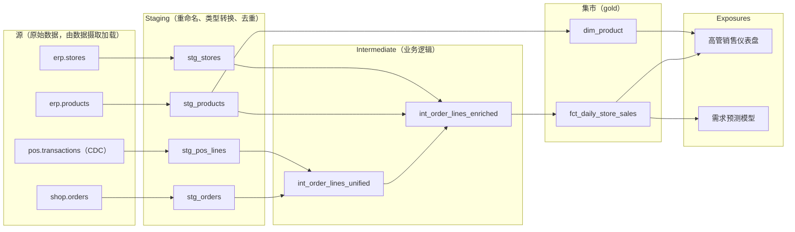
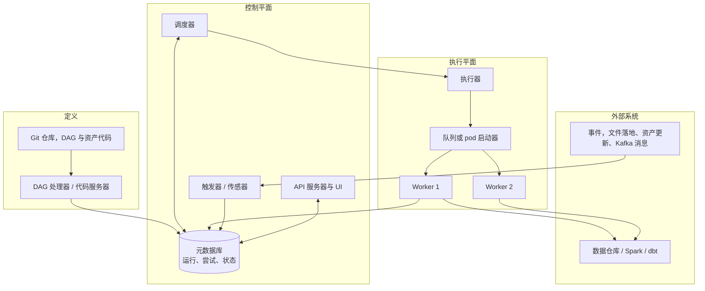
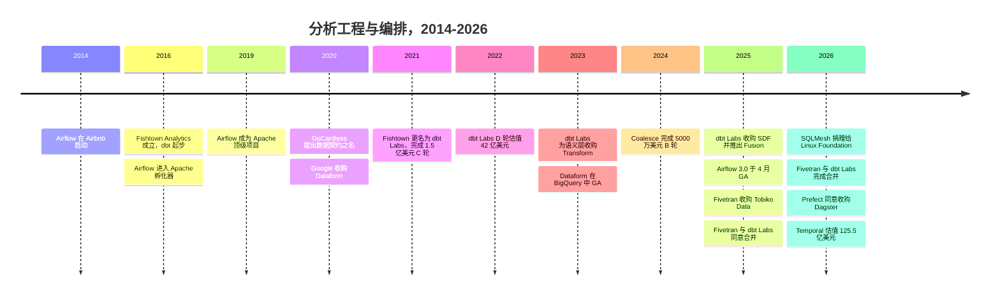

# 12. 数据转换与编排
> **深度：** L2 · **阅读时间：** 约 14 分钟 · **最后核实：** 2026-11-01 · **前置阅读：** [第 9 章 — 数据管道模式](ch09-pipeline-patterns.md)

<a id="tldr"></a>
## 要点速览（TL;DR）

- **数据转换（transformation）是原始数据变成业务事实的地方。** 在 [ELT](../glossary.md#elt) 模式下，数据以原始形态落入数据仓库或湖仓一体（lakehouse）。随后由 SQL 模型对其进行清洗、连接和聚合，形成人们信任的表。[dbt](../glossary.md#dbt) 把这件事变成了一门软件工程学科：把版本控制、测试和依赖图应用到 SQL 上。
- **编排（orchestration）决定工作何时运行、按什么顺序运行，以及失败时如何处理。** Apache Airflow 是在位者。它于 2014 年起源于 Airbnb，并于 2025 年 4 月发布了重写后的 3.0 版本。[^airflow-hist][^airflow3] Dagster（以资产为中心）、Prefect（Python 原生）和 Temporal（[持久化执行（durable execution）](../glossary.md#durable-execution)）是主要替代方案。
- **独立工具层已经整合。** Fivetran 于 2025 年 9 月收购了 Tobiko Data（SQLMesh），并于 2026 年 6 月 1 日完成了与 dbt Labs 的全股票合并。合并后的年度经常性收入（ARR）"接近 $600M"（公司披露）。[^tobiko][^merger-close] Prefect 于 2026 年 7 月同意收购 Dagster。[^prefect-dagster]
- **平台正从下方吸收这一层。** Snowflake Dynamic Tables、Databricks Lakeflow Spark Declarative Pipelines（原 Delta Live Tables）和 Google Dataform 把数据转换内建到引擎中。Snowflake 还能原生运行 dbt 项目（2025 年 11 月 GA）。[^dbt-sf][^ldp][^dataform]
- **对智能体（agent）而言，编排层正在变成控制平面。** Temporal 的 E 轮融资于 2026 年 9 月给出了 $12.55B 的估值（公司披露），其逻辑是长时间运行的 AI 智能体需要重试和保存的状态。[^temporal] [数据契约（data contract）](../glossary.md#data-contract)把同样的思路带到了数据生产者与消费者之间的接口上。

<a id="why-this-matters-business--everpure-lens"></a>
## 为何重要（业务 + Everpure 视角）

每一个仪表盘数字、预测特征和 RAG 源表都经过了数据转换层。这一层编码了公司的业务逻辑：什么算"净收入"、哪些订单已取消、门店如何映射到区域。战略从业者应关注它，原因有三。

第一，这里是**锁定效应所在**。迁移数据仓库很痛苦，但重写 2,000 个 dbt 模型更糟。这就是为什么 dbt 在 2025 年决定以 ELv2 和专有条款发布 Fusion 引擎、随后又与 Fivetran 合并，会让客户如此担忧。这也是 Snowflake 和 Databricks 希望数据转换在自己的引擎内运行的原因。

第二，**编排是一门定价权较弱的可靠性生意**。Airflow 是免费的，并由 AWS（MWAA）和 Google（Cloud Composer）作为托管服务提供。因此商业厂商竞争的是运维、可观测性和开发者体验，而不是调度本身。

第三，**智能体正在重塑这一品类**。一个运行数小时、调用工具并等待人工审批的智能体，需要与数据管道相同的基础原语：重试、保存的状态，以及对发生过什么的清晰记录。投资者已经为此定价：Temporal 的估值在七个月内从 $5B 升至 $12.55B（公司披露）。[^temporal-d][^temporal]

对 Everpure（原 Pure Storage；NYSE: P）而言，要点很窄：每一层数据转换都会产生**派生副本**。一个"gold"集市（mart）是由 silver 和 bronze 表构建的一张新物理表，通常还附带若干用于开发和 CI 的环境副本。这会成倍放大容量，并使基于数据血缘（lineage）的保留策略成为一个真实的存储策略问题。Everpure 的数据智能抱负位于这一层的旁边，而不是其内部。

<a id="how-it-works"></a>
## 工作原理

<a id="transformation-from-raw-tables-to-a-model-graph"></a>
### 数据转换：从原始表到模型图

一个 dbt 项目是一个装满 SQL `SELECT` 语句的文件夹，每条语句保存为一个称为*模型*的文件。模型代码把 SQL 与 [Jinja](../glossary.md#jinja) 模板混合使用。关键函数是 `ref('other_model')`。它承担两项工作：解析为当前环境中正确的物理表名，并记录一条依赖边。dbt 把每个 `ref()` 和 `source()` 调用解析成一个[有向无环图](../glossary.md#directed-acyclic-graph)（DAG）。然后按依赖顺序运行模型，并在图允许的地方并行运行。[^dbt-mat]

每个模型都有一种[物化方式（materialization）](../glossary.md#materialization)，它决定结果如何持久化：[^dbt-mat]

- **视图（View）：** 不存储任何内容。构建成本低，但每次查询都要重新计算。
- **表（Table）：** 每次运行都完全重建该模型。简单且正确，但在大规模下成本高昂。
- **增量（Incremental）：** 只处理新增或变更的行，并合并到现有表中。这是大型事实表最主要的成本杠杆，也是细微缺陷的主要来源，例如迟到的行和重复键。
- **临时（Ephemeral）：** 模型以 CTE（公共表表达式）的形式内联到其下游模型中。

测试（`unique`、`not_null`、`relationships`、`accepted_values` 以及自定义 SQL）在模型旁边的 YAML 中声明，并在每次构建后作为查询运行。文档由同样的 YAML 和 DAG 生成。[Exposure（暴露）](../glossary.md#exposure)记录消费某个集市的仪表盘、机器学习模型或应用，从而把图延伸到业务结果。



*图 12.1 — 一个 dbt 项目是由 `ref()` 调用构建的依赖图。Staging 层隔离源系统的怪异之处，intermediate 模型承载业务逻辑，集市则是 exposure 所消费的对象。*

下面是这家零售商的每日销售集市，采用增量模型。三天的回看窗口会重新处理最近几天的数据，因此迟到的销售终端（POS）记录仍会被计入：

```sql
{{ config(materialized='incremental', unique_key=['store_id', 'sale_date']) }}

select
    store_id,
    cast(ordered_at as date)   as sale_date,
    sum(net_amount)            as net_sales,
    count(distinct order_id)   as orders
from {{ ref('int_order_lines_enriched') }}

where ordered_at >= (select dateadd(day, -3, max(sale_date)) from {{ this }})

group by 1, 2
```

> **类比：半导体。** dbt 的 `ref()` 图就像芯片流程中的构建系统。RTL 输入综合，综合输入布局布线，布局布线输入时序签核。Make 风格的依赖跟踪只重建下游发生变化的部分。dbt 的 `state:modified+` 选择器对 SQL 做同样的事：重建已变更的模型及其后代，跳过其余部分。增量模型类似于增量编译。它们很快，但你得相信缓存状态依然有效。

<a id="sqlmesh-fusion-and-the-compiler-turn"></a>
### SQLMesh、Fusion 与"编译器"转向

dbt Core 把 SQL 当作文本处理：Jinja 渲染出一个字符串，由数据仓库来发现错误。更新的工具会解析 SQL 本身。**SQLMesh**（由 Tobiko Data 基于其 SQLGlot 解析器构建）能理解每一条查询。这赋予它[列级数据血缘（column-level lineage）](../glossary.md#column-level-lineage)和变更分类能力：在任何东西运行之前，它就能区分破坏性变更和非破坏性变更。其 `plan` 命令会展示一项变更的影响、运行单元测试，并在应用之前请求审批。[^sqlmesh-docs] SQLMesh 还提供[虚拟数据环境（virtual data environment）](../glossary.md#virtual-data-environment)。用户面对的是一层指向带版本物理表的视图。因此，开发或 CI 环境可以复用未发生变化的生产表，而晋升（promotion）只是一次指针切换，而非重建。[^sqlmesh-docs]

dbt Labs 的回应是在 2025 年 1 月收购了 Rust SQL 编译器初创公司 **SDF Labs**。[^sdf] 2025 年 5 月，它推出了 **dbt Fusion 引擎**，这是一个 Rust 重写版本，解析大型项目的速度比 dbt Core 快最多 30 倍（公司披露），并能原生理解各种 SQL 方言。[^fusion] 引发争议的是许可证。Fusion 以专有代码和 Elastic License 2.0（ELv2）下的源码可见代码混合形式发布，按 OSI 标准不属于开源，并禁止在竞争性托管服务中使用。dbt Core 仍保持 Apache 2.0。[^fusion-lic] 包括 Tobiko 在内的竞争对手称这是 dbt Core 衰落的开始。[^fusion-lic]

合并改变了局面。此后 dbt Labs 发布了 **dbt Core v2**：一个 Apache 2.0 许可的 Rust 运行时，由此前承诺以 ELv2 发布的代码构建而成。功能更完整的 Fusion 二进制仍依据 dbt 的产品许可协议保持专有。[^core-v2] 截至本文撰写时，Core v2 处于 alpha/beta 阶段，Fusion 已在 Snowflake 上 GA，其他适配器处于预览阶段。[^core-v2][^fusion-avail] `[VERIFY: Core v2 发布日期及当前成熟度；Fusion 已 GA 的适配器]`

<a id="analytics-engineering-as-a-discipline"></a>
### 作为一门学科的分析工程

更大的转变发生在人身上，而不是工具上。大约 2016 年以前，SQL 业务逻辑存在于 BI 工具、存储过程或分析师的笔记本电脑里。它没有版本控制、没有代码评审，也没有测试。dbt 于 2016 年起源于费城咨询公司 Fishtown Analytics，它把软件工程方法应用到 SQL 上：Git、pull request、每次变更都运行的 CI，以及能阻止合并的测试。[^fishtown] [分析工程师（analytics engineer）](../glossary.md#analytics-engineering)这一职位名称在大约 2018 年至 2020 年间通过 dbt 社区的写作传播开来。它描述的是介于负责搬运数据的数据工程师与负责解读数据的分析师之间的角色。`[VERIFY: "analytics engineer" 一词最早有据可查的使用]` 云数据仓库让这在经济上可行。一旦计算变得弹性且按用量计费，在数据仓库内部用 SQL 重建一切就胜过了单独的 ETL 服务器。

<a id="data-contracts-moving-quality-upstream"></a>
### 数据契约：把质量前移到上游

数据转换代码依赖于源系统输出的任何内容。当应用团队重命名一列时，数据管道会在凌晨 2 点崩溃。**数据契约**是由生产者拥有的一份协议。它涵盖某个数据集的模式、含义、新鲜度和质量 SLA，并在变更发布之前于生产者的 CI 中强制执行。Andrew Jones 于 2020 年在 GoCardless 开始使用这一术语，2021 年公开撰文讨论，并于 2023 年就此出版了一本书。[^jones] O'Reilly《*Data Contracts*》一书的合著者 Chad Sanderson 为推广这一理念做了大量工作。标准化工作如今由 **Bitol** 承担，这是 Linux Foundation AI & Data 旗下的一个项目。其 Open Data Contract Standard（ODCS）是一份 YAML 规范，版本为 3.1.0（2025 年 12 月），涵盖模式、质量规则、SLA、所有权和定价。[^odcs] dbt 的"模型契约"是其在消费者一侧的近亲：如果模型的输出列和类型偏离了声明的形态，模型将构建失败。

> **类比：半导体。** 数据契约就是 SoC 上各 IP 模块之间的接口规范。总线协议、信号位宽和时序预算在任何一方流片之前就已商定。IP 供应商不会擅自改变 AXI 端口位宽，然后让集成方在硅片上才发现问题。数据契约让应用团队对其下游的数据团队遵守同样的纪律。

<a id="orchestration-scheduler-executor-memory"></a>
### 编排：调度器、执行器与记忆

[编排器（orchestrator）](../glossary.md#orchestrator)把任务图转化为执行。各工具的架构相似：代码定义工作流，调度器决定哪些任务已就绪，执行器把工作分派给 worker，元数据库记录每一次尝试。



*图 12.2 — 编排器把"决定"（调度器加元数据库）与"执行"（执行器加 worker）分离。传感器和触发器让外部事件——而不仅仅是时钟——也能启动工作。*

关键机制：

- **调度。** 基于时间的调度（cron，例如"每天 02:00"）简单，但对数据一无所知。事件驱动或资产感知的调度会在上游数据真正发生变化时启动工作。Airflow 3.0 把"datasets"更名为 **assets（资产）**，并增加了事件驱动调度。Dagster 则是围绕[软件定义资产（software-defined asset）](../glossary.md#software-defined-asset)构建的，其基本单位是表，而不是任务。[^airflow3][^dagster-docs]
- **重试与[幂等性（idempotency）](../glossary.md#idempotency)。** 数据仓库超时或 API 限流等瞬时故障司空见惯。带退避的重试可以处理它们，但前提是每个任务都能被安全地重新运行，例如使用 `MERGE` 而不是 `INSERT`。
- **[回填（backfill）](../glossary.md#backfill)。** 在修复缺陷或新增一列后重新处理过去的日期。Airflow 3.0 把回填移入调度器，因此回填会像普通运行一样被跟踪。[^airflow3] 按日期分区的资产使得只回填受影响的切片成为可能。
- **SLA 与新鲜度。** "销售集市在 06:00 前就绪"是关于数据的承诺，而不是关于任务的承诺。资产感知工具把它直接表述为新鲜度策略。以任务为中心的工具则通过截止时间和告警间接表述。
- **[传感器（sensor）](../glossary.md#sensor)。** 等待某个条件（例如文件落地或分区出现）的任务。Airflow 的"可延迟"（deferrable）传感器在等待期间会释放其 worker 槽位。

> **类比：晶圆厂运营。** 编排器就是晶圆厂的制造执行系统（MES）。MES 知道每个批次的工艺路线（DAG），把批次派往可用的机台（worker），在机台漂移出规格时扣留批次（测试失败），为谱系追溯记录每一步（元数据库），并从指定步骤返工一个批次而不是报废晶圆（清除并重跑下游）。以资产为中心的编排就像按晶圆状态而不是按工艺步骤来跟踪在制品。

<a id="durable-execution-orchestration-for-agents"></a>
### 持久化执行：面向智能体的编排

Temporal 来自另一种传统：应用工作流，而非数据。开发者编写普通代码，运行时把每一步的结果保存在事件历史中。崩溃之后，工作流会从停止的那一行精确恢复，即使是数周之后。这就是 AI 智能体开发者采用它的原因。"规划、调用工具、等待审批、重试"这样的智能体循环，就是一个必须在重启后存活的长时间运行工作流。[^temporal] Airflow 3.1（2025 年 9 月）朝同一方向迈进，推出了人在回路（human-in-the-loop）算子，可让任务暂停，直到有人在 UI 中批准。[^airflow31]

<a id="worked-example-the-retailers-nightly-mart-under-failure"></a>
## 实例演算：零售商的夜间集市遭遇故障

以图 12.1 的项目为例。它约有 40 个模型，每晚 02:00 运行，必须在 06:00 前为高管仪表盘准备就绪。某天夜里出了两处故障。02:20，一次数据仓库超时终止了 `int_order_lines_enriched`。随后在重跑时，`stg_pos_lines` 又失败了，因为 POS 团队把 `discount_amt` 重命名为 `discount_amount`。

在 **Airflow** 中，结果取决于 dbt 是如何接入的。单一的 `dbt build` 任务会作为一个整体失败。值班工程师要么重跑全部 40 个模型，要么手工拼写一条 `--select` 命令。如果采用每个模型一个任务的方式（开源的 Astronomer Cosmos 包可以生成这些任务），Airflow 会自动重试超时的任务，工程师可以"清除"失败的任务及其所有下游任务。但 Airflow 看到的仍然是任务，而不是表。除非声明了资产，否则它无法说出哪些仪表盘现在已经过时。

在 **Dagster** 中，每个 dbt 模型都是一个资产。UI 会把 `int_order_lines_enriched` 及其后代显示为失败或过时，"重新物化失败项及其下游"只需一个操作。dbt 测试以资产检查（asset check）的形式出现，而 `fct_daily_store_sales` 上的新鲜度策略会直接触发 06:00 告警。采用每日分区后，回填上周的坏数据只涉及七个分区。

两种编排器都无法修复列重命名问题。对模式破坏进行重试只会再次失败。解决办法是 dbt 模型契约——它会在坏数据到达集市之前大声地中止构建；更好的办法是在 POS 团队的 CI 中检查一份 ODCS 契约，在重命名发布之前就将其拦截。**编排器能从瞬时故障中恢复，契约则能预防语义故障。**

| 故障 | Airflow（以任务为中心） | Dagster（以资产为中心） | 真正的解决办法 |
|---|---|---|---|
| 数据仓库超时 | 任务带退避重试；清除并重跑下游 | 运行重试；重新物化失败项及其下游 | 幂等模型（MERGE） |
| POS 数据迟到 | 传感器或可延迟等待；否则出现无声的缺口 | 上游资产不新鲜，因此下游等待或告警 | 增量回看窗口 |
| 上游重命名了列 | 每次重试都失败 | 每次重试都失败；资产检查显示影响范围 | 生产者数据契约加 dbt 模型契约 |
| 缺陷已修复，历史数据错误 | 由调度器管理的日期区间回填（3.0+） | 只回填受影响日期的分区 | 分区化、幂等的集市 |
| "仪表盘过时了吗？" | 除非声明资产，否则只能从任务状态推断 | 每个资产原生的新鲜度状态 | 以代码形式定义的新鲜度 SLA |

*图 12.3 — 同样的故障，在以任务为中心和以资产为中心的编排器看来并不相同。两者都无法靠重试越过语义破坏。*

<a id="design-choices-and-trade-offs"></a>
## 设计选择与权衡

| 工具 | 范式 | 运行位置 | 许可证 / 模式 | 优势 | 主要弱点 |
|---|---|---|---|---|---|
| dbt Core（v1.x / v2） | SQL + Jinja 模型，`ref()` DAG | 通过适配器支持任意数据仓库 | Apache 2.0（Core v2 运行时为 Rust） | 庞大的生态系统和人才库 | 文本模板；v1 在大型项目上解析缓慢 |
| dbt 平台（Cloud）/ Fusion | 同样的模型，加上 IDE、CI、语义层、Mesh | SaaS；Fusion 二进制在本地运行 | 专有 SaaS；Fusion 采用 dbt 许可证 | 企业最快的路径；理解 SQL | 现已归属 Fivetran；存在定价和路线图风险 |
| SQLMesh | 经解析的 SQL/Python，基于 plan 的部署 | 通过 SQLGlot 支持多种引擎 | Apache 2.0；Linux Foundation 项目（2026） | 虚拟环境、列级血缘、低成本 CI | 社区较小；其主要赞助方（Fivetran）同时拥有 dbt |
| Coalesce | 可视化、元数据驱动，生成 SQL | 优先支持 Snowflake，陆续增加其他引擎 | 专有 SaaS | 对偏好 GUI 和模板的团队而言速度快 | 可移植性较差；生态系统较小 |
| Dataform（Google） | BigQuery 中的 SQLX 模型 | 仅 BigQuery | 在 GCP 中免费（按查询付费） | 零额外成本，BigQuery 原生 | 单一云 |
| Snowflake Dynamic Tables | 带目标延迟的声明式 SQL | 仅 Snowflake | Snowflake 按用量计费 | 无需编排器；增量刷新 | 逻辑锁定在单一引擎；测试能力有限 |
| Lakeflow Spark Declarative Pipelines | 声明式 SQL/Python 表，流式或批处理 | Databricks；核心位于 Apache Spark 4.1 | Databricks 按用量计费；Spark 核心为 Apache 2.0 | 批处理 + 流处理，内建 expectations | 最好的功能仍由 Databricks 托管 |

*图 12.4 — 数据转换工具从可移植框架（dbt、SQLMesh）一直延伸到引擎原生功能（Dynamic Tables、Lakeflow、Dataform）。可移植性与运维简洁性之间存在取舍。*

表格来源：dbt、SQLMesh、Snowflake、Databricks 和 Google 的文档，以及上文的许可证说明。[^dbt-mat][^core-v2][^sqlmesh-lf][^dt][^ldp][^dataform][^coalesce]

**引擎原生数据转换的最强版本论证。** Snowflake Dynamic Tables 让用户声明一条查询和一个目标延迟，最低可设为 60 秒。随后 Snowflake 会自行确定刷新顺序，并在可能时进行增量刷新，无需运行调度器。[^dt] 对于只用 Snowflake 的企业，这就省掉了一整个工具。**可移植框架的最强版本论证。** 业务逻辑是公司最持久的资产。把它保存在一个引擎中立、带有测试的仓库中，能在续约时保留谈判筹码。这就是 Snowflake 和 Databricks 都选择*托管* dbt 而不是与之对抗的原因。[^dbt-sf]

| 维度 | Apache Airflow | Dagster | Prefect | Temporal | Lakeflow Jobs | Kestra |
|---|---|---|---|---|---|---|
| 核心抽象 | 任务 DAG（自 3.0 起支持资产） | 软件定义资产 | Python flow/task | 持久化工作流与活动（activity） | 由 notebook/pipeline/SQL 任务组成的作业 | YAML 声明的 flow |
| 编写方式 | Python | Python，感知 dbt | 普通 Python 装饰器 | Go/Java/Python/TS SDK | UI、YAML bundle、API | YAML 加 UI，可用任意语言脚本 |
| 触发模型 | Cron、资产事件、传感器 | 声明式自动化、传感器、调度 | 调度、事件、临时触发 | 代码驱动、信号、定时器 | 调度、文件到达、表更新 | 调度、事件、webhook |
| 故障恢复 | 重试；清除任务及其下游 | 重新物化失败项及其下游 | 重试、缓存、恢复 | 依据事件历史重放到精确步骤 | 对失败任务进行修复运行 | 重试，从失败任务处重放 |
| 血缘 / 数据感知 | 弱到中等（资产、OpenLineage） | 强（资产图、检查） | 中等 | 无（并非数据专用） | 在 Unity Catalog 内部较强 | 中等 |
| 商业版 / 托管 | Astronomer Astro、AWS MWAA、Google Cloud Composer | Dagster+（现属 Prefect） | Prefect Cloud | Temporal Cloud | 捆绑在 Databricks 中 | Kestra Enterprise / Cloud |
| 最佳适用 | 异构的企业数据管道 | 数据平台团队、重度使用 dbt 的企业 | Python 与机器学习团队 | 智能体、事务、长时间运行的应用 | 以 Databricks 为中心的环境 | 多语言、配置优先的团队 |

*图 12.5 — Airflow 胜在无处不在，Dagster 胜在数据感知，Temporal 胜在持久性，平台原生作业胜在便利。选择主要取决于整体环境的异构程度。*

<a id="whos-who"></a>
## 主要参与者

- **Fivetran + dbt Labs。** Fivetran 如今拥有默认的数据摄取连接器库、默认的数据转换框架（dbt）、其主要挑战者（SQLMesh，于 2026 年 3 月捐赠给 Linux Foundation）以及反向 ETL（Census，2025 年 5 月达成协议；交割未单独公告）。[^merger-close][^sqlmesh-lf] 它是一家横亘在数据仓库与其客户之间的完整 ELT 厂商。George Fraser 担任 CEO，Tristan Handy 担任总裁。参见[第 30 章](../04-company-deep-dives/ch30-data-movement-streaming-companies.md)。
- **Astronomer。** Airflow 最主要的商业维护方和最大贡献者。它销售 Astro 托管服务，并于 2025 年 5 月完成 $93M 的 D 轮融资（媒体报道估值约 $775M）。[^astro-d] 其风险在于 AWS 和 Google 在自家计算服务旁边销售托管 Airflow。MWAA 自 2025 年 10 月起支持 Airflow 3.0。[^mwaa]
- **Prefect + Dagster。** Prefect 于 2026 年 7 月 13 日宣布收购 Dagster Labs，条款未披露。两款产品都保留各自的名称和许可证：Dagster 被定位为"成果"层，Prefect 被定位为"执行"层。[^prefect-dagster] `[VERIFY: 交割日期]`
- **Temporal。** 持久化执行领域的领导者，脱胎于 Uber 的 Cadence。它在 E 轮融资时披露拥有超过 4,300 家付费客户（媒体报道）。[^temporal]
- **平台。** Snowflake（Dynamic Tables、dbt Projects on Snowflake）、Databricks（Lakeflow Spark Declarative Pipelines 和 Lakeflow Jobs，原 Delta Live Tables 和 Workflows）[^ldp][^lakeflow-jobs]以及 Google（Dataform、Cloud Composer）。
- **其他。** Coalesce（可视化数据转换；2024 年 4 月完成 $50M B 轮）[^coalesce]、Kestra（开源声明式编排）和 Mage（笔记本风格的数据管道）。Spark/PySpark 作业仍是重型非 SQL 数据转换的默认选择，可由上述任一编排器调度。

<a id="history-and-trajectory"></a>
## 历史与发展轨迹



*图 12.6 — 2014–2020 年的开源工具变成了 2021–2022 年获风险投资支持的公司，随后又成为 2025–2026 年的整合标的。*

这段历程分为三个阶段。**2014–2020，开源发明期。** Airflow（Airbnb，2015 年开源，2019 年 1 月成为 Apache 顶级项目）[^airflow-hist]和 dbt（2016）用代码取代了专有的 ETL 图形界面。**2021–2022，现代数据栈的巅峰。** dbt Labs 于 2021 年 6 月完成 $150M C 轮并更名，随后于 2022 年 2 月以 $4.2B 估值（公司披露）完成 $222M D 轮。[^fishtown][^funding-csv] Fivetran 于 2021 年 9 月以 $5.6B 估值融资。[^funding-csv] **2023–2026，再捆绑。** dbt Labs 收购了 Transform（2023），ARR 突破 $100M（公司披露，2025 年 2 月），并收购了 SDF。[^transform][^dbt-100m][^sdf] 随后独立厂商开始整合：Fivetran 收购 Tobiko 并与 dbt Labs 合并，Prefect 同意收购 Dagster（待完成）。与此同时，各平台原生构建或托管了数据转换。2021 年 Fivetran 的估值和 2022 年 dbt Labs 的估值都没有在后续轮次中重新定价，而全股票合并又回避了现金价格的检验。因此外界无法判断各自独立的估值是否仍然成立。看空的解读是这些估值过高；看多的解读是合并避免了一轮折价融资，同时合并后的 ARR 持续向 $600M 增长。参见[第 43 章](../06-history-and-future/ch43-modern-data-stack.md)。

下一步：数据转换将成为一个**编译器问题**，涉及经解析的 SQL、列级血缘和低成本虚拟环境；编排则将成为一个**智能体运行时问题**。智能体将编写更多的 dbt 模型。这会提升测试、契约和语义定义（[第 14 章](ch14-semantic-layers-and-bi.md)）以及可观测性（[第 13 章](ch13-data-quality-observability-lineage.md)）作为护栏的价值。

<a id="numbers-that-matter"></a>
## 关键数字

| 指标 | 数值 | 口径 | 来源 / 日期 |
|---|---|---|---|
| Fivetran + dbt Labs 合并后 ARR | "接近 $600M" | 公司披露，交割时 | Fivetran，2026-06-01[^merger-close] |
| Fivetran + dbt Labs 客户数 | "远超" 10,000 | 公司披露，宣布时 | dbt Labs，2025-10-13[^merger-ann] |
| dbt Labs ARR | >$100M | 公司披露 | dbt Labs，2025-02-05[^dbt-100m] |
| dbt Cloud 付费客户 | >5,000（同比 +30%） | 公司披露 | dbt Labs，2025-02-05[^dbt-100m] |
| dbt Labs 最近一次定价估值 | $4.2B（D 轮，$222M） | 公司披露 | 2022 年 2 月[^funding-csv] |
| Fusion 相对 dbt Core 的解析速度 | 最高 30 倍 | 公司披露的基准测试 | dbt Labs，2025-05-28[^fusion] |
| Airflow 月下载量 | 约 31M（2024 年 11 月；2020 年 <900K） | 公司披露（Astronomer：PyPI + Docker 拉取量） | Astronomer，2025[^soa] |
| Airflow 贡献者 | 3,000+（2025 年报告）；3.4K（当前官网） | 公司披露 | Astronomer[^soa][^astro-about] |
| Astronomer D 轮 | $93M，估值约 $775M | 媒体报道 | 2025 年 5 月[^astro-d] |
| Temporal E 轮 | $550M，估值 $12.55B | 公司披露 | 2026-09-14[^temporal] |
| Temporal 年化收入 | >$250M | 媒体报道 | 2026-09[^temporal] |
| Snowflake Dynamic Tables 最小目标延迟 | 60 秒 | 产品文档 | Snowflake 文档[^dt] |

*图 12.7 — 合并后的"数据摄取加数据转换"厂商 ARR 正接近 $0.6B，其中截至 2025 年初 dbt Labs 贡献了超过 $100M（两者均为公司披露）。编排的价值正在向智能体时代的持久化执行转移。*

<a id="conversation-playbook"></a>
## 对话手册

**向产品经理提的三个问题**

1. "你们的客户中，在数据仓库原生功能内做数据转换的比例与使用 dbt 或 SQLMesh 的比例分别是多少？这一比例在变化吗？" 好的回答会给出带数字的趋势，并解释哪些负载最先迁移，通常是只用 Snowflake 的简单数据管道。
2. "自 Fivetran–dbt 合并以来，你们 dbt 平台的续约以及从 Core 到 Cloud 的转化发生了什么变化？" 好的回答会把许可证焦虑（关于 Core v2 和 Fusion 的条款）与定价焦虑区分开来，并坦诚说出客户流失的去向。
3. "智能体目前如何使用你们的编排器：作为调用方、作为工作流的编写者，还是作为负载？" 好的回答是具体的，例如"x% 的新 DAG 由智能体生成"，并会提到人在回路的审批关口。

**向工程师提的三个问题**

1. "当上游模式发生变化时，最先在哪里失败：生产者 CI、dbt 契约，还是生产环境？" 好的回答是"通过契约检查，在生产者 CI 中失败"。弱的回答是"我们从仪表盘上发现的"。
2. "你们如何回填有问题的一周数据，而不必重新处理一整年？" 好的回答会提到日期分区、幂等的 MERGE 模型以及由调度器管理的回填。
3. "你们的 gold 表有多少个环境副本？由谁来删除它们？" 好的回答会提到零拷贝克隆或虚拟环境，再加上保留策略。这也是与存储相关的问题。

**不要这样说**

- "dbt 是一个数据库"或"dbt 搬运数据"。dbt 编译 SQL 并把它发送给引擎。它不存储任何东西，也不摄取任何东西。
- "Airflow 处理数据。" Airflow 调度并跟踪工作。处理工作由 worker 或外部引擎完成。
- "dbt 闭源了。" dbt Core 仍是 Apache 2.0，Core v2 也是 Apache 2.0。增强型引擎 Fusion 才是专有的。
- 把"Delta Live Tables"当作当前的产品名称。它现在叫 Lakeflow Spark Declarative Pipelines。
- "数据契约就是模式。" 它还涵盖所有权、含义、SLA 以及在生产者 CI 中的强制执行。

<a id="going-deeper"></a>
## 深入阅读

> **深入（L3）。** 阅读 Airflow 3.0 的发布说明，了解 Task SDK 和 Task Execution API，它们使 worker 不再直接访问元数据库。[^airflow3] 阅读 SQLMesh 关于变更分类和虚拟环境的文档。[^sqlmesh-docs] dbt 的物化方式和增量策略页面解释了 `merge`、`delete+insert` 与 `microbatch` 的区别。[^dbt-mat] GitHub 上的 ODCS v3 规范提供了一个完整的契约示例。[^odcs] Temporal 关于事件历史重放的文档解释了为什么工作流代码必须是确定性的。

相关章节：[第 9 章](ch09-pipeline-patterns.md)（ELT 与 CDC 模式）、[第 10 章](ch10-ingestion-and-integration.md)（让源数据落地的连接器）、[第 13 章](ch13-data-quality-observability-lineage.md)（测试、可观测性、数据血缘）、[第 14 章](ch14-semantic-layers-and-bi.md)（集市之上的指标）、[第 30 章](../04-company-deep-dives/ch30-data-movement-streaming-companies.md)（作为企业的 Fivetran、dbt Labs 及同业）、[第 43 章](../06-history-and-future/ch43-modern-data-stack.md)（现代数据栈的兴起与再捆绑）。

<a id="key-terms"></a>
## 关键术语

- [dbt](../glossary.md#dbt) — 开源框架，把 SQL 加 Jinja 模型编译成依赖图，并在数据仓库中运行它们。
- [分析工程（Analytics engineering）](../glossary.md#analytics-engineering) — 把软件实践（Git、CI、测试、代码评审）应用于 SQL 数据转换。
- [有向无环图（Directed acyclic graph）](../glossary.md#directed-acyclic-graph) — 由带依赖边且无环的任务或模型组成的图；决定运行顺序。
- [物化方式（Materialization）](../glossary.md#materialization) — dbt 模型的持久化方式：视图、表、增量或临时。
- [增量模型（Incremental model）](../glossary.md#incremental-model) — 只处理新增或变更的行并将其合并到现有表中的模型。
- [Exposure（暴露）](../glossary.md#exposure) — dbt 模型已声明的下游消费者（仪表盘、机器学习模型、应用）。
- [列级数据血缘（Column-level lineage）](../glossary.md#column-level-lineage) — 追踪哪些源列为每个输出列提供数据。
- [虚拟数据环境（Virtual data environment）](../glossary.md#virtual-data-environment) — SQLMesh 在带版本物理表之上的视图层，可提供低成本的开发/CI 环境。
- [数据契约（Data contract）](../glossary.md#data-contract) — 由生产者拥有并强制执行的、关于数据集模式、含义、质量和 SLA 的协议。
- [编排器（Orchestrator）](../glossary.md#orchestrator) — 调度、运行、重试并记录工作流的软件。
- [软件定义资产（Software-defined asset）](../glossary.md#software-defined-asset) — Dagster 的基本单位：在代码中连同其上游依赖一起声明的数据资产。
- [回填（Backfill）](../glossary.md#backfill) — 对历史时段重新运行数据管道。
- [幂等性（Idempotency）](../glossary.md#idempotency) — 重新运行一个任务与只运行一次得到相同结果的性质。
- [传感器（Sensor）](../glossary.md#sensor) — 在下游工作开始之前等待某个外部条件的任务。
- [持久化执行（Durable execution）](../glossary.md#durable-execution) — 保存每个工作流步骤的运行时，使代码在故障后能从停止处精确恢复。
- [动态表（Dynamic table）](../glossary.md#dynamic-table) — Snowflake 的声明式表，会自动刷新以满足目标延迟。
- [声明式数据管道（Declarative pipeline）](../glossary.md#declarative-pipeline) — 按其应产出的表而非步骤来定义的数据管道；例如 Lakeflow Spark Declarative Pipelines。
- [Jinja](../glossary.md#jinja) — dbt 用于宏和 `ref()` 的 Python 模板语言。
- [ELT](../glossary.md#elt) — 抽取、加载，然后在目标引擎内部进行转换。

<a id="sources"></a>
## 资料来源

[^airflow-hist]: Apache Airflow, "Project" (history section), https://airflow.apache.org/docs/apache-airflow/1.10.4/project.html, n.d.（文档 v1.10.4，2019）；检索 2026-11-01。
[^airflow3]: Apache Airflow, "Release Notes — Airflow 3.0.0," https://airflow.apache.org/docs/apache-airflow/3.0.0/release_notes.html, 发布 2025-04-22；检索 2026-11-01。
[^airflow31]: Apache Airflow blog, "Apache Airflow 3.1.0: Human-Centered Workflows," https://airflow.apache.org/blog/airflow-3.1.0/, 发布 2025-09-25；Astronomer, "Introducing Apache Airflow 3.1," https://www.astronomer.io/blog/introducing-apache-airflow-3-1/, 2025-09；检索 2026-11-01。
[^mwaa]: AWS What's New, "Announcing Apache Airflow 3.0 support in Amazon Managed Workflows for Apache Airflow," https://aws.amazon.com/about-aws/whats-new/2025/10/apache-airflow-3-amazon-mwaa, 发布 2025-10-01；检索 2026-11-01。
[^soa]: Astronomer, "State of Apache Airflow 2025," https://www.astronomer.io/airflow/state-of-airflow/2025/, 2025；Astronomer press release, "Astronomer Releases 2025 State of Airflow Report," https://www.astronomer.io/press-releases/astronomer-releases-2025-state-of-airflow-report/, 2025；Astronomer blog, "How we track the growth of Apache Airflow," https://www.astronomer.io/blog/how-we-track-the-growth-of-apache-airflow/, n.d.；检索 2026-11-01。
[^astro-about]: Astronomer, "About us," https://www.astronomer.io/about-us/, n.d.；检索 2026-11-01。
[^astro-d]: Contrary Research, "Astronomer," https://research.contrary.com/company/astronomer, 2025（已记录于 `data/private_funding.csv`）；检索 2026-11-01。
[^dbt-mat]: dbt Labs documentation, "Materializations," https://docs.getdbt.com/docs/build/materializations, n.d.；检索 2026-11-01。
[^dbt-100m]: dbt Labs blog, "dbt Labs surpasses $100M ARR," https://getdbt.com/blog/dbt-labs-100m-arr-milestone, 发布 2025-02-05；BigDATAwire, "dbt Labs Surpasses $100M ARR," https://www.hpcwire.com/bigdatawire/this-just-in/dbt-labs-surpasses-100m-arr-expands-global-customer-base/, 2025-02；检索 2026-11-01。
[^sdf]: dbt Labs blog, "dbt Labs acquires SDF Labs," https://getdbt.com/blog/dbt-labs-acquires-sdf-labs, 发布 2025-01-14；SiliconANGLE, https://siliconangle.com/2025/01/14/big-data-company-dbt-labs-buys-sdf-labs-improve-sql-code-comprehension/, 2025-01-14；检索 2026-11-01。
[^fusion]: dbt Labs blog, "dbt Labs redefines dbt with new Fusion engine," https://www.getdbt.com/blog/dbt-labs-redefines-dbt-with-new-fusion-engine, 发布 2025-05-28；BigDATAwire, "dbt Labs Cranks the Performance Dial with New Fusion Engine," https://www.bigdatawire.com/2025/05/28/dbt-labs-cranks-the-performance-dial-with-new-fusion-engine, 2025-05-28；检索 2026-11-01。
[^fusion-lic]: dbt Labs blog, "New code, new license: understanding the new license for the dbt Fusion engine," https://www.getdbt.com/blog/new-code-new-license-understanding-the-new-license-for-the-dbt-fusion-engine, 发布 2025-05；Tobiko Data blog, "dbt Fusion: the death of dbt Core?," https://tobikodata.com/blog/dbt-fusion-death-of-dbt-core, 2025；检索 2026-11-01。
[^core-v2]: dbt Labs developer blog, "dbt Core v2 is here," https://docs.getdbt.com/blog/dbt-core-v2-is-here, 2026（具体日期未核实；每周摘要将其置于 2026 年 7 月）；dbt Labs, "Licensing FAQ," https://www.getdbt.com/licenses-faq, n.d.；检索 2026-11-01。
[^fusion-avail]: dbt Labs documentation, "About the dbt Fusion engine" 与 "Fusion readiness checklist," https://docs.getdbt.com/docs/fusion/about-fusion 与 https://docs.getdbt.com/docs/fusion/fusion-readiness, n.d.；检索 2026-11-01。
[^merger-ann]: dbt Labs blog, "dbt Labs and Fivetran merge announcement," https://www.getdbt.com/blog/dbt-labs-and-fivetran-merge-announcement, 发布 2025-10-13；Reuters via TradingView, "a16z-backed data firms Fivetran, dbt Labs to merge in all-stock deal," https://de.tradingview.com/news/reuters.com%2C2025%3Anewsml_L6N3VU00K%3A0-a16z-backed-data-firms-fivetran-dbt-labs-to-merge-in-all-stock-deal, 2025-10-13；检索 2026-11-01。
[^merger-close]: Fivetran press release, "Fivetran & dbt Labs Complete Merger to Create the Data Infrastructure for Trusted AI Agents," https://www.fivetran.com/press/fivetran-dbt-labs-complete-merger-to-create-the-data-infrastructure-for-trusted-ai-agents, 发布 2026-06-01；Pulse2, https://pulse2.com/fivetran-and-dbt-labs-complete-merger-to-build-trusted-ai-data-infrastructure/, 2026-06-05；检索 2026-11-01。
[^tobiko]: Fivetran press release, "Fivetran Acquires Tobiko Data to Power the Next Generation of Advanced, AI-Ready Data Transformation," https://www.fivetran.com/press/fivetran-acquires-tobiko-data-to-power-the-next-generation-of-advanced-ai-ready-data-transformation, 发布 2025-09-03；Business Wire, https://www.businesswire.com/news/home/20250903275106/en/, 2025-09-03；检索 2026-11-01。
[^sqlmesh-lf]: Fivetran press release, "Fivetran Contributes SQLMesh to the Linux Foundation to Advance Open Data Infrastructure," https://www.fivetran.com/press/fivetran-contributes-sqlmesh-to-the-linux-foundation-to-advance-open-data-infrastructure, 发布 2026-03-25；Linux Foundation, "Linux Foundation Welcomes SQLMesh Project," https://www.linuxfoundation.org/press/linux-foundation-welcomes-sqlmesh-project, 2026-03-25；检索 2026-11-01。
[^sqlmesh-docs]: SQLMesh documentation, "FAQ," https://sqlmesh.readthedocs.io/en/latest/faq/faq/, n.d.；SQLMesh GitHub README, https://github.com/SQLMesh/sqlmesh, n.d.；检索 2026-11-01。
[^coalesce]: TechCrunch, "Coalesce raises more cash to transform data for Snowflake customers," https://techcrunch.com/2024/04/04/coalesce-raises-more-cash-to-transform-data-for-snowflake-customers/, 发布 2024-04-04；Coalesce blog, "Let's Talk About Our Series B," https://coalesce.io/company-news/lets-talk-about-our-series-b/, 2024-04；检索 2026-11-01。
[^dataform]: Google Cloud blog, "Welcoming Dataform to BigQuery," https://cloud.google.com/blog/products/data-analytics/welcoming-dataform-to-bigquery, 发布 2020-12-08；TechCrunch, "Google quietly acquires Dataform," https://techcrunch.com/2020/12/09/google-quietly-acquires-dataform/, 2020-12-09；Google Cloud blog (Japan), "Introducing Dataform in GA," https://cloud.google.com/blog/ja/products/data-analytics/introducing-dataform-in-ga, 2023-06；检索 2026-11-01。
[^dt]: Snowflake documentation, "Dynamic tables," https://docs.snowflake.com/en/user-guide/dynamic-tables-intro, 以及 "Understanding dynamic table initialization and refresh," https://docs.snowflake.com/en/user-guide/dynamic-tables/refresh-modes, n.d.；检索 2026-11-01。GA 日期（第三方报道为 2024 年 4 月）未从 Snowflake 来源得到确认。
[^dbt-sf]: Snowflake release notes, "Nov 06, 2025: dbt Projects on Snowflake (General availability)," https://docs.snowflake.com/en/release-notes/2025/other/2025-11-06-dbt-projects-on-snowflake-ga, 发布 2025-11-06；"May 19, 2026: dbt Projects on Snowflake updates," https://docs.snowflake.com/release-notes/2026/other/2026-05-19-dbt-projects-on-snowflake-updates, 2026-05-19；检索 2026-11-01。
[^ldp]: Databricks documentation, "What happened to Delta Live Tables (DLT)?," https://docs.databricks.com/aws/en/ldp/where-is-dlt, n.d.；Databricks release notes, "November 2025," https://docs.databricks.com/aws/en/release-notes/product/2025/november, 2025-11；检索 2026-11-01。
[^lakeflow-jobs]: Databricks blog, "What's new in Workflows," https://www.databricks.com/blog/whats-new-workflows, 2025；Flexera, "Databricks Data + AI Summit 2025 recap," https://www.flexera.com/blog/finops/databricks-data-ai-summit-2025/, 2025-06；检索 2026-11-01。
[^dagster-docs]: Dagster documentation, "Software-defined assets," https://docs.dagster.io/concepts/assets/software-defined-assets, n.d.；Dagster API reference, "Assets," https://docs.dagster.io/api/python-api/assets, n.d.；检索 2026-11-01。
[^prefect-dagster]: Dagster blog, "Prefect is acquiring Dagster," https://dagster.io/blog/prefect-is-acquiring-dagster, 发布 2026-07-13；Dagster, "Customer FAQ: Prefect Acquisition," https://dagster.io/dagster-customer-faq, 2026-07；Techstrong.ai, "Prefect to acquire Dagster Labs to drive AI workflow automation," https://techstrong.ai/features/prefect-to-acquire-dagster-labs-to-drive-ai-workflow-automation/, 2026-07；检索 2026-11-01。
[^temporal]: Temporal, "Temporal raises $550M at a $12.55B valuation," https://temporal.io/news/temporal-raises-550m-at-a-12-55b-valuation, 发布 2026-09-14；GeekWire, https://www.geekwire.com/2026/temporal-raises-550m-hits-12-55b-valuation-as-agentic-ai-wave-fuels-massive-growth/, 2026-09；The Next Web, "Temporal raises $550m at $12.55bn," https://thenextweb.com/news/temporal-550m-series-e-12-55bn-valuation-lightspeed, 2026-09-14（>$250M 年化收入数字的来源，媒体报道）；检索 2026-11-01。
[^temporal-d]: Business Wire, "Temporal Raises $300M Series D to Make Agentic AI Real for Companies," https://www.businesswire.com/news/home/20260217453156/en/, 发布 2026-02-17；检索 2026-11-01。
[^jones]: Andrew Jones, *Driving Data Quality with Data Contracts*, Packt, 发布 2023-06, https://oreilly.com/library/view/driving-data-quality/9781837635009（前言将该术语追溯至 2020 年 8 月，首次公开撰文为 2021 年 4 月）；检索 2026-11-01。
[^odcs]: Bitol (Linux Foundation AI & Data), "Open Data Contract Standard," https://github.com/bitol-io/open-data-contract-standard, n.d.；Bitol, "Bitol Announces ODCS v3.1.0," https://bitol.io/?p=302, 2025-12；检索 2026-11-01。
[^fishtown]: Newswire, "Fishtown Analytics Rebrands as dbt Labs; Closes $150M to Develop Open-Source Analytics Engineering Software," https://www.newswire.com/view/content/fishtown-analytics-rebrands-as-dbt-labs-closes-150m-to-develop-open-21427433, 2021-06；Technical.ly, "dbt Labs Series C," https://technical.ly/philly/2021/06/30/dbt-labs-series-c/, 2021-06-30；Philadelphia Inquirer, https://www.inquirer.com/business/dbt-labs-fishtown-analytics-tristan-handy-fivetran-acquisition-20251218.html, 2025-12-18；检索 2026-11-01。
[^funding-csv]: `data/private_funding.csv` 中 dbt Labs D 轮（2022-02-24，$222M，$4.2B，公司披露，来源 Sacra https://sacra.com/c/dbt/）与 Fivetran D 轮（2021-09-20，$565M，$5.6B，公司披露，来源 Sacra https://sacra.com/c/fivetran/）的记录行；检索 2026-11-01。
[^transform]: Technical.ly, "dbt Labs acquiring Transform," https://technical.ly/startups/dbt-labs-acquiring-transform/, 2023-02-08（已记录于 `data/ma_deals.csv`）；检索 2026-11-01。
