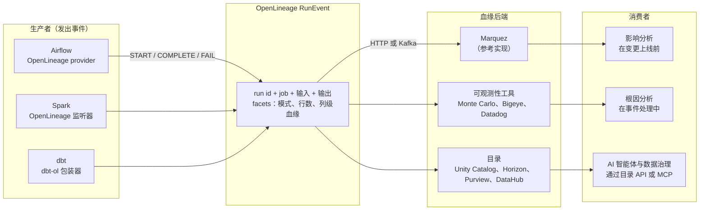
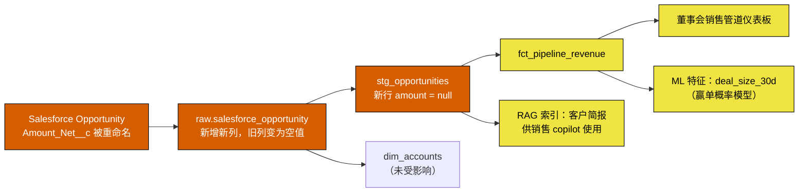
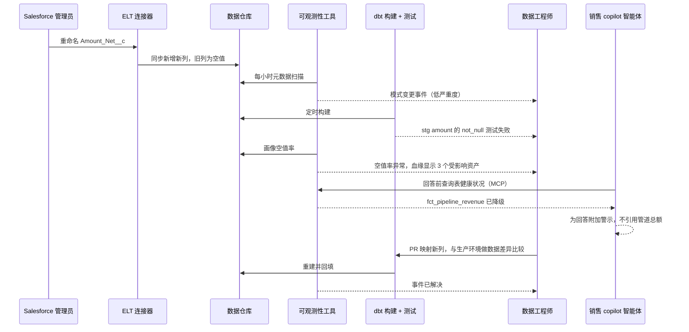
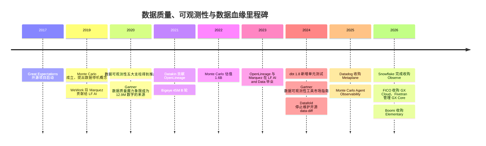

# 13. 数据质量、可观测性与数据血缘
> **深度：** L2 · **阅读时间：** 约 15 分钟 · **最后核实：** 2026-11-01 · **前置阅读：** [12. 数据转换与编排](ch12-transformation-and-orchestration.md)

## 要点速览（TL;DR）

- **数据停机（data downtime）**指数据延迟、缺失、错误或具有误导性的任何时段。它很少以报错的形式出现，更常见的情况是仪表板悄无声息地显示一个错误的数字。最知名的成本估算都偏"软"：Gartner 提出的每家组织每年 $12.9M 损失，来自 2020 年一项针对厂商参考客户、由其自行估算成本的调查；Monte Carlo 的调查则由厂商赞助。两者都表明，这个问题普遍存在且代价高昂。
- **测试与可观测性解决的是不同问题。** dbt tests、Great Expectations（GX）和 Soda 等测试检查的是事先写好的规则（已知的未知）。可观测性（observability）则监控元数据，捕捉你未曾预料的漂移（未知的未知）。Monte Carlo 提出的"五大支柱"是新鲜度、数据量、模式、分布和数据血缘。
- **数据血缘（lineage）是把告警变成答案的地图。** 它告诉你上游哪里出了问题、下游谁受到影响。采集血缘有三种方式：解析查询日志中的 SQL；来自运行时事件（由 Airflow、Spark 和 dbt 发出的 OpenLineage 标准事件）；或由平台原生记录（Unity Catalog、Snowflake Horizon、Microsoft Purview）。列级血缘才是真正有用的级别，也是最难做到的级别。
- **独立厂商正在被吸收。** Datadog 收购了 Metaplane（2025 年 4 月）。Snowflake 收购了 Observe（2026 年 2 月完成；根据 Snowflake FY2026 10-K，初步对价为 $596.2M，媒体报道约为 $1B），但 Observe 做的是 IT 遥测，而非数据质量。Boomi 收购了 Elementary（2026 年 10 月）。FICO 收购了 GX Cloud，Fivetran 接手 GX Core 的社区管理（2026 年 5 月）。Databricks 和 Snowflake 现已提供原生异常检测。Monte Carlo 仍是融资最充足的独立厂商；其最近一次定价融资（2022 年 5 月）给出的估值为 $1.6B（公司披露）。
- **AI 抬高了风险。** 智能体（agent）在没有人工合理性校验的情况下直接依据数据采取行动。因此，新鲜度、质量评分和数据血缘必须成为机器可读的输入，供智能体在行动前查询，例如通过 MCP 服务器和目录 API。

## 为何重要（商业 + Everpure 视角）

Monte Carlo 借鉴"应用停机"的说法，创造了 **[数据停机（data downtime）](../glossary.md#data-downtime)** 一词：指数据不完整、错误、过时或以其他方式不可靠的时段。区别在于可见性。系统宕机会触发值班告警；而一个让董事会材料中收入翻倍的错误关联（join），在财务分析师发现之前不会触发任何东西。经济影响正源于这种不对称：检测缓慢，因此在任何人着手修复之前，损害已在不断累积。

最常被引用的成本数字需要谨慎对待。Gartner 广为流传的说法是，糟糕的数据质量平均每年让组织损失 **$12.9M**。这个数字可追溯到 Gartner 2020 年的《数据质量解决方案魔力象限》（Magic Quadrant for Data Quality Solutions）。其依据是对 16 家参评厂商的参考客户所做的调查，且这些客户自行估算了成本。这个数字作为信号有用，但它并非经过测量的全经济平均值。[^gartner-129] Monte Carlo 委托 Wakefield Research 开展的调查结论大体相同，应标注为厂商赞助。在 2022 年版中，受访者报告每月约 61 起事件，每起事件约需 13 小时识别和解决，糟糕数据影响约 26% 的收入。他们还表示，数据工程师大约 40% 的时间花在数据质量问题上。[^mc-2022] 2023 年版（200 名受访者）报告每月 67 起事件，数据停机同比增长 1.89 倍。74% 的情况下，业务方先于数据团队发现问题。[^mc-2023]

对企业发展（corporate development）读者来说，有三点值得关注。第一，这一层是"现代数据栈"整合最快的地方，因此是一个活跃的并购市场（见[主要参与者](#whos-who)）。第二，AI 把数据质量从报表层面的小麻烦变成了运营风险。读取过时表的检索增强生成（RAG）助手或智能体，会以机器速度做出错误决策。第三，可观测性工具挖掘的信号是*元数据*：行数、提交时间戳、查询日志、访问模式。元数据也是数据。

> **Everpure 视角。** 遥测只是更多的数据，而存储系统本就能看到每个数据集的访问频率、读取者身份和对象年龄。基于公开信息，战略团队可以评估：存储层信号与 1touch 收购带来的数据发现和数据分类能力相结合，能否为数据目录和可观测性工具丰富血缘与分类信息。[^everpure-1touch]

## 工作原理

### 测试：事先写好的断言

**[数据测试（data test）](../glossary.md#data-test)** 是针对数据集运行的断言。例如：`order_id` 永不为空且唯一；`status` 只能是五个值之一；orders 中的每个 `customer_id` 都存在于 customers 中。在 dbt 中（见[第 12 章](ch12-transformation-and-orchestration.md)），这些测试在模型旁的 YAML 中声明，并在每次构建后运行。dbt 1.8（2024 年 5 月）新增了 **[单元测试（unit test）](../glossary.md#unit-test)**。单元测试向模型的 SQL 输入模拟数据行并检查输出，从而在触及任何生产数据之前，在 CI 中测试*逻辑*。随该版本发布，dbt 将旧的 `tests:` 键更名为 `data_tests:`，以区分这两类测试。[^dbt-18] **Great Expectations**（现为 GX Core，以 Apache 2.0 许可开源）用 Python 中的"Expectations"表达同样的理念。[^gx-1] **Soda** 在 Soda Core 4.0 中把 **[数据契约（data contract）](../glossary.md#data-contract)** 设为编写检查的默认方式。该版本首次公开发布于 2026 年 1 月，取代了较早的 SodaCL 检查语言。[^soda-4]

测试成本低、精确且可解释。其弱点在于覆盖面。一个拥有 2,000 张表的团队不可能为每一列都写出周到的断言，也没有人会为自己从未想到的故障写测试。

> **类比：半导体（BIST 与 DFT）。** 数据测试相当于数据管道中的可测试性设计（DFT）和内建自测试（BIST）。你在*已知*可能出现故障的位置插入扫描链和存储器 BIST 引擎，它们给出快速、确定的通过/失败结果。但它们抓不到只在现场特定温度下才出现的边缘时序故障。单元测试类似于对照测试平台（testbench）进行的流片前验证；数据测试则类似于在真实晶圆上进行的量产测试。

### 可观测性：监控元数据，发现你未曾预料的问题

**[数据可观测性（data observability）](../glossary.md#data-observability)** 反转了思路。它不要求工程师陈述规则，而是从每张表收集元数据，并学习"正常"是什么样子。Monte Carlo 推广了五个信号，即其"五大支柱"。该公司现有材料有时会用"质量"替换"分布"，但最常被引用的仍是最初的列表。[^mc-pillars]

| 支柱 | 回答的问题 | 测量内容 | 通常的采集方式 |
|---|---|---|---|
| 新鲜度 | 表是否按时更新？ | 距上次写入的时间；更新间隔 | 数据仓库元数据（最后修改时间、提交历史）、编排器运行日志 |
| 数据量 | 预期的数据量是否到达？ | 行数、字节数、每次加载新增行数 | information schema 或表统计信息；一次低成本的 `COUNT(*)` |
| 模式 | 结构是否发生变化？ | 列的新增、删除、重命名或类型变更 | 对 information schema 快照做差异比较；查询日志中的 DDL |
| 分布 | 数值是否仍然合理？ | 空值率、去重计数、最小/最大/平均值、各类别占比 | 对抽样行运行画像查询；这是最耗计算资源的支柱 |
| 数据血缘 | 这张表的上游是什么，又供给了谁？ | 上下游的表、列、作业、仪表板 | 查询日志 SQL 解析、OpenLineage 事件、平台原生血缘 |

*图 13.1 — 四大支柱用于发现问题；第五个支柱数据血缘负责解释问题并评估影响范围。*

**L2 层面的异常检测原理。** 工具按计划（通常每小时一次）对每张受监控的表运行一个小型元数据查询。它把结果按表存储为时间序列，并拟合一个包含趋势和季节性的模型，因为周一的加载量大于周日。当新数据点落在学习到的区间之外时，它就发出告警。新鲜度模型预测下一次提交应在*何时*到达。例如，Databricks 的数据质量监控为每张表建立提交时间模型，当提交异常延迟时将表标记为过时。它还预测预期的行数区间，当行数低于该区间时将表标记为不完整。[^dbx-dqm] Snowflake 通过 **[数据指标函数（data metric function）](../glossary.md#data-metric-function)**（DMF）做同样的事。其系统 DMF（如 `ROW_COUNT`、`FRESHNESS` 和 `NULL_COUNT`）按计划挂载到表上，并可对 `ROW_COUNT` 和 `FRESHNESS` 启用异常检测。在积累足够历史数据之前，模型会显示"训练中"状态。[^sf-dmf] 第二种输入是**查询日志挖掘**。每个数据仓库都会记录其运行过的 SQL。解析这些日志可以看出哪些表被读取最多、由谁读取，以及哪些表供给高管仪表板。工具借此对告警按重要性排序，并在无需任何埋点的情况下构建数据血缘。

> **类比：晶圆厂良率管理（SPC）。** 这就是把统计过程控制应用于元数据。晶圆厂对关键尺寸、膜厚和颗粒数设置控制图，并依据 Western Electric 式规则（一个点超出 3σ，或一连串点朝同一方向漂移）在整批报废之前采取行动。数据可观测性则对行数和空值率设置控制图。它有同样的核心权衡：控制限收紧可以及早发现漂移，但会让工程师被误报淹没。告警疲劳是可观测性部署停滞最常见的原因。

### 数据血缘：表级、列级以及采集方式

**[数据血缘（data lineage）](../glossary.md#data-lineage)** 是描述数据如何从源头经过转换流向消费者的有向图。**表级**血缘表明 `fct_revenue` 读取了 `stg_opportunities`。**[列级血缘（column-level lineage）](../glossary.md#column-level-lineage)** 则表明 `fct_revenue.amount_usd` 由 `stg_opportunities.amount` 乘以汇率得出。只有列级版本能告诉你：某个 Salesforce 字段的变更会破坏下游四十个仪表板中的三个。正是这种精确度，让影响分析变得有用，而不是徒增恐慌。

数据血缘有三种采集方式：

1. **对查询日志做静态 SQL 解析。** 解析器读取数据仓库历史中的每条 `INSERT … SELECT` 或 `CREATE TABLE AS` 语句，推算出哪些输入列供给哪些输出列。它无需埋点，但会遗漏 SQL 之外的逻辑，例如 Python、Spark DataFrame 或外部工具。Snowflake 在 Snowsight 中的列级血缘来源于访问历史。它新增了存储过程和任务的血缘（2025 年 10 月正式可用），以及可穿透临时表和视图的血缘（2026 年 9 月正式可用）。[^sf-lineage]
2. **通过 [OpenLineage](../glossary.md#openlineage) 采集运行时事件。** 作业在运行时宣告自己读取和写入了什么。OpenLineage 是此类事件的开放规范。每个事件指明一次 *run*（运行）、一个 *job*（作业）以及输入和输出 *dataset*（数据集），并携带可扩展的"facets"（切面），如模式、行数或列级血缘映射。Datakin 于 2021 年将其贡献给 LF AI & Data，并于 2023 年 7 月毕业。**[Marquez](../glossary.md#marquez)** 最初由 WeWork 贡献，是存储和提供这些事件的参考实现；它于 2023 年 9 月毕业。[^ol-lfai] Airflow 内置原生 OpenLineage provider（取代了一个因依赖 Airflow 内部实现而容易失效的旧插件包），Spark 通过监听器发出事件，dbt 则由一个包装器覆盖。[^ol-airflow]
3. **平台原生血缘。** 如果所有查询都经由同一个引擎和目录运行，平台就能根据自身的查询计划记录血缘。Unity Catalog 会自动为 Unity Catalog 表采集表级和列级血缘，并在系统表中公开。基于路径的读取、部分用户自定义函数以及旧版 Hive 元数据存储仍存在空白。[^uc-lineage] Microsoft Purview 根据 Data Factory 复制活动、Synapse 和 Databricks 的处理过程构建血缘。[^purview] 原生血缘在单一平台内最准确，但在平台之外则是盲区，这就是为什么把 OpenLineage 接入这些目录很重要。见[第 8 章](../01-data-systems-foundations/ch08-catalogs-and-metastores.md)。

*图 13.2 — OpenLineage 将"谁发出血缘"与"谁存储血缘"解耦。任何生产者都可以供给任何后端，就像 OpenTelemetry 把应用追踪与追踪厂商解耦一样。*

> **类比：晶圆谱系。** 数据血缘相当于晶圆厂中的批次与晶圆谱系（genealogy）。当现场返修件出现故障时，谱系会把裸片沿封装、晶圆、批次、机台和腔室逐级回溯，再向前追踪到所有共用该腔室的其他器件，并将它们隔离。列级血缘同样承担这两项工作：向后追溯找根因，向前追踪做隔离。与谱系一样，它的好坏取决于每个环节的埋点。只要有一个未被追踪的返工步骤，或一个游离在血缘系统之外的 Python 脚本，链条就会断裂。

### SLA、SLO、事件与契约

成熟团队会借鉴站点可靠性工程（SRE）。**[数据 SLO（data SLO）](../glossary.md#data-slo)** 是一个内部目标，例如"在 99% 的工作日中，`fct_revenue` 于 UTC 07:00 前完成刷新，且 `amount_usd` 的空值率低于 0.1%"。SLA 则是向消费方承诺的版本，有时附带后果条款。于是，可观测性工具变成了事件管理系统：告警开启一个事件，数据血缘指派负责人，负责人在 Slack 或 PagerDuty 中分诊，事后复盘再反馈到测试中。数据契约把约定推向上游。拥有源系统的团队承诺遵守某种模式和语义，任何破坏性变更都必须在该团队自己的 CI 中失败，而不是出现在别人的仪表板上。契约和 dbt 模型契约是预防层，可观测性是侦测层。数据治理策略（[第 15 章](ch15-governance-security-privacy.md)）则决定谁有权看到这些数据。

### AI 时代的新变化：为智能体提供可信数据

人类分析师看到收入一夜之间增长 300%，会停下来问为什么，智能体则不会。随着智能体开始查询数据仓库、触发工作流并回答客户问题（[第 22 章](../03-ai-data-stack/ch22-agents-and-data.md)），质量信号必须从面向人类的仪表板转变为面向机器的输入。智能体在行动前应当检查：这张表是否新鲜？是否通过了检查？它的血缘是什么？是否经过认证？厂商正在构建的恰恰是这些能力。Monte Carlo 于 2025 年 9 月推出 Agent Observability，用于监控智能体的输入和输出。2026 年 3 月，它将产品扩展至覆盖智能体轨迹和上线前评估，并提供托管的 MCP 服务器，让助手可以查询监控项和事件。[^mc-agent] RAG 让数据血缘的要求更加严格。向量索引是构建它所用文档和表的下游资产，因此一个过时或被污染的数据源，应当能被追溯到该索引以及基于它生成的答案。因此，AI 数据管道的可观测性横跨两层：一层是对语料的经典数据检查，另一层是对 LLM 输出在依据性（groundedness）、漂移和成本方面的评估。

## 实例演练：一个被重命名的 Salesforce 字段

一位销售运营管理员为了规范命名，把 Salesforce Opportunity 对象上的自定义字段 `Amount_Net__c` 重命名为 `Net_Amount__c`。没有任何报错。许多托管连接器在处理源字段重命名时，会把新值同步到一个*新*列中，而保留旧列不动：新记录在旧列中为空值，且不回填历史数据。Fivetran 针对 HubSpot 自定义字段明确记录了这种行为；这是一种常见模式，而非普遍规则，因此需要逐个核查连接器。[^fivetran-rename] staging 模型仍在选取 `amount_net__c`，因此从那一刻起，每一个新商机的金额都是空值。以下数字仅为示意。

*图 13.3 — 一次上游重命名悄无声息地拖垮了董事会仪表板、一个 ML 特征和一个 AI copilot。列级血缘显示 `dim_accounts` 是安全的，因此只需向三个消费方发出警告，而不是四十个。*

各层按发现速度排序的捕获方式：

- **模式监控（可观测性）。** 在下一次元数据扫描时，工具发现原始表中出现了新列 `net_amount__c`。单凭这一点只是低严重度事件，因为新增列是常有的事。
- **分布监控。** 在一到两次加载之内，新行中 `amount_net__c` 的空值率从约 0% 跃升到 100%。这远远超出控制区间，于是触发高严重度告警，并与模式变更事件关联。
- **dbt 数据测试。** 对 `stg_opportunities.amount` 的 `not_null` 测试在下一次定时构建时失败。它很精确，但前提是有人写了这个测试。
- **列级血缘。** 事件视图列出受影响的资产：收入事实表、董事会仪表板、`deal_size_30d` 特征以及 copilot 的索引。系统通知各负责人，并将仪表板标记为"降级"。
- **CI 中的数据差异比较（预防）。** 当修复以拉取请求（PR）的形式映射新列名后，Datafold 等数据差异比较（data diff）工具会在合并前把重建后的表与生产环境逐行比较。
- **契约（下次的预防）。** 如果在源端设有并在 CI 中强制执行的契约，就会阻止这次重命名，或要求设置弃用过渡期。
- **如果以上都没有，** 地区副总裁会在周一的预测会议上发现销售管道下降了 40%。

*图 13.4 — 针对此次重命名的检测与响应。智能体的健康检查是新增的一步：智能体为回答附加警示，而不是重复一个错误的数字。*

## 设计选择与权衡

| 选择 | 方案 A | 方案 B | A 胜出的场景 | B 胜出的场景 |
|---|---|---|---|---|
| 检测方法 | 显式测试与契约 | 基于元数据的 ML 异常检测 | 规则已知的关键表；受监管的报告；运行成本低 | 规则跟不上的大规模数据资产（1,000+ 张表）；未知的故障模式 |
| 部署位置 | 平台原生（Databricks 数据质量监控、Snowflake DMF） | 独立工具（Monte Carlo、Bigeye、Anomalo） | 单一平台企业；对成本敏感；"够用"的新鲜度和数据量检查 | 多平台数据资产；需要跨系统血缘、BI 覆盖和事件工作流 |
| 血缘采集 | 对查询日志做 SQL 解析 | 运行时事件（OpenLineage） | 以数据仓库为中心的 SQL 技术栈；零埋点 | 在数据仓库之外使用 Spark、Python 和 Airflow 的多语言数据管道 |
| 画像深度 | 仅元数据（计数、时间戳） | 行级内容画像 | 计算成本低；数据不离开平台 | 元数据看不到的细微数值漂移，如币种结构变化 |
| 买方 | 数据工程 | IT 运维 / SRE（Datadog 式） | 数据语义最重要 | 基础设施、应用和数据管道统一视图；整合厂商支出 |

*图 13.5 — 主要权衡是覆盖面与噪声及成本之间的取舍。大多数成熟团队对最重要的表运行测试，对其余所有表运行异常检测。*

支持独立工具最有力的论点是：数据资产并非单一平台。数据从 Salesforce 经 Fivetran 进入 Snowflake，经过 dbt，输出到 Tableau，再进入 Databricks 特征存储。只有中立的工具才能看到完整路径。最有力的反方论点是：平台现在已能看到路径的大部分，且无需额外许可费用，而"够用且捆绑"通常胜过"同类最佳但需走一轮采购流程"。

## 主要参与者

| 厂商 | 类型 | 定位 | 最新公开信号 |
|---|---|---|---|
| Monte Carlo | 独立可观测性 | 品类开创者；五大支柱、数据血缘、事件工作流；正向智能体可观测性扩展 | 由 IVP 领投的 $135M D 轮，投后估值 $1.6B（公司披露，2022 年 5 月）；未发现此后的定价融资[^mc-d] |
| Bigeye | 独立可观测性 | 聚焦企业客户，基于血缘对现代和传统数据源进行监控 | 由 Coatue 领投的 $45M B 轮（2021 年 9 月）[^bigeye] |
| Anomalo | 独立数据质量 | 对表*内容*（而不仅是元数据）做无监督 ML；在面向 AI 的非结构化数据质量方面实力突出 | 由 SignalFire 领投、Databricks Ventures 参投的 $33M B 轮（2024 年 1 月）[^anomalo] |
| Acceldata | 独立，多层 | 数据加数据管道和计算可观测性；在 Hadoop 和本地部署环境中实力突出 | 由 March Capital 领投的 $50M C 轮（2023 年 2 月）[^acceldata] |
| Sifflet | 独立（巴黎） | 结合数据目录与业务上下文的可观测性 | 来自 EQT Ventures、Mangrove 和 Capmont 的约 $18M 融资（2025 年）[^sifflet] |
| Metaplane → Datadog | 并入 IT 可观测性 | ML 监控加列级血缘，现为"Metaplane by Datadog" | 2025 年 4 月被收购，金额未披露；Datadog 于 2025 年第四季度使数据可观测性正式可用[^dd-metaplane][^dd-ga] |
| Elementary → Boomi | dbt 原生开源 | dbt 项目内的可观测性；已被 1,500+ 数据团队采用 | 2026 年 10 月被 Boomi 收购；媒体报道约 $40–45M（Calcalist）[^boomi] |
| Soda | 开放核心测试 | 以数据契约为默认检查格式（Soda Core 4.0） | 4.0 首次公开发布于 2026 年 1 月[^soda-4] |
| GX（Great Expectations） | 开源测试 | Python Expectations；知名度最高的开源测试框架 | GX Cloud 出售给 FICO；Fivetran 成为 GX Core 的管理方（2026 年 5 月）[^gx-2026] |
| Datafold | CI 与回归测试 | 数据差异比较：在合并或迁移前逐行比较表 | 2024 年 5 月停止维护开源 data-diff，专注于其云产品[^datafold] |
| Databricks（原生） | 平台原生 | 数据质量监控：异常检测加数据画像（前身为 Lakehouse Monitoring）；Unity Catalog 血缘 | 按无服务器计算计费；全模式范围的"智能扫描"[^dbx-dqm] |
| Snowflake（原生） | 平台原生 | 数据指标函数、针对数据量和新鲜度的异常检测、Horizon 血缘 | 系统 DMF；Observe 补充的是 IT 遥测而非数据质量[^sf-dmf][^sf-observe] |

*图 13.6 — 十二家参与者，三条轨迹：独立厂商（上）、被吸收者（中），以及设定价格底线的平台原生功能（下）。*

**数据可观测性不等于 IT 可观测性。** IT 可观测性（Datadog、Observe、Chronosphere、Splunk）监控日志、指标和追踪，回答"系统是否在线、是否够快？"数据可观测性监控数据集，回答"这个数字对不对？"Snowflake–Observe 交易属于 IT 可观测性。Observe 使用 Apache Iceberg 和 OpenTelemetry 在 Snowflake 上存储遥测数据；Snowflake 的 FY2026 10-K 显示初步对价为 $596.2M，而媒体报道约为 $1B。[^sf-observe] 两个品类在数据管道健康状况上交汇，这一重叠正是 Datadog 收购 Metaplane 的原因。

**整合为何正在发生。** 有四股力量。第一，平台现在免费提供新鲜度和数据量检查，抹去了独立厂商价值中最容易实现的那一半。第二，可观测性天然是某个更大产品的*模块*。Datadog 希望在 SRE 的席位旁边拿下数据工程师的席位。Boomi 和 Fivetran 希望把"可信数据"与集成和数据转换放在一起；Fivetran 现已整合了 dbt（合并于 2026 年 6 月完成）、SQLMesh 以及 GX Core 的管理权。[^fivetran-dbt] 第三，"遥测只是更多的数据"这一逻辑有利于已拥有廉价存储和计算的厂商，这正是 Palo Alto Networks–Chronosphere（$3.35B）和 Snowflake–Observe 背后的逻辑。[^chronosphere] 第四，2021–22 年那一批估值让独立融资变得困难。Monte Carlo 的 $1.6B 估值定于 2022 年 5 月，正值融资热潮的尾声，此后没有披露过新的定价融资。独立厂商的看多逻辑是跨平台中立性以及新出现的智能体信任预算；看空逻辑是两者都会被捆绑。公司层面的细节见[第 33 章](../04-company-deep-dives/ch33-governance-catalog-security-companies.md)。

## 历史与发展轨迹

*图 13.7 — 不到十年间，这一品类从开源测试（2017）发展为风投支持的品类（2019–2022），再被平台吸收（2025–2026）。*

Gartner 于 2024 年 6 月发布了首份《数据可观测性工具市场指南》（*Market Guide for Data Observability Tools*），并于 2026 年 2 月发布了 2026 年版，这表明该品类如今已被视为一条标准的采购线。[^gartner-mg]GX 的起始年份（2017）依据的是该项目的公开历史：其开源代码库可追溯到 2017 年，而 2018 年 2 月的文章"Down with Pipeline Debt"使其广为人知。这属于 2025 年之前的既定知识，已由审校者确认，并非为本章检索的文档。预计接下来会发生三件事：平台原生监控将从数据量和新鲜度扩展到分布检查；OpenLineage 将成为外部工具向原生目录输送数据的默认方式；质量和血缘信号将与语义层元数据一起，作为智能体所用上下文的标准组成部分提供给智能体。

## 关键数字

| 指标 | 数值 | 口径 | 来源 / 日期 |
|---|---|---|---|
| 每家组织因数据质量差造成的平均年度损失 | $12.9M | 估算；由厂商参考客户自行报告，Gartner 2020 魔力象限 | [^gartner-129]（2020；在后续 Gartner 材料中被重复引用） |
| 每家组织每月数据事件数 | ~61（2022）→ 67（2023） | 厂商赞助调查（Monte Carlo / Wakefield） | [^mc-2022] 2022-08-09；[^mc-2023] 2023-05-02 |
| 识别并解决一起事件所需时间 | ~13 小时 | 厂商赞助调查，2022 | [^mc-2022] |
| 受糟糕数据影响的收入占比 | ~26% | 厂商赞助调查，受访者估算，2022 | [^mc-2022] |
| 业务方先于数据团队发现问题 | 74% | 厂商赞助调查，2023 | [^mc-2023] |
| Monte Carlo 投后估值 | $1.6B | 公司披露，D 轮，2022 年 5 月 | [^mc-d] |
| Snowflake–Observe 对价 | $596.2M | 已披露，初步，FY2026 10-K（财年截至 2026 年 1 月 31 日） | [^sf-observe] |
| Boomi–Elementary 价格 | ~$40–45M | 媒体报道（Calcalist） | [^boomi] 2026-10 |
| Palo Alto Networks–Chronosphere | $3.35B | 已披露交易金额（IT 可观测性） | [^chronosphere] 2025-11-19 |
| Everpure–1touch（数据发现与数据分类） | $125.0M | 已披露现金对价，10-Q | [^everpure-1touch] 2026-06 |

*图 13.8 — 成本数字偏"软"且基于调查，交易数字则是"硬"数据。用前者解释该品类为何存在，用后者为其定价。*

## 存储桥接

> **存储桥接。** 可观测性工具大多读取数据仓库元数据，但对象存储在底层也会产生同样的原始信号：最后修改时间、对象数量、每个前缀写入的字节数以及按请求记录的访问日志。对于从不经过数据仓库的文件（例如 RAG 索引背后的 PDF 和图片），这些信号可以直接映射到新鲜度、数据量和数据血缘三大支柱。关于存储阵列如何公开这些日志和元数据，请参阅姊妹篇 *Everpure Tech Atlas*。

## 对话手册

**向产品经理提的三个问题**

1. "你们的监控项中，客户自行编写的规则与学习得到的异常检测各占多大比例？客户在选择静音之前能接受多高的误报率？" *好的回答：* 给出具体比例，以及一个能调节阈值的静音或反馈机制，而不是"我们的 ML 非常准确"。
2. "当 Databricks 和 Snowflake 免费提供新鲜度和数据量检查时，客户还在为你们的什么付费？" *好的回答：* 延伸到 BI 和 SaaS 数据源的跨平台血缘、事件工作流、分布或内容检查，以及面向智能体的信任 API，并有流失率数据作为支撑。
3. "目前智能体如何消费你们的信号？" *好的回答：* 一个具名的 MCP 服务器或 API，真实客户依据健康检查来控制智能体的行动，并有与之挂钩的定价。

**向工程师提的三个问题**

1. "你们的血缘是从 SQL 解析得到、通过 OpenLineage 发出，还是从平台读取？哪些部分会遗漏？" *好的回答：* 能说出盲区，如 Python 转换、基于路径的读取和 BI 抽取。
2. "监控会消耗多少数据仓库计算资源，由谁买单？" *好的回答：* 大多数表只做元数据扫描，关键表做抽样画像，并给出明确的 credit 或 DBU（Databricks Unit）开销。
3. "你们如何处理季节性和计划内变更，比如回填或节假日？" *好的回答：* 季节性模型、维护窗口以及基于血缘的告警抑制，这样一次上游故障就不会呼叫二十个负责人。

**不要这样说**

- "可观测性取代了测试。"并非如此。测试编码的是业务规则，任何异常检测模型都无法推断出来。
- "糟糕的数据每年让公司损失 $12.9M。"应改为：Gartner 2020 年一项针对参考客户的调查显示，自行估算的平均值为 $12.9M。
- "Snowflake 收购 Observe 是为了数据质量。"Observe 是构建在 Snowflake 上的 IT 遥测可观测性产品。Snowflake 上的数据质量来自 DMF 和合作伙伴。
- "我们有数据血缘"（实际仅有表级血缘）。要追问它是否是列级的，以及是否跨越系统边界。
- "OpenLineage 是一款产品。"它是一项规范，Marquez 才是参考后端。

## 深入阅读

> **深入（L3）。** 阅读 OpenLineage 对象模型（RunEvent、Job、Run、Dataset、facets），以及把输出字段映射到输入字段的 `ColumnLineageDatasetFacet`。在本地用 Airflow provider 试运行 Marquez，观察事件如何到达。关于异常检测，可研究厂商如何将季节性分解与动态阈值和用户反馈结合。注意，Snowflake 的异常检测只有在训练期之后才开始告警。关于基于 SQL 解析的血缘，SQLGlot（现已通过 Tobiko Data 并入 Fivetran）是一款被广泛使用的开源解析器和优化器。

## 关键术语

- [数据停机（Data downtime）](../glossary.md#data-downtime) — 数据延迟、缺失、错误或以其他方式不可靠的时段。
- [数据可观测性（Data observability）](../glossary.md#data-observability) — 对数据集元数据进行自动化监控，以发现、分诊和解释数据问题。
- [数据测试（Data test）](../glossary.md#data-test) — 针对生产数据运行的显式断言，例如非空或唯一。
- [单元测试（Unit test）](../glossary.md#unit-test) — 在开发或 CI 中用模拟输入测试数据转换逻辑。
- [数据契约（Data contract）](../glossary.md#data-contract) — 生产方与消费方之间关于数据集模式、语义和质量的可强制执行的约定。
- [数据血缘（Data lineage）](../glossary.md#data-lineage) — 描述数据如何从源头经过转换流向消费者的图。
- [列级血缘（Column-level lineage）](../glossary.md#column-level-lineage) — 精确到单个列而非整张表的数据血缘。
- [OpenLineage](../glossary.md#openlineage) — 由数据作业在运行时发出的血缘事件的开放规范。
- [Marquez](../glossary.md#marquez) — 收集并提供 OpenLineage 事件的开源参考实现。
- [数据指标函数（Data metric function）](../glossary.md#data-metric-function) — Snowflake 中按计划运行、在表上测量某项质量指标的函数。
- [数据 SLO（Data SLO）](../glossary.md#data-slo) — 针对数据集新鲜度、完整性或准确性的内部目标。
- [数据可观测性五大支柱（Five pillars of data observability）](../glossary.md#five-pillars-of-data-observability) — 新鲜度、数据量、模式、分布和数据血缘。
- [数据差异比较（Data diff）](../glossary.md#data-diff) — 对一张表的两个版本逐行比较，以发现回归问题。

## 资料来源

[^gartner-129]: Reliable (reliamag.com), "The Cost of Bad Manufacturing Data (2026)," 对 Gartner $12.9M 数字出处的分析（2020 Magic Quadrant for Data Quality Solutions，对 154 家组织的参考客户调查），https://reliamag.com/topics/guides/cost-of-bad-manufacturing-data，2026 年发布；以及 Verato, "Gartner DQ," 引用 Gartner, "12 Actions Data and Analytics Leaders Can Take to Improve Data Quality"（2024 年 7 月），https://verato.com/resources/gartner-dq，无日期；2026-11-01 检索。[VERIFY: 对照 Gartner 原始文档核实措辞]
[^mc-2022]: Monte Carlo via Business Wire, "Data Engineers Spend Two Days Per Week Firefighting Bad Data, Monte Carlo Survey Says," https://markets.financialcontent.com/wss/article/bizwire-2022-8-9-data-engineers-spend-two-days-per-week-firefighting-bad-data-monte-carlo-survey-says，2022-08-09 发布；BigDATAwire, "Monte Carlo Survey Finds Data Engineers Spend 40% of Their Workday on Bad Data," https://www.hpcwire.com/bigdatawire/2022/08/12/monte-carlo-survey-finds-data-engineers-spend-40-of-their-workday-on-bad-data/，2022-08-12 发布；2026-11-01 检索。
[^mc-2023]: Monte Carlo via Business Wire, "Data Downtime Nearly Doubled Year Over Year, Monte Carlo Survey Says," https://www.businesswire.com/news/home/20230502005377/en/5435996/Data-Downtime-Nearly-Doubled-Year-Over-Year-Monte-Carlo-Survey-Says，2023-05-02 发布；BigDATAwire, "Data Quality Is Getting Worse, Monte Carlo Says," https://www.hpcwire.com/bigdatawire/2023/05/02/data-quality-is-getting-worse-monte-carlo-says/，2023-05-02 发布；2026-11-01 检索。
[^mc-pillars]: Monte Carlo, "Introducing the 5 Pillars of Data Observability," https://montecarlodata.com/blog-introducing-the-5-pillars-of-data-observability，约 2020 年发布 [VERIFY: 原始发布日期]；Monte Carlo, "What Is Data Observability?," https://www.montecarlodata.com/blog-what-is-data-observability/，2025-07-31 更新；2026-11-01 检索。
[^dbt-18]: dbt Labs, "Upgrading to v1.8," https://docs.getdbt.com/docs/dbt-versions/core-upgrade/upgrading-to-v1.8，以及 "Announcing unit testing," https://docs.getdbt.com/blog/announcing-unit-testing，2024；Materialize changelog, "dbt 1.8.0," https://materialize.com/changelog/2024-05-27-dbt-1.8.0，2024-05-27 发布；2026-11-01 检索。
[^gx-1]: Great Expectations, "The next step for GX OSS: 1.0," https://greatexpectations.io/blog/the-next-step-for-gx-oss-1-0，2024 年发布 [VERIFY: GX 1.0 的确切发布日期]；2026-11-01 检索。
[^soda-4]: Soda, "Soda Core – Release notes"（v4：初始版本 2025-09-01；soda-core 4.0.5 首次公开发布 2026-01-28），https://docs.soda.io/soda-v4/release-notes/soda-core-release-notes，2026-11-01 访问；2026-11-01 检索。
[^dbx-dqm]: Databricks, "Data quality monitoring" 文档（针对新鲜度和完整性的异常检测；数据画像前身为 Lakehouse Monitoring；按无服务器计费），https://docs.databricks.com/aws/en/data-quality-monitoring，2026-11-01 访问；2026-11-01 检索。
[^sf-dmf]: Snowflake, "System data metric functions," https://docs.snowflake.com/en/user-guide/data-quality-system-dmfs，以及 "Detecting anomalies in data quality," https://docs.snowflake.com/en/user-guide/data-quality-anomaly，2026-11-01 访问；2026-11-01 检索。
[^sf-lineage]: Snowflake, "Data Lineage" (Snowsight), https://docs.snowflake.com/en/user-guide/ui-snowsight-lineage；发布说明 "Lineage for stored procedures and tasks (General availability)," https://docs.snowflake.com/release-notes/2025/other/2025-10-03-process-lineage，2025-10-03 发布；"Lineage preservation through temporary tables and views (General availability)," https://docs.snowflake.com/release-notes/2026/other/2026-09-21-lineage-temporary-objects，2026-09-21 发布；2026-11-01 检索。
[^ol-lfai]: LF AI & Data Foundation, "OpenLineage" 项目页（由 Datakin 于 2021 年 5 月贡献；2023 年 7 月毕业），https://lfai.foundation/projects/openlineage；"Marquez" 项目页（由 WeWork 于 2019 年 12 月贡献；2023 年 9 月毕业），https://lfai.foundation/projects/marquez/；2026-11-01 检索。
[^ol-airflow]: Apache Airflow, "apache-airflow-providers-openlineage changelog" (2.0.0), https://airflow.apache.org/docs/apache-airflow-providers-openlineage/2.0.0/changelog.html，2026-11-01 访问；Databricks Data + AI Summit 2023 关于 OpenLineage 与 Spark 和 dbt 的演讲幻灯片，https://microsites.databricks.com/sites/default/files/dais/2023/dais2023-231128.pdf，2023；2026-11-01 检索。
[^uc-lineage]: Databricks Community, "Unity Catalog lineage: lineage that just works" 以及 "How to enable column-level lineage in Databricks"（社区帖子，二手来源），https://community.databricks.com/t5/community-articles/unity-catalog-lineage-lineage-that-just-works/m-p/141855 和 https://community.databricks.com/t5/data-engineering/how-to-enable-column-level-lineage-in-databricks/m-p/165923，2025–2026；2026-11-01 检索。[VERIFY: 对照 Databricks 官方血缘文档核实]
[^purview]: Microsoft Learn, "Data lineage in classic Data Catalog" (Microsoft Purview), https://learn.microsoft.com/en-us/purview/concept-data-lineage，2026-11-01 访问；2026-11-01 检索。
[^mc-agent]: Monte Carlo via Business Wire, "Monte Carlo Launches Agent Observability to Help Teams Build Reliable AI," https://www.businesswire.com/news/home/20250909271741/en/Monte-Carlo-Launches-Agent-Observability-to-Help-Teams-Build-Reliable-AI，2025-09-09 发布；"Monte Carlo's New Agent Observability Delivers End-to-End Visibility Across Context, Performance, Behavior and Outputs," https://www.businesswire.com/news/home/20260312700545/en/，2026-03-12 发布；Monte Carlo, "Accelerating agent trust with Monte Carlo's MCP server," https://montecarlo.ai/accelerating-agent-trust-with-monte-carlos-mcp-server，2026-07-30 更新；2026-11-01 检索。
[^fivetran-rename]: Fivetran, "How Does Fivetran Handle Custom Field Name Changes?"（HubSpot 连接器），https://fivetran.com/docs/connectors/applications/hubspot/troubleshooting/custom-field-name-changes，2026-11-01 访问；Gearset, "How to handle API rename of a Salesforce component through the pipeline," https://docs.gearset.com/en/articles/11003069-how-to-handle-api-rename-of-a-salesforce-component-through-the-pipeline，无日期；2026-11-01 检索。
[^mc-d]: Monte Carlo via Business Wire, "Monte Carlo Raises $135M Series D to Accelerate the Rapid Growth of the Data Observability Category," https://www.businesswire.com/news/home/20220524005417/en/，2022-05-24 发布；Gunderson Dettmer, "Monte Carlo Reaches $1.6B Valuation with $135M Series D Financing," https://www.gunder.com/news/monte-carlo-reaches-1-6b-valuation-with-135m-series-d-financing，2022；2026-11-01 检索。
[^bigeye]: Bigeye via Business Wire, "Bigeye Raises $45M Series B to Scale Leading Data Observability Platform," https://www.businesswire.com/news/home/20210923005170/en/，2021-09-23 发布；2026-11-01 检索。
[^anomalo]: TFIR, "Anomalo Raises $33M In Series B Funding For Its Data Quality Platform," https://tfir.io/anomalo-raises-33m-in-series-b-funding-for-its-data-quality-platform/，2024-01 发布；2026-11-01 检索。
[^acceldata]: O'Melveny, "Global Legal Chronicle: Acceldata's $50 Million Series C Funding Round," https://www.omm.com/news/in-the-news/global-legal-chronicle-acceldata-s-50-million-series-c-funding-round/，2023-02 发布；2026-11-01 检索。
[^sifflet]: Pulse 2.0, "Sifflet: $18 Million Raised For Data Observability Platform," https://pulse2.com/sifflet-18-million-raised-for-data-observability-platform/amp/，2025-06 发布 [VERIFY: 轮次名称和确切日期；CB Insights 列为 2025-06-19]；2026-11-01 检索。
[^dd-metaplane]: Datadog, "Datadog Brings Observability to Data Teams by Acquiring Metaplane," https://investors.datadoghq.com/news-releases/news-release-details/datadog-brings-observability-data-teams-acquiring-metaplane，2025-04-23 发布；TechCrunch, "Datadog acquires AI-powered observability startup Metaplane," https://techcrunch.com/2025/04/23/datadog-acquires-ai-powered-observability-startup-metaplane，2025-04-23 发布；2026-11-01 检索。
[^dd-ga]: Insider Monkey, "Datadog, Inc. (NASDAQ:DDOG) Q4 2025 Earnings Call Transcript," https://www.insidermonkey.com/blog/datadog-inc-nasdaqddog-q4-2025-earnings-call-transcript-1693332/，2026-02 发布；2026-11-01 检索。
[^boomi]: Constellation Research, "Boomi acquires Elementary Data, adds data observability, quality, governance layer," https://www.constellationr.com/insights/news/boomi-acquires-elementary-data-adds-data-observability-quality-governance-layer，2026-10 发布；iTWire, "Boomi acquires Elementary Data to bring trusted, governed data to the AI era," https://itwire.com/it-industry-news/deals/boomi-acquires-elementary-data-to-bring-trusted-governed-data-to-the-ai-era，2026-10-19 发布；Calcalist（价格，媒体报道），https://www.calcalistech.com/ctechnews/article/b1zgj8mnzg，2026-10；2026-11-01 检索。
[^gx-2026]: Great Expectations, "An update from Great Expectations," https://www.greatexpectations.io/blog/an-update-from-great-expectations，2026-05-06 发布；Fivetran, "Fivetran to Become Steward of the Great Expectations Open Source Community and GX Core Project," https://www.fivetran.com/press/fivetran-to-become-steward-of-the-great-expectations-open-source-community-and-gx-core-project，2026-05-13 发布；2026-11-01 检索。
[^datafold]: Datafold, "Sunsetting open-source data-diff," https://www.datafold.com/blog/sunsetting-open-source-data-diff，2024-05-17 发布；GitHub, datafold/data-diff, https://github.com/datafold/data-diff；2026-11-01 检索。
[^sf-observe]: Snowflake via Business Wire, "Snowflake Announces Intent to Acquire Observe to Deliver AI Powered Observability at Enterprise Scale," https://www.businesswire.com/news/home/20260108681865/en/，2026-01-08 发布；Snowflake Inc., Form 10-K for fiscal year ended January 31, 2026（Observe 购买会计处理，$596.2M 初步对价），https://www.sec.gov/Archives/edgar/data/1640147/000164014726000008/snow-20260131.htm，2026-03 发布；TechCrunch, https://techcrunch.com/2026/01/08/snowflake-announces-its-intent-to-buy-observability-platform-observe，2026-01-08 发布；2026-11-01 检索。
[^fivetran-dbt]: TechTarget, "Fivetran, dbt Labs complete merger to form data layer for AI," https://www.techtarget.com/searchdatamanagement/news/366643590/Fivetran-DBT-Labs-complete-merger-to-form-data-layer-for-AI，2026-06 发布；2026-11-01 检索。
[^chronosphere]: SecurityWeek, "Palo Alto Networks to Acquire Observability Platform Chronosphere in $3.35 Billion Deal," https://securityweek.com/palo-alto-networks-to-acquire-observability-platform-chronosphere-in-3-35-billion-deal/，2025-11-19 发布；2026-11-01 检索。
[^everpure-1touch]: Everpure, Inc., Form 10-Q for the quarter ended 2026-05-03（1touch，$125.0M 现金对价），https://www.sec.gov/Archives/edgar/data/0001474432/000147443226000061/pstg-20260503.htm，2026-06 发布；Computer Weekly, "Everpure aims to bridge AI data gap with Universal Data Intelligence," https://www.computerweekly.com/news/366644438/Everpure-aims-to-bridge-AI-data-gap-with-Universal-Data-Intelligence，2026-06 发布；2026-11-01 检索。
[^gartner-mg]: Gartner, "Market Guide for Data Observability Tools," 摘要，https://www.gartner.com/en/documents/5533895，2024-06-25 发布；Monte Carlo, "What the 2026 Gartner Market Guide for Data Observability Tools means for your data and AI team," https://www.montecarlodata.com/blog-what-2026-gartner-market-guide-for-data-observability-tools-means-for-your-data-and-ai-team-my-take/，2026-02 发布；2026-11-01 检索。
