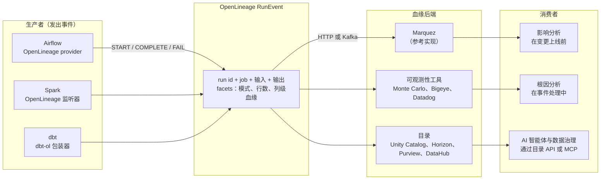

# 13. 数据质量、可观测性与数据血缘
> **深度：** L2 · **阅读时间：** 约 15 分钟 · **最后核实：** 2026-11-01 · **前置阅读：** [12. 数据转换与编排](ch12-transformation-and-orchestration.md)

## 要点速览（TL;DR）

- **数据停机（data downtime）**指数据延迟、缺失、错误或具有误导性的任何时段。它很少以报错的形式出现，更常见的情况是仪表板悄无声息地显示一个错误的数字。最知名的成本估算都偏"软"：Gartner 提出的每家组织每年 $12.9M 损失，来自 2020 年一项针对厂商参考客户、由其自行估算成本的调查；Monte Carlo 的调查则由厂商赞助。两者都表明，这个问题普遍存在且代价高昂。
- **测试与可观测性解决的是不同问题。** dbt tests、Great Expectations（GX）和 Soda 等测试检查的是事先写好的规则（已知的未知）。可观测性（observability）则监控元数据，捕捉你未曾预料的漂移（未知的未知）。Monte Carlo 提出的"五大支柱"是新鲜度、数据量、模式、分布和数据血缘。
- **数据血缘（lineage）是把告警变成答案的地图。** 它告诉你上游哪里出了问题、下游谁受到影响。采集血缘有三种方式：解析查询日志中的 SQL；来自运行时事件（由 Airflow、Spark 和 dbt 发出的 OpenLineage 标准事件）；或由平台原生记录（Unity Catalog、Snowflake Horizon、Microsoft Purview）。列级血缘才是真正有用的级别，也是最难做到的级别。
- **独立厂商正在被吸收。** Datadog 收购了 Metaplane（2025 年 4 月）。Snowflake 收购了 Observe（2026 年 2 月完成；根据 Snowflake FY2026 10-K，初步对价为 $596.2M，媒体报道约为 $1B），但 Observe 做的是 IT 遥测，而非数据质量。Boomi 收购了 Elementary（2026 年 10 月）。FICO 收购了 GX Cloud，Fivetran 接手 GX Core 的社区管理（2026 年 5 月）。Databricks 和 Snowflake 现已提供原生异常检测。Monte Carlo 仍是融资最充足的独立厂商；其最近一次定价融资（2022 年 5 月）给出的估值为 $1.6B（公司披露）。
- **AI 抬高了风险。** 智能体（agent）在没有人工合理性校验的情况下直接依据数据采取行动。因此，新鲜度、质量评分和数据血缘必须成为机器可读的输入，供智能体在行动前查询，例如通过 MCP 服务器和目录 API。

## 为何重要（商业 + Everpure 视角）

Monte Carlo 借鉴"应用停机"的说法，创造了 **[数据停机（data downtime）](../glossary.md#data-downtime)** 一词：指数据不完整、错误、过时或以其他方式不可靠的时段。区别在于可见性。系统宕机会触发值班告警；而一个让董事会材料中收入翻倍的错误关联（join），在财务分析师发现之前不会触发任何东西。经济影响正源于这种不对称：检测缓慢，因此在任何人着手修复之前，损害已在不断累积。

最常被引用的成本数字需要谨慎对待。Gartner 广为流传的说法是，糟糕的数据质量平均每年让组织损失 **$12.9M**。这个数字可追溯到 Gartner 2020 年的《数据质量解决方案魔力象限》（Magic Quadrant for Data Quality Solutions）。其依据是对 16 家参评厂商的参考客户所做的调查，且这些客户自行估算了成本。这个数字作为信号有用，但它并非经过测量的全经济平均值。[^gartner-129] Monte Carlo 委托 Wakefield Research 开展的调查结论大体相同，应标注为厂商赞助。在 2022 年版中，受访者报告每月约 61 起事件，每起事件约需 13 小时识别和解决，糟糕数据影响约 26% 的收入。他们还表示，数据工程师大约 40% 的时间花在数据质量问题上。[^mc-2022] 2023 年版（200 名受访者）报告每月 67 起事件，数据停机同比增长 1.89 倍。74% 的情况下，业务方先于数据团队发现问题。[^mc-2023]

对企业发展（corporate development）读者来说，有三点值得关注。第一，这一层是"现代数据栈"整合最快的地方，因此是一个活跃的并购市场（见[主要参与者](#whos-who)）。第二，AI 把数据质量从报表层面的小麻烦变成了运营风险。读取过时表的检索增强生成（RAG）助手或智能体，会以机器速度做出错误决策。第三，可观测性工具挖掘的信号是*元数据*：行数、提交时间戳、查询日志、访问模式。元数据也是数据。

> **Everpure 视角。** 遥测只是更多的数据，而存储系统本就能看到每个数据集的访问频率、读取者身份和对象年龄。基于公开信息，战略团队可以评估：存储层信号与 1touch 收购带来的数据发现和数据分类能力相结合，能否为数据目录和可观测性工具丰富血缘与分类信息。[^everpure-1touch]

## 工作原理

### 测试：事先写好的断言

**[数据测试（data test）](../glossary.md#data-test)** 是针对数据集运行的断言。例如：`order_id` 永不为空且唯一；`status` 只能是五个值之一；orders 中的每个 `customer_id` 都存在于 customers 中。在 dbt 中（见[第 12 章](ch12-transformation-and-orchestration.md)），这些测试在模型旁的 YAML 中声明，并在每次构建后运行。dbt 1.8（2024 年 5 月）新增了 **[单元测试（unit test）](../glossary.md#unit-test)**。单元测试向模型的 SQL 输入模拟数据行并检查输出，从而在触及任何生产数据之前，在 CI 中测试*逻辑*。随该版本发布，dbt 将旧的 `tests:` 键更名为 `data_tests:`，以区分这两类测试。[^dbt-18] **Great Expectations**（现为 GX Core，以 Apache 2.0 许可开源）用 Python 中的"Expectations"表达同样的理念。[^gx-1] **Soda** 在 Soda Core 4.0 中把 **[数据契约（data contract）](../glossary.md#data-contract)** 设为编写检查的默认方式。该版本首次公开发布于 2026 年 1 月，取代了较早的 SodaCL 检查语言。[^soda-4]

测试成本低、精确且可解释。其弱点在于覆盖面。一个拥有 2,000 张表的团队不可能为每一列都写出周到的断言，也没有人会为自己从未想到的故障写测试。

> **类比：半导体（BIST 与 DFT）。** 数据测试相当于数据管道中的可测试性设计（DFT）和内建自测试（BIST）。你在*已知*可能出现故障的位置插入扫描链和存储器 BIST 引擎，它们给出快速、确定的通过/失败结果。但它们抓不到只在现场特定温度下才出现的边缘时序故障。单元测试类似于对照测试平台（testbench）进行的流片前验证；数据测试则类似于在真实晶圆上进行的量产测试。

### 可观测性：监控元数据，发现你未曾预料的问题

**[数据可观测性（data observability）](../glossary.md#data-observability)** 反转了思路。它不要求工程师陈述规则，而是从每张表收集元数据，并学习"正常"是什么样子。Monte Carlo 推广了五个信号，即其"五大支柱"。该公司现有材料有时会用"质量"替换"分布"，但最常被引用的仍是最初的列表。[^mc-pillars]

| 支柱 | 回答的问题 | 测量内容 | 通常的采集方式 |
|---|---|---|---|
| 新鲜度 | 表是否按时更新？ | 距上次写入的时间；更新间隔 | 数据仓库元数据（最后修改时间、提交历史）、编排器运行日志 |
| 数据量 | 预期的数据量是否到达？ | 行数、字节数、每次加载新增行数 | information schema 或表统计信息；一次低成本的 `COUNT(*)` |
| 模式 | 结构是否发生变化？ | 列的新增、删除、重命名或类型变更 | 对 information schema 快照做差异比较；查询日志中的 DDL |
| 分布 | 数值是否仍然合理？ | 空值率、去重计数、最小/最大/平均值、各类别占比 | 对抽样行运行画像查询；这是最耗计算资源的支柱 |
| 数据血缘 | 这张表的上游是什么，又供给了谁？ | 上下游的表、列、作业、仪表板 | 查询日志 SQL 解析、OpenLineage 事件、平台原生血缘 |

*图 13.1 — 四大支柱用于发现问题；第五个支柱数据血缘负责解释问题并评估影响范围。*

**L2 层面的异常检测原理。** 工具按计划（通常每小时一次）对每张受监控的表运行一个小型元数据查询。它把结果按表存储为时间序列，并拟合一个包含趋势和季节性的模型，因为周一的加载量大于周日。当新数据点落在学习到的区间之外时，它就发出告警。新鲜度模型预测下一次提交应在*何时*到达。例如，Databricks 的数据质量监控为每张表建立提交时间模型，当提交异常延迟时将表标记为过时。它还预测预期的行数区间，当行数低于该区间时将表标记为不完整。[^dbx-dqm] Snowflake 通过 **[数据指标函数（data metric function）](../glossary.md#data-metric-function)**（DMF）做同样的事。其系统 DMF（如 `ROW_COUNT`、`FRESHNESS` 和 `NULL_COUNT`）按计划挂载到表上，并可对 `ROW_COUNT` 和 `FRESHNESS` 启用异常检测。在积累足够历史数据之前，模型会显示"训练中"状态。[^sf-dmf] 第二种输入是**查询日志挖掘**。每个数据仓库都会记录其运行过的 SQL。解析这些日志可以看出哪些表被读取最多、由谁读取，以及哪些表供给高管仪表板。工具借此对告警按重要性排序，并在无需任何埋点的情况下构建数据血缘。

> **类比：晶圆厂良率管理（SPC）。** 这就是把统计过程控制应用于元数据。晶圆厂对关键尺寸、膜厚和颗粒数设置控制图，并依据 Western Electric 式规则（一个点超出 3σ，或一连串点朝同一方向漂移）在整批报废之前采取行动。数据可观测性则对行数和空值率设置控制图。它有同样的核心权衡：控制限收紧可以及早发现漂移，但会让工程师被误报淹没。告警疲劳是可观测性部署停滞最常见的原因。

### 数据血缘：表级、列级以及采集方式

**[数据血缘（data lineage）](../glossary.md#data-lineage)** 是描述数据如何从源头经过转换流向消费者的有向图。**表级**血缘表明 `fct_revenue` 读取了 `stg_opportunities`。**[列级血缘（column-level lineage）](../glossary.md#column-level-lineage)** 则表明 `fct_revenue.amount_usd` 由 `stg_opportunities.amount` 乘以汇率得出。只有列级版本能告诉你：某个 Salesforce 字段的变更会破坏下游四十个仪表板中的三个。正是这种精确度，让影响分析变得有用，而不是徒增恐慌。

数据血缘有三种采集方式：

1. **对查询日志做静态 SQL 解析。** 解析器读取数据仓库历史中的每条 `INSERT … SELECT` 或 `CREATE TABLE AS` 语句，推算出哪些输入列供给哪些输出列。它无需埋点，但会遗漏 SQL 之外的逻辑，例如 Python、Spark DataFrame 或外部工具。Snowflake 在 Snowsight 中的列级血缘来源于访问历史。它新增了存储过程和任务的血缘（2025 年 10 月正式可用），以及可穿透临时表和视图的血缘（2026 年 9 月正式可用）。[^sf-lineage]
2. **通过 [OpenLineage](../glossary.md#openlineage) 采集运行时事件。** 作业在运行时宣告自己读取和写入了什么。OpenLineage 是此类事件的开放规范。每个事件指明一次 *run*（运行）、一个 *job*（作业）以及输入和输出 *dataset*（数据集），并携带可扩展的"facets"（切面），如模式、行数或列级血缘映射。Datakin 于 2021 年将其贡献给 LF AI & Data，并于 2023 年 7 月毕业。**[Marquez](../glossary.md#marquez)** 最初由 WeWork 贡献，是存储和提供这些事件的参考实现；它于 2023 年 9 月毕业。[^ol-lfai] Airflow 内置原生 OpenLineage provider（取代了一个因依赖 Airflow 内部实现而容易失效的旧插件包），Spark 通过监听器发出事件，dbt 则由一个包装器覆盖。[^ol-airflow]
3. **平台原生血缘。** 如果所有查询都经由同一个引擎和目录运行，平台就能根据自身的查询计划记录血缘。Unity Catalog 会自动为 Unity Catalog 表采集表级和列级血缘，并在系统表中公开。基于路径的读取、部分用户自定义函数以及旧版 Hive 元数据存储仍存在空白。[^uc-lineage] Microsoft Purview 根据 Data Factory 复制活动、Synapse 和 Databricks 的处理过程构建血缘。[^purview] 原生血缘在单一平台内最准确，但在平台之外则是盲区，这就是为什么把 OpenLineage 接入这些目录很重要。见[第 8 章](../01-data-systems-foundations/ch08-catalogs-and-metastores.md)。

*图 13.2 — OpenLineage 将"谁发出血缘"与"谁存储血缘"解耦。任何生产者都可以供给任何后端，就像 OpenTelemetry 把应用追踪与追踪厂商解耦一样。*

> **类比：晶圆谱系。** 数据血缘相当于晶圆厂中的批次与晶圆谱系（genealogy）。当现场返修件出现故障时，谱系会把裸片沿封装、晶圆、批次、机台和腔室逐级回溯，再向前追踪到所有共用该腔室的其他器件，并将它们隔离。列级血缘同样承担这两项工作：向后追溯找根因，向前追踪做隔离。与谱系一样，它的好坏取决于每个环节的埋点。只要有一个未被追踪的返工步骤，或一个游离在血缘系统之外的 Python 脚本，链条就会断裂。

### SLA、SLO、事件与契约

成熟团队会借鉴站点可靠性工程（SRE）。**[数据 SLO（data SLO）](../glossary.md#data-slo)** 是一个内部目标，例如"在 99% 的工作日中，`fct_revenue` 于 UTC 07:00 前完成刷新，且 `amount_usd` 的空值率低于 0.1%"。SLA 则是向消费方承诺的版本，有时附带后果条款。于是，可观测性工具变成了事件管理系统：告警开启一个事件，数据血缘指派负责人，负责人在 Slack 或 PagerDuty 中分诊，事后复盘再反馈到测试中。数据契约把约定推向上游。拥有源系统的团队承诺遵守某种模式和语义，任何破坏性变更都必须在该团队自己的 CI 中失败，而不是出现在别人的仪表板上。契约和 dbt 模型契约是预防层，可观测性是侦测层。数据治理策略（[第 15 章](ch15-governance-security-privacy.md)）则决定谁有权看到这些数据。

### AI 时代的新变化：为智能体提供可信数据

人类分析师看到收入一夜之间增长 300%，会停下来问为什么，智能体则不会。随着智能体开始查询数据仓库、触发工作流并回答客户问题（[第 22 章](../03-ai-data-stack/ch22-agents-and-data.md)），质量信号必须从面向人类的仪表板转变为面向机器的输入。智能体在行动前应当检查：这张表是否新鲜？是否通过了检查？它的血缘是什么？是否经过认证？厂商正在构建的恰恰是这些能力。Monte Carlo 于 2025 年 9 月推出 Agent Observability，用于监控智能体的输入和输出。2026 年 3 月，它将产品扩展至覆盖智能体轨迹和上线前评估，并提供托管的 MCP 服务器，让助手可以查询监控项和事件。[^mc-agent] RAG 让数据血缘的要求更加严格。向量索引是构建它所用文档和表的下游资产，因此一个过时或被污染的数据源，应当能被追溯到该索引以及基于它生成的答案。因此，AI 数据管道的可观测性横跨两层：一层是对语料的经典数据检查，另一层是对 LLM 输出在依据性（groundedness）、漂移和成本方面的评估。
