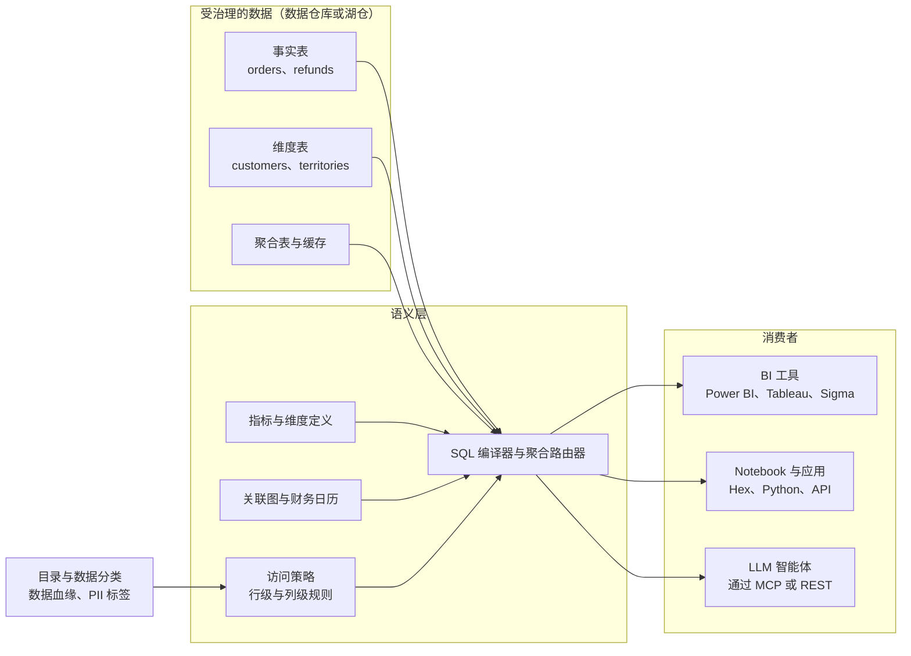
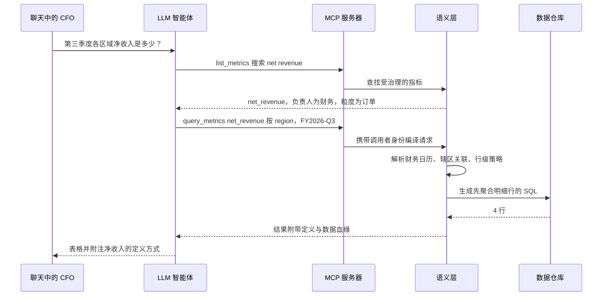

# 14. 语义层与商业智能（BI）
> **深度：** L2 · **阅读时间：** 约 12 分钟 · **最后核实：** 2026-11-01 · **前置阅读：** [第 12 章 — 数据转换与编排](ch12-transformation-and-orchestration.md)

## 要点速览（TL;DR）

- [语义层（semantic layer）](../glossary.md#semantic-layer)是一部受治理的业务含义词典（包括实体、[度量（measure）](../glossary.md#measure)、[维度（dimension）](../glossary.md#dimension)、关联路径和访问规则），它能把"按区域的净收入"这类请求编译成正确的 SQL。"收入"只需定义一次，即可处处复用。
- 这个理念由来已久：OLAP cube、BusinessObjects universe 和 LookML 都做过同样的事。变化在于它*放在哪里*。它正从各个 BI 工具中迁出，进入数据平台本身（Snowflake semantic views、Databricks metric views），或进入中立服务（dbt Semantic Layer/MetricFlow、Cube、AtScale）。
- LLM 让语义层具有了战略意义。已发布的基准测试（大多数由厂商主导）显示，基于受治理定义回答自然语言问题，远比在原始表上做文本转 SQL（text-to-SQL）准确。一个例子：在 data.world 2023 年的研究中，准确率从 16.7% 提升到 54.2%。[^dw-bench]
- BI 前端正在商品化。Gartner 的领导者名单保持稳定，Microsoft 把 Power BI 捆绑进 Fabric，风险资本则流向更新的数据仓库原生工具（2026 年 Sigma 估值 $3B、Omni 估值 $1.5B）。[^sigma-e][^omni-c] 控制点（control point）正从仪表板转移到其底层的定义上。
- 对 Everpure 而言：语义上下文是数据智能（数据分类、业务含义）转化为智能体可用之物的地方。这把 1touch 的投资逻辑与这一层联系在一起（见[第 15 章](ch15-governance-security-privacy.md)和[第 45 章](../06-history-and-future/ch45-storage-moving-up-the-stack.md)）。

## 为何重要（商业 + Everpure 视角）

每家大公司都有"三个收入数字"问题。财务、销售和董事会材料对同一季度各报一个不同的数字，因为每个团队的仪表板都编码了自己关于退款、汇率换算以及采用哪种日历的逻辑。代价不止是尴尬。花在核对数字上的会议会拖延决策，而审计师和监管机构期望的是唯一的数字。

LLM 抬高了风险。写出错误关联的人类分析师通常会注意到总数看起来不对；而在 Slack 中回答 CFO 问题的智能体不会察觉，并且会即时、自信地给出答案。厂商现在把语义层定位为*访问企业数据的智能体安全 API*：智能体只能请求经过定义和治理的指标，且所经接口会强制执行"谁能看到什么"的规则。这就是为什么 Snowflake、Databricks、Google、Microsoft、Salesforce 和 ThoughtSpot 都在 2024 至 2026 年间重做了各自的语义产品，也是为什么 Snowflake 在 2025 年 9 月牵头发起了一项跨厂商标准——开放语义交换（Open Semantic Interchange，OSI）。[^osi-launch] OSI 并非 Snowflake 一家的事：Databricks 于 2026 年 1 月加入，同时加入的还有 Qlik 和 AtScale。[^osi-v1]

对 Everpure 的战略读者而言，关键在于*含义*处于技术栈的哪个位置。Everpure 2026 年收购 1touch，明确就是为了发现和分类数据，并围绕数据"是什么"构建语义上下文。[^1touch] 本章讨论的语义层是同一理念面向分析的版本。数据分类告诉你某一列包含客户 PII；指标定义告诉你，按销售辖区分组的 `SUM(amount) - SUM(refunds)` 就是"按区域的净收入"的含义。智能体两者都需要。基于公开信息，战略团队可以评估的选项包括：把分类和敏感度标签输送到客户已在运行的语义层中（通过 OSI 或目录集成），而不是自建一个与之竞争的指标层。[第 15 章](ch15-governance-security-privacy.md)介绍分类引擎，[第 45 章](../06-history-and-future/ch45-storage-moving-up-the-stack.md)介绍更广泛的"向技术栈上层移动"。

## 工作原理

### 四种要素

一个语义模型由四种要素构成：

- **实体**：业务名词（客户、订单、产品），每个都映射到相应的表和键。
- **度量**：带有规则的聚合。`net_revenue = sum(gross) − sum(refunds) − sum(discounts)`，以美元计，按预订日汇率换算。
- **维度**：用于切分的属性（区域、财季、产品线），包括国家 → 区域 → 大区（theatre）这样的层级。
- **关系**：实体之间合法的关联路径及其基数，使引擎知道 orders 到 order-lines 是一对多关系。

大多数语义层还会增加**访问策略**（行级和列级规则："EMEA 经理只能看到 EMEA 数据"）和**性能层**（缓存、预构建的聚合表以及[聚合感知（aggregate awareness）](../glossary.md#aggregate-awareness)，即引擎在可能时把查询路由到一个小型汇总表）。

在查询时，客户端请求的是*指标和维度*，而不是表：`net_revenue BY region WHERE fiscal_quarter = 'FY25-Q3'`。语义引擎推算出关联方式，应用财务日历和安全过滤条件，为 Snowflake、BigQuery、Databricks 等生成特定方言的 SQL，并返回结果。繁重的计算仍由数据仓库完成。语义层是编译器，而不是数据库。



*图 14.1 — 语义层位于受治理的表与每个消费者之间，因此 BI 工具、notebook 和智能体得到的是同一个"净收入"，而目录中的分类信息会输入到它的访问规则中。*

智能体越来越多地通过 [Model Context Protocol](../glossary.md#model-context-protocol)（MCP，模型上下文协议）访问语义层，这是一项向 LLM 暴露工具的开放标准。MCP 服务器不是把 4,000 张表的清单交给模型，而是提供 `list_metrics`、`describe_metric` 和 `query_metrics` 等少数几个工具。ThoughtSpot（Spotter Semantics，2026 年 3 月）和 dbt 都为各自的语义层提供了 MCP 服务器，Databricks 则将其 2026 年的 Unity Catalog 语义能力定位为可通过 SQL、API 和 MCP 访问。[^ts-semantics][^dbx-uc26] 智能体一侧的内容见[第 22 章](../03-ai-data-stack/ch22-agents-and-data.md)。

> **类比：半导体（指令集架构）。** 语义层之于分析，就像 ISA 之于 CPU。x86 和 Arm 让编译器和操作系统面向一份稳定的契约，而底层的微架构（流水线、缓存、工艺节点）每一代都在变化。指标定义承担的是同样的职责。仪表板和智能体面向 `net_revenue`，而数据工程师在底层重建表、从 Redshift 迁移到 Snowflake，或从 Parquet 切换到 Iceberg。一旦这份契约被破坏，每个消费者都会出错，这正是拥有这一层的一方具备定价权的原因。

> **类比：金融（GAAP 定义）。** 一个指标定义就是一份微型会计政策。GAAP 规定了收入如何确认，使两位阅读同一份 10-K 的分析师得到相同的数字，审计师也依据这唯一的定义进行测试。受治理的指标层在公司内部做的是同样的事：一个定义，在 Git 中做版本控制，归财务部门所有，只能经评审后变更，并用数据血缘显示哪些报表在使用它。而当每个团队都在电子表格里保留自己的定义时，你得到的就是"非 GAAP 调整后 EBITDA"。

### 实例演练："第三季度各区域净收入是多少？"

以一家使用 Snowflake 的中型 SaaS 公司为例。它的表包括 `orders`（每个订单一行，含 `order_total`）、`order_lines`（每个 SKU 一行）、`refunds`、`customers`（同时含 `billing_country` 和 `sales_territory_id`）以及 `territories`。财年从 2 月 1 日开始。

**路径 A：基于原始模式的文本转 SQL。** 只拿到表清单的 LLM 写出了看似合理的 SQL：

```sql
-- 看似合理，实则错误
SELECT c.billing_country AS region, SUM(o.order_total) AS net_revenue
FROM orders o
JOIN order_lines l ON l.order_id = o.order_id      -- 扇出：order_total 按每个明细行重复
JOIN customers c   ON c.customer_id = o.customer_id
WHERE o.order_date BETWEEN '2025-07-01' AND '2025-09-30'  -- 自然年 Q3，而非财年 Q3
GROUP BY 1;                                        -- 忽略了退款和汇率
```

四个错误层层叠加。（1）**扇出（fan-out）**关联让每个订单按明细行数被重复计数；如果订单平均有三行明细，收入会被放大约 3 倍。（2）它用的是*自然年* Q3，而该公司的财年 Q3 是 8 月至 10 月。（3）它忽略了退款和币种，因此结果是总收入而非净收入。（4）在这家公司，"区域"指的是销售辖区，而不是账单国家。查询能够运行，返回一张整齐的表，但其中每个数字都是错的。输出中没有任何内容会提醒用户。

**路径 B：通过语义层。** 智能体无法写出那条 SQL。它只能调用 `query_metrics(metrics=["net_revenue"], group_by=["region"], where="fiscal_quarter = 'FY2026-Q3'")`。语义层已经知道：`net_revenue` 以订单为粒度定义，扣除退款并按预订日汇率换算；`region` 通过 `sales_territory_id` 解析；FY2026-Q3 指 2025 年 8 月至 10 月。它生成的 SQL 会在关联*之前*先聚合 `order_lines`（避免扇出），应用调用者的行级策略，然后返回答案。如果用户询问没有定义指标的内容，例如在未对席位建模的情况下问"每个活跃席位的净收入"，语义层会拒绝回答，而不是去猜测。



*图 14.2 — 通过语义层，智能体选择的是指标而不是编写关联，因此路径 A 中的扇出、日历和区域错误都不会发生。*

证据怎么说？最知名的研究是 data.world 2023 年的基准测试。在一个保险业模式上，GPT-4 在 SQL 表上以零样本方式正确回答了 16.7% 的企业问题，而在同一数据的知识图谱（语义）表示上正确回答了 54.2%。在最难的问题上，SQL 的准确率为 0%。[^dw-bench] AtScale 2024 年由厂商主导、基于 40 个 TPC-DS 问题的测试报告称，不使用其语义层时准确率为 20%，使用后为 92.5%。[^atscale-bench] dbt Labs 2026 年 4 月的更新报告称，在其 Semantic Layer *建模范围内*的问题上，前沿模型达到 98–100%，而在同样建模良好的数据上，文本转 SQL 为 84–90%。[^dbt-bench] Google 表示，在内部测试中，LookML 将自然语言查询的错误减少了最多三分之二。[^looker-twothirds] 解读这些数字需谨慎。除学术预印本外，其余均由厂商主导，问题集很小（11–40 个问题），而且语义层得分高的部分原因是它拒绝回答无法回答的问题。不过方向是一致的。模型每年都在进步，但它们无法推断出你的财务日历或你对"区域"的定义。只有受治理的上下文才能提供这些。
