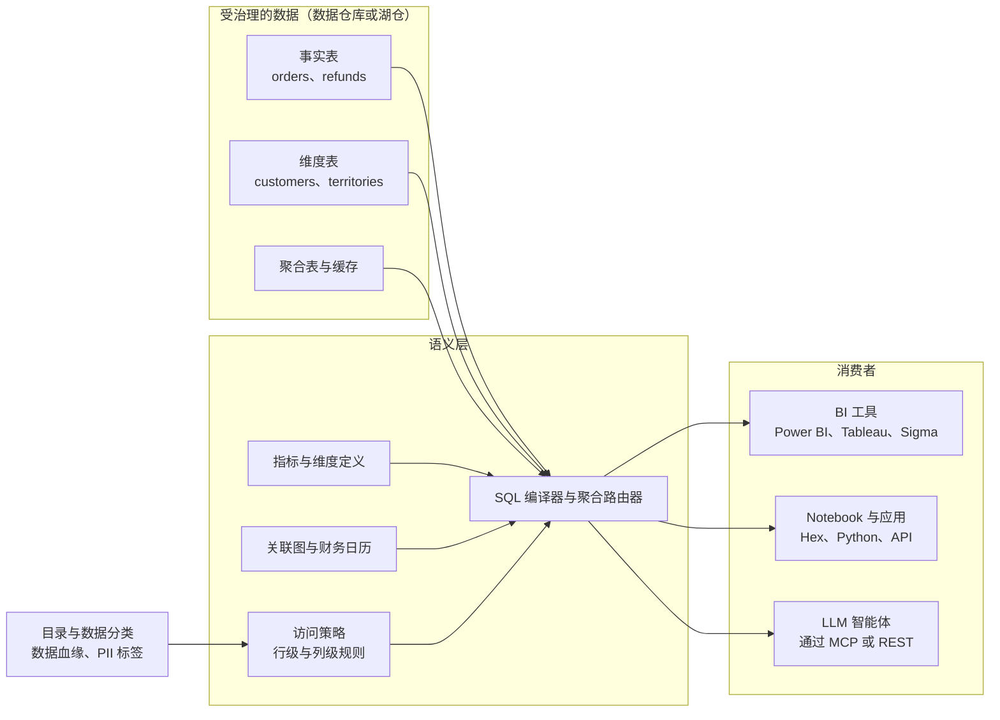
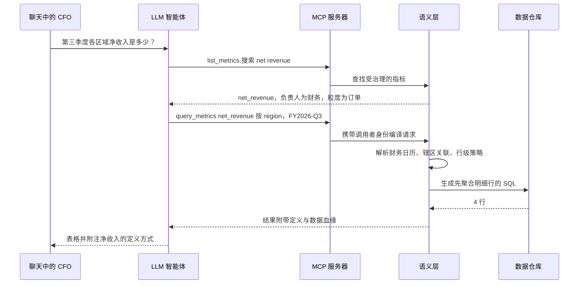
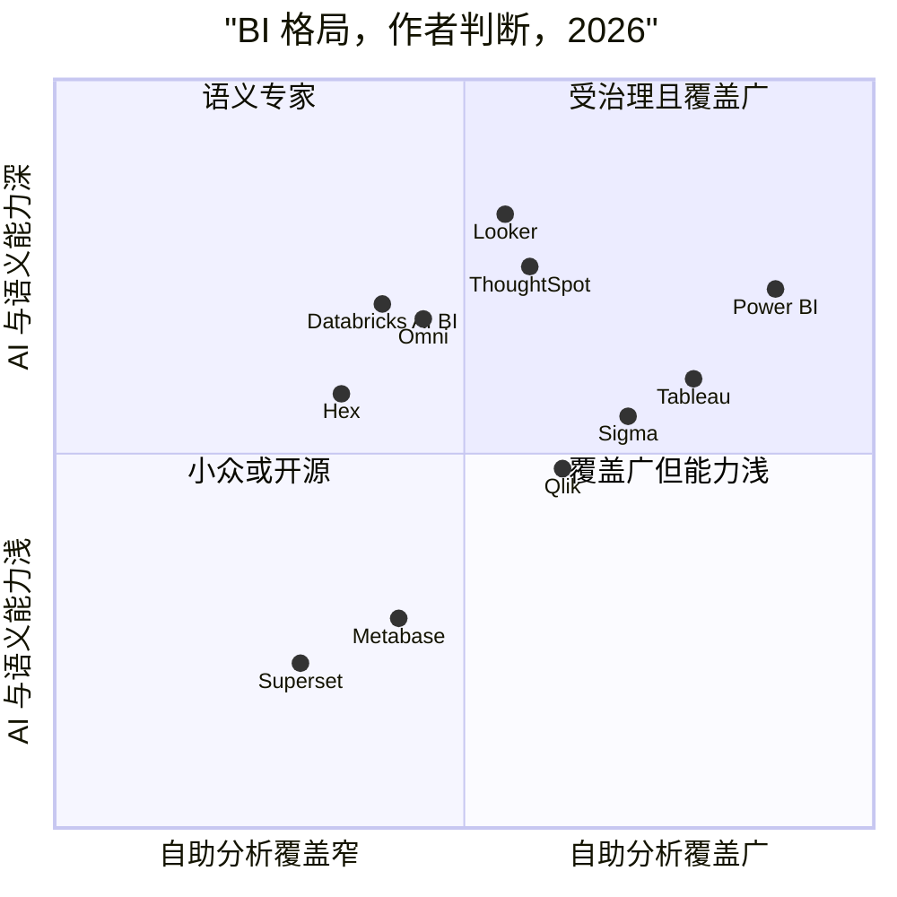
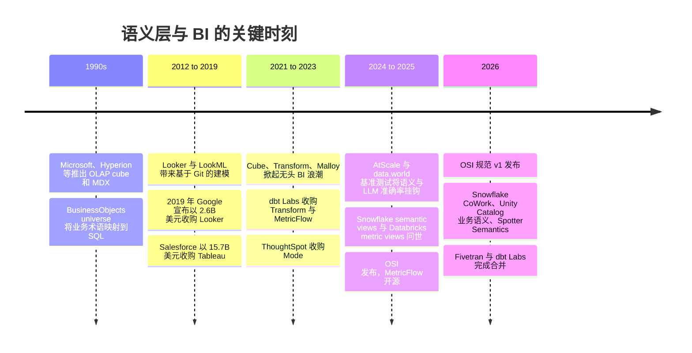

# 14. 语义层与商业智能（BI）
> **深度：** L2 · **阅读时间：** 约 12 分钟 · **最后核实：** 2026-11-01 · **前置阅读：** [第 12 章 — 数据转换与编排](ch12-transformation-and-orchestration.md)

<a id="tldr"></a>
## 要点速览（TL;DR）

- [语义层（semantic layer）](../glossary.md#semantic-layer)是一部受治理的业务含义词典（包括实体、[度量（measure）](../glossary.md#measure)、[维度（dimension）](../glossary.md#dimension)、关联路径和访问规则），它能把"按区域的净收入"这类请求编译成正确的 SQL。"收入"只需定义一次，即可处处复用。
- 这个理念由来已久：OLAP cube、BusinessObjects universe 和 LookML 都做过同样的事。变化在于它*放在哪里*。它正从各个 BI 工具中迁出，进入数据平台本身（Snowflake semantic views、Databricks metric views），或进入中立服务（dbt Semantic Layer/MetricFlow、Cube、AtScale）。
- LLM 让语义层具有了战略意义。已发布的基准测试（大多数由厂商主导）显示，基于受治理定义回答自然语言问题，远比在原始表上做文本转 SQL（text-to-SQL）准确。一个例子：在 data.world 2023 年的研究中，准确率从 16.7% 提升到 54.2%。[^dw-bench]
- BI 前端正在商品化。Gartner 的领导者名单保持稳定，Microsoft 把 Power BI 捆绑进 Fabric，风险资本则流向更新的数据仓库原生工具（2026 年 Sigma 估值 $3B、Omni 估值 $1.5B）。[^sigma-e][^omni-c] 控制点（control point）正从仪表板转移到其底层的定义上。
- 对 Everpure 而言：语义上下文是数据智能（数据分类、业务含义）转化为智能体可用之物的地方。这把 1touch 的投资逻辑与这一层联系在一起（见[第 15 章](ch15-governance-security-privacy.md)和[第 45 章](../06-history-and-future/ch45-storage-moving-up-the-stack.md)）。

<a id="why-this-matters-business--everpure-lens"></a>
## 为何重要（商业 + Everpure 视角）

每家大公司都有"三个收入数字"问题。财务、销售和董事会材料对同一季度各报一个不同的数字，因为每个团队的仪表板都编码了自己关于退款、汇率换算以及采用哪种日历的逻辑。代价不止是尴尬。花在核对数字上的会议会拖延决策，而审计师和监管机构期望的是唯一的数字。

LLM 抬高了风险。写出错误关联的人类分析师通常会注意到总数看起来不对；而在 Slack 中回答 CFO 问题的智能体不会察觉，并且会即时、自信地给出答案。厂商现在把语义层定位为*访问企业数据的智能体安全 API*：智能体只能请求经过定义和治理的指标，且所经接口会强制执行"谁能看到什么"的规则。这就是为什么 Snowflake、Databricks、Google、Microsoft、Salesforce 和 ThoughtSpot 都在 2024 至 2026 年间重做了各自的语义产品，也是为什么 Snowflake 在 2025 年 9 月牵头发起了一项跨厂商标准——开放语义交换（Open Semantic Interchange，OSI）。[^osi-launch] OSI 并非 Snowflake 一家的事：Databricks 于 2026 年 1 月加入，同时加入的还有 Qlik 和 AtScale。[^osi-v1]

对 Everpure 的战略读者而言，关键在于*含义*处于技术栈的哪个位置。Everpure 2026 年收购 1touch，明确就是为了发现和分类数据，并围绕数据"是什么"构建语义上下文。[^1touch] 本章讨论的语义层是同一理念面向分析的版本。数据分类告诉你某一列包含客户 PII；指标定义告诉你，按销售辖区分组的 `SUM(amount) - SUM(refunds)` 就是"按区域的净收入"的含义。智能体两者都需要。基于公开信息，战略团队可以评估的选项包括：把分类和敏感度标签输送到客户已在运行的语义层中（通过 OSI 或目录集成），而不是自建一个与之竞争的指标层。[第 15 章](ch15-governance-security-privacy.md)介绍分类引擎，[第 45 章](../06-history-and-future/ch45-storage-moving-up-the-stack.md)介绍更广泛的"向技术栈上层移动"。

<a id="how-it-works"></a>
## 工作原理

<a id="the-four-ingredients"></a>
### 四种要素

一个语义模型由四种要素构成：

- **实体**：业务名词（客户、订单、产品），每个都映射到相应的表和键。
- **度量**：带有规则的聚合。`net_revenue = sum(gross) − sum(refunds) − sum(discounts)`，以美元计，按预订日汇率换算。
- **维度**：用于切分的属性（区域、财季、产品线），包括国家 → 区域 → 大区（theatre）这样的层级。
- **关系**：实体之间合法的关联路径及其基数，使引擎知道 orders 到 order-lines 是一对多关系。

大多数语义层还会增加**访问策略**（行级和列级规则："EMEA 经理只能看到 EMEA 数据"）和**性能层**（缓存、预构建的聚合表以及[聚合感知（aggregate awareness）](../glossary.md#aggregate-awareness)，即引擎在可能时把查询路由到一个小型汇总表）。

在查询时，客户端请求的是*指标和维度*，而不是表：`net_revenue BY region WHERE fiscal_quarter = 'FY25-Q3'`。语义引擎推算出关联方式，应用财务日历和安全过滤条件，为 Snowflake、BigQuery、Databricks 等生成特定方言的 SQL，并返回结果。繁重的计算仍由数据仓库完成。语义层是编译器，而不是数据库。



*图 14.1 — 语义层位于受治理的表与每个消费者之间，因此 BI 工具、notebook 和智能体得到的是同一个"净收入"，而目录中的分类信息会输入到它的访问规则中。*

智能体越来越多地通过 [Model Context Protocol](../glossary.md#model-context-protocol)（MCP，模型上下文协议）访问语义层，这是一项向 LLM 暴露工具的开放标准。MCP 服务器不是把 4,000 张表的清单交给模型，而是提供 `list_metrics`、`describe_metric` 和 `query_metrics` 等少数几个工具。ThoughtSpot（Spotter Semantics，2026 年 3 月）和 dbt 都为各自的语义层提供了 MCP 服务器，Databricks 则将其 2026 年的 Unity Catalog 语义能力定位为可通过 SQL、API 和 MCP 访问。[^ts-semantics][^dbx-uc26] 智能体一侧的内容见[第 22 章](../03-ai-data-stack/ch22-agents-and-data.md)。

> **类比：半导体（指令集架构）。** 语义层之于分析，就像 ISA 之于 CPU。x86 和 Arm 让编译器和操作系统面向一份稳定的契约，而底层的微架构（流水线、缓存、工艺节点）每一代都在变化。指标定义承担的是同样的职责。仪表板和智能体面向 `net_revenue`，而数据工程师在底层重建表、从 Redshift 迁移到 Snowflake，或从 Parquet 切换到 Iceberg。一旦这份契约被破坏，每个消费者都会出错，这正是拥有这一层的一方具备定价权的原因。

> **类比：金融（GAAP 定义）。** 一个指标定义就是一份微型会计政策。GAAP 规定了收入如何确认，使两位阅读同一份 10-K 的分析师得到相同的数字，审计师也依据这唯一的定义进行测试。受治理的指标层在公司内部做的是同样的事：一个定义，在 Git 中做版本控制，归财务部门所有，只能经评审后变更，并用数据血缘显示哪些报表在使用它。而当每个团队都在电子表格里保留自己的定义时，你得到的就是"非 GAAP 调整后 EBITDA"。

<a id="worked-example-what-was-q3-net-revenue-by-region"></a>
### 实例演练："第三季度各区域净收入是多少？"

以一家使用 Snowflake 的中型 SaaS 公司为例。它的表包括 `orders`（每个订单一行，含 `order_total`）、`order_lines`（每个 SKU 一行）、`refunds`、`customers`（同时含 `billing_country` 和 `sales_territory_id`）以及 `territories`。财年从 2 月 1 日开始。

**路径 A：基于原始模式的文本转 SQL。** 只拿到表清单的 LLM 写出了看似合理的 SQL：

```sql
-- 看似合理，实则错误
SELECT c.billing_country AS region, SUM(o.order_total) AS net_revenue
FROM orders o
JOIN order_lines l ON l.order_id = o.order_id      -- 扇出：order_total 按每个明细行重复
JOIN customers c   ON c.customer_id = o.customer_id
WHERE o.order_date BETWEEN '2025-07-01' AND '2025-09-30'  -- 自然年 Q3，而非财年 Q3
GROUP BY 1;                                        -- 忽略了退款和汇率
```

四个错误层层叠加。（1）**扇出（fan-out）**关联让每个订单按明细行数被重复计数；如果订单平均有三行明细，收入会被放大约 3 倍。（2）它用的是*自然年* Q3，而该公司的财年 Q3 是 8 月至 10 月。（3）它忽略了退款和币种，因此结果是总收入而非净收入。（4）在这家公司，"区域"指的是销售辖区，而不是账单国家。查询能够运行，返回一张整齐的表，但其中每个数字都是错的。输出中没有任何内容会提醒用户。

**路径 B：通过语义层。** 智能体无法写出那条 SQL。它只能调用 `query_metrics(metrics=["net_revenue"], group_by=["region"], where="fiscal_quarter = 'FY2026-Q3'")`。语义层已经知道：`net_revenue` 以订单为粒度定义，扣除退款并按预订日汇率换算；`region` 通过 `sales_territory_id` 解析；FY2026-Q3 指 2025 年 8 月至 10 月。它生成的 SQL 会在关联*之前*先聚合 `order_lines`（避免扇出），应用调用者的行级策略，然后返回答案。如果用户询问没有定义指标的内容，例如在未对席位建模的情况下问"每个活跃席位的净收入"，语义层会拒绝回答，而不是去猜测。



*图 14.2 — 通过语义层，智能体选择的是指标而不是编写关联，因此路径 A 中的扇出、日历和区域错误都不会发生。*

证据怎么说？最知名的研究是 data.world 2023 年的基准测试。在一个保险业模式上，GPT-4 在 SQL 表上以零样本方式正确回答了 16.7% 的企业问题，而在同一数据的知识图谱（语义）表示上正确回答了 54.2%。在最难的问题上，SQL 的准确率为 0%。[^dw-bench] AtScale 2024 年由厂商主导、基于 40 个 TPC-DS 问题的测试报告称，不使用其语义层时准确率为 20%，使用后为 92.5%。[^atscale-bench] dbt Labs 2026 年 4 月的更新报告称，在其 Semantic Layer *建模范围内*的问题上，前沿模型达到 98–100%，而在同样建模良好的数据上，文本转 SQL 为 84–90%。[^dbt-bench] Google 表示，在内部测试中，LookML 将自然语言查询的错误减少了最多三分之二。[^looker-twothirds] 解读这些数字需谨慎。除学术预印本外，其余均由厂商主导，问题集很小（11–40 个问题），而且语义层得分高的部分原因是它拒绝回答无法回答的问题。不过方向是一致的。模型每年都在进步，但它们无法推断出你的财务日历或你对"区域"的定义。只有受治理的上下文才能提供这些。

<a id="design-choices-and-trade-offs"></a>
## 设计选择与权衡

主要的架构选择是*定义放在哪里*。有三种选项。**BI 内嵌式**语义层（LookML、Power BI semantic models、Tableau Semantics）成熟且集成紧密，但会把定义绑定在单一前端上。**通用 / 无头式（headless）**语义层（dbt Semantic Layer、Cube、AtScale）可服务任何消费者，但需要额外运行一项服务，并依赖 BI 厂商与之集成。**平台原生**语义层（Snowflake semantic views、Databricks metric views）没有额外许可费，并紧邻数据治理引擎，但会把定义绑定在单一数据平台上。OSI 试图让定义在这三者之间可移植。

| 语义层 | 所有者 | 定义存放位置 | 语言 / 格式 | 查询接口 | 状态（截至 2026-11-01） |
|---|---|---|---|---|---|
| LookML | Google（Looker） | Git 中的 Looker 项目 | LookML（类 YAML 的 DSL） | Looker Explores、SQL 接口、Conversational Analytics API | 成熟（约 2012 年起）；为 Looker 对话式分析提供依据，已正式可用[^looker-ca] |
| dbt Semantic Layer / MetricFlow | Fivetran + dbt Labs | dbt 项目 YAML | MetricFlow 规范；引擎自 2025 年 10 月起采用 Apache 2.0 | JDBC/GraphQL API、BI 集成、MCP | 在 dbt 平台中正式可用；MetricFlow 于 2025-10-14 开源[^metricflow-oss] |
| Cube | Cube Dev | Cube 数据模型文件 | YAML/JS；开源核心 | SQL（Postgres 协议）、REST、GraphQL、面向 Excel 的 MDX | 开源加 Cube Cloud；2025 年推出智能体式分析产品[^cube-d3] |
| AtScale | AtScale | AtScale 语义模型 | SML（开放语义建模语言） | 面向 Excel、Power BI、Tableau 的 MDX/DAX/SQL 接口 | 商业产品；OSI 工作组成员[^osi-v1] |
| Snowflake semantic views | Snowflake | 模式级数据库对象 | `CREATE SEMANTIC VIEW` DDL（仍支持 YAML 模型） | SQL `SEMANTIC_VIEW()` 查询、Cortex Analyst、CoWork | 定义功能于 Summit 2025 正式可用；查询功能当时处于预览阶段[^sf-sv] `[VERIFY: 2026 年查询功能的正式可用状态]` |
| Databricks metric views | Databricks | Unity Catalog 对象 | 在 Unity Catalog 中注册的 YAML 规范 | SQL `MEASURE()`、AI/BI 仪表板、Genie | 自 2025-05-29 起公开预览；正式可用状态 [VERIFY: metric views 正式可用日期]；在 DAIS 2026 上扩展为 Unity Catalog Metrics/Business Semantics（二手来源）[^dbx-mv][^dbx-uc26] |
| Power BI semantic models | Microsoft | Power BI / Fabric 工作区 | 表格模型、DAX 度量、TMDL | Power BI、Excel、XMLA 端点、Copilot | 成熟；为 Copilot 提供"Prep data for AI"（模式、已验证答案、指令）[^pbi-prep] |

*图 14.3 — 七种语义层，三种架构：BI 内嵌式（LookML、Power BI）、通用式（dbt、Cube、AtScale）和平台原生式（Snowflake、Databricks）。区分它们的是可移植性，而非表达能力。*

*反对*单独设立语义层的观点也值得一听。许多团队发现，一组建模良好的 dbt "marts" 表，加上描述完善的数据目录，就能获得大部分收益，同时省去一次额外的运行时跳转和又一张厂商账单。语义层在临时分析方面也有困难：探索新问题的数据科学家往往需要原始表，而过于严格的语义层会逼他们导出 CSV。此外，"只定义一次"的承诺只有在财务部门真正拥有这些定义时才能兑现，否则语义层只会变成又一个存放三个版本收入的地方。实事求是的立场是：在问题重复出现、数据治理重要且涉及智能体的场景中，语义层物有所值；对于一次性探索，它并无必要。

<a id="whos-who"></a>
## 主要参与者

语义层厂商已在图 14.3 中介绍。BI 前端市场的格局如下：

| 厂商 | 所有者 / 状态 | 定价模式 | AI 助手 | 语义模型 | 最佳适用场景 |
|---|---|---|---|---|---|
| Power BI | Microsoft；属于 Fabric | 按用户（自 2025 年 4 月起 Pro $14、PPU $24/用户/月）加 Fabric 容量[^pbi-price] | Copilot（Fabric F2+ 或 P1 容量）[^pbi-copilot] | Power BI semantic models（DAX） | Microsoft 365 用户；企业默认选择 |
| Tableau | Salesforce | 按用户（Standard 标价：Creator $75、Explorer $42、Viewer $15/用户/月）；Tableau+ 套餐需询价[^tableau-price] | Tableau Next / Agentforce 智能体 | Tableau Semantics（基于 Salesforce Data 360，前身为 Data Cloud） | 可视化分析；Salesforce CRM 环境 |
| Looker | Google Cloud | 平台费加按用户收费，需询价 | Gemini in Looker、Conversational Analytics | LookML | BigQuery/GCP；受治理的嵌入式分析 |
| Qlik Sense / Qlik Cloud | Qlik（Thoma Bravo 旗下，私有） | 基于容量和用户的订阅 | Qlik Answers | 关联引擎、Qlik 数据模型 | 传统企业、制造业、集成套件（Talend） |
| Sigma | 私有（估值 $3B，2026 年 5 月）[^sigma-e] | 按用户，部分层级查看者免费 [VERIFY: Sigma 当前的分层定价] | Sigma AI / 智能体式应用 | 基于数据仓库的数据模型；消费 dbt/Snowflake 语义 | 直接在 Snowflake/Databricks 上提供电子表格式体验 |
| ThoughtSpot | 私有（自 2023 年起含 Mode） | 按用户及按用量分层 | Spotter 智能体 | Spotter Semantics / TML、MCP 服务器[^ts-semantics] | 搜索优先的自助分析、嵌入式分析 |
| Hex | 私有（C 轮 $70M，2025 年）[^hex-c] | 按编辑者席位 | Hex Magic / 智能体 | 同步 dbt、Snowflake、Databricks 语义模型 | 面向数据团队的 notebook 加应用 |
| Omni | 私有（估值 $1.5B，2026 年 4 月）[^omni-c] | 按用户，需询价 | Omni AI | 内置语义模型，可与 dbt 同步 | 兼具 Looker 式治理与电子表格的速度 |
| Superset / Preset | Apache（开源）/ Preset（商业） | 开源免费；Preset 按用户收费 | Preset AI 辅助 | 轻量级数据集和指标 | 对成本敏感、由工程师主导的团队 |
| Metabase | Metabase（开放核心） | 开源免费；云版按用户分层 | Metabot | 模型与指标 | 初创公司和内部工具 |
| Databricks AI/BI | Databricks | 包含在内；消耗 SQL 计算 | Genie（2025 年 6 月正式可用；2026 年推出 Genie One）[^genie-ga] | Unity Catalog metric views | 湖仓原生的业务用户 |

*图 14.4 — 如今 BI 厂商之间的差异，更少体现在图表能力上，更多体现在计价单位（席位 vs 用量）、AI 助手，以及把谁的语义模型视为标准上。*



*图 14.5 — 作者的定性判断，而非 Gartner 的判断：老牌厂商胜在覆盖面，而对智能体最重要的语义深度则分散在 Looker、ThoughtSpot、Omni 和平台原生工具之间。*

关于分析师观点：Gartner 2025 年 6 月的《分析与 BI 平台魔力象限》（Magic Quadrant for Analytics and BI Platforms）将 Microsoft、Salesforce（Tableau）、Google（Looker）、Qlik、Oracle 和 ThoughtSpot 列为领导者，Sigma 是唯一的新入选者。[^gartner-2025] 2026 年版的日期为 2026 年 6 月 29 日。厂商页面确认 Salesforce（第 14 年入选）、Google 和 Qlik 为领导者，完整的 2026 年名单为 [VERIFY: 2026 年 ABI 魔力象限完整领导者名单]。[^gartner-2026]

对话式分析如今已是标配。Databricks 于 2025 年 6 月使 AI/BI Genie 正式可用。[^genie-ga] Snowflake 在 Summit 2026 上把 Snowflake Intelligence 更名为 **Snowflake CoWork**，并以 semantic views 作为其依据层。[^sf-cowork] Microsoft 把 Power BI Copilot 与"为 AI 准备好"的语义模型绑定。[^pbi-prep] Google 使以 LookML 为依据的 Looker Conversational Analytics 正式可用。[^looker-ca] Salesforce 的 Tableau Next 在 Tableau Semantics 上运行 Agentforce 智能体。[^tableau-next] 每家厂商对"为什么要信任聊天机器人？"的回答，最终都指向语义模型。Salesforce 和 Microsoft 如何利用 BI 加深应用锁定，见[第 34 章](../04-company-deep-dives/ch34-application-giants-data-platforms.md)。

> **类比：EDA 许可（按席位定价）。** BI 席位类似于 Synopsys 和 Cadence 按席位计费的 EDA 许可：按具名工程师定价；由于工作流程和培训围绕工具不断积累而具有黏性；并通过捆绑销售来防守。与 EDA 一样，席位面临的压力来自无法对应到具体个人的使用量。EDA 厂商曾面对云端突发许可和基于令牌的许可池；BI 厂商则面对代表成千上万名无许可员工发起查询的 AI 智能体。预计 BI 定价将逐步转向按用量计费（Fabric 容量、Databricks 计算、Snowflake AI credits），就像 EDA 转向令牌和订阅池一样。

<a id="history-and-trajectory"></a>
## 历史与发展轨迹



*图 14.6 — 语义层已被发明了三次：在 cube 内部、在 BI 工具内部，以及如今在数据平台内部。每一次迁移，都把控制权转移给了掌握定义的一方。*

**Cube 与 universe（1990 年代–2000 年代）。** OLAP cube 沿固定维度预先计算聚合，并通过 MDX（Multidimensional Expressions，多维表达式）对外提供。只要问题契合 cube，业务用户就能获得快速、一致的答案。BusinessObjects 的"universe"可以说是现代意义上的第一个语义层：一套从业务词汇到 SQL 关联的映射。两者都与各自厂商绑定，且每当模式变化就要重建。

**LookML 与云数据仓库（2012–2020）。** Looker 的洞见在于：把语义模型作为代码保存在 Git 中，并针对云数据仓库实时生成 SQL，而不是预先构建 cube。这契合了 Redshift、BigQuery 和 Snowflake 计算弹性伸缩的经济特性。Google 于 2019 年 6 月 6 日宣布以 $2.6B 全现金收购，交易在经过英国 CMA 审查后于 2020 年 2 月完成。[^looker-acq][^ma-csv] Google 宣布四天后，Salesforce 同意以 $15.7B 的股票收购 Tableau。[^ma-csv] 在短短一周内，BI 变成了超大规模云厂商和应用套件的一项功能。

**无头 BI（2020–2023）。** 随后，从业者主张指标不应被锁定在任何单一 BI 工具中。Cube、Transform（MetricFlow）以及 Google 由 Looker 创始人 Lloyd Tabb 创建的开源项目 Malloy，都在追求"无头"或通用语义。[^malloy] 整合随之而来。dbt Labs 于 2023 年 2 月收购 Transform 以构建 dbt Semantic Layer，[^transform] ThoughtSpot 于 2023 年 6 月以 $200M 现金加股票收购 Mode。[^mode] Cube 在 2024 年完成由 Databricks Ventures 领投的 $25M 融资，表明平台希望在其生态系统中拥有中立的语义能力。[^cube-25m]

**平台原生语义与 OSI（2025–2026）。** 2025 年，数据平台把语义能力收归自身。Snowflake 在 Summit 2025 上使 semantic view 定义功能正式可用，[^sf-sv] Databricks 于 2025 年 5 月 29 日将 metric views 推入公开预览。[^dbx-mv] 2025 年 9 月，Snowflake 与 Salesforce、dbt Labs、BlackRock 和 RelationalAI 作为联合牵头方发起 OSI，合作伙伴包括 Cube、Hex、Omni、Sigma 和 ThoughtSpot 等。[^osi-launch] dbt 于 2025 年 10 月以 Apache 2.0 许可开源 MetricFlow，以支持这一倡议。[^metricflow-oss] OSI 于 2026 年 1 月在 GitHub 上发布其 v1.0 规范，Databricks、Qlik、AtScale 等加入了工作组，其治理计划移交给一个中立基金会。[^osi-v1] 与此同时，Fivetran 与 dbt Labs 于 2026 年 6 月 1 日完成合并，使使用最广泛的开放指标引擎归入一家"数据摄取加数据转换"厂商旗下（[第 12 章](ch12-transformation-and-orchestration.md)）。[^ma-csv]

**发展轨迹。** 有三个押注看起来是合理的。（1）定义将越来越多地只编写一次，并通过 OSI 式格式在各工具间*同步*，就像 Iceberg 让表格式变得可移植一样（目录方面的类比见[第 8 章](../01-data-systems-foundations/ch08-catalogs-and-metastores.md)）。（2）语义层将与目录和数据治理层融合，因为智能体需要在一次调用中同时获得含义、权限和数据血缘。（3）BI 仪表板不会消失，但其在分析预算中的占比将相对于智能体和平台消耗而缩小。反方观点是：OSI 可能停滞为一份"最小公分母"式规范，而各平台继续把最丰富的功能保留为专有。由单一厂商召集的标准组织常常落得如此结局。预期情况会有所不同的主要理由是：Databricks 于 2026 年 1 月加入，把 Snowflake 的头号对手拉了进来；以及已公布的将治理移交中立基金会的计划。

<a id="numbers-that-matter"></a>
## 关键数字

| 指标 | 数值 | 口径 | 来源 / 日期 |
|---|---|---|---|
| GPT-4 在企业 SQL 问题上的准确率：原始表 vs 知识图谱 | 16.7% → 54.2% | 学术预印本（data.world 作者） | Sequeda et al., 2023-11-13[^dw-bench] |
| AtScale TPC-DS 文本转 SQL：不使用 vs 使用语义层 | 20% → 92.5%（40 个问题） | 厂商主导的基准测试 | BigDATAwire, 2024-08-15[^atscale-bench] |
| dbt 基准测试，范围内问题：文本转 SQL vs Semantic Layer | 90.0% vs 98.2%（Claude Sonnet 4.6）；84.1% vs 100%（GPT-5.3-Codex） | 厂商主导的基准测试，11 个问题 × 20 次运行 | dbt Labs, 2026-04[^dbt-bench] |
| Google 收购 Looker | $2.6B 全现金 | 已披露交易金额 | Alphabet, 2019-06-06[^looker-acq] |
| Salesforce–Tableau | $15.7B 全股票 | 已披露交易金额 | Cooley, 2019-06-10[^ma-csv] |
| ThoughtSpot–Mode | $200M 现金加股票 | 已披露交易金额 | TechCrunch, 2023-06-26[^mode] |
| Power BI Pro / PPU 标价 | $10 → $14；$20 → $24 每用户/月 | 标价，2025-04-01 生效 | Microsoft Power BI 博客[^pbi-price] |
| Tableau Creator / Explorer / Viewer（Standard） | $75 / $42 / $15 每用户/月 | 标价，按年计费 | Tableau 定价页面[^tableau-price] |
| Sigma ARR 与估值 | ARR 约 $200M（2026 年 4 月），同比约 2 倍；投后估值 $3B | 公司披露的 ARR；媒体报道的估值 | Sigma / SiliconANGLE, 2026-05-18[^sigma-e] |
| Omni C 轮 | $120M，估值 $1.5B（收入同比增长约 4 倍） | 公司披露 / 媒体报道 | Omni, SiliconANGLE, 2026-04-23[^omni-c] |
| Fabric 付费客户 | 19,000+ | 公司在 FabCon 2025 上披露，经二手回顾转引 | Theobald Software, 2025[^fabric-cust] |

*图 14.7 — 基准测试显示，原始文本转 SQL 与受治理语义之间存在巨大的准确率差距；而即便定价模式正向按用量计费转变，席位价格仍在上涨。*

<a id="storage-bridge"></a>
## 存储桥接

本章无需存储桥接：语义层编译 SQL，并不改变字节的存储方式。与 Everpure 的关联在于元数据路径，它从数据分类（[第 15 章](ch15-governance-security-privacy.md)）延伸到语义上下文，再到智能体。见[第 45 章](../06-history-and-future/ch45-storage-moving-up-the-stack.md)。

<a id="conversation-playbook"></a>
## 对话手册

**向产品经理提的问题**

1. "你们的指标定义目前放在哪里：在各个 BI 工具中、在 dbt 中，还是在平台中？财务部门由谁来签批对'净收入'的变更？"
2. "当你们的 AI 助手遇到一个没有受治理指标可依据的问题时，它会怎么做：拒绝回答、退回到原始 SQL，还是发出警告？"
3. "如果客户在 Snowflake semantic views *和* Power BI 中都有定义，你们如何保持同步？是否通过 OSI 导入或导出？"

**向工程师提的问题**

1. "你们的语义层如何防止跨一对多关联时出现扇出和深坑陷阱（chasm trap）导致的重复计数？"
2. "行级和列级策略是在语义层执行、在数据仓库执行，还是两者兼有？智能体的查询以哪个身份运行？"
3. "你们的聚合感知或缓存策略是什么？当上游 dbt 模型重建时，如何使缓存失效？"

**好的回答是什么样的。** 定义以版本控制的代码形式存在，并有具名负责人；针对智能体有明确的拒答行为；安全策略在数据仓库层面以最终用户的身份执行，而不是使用共享服务账号；对 OSI 导入和导出有清晰的答复；基准测试结论注明问题集和范围。

**不要这样说**

- "LLM 很快就会好到可以跳过语义层。"更好的模型能修正 SQL 语法，但无法推断你的财务日历，也无法推断你的公司所说的"区域"指什么。
- "语义层是一个数据库。"它编译查询并缓存结果，执行查询的仍是数据仓库。
- "OSI 意味着定义现在已完全可移植。"v1.0 涵盖核心指标、维度和关系，厂商特有的功能仍无法转换。
- "dbt 被收购了，所以无头 BI 已死。"这些理念已进入平台和标准，淡出的只是独立初创公司的模式。

<a id="going-deeper"></a>
## 深入阅读

> **深入（L3）。** 阅读 MetricFlow 源代码（Apache 2.0），了解一个指标请求如何变成数据流计划，再变成特定方言的 SQL。将其与 Snowflake 的 `SEMANTIC_VIEW()` 查询语法以及 Databricks 在 metric views 上使用的 `MEASURE()` 函数进行比较。研究 GitHub 上 OSI v1.0 的 YAML 模式。关于准确率评估方法，阅读 data.world 的论文（arXiv:2311.07509）和开放的 `dbt-llm-sl-bench` 代码库，并留意各自如何判定"正确"。

<a id="key-terms"></a>
## 关键术语

- [语义层（Semantic layer）](../glossary.md#semantic-layer) — 受治理的业务定义（指标、维度、关联、策略），可将请求编译为 SQL。
- [指标层（Metrics layer）](../glossary.md#metrics-layer) — 专注于指标定义的语义层；常与语义层互换使用。
- [度量（Measure）](../glossary.md#measure) — 带有业务规则的聚合，例如净收入。
- [维度（Dimension）](../glossary.md#dimension) — 用于对度量进行分组或过滤的属性，例如区域或财季。
- [OLAP cube（OLAP 立方体）](../glossary.md#olap-cube) — 以 MDX 查询的预聚合多维存储。
- [MDX](../glossary.md#mdx) — Multidimensional Expressions（多维表达式），OLAP cube 的查询语言。
- [LookML](../glossary.md#lookml) — Looker 基于代码的语义建模语言。
- [无头 BI（Headless BI）](../glossary.md#headless-bi) — 与任何单一可视化工具解耦的语义层。
- [MetricFlow](../glossary.md#metricflow) — dbt Semantic Layer 背后 dbt 的开源指标编译器。
- [语义视图（Semantic view）](../glossary.md#semantic-view) — Snowflake 的模式级语义模型对象。
- [指标视图（Metric view）](../glossary.md#metric-view) — Databricks Unity Catalog 中定义受治理指标的对象。
- [开放语义交换（Open Semantic Interchange）](../glossary.md#open-semantic-interchange) — 旨在实现语义模型可移植的跨厂商倡议及规范。
- [聚合感知（Aggregate awareness）](../glossary.md#aggregate-awareness) — 在预构建汇总表能够回答查询时，将查询路由到该汇总表。
- [扇出（Fan-out）](../glossary.md#fan-out) — 一对多关联导致行数倍增，从而虚增求和结果。
- [文本转 SQL（Text-to-SQL）](../glossary.md#text-to-sql) — 由 LLM 根据自然语言问题生成 SQL。
- [对话式分析（Conversational analytics）](../glossary.md#conversational-analytics) — 在 BI 或数据平台中，基于受治理数据进行的自然语言问答。
- [模型上下文协议（Model Context Protocol）](../glossary.md#model-context-protocol) — 向 LLM 智能体暴露工具和数据的开放标准。

<a id="sources"></a>
## 资料来源

[^dw-bench]: Juan Sequeda, Dean Allemang, Bryon Jacob (data.world), "A Benchmark to Understand the Role of Knowledge Graphs on Large Language Model's Accuracy for Question Answering on Enterprise SQL Databases," arXiv:2311.07509, https://arxiv.org/abs/2311.07509，2023-11-13 发布；完整报告 https://data.world/mstatic/assets/pdf/kg_llm_accuracy_benchmark_11132023_public.pdf；2026-11-01 检索。
[^atscale-bench]: BigDATAwire, "AtScale Claims Text-to-SQL Breakthrough with Semantic Layer," https://bigdatawire.com/2024/08/15/atscale-claims-text-to-sql-breakthrough-with-semantic-layer，2024-08-15 发布；2026-11-01 检索。厂商主导的测试（Gemini 1.5 Pro，40 个 TPC-DS 问题）。
[^dbt-bench]: dbt Labs, "Semantic Layer vs. Text-to-SQL: 2026 benchmark update," https://docs.getdbt.com/blog/semantic-layer-vs-text-to-sql-2026，2026-04 发布；2026-11-01 检索。厂商主导；ACME Insurance 数据集，11 个问题，每个模型运行 20 次。
[^looker-twothirds]: Google Cloud blog, "How Looker's semantic layer enhances gen AI trustworthiness," https://cloud.google.com/blog/products/business-intelligence/how-lookers-semantic-layer-enhances-gen-ai-trustworthiness，2025 年发布；2026-11-01 检索。公司披露，内部测试。
[^osi-launch]: Snowflake press release, "Snowflake, Salesforce, dbt Labs, and More, Revolutionize Data Readiness for AI with Open Semantic Interchange Initiative," https://snowflake.com/en/news/press-releases/snowflake-salesforce-dbt-labs-and-more-revolutionize-data-readiness-for-ai-with-open-semantic-interchange-initiative，2025-09-23 发布；2026-11-01 检索。
[^osi-v1]: Snowflake blog, "Open Semantic Interchange's specs finalized," https://www.snowflake.com/en/blog/open-semantic-interchanges-specs-finalized/，2026-01-27 发布；dbt Labs, "The OSI spec updates," https://www.getdbt.com/blog/the-osi-spec-updates，2026-01-29 发布；2026-11-01 检索。
[^metricflow-oss]: dbt Labs, "dbt Labs Affirms Commitment to Open Semantic Interchange by Open Sourcing MetricFlow," https://www.getdbt.com/blog/dbt-labs-affirms-commitment-to-open-semantic-interchange-by-open-sourcing-metricflow，2025-10-14 发布；2026-11-01 检索。
[^1touch]: World Wide Technology（转载 Pure Storage 新闻稿），"Pure Storage rebrands to Everpure and announces intent to acquire 1touch," https://www.wwt.com/news/pure-storage-rebrands-to-everpure-and-announces-intent-to-acquire-1touch，2026-02-23 发布；Computer Weekly, "Everpure aims to bridge AI data gap with Universal Data Intelligence," https://www.computerweekly.com/news/366644438/Everpure-aims-to-bridge-AI-data-gap-with-Universal-Data-Intelligence，2026-06 发布；2026-11-01 检索。
[^ts-semantics]: IT Brief, "ThoughtSpot unveils Spotter Semantics AI-native layer," https://itbrief.com.au/story/thoughtspot-unveils-spotter-semantics-ai-native-layer，2026-03-13 发布；2026-11-01 检索。
[^dbx-uc26]: Databricks blog（韩文版），"What's new in Unity Catalog at Data + AI Summit 2026," https://www.databricks.com/kr/blog/whats-new-unity-catalog-data-ai-summit-2026，2026-06 发布；Atlan, "What is Unity Catalog Metrics?," https://atlan.com/know/ai-agent/databricks/unity-catalog-metrics/，2026 年发布；2026-11-01 检索。功能状态部分来自二手来源。
[^dbx-mv]: Databricks 文档，"Unity Catalog metric views," https://docs.databricks.com/aws/en/metric-views，2026-11-01 检索；Databricks 平台发布说明，2025 年 5 月（metric views 公开预览，2025-05-29），https://docs.databricks.com/aws/release-notes/product/2025/may，2026-11-01 检索。
[^sf-sv]: Snowflake 文档，"Summit announcements: June 02–05, 2025"（semantic views 定义功能正式可用，查询功能处于预览），https://docs.snowflake.com/en/release-notes/2025/june-summit，2025-06 发布；"Oct 02, 2025: Using the database object explorer in Snowsight to create and manage semantic views (GA)," https://docs.snowflake.com/release-notes/2025/other/2025-10-02-semantic-views-in-snowsight；2026-11-01 检索。
[^sf-cowork]: IT Brief Australia, "Snowflake renames AI tools amid broader platform push," https://itbrief.com.au/story/snowflake-renames-ai-tools-amid-broader-platform-push，2026-06 发布；Snowflake 文档，"Getting started with Snowflake CoWork," https://docs.snowflake.com/en/user-guide/snowflake-cortex/snowflake-cowork/getting-started；2026-11-01 检索。
[^looker-ca]: Google Cloud blog, "Conversational Analytics in Looker is now GA," https://cloud.google.com/blog/products/business-intelligence/looker-conversational-analytics-now-ga，2026 年发布 [VERIFY: 确切的正式可用日期]；2026-11-01 检索。
[^looker-acq]: Alphabet Investor Relations, "Google to Acquire Looker," https://abc.xyz/investor/news/news-details/2019/Google-to-Acquire-Looker-06-06-2019/default.aspx，2019-06-06 发布；TechCrunch, "Google closes $2.6B Looker acquisition," https://techcrunch.com/2020/02/13/google-closes-2-6b-looker-acquisition/，2020-02-13 发布；2026-11-01 检索。
[^ma-csv]: AI Data Atlas，`data/ma_deals.csv` 中关于 Google–Looker（TechCrunch 2020-02-13）、Salesforce–Tableau（Cooley, https://www.cooley.com/news/coverage/2019/2019-06-10-tableau-enters-agreement-to-sell-to-salesforce-for-15-billion，2019-06-10）以及 Fivetran–dbt Labs（Fivetran 新闻稿；2026-06-01 完成）的记录行；2026-11-01 检索。
[^transform]: Technical.ly, "dbt Labs acquiring Transform," https://technical.ly/startups/dbt-labs-acquiring-transform/，2023-02-08 发布；2026-11-01 检索。金额未披露。
[^mode]: TechCrunch, "ThoughtSpot acquires Mode Analytics, a BI platform, for $200M in cash and stock," https://techcrunch.com/2023/06/26/thoughtspot-acquires-mode-analytics-a-bi-platform-for-200m-in-cash-and-stock，2023-06-26 发布；ThoughtSpot 新闻稿，https://www.thoughtspot.com/press-releases/thoughtspot-acquires-mode-analytics-for-200m；2026-11-01 检索。
[^malloy]: BigDATAwire, "Looker Founder Helps Create New Data Exploration Language, Malloy," https://www.bigdatawire.com/2022/05/03/looker-founder-helps-create-new-data-exploration-language-malloy，2022-05-03 发布；2026-11-01 检索。
[^cube-25m]: DBTA, "Cube Raises $25M to Supercharge the Universal Semantic Layer, Backed by Databricks," https://www.dbta.com/Editorial/News-Flashes/Cube-Raises-25M-to-Supercharge-the-Universal-Semantic-Layer-Backed-by-Databricks-164448.aspx，2024-06 发布；2026-11-01 检索。媒体报道。
[^cube-d3]: SiliconANGLE, "Semantic data layer startup Cube automates analytics with AI agents," https://siliconangle.com/2025/06/02/semantic-data-layer-startup-cube-automates-analytics-ai-agents/，2025-06-02 发布；Cube 文档，https://cube.dev/docs；2026-11-01 检索。
[^pbi-prep]: Microsoft Learn, "Prepare your data for AI"（AI 数据模式、已验证答案、AI 指令），https://learn.microsoft.com/en-us/power-bi/create-reports/copilot-prepare-data-ai，2026-11-01 检索。
[^pbi-price]: Microsoft Power BI blog, "Important update to Microsoft Power BI pricing," https://community.fabric.microsoft.com/t5/Power-BI-Updates-Blog/Important-update-to-Microsoft-Power-BI-pricing/ba-p/5174341，2024-11 发布；The Register, "Microsoft's new Power BI prices," https://www.theregister.com/2025/04/02/microsoft_power_bi_hikes/，2025-04-02 发布；2026-11-01 检索。标价。
[^pbi-copilot]: Microsoft Learn, "Enable Copilot in Microsoft Fabric," https://learn.microsoft.com/en-us/training/modules/manage-copilot-fabric/enable-copilot；Microsoft Fabric blog, "Copilot and AI capabilities will be accessible to all paid SKUs," https://community.fabric.microsoft.com/t5/Fabric-Updates-Blog/Copilot-and-AI-Capabilities-will-be-accessible-to-all-paid-SKUs/ba-p/5172881，2025 年发布；2026-11-01 检索。
[^tableau-price]: Tableau, "Pricing," https://www.tableau.com/pricing，2026-11-01 检索。标价，Standard 版，按年计费。
[^tableau-next]: IT Brief UK, "Salesforce launches Tableau Next to automate data analysis," https://itbrief.co.uk/story/salesforce-launches-tableau-next-to-automate-data-analysis，2025-04 发布；Tableau, "Tableau Next," https://tableau.com/products/tableau-next；2026-11-01 检索。根据 `meta/verified-facts.md` 第 11 项，Salesforce 在 Dreamforce 2025（约 2025-10-14）上将 Data Cloud 更名为 Data 360。
[^genie-ga]: Databricks blog, "AI/BI Genie is now Generally Available," https://www.databricks.com/blog/aibi-genie-now-generally-available，2025-06-12 发布；2026-11-01 检索。Genie One 依据 AI Data Atlas `meta/research-briefing.md`（DAIS 2026 报道）。
[^sigma-e]: Sigma, "Series E announcement," https://sigmacomputing.com/resources/announcements/series-e，2026-05-18 发布；SiliconANGLE, "Sigma Computing seals $80M funding round, pivots toward agentic analytics," https://siliconangle.com/2026/05/18/sigma-computing-seals-80m-funding-round-pivots-toward-agentic-analytics/，2026-05-18 发布；2026-11-01 检索。ARR 为公司披露；估值为媒体报道。
[^omni-c]: Omni, "Omni Raises Series C at $1.5B Valuation," https://omni.co/blog/press-release-omni-series-c-funding，2026-04-23 发布；SiliconANGLE, https://siliconangle.com/2026/04/23/omni-raises-120m-round-backed-gv-ai-analytics-platform/，2026-04-23 发布；2026-11-01 检索。
[^hex-c]: Fortune via Yahoo Finance, "Exclusive: Hex raises a $70 million Series C," https://finance.yahoo.com/news/exclusive-hex-raises-70-million-110500797.html，2025-05 发布；2026-11-01 检索。
[^gartner-2025]: CX Today, "Gartner Magic Quadrant for Analytics and Business Intelligence (ABI) Platforms 2025: The Rundown," https://www.cxtoday.com/customer-data-platform/gartner-magic-quadrant-for-analytics-and-business-intelligence-abi-platforms-2025-the-rundown/，2025-06 发布；Oracle 新闻稿，https://www.oracle.com/news/announcement/oracle-named-leader-in-2025-gartner-magic-quadrant-for-analytics-and-business-intelligence-platforms-2025-06-23/，2025-06-23 发布；2026-11-01 检索。付费报告的公开摘要。
[^gartner-2026]: Tableau, "2026 Gartner Magic Quadrant for Analytics and Business Intelligence Platforms," https://www.tableau.com/asset/gartner-magic-quadrant；Qlik, https://www.qlik.com/us/gartner-magic-quadrant-business-intelligence；Google Cloud blog, "Looker in 2026 Gartner Analytics and BI Platforms MQ," https://cloud.google.com/blog/products/business-intelligence/looker-in-2026-gartner-analytics-and-bi-platforms-mq；报告日期 2026-06-29；2026-11-01 检索。
[^fabric-cust]: Theobald Software, "SAP Meets Microsoft Fabric: Key Takeaways from FabCon 2025," https://theobald-software.com/en/blog/fabcon-2025，2025-04 发布；2026-11-01 检索。公司披露的数字，经二手回顾转引。
