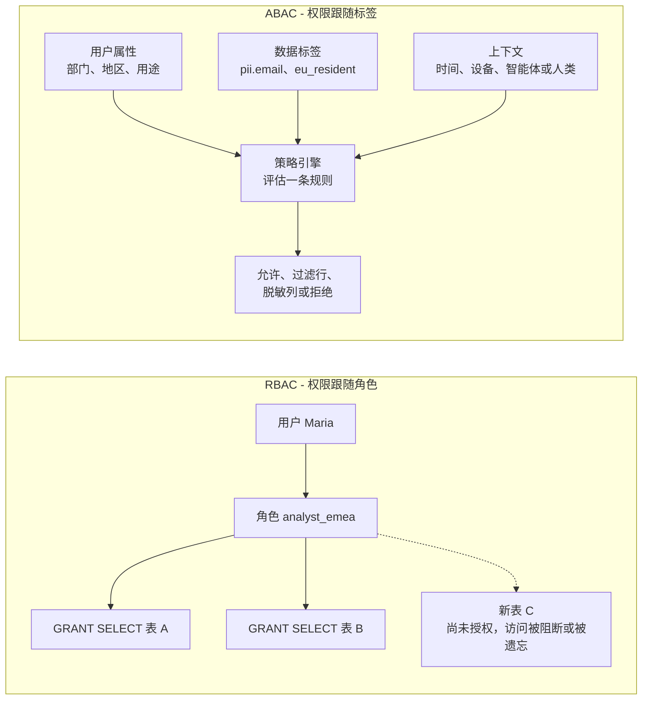
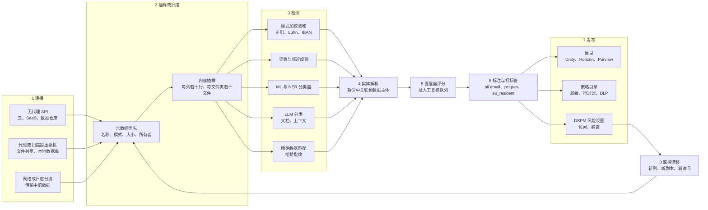

# 15. 数据治理、安全与隐私
> **深度：** L2 · **阅读时间：** 约 19 分钟 · **最后核实：** 2026-11-01 · **前置阅读：** [第 8 章 — 目录与元数据存储](../01-data-systems-foundations/ch08-catalogs-and-metastores.md)

## 要点速览（TL;DR）

- 数据治理（governance）要为每一份数据回答三个问题：*它是什么*、*谁可以出于何种目的使用它*，以及*它流向了哪里*。数据分类（data classification）回答第一个问题，访问策略回答第二个，数据血缘（lineage）回答第三个。每一环都依赖前一环，而大多数失败都始于第一环：没人知道某一列存放着银行卡号，策略就无从保护它。
- 访问控制已经从**角色**转向**属性**。在[基于角色的访问控制](../glossary.md#role-based-access-control)（RBAC）下，权限逐表授予某个角色。在[基于属性的访问控制](../glossary.md#attribute-based-access-control)（ABAC）下，只需针对数据上的标签和用户的属性编写一条策略（"凡标记为 `pii.email` 的内容一律脱敏，除非 purpose = support"），因此它甚至能覆盖尚不存在的表。Unity Catalog ABAC 已于 2026 年正式发布（GA），Snowflake 的基于标签的脱敏也已 GA。[^uc-abac][^sf-tag]
- 数据发现（data discovery）与分类引擎本质上是一条数据管道（pipeline）：连接、抽样、检测（模式匹配加校验和、词典、ML 与 LLM 分类器、精确数据指纹），将检测结果归属到具体个人，评定置信度，把标签写入目录，再持续监控漂移。[数据安全态势管理](../glossary.md#data-security-posture-management)（DSPM）在此之上再增加一张地图：谁能访问这些数据、数据在哪里暴露。
- 该品类正在向更大的安全与数据保护平台整合。Palo Alto 收购了 Dig（2023 年），Proofpoint 同意收购 Normalyze（2024 年），并于 2026 年 10 月同意以约 $6.3B 的交易价值（约 $5.71B 股权价值；尚待完成，预计 2027 年上半年交割）收购 Varonis；Veeam 则完成了对 Securiti 的 $1.725B 收购（2025 年 12 月）。[^dig][^normalyze][^varonis-8k][^securiti] Everpure 以 $125.0M 收购了 1touch（2026 年 5 月交割）。[^ep-10q] Cyera 是坚持独立的一家，媒体报道估值为 $12B。[^cyera-g]
- 监管创造需求。截至 2026 年 1 月，GDPR 罚款累计约 €7.1B；[^dla] 在 IBM 2025 年的研究中，数据泄露平均成本全球为 $4.44M、美国为 $10.22M；[^ibm] 经 2026 年 AI Omnibus（Regulation (EU) 2026/1744）调整后，EU AI Act 对高风险系统的数据治理义务现定于：独立系统（附件 III）自 2027 年 12 月 2 日起、嵌入产品的系统（附件 I）自 2028 年 8 月 2 日起适用。[^omnibus] AI 智能体（agent）进一步放大了风险，因为它们读取的数据量远超任何分析师。

## 为何重要（商业视角 + Everpure 视角）

本书涉及的每一个数据平台最终都会售卖数据治理能力。目录（catalog，见[第 8 章](../01-data-systems-foundations/ch08-catalogs-and-metastores.md)）是权限所在之处，这正是 Databricks 与 Snowflake 争夺目录的原因。数据血缘（[第 13 章](ch13-data-quality-observability-lineage.md)）让删除和审计成为可能。语义层（semantic layer，[第 14 章](ch14-semantic-layers-and-bi.md)）决定 AI 智能体看到哪些定义。这三者背后的共同问题是：系统是否知道数据*是什么*。只有知道了这一点，系统才能决定谁可以看它。

生成式 AI 让这个问题变得紧迫。人类分析师只查询少数几张表。而带有检索索引的智能体会读取数以百万计的文档，包括从未有人分类过的陈旧文件共享，并复述它所找到的内容。IBM 2025 年的研究发现，20% 的受访组织发生过涉及"影子 AI"（shadow AI，即未经批准的 AI 工具）的数据泄露，这使平均成本增加了约 $670,000。[^ibm-ai] 过去把数据分类视为合规杂务的董事会，如今将其视为 AI 部署的一道关卡。

对 Everpure 而言，这是第 2 部分中最重要的一章。2026 年 2 月 23 日，也就是 Pure Storage 更名为 Everpure 的当天，公司宣布收购 **1touch**，一家从事数据发现、分类和语义上下文的公司。[^ep-wwt] 该交易于 2026 年 5 月 7 日以 $125.0M 现金完成交割（GAAP，依据 10-Q）。[^ep-10q] 这项技术于 2026 年 6 月以 **Everpure Data Intelligence** 之名重新发布。行业媒体将其描述为：无需复制数据，即可在 Everpure 阵列、第三方存储、云和 SaaS 之间发现并分类结构化与非结构化数据。[^ep-cw] 2026 年 10 月的更新增加了仅处理元数据的 File Edition，以及一个[模型上下文协议](../glossary.md#model-context-protocol)（MCP）接口，可用自然语言查询已分类的数据。[^ep-oct]

一家存储公司为什么要买一个分类器？因为存储层能看到每一个字节，包括那些从未进入目录的副本：备份、快照（snapshot）、导出文件、临时存储桶，以及十年前的 SMB 共享。数据治理厂商需要在连接器上投入大量资金才能触达这些数据，而存储系统本身就持有它们。简言之，其逻辑是：分类加上语义上下文，能把原始容量变成*受治理、可供 AI 使用*的数据，而受治理的数据每 TB 价值更高。[主要参与者](#whos-who)一节列出了基于公开信息、战略团队可能评估的选项。

## 工作原理

### 访问控制模型：从角色到属性

**RBAC** 是大多数企业仍在使用的模型。诸如对 `crm.customers` 的 SELECT 之类的权限被授予 `analyst_emea` 之类的角色，再把用户分配到角色。它易于审计（"谁拥有这个角色？"），但扩展性差。面对 5,000 张表、40 个敏感级别和 30 个地区，管理员最终要为每一种组合创建一个角色，从业者称之为*角色爆炸*（role explosion）。每张新表还需要重新授权，因此保护总是滞后于创建。

**ABAC** 由 NIST SP 800-162（2014 年）正式定义，它在请求发生时，根据**主体**（部门、密级、所在地）、**客体**（如 `pii`、`pci`、`eu_resident` 等标签）、**操作**和**环境**（时间、设备、声明的用途）的属性来评估规则。[^nist-abac] 一条策略，例如"对用途不是 `support` 的任何人，脱敏所有标记为 `pii.contact` 的列"，就能保护当前及未来所有带此标签的列。代价是 ABAC 的效果完全取决于标签质量，这也是它与自动化分类同时兴起的原因。

在分析场景中，有两种执行形式很重要。**行级安全**（row-level security）会悄无声息地添加一个过滤条件（`WHERE region = user.region`）。**列级安全**（column-level security）要么屏蔽某一列，要么应用[动态脱敏](../glossary.md#dynamic-data-masking)函数，返回 `j***@example.com` 而非真实地址。两者都由查询引擎在改写查询时施加，因此用户永远看不到策略本身，只能看到其效果。

*图 15.1 — RBAC 以一次一条授权的方式把权限绑定到角色和对象。ABAC 在查询时根据标签和属性评估规则，因此新表一旦被打上标签即受保护。*

**策略引擎**（policy engine）是编写和评估规则的地方，分为三类：

1. **通用决策引擎。** [Open Policy Agent](../glossary.md#open-policy-agent)（OPA）是 CNCF 毕业项目，它接收 JSON 请求，用 Rego 语言评估规则并返回决策，然后由应用或代理执行该决策。[^opa] 2025 年 8 月，OPA 的创建者和 Styra 团队的大部分成员加入了 Apple。该项目的治理结构和许可证没有变化。[^opa-apple]
2. **平台原生引擎。** Apache Ranger 诞生于 Hadoop 生态，提供 Hive、HDFS、Kafka 和 Trino 的插件。[^ranger] Databricks Unity Catalog 现已提供由受治理标签驱动的 ABAC 行过滤器和列掩码（2026 年 GA）。[^uc-abac] Snowflake 允许管理员把脱敏策略附加到标签上，任何继承该标签的列都会被脱敏，并正在把基于标签的策略扩展到行访问、聚合和投影。[^sf-tag]
3. **叠加层厂商。** Immuta 和 Privacera（由 Ranger 的创建者创立）只需编写一次策略，再将其下推到各平台的原生控制中，适合多平台环境。[^immuta][^privacera]

> **类比：硬件内存标签。** ABAC 类似 ARM 的内存标签扩展（Memory Tagging Extension，MTE）。MTE 为每个 16 字节内存颗粒存储一个小标签，并在指针中存储匹配的标签，硬件在每次访问时比对两者。相比之下，在 RBAC 下，权限取决于*你运行在哪张页表里*。数据标签扮演着内存标签的角色：检查随数据而行，而不是随程序而行。CHERI 之类的能力（capability）系统更进一步，把访问权变成不可伪造的令牌。如今目录向查询引擎签发的有范围限制的短期凭证（[第 8 章](../01-data-systems-foundations/ch08-catalogs-and-metastores.md)）遵循的也是同一原理。

### 数据发现与分类引擎内部

标签必须有来源，分类引擎负责生成它们。各商业产品的包装方式不同，但底层管道大同小异。

*图 15.2 — 发现引擎把原始字节转换为目录和策略引擎可以执行的标签。最重要的是从监控回流的那条环路：数据资产每天都在变化，因此分类永远不会"完成"。*

