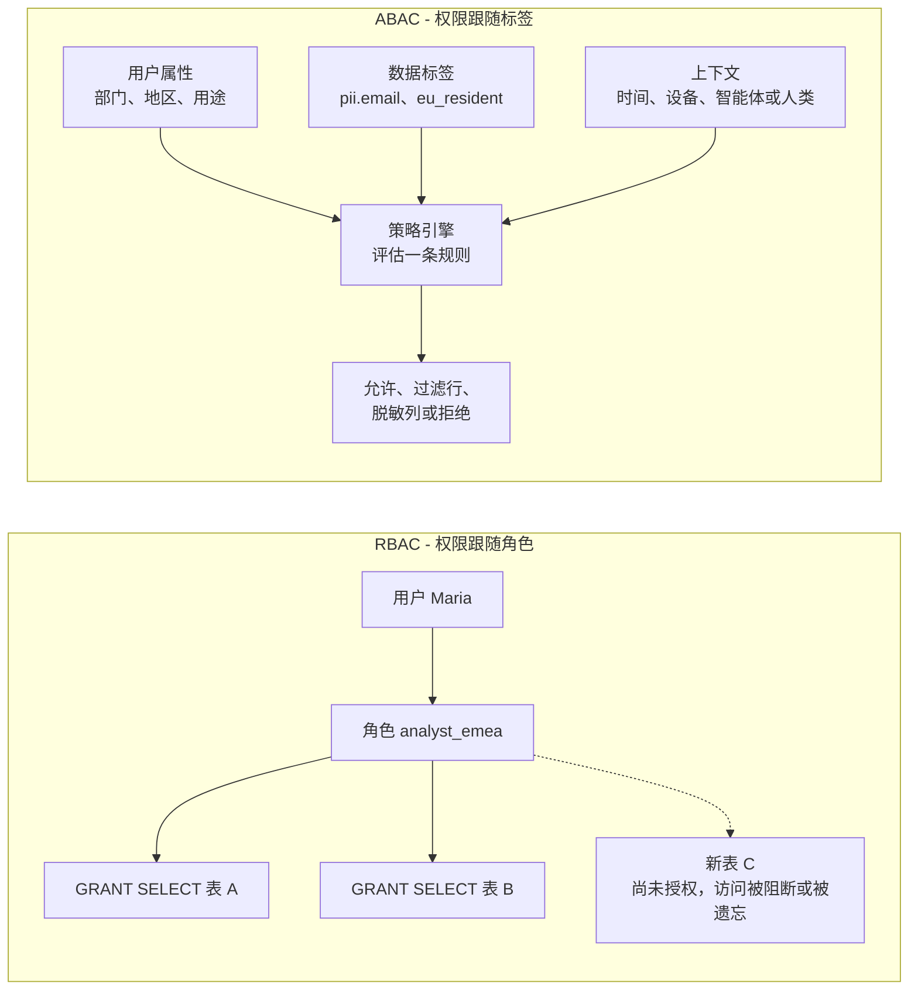
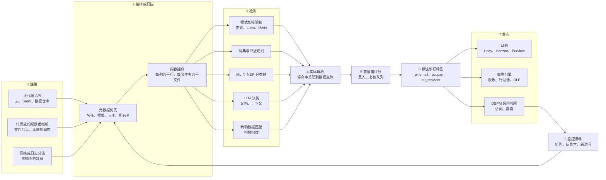
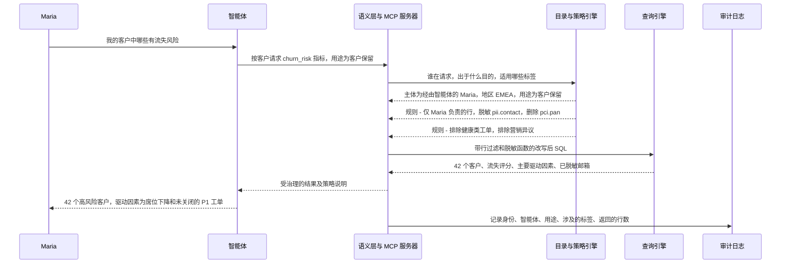
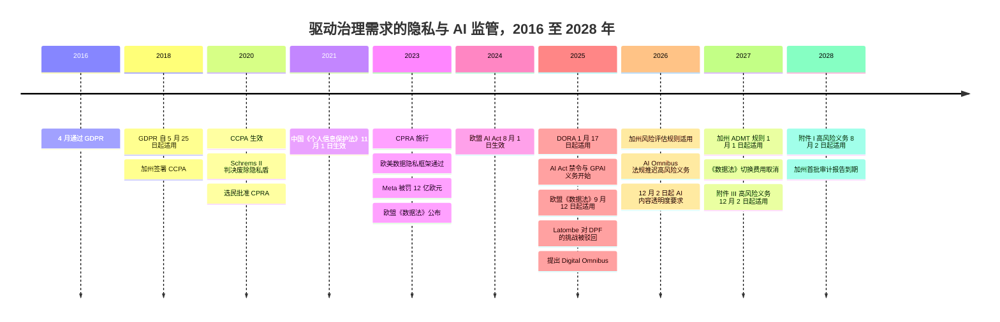

# 15. 数据治理、安全与隐私
> **深度：** L2 · **阅读时间：** 约 19 分钟 · **最后核实：** 2026-11-01 · **前置阅读：** [第 8 章 — 目录与元数据存储](../01-data-systems-foundations/ch08-catalogs-and-metastores.md)

## 要点速览（TL;DR）

- 数据治理（governance）要为每一份数据回答三个问题：*它是什么*、*谁可以出于何种目的使用它*，以及*它流向了哪里*。数据分类（data classification）回答第一个问题，访问策略回答第二个，数据血缘（lineage）回答第三个。每一环都依赖前一环，而大多数失败都始于第一环：没人知道某一列存放着银行卡号，策略就无从保护它。
- 访问控制已经从**角色**转向**属性**。在[基于角色的访问控制](../glossary.md#role-based-access-control)（RBAC）下，权限逐表授予某个角色。在[基于属性的访问控制](../glossary.md#attribute-based-access-control)（ABAC）下，只需针对数据上的标签和用户的属性编写一条策略（"凡标记为 `pii.email` 的内容一律脱敏，除非 purpose = support"），因此它甚至能覆盖尚不存在的表。Unity Catalog ABAC 已于 2026 年正式发布（GA），Snowflake 的基于标签的脱敏也已 GA。[^uc-abac][^sf-tag]
- 数据发现（data discovery）与分类引擎本质上是一条数据管道（pipeline）：连接、抽样、检测（模式匹配加校验和、词典、ML 与 LLM 分类器、精确数据指纹），将检测结果归属到具体个人，评定置信度，把标签写入目录，再持续监控漂移。[数据安全态势管理](../glossary.md#data-security-posture-management)（DSPM）在此之上再增加一张地图：谁能访问这些数据、数据在哪里暴露。
- 该品类正在向更大的安全与数据保护平台整合。Palo Alto 收购了 Dig（2023 年），Proofpoint 同意收购 Normalyze（2024 年），并于 2026 年 10 月同意以约 $6.3B 的交易价值（约 $5.71B 股权价值；尚待完成，预计 2027 年上半年交割）收购 Varonis；Veeam 则完成了对 Securiti 的 $1.725B 收购（2025 年 12 月）。[^dig][^normalyze][^varonis-8k][^securiti] Everpure 以 $125.0M 收购了 1touch（2026 年 5 月交割）。[^ep-10q] Cyera 是坚持独立的一家，媒体报道估值为 $12B。[^cyera-g]
- 监管创造需求。截至 2026 年 1 月，GDPR 罚款累计约 €7.1B；[^dla] 在 IBM 2025 年的研究中，数据泄露平均成本全球为 $4.44M、美国为 $10.22M；[^ibm] 经 2026 年 AI Omnibus（Regulation (EU) 2026/1744）调整后，EU AI Act 对高风险系统的数据治理义务现定于：独立系统（附件 III）自 2027 年 12 月 2 日起、嵌入产品的系统（附件 I）自 2028 年 8 月 2 日起适用。[^omnibus] AI 智能体（agent）进一步放大了风险，因为它们读取的数据量远超任何分析师。

## 为何重要（商业视角 + Everpure 视角）

本书涉及的每一个数据平台最终都会售卖数据治理能力。目录（catalog，见[第 8 章](../01-data-systems-foundations/ch08-catalogs-and-metastores.md)）是权限所在之处，这正是 Databricks 与 Snowflake 争夺目录的原因。数据血缘（[第 13 章](ch13-data-quality-observability-lineage.md)）让删除和审计成为可能。语义层（semantic layer，[第 14 章](ch14-semantic-layers-and-bi.md)）决定 AI 智能体看到哪些定义。这三者背后的共同问题是：系统是否知道数据*是什么*。只有知道了这一点，系统才能决定谁可以看它。

生成式 AI 让这个问题变得紧迫。人类分析师只查询少数几张表。而带有检索索引的智能体会读取数以百万计的文档，包括从未有人分类过的陈旧文件共享，并复述它所找到的内容。IBM 2025 年的研究发现，20% 的受访组织发生过涉及"影子 AI"（shadow AI，即未经批准的 AI 工具）的数据泄露，这使平均成本增加了约 $670,000。[^ibm-ai] 过去把数据分类视为合规杂务的董事会，如今将其视为 AI 部署的一道关卡。

对 Everpure 而言，这是第 2 部分中最重要的一章。2026 年 2 月 23 日，也就是 Pure Storage 更名为 Everpure 的当天，公司宣布收购 **1touch**，一家从事数据发现、分类和语义上下文的公司。[^ep-wwt] 该交易于 2026 年 5 月 7 日以 $125.0M 现金完成交割（GAAP，依据 10-Q）。[^ep-10q] 这项技术于 2026 年 6 月以 **Everpure Data Intelligence** 之名重新发布。行业媒体将其描述为：无需复制数据，即可在 Everpure 阵列、第三方存储、云和 SaaS 之间发现并分类结构化与非结构化数据。[^ep-cw] 2026 年 10 月的更新增加了仅处理元数据的 File Edition，以及一个[模型上下文协议](../glossary.md#model-context-protocol)（MCP）接口，可用自然语言查询已分类的数据。[^ep-oct]

一家存储公司为什么要买一个分类器？因为存储层能看到每一个字节，包括那些从未进入目录的副本：备份、快照（snapshot）、导出文件、临时存储桶，以及十年前的 SMB 共享。数据治理厂商需要在连接器上投入大量资金才能触达这些数据，而存储系统本身就持有它们。简言之，其逻辑是：分类加上语义上下文，能把原始容量变成*受治理、可供 AI 使用*的数据，而受治理的数据每 TB 价值更高。[主要参与者](#whos-who)一节列出了基于公开信息、战略团队可能评估的选项。

## 工作原理

### 访问控制模型：从角色到属性

**RBAC** 是大多数企业仍在使用的模型。诸如对 `crm.customers` 的 SELECT 之类的权限被授予 `analyst_emea` 之类的角色，再把用户分配到角色。它易于审计（"谁拥有这个角色？"），但扩展性差。面对 5,000 张表、40 个敏感级别和 30 个地区，管理员最终要为每一种组合创建一个角色，从业者称之为*角色爆炸*（role explosion）。每张新表还需要重新授权，因此保护总是滞后于创建。

**ABAC** 由 NIST SP 800-162（2014 年）正式定义，它在请求发生时，根据**主体**（部门、密级、所在地）、**客体**（如 `pii`、`pci`、`eu_resident` 等标签）、**操作**和**环境**（时间、设备、声明的用途）的属性来评估规则。[^nist-abac] 一条策略，例如"对用途不是 `support` 的任何人，脱敏所有标记为 `pii.contact` 的列"，就能保护当前及未来所有带此标签的列。代价是 ABAC 的效果完全取决于标签质量，这也是它与自动化分类同时兴起的原因。

在分析场景中，有两种执行形式很重要。**行级安全**（row-level security）会悄无声息地添加一个过滤条件（`WHERE region = user.region`）。**列级安全**（column-level security）要么屏蔽某一列，要么应用[动态脱敏](../glossary.md#dynamic-data-masking)函数，返回 `j***@example.com` 而非真实地址。两者都由查询引擎在改写查询时施加，因此用户永远看不到策略本身，只能看到其效果。

*图 15.1 — RBAC 以一次一条授权的方式把权限绑定到角色和对象。ABAC 在查询时根据标签和属性评估规则，因此新表一旦被打上标签即受保护。*

**策略引擎**（policy engine）是编写和评估规则的地方，分为三类：

1. **通用决策引擎。** [Open Policy Agent](../glossary.md#open-policy-agent)（OPA）是 CNCF 毕业项目，它接收 JSON 请求，用 Rego 语言评估规则并返回决策，然后由应用或代理执行该决策。[^opa] 2025 年 8 月，OPA 的创建者和 Styra 团队的大部分成员加入了 Apple。该项目的治理结构和许可证没有变化。[^opa-apple]
2. **平台原生引擎。** Apache Ranger 诞生于 Hadoop 生态，提供 Hive、HDFS、Kafka 和 Trino 的插件。[^ranger] Databricks Unity Catalog 现已提供由受治理标签驱动的 ABAC 行过滤器和列掩码（2026 年 GA）。[^uc-abac] Snowflake 允许管理员把脱敏策略附加到标签上，任何继承该标签的列都会被脱敏，并正在把基于标签的策略扩展到行访问、聚合和投影。[^sf-tag]
3. **叠加层厂商。** Immuta 和 Privacera（由 Ranger 的创建者创立）只需编写一次策略，再将其下推到各平台的原生控制中，适合多平台环境。[^immuta][^privacera]

> **类比：硬件内存标签。** ABAC 类似 ARM 的内存标签扩展（Memory Tagging Extension，MTE）。MTE 为每个 16 字节内存颗粒存储一个小标签，并在指针中存储匹配的标签，硬件在每次访问时比对两者。相比之下，在 RBAC 下，权限取决于*你运行在哪张页表里*。数据标签扮演着内存标签的角色：检查随数据而行，而不是随程序而行。CHERI 之类的能力（capability）系统更进一步，把访问权变成不可伪造的令牌。如今目录向查询引擎签发的有范围限制的短期凭证（[第 8 章](../01-data-systems-foundations/ch08-catalogs-and-metastores.md)）遵循的也是同一原理。

### 数据发现与分类引擎内部

标签必须有来源，分类引擎负责生成它们。各商业产品的包装方式不同，但底层管道大同小异。

*图 15.2 — 发现引擎把原始字节转换为目录和策略引擎可以执行的标签。最重要的是从监控回流的那条环路：数据资产每天都在变化，因此分类永远不会"完成"。*

**连接。** *无代理*（agentless）工具使用云和 SaaS 的 API（S3 列举、快照共享、Snowflake 的 information schema、Microsoft Graph API）。它们能在数小时内完成部署，这正是云优先的 DSPM 浪潮（Cyera、Dig、Normalyze、Sentra）都采用无代理方式的原因。[^normalyze][^sentra] *代理或扫描器*部署则在本地文件服务器和数据库附近运行一台虚拟机或容器，因为那里没有云 API。1touch 最初的产品还能通过网络流量映射传输中的数据，从而发现无人登记过的数据存储。[^1touch-inventa] 客户关心扫描器本身的安全性。大多数现代工具在客户自己的账户内扫描，只把元数据和发现结果发送到厂商的控制平面。

**抽样或扫描。** 对 1 PB 数据做一次完整的内容扫描代价高昂。AWS Macie 的标价是每检查 1 GB 收费 $1.00，Google 的 Sensitive Data Protection 也按已分析字节数或订阅单位对发现功能计费。[^macie][^gsdp] 按统一 $1/GB 计算，对 1 PB 完整扫描一遍约需 $1M（估算）。Macie 2025 年之前的价目表在每月超过 50 TB 后实行阶梯降价（500 TB 以内 $0.50/GB，之后 $0.25/GB）；如果这些阶梯仍然适用，同样一遍扫描的成本更接近 $0.4M（估算；`[VERIFY: Macie 按 GB 阶梯价格表]`）。无论哪种情况，PB 级的完整扫描都是一项预算支出，而非默认操作。因此引擎会进行分诊。它们先读取元数据（列名、文件类型、所有者、最后访问时间）。然后抽样内容：对结构化列而言，每列几百行通常就足以完成分类，因为其值是同质的。它们按哈希对相同文件去重，并且只重新扫描发生变化的部分。非结构化数据更难处理。一份 PDF 可能同时包含合同、护照扫描件和健康记录，因此必须按文档、往往还要按页抽样，图像则需要 OCR。

**检测。** 检测器按成本由低到高运行：

- **模式加校验。** 正则表达式找出 16 位数字串。Luhn 校验和（Luhn checksum）可剔除约 90% 并非有效卡号的随机数字串。IBAN 和各国身份证号的校验和也以同样方式工作。
- **词典与邻近规则。** 出现在"SSN"或"social security"字样附近的九位数字，得分高于日志文件中的九位数字。
- **ML 与命名实体识别。** 模型在自由文本中标注姓名、地址和医学术语。Microsoft Purview 的*可训练分类器*（trainable classifiers）通过示例学习文档类型（简历、源代码、合同）。[^purview-class]
- **LLM 分类。** 大模型可以阅读一份文档并判断"这是一份并购条款清单"或"这张工单描述了客户的诊断"。它们能捕捉任何模式都无法识别的上下文。但它们按 token 计算速度慢、成本高，这在 PB 规模下很关键，而且提示词本身不得泄露数据。
- **指纹与精确数据匹配（EDM）。** 客户从记录系统（例如真实的客户表）上传哈希值，引擎在任何位置发现完全匹配即予以标记。Purview 的 EDM 就是这样工作的。[^purview-class] EDM 是最精确的检测器，但它只能找到已知的数据。

**实体解析。** 对隐私而言，仅发现"一个电子邮件地址"是不够的。引擎必须知道它*属于谁*。实体解析（entity resolution）跨系统把检测结果关联到同一个数据主体（客户 4471 = `j.ng@…` = 支持工单中的那个电话号码）。正是这一点把分类工具变成了隐私工具：它能通过列出持有该人数据的每一个位置，来答复数据主体访问请求（DSAR）。BigID 等厂商长期以来一直在推广这种以身份为中心的方法。

**评分、打标签、发布、监控。** 每条发现都带有置信度评分。高置信度命中会自动成为标签，处于边界的则交给数据管理员（data steward）。标签被写入目录和策略引擎，真正的执行发生在那里。随后 DSPM 叠加*访问*维度：哪些身份、角色、服务账户和公开链接能触达每个敏感存储。最后，引擎监控漂移，例如新增一列、一次新导出到临时存储桶，或某个角色突然获得了读取权限。

> **类比：晶圆检测。** 分类引擎就是把晶圆厂的缺陷检测流程应用于数据。光学检测（元数据与正则）速度快，负责标记候选缺陷。复检 SEM（ML 与 LLM 分类器）较慢，负责对其分类。处置（打标签、脱敏、隔离、删除）则依据缺陷代码进行。经济逻辑也一样：你不可能让每片晶圆都经过电子束复检，所以要按风险抽样，并调整阈值，在漏检（假阴性，这里指漏掉一个 SSN）与过杀（假阳性，这里指分析师需要的数据被脱敏）之间取舍。好的厂商能告诉你它在*你的*数据上的漏检率，而不只是一个笼统的准确率数字。

> **深入（L3）。** 置信度评分组合各检测器输出的方式，与贝叶斯垃圾邮件过滤器组合词语证据的方式非常相似。每个检测器贡献一个似然比（"Visa"字样旁一个通过 Luhn 校验的 16 位数字串是强证据；一个孤立的 9 位数字是弱证据），在样本上进行列级聚合可以使估计更精确。如果 200 个抽样值中有 180 个匹配，即使有 10% 不匹配，该列也会被打上标签。要询问厂商：阈值是否按数据源分别校准，以及数据管理员的更正如何反馈到模型中。

### DSPM：从标签到态势

分类说明数据是什么。**DSPM** 是 Gartner 约从 2022 年开始跟踪的一个品类，它把分类结果与数据*位于何处*、*谁能触达*结合起来，再对暴露风险进行排序。[^dspm-market] 典型发现包括：一份生产环境客户快照被复制到测试账户中一个未加密的存储桶；一个存放工资文件的 SharePoint 文件夹被共享给"所有人"；或者一个 AI 助手的索引建立在包含健康数据的共享之上。DSPM 借鉴了云安全态势管理的模式，并且常常与之对接：持续扫描、风险评分和整改工单。相邻能力，如数据检测与响应（对异常访问告警）和数据防泄漏（DLP，阻止数据外流），正在融入同一批产品。Cyera 以 $162M 收购 DLP 公司 Trail Security 就是一例。[^cyera-trail]

### 保护必须被使用的数据

分类与策略决定某人*能否*看到数据。另一套工具则改变他们*看到什么*。

| 技术 | 作用 | 是否可逆？ | 典型用途 | 注意事项 |
|---|---|---|---|---|
| 静态脱敏 | 在副本（开发、测试、供应商抽取）中永久改写值 | 否 | 非生产副本 | 脱敏副本会与生产数据渐行渐远；连接键必须保持一致 |
| 动态脱敏 | 在查询时根据策略改写值 | 底层数据不变 | 分析、BI、智能体 | 强度取决于策略及其标签；可能通过过滤条件推断出真实值 |
| 金库式令牌化 | 用随机令牌替换值，映射关系保存在受保护的金库中 | 是，通过金库 | 银行卡号（PCI）、身份证号 | 金库是高价值攻击目标，也会多一跳延迟 |
| 无金库或保格式令牌化 | 以密码学方式派生令牌（如保格式加密），使其保持原值的形态 | 是，持有密钥即可 | 会校验格式的遗留系统 | 密钥管理成为控制点；相同输入得到相同令牌，从而可被关联 |
| 哈希或假名化 | 对标识符做单向变换 | 否（但可关联） | 在不暴露姓名的情况下连接数据集 | 在 GDPR 下，假名化数据仍属于个人数据 |
| 差分隐私 | 在"隐私预算"范围内向聚合结果添加经过校准的噪声 | 不适用 | 发布的统计数据、协作查询 | 小群体的准确度下降；必须管理预算 |
| 数据洁净室 | 双方在约定规则下查询合并数据，彼此看不到对方的行 | 不适用 | 广告效果衡量、零售媒体 | 全部保护都依赖规则与最低聚合阈值 |

*图 15.3 — 脱敏（masking）隐藏值，令牌化（tokenization）替换值，差分隐私和洁净室只释放聚合结果。高管常常忽略的法律要点是：在 GDPR 下，令牌化或假名化的数据通常仍属于个人数据。*[^gdpr]

差分隐私在美国人口普查局将其用于 2020 年人口普查时，从理论走向了生产。[^census-dp] 数据洁净室大约在同一时期成为一个产品品类。AWS Clean Rooms 于 2023 年 3 月 GA，并在 2024 年 4 月加入差分隐私。[^aws-cr] Snowflake 于 2023 年 12 月收购 Samooha 来构建其洁净室。[^samooha] LiveRamp 于 2024 年 1 月以约 $200M 收购了 Habu。[^habu]

> **类比：地址转换。** 令牌化就是敏感值的页表。应用持有的是一个*虚拟*标识符（令牌），它本身毫无用处，只有特权转换步骤（金库，或保格式方案中的密钥）才能把它映射到*物理*值。与 MMU 一样，安全性来自对谁能执行转换的控制，代价则是每次解引用都多一次查找。无金库方案类似固定的基于哈希的映射：无需遍历表，但持有密钥的任何人都能转换一切。

### 基于血缘的合规：访问、删除、保留

GDPR 赋予个人访问权（第 15 条）和删除权（第 17 条），控制者必须在一个月内答复，复杂请求可再延长两个月。[^gdpr] 要大规模做到这一点，需要分类引擎的实体地图（此人的数据存放在哪里？）以及数据血缘（[第 13 章](ch13-data-quality-observability-lineage.md)）来显示这些数据流入了哪些派生表、特征、嵌入（embedding）和备份。湖仓一体（lakehouse）中的删除也不是即时的。Iceberg 或 Delta 中的 DELETE 只是把行从*当前*快照中移除，字节会一直保留，直到压缩和快照过期运行完毕（[第 7 章](../01-data-systems-foundations/ch07-open-table-formats.md)）。因此，以 `retain_until=2027-12-31` 这类标签写成的保留策略是数据治理的一部分，而不只是存储层面的日常维护。嵌入向量和微调模型带来了一个悬而未决的问题："删除"一个人是否需要重建索引或重新训练模型。监管机构尚未对此定论。

## 实例：智能体被问到"有流失风险的客户"

Maria 是都柏林的一名客户成功经理，她问公司的 AI 智能体：*"我的客户中哪些有流失风险，原因是什么？"* 该智能体通过一个 MCP 服务器和语义层工作（[第 14 章](ch14-semantic-layers-and-bi.md)、[第 22 章](../03-ai-data-stack/ch22-agents-and-data.md)）。相关数据已经完成分类：

- `crm.customers`：`email` 和 `phone` 被标记为 `pii.contact`；`country` 决定行级标签 `eu_resident`；`marketing_objection` 是一个同意标志。
- `billing.payments`：`card_number` 被标记为 `pci.pan`，以令牌化形式存储。
- `support.tickets.body`：自由文本，LLM 分类器将其标记为 `pii.free_text`，另有 3% 的工单还被标记为 `special_category.health`，因为客户描述了取消服务的医疗原因。
- `ml.churn_scores`：派生表；血缘显示它由上述三者构建而成。

*图 15.4 — 智能体始终看不到原始卡号、健康叙述或 Maria 负责范围之外的客户。策略在每次请求时依据标签评估一次，而不是写进智能体的提示词。*

其中发生了四件基于角色的设计难以做到的事：

1. **用途是一个属性。** 同一个智能体在回答欺诈调查员时会得到不同的列。GDPR 的目的限制（purpose limitation）原则由此变得可执行。
2. **健康数据被排除，而非脱敏。** 健康信息属于 GDPR 第 9 条规定的特殊类别，用它来定向推送客户保留优惠需要第 9 条规定的合法依据，而公司几乎肯定不具备。分类器的 `special_category.health` 标签把这些工单正文完全移出智能体的上下文，而派生出的"未关闭 P1 工单"驱动因素得以保留。
3. **异议被自动尊重。** 根据 GDPR 第 21 条，个人可以反对为直接营销目的进行画像，且该异议是绝对的。[^gdpr] 带有 `marketing_objection = true` 的行会在评分进入客户保留营销活动之前被过滤掉。加州新的自动化决策规则自 2027 年 1 月 1 日起适用，如果评分被用于"重大决策"，可能需要单独分析。大多数客户保留营销并不属于此类，但应由法律顾问确认。[^cppa]
4. **日志就是证据。** 审计记录（谁、通过哪个智能体、出于什么目的、涉及哪些标签）正是监管机构或审计师会索要的东西。它也让 DSPM 工具能够察觉智能体是否开始拉取平时十倍的数据量。

失败模式同样具有启发性。假设一名工程师在 `crm.customers` 中新增了一个 `notes` 列，而一位客户经理把护照号码粘贴了进去。在分类器的漂移扫描为该列打上标签之前，ABAC 无从发挥作用，智能体就可能把这些内容暴露出来。以小时或天计的分类延迟，才是真正的暴露窗口。

## 设计选择与权衡

| 决策 | 选项 A | 选项 B | A 胜出的情形… | B 胜出的情形… |
|---|---|---|---|---|
| 策略存放在哪里 | 平台原生（Unity Catalog、Snowflake Horizon） | 集中式叠加层（Immuta、Privacera、OPA） | 只有一个主导平台；原生性能与功能很重要 | 多个平台并存；需要跨平台一套可审计的策略 |
| 如何触达数据 | 无代理 API | 网络内部署代理或扫描器 | 云和 SaaS 环境；追求快速见效 | 本地文件共享、大型机、物理隔离站点 |
| 扫描深度 | 抽样加元数据 | 完整内容扫描 | 结构化列、PB 级资产、成本受限 | 受监管的非结构化存储；需要证明"不存在" |
| 检测器组合 | 模式、词典、EDM | ML 或 LLM 分类器 | 已知标识符；需要向审计师解释 | 自由文本、文档、新型数据类型 |
| 值保护方式 | 动态脱敏 | 令牌化 | 需要按角色呈现不同视图的分析 | 支付数据以及原始值绝不能落地的记录系统 |
| 谁负责标签 | 中央数据治理团队 | 数据生产者（数据网格风格） | 需要一致性的受监管企业 | 快速变化的业务领域；所有者最了解自己的数据 |

*图 15.5 — 大多数真实环境会混用两列选项。有用的问题是：哪个选项是默认方案，例外情况如何治理。*

**为替代方案构建最强版本论证（steelman）。** 支持*平台原生*策略的理由很充分：在引擎内部执行速度最快，无法通过直连绕过，而且正在快速改进。Unity Catalog 和 Snowflake 现在都已原生评估由标签驱动的策略。[^uc-abac][^sf-tag] 支持*叠加层*的理由是：很少有大企业只运行一个平台，而审计师希望对"谁能看到客户数据？"得到唯一的答案。在检测器方面，反对 LLM 分类的理由是成本与可重复性：同一份文档在两次运行中可能得到不同标签，若没有置信度阈值和人工复核，审计师不会接受。支持它的理由则是：正则表达式从来读不懂一份并购备忘录。

## 主要参与者

| 厂商 | 所有者 / 状态（2026 年 11 月） | 方法 | 结构化 / 非结构化 | 部署方式 | 重要交易或融资 |
|---|---|---|---|---|---|
| Everpure Data Intelligence（原 1touch） | 自 2026-05-07 起为 Everpure 子公司 | 发现、分类、语义上下文；覆盖传输中与静态数据；MCP 接口 | 两者皆可 | 混合；Everpure 与第三方存储、云、SaaS | $125.0M 现金（GAAP，10-Q）[^ep-10q][^ep-oct] |
| Cyera | 独立，私营 | 无代理云 DSPM 加 DLP | 两者皆可 | SaaS，云优先 | $600M G 轮，估值 $12B（媒体报道，2026 年 6 月）；以 $162M 收购 Trail Security[^cyera-g][^cyera-trail] |
| BigID | 独立，私营 | 以身份为中心的发现与隐私 | 两者皆可 | SaaS 或自托管 | E 轮（Riverwood 领投），估值"超过 $1B"（公司披露，2024 年）[^bigid] |
| Varonis | 上市（VRNS）；待售予 Proofpoint | 文件权限与活动分析；DSPM | 以非结构化为主，正在扩展 | SaaS（由本地部署转型） | $6.3B 交易价值（约 $5.71B 股权价值），每股 $49.75 现金；2026-10-15 宣布，预计 2027 年上半年交割[^varonis-8k] |
| Securiti | Veeam（2025-12-11 交割） | 隐私运营加 DSPM（"数据指挥中心"） | 两者皆可 | 混合 | $1.725B[^securiti] |
| Normalyze | Proofpoint（2024-10-29 达成协议） | 无代理、原地 DSPM 扫描 | 两者皆可 | 云 | 未披露[^normalyze] |
| Dig Security | Palo Alto Networks（Prisma Cloud） | 无代理 DSPM 加数据检测与响应 | 两者皆可 | 云 | $400M（媒体报道，2023 年）[^dig] |
| Sentra | 独立，私营 | 无代理云 DSPM | 两者皆可 | 云、SaaS | $50M B 轮（2025 年 4 月）；累计融资超过 $100M（公司披露）[^sentra] |
| Laminar / Flow / Eureka | Rubrik / CrowdStrike / Tenable | DSPM 被并入备份与安全套件 | 两者皆可 | 云 | Laminar 与 Flow 未披露；Eureka $29.2M 现金（10-Q）[^dspm-tuckins] |
| Microsoft Purview | Microsoft | 敏感度标签、DLP、EDM、可训练分类器、面向 AI 的 DSPM | 两者皆可；在 M365 中最深入 | 云 | 通过 Microsoft 365 和 Purview 计划授权[^purview-class][^purview-dspm] |
| Google Sensitive Data Protection | Google Cloud | 检查、去标识化、发现画像 | 两者皆可 | 云 | 按用量或订阅定价[^gsdp] |
| Amazon Macie | AWS | ML 加托管标识符，面向 S3 | 以 S3 中的非结构化对象为主 | 云 | 每检查 1 GB $1.00（标价）[^macie] |
| Immuta | 独立，私营 | ABAC 策略叠加层；智能体数据供给 | 结构化 | SaaS，下推至 Snowflake 和 Databricks | $100M E 轮（2022 年）[^immuta] |
| Privacera | 独立，私营 | 基于 Ranger 的跨平台策略 | 结构化 | SaaS 或自托管 | $50M B 轮（2021 年）[^privacera] |

*图 15.6 — 独立 DSPM 厂商正被安全、备份以及如今的存储公司收购。Cyera 是仅存的主要资金充裕的独立厂商，而各大云则把"够用"的分类能力捆绑进自己的平台。*

**定位。** 三类玩家在竞争。*安全平台*（Palo Alto、Proofpoint、CrowdStrike、Tenable）收购 DSPM，为其威胁与身份产品增加数据上下文。*数据保护与备份厂商*（Veeam–Securiti、Rubrik–Laminar）收购它，是因为它们本就持有一切数据的副本，希望售卖"了解你的备份里有什么"。*数据平台与云*（Databricks、Snowflake、Microsoft、Google、AWS）把分类内建到目录中，使标签在执行策略的地方生成。Databricks 还在 2023 年收购了 Okera 以获得数据访问治理能力。[^okera] Varonis 的价格，按 $6.3B 交易价值约为其 2026 日历年收入指引的 8.5 倍，按约 $5.71B 股权价值约为 7.7 倍（以 $737M 指引中值计算的估算），是该品类中规模化上市厂商最清晰的公开定价参照。该交易仍待完成。[^varonis-8k] Cyera 的 $12B 估值据报道约为 ARR 的 80 倍（公司对该数字提出异议），是"稀缺成长性"的定价参照。[^cyera-g]

**Everpure 的位置。** Everpure 沿用了备份厂商的逻辑，但起点是主存储，而且价格低得多（$125M，对比 Securiti 的 $1.725B）。基于公开信息，战略团队可能评估的选项包括：

- *功能路径。* 利用 Data Intelligence 让 Everpure 阵列（以及竞争对手的阵列）具备自描述能力，例如在 Data Stream 对某个 FlashBlade 存储桶进行向量化之前，就标记出这个为检索索引供数的存储桶中含有 `special_category` 数据。[^ep-cw]
- *集成路径。* 把标签发布到客户已在使用的目录中，如 Unity Catalog、Snowflake Horizon 和 Purview，使 Everpure 成为分类的来源，而由各平台负责执行。这样可以避免在安全功能上与 Cyera 正面竞争。
- *平台路径。* 扩展到 DSPM 和访问治理。这会让 Everpure 与 Proofpoint–Varonis、Veeam–Securiti 以及各大云正面交锋，市场更大，但也拥挤得多。

看空逻辑是：分类正在成为目录和云的免费功能。看多逻辑是：没有任何目录能看到存储所能看到的非结构化数据和影子副本。[第 33 章](../04-company-deep-dives/ch33-governance-catalog-security-companies.md)对这些公司做了详细介绍，[第 45 章](../06-history-and-future/ch45-storage-moving-up-the-stack.md)则把这一举措放在存储厂商向上层栈延伸的背景下讨论。

## 历史与发展轨迹

*图 15.7 — 监管是一波一波到来的。每一波（2018 年的 GDPR、2020 年起的美国各州法律、2025 年起的 AI Act）都带来了新一轮的分类与治理支出。*

**三波需求。** *第一波（2016–2019 年）：隐私合规。* GDPR 于 2016 年通过、2018 年 5 月起适用，允许处以最高 €20M 或全球营业额 4% 的罚款，以较高者为准。[^gdpr] 它催生了 DSAR 和删除请求的工作量，BigID、OneTrust 和 Securiti 正是在此基础上建立业务的。加州随后推出 CCPA（2020 年生效）和 CPRA（2023 年施行）。[^ccpa] *第二波（2020–2024 年）：数据主权与云蔓延。* 欧盟法院的 Schrems II 判决（2020 年 7 月）废除了欧美隐私盾，使传输影响评估成为常规工作。[^schrems] 2023 年的数据隐私框架在 2025 年 9 月经受住了欧盟普通法院的第一次挑战，但仍可能被上诉。[^latombe] 中国的《个人信息保护法》（PIPL，2021 年 11 月）增加了数据本地化和跨境传输管控。[^pipl] 与此同时，云迁移让副本散落在各个账户中，云原生 DSPM 应运而生，专门寻找这些副本。*第三波（2025 年起）：AI 与韧性。* 欧盟 AI Act 于 2024 年 8 月生效。[^aiact] 其第 10 条要求高风险系统使用受书面治理约束的训练、验证和测试数据，2026 年的 Omnibus 将这些高风险义务推迟至 2027 年 12 月（独立系统）和 2028 年 8 月（嵌入产品的系统）。[^omnibus] DORA 自 2025 年 1 月起适用于欧盟金融企业，要求进行 ICT 风险管理并建立第三方服务商登记册。[^dora] 欧盟《数据法》自 2025 年 9 月起适用，赋予用户获取联网产品数据的权利，并赋予云客户切换服务商的权利。[^dataact]

在美国，至今仍没有联邦隐私法。根据对 IAPP 追踪表的二手汇总，2026 年约有 20 个州拥有综合性隐私法；具体数量因定义不同而有出入。[^iapp] `[VERIFY: 截至 2026-11 IAPP 统计的拥有综合性隐私法的州数量]` 对跨国企业而言，其实际影响是："个人数据在哪里、属于谁、适用哪部法律"必须由机器持续不断地回答。

**下一步。** 欧盟 Digital Omnibus 中的 GDPR 部分于 2025 年 11 月提出，将收窄个人数据的认定范围并增加 AI 处理相关条款，截至 2026 年底仍在谈判中。[^omnibus] 智能体治理（与用途绑定的凭证、MCP 网关、按智能体审计）是下一轮建设重点。Snowflake 同意以约 $110M（主要以股票支付）收购 MCP 网关公司 Natoma（2026 年 5 月宣布；交割情况未核实），表明平台厂商正在进入这一领域。[^natoma]

## 关键数字

| 指标 | 数值 | 口径 | 来源 / 日期 |
|---|---|---|---|
| GDPR 罚款，自 2025 年 1 月 28 日起一年 | 约 €1.2B | 调查汇总 | DLA Piper，2026 年 1 月[^dla] |
| GDPR 累计罚款，2018 年 5 月至 2026 年 1 月 10 日 | 约 €7.1B | 调查汇总 | DLA Piper，2026 年 1 月[^dla] |
| 欧洲个人数据泄露通报 | 每天 443 起（+22%） | 调查汇总 | DLA Piper，2026 年 1 月[^dla] |
| 单笔最大 GDPR 罚款 | €1.2B（Meta，2023 年 5 月） | 监管机构决定 | EDPB，2023-05-22[^meta-fine] |
| 平均泄露成本，全球 / 美国 | $4.44M（−9%）/ $10.22M | 调查估算（Ponemon 为 IBM 开展） | IBM，2025 年 7 月[^ibm] |
| 影子 AI 程度高时的额外成本 | 约 $670,000 | 调查估算 | IBM，2025 年[^ibm-ai] |
| GDPR 最高罚款 | €20M 或全球营业额的 4% | 法规（第 83 条） | GDPR[^gdpr] |
| DSAR 答复期限 | 1 个月，复杂情况可再延 2 个月 | 法规（第 12 条） | GDPR[^gdpr] |
| Amazon Macie 检查价格 | 每 GB $1.00（标价） | 厂商标价 | AWS，检索于 2026-11-01[^macie] |
| 完整扫描 1 PB | 按统一 $1/GB 约 $1M；若 2025 年前的用量阶梯仍适用则约 $0.4M | 估算 | 依据 [^macie] 推算 `[VERIFY: 当前阶梯价格]` |
| Proofpoint–Varonis（待完成） | $6.3B 交易价值（约 $5.71B 股权价值）；约为 CY2026 收入指引的 8.5 倍（按股权价值约 7.7 倍） | 已披露；倍数为估算 | Varonis 8-K 附件 99.1，2026-10-15[^varonis-8k] |
| Veeam–Securiti | $1.725B | 公司披露 | Business Wire，2025-12-11[^securiti] |
| Everpure–1touch | $125.0M 现金 | GAAP，10-Q | Everpure 10-Q，2026-06[^ep-10q] |
| Cyera 最新一轮融资 | $600M，投后估值 $12B | 媒体报道 | SecurityWeek，2026 年 6 月[^cyera-g] |
| DSPM 市场规模 | 无经核实的独立数据；厂商引用 2024 年约 $415M | 厂商引用的估算 | Palo Alto Networks Cyberpedia[^dspm-market] `[VERIFY: 独立的 DSPM 市场规模数据]` |

*图 15.8 — 罚款金额巨大但并不常见。泄露成本和不断增加的 AI 相关事件对预算的推动作用更大。数据上下文类资产的定价参照，从规模化上市厂商约 8 倍收入（Varonis，待被收购），到私募成长轮据报道约 80 倍 ARR（Cyera，公司对该数字提出异议）。*

## 存储桥接

> **存储桥接。** 分类是关于内容的元数据，而存储本身已经持有大量此类元数据：对象标签、文件 ACL、快照目录、访问日志。驻留在存储中的分类器可以在靠近数据的位置扫描而无需产生出口流量费（egress fees），可以在共享数据块的快照之间对扫描去重，还能为从未在任何目录中登记的影子副本（备份、克隆、临时存储桶）打标签。难点在于对生产阵列施加的读取负载，以及把标签*写出*到执行策略的目录中。快照、元数据和对象标签的机制请参见配套的 *Everpure Tech Atlas*。

## 对话手册

**向产品经理提问**

1. "当你们的分类器给某一列打上标签后，这个标签去了哪里：是你们自己的控制台，还是 Unity Catalog、Snowflake Horizon 和 Purview，由它们的引擎来执行？需要多长时间？"
2. "在你们客户的敏感数据发现中，有多大比例来自非结构化存储，以及任何目录都不知道的副本？"
3. "你们怎么定价：按扫描的 GB、按数据存储，还是按身份？客户数据量翻倍时，账单会怎样变化？"

**向工程师提问**

1. "请讲讲你们对一个 2 PB 的 S3 环境和一个 50 TB 的 SMB 共享分别采用什么抽样策略。在真实客户数据上测得的漏检率和误报率是多少？"
2. "你们的 LLM 分类器在哪里运行，哪些数据会离开客户边界，你们如何让标签足够可重复以满足审计要求？"
3. "你们如何跨系统把一次检测归属到具体的数据主体？又如何证明一项删除请求已在备份和派生表中执行完毕？"

**好的回答听起来是什么样的。** 具体且可度量："我们每列抽样 500 行，对于 `pci` 类型，置信度超过 0.8 即升级为完整扫描"；"标签会在 15 分钟内同步到 Unity Catalog 的受治理标签"；"LLM 分类在客户的 VPC 中运行，没有任何内容离开"。好的回答会把检测准确度与策略执行区分开，并承认分类延迟是一个真实存在的暴露风险。

**不要这样说**

- "令牌化的数据不是个人数据。"在 GDPR 下，只要有人能够重新识别，假名化数据通常仍属于个人数据。
- "我们有 RBAC，所以已经治理好了。"没有分类，角色保护的是表，而不是表中的敏感列和文档。
- "DSPM 可以取代目录。"DSPM 负责发现风险并打分，执行策略的是目录和引擎。
- "分类是一次性项目。"数据资产每天都在变化，漂移监控才是产品本身。
- "EU AI Act 的高风险规则自 2026 年 8 月起适用。"2026 年的 Omnibus 已将其推迟到 2027 年 12 月和 2028 年 8 月。

## 深入阅读

- NIST SP 800-162，了解形式化的 ABAC 模型（主体、客体、环境、策略）。[^nist-abac]
- OPA 文档，尤其是 Rego 以及决策与执行的分离。[^opa]
- Snowflake 基于标签的脱敏文档和 Databricks ABAC 文档，看看标签如何变成 SQL 改写。[^sf-tag][^uc-abac]
- Microsoft Purview 数据分类概述，了解 EDM、指纹识别和可训练分类器。[^purview-class]
- Dwork、McSherry、Nissim 和 Smith（2006 年），差分隐私的奠基论文。[^dwork]

## 关键术语

- [基于角色的访问控制](../glossary.md#role-based-access-control) — 把权限授予角色，再把角色分配给用户。
- [基于属性的访问控制](../glossary.md#attribute-based-access-control) — 在请求时根据用户、数据、操作和上下文的属性决定是否允许访问。
- [行级安全](../glossary.md#row-level-security) — 过滤用户可以看到哪些行的策略。
- [列级安全](../glossary.md#column-level-security) — 屏蔽或脱敏特定列的策略。
- [动态数据脱敏](../glossary.md#dynamic-data-masking) — 在查询时根据策略改写敏感值。
- [静态数据脱敏](../glossary.md#static-data-masking) — 在数据副本中永久替换敏感值。
- [基于标签的策略](../glossary.md#tag-based-policy) — 附加在标签上的策略，适用于带有该标签的所有对象。
- [策略引擎](../glossary.md#policy-engine) — 评估访问规则并返回允许、拒绝或转换决策的软件。
- [Open Policy Agent](../glossary.md#open-policy-agent) — 使用 Rego 语言的 CNCF 通用策略引擎。
- [Apache Ranger](../glossary.md#apache-ranger) — 面向 Hadoop 时代数据平台的开源策略框架。
- [数据分类](../glossary.md#data-classification) — 按类型和敏感度给数据打标签。
- [数据发现](../glossary.md#data-discovery) — 找出数据存储和敏感数据所在的位置。
- [精确数据匹配](../glossary.md#exact-data-match) — 通过匹配参考表中的哈希值来检测敏感数据。
- [Luhn 校验和](../glossary.md#luhn-checksum) — 用于验证候选卡号的校验位算法。
- [命名实体识别](../glossary.md#named-entity-recognition) — 在文本中标注人名、地名及其他实体的 ML 技术。
- [实体解析](../glossary.md#entity-resolution) — 把跨系统的记录关联到同一个现实中的人或事物。
- [数据安全态势管理](../glossary.md#data-security-posture-management) — 持续发现敏感数据、谁能访问它以及它在哪里暴露。
- [影子数据](../glossary.md#shadow-data) — 位于受治理、已编目系统之外的数据副本。
- [数据防泄漏](../glossary.md#data-loss-prevention) — 检测并阻止敏感数据离开批准边界的控制措施。
- [令牌化](../glossary.md#tokenization) — 用替代令牌替换敏感值。
- [保格式加密](../glossary.md#format-preserving-encryption) — 输出保持原值格式的加密方式。
- [假名化](../glossary.md#pseudonymisation) — 对数据进行处理，使其在没有额外信息的情况下无法归属到具体个人。
- [差分隐私](../glossary.md#differential-privacy) — 添加经过校准的噪声，使输出几乎不泄露任何个体的信息。
- [数据洁净室](../glossary.md#data-clean-room) — 各方在看不到彼此行数据的情况下分析合并数据的环境。
- [数据主体访问请求](../glossary.md#data-subject-access-request) — 个人依法要求查看机构所持有的本人个人数据的请求。
- [删除权](../glossary.md#right-to-erasure) — GDPR 规定的在特定情形下要求删除个人数据的权利。
- [目的限制](../glossary.md#purpose-limitation) — 数据只能用于特定且相容目的的原则。
- [数据主权](../glossary.md#data-sovereignty) — 数据受其存储地或数据主体居住地法律管辖。
- [模型上下文协议](../glossary.md#model-context-protocol) — 把 AI 智能体连接到工具和数据的开放协议。

## 资料来源

[^ep-wwt]: World Wide Technology（转载 Pure Storage 新闻稿），"Pure Storage rebrands to Everpure and announces intent to acquire 1touch," https://www.wwt.com/news/pure-storage-rebrands-to-everpure-and-announces-intent-to-acquire-1touch，发布 2026-02-23；检索 2026-11-01。另见 Cleary Gottlieb，"Everpure (f/k/a Pure Storage) to Acquire 1touch," https://www.clearygottlieb.com/news-and-insights/news-listing/everpure-f-k-a-pure-storage-to-acquire-1touch，发布 2026-02；检索 2026-11-01。
[^ep-10q]: Everpure, Inc.，截至 2026-05-03 季度的 Form 10-Q（1touch 于 2026-05-07 交割；所述现金对价 $125.0M，可能根据调整和托管条款变动），SEC EDGAR，https://www.sec.gov/Archives/edgar/data/0001474432/000147443226000061/pstg-20260503.htm，发布 2026-06；检索 2026-11-01。交割消息亦由 Cleary Gottlieb 公布，https://www.clearygottlieb.com/news-and-insights/news-listing/everpure-completes-acquisition-of-1touch，2026-05-11。
[^ep-cw]: Computer Weekly，"Everpure aims to bridge AI data gap with Universal Data Intelligence," https://www.computerweekly.com/news/366644438/Everpure-aims-to-bridge-AI-data-gap-with-Universal-Data-Intelligence，发布 2026-06；检索 2026-11-01（经由 `meta/research-briefing.md`）。另见 Everpure 经 PR Newswire 发布的 "Everpure Unveils Data-Primacy Architecture for the AI Era," https://www.prnewswire.com/news-releases/everpure-unveils-data-primacy-architecture-for-the-ai-era-302803097.html，2026-06-17。
[^ep-oct]: HPCwire/AIwire，"Everpure enhances Data Intelligence to bolster customer AI projects," https://www.hpcwire.com/aiwire/2026/10/07/verpure-enhances-data-intelligence-to-bolster-customer-ai-projects/，发布 2026-10-07；检索 2026-11-01。行业媒体对 File Edition 和 MCP 集成的报道；未找到 Everpure 自己的新闻稿。
[^1touch-inventa]: 1touch.io（厂商博客，由 Security Boulevard 转载），"Sensitive data discovery the 1touch.io Inventa way," https://securityboulevard.com/2021/07/sensitive-data-discovery-the-1touch-io-inventa-way/，发布 2021-07；检索 2026-11-01。厂商撰写；描述以网络流量为主导的无代理发现。
[^cyera-g]: SecurityWeek，"Cyera raises $600 million at $12 billion valuation," https://www.securityweek.com/cyera-raises-600-million-at-12-billion-valuation/amp/，发布 2026-06；检索 2026-11-01（按 `data/private_funding.csv` 所记录）。约 80 倍 ARR 的倍数为媒体报道（据二手汇总，出自 Calcalist/TechCrunch），Cyera 发言人对此提出异议。上一轮：StorageNewsletter，"Cyera raised $400 million at $9 billion valuation," https://www.storagenewsletter.com/2026/01/06/cyera-raised-400-million-at-9-billion-valuation/，2026-01-06。
[^cyera-trail]: Cyera，"Cyera acquires Trail Security for $162M…," 新闻稿，https://www.cyera.com/press-releases/cyera-acquires-trail-security-for-162m-redefining-ai-powered-data-security-with-comprehensive-data-loss-prevention，发布 2024-10-17；检索 2026-11-01。
[^bigid]: Foley & Lardner，"Foley represents Riverwood Capital as lead investor in Series E round for BigID," https://www.foley.com/news/2024/03/foley-represents-riverwood-capital-as-lead-investor-in-series-e-round-for-bigid/，发布 2024-03；检索 2026-11-01。"超过 $1B"的估值为公司披露（依据 `data/private_funding.csv`）。
[^varonis-8k]: Varonis Systems, Inc.，Form 8-K 附件 99.1（与 Proofpoint 的合并协议），SEC EDGAR，https://www.sec.gov/Archives/edgar/data/0001361113/000121390026109901/ea030861001ex99-1.htm，发布 2026-10-15；检索 2026-11-01。SiliconANGLE，"Proofpoint agrees to buy data security company Varonis for $6.3B in cash," https://siliconangle.com/2026/10/15/proofpoint-agrees-to-buy-data-security-company-varonis-for-6-3b-in-cash/，2026-10-15。收入倍数采用 `data/public_comps.csv` 中 FY2026（日历年）指引 $735–739M 的中值（估算）。根据 `meta/verified-facts.md` 第 14 项，$6.3B 为交易价值，约 $5.71B 为股权价值；预计 2027 年上半年交割。
[^normalyze]: Proofpoint，"Proofpoint Signs Definitive Agreement to Acquire Normalyze," 新闻稿，https://www.proofpoint.com/us/newsroom/press-releases/proofpoint-signs-definitive-agreement-acquire-normalyze，发布 2024-10-29；检索 2026-11-01。条款未披露。
[^securiti]: Veeam 经 Business Wire 发布，"Veeam Completes Acquisition of Securiti AI…," https://www.businesswire.com/news/home/20251211040418/en/Veeam-Completes-Acquisition-of-Securiti-AI-to-Create-the-Industrys-First-Trusted-Data-Platform-for-Accelerating-Safe-AI-at-Scale，发布 2025-12-11；检索 2026-11-01。$1.725B 依据交易相关报道；宣布日期 `[VERIFY: Veeam–Securiti 宣布日期，2025 年 10 月]`。
[^dig]: Palo Alto Networks，"A Decade of Strategic Acquisitions"（Cyberpedia），https://www.paloaltonetworks.com/cyberpedia/palo-alto-networks-strategic-acquisitions，无日期；检索 2026-11-01。$400M 最初为媒体报道（依据 `data/ma_deals.csv`）。
[^sentra]: Sentra 经 Business Wire 发布的 B 轮公告（Key1 Capital 领投 $50M；累计融资超过 $100M，公司披露），https://www.businesswire.com/news/home/20250422569273/en，发布 2025-04-22；检索 2026-11-01。A 轮：Help Net Security，https://www.helpnetsecurity.com/2023/02/02/sentra-funding/，2023-02-02。
[^dspm-tuckins]: Tenable Holdings，截至 2024-09-30 季度的 Form 10-Q（Eureka：$29.2M 现金，扣除所获得的 $0.4M 现金），https://www.sec.gov/Archives/edgar/data/1660280/000166028024000153/tenb-20240930.htm，发布 2024-11；SecurityWeek，"CrowdStrike to acquire Flow Security," https://www.securityweek.com/crowdstrike-to-acquire-flow-security，发布 2024-03；Rubrik–Laminar（2023-08 宣布，条款未披露），依据交易追踪汇总 `[VERIFY: Rubrik–Laminar 的一手公告]`；均检索于 2026-11-01。
[^okera]: Futurum Group，"Databricks Acquires Okera," https://futurumgroup.com/insights/databricks-acquires-okera，发布 2023-05；检索 2026-11-01（依据 `data/ma_deals.csv`）。
[^immuta]: Immuta 经 Business Wire 发布，"Immuta Raises $100 Million in Series E Funding," https://www.businesswire.com/news/home/20220608005624/en，发布 2022-06-08；Immuta 新闻室（2026 年智能体式数据供给产品发布），https://www.immuta.com/newsroom/press-releases/；检索 2026-11-01。
[^privacera]: Insight Partners，"Privacera Secures $50 Million Series B…," https://www.insightpartners.com/ideas/privacera-secures-50-million-series-b-advances-cloud-first-data-governance-and-security-across-global-organizations/，发布 2021-03；Privacera 管理层页面（创始人创建了 Apache Ranger），https://privacera.com/leadership/；检索 2026-11-01。
[^opa]: Open Policy Agent，"Documentation," https://www.openpolicyagent.org/docs，持续更新文档；检索 2026-11-01。
[^opa-apple]: T. Koponen, T. Hinrichs, T. Sandall，"A note from Teemu, Tim, and Torin to the Open Policy Agent community," OPA 博客，https://openpolicyagent.org/blog/note-from-teemu-tim-and-torin-to-the-open-policy-agent-community-2dbbfe494371，发布 2025-08；检索 2026-11-01。
[^ranger]: Apache Software Foundation，"Apache Ranger," https://ranger.apache.org/，持续更新文档；检索 2026-11-01。
[^uc-abac]: Databricks 博客，"ABAC row filtering and column masking policies, governed tags and data classification are now generally available," https://www.databricks.com/blog/abac-row-filtering-and-column-masking-policies-governed-tags-and-data-classification-are-now，发布 2026；Databricks 发布说明，2026 年 4 月（受治理标签于 2026-04-02 GA），https://docs.databricks.com/gcp/en/release-notes/product/2026/april；检索 2026-11-01。`[VERIFY: ABAC 策略的确切 GA 日期；有一个文档页面仍显示为 Public Preview]`
[^sf-tag]: Snowflake 文档，"Tag-based masking policies," https://docs.snowflake.com/en/user-guide/tag-based-masking-policies，以及 "Attribute-based access control (ABAC) using tag-based policies," https://docs.snowflake.com/en/user-guide/tag-based-policies，持续更新文档；检索 2026-11-01。脱敏已 GA；聚合、行访问、投影和连接策略在基于标签的用法中列为公开预览。
[^purview-class]: Microsoft Learn，"Data classification overview"（敏感信息类型、精确数据匹配、文档指纹、可训练分类器），https://learn.microsoft.com/en-us/purview/data-classification-overview，持续更新文档；检索 2026-11-01。
[^purview-dspm]: Microsoft Learn，"Microsoft Purview Data Security Posture Management (DSPM) for AI," https://learn.microsoft.com/en-us/purview/dspm-for-ai，持续更新文档；检索 2026-11-01。
[^gsdp]: Google Cloud，"Sensitive Data Protection pricing"（发现功能按已分析字节数或订阅单位计费），https://cloud.google.com/sensitive-data-protection/pricing，持续更新文档；检索 2026-11-01。
[^macie]: AWS，"Amazon Macie pricing," https://aws.amazon.com/macie/pricing/，以及 "Understanding estimated usage costs for Macie," https://docs.aws.amazon.com/macie/latest/user/account-mgmt-costs-calculations.html，持续更新文档；检索 2026-11-01。每检查 1 GB $1.00，US East 标价；更高用量阶梯未确认。
[^dspm-market]: Palo Alto Networks Cyberpedia，"DSPM market," https://www.paloaltonetworks.com/cyberpedia/dspm-market，无日期；检索 2026-11-01。厂商来源，引用 Gartner（2022 年 Hype Cycle 条目；2025 年 DSPM Market Guide，日期 2025-09-17，需付费）。市场规模数字应视为厂商引用数据。
[^census-dp]: US Census Bureau，"Disclosure Avoidance and the 2020 Census" / differential privacy，https://www.census.gov/programs-surveys/decennial-census/decade/2020/planning-management/process/disclosure-avoidance/differential-privacy.html，持续更新文档；检索 2026-11-01。`[VERIFY: 本次会话中未重新抓取该 URL]`
[^aws-cr]: AWS，"AWS Clean Rooms is now generally available," https://aws.amazon.com/about-aws/whats-new/2023/03/aws-clean-rooms-generally-available，发布 2023-03-21；"AWS Clean Rooms Differential Privacy is now generally available," https://aws.amazon.com/about-aws/whats-new/2024/04/aws-clean-room-differential-privacy，发布 2024-04-10；检索 2026-11-01。
[^samooha]: TechCrunch，"Snowflake goes all in on data clean rooms with Samooha acquisition," https://techcrunch.com/2023/12/18/snowflake-goes-all-in-on-data-clean-rooms-with-samooha-acquisition，发布 2023-12-18；检索 2026-11-01。
[^habu]: LiveRamp Holdings，Form 8-K 附件 99.1（以约 $200M 收购 Habu 的协议），https://www.sec.gov/Archives/edgar/data/733269/000110465924004503/tm243478d1_ex99-1.htm，发布 2024-01-17；检索 2026-11-01。
[^gdpr]: Regulation (EU) 2016/679 (General Data Protection Regulation)，EUR-Lex，https://eur-lex.europa.eu/eli/reg/2016/679/oj，发布 2016-05-04（自 2018-05-25 起适用）；第 4(5)、9、12、15、17、21、83 条及鉴于条款第 26 条；检索 2026-11-01。
[^dla]: DLA Piper，"DLA Piper GDPR Fines and Data Breach Survey: January 2026," https://www.dlapiper.com/en/insights/publications/2026/01/dla-piper-gdpr-fines-and-data-breach-survey-january-2026，发布 2026-01；完整报告 PDF https://blogs.dlapiper.com/advocatus/files/2026/01/dla-piper-gdpr-fines-and-data-breach-survey-2026.pdf；检索 2026-11-01。
[^meta-fine]: European Data Protection Board，"1.2 billion euro fine for Facebook as a result of EDPB binding decision," https://www.edpb.europa.eu/news/news/2023/12-billion-euro-fine-facebook-result-edpb-binding-decision_en，发布 2023-05-22；检索 2026-11-01。`[VERIFY: 本次会话中未重新抓取该 URL]`
[^ibm]: IBM，"Cost of a Data Breach Report 2025"（Ponemon Institute 研究），https://www.ibm.com/reports/data-breach，发布 2025-07；检索 2026-11-01。已与 CyberScoop 交叉核对，https://cyberscoop.com/ibm-cost-data-breach-2025/，2025-07。
[^ibm-ai]: IBM X-Force，"2025 Cost of a Data Breach Report: Navigating the AI rush without sidelining security," https://www.ibm.com/think/x-force/2025-cost-of-a-data-breach-navigating-ai，发布 2025-07；检索 2026-11-01。调查估算。
[^iapp]: IAPP，"US State Privacy Legislation Tracker," https://iapp.org/resources/article/us-state-privacy-legislation-tracker，持续更新文档（会员资源）；约 20 个州的数量取自二手汇总（Clym；Consently，2026 年 7 月）；检索 2026-11-01。
[^cppa]: California Privacy Protection Agency，"California Finalizes Regulations to Strengthen Consumers' Privacy," https://www.cppa.ca.gov/announcements/2025/20250923.html，发布 2025-09-23；Skadden，https://www.skadden.com/insights/publications/2025/10/california-finalizes-cppa-regulations，2025-10；检索 2026-11-01（经由 `meta/research-briefing.md`）。
[^ccpa]: State of California Department of Justice，"California Consumer Privacy Act (CCPA)," https://oag.ca.gov/privacy/ccpa，持续更新文档（CCPA 于 2020-01-01 生效；CPRA 修正案于 2023-01-01 施行）；检索 2026-11-01。
[^aiact]: Regulation (EU) 2024/1689 (Artificial Intelligence Act)，EUR-Lex，https://eur-lex.europa.eu/eli/reg/2024/1689/oj，发布 2024-07-12（2024-08-01 生效；第 10 条关于数据治理）；检索 2026-11-01。
[^omnibus]: Council of the EU，"Artificial intelligence: Council and Parliament agree to simplify and streamline rules," https://www.consilium.europa.eu/en/press/press-releases/2026/05/07/artificial-intelligence-council-and-parliament-agree-to-simplify-and-streamline-rules/，发布 2026-05-07；Future of Privacy Forum，"The AI Act implementation timeline: What changes under the AI Omnibus?," https://fpf.org/blog/the-ai-act-implementation-timeline-what-changes-under-the-ai-omnibus/，2026（Regulation (EU) 2026/1744，OJ 2026-07-24；附件 III 推迟至 2027-12-02，附件 I 推迟至 2028-08-02）。GDPR Omnibus 进展：MediaLaws 追踪页，https://www.medialaws.eu/digital-omnibus-legislative-tracker/，2026；检索 2026-11-01（经由 `meta/research-briefing.md`）。
[^dataact]: Regulation (EU) 2023/2854 (Data Act)，EUR-Lex，https://eur-lex.europa.eu/eli/reg/2023/2854/oj，发布 2023-12-22（自 2025-09-12 起适用）；Society for Computers and Law，"EU Data Act in force from 12 September 2025," https://www.scl.org/eu-data-act-in-force-from-12-september-2025/，2025-09；检索 2026-11-01。
[^dora]: Regulation (EU) 2022/2554 (Digital Operational Resilience Act)，EUR-Lex，https://eur-lex.europa.eu/eli/reg/2022/2554/oj，发布 2022-12-27（自 2025-01-17 起适用）；检索 2026-11-01。
[^schrems]: Court of Justice of the EU，Case C-311/18，*Data Protection Commissioner v Facebook Ireland and Maximillian Schrems*（"Schrems II"），2020-07-16 判决，https://curia.europa.eu/juris/liste.jsf?num=C-311/18；检索 2026-11-01。
[^latombe]: IAPP，"European General Court dismisses Latombe challenge, upholds EU-US Data Privacy Framework," https://iapp.org/news/a/european-general-court-dismisses-latombe-challenge-upholds-eu-us-data-privacy-framework，发布 2025-09-03；检索 2026-11-01。案件编号 T-553/23。
[^pipl]: Stanford DigiChina，"Translation: Personal Information Protection Law of the People's Republic of China — Effective Nov. 1, 2021," https://digichina.stanford.edu/work/translation-personal-information-protection-law-of-the-peoples-republic-of-china-effective-nov-1-2021/，发布 2021-08；检索 2026-11-01。`[VERIFY: 本次会话中未重新抓取该 URL]`
[^natoma]: Snowflake Inc.，截至 2026-04-30 季度的 Form 10-Q（Natoma Labs，所述对价约 $110M），https://www.sec.gov/Archives/edgar/data/0001640147/000164014726000030/snow-20260430.htm，发布 2026-05/06；检索 2026-11-01（依据 `data/ma_deals.csv`）。
[^dwork]: C. Dwork, F. McSherry, K. Nissim, A. Smith，"Calibrating Noise to Sensitivity in Private Data Analysis," Theory of Cryptography Conference (TCC 2006)，https://doi.org/10.1007/11681878_14，发布 2006-03；检索 2026-11-01。
[^nist-abac]: V. Hu et al.，NIST Special Publication 800-162，"Guide to Attribute Based Access Control (ABAC) Definition and Considerations," https://csrc.nist.gov/pubs/sp/800/162/upd2/final，发布 2014-01（2019 年更新）；检索 2026-11-01。
