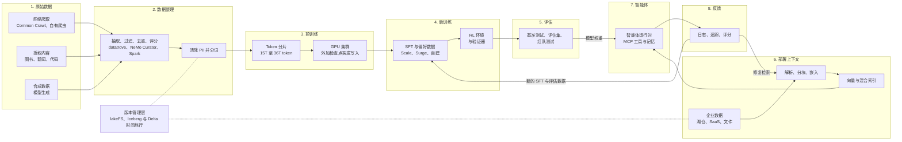

# 16. AI 数据生命周期
> **深度：** L2 · **阅读时间：** 约 16 分钟 · **最后核实：** 2026-11-01 · **前置阅读：** [第 1 章 — 数据栈全景图](../01-data-systems-foundations/ch01-data-stack-map.md)

## 要点速览（TL;DR）

- 模型的数据要经过八个阶段：原始数据、数据整理（curation）、预训练（pretraining）、后训练（post-training）、评估、部署上下文、智能体（agent）和反馈。每个阶段都有各自的数据形态、数据量、工具和风险。大多数 AI 质量问题其实是在这些阶段之一暴露出来的数据问题。
- 存在两条生命周期。**前沿实验室生命周期**从网络规模的爬取一直走到训练完成的模型。Llama 3 使用了超过 15 万亿个 [token](../glossary.md#token)，[^llama3-blog] Qwen3 约 36 万亿个，[^qwen3] 而 2026 年 Common Crawl 的单个快照就有约 360 TiB。[^cc-aug26] 运行这条生命周期的组织大概只有十几家。
- **企业生命周期**从一个现成的模型出发，在运行时加入公司自有数据：[检索增强生成](../glossary.md#retrieval-augmented-generation)（RAG）、轻量微调（fine-tuning），以及在受治理数据上调用工具的 [AI 智能体](../glossary.md#ai-agent)。运行这条生命周期的公司数以千计，各数据平台（Databricks、Snowflake、AWS、Google）都在争夺这块市场。
- 高价值阶段随时间迁移。2020–2023 年是预训练规模。2024 年以来则是整理质量、后训练（偏好数据、[RL 环境](../glossary.md#rl-environment)和[验证器](../glossary.md#verifiable-reward)），对企业而言则是上下文：在模型作答的那一刻，哪些受治理的事实能送达模型。
- 不同阶段对存储的需求不同。整理和训练需要高吞吐的顺序读取，外加用于数据打乱（shuffle）的随机读取。检查点以突发方式写入。RAG 需要对向量进行低延迟随机读取。反馈日志会无限增长。可复现性依赖[数据版本管理](../glossary.md#data-versioning)（lakeFS、Iceberg/Delta 的[时间旅行（历史版本查询）](../glossary.md#time-travel)），正如晶圆厂依赖批次谱系一样。

## 为何重要（商业视角 + Everpure 视角）

投资者把 AI 描述为一个算力故事，GPU 账单也支持这种看法。但数据是算力无法替代的投入。Gartner 预测，到 2026 年，组织将放弃 60% 缺乏 AI 就绪数据的 AI 项目（分析师预测）。[^gartner] IDC 估计，2022 年组织产生的数据中约 90% 是非结构化数据（白皮书发布于 2023 年，分析师估算，由 Box 赞助）。[^idc] 非结构化数据正是 RAG 和智能体所消耗的数据，也是传统数据仓库一直忽视的数据。谁负责清洗、分类、版本管理并提供这些数据，谁就能获取生命周期中的经常性支出。相比之下，训练一个模型更接近一次性的资本项目。

对公司发展（corporate development）方向的读者而言，有用的划分是：哪些阶段由前沿实验室完全自建，哪些阶段由企业外购。实验室自建爬虫、整理管道和 RL 环境，主要外购的是 GPU、存储，以及从 Scale AI 等供应商处采购的人工数据。2025 年 6 月 Meta 以约 $14.3B 购入 Scale AI 49% 的无投票权股份时，Scale AI 的估值约为 $29B（媒体报道）。[^scale] 企业则几乎什么都外购：通过 API 获取的模型、向量索引、评估工具和智能体运行时。这正是 Databricks、Snowflake 和超大规模云厂商竞争的市场，也是 Everpure 2026 年各项举措所定位的地方。Data Intelligence（来自对 1touch 的收购）负责发现和分类数据，Data Stream 则借助 NVIDIA GPU 在 FlashBlade 上对数据进行向量化。[^everpure-ds] 两者都位于企业的整理阶段和部署上下文阶段，并不涉及前沿预训练。

## 工作原理

### 总览图

*图 16.1 — AI 数据生命周期（SV-9）。阶段 1–5 是前沿实验室路径，产出模型权重。阶段 6–8 是企业路径，用公司数据包裹这些权重。反馈环路同时为两者供数。*

### 阶段 1–2：原始数据与整理，相当于晶圆清洗环节

原始数据有四个来源。**网络**是最大的来源。Common Crawl Foundation 2026 年 8 月的爬取包含约 21.4 亿个网页，未压缩约 360 TiB，其存档累计超过 3,000 亿个网页。[^cc-aug26][^cc-home] **授权内容**包括按合同购买的图书、新闻档案、代码和文字记录。**企业数据**是公司拥有的文档、工单和数据表。**[合成数据](../glossary.md#synthetic-data)**（synthetic data）是由一个模型生成、用于训练另一个模型的文本、代码或推理轨迹。

[数据整理](../glossary.md#data-curation)把这些原材料变成训练 token，而其中绝大部分都会被丢弃。现代管道做五件事：从 HTML 或 PDF 中**抽取**文本；按语言、启发式规则（重复度、符号比例）和 URL 黑名单进行**过滤**；**去重**，通常采用 [MinHash](../glossary.md#minhash) 近似重复检测；用[质量分类器](../glossary.md#quality-classifier)**给质量打分**，这是一个经过训练、用于预测某个网页是否像优质参考文本的小模型；最后清除 [PII](../glossary.md#pii) 并进行[分词（tokenization）](../glossary.md#tokenization)。Hugging Face 的 FineWeb 展示了结果：它取用了 96 个 Common Crawl 快照，产出 15 万亿个 token，磁盘占用约 44 TB。其论文发现，在每个快照内部去重比跨所有快照去重效果更好。[^fineweb] 教育类子集 FineWeb-Edu（1.3 万亿 token）由分类器筛选而成，基于它训练的模型在知识类基准上表现更好。[^fineweb]

**实例：整理的"良率"。** GPT-3 团队从 45 TB 压缩后的 Common Crawl 文本起步，过滤后保留了 570 GB，约为字节量的 1.3%。[^gpt3] FineWeb 的过滤远没有那么激进，但仍会丢弃所爬取内容的大部分。96 个快照、每个数百 TiB，就是数十 PB 的原始 HTML，而输出是 44 TB 的文本（根据已发布数字的估算）。其经济性更像采矿，而不像仓储。大部分算力都花在决定丢弃什么上，而这些决策的质量对模型质量的影响，超过原始数据堆的规模。

> **类比：半导体。** 数据整理就是晶圆清洗和良率提升。去重清除的是会在许多晶粒上印出同一缺陷的颗粒，在模型中表现为被记住的样板文字。质量评分类似在线检测：用一个廉价的分类器筛查每个网页，让昂贵的 GPU 时间只花在优质材料上。被投毒或有害的文档就是污染。几个颗粒就能毁掉一颗晶粒，几百份文档就能植入一个后门（见下文"数据治理"）。晶圆厂靠良率学习取胜，而不是靠购买更多硅片。

**存储画像。** 数据整理是一项针对文件和对象的批量分析作业。Spark、Ray 或 Hugging Face 的 datatrove 以高吞吐顺序读取 WARC 文件，并写出 [Parquet](../glossary.md#parquet) 分片。MinHash 去重是一次大规模 shuffle。这是最像湖仓一体（lakehouse）工作负载的阶段（[第 7 章](../01-data-systems-foundations/ch07-open-table-formats.md)），也是前沿实验室与数据平台的主要重叠之处。[第 17 章](ch17-unstructured-data-processing.md)介绍解析，[第 20 章](ch20-training-data-supply-chain.md)介绍数据来源、授权和数据标注（labeling）供应商。

### 阶段 3：预训练，相当于晶圆制造

[预训练](../glossary.md#pretraining)让模型学会在整理好的语料上预测下一个 token。语料规模持续增长：

- Llama 2 使用了约 2 万亿 token。
- Llama 3 使用了超过 15 万亿（公司披露），配比约为 50% 通用知识、25% 数学与推理、17% 代码、8% 多语言。[^llama3-blog][^llama3-paper]
- Llama 4 使用了超过 30 万亿（公司披露）。[^llama4]
- Qwen3 使用了约 36 万亿，覆盖 119 种语言。[^qwen3]

按每个 token 约 4 字节英文文本计算（经验法则，估算），15 万亿 token 大约是 60 TB 文本。以存储标准衡量，这并不大。难点在于：要以打乱的顺序、多遍、快速地读取它，而数千块 GPU 都在等待每一次读取。

Llama 3 论文是少数公开描述底层存储的资料之一。Meta 在其分布式文件系统 Tectonic 上训练：7,500 台配备 SSD 的服务器上共 240 PB，持续吞吐 2 TB/s，峰值 7 TB/s。[^llama3-paper] 论文指出，突发性的检查点写入会在短时间内使网络饱和，是主要的存储挑战。论文还报告，在 54 天的预训练期间发生了 466 次作业中断，约每 2.8 小时一次。[^llama3-paper] [模型检查点](../glossary.md#model-checkpoint)就是应对这些中断的保险。

**实例：检查点大小。** 使用 Adam 优化器的混合精度训练，每个参数在内存中约占 16 字节状态（bf16 权重和梯度，加上 fp32 主权重和两个优化器动量）。检查点通常不保存梯度，因此每个参数约存 14 字节。对一个 4,050 亿参数的模型而言，每个完整检查点约 5.7 TB（估算；若保留梯度则约 6.5 TB）。按 2 TB/s 计算，理想情况下约需三秒。但实际上，数万块 GPU 会在同一时刻写入，然后归于沉寂。因此实验室会先异步地把检查点写到主机内存或本地 NVMe，再逐步转存到共享存储。

> **类比：半导体。** 检查点和数据集版本就是**晶圆批次谱系**。当现场失效品被退回时，晶圆厂会把晶粒追溯到它的批次、机台和工艺配方。当模型出现退化时，实验室必须把它追溯到对应的检查点、数据配比和精确的分片清单。没有这份记录，没人能复现或解释结果。

### 阶段 4：后训练，从基础模型到产品

预训练模型只会续写文本。[后训练](../glossary.md#post-training)把它变成助手，所用的是另一类数据：规模小、成本高，由人或验证器制作。InstructGPT（Ouyang 等，2022 年）确立了范式。[^instructgpt] 共分三步：

1. 在约 13,000 条提示词上进行[监督微调](../glossary.md#supervised-fine-tuning)（SFT），示范回答由标注员撰写。
2. 在约 33,000 条提示词上训练[奖励模型](../glossary.md#reward-model)，由标注员对模型输出进行排序。
3. 在约 31,000 条提示词上针对该奖励模型进行强化学习。

标注员更偏好 13 亿参数的 InstructGPT，而不是 1,750 亿参数的 GPT-3。这种方法就是[人类反馈强化学习](../glossary.md#reinforcement-learning-from-human-feedback)（RLHF）。它证明了：几万条精心制作的样本，可能比一个大 100 倍的模型更重要。

此后有三项变化塑造了数据市场：

- **AI 反馈取代了部分人类反馈。** Constitutional AI（2022 年）使用一个在书面原则指导下的模型来生成偏好标签，这就是 [RLAIF](../glossary.md#reinforcement-learning-from-ai-feedback)。[^cai]
- **更简单的偏好方法出现了。** [直接偏好优化](../glossary.md#direct-preference-optimization)（DPO，2023 年）直接在[偏好数据](../glossary.md#preference-data)（即被选中与被拒绝的回答对）上训练，无需单独的奖励模型。[^dpo]
- **可验证奖励和环境接管了推理训练。** DeepSeek-R1（2025 年 1 月）表明，使用由规则检查的奖励进行 RL 可以产生强大的推理能力：代码是否通过了测试，数学答案是否一致。[^r1] 此后实验室大举投入 RL 环境，即软件、网站和工作流的沙箱化复制品，智能体在其中尝试完成任务，由验证器打分。TechCrunch 于 2025 年 9 月报道，Anthropic 曾讨论在一年内为环境投入超过 $1B（媒体报道）。[^rl-env]

后训练的数据量并不大。Meta 报告称，Llama 3 的后训练使用了超过 1,000 万条人工标注样本。[^llama3-blog] 这是 GB 级而非 PB 级。但每条样本的成本很高。标注与环境供应商出售的是专业能力和产能，而不是存储，这正是这一阶段能支撑 Scale AI 及其竞争对手等公司的原因（[第 20 章](ch20-training-data-supply-chain.md)）。

### 阶段 5：评估

评估决定一个检查点能否发布。它有三层。公开**基准测试**是有已知答案的固定题集，当测试题泄露进训练数据时就会受到污染。私有**评估集**（eval）是为匹配实验室或客户真实用途而构建的任务套件，通常由 [LLM 评审](../glossary.md#llm-judge)（LLM judge）打分。**[红队测试](../glossary.md#red-teaming)**（red-teaming）是指由人工和自动化手段尝试让模型出现不当行为。评估集规模小、高度敏感。它们必须做版本管理、与训练数据隔离（去污染），并像源代码一样受到保护，因为泄露的评估集将失去任何衡量意义。对企业而言，这是它们最常跳过、也最需要的阶段。例如，Databricks 的 Agent Bricks 就在售卖自动生成的任务评估和 LLM 评审。[^dbx-dais25]

