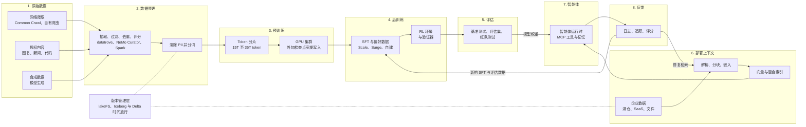
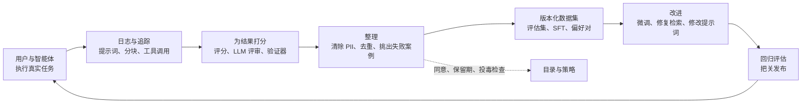
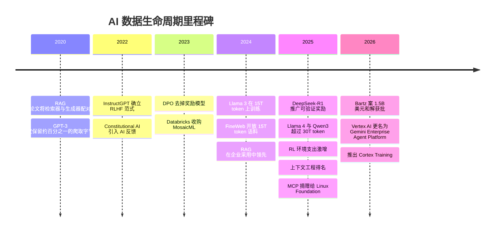

# 16. AI 数据生命周期
> **深度：** L2 · **阅读时间：** 约 16 分钟 · **最后核实：** 2026-11-01 · **前置阅读：** [第 1 章 — 数据栈全景图](../01-data-systems-foundations/ch01-data-stack-map.md)

## 要点速览（TL;DR）

- 模型的数据要经过八个阶段：原始数据、数据整理（curation）、预训练（pretraining）、后训练（post-training）、评估、部署上下文、智能体（agent）和反馈。每个阶段都有各自的数据形态、数据量、工具和风险。大多数 AI 质量问题其实是在这些阶段之一暴露出来的数据问题。
- 存在两条生命周期。**前沿实验室生命周期**从网络规模的爬取一直走到训练完成的模型。Llama 3 使用了超过 15 万亿个 [token](../glossary.md#token)，[^llama3-blog] Qwen3 约 36 万亿个，[^qwen3] 而 2026 年 Common Crawl 的单个快照就有约 360 TiB。[^cc-aug26] 运行这条生命周期的组织大概只有十几家。
- **企业生命周期**从一个现成的模型出发，在运行时加入公司自有数据：[检索增强生成](../glossary.md#retrieval-augmented-generation)（RAG）、轻量微调（fine-tuning），以及在受治理数据上调用工具的 [AI 智能体](../glossary.md#ai-agent)。运行这条生命周期的公司数以千计，各数据平台（Databricks、Snowflake、AWS、Google）都在争夺这块市场。
- 高价值阶段随时间迁移。2020–2023 年是预训练规模。2024 年以来则是整理质量、后训练（偏好数据、[RL 环境](../glossary.md#rl-environment)和[验证器](../glossary.md#verifiable-reward)），对企业而言则是上下文：在模型作答的那一刻，哪些受治理的事实能送达模型。
- 不同阶段对存储的需求不同。整理和训练需要高吞吐的顺序读取，外加用于数据打乱（shuffle）的随机读取。检查点以突发方式写入。RAG 需要对向量进行低延迟随机读取。反馈日志会无限增长。可复现性依赖[数据版本管理](../glossary.md#data-versioning)（lakeFS、Iceberg/Delta 的[时间旅行（历史版本查询）](../glossary.md#time-travel)），正如晶圆厂依赖批次谱系一样。

## 为何重要（商业视角 + Everpure 视角）

投资者把 AI 描述为一个算力故事，GPU 账单也支持这种看法。但数据是算力无法替代的投入。Gartner 预测，到 2026 年，组织将放弃 60% 缺乏 AI 就绪数据的 AI 项目（分析师预测）。[^gartner] IDC 估计，2022 年组织产生的数据中约 90% 是非结构化数据（白皮书发布于 2023 年，分析师估算，由 Box 赞助）。[^idc] 非结构化数据正是 RAG 和智能体所消耗的数据，也是传统数据仓库一直忽视的数据。谁负责清洗、分类、版本管理并提供这些数据，谁就能获取生命周期中的经常性支出。相比之下，训练一个模型更接近一次性的资本项目。

对公司发展（corporate development）方向的读者而言，有用的划分是：哪些阶段由前沿实验室完全自建，哪些阶段由企业外购。实验室自建爬虫、整理管道和 RL 环境，主要外购的是 GPU、存储，以及从 Scale AI 等供应商处采购的人工数据。2025 年 6 月 Meta 以约 $14.3B 购入 Scale AI 49% 的无投票权股份时，Scale AI 的估值约为 $29B（媒体报道）。[^scale] 企业则几乎什么都外购：通过 API 获取的模型、向量索引、评估工具和智能体运行时。这正是 Databricks、Snowflake 和超大规模云厂商竞争的市场，也是 Everpure 2026 年各项举措所定位的地方。Data Intelligence（来自对 1touch 的收购）负责发现和分类数据，Data Stream 则借助 NVIDIA GPU 在 FlashBlade 上对数据进行向量化。[^everpure-ds] 两者都位于企业的整理阶段和部署上下文阶段，并不涉及前沿预训练。

## 工作原理

### 总览图

*图 16.1 — AI 数据生命周期（SV-9）。阶段 1–5 是前沿实验室路径，产出模型权重。阶段 6–8 是企业路径，用公司数据包裹这些权重。反馈环路同时为两者供数。*

### 阶段 1–2：原始数据与整理，相当于晶圆清洗环节

原始数据有四个来源。**网络**是最大的来源。Common Crawl Foundation 2026 年 8 月的爬取包含约 21.4 亿个网页，未压缩约 360 TiB，其存档累计超过 3,000 亿个网页。[^cc-aug26][^cc-home] **授权内容**包括按合同购买的图书、新闻档案、代码和文字记录。**企业数据**是公司拥有的文档、工单和数据表。**[合成数据](../glossary.md#synthetic-data)**（synthetic data）是由一个模型生成、用于训练另一个模型的文本、代码或推理轨迹。

[数据整理](../glossary.md#data-curation)把这些原材料变成训练 token，而其中绝大部分都会被丢弃。现代管道做五件事：从 HTML 或 PDF 中**抽取**文本；按语言、启发式规则（重复度、符号比例）和 URL 黑名单进行**过滤**；**去重**，通常采用 [MinHash](../glossary.md#minhash) 近似重复检测；用[质量分类器](../glossary.md#quality-classifier)**给质量打分**，这是一个经过训练、用于预测某个网页是否像优质参考文本的小模型；最后清除 [PII](../glossary.md#pii) 并进行[分词（tokenization）](../glossary.md#tokenization)。Hugging Face 的 FineWeb 展示了结果：它取用了 96 个 Common Crawl 快照，产出 15 万亿个 token，磁盘占用约 44 TB。其论文发现，在每个快照内部去重比跨所有快照去重效果更好。[^fineweb] 教育类子集 FineWeb-Edu（1.3 万亿 token）由分类器筛选而成，基于它训练的模型在知识类基准上表现更好。[^fineweb]

**实例：整理的"良率"。** GPT-3 团队从 45 TB 压缩后的 Common Crawl 文本起步，过滤后保留了 570 GB，约为字节量的 1.3%。[^gpt3] FineWeb 的过滤远没有那么激进，但仍会丢弃所爬取内容的大部分。96 个快照、每个数百 TiB，就是数十 PB 的原始 HTML，而输出是 44 TB 的文本（根据已发布数字的估算）。其经济性更像采矿，而不像仓储。大部分算力都花在决定丢弃什么上，而这些决策的质量对模型质量的影响，超过原始数据堆的规模。

> **类比：半导体。** 数据整理就是晶圆清洗和良率提升。去重清除的是会在许多晶粒上印出同一缺陷的颗粒，在模型中表现为被记住的样板文字。质量评分类似在线检测：用一个廉价的分类器筛查每个网页，让昂贵的 GPU 时间只花在优质材料上。被投毒或有害的文档就是污染。几个颗粒就能毁掉一颗晶粒，几百份文档就能植入一个后门（见下文"数据治理"）。晶圆厂靠良率学习取胜，而不是靠购买更多硅片。

**存储画像。** 数据整理是一项针对文件和对象的批量分析作业。Spark、Ray 或 Hugging Face 的 datatrove 以高吞吐顺序读取 WARC 文件，并写出 [Parquet](../glossary.md#parquet) 分片。MinHash 去重是一次大规模 shuffle。这是最像湖仓一体（lakehouse）工作负载的阶段（[第 7 章](../01-data-systems-foundations/ch07-open-table-formats.md)），也是前沿实验室与数据平台的主要重叠之处。[第 17 章](ch17-unstructured-data-processing.md)介绍解析，[第 20 章](ch20-training-data-supply-chain.md)介绍数据来源、授权和数据标注（labeling）供应商。

### 阶段 3：预训练，相当于晶圆制造

[预训练](../glossary.md#pretraining)让模型学会在整理好的语料上预测下一个 token。语料规模持续增长：

- Llama 2 使用了约 2 万亿 token。
- Llama 3 使用了超过 15 万亿（公司披露），配比约为 50% 通用知识、25% 数学与推理、17% 代码、8% 多语言。[^llama3-blog][^llama3-paper]
- Llama 4 使用了超过 30 万亿（公司披露）。[^llama4]
- Qwen3 使用了约 36 万亿，覆盖 119 种语言。[^qwen3]

按每个 token 约 4 字节英文文本计算（经验法则，估算），15 万亿 token 大约是 60 TB 文本。以存储标准衡量，这并不大。难点在于：要以打乱的顺序、多遍、快速地读取它，而数千块 GPU 都在等待每一次读取。

Llama 3 论文是少数公开描述底层存储的资料之一。Meta 在其分布式文件系统 Tectonic 上训练：7,500 台配备 SSD 的服务器上共 240 PB，持续吞吐 2 TB/s，峰值 7 TB/s。[^llama3-paper] 论文指出，突发性的检查点写入会在短时间内使网络饱和，是主要的存储挑战。论文还报告，在 54 天的预训练期间发生了 466 次作业中断，约每 2.8 小时一次。[^llama3-paper] [模型检查点](../glossary.md#model-checkpoint)就是应对这些中断的保险。

**实例：检查点大小。** 使用 Adam 优化器的混合精度训练，每个参数在内存中约占 16 字节状态（bf16 权重和梯度，加上 fp32 主权重和两个优化器动量）。检查点通常不保存梯度，因此每个参数约存 14 字节。对一个 4,050 亿参数的模型而言，每个完整检查点约 5.7 TB（估算；若保留梯度则约 6.5 TB）。按 2 TB/s 计算，理想情况下约需三秒。但实际上，数万块 GPU 会在同一时刻写入，然后归于沉寂。因此实验室会先异步地把检查点写到主机内存或本地 NVMe，再逐步转存到共享存储。

> **类比：半导体。** 检查点和数据集版本就是**晶圆批次谱系**。当现场失效品被退回时，晶圆厂会把晶粒追溯到它的批次、机台和工艺配方。当模型出现退化时，实验室必须把它追溯到对应的检查点、数据配比和精确的分片清单。没有这份记录，没人能复现或解释结果。

### 阶段 4：后训练，从基础模型到产品

预训练模型只会续写文本。[后训练](../glossary.md#post-training)把它变成助手，所用的是另一类数据：规模小、成本高，由人或验证器制作。InstructGPT（Ouyang 等，2022 年）确立了范式。[^instructgpt] 共分三步：

1. 在约 13,000 条提示词上进行[监督微调](../glossary.md#supervised-fine-tuning)（SFT），示范回答由标注员撰写。
2. 在约 33,000 条提示词上训练[奖励模型](../glossary.md#reward-model)，由标注员对模型输出进行排序。
3. 在约 31,000 条提示词上针对该奖励模型进行强化学习。

标注员更偏好 13 亿参数的 InstructGPT，而不是 1,750 亿参数的 GPT-3。这种方法就是[人类反馈强化学习](../glossary.md#reinforcement-learning-from-human-feedback)（RLHF）。它证明了：几万条精心制作的样本，可能比一个大 100 倍的模型更重要。

此后有三项变化塑造了数据市场：

- **AI 反馈取代了部分人类反馈。** Constitutional AI（2022 年）使用一个在书面原则指导下的模型来生成偏好标签，这就是 [RLAIF](../glossary.md#reinforcement-learning-from-ai-feedback)。[^cai]
- **更简单的偏好方法出现了。** [直接偏好优化](../glossary.md#direct-preference-optimization)（DPO，2023 年）直接在[偏好数据](../glossary.md#preference-data)（即被选中与被拒绝的回答对）上训练，无需单独的奖励模型。[^dpo]
- **可验证奖励和环境接管了推理训练。** DeepSeek-R1（2025 年 1 月）表明，使用由规则检查的奖励进行 RL 可以产生强大的推理能力：代码是否通过了测试，数学答案是否一致。[^r1] 此后实验室大举投入 RL 环境，即软件、网站和工作流的沙箱化复制品，智能体在其中尝试完成任务，由验证器打分。TechCrunch 于 2025 年 9 月报道，Anthropic 曾讨论在一年内为环境投入超过 $1B（媒体报道）。[^rl-env]

后训练的数据量并不大。Meta 报告称，Llama 3 的后训练使用了超过 1,000 万条人工标注样本。[^llama3-blog] 这是 GB 级而非 PB 级。但每条样本的成本很高。标注与环境供应商出售的是专业能力和产能，而不是存储，这正是这一阶段能支撑 Scale AI 及其竞争对手等公司的原因（[第 20 章](ch20-training-data-supply-chain.md)）。

### 阶段 5：评估

评估决定一个检查点能否发布。它有三层。公开**基准测试**是有已知答案的固定题集，当测试题泄露进训练数据时就会受到污染。私有**评估集**（eval）是为匹配实验室或客户真实用途而构建的任务套件，通常由 [LLM 评审](../glossary.md#llm-judge)（LLM judge）打分。**[红队测试](../glossary.md#red-teaming)**（red-teaming）是指由人工和自动化手段尝试让模型出现不当行为。评估集规模小、高度敏感。它们必须做版本管理、与训练数据隔离（去污染），并像源代码一样受到保护，因为泄露的评估集将失去任何衡量意义。对企业而言，这是它们最常跳过、也最需要的阶段。例如，Databricks 的 Agent Bricks 就在售卖自动生成的任务评估和 LLM 评审。[^dbx-dais25]

### 阶段 6：部署上下文，企业的主战场

企业很少修改模型权重，它们修改的是模型看到的内容。RAG（Lewis 等，2020 年）把生成器与一个覆盖 2,100 万个维基百科段落的检索器配对，从而可以通过替换索引而非重新训练来更新知识。[^rag] 企业版本遵循同样的模式（[第 19 章](ch19-retrieval-architectures.md)）：

1. 从 SharePoint、工单系统、合同和湖仓表中拉取文档。
2. 解析并分块（[第 17 章](ch17-unstructured-data-processing.md)）。
3. 为每个分块生成嵌入（embedding，[第 18 章](ch18-embeddings-and-vector-search.md)）。
4. 为向量建立索引，并同时提供关键词检索。
5. 在查询时，检索排名靠前的分块，检查权限，并把它们放入提示词。

Menlo Ventures 2024 年的调查发现，51% 的企业生成式 AI 部署采用了 RAG，相比之下只有 9% 主要依赖微调（调查，媒体报道）。[^menlo24] 2025 年，从业者开始把这一更广泛的学科称为[上下文工程](../glossary.md#context-engineering)（context engineering）。Anthropic 将其描述为：在每次调用模型时，决定纳入哪些指令、检索数据、工具结果和历史记录。[^context-eng]

微调并没有消失，它已成为各平台都提供的托管功能。Snowflake 的 Cortex Fine-tuning（2025 年 2 月 GA）在账户内部训练参数高效的适配器。[^sf-ft] Snowflake 在 Summit 2026 上新增了 Cortex Training，用于对开放权重模型进行托管式 GPU 微调。[^sf-summit26] AWS 的 Bedrock Knowledge Bases 可以把 S3 Vectors 用作托管的 RAG 存储。[^s3v-bedrock]

### 阶段 7–8：智能体与反馈环路

智能体增加了两条数据流。第一条是**工具**。模型通过[模型上下文协议](../glossary.md#model-context-protocol)等接口调用 SQL、API 和搜索；Anthropic 已于 2025 年 12 月将该协议捐赠给 Linux Foundation 旗下的 Agentic AI Foundation。[^mcp] 第二条是**记忆**：会话笔记和长期用户事实，它们需要被存储、检索、过期和治理（[第 22 章](ch22-agents-and-data.md)）。每次智能体运行还会产生一条**追踪**（trace），记录提示词、检索到的分块、工具调用和结果。追踪是飞轮的原材料。

*图 16.2 — 数据飞轮。使用产生追踪，打分把追踪变成带标签的样本，版本化数据集既用于改进，也用于防止退步的回归评估。数据治理位于整理环节，因为用户数据正是在这里变成训练数据的。*

[数据飞轮](../glossary.md#data-flywheel)是 AI 领域最有力的护城河论点，也常常被夸大。当结果可以被廉价地打分时它就有效，比如能编译通过的代码或得到解决的工单。它还需要拥有复用数据的权利。当反馈稀疏（很少有用户点"踩"）、充满噪声或在合同上不可使用时，飞轮就会停转。大多数企业合同禁止模型供应商使用客户数据进行训练，因此飞轮主要在客户自己的边界内转动。这对已经持有日志的数据平台而言是一种结构性优势。

> **类比：半导体。** 现场退货为良率学习提供养料。拥有批次谱系（阶段 3）并对退回部件做失效分析的晶圆厂，每一代都在进步；没有这些的晶圆厂则会重复同样的缺陷。追踪就是 AI 系统的现场退货。

### 各阶段的治理风险

- **版权**问题主要集中在阶段 1–2。在 *Bartz v. Anthropic* 案中，Alsup 法官于 2025 年裁定，用图书进行训练属于合理使用，但保留盗版副本则不属于。该案随后以 $1.5B 和解，约每部作品 $3,000，和解协议于 2026 年 7 月获得最终批准。[^bartz] 对数据团队的启示是：来源记录与训练本身同样重要。FineWeb 的数据集卡片同样记录了在收到停止侵权通知后被移除的域名。[^fineweb-card]
- **PII** 在每个阶段都会出现，在阶段 8 最为严重，因为用户对话会在这里成为训练候选数据。
- **[数据投毒](../glossary.md#data-poisoning)**（data poisoning）比直觉上更便宜。Anthropic、英国 AI Security Institute 和 Alan Turing Institute 发现，约 250 份恶意文档就能给参数量从 600M 到 13B 的模型植入后门，且与模型大小无关。对最大的模型而言，这只占其训练 token 的 0.00016%（研究结果，针对狭窄的触发行为）。[^poison] 在 RAG 中门槛可能更低：针对检索的研究攻击中，每个目标问题只需植入少量文档，因为攻击者只需让它们进入索引并获得排名。

## 设计选择与权衡

| 维度 | 前沿实验室生命周期 | 企业生命周期 |
|---|---|---|
| 目标 | 产出通用模型权重 | 让购买来的模型在专有数据上发挥作用 |
| 主导阶段 | 1–5（爬取、整理、预训练、后训练、评估） | 6–8（上下文、智能体、反馈），加上轻量微调 |
| 数据量 | 原始数据数十 PB，整理后 15–36T token | GB 级到低 PB 级的文档和表，数百万个分块（估算） |
| 数据形态 | 网页文本、代码、授权语料、合成轨迹 | PDF、工单、邮件、合同、数据仓库表、日志 |
| 谁来构建 | 自建团队（OpenAI、Anthropic、Google、Meta、xAI、Qwen、DeepSeek） | 使用 Databricks、Snowflake、AWS、Google、Microsoft 及初创公司产品的平台团队 |
| 支出模式 | 类资本支出的训练运行，之后是人工数据与 RL 环境 | 按用量计费：token、向量查询、计算积分 |
| 存储 I/O | 顺序吞吐、shuffle 读取、检查点突发 | 低延迟随机读取（向量）、大量小文件、日志 |
| 主要治理风险 | 版权、投毒、基准污染 | 访问控制（谁可以检索什么）、PII、保留期 |
| 可复现性工具 | 分片清单、检查点谱系、lakeFS | Iceberg/Delta 时间旅行、索引版本、评估集 |

*图 16.3 — 两条生命周期共享一套词汇，除此之外几乎没有共同点。数据平台在右侧一栏竞争。存储厂商则以不同的 I/O 画像同时服务两者。*

"企业将训练自己的模型"这一观点的最强版本论证（steelman）确实存在，但适用面窄。制药、金融和芯片设计等领域知识密集型企业会在专有语料上进行继续预训练或深度微调，而 Cortex Training 和 Mosaic AI 等托管服务降低了成本。但对大多数公司而言，一个配有良好检索和评估的前沿模型，在单位质量成本上胜过定制模型。上文的采用率数据（RAG 领先于微调）反映了这一点。

相反观点的最强版本论证，"长上下文让 RAG 过时"，也部分成立。百万 token 的上下文窗口让小型语料无需分块。但长上下文无法在企业规模上处理权限、时效性和成本问题，因此检索仍是默认方案（[第 19 章](ch19-retrieval-architectures.md)）。

## 主要参与者

| 阶段 | 代表性工具 / 供应商 | 数据形态 | 存储 I/O 画像 |
|---|---|---|---|
| 1. 原始数据 | Common Crawl、自有爬虫、出版商授权协议、合成数据生成器 | WARC/HTML、PDF、代码仓库 | 批量顺序摄取；冷对象存储 |
| 2. 数据整理 | datatrove、NVIDIA NeMo Curator、Spark、Ray、Databricks、Lilac（Databricks） | Parquet 文本分片、MinHash 签名 | 高吞吐扫描；重度 shuffle 的去重 |
| 3. 预训练 | PyTorch、Megatron、自建技术栈；Tectonic 级文件系统 | 分词后的二进制分片；Safetensors 检查点 | 顺序读取加随机 shuffle；检查点突发写入 |
| 4. 后训练 | Scale AI、Surge AI、Mercor、Snorkel；RL 环境初创公司 | 提示词/回答对、排序、环境规格 | 小数据集；沙箱虚拟机；追踪日志 |
| 5. 评估 | 开放基准套件、Weights & Biases、MLflow、Braintrust、Agent Bricks 评估 | 题集、评审评分标准、分数 | 小规模、版本化、访问受限 |
| 6. 部署上下文 | Databricks Vector Search（其文档中现称"AI Search"）、Snowflake Cortex Search、Bedrock Knowledge Bases + S3 Vectors、Gemini Enterprise Agent Platform、Pinecone、Elasticsearch、pgvector | 分块、嵌入、元数据 | 低延迟随机读取；频繁的索引刷新 |
| 7. 智能体 | MCP 服务器、Agent Bricks、Snowflake CoWork 与 Cortex Agents、Bedrock agents、LangGraph | 工具调用、记忆记录 | 小型事务性读写（通常为 Postgres） |
| 8. 反馈 | LangSmith、Arize、W&B Weave、湖仓表、lakeFS | 追踪、评分、偏好对 | 以追加为主的日志；长期保留 |

*图 16.4 — 各阶段工具。前沿实验室在第 1–4 行的大部分内容上自建。企业市场是第 5–8 行加上非结构化数据的整理，这正是数据平台、向量厂商和存储厂商重叠之处。供应商列表仅为示例，并非详尽；产品状态见脚注。*[^dbx-dais25][^sf-summit26][^s3v-bedrock][^gemini-ap]

**数据平台适合在哪里，不适合在哪里。** Databricks（Mosaic AI、Agent Bricks、Vector Search、Unity Catalog）、Snowflake（Cortex AI、Cortex Search、CoWork）、AWS（SageMaker Unified Studio、Bedrock）和 Google（Vertex AI，已于 2026 年 4 月更名为 Gemini Enterprise Agent Platform）[^gemini-ap] 都覆盖了阶段 5–8 以及企业规模的阶段 2。它们的卖点是：数据治理、数据血缘和访问控制已经存在于平台中，因此上下文和反馈也应该放在平台上（[第 21 章](ch21-ml-platforms-feature-stores-llmops.md)；[第 25 章](../04-company-deep-dives/ch25-databricks.md)）。它们在前沿预训练中基本缺席。实验室不会从数据仓库中运行 16,000 块 GPU 的作业，其整理技术栈也是量身定制的。Databricks 以 $1.3B 收购 MosaicML（2023 年），是押注中等规模的定制预训练会成为一个企业市场。后来这项业务被并入 Agent Bricks，表明市场转而选择了 RAG 和智能体。[^mosaic]

**版本管理**是横向贯穿的一层。lakeFS 在对象存储之上增加了 Git 风格的分支、提交与合并，使训练运行可以锁定某个精确的数据集提交。lakeFS 于 2025 年 11 月接管了 DVC 开源项目的维护工作。[^lakefs] Iceberg 和 Delta 的时间旅行为表提供同样的锁定能力（[第 7 章](../01-data-systems-foundations/ch07-open-table-formats.md)）。向量索引是薄弱环节：很少有团队能说清某个答案是由哪个索引版本产生的。

## 历史与发展轨迹

*图 16.5 — 重心从预训练规模（2020–2024 年）转向后训练和上下文（2025–2026 年）。每一次转移都把价值推向更稀缺、治理更完善的数据。*

共有三个阶段。**规模阶段（2020–2023 年）：** 更好的模型来自更多的 token 和参数，数据工作意味着过滤爬取结果。**质量阶段（2023–2024 年）：** FineWeb-Edu 和 Llama 3 的数据配比表明，经分类器筛选的数据和精心的配比胜过原始数据量。[^fineweb][^llama3-paper] **经验阶段（2025 年起）：** 可用的网络文本已接近枯竭，因此实验室通过合成生成、RL 环境和验证器来制造新数据，而企业则在上下文上展开竞争。下一个可能的约束是权利。授权协议和法院和解正在把数据来源变成一条成本线，而企业飞轮依赖于客户合同中的同意条款。两者都有利于保留数据血缘的平台。预计"AI 就绪数据"类产品（分类、PII 标记、版本化的非结构化语料）将继续向数据平台和存储平台整合。

## 关键数字

| 指标 | 数值 | 口径 | 来源 / 日期 |
|---|---|---|---|
| Common Crawl 月度快照（2026 年 8 月） | 约 2.14B 个网页，未压缩约 360 TiB | 发布方披露 | Common Crawl，2026-08[^cc-aug26] |
| Common Crawl 存档 | >300B 个网页 | 发布方披露 | Common Crawl 网站，2026[^cc-home] |
| GPT-3 的 Common Crawl 过滤 | 输入 45 TB 压缩文本，保留 570 GB | 论文披露 | Brown 等，2020-05-28[^gpt3] |
| FineWeb | 来自 96 个快照的 15T token，约 44 TB；数据集卡片现为 >18.5T | 项目披露 | Penedo 等，2024-06；HF 卡片[^fineweb][^fineweb-card] |
| FineWeb-Edu | 1.3T token | 项目披露 | Penedo 等，2024-06[^fineweb] |
| Llama 3 预训练 | >15T token（约为 Llama 2 的 7 倍） | 公司披露 | Meta，2024-04-18[^llama3-blog] |
| Llama 4 预训练 | >30T token | 公司披露 | Meta，2025-04-05[^llama4] |
| Qwen3 预训练 | 约 36T token，119 种语言 | 公司披露 | Qwen 技术报告，2025-05[^qwen3] |
| Llama 3 训练存储 | 240 PB，持续 2 TB/s，峰值 7 TB/s | 论文披露 | Llama 3 论文，2024-07[^llama3-paper] |
| Llama 3 作业中断 | 54 天内 466 次 | 论文披露 | Llama 3 论文，2024-07[^llama3-paper] |
| 完整检查点，405B 参数 | 约 5.7 TB（含梯度约 6.5 TB） | 估算（约 14 字节/参数；含梯度为 16） | 本章 |
| InstructGPT 数据集 | 约 13k SFT、约 33k RM、约 31k RL 提示词 | 论文披露 | Ouyang 等，2022-03[^instructgpt] |
| Llama 3 后训练人工标注样本 | >10M | 公司披露 | Meta，2024-04-18[^llama3-blog] |
| 投毒门槛 | 约 250 份文档（13B 模型训练 token 的 0.00016%） | 研究结果 | Anthropic 等，2025-10[^poison] |
| 组织数据中非结构化数据占比 | 2022 年产生数据的约 90% | 分析师估算，厂商赞助 | IDC，经由 StorageNewsletter，2023-09-07[^idc] |
| 使用 RAG 与微调的企业部署比例 | 51% 对 9%（2024 年） | 调查，媒体报道 | Menlo Ventures，2024-11[^menlo24] |
| 企业生成式 AI 支出 | 约 $37B（2025 年），增长约 3.2 倍 | 基于调查的估算 | Menlo Ventures，2025-12-09[^menlo25] |
| 因缺乏 AI 就绪数据而被放弃的 AI 项目 | 到 2026 年为 60% | 分析师预测 | Gartner，2025-02-26[^gartner] |
| Bartz v. Anthropic 和解 | $1.5B，约每部作品 $3,000 | 法院批准的和解 | Jurist，2026-07[^bartz] |

*图 16.6 — 整理后的预训练语料只有数十 TB，但为其提供服务的基础设施却达到数百 PB 和每秒数 TB。企业层面的数字关乎采用率和就绪度，而非字节数。*

## 存储桥接

> **存储桥接。** 每个阶段对存储的需求都不同。整理阶段需要在对象存储上进行高吞吐的顺序扫描并具备 shuffle 带宽。训练阶段需要带随机采样的持续读取，以及足够的写入带宽来吸收检查点突发，避免 GPU 停顿。RAG 需要对向量索引进行低延迟随机读取以及频繁的小规模更新。反馈阶段需要廉价、持久、以追加为主并具备保留期控制的容量。Everpure 的 FlashBlade、Data Stream 和 Data Intelligence 面向的是企业阶段（分类、向量化、受治理的数据服务）。是否更进一步，例如对非结构化语料进行版本管理或提供检查点层级服务，属于基于公开信息、战略团队可能评估的选项之一。检查点、GPUDirect 和 AI 存储基准测试请参见配套的 *Everpure Tech Atlas*；[第 24 章](ch24-data-meets-compute-and-storage.md)讨论计算与存储之间的相互作用。

## 对话手册

**向产品经理提问**

1. "如今客户为哪些生命周期阶段向你们付费，哪些阶段仍然自己构建？自 2024 年以来这有什么变化？"
2. "你们如何知道某个客户的 RAG 或智能体系统在上个季度变得更好了？评估集由谁负责？"
3. "你们的合同赋予你们或客户什么样的权利，来复用追踪和反馈数据进行调优？"

**向工程师提问**

1. "你们能复现六个月前某个模型或智能体给出的答案吗：数据集提交、检查点、索引版本和提示词？"
2. "训练期间你们的读取模式是怎样的？写入和恢复一个完整检查点需要多长时间？"
3. "PII 清除和权限检查发生在哪里：摄取时、建索引时，还是检索时？"

**好的回答听起来是什么样的。** 它们会区分前沿与企业的需求。它们会引用具体数字（"我们每 30 分钟异步写一次检查点，每次约 6 TB"；"评估集有 400 个已打分任务，每次发布都要过这道关"）。它们把数据版本管理和访问控制视为一等需求，并承认飞轮需要可打分的结果和复用权利。

**不要这样说**

- "企业都会预训练自己的模型。"大多数企业是在前沿模型或开放权重模型上使用 RAG、轻量微调和智能体。
- "数据越多越好。"如今整理质量和后训练数据比原始数据量更重要。
- "RAG 消除了幻觉。"在检索正确且权限得到执行时，它能减少幻觉，但也增加了一个新的投毒攻击面。
- "训练数据是一个存储容量问题。"一个 15T token 的语料约为 60 TB。真正的挑战在于吞吐、shuffle 和检查点突发。
- "每个 AI 应用都有数据飞轮。"只有当结果可以被廉价打分、且数据可以合法复用时才有。

## 深入阅读

- Penedo 等，*The FineWeb Datasets*（2024 年），关于大规模去重和分类器过滤。[^fineweb]
- *The Llama 3 Herd of Models*（2024 年），其中关于数据配比、基础设施、存储和可靠性的章节。[^llama3-paper]
- Ouyang 等，*InstructGPT*（2022 年），以及 Rafailov 等，*DPO*（2023 年），了解后训练的数据配方。[^instructgpt][^dpo]
- Lewis 等，*Retrieval-Augmented Generation*（2020 年）。[^rag]
- Anthropic，"Effective context engineering for AI agents"（2025 年）。[^context-eng]
- lakeFS 关于分支和可复现性的文档。[^lakefs]

## 关键术语

- [Token](../glossary.md#token) — 语言模型读取和预测的子词单元；英文平均约每个 token 四个字符。
- [分词（Tokenization）](../glossary.md#tokenization) — 在训练或推理之前，用固定词表把文本转换为 token ID。
- [预训练](../glossary.md#pretraining) — 在非常大的通用语料上训练模型预测下一个 token。
- [后训练](../glossary.md#post-training) — 预训练之后的各阶段（SFT、偏好调优、RL），把基础模型变成助手。
- [数据整理](../glossary.md#data-curation) — 对原始数据进行抽取、过滤、去重、评分和清洗，使之成为可用于训练的形式。
- [MinHash](../glossary.md#minhash) — 一种以低成本估计文档相似度的哈希技术，用于去除近似重复。
- [质量分类器](../glossary.md#quality-classifier) — 为文档的训练价值打分的小模型。
- [PII](../glossary.md#pii) — 个人身份信息，如姓名、电子邮件和证件号，必须被移除或管控。
- [合成数据](../glossary.md#synthetic-data) — 由模型生成、而非从人或网络收集的训练数据。
- [监督微调](../glossary.md#supervised-fine-tuning) — 在配有理想回答的示例提示词上进行训练（SFT）。
- [奖励模型](../glossary.md#reward-model) — 基于人类排序训练、在 RL 期间为输出打分的模型。
- [人类反馈强化学习](../glossary.md#reinforcement-learning-from-human-feedback) — 用 RL 针对从人类偏好中学到的奖励来调优模型（RLHF）。
- [AI 反馈强化学习](../glossary.md#reinforcement-learning-from-ai-feedback) — 偏好标签由模型在书面原则指导下生成的 RLHF（RLAIF）。
- [直接偏好优化](../glossary.md#direct-preference-optimization) — 直接在被选中/被拒绝的回答对上训练，无需单独的奖励模型（DPO）。
- [偏好数据](../glossary.md#preference-data) — 按优劣标注的模型输出对或排序。
- [RL 环境](../glossary.md#rl-environment) — 任务或软件系统的沙箱化复制品，智能体在其中行动并被打分。
- [可验证奖励](../glossary.md#verifiable-reward) — 由自动检查计算的 RL 奖励，例如测试通过或答案一致。
- [LLM 评审](../glossary.md#llm-judge) — 依据评分标准为其他模型的输出打分的语言模型。
- [红队测试](../glossary.md#red-teaming) — 为发现不安全或非预期的模型行为而进行的对抗性测试。
- [检索增强生成](../glossary.md#retrieval-augmented-generation) — 在查询时获取相关内容并将其加入提示词（RAG）。
- [上下文工程](../glossary.md#context-engineering) — 在每次调用模型时，选择纳入哪些指令、数据、工具结果和历史记录。
- [AI 智能体](../glossary.md#ai-agent) — 由模型驱动、通过规划和调用工具来完成任务的程序。
- [模型上下文协议](../glossary.md#model-context-protocol) — 向 AI 智能体开放工具和数据的开放标准（MCP）。
- [数据飞轮](../glossary.md#data-flywheel) — 产品使用产生数据、数据又改进产品的循环。
- [数据投毒](../glossary.md#data-poisoning) — 向训练或检索数据中插入恶意样本，以植入不期望的行为。
- [模型检查点](../glossary.md#model-checkpoint) — 保存的模型权重与优化器状态快照，用于恢复或回滚训练。
- [数据版本管理](../glossary.md#data-versioning) — 记录数据集不可变、可寻址的版本，以便复现运行。
- [时间旅行](../glossary.md#time-travel) — 按某个较早的快照或版本查询表。
- [Parquet](../glossary.md#parquet) — 占主导地位的开放列式文件格式，也用于存放整理后的文本分片。

## 资料来源

[^cc-aug26]: Common Crawl Foundation，"August 2026 Crawl Archive Now Available," https://commoncrawl.org/blog/august-2026-crawl-archive-now-available，发布 2026-08；检索 2026-11-01。2026 年其他快照：2 月 2.1B 网页 / 363 TiB；4 月 2.19B / 379 TiB；5 月 2.16B / 366 TiB（同一博客系列）。
[^cc-home]: Common Crawl Foundation，首页及概览页面（"over 300 billion pages"），https://commoncrawl.org/，持续更新页面；检索 2026-11-01。
[^fineweb]: Guilherme Penedo et al. (Hugging Face)，"The FineWeb Datasets: Decanting the Web for the Finest Text Data at Scale," arXiv:2406.17557，https://huggingface.co/papers/2406.17557，发布 2024-06-25；配套博客 https://huggingfacefw-blogpost-fineweb-v1.static.hf.space/（44 TB 数字出处）；检索 2026-11-01。
[^fineweb-card]: Hugging Face，"HuggingFaceFW/fineweb" 数据集卡片（>18.5T token；收到停止侵权通知后移除的域名），https://huggingface.co/datasets/HuggingFaceFW/fineweb，持续更新文档；检索 2026-11-01。
[^gpt3]: Tom Brown et al. (OpenAI)，"Language Models are Few-Shot Learners," arXiv:2005.14165，https://arxiv.org/abs/2005.14165，发布 2020-05-28；检索 2026-11-01。
[^llama3-blog]: Meta AI，"Introducing Meta Llama 3: The most capable openly available LLM to date," https://ai.meta.com/blog/meta-llama-3/，发布 2024-04-18；检索 2026-11-01。公司披露；经 The Register（2024-04-19）和 IEEE Spectrum（Llama 2 为 2T token）佐证。
[^llama3-paper]: Llama Team, AI @ Meta，"The Llama 3 Herd of Models," arXiv:2407.21783，https://arxiv.org/abs/2407.21783，发布 2024-07-31；检索 2026-11-01。数据配比（第 3.1 节）、存储（Tectonic：240 PB，7,500 台 SSD 服务器，持续 2 TB/s，峰值 7 TB/s；检查点突发）和可靠性（54 天内 466 次中断）。
[^llama4]: Meta AI，"The Llama 4 herd: The beginning of a new era of natively multimodal AI innovation," https://ai.meta.com/blog/llama-4-multimodal-intelligence/，发布 2025-04-05；检索 2026-11-01。公司披露">30 trillion tokens"；本轮核查中仅通过二手汇总确认。
[^qwen3]: Qwen Team，"Qwen3 Technical Report," arXiv:2505.09388，https://arxiv.org/abs/2505.09388，发布 2025-05-14；检索 2026-11-01。
[^instructgpt]: Long Ouyang et al. (OpenAI)，"Training language models to follow instructions with human feedback," arXiv:2203.02155，https://arxiv.org/abs/2203.02155，发布 2022-03-04；检索 2026-11-01。
[^cai]: Yuntao Bai et al. (Anthropic)，"Constitutional AI: Harmlessness from AI Feedback," arXiv:2212.08073，https://arxiv.org/abs/2212.08073，发布 2022-12-15；检索 2026-11-01。
[^dpo]: Rafael Rafailov et al.，"Direct Preference Optimization: Your Language Model is Secretly a Reward Model," arXiv:2305.18290，https://arxiv.org/abs/2305.18290，发布 2023-05-29；检索 2026-11-01。
[^r1]: DeepSeek-AI，"DeepSeek-R1: Incentivizing Reasoning Capability in LLMs via Reinforcement Learning," arXiv:2501.12948，https://arxiv.org/abs/2501.12948，发布 2025-01-22；检索 2026-11-01。
[^rl-env]: TechCrunch，"Silicon Valley bets big on 'environments' to train AI agents," https://techcrunch.com/2025/09/16/silicon-valley-bets-big-on-environments-to-train-ai-agents/，发布 2025-09-16；Epoch AI，"The state of RL environments," https://epoch.ai/gradient-updates/state-of-rl-envs，2026；检索 2026-11-01。Anthropic 超过 $1B 的数字源自 The Information（媒体报道，单一来源）。
[^rag]: Patrick Lewis et al.，"Retrieval-Augmented Generation for Knowledge-Intensive NLP Tasks," NeurIPS 2020，arXiv:2005.11401，https://arxiv.org/abs/2005.11401，发布 2020-05-22；检索 2026-11-01。
[^context-eng]: Anthropic Engineering，"Effective context engineering for AI agents," https://www.anthropic.com/engineering/effective-context-engineering-for-ai-agents，发布 2025-09-29；检索 2026-11-01。
[^mcp]: Anthropic，"Donating the Model Context Protocol and establishing the Agentic AI Foundation," https://anthropic.com/news/donating-the-model-context-protocol-and-establishing-of-the-agentic-ai-foundation，发布 2025-12-09；检索 2026-11-01。
[^poison]: Anthropic（与 UK AI Security Institute 和 Alan Turing Institute 合作），"A small number of samples can poison LLMs of any size," https://www.anthropic.com/research/small-samples-poison，发布 2025-10；Dark Reading 报道，https://www.darkreading.com/application-security/only-250-documents-poison-any-ai-model，2025-10；检索 2026-11-01。
[^bartz]: JURIST，"Judge approves record $1.5 billion AI copyright settlement involving Anthropic," https://www.jurist.org/news/2026/07/judge-approves-record-1-5-billion-settlement-involving-anthropic/，发布 2026-07；初步批准：ChatGPT Is Eating the World，https://chatgptiseatingtheworld.com/2025/09/25/judge-alsup-grants-preliminary-approval-of-1-5-billion-settlement-largest-in-copyright-history-in-class-action-filed-by-bartz-v-anthropic/，2025-09-25；检索 2026-11-01。报道的作品数量约为 465,000–500,000 部；应视为近似值。
[^idc]: StorageNewsletter，"What Every Executive Needs to Know About Unstructured Data"（IDC 白皮书 *Untapped Value* 的摘要，由 Box 赞助），https://www.storagenewsletter.com/2023/09/07/what-every-executive-needs-to-know-about-unstructured-data/，发布 2023-09-07；检索 2026-11-01。分析师估算；厂商赞助。
[^gartner]: Gartner，"Lack of AI-Ready Data Puts AI Projects at Risk," https://www.gartner.com/en/newsroom/press-releases/2025-02-26-lack-of-ai-ready-data-puts-ai-projects-at-risk，发布 2025-02-26；检索 2026-11-01。
[^menlo24]: Menlo Ventures，"2024: The State of Generative AI in the Enterprise," https://menlovc.com/2024-the-state-of-generative-ai-in-the-enterprise/，发布 2024-11；检索 2026-11-01，经由二手汇总（51% RAG，9% 微调）。调查；媒体报道。
[^menlo25]: Menlo Ventures 经 GlobeNewswire/FinancialContent 发布，"Menlo Ventures' 2025 State of Generative AI Report: Enterprise Investment Hit $37B in 2025, Tripling in One Year," https://www.financialcontent.com/article/gnwcq-2025-12-9-menlo-ventures-2025-state-of-generative-ai-report-enterprise-investment-hit-37b-in-2025-tripling-in-one-year，发布 2025-12-09；检索 2026-11-01。对约 500 名美国企业决策者的调查。
[^sf-ft]: Snowflake，"Feb 07, 2025: Snowflake Cortex Fine-tuning (General availability)," https://docs.snowflake.com/en/release-notes/2025/other/2025-02-07-cortex-finetuning，发布 2025-02-07；以及 "Fine-tuning (Snowflake Cortex)," https://docs.snowflake.com/en/user-guide/snowflake-cortex/cortex-finetuning，持续更新文档；检索 2026-11-01。
[^sf-summit26]: Flexera，"Snowflake Summit 2026 recap: rebrands, acquisition and 25+ announcements," https://www.flexera.com/blog/perspectives/snowflake-summit-2026/，发布 2026-06；Atlan，"What is Snowflake Cortex Training?," https://atlan.com/know/snowflake/snowflake-cortex-training/，2026；检索 2026-11-01。二手来源；据报道 Cortex Training 处于公开预览阶段。
[^s3v-bedrock]: AWS，"Using S3 Vectors with Amazon Bedrock Knowledge Bases," https://docs.aws.amazon.com/AmazonS3/latest/userguide/s3-vectors-bedrock-kb.html，持续更新文档；AWS News Blog，"Top announcements of AWS re:Invent 2025"（S3 Vectors GA），https://aws.amazon.com/blogs/aws/top-announcements-of-aws-reinvent-2025，2025-12；检索 2026-11-01。
[^gemini-ap]: HPCwire/AIwire，"Google Unveils Gemini Enterprise Agent Platform," https://www.hpcwire.com/aiwire/2026/04/23/google-unveils-gemini-enterprise-agent-platform/，发布 2026-04-23；Virtualization Review，https://virtualizationreview.com/articles/2026/04/24/google-cloud-next-26-gemini-enterprise-agent-platform-leads-ai-centric-news.aspx，2026-04-24；检索 2026-11-01。
[^dbx-dais25]: Databricks，"Data + AI Summit 2025 announcements," https://www.databricks.com/kr/events/dataaisummit-2025-announcements，发布 2025-06；Flexera，"Databricks Data + AI Summit 2026 recap," https://www.flexera.com/blog/perspectives/databricks-data-ai-summit-2026-recap-genie-one-ltap-lakehouse-rt-and-every-major-launche/，2026-06；检索 2026-11-01。
[^mosaic]: Databricks，"Databricks Completes Acquisition of MosaicML," https://www.databricks.com/company/newsroom/press-releases/databricks-completes-acquisition-mosaicml，发布 2023-07-19；检索 2026-11-01。品牌并入 Agent Bricks 依据 `meta/research-briefing.md` [VERIFY: Mosaic AI 品牌的当前状态]。
[^lakefs]: lakeFS (Treeverse)，"lakeFS Acquires DVC," https://lakefs.io/blog/lakefs-acquires-dvc/，发布 2025-11-18；lakeFS 文档，https://docs.lakefs.io/，持续更新文档；检索 2026-11-01。
[^scale]: TechCrunch，"Scale AI confirms 'significant' investment from Meta, says CEO Alexandr Wang is leaving," https://techcrunch.com/2025/06/13/scale-ai-confirms-significant-investment-from-meta-says-ceo-alexandr-wang-is-leaving/，发布 2025-06-13；检索 2026-11-01。以 $14.3B 购入 49%（媒体报道），与 `data/private_funding.csv` 一致。
[^everpure-ds]: Everpure 经 PR Newswire 发布，"Everpure Unveils Data-Primacy Architecture for the AI Era," https://www.prnewswire.com/news-releases/everpure-unveils-data-primacy-architecture-for-the-ai-era-302803097.html，发布 2026-06-17；Computer Weekly，"Everpure aims to bridge AI data gap with Universal Data Intelligence," https://www.computerweekly.com/news/366644438/Everpure-aims-to-bridge-AI-data-gap-with-Universal-Data-Intelligence，2026-06；检索 2026-11-01。
