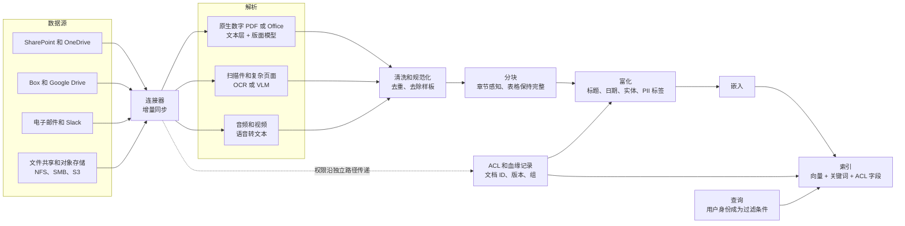
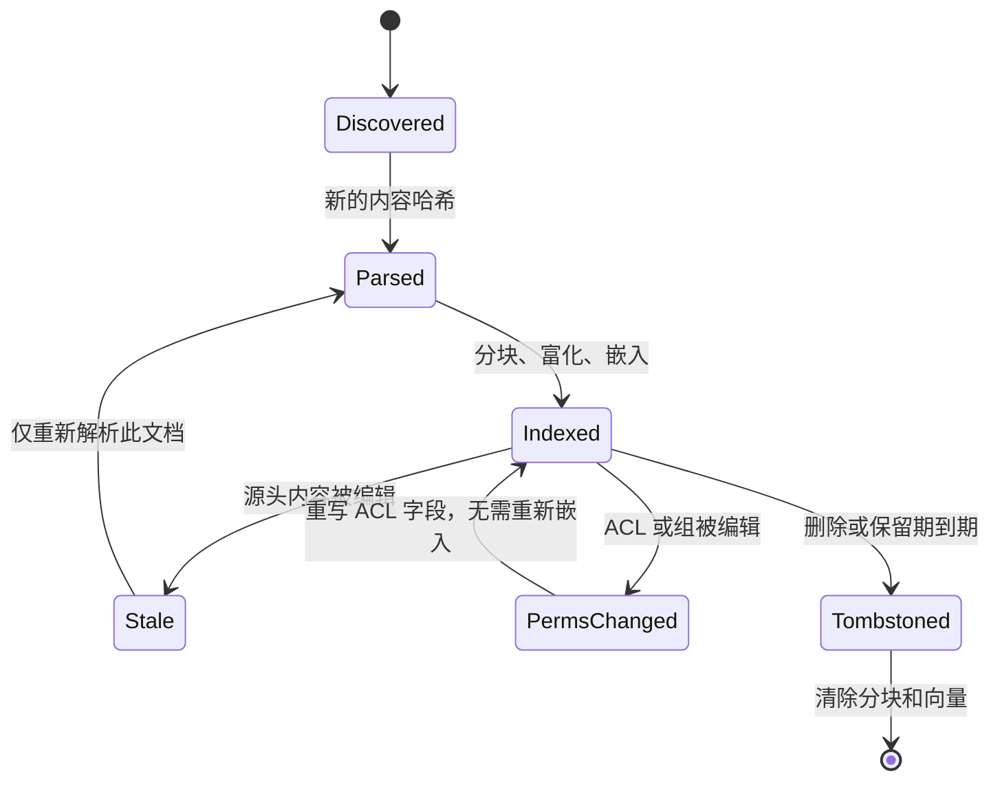
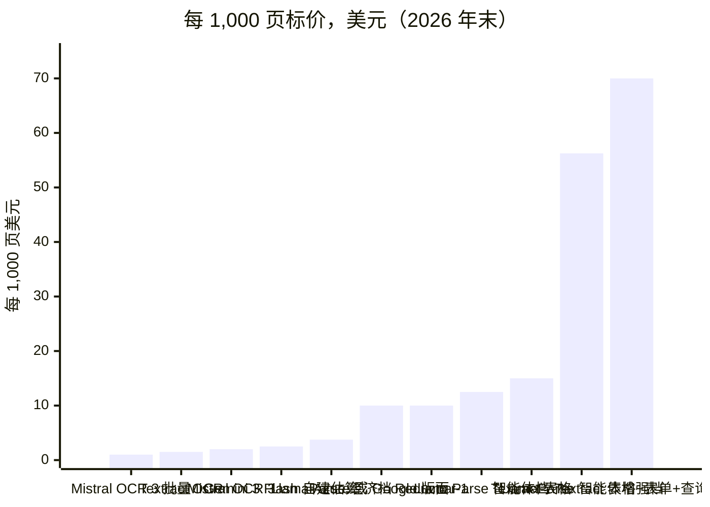
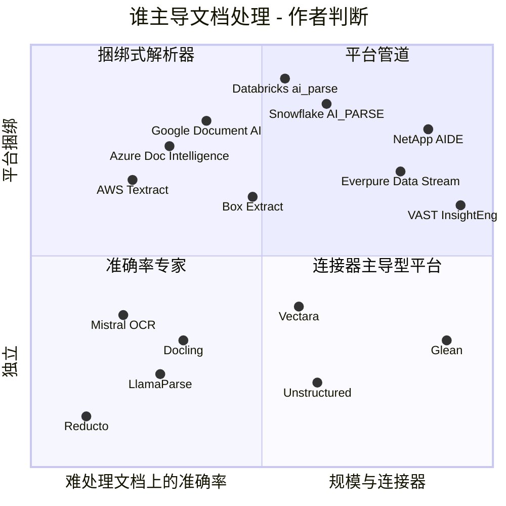
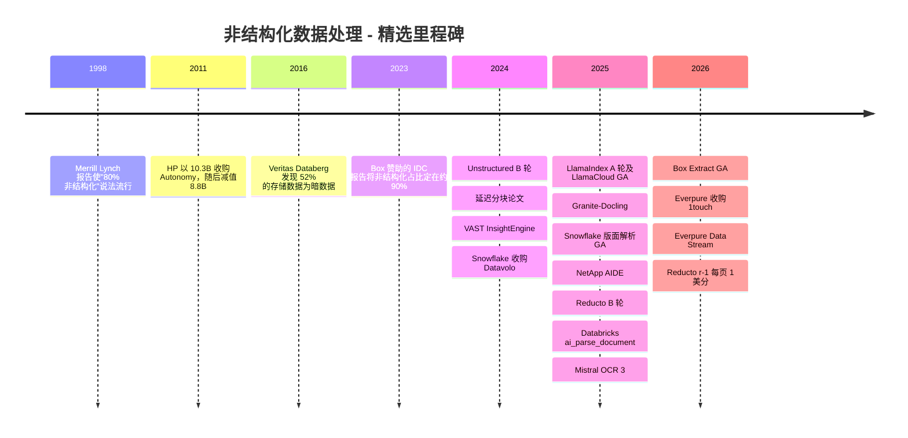

# 17. 非结构化数据处理
> **深度：** L2 · **阅读时间：** 约 14 分钟 · **最后核实：** 2026-11-01 · **前置阅读：** [第 16 章 — AI 数据生命周期](ch16-ai-data-lifecycle.md)

## 要点速览（TL;DR）

- 企业的大部分知识存在于合同、演示文稿、电子邮件、扫描件和录音之中，而不在表格里。常被引用的"80–90% 为非结构化数据"只是一条经验法则。它可追溯到 1998 年的一项说法，其现代版本是一份由 Box 赞助的 IDC 报告（2023 年 8 月），该报告将这一比例定在约 90%。[^idc-box][^grimes] 应将其视为方向正确、但测量基础薄弱的数字。
- 要把一个文件变成 AI 系统可检索的内容，需要一条七步数据管道（pipeline）：数据摄取（ingestion）、[解析](../glossary.md#document-parsing)、清洗、[分块](../glossary.md#chunking)、富化、[嵌入（向量）（embedding）](../glossary.md#embedding)和建立索引。解析和分块决定回答质量；建立索引已接近商品化。
- 解析已分化为三个层级。廉价 OCR 的成本约为每 1,000 页 $1–2；版面感知解析约为每 1,000 页 $10；由[视觉语言模型](../glossary.md#vision-language-model)驱动的智能体式（agentic）解析约为每 1,000 页 $10–60。以上均为截至 2026 年末的标价。[^textract][^gdocai][^mistral-ocr3][^llamaparse][^reducto-r1] 对典型语料库而言，所选方法比所选供应商更重要。
- 企业真正的难题不在解析，而在于 **[ACL 传播](../glossary.md#acl-propagation)**（即每个分块都携带源文件的权限）和 **[增量同步](../glossary.md#incremental-sync)**（即索引能追踪编辑、权限变更和删除，而无需重新处理全部内容）。Microsoft 自己发布的 Copilot 过度共享指南表明，当源头权限混乱时会出现什么问题。[^m365]
- 有四类参与者在争夺这一层：独立初创公司（Unstructured、LlamaIndex、Reducto）、超大规模云厂商的文档 AI API、将解析作为 SQL 函数提供的数据平台（Databricks `ai_parse_document`、Snowflake `AI_PARSE_DOCUMENT`），以及内容与存储平台（Box、Glean、NetApp AIDE、VAST、Everpure Data Stream）。存储厂商基于数据引力（data gravity）的论据最强，但在交付数据处理软件方面的记录最短。

## 为何重要（商业 + Everpure 视角）

结构化数据背后有五十年的工具积累：模式（schema）、SQL、数据仓库（data warehouse）和商业智能（BI）。非结构化数据则大多只有文件共享、搜索框和记录保留策略。实际上，它就是 **[暗数据](../glossary.md#dark-data)**。Veritas 在 2016 年对 2,550 名 IT 负责人开展的 Databerg 调查发现，受访者将 52% 的存储数据归为"暗"数据（即价值未知），另有 33% 被归为冗余、过时或无关紧要（ROT）。[^veritas] 唯一一次著名的大规模变现此类数据的尝试——HP 于 2011 年以 $10.3B 收购 Autonomy——最终以 $8.8B 的减值告终。[^hp-autonomy] 高管们由此学会把"释放你的非结构化数据"视为一个危险信号。

生成式 AI 改变了经济账。语言模型能读合同，但前提是有人先把 PDF 转换成结构正确的干净文本，切分成可检索的片段，并记住谁有权查看每个片段。这项准备工作如今已成为[检索增强生成（RAG）](../glossary.md#retrieval-augmented-generation)（[第 19 章](ch19-retrieval-architectures.md)）和智能体（agent）的瓶颈。每个主要平台都在进入这一领域。Snowflake 于 2024 年 11 月收购 Datavolo 以实现多模态数据摄取。[^datavolo] Databricks 于 2025 年将文档解析作为 SQL 函数推出。[^dbx-parse] Box 于 2026 年 1 月将元数据提取产品化。[^box-extract]

对 Everpure 而言，要点很简单。这些文件大多已经存放在文件存储和对象存储（object storage）上，其中很多在本地部署，因此处理层是存储厂商天然的相邻领域。Everpure 在 2026 年的举措符合这一解读：它完成了对 1touch 的收购（披露的现金对价为 $125M），用于数据发现和数据分类，[^everpure-1touch] 并推出了 **Data Stream**，借助 NVIDIA GPU 在 FlashBlade 上对数据进行向量化，并在流层级实施访问控制。[^everpure-ds] 悬而未决的问题是：存储厂商能可信地拥有管道中的哪些步骤，又应把哪些留给合作伙伴。

## 工作原理

### 第 1 步 — 数据摄取：连接器，而非副本

数据管道始于连接 SharePoint 和 OneDrive、Box、Google Drive、Confluence、电子邮件和 Slack 的[连接器](../glossary.md#connector)，以及 NFS/SMB 共享和 S3 存储桶。每个连接器有三项任务：拉取内容；拉取**元数据**，例如所有者、路径、修改时间和版本；拉取**权限**，即源系统的[访问控制列表](../glossary.md#access-control-list)、组成员关系和共享链接。第三项任务是团队最容易低估的。Glean 正是在这一层上建立起业务的，它将每个应用的身份和权限同步到自己的索引中，并在查询时将每条结果过滤为用户在源系统中可见的内容。[^glean-docs]

### 第 2 步 — 解析：从字节到结构化文本

解析将文件转化为有序文本加结构。方法取决于输入。

- **原生数字 PDF 和 Office 文件。** 这些文件本身已包含文本层，因此提取既便宜又精确。问题不在字符，而在结构。PDF 存储的是位于坐标上的字形，而不是段落。双栏版式、页眉、脚注和跨页表格都需要 **[版面分析](../glossary.md#layout-analysis)** 来恢复标题、表格单元格和 **[阅读顺序](../glossary.md#reading-order)**。
- **扫描件、传真和照片。** 这些需要[光学字符识别](../glossary.md#optical-character-recognition)（OCR）。OCR 是概率性的，会为每个单词返回置信度分数，数据管道可据此将低置信度页面路由给更强的模型或人工处理。
- **复杂页面。** 图表、嵌套表格、手写体和表单越来越多地交给**视觉语言模型（VLM）**处理，它读取渲染后的页面图像并直接输出 Markdown 或 JSON。IBM 开源的 Granite-Docling 用一个 258M 参数的模型实现了这一点（2025 年 9 月）。[^docling] Mistral OCR 3 以每 1,000 页 $2 的 API 提供这一能力。[^mistral-ocr3] Reducto 和 LlamaParse 会将每一页路由给能处理该页的最便宜模型。[^reducto-r1][^llamaparse]
- **音频和视频。** 语音转文本生成带说话人标签和时间戳的转录稿，时间戳所起的作用相当于文档中的页码。

VLM 解析有一种已知的失败模式。传统 OCR 引擎会把无法识别的字符弄成乱码；而生成式模型则可能写出一个看似合理、但页面上从未出现过的数字。因此，生产级数据管道会保留边界框、页面引用和置信度分数，使任何提取出的值都能追溯回像素。

> **类比：半导体。** 解析相当于晶圆厂的**晶圆 ID 读取**。当批次 ID 来自 MES 数据库时，它是精确的，就像原生数字文本层。当光学读取器必须识别被工艺过程磨损的激光刻印标记时，读取是概率性的，就像 OCR。晶圆厂通过置信度阈值、重复读取和操作员兜底来处理。版面分析对应自动光学检测，在那里，知道某个特征位于晶粒上的*哪个位置*与读出它同样重要。在这两种场景中，误读的代价都会在流程后段显现，而那时更难追溯。

### 第 3–4 步 — 清洗与分块

清洗会去除样板内容（每页重复出现的页眉、页脚、法律免责声明），对几乎相同的版本去重，并统一编码。随后，**分块**将文档切分为若干单元，每个单元都会得到一个嵌入向量，并争夺模型提示词中的一个位置。

基本权衡在于精确度与上下文。小分块与查询匹配得更精准，但会丢失周边事实：比如一个只写"供应商"却未点名的条款，或一个与表头分离的表格行。大分块保留上下文，但会稀释嵌入向量，并用无关文本填满提示词。**[分块重叠](../glossary.md#chunk-overlap)**通常为 10–20%（从业者惯例，并非标准），它以部分文本被存储和嵌入两次为代价，缓解边界问题。

> **类比：内存层级。** 选择分块大小就是选择**缓存行或块大小**。行太小，标签和元数据开销占主导，空间局部性丧失：每次访问只取回一个事实，而不带其相邻内容。行太大，每次未命中都会拖入程序从不使用的字节，缓存能容纳的有用行也更少。重叠的作用类似对相邻行的预取。按章节感知的分块就像把内存分配对齐到页边界，使一个逻辑对象不会横跨两行。

关于哪种策略更优，证据很少且依赖于语料库。NVIDIA 公布的测试发现，在其数据集上，按页分块的平均端到端准确率最高（0.648），基于 token 的切分在 0.603 到 0.645 之间。该测试集主要是分页报告，且 NVIDIA 并未进行完整的网格搜索。[^nvidia-chunk] Jina AI 于 2024 年 9 月提出的 **[延迟分块](../glossary.md#late-chunking)**颠倒了操作顺序：它先用长上下文模型对整篇文档做嵌入，再将 token 向量池化为分块向量，从而使代词保留其指代对象。[^late-chunk]

### 第 5 步 — 富化元数据，并携带 ACL

每个分块在嵌入之前都需要附加元数据：文档标题、章节路径、页码、日期、作者、提取出的实体（当事方、金额、产品名称）、一个[数据分类](../glossary.md#data-classification)标签，以及针对个人身份信息的 [PII](../glossary.md#personally-identifiable-information) 标签（[第 15 章](../02-pipelines-and-governance/ch15-governance-security-privacy.md)）。最重要的是，它需要**源 ACL 以及稳定的文档 ID 和版本**。查询时，检索器在排序*之前*按调用者身份过滤候选项，这就是[权限感知检索](../glossary.md#permission-aware-retrieval)。在生成之后再过滤就太晚了，因为模型已经读过受限文本。

*图 17.1 — 内容和权限从源头沿不同路径传递，并在索引中重新汇合。如果 ACL 路径断裂，RAG 系统仍能运行，但会泄露数据。*

> **类比：内存层级。** ACL 传播就像**让每条缓存行都携带安全属性**。安全世界位或内存标签必须跟随数据从 DRAM 进入 L3、L2 和 L1。如果某一级在复制缓存行时丢掉了标签，即使其他每一级都正确执行，隔离也会悄无声息地失效。分块索引就是又一级副本，而 ACL 就是它的标签。

### 第 6–7 步 — 嵌入和索引，然后保持更新

嵌入和索引在[第 18 章](ch18-embeddings-and-vector-search.md)中讨论。本章要讲的是**保持索引同步**。企业内容一直在变化：文件被编辑，文件夹被重新共享给新的组，员工离职，或文档依保留规则被删除。只追加新内容的数据管道最终会提供过时或已撤销权限的内容。好的数据管道会以不同方式处理四类事件，如图 17.2 所示。

*图 17.2 — 增量同步是针对每个文档的状态机。权限变更只应付出元数据更新的代价，而不是重新嵌入。删除必须触及每一个派生副本。*

有两件事让这变得困难。第一是**权限频繁变动**。组成员关系的变化频率远高于文档本身，而许多数据源（SharePoint 共享链接、嵌套组、继承的文件夹权限）无法低成本地回答"自时间 T 以来发生了什么变化"。第二是**删除时的扇出**。一份被删除的 PDF 可能已产生 70 个分块、70 个向量、一份摘要和若干缓存答案，而隐私监管机构也会把其中每一个副本视为该数据本身。为每个文档计算[内容哈希](../glossary.md#content-hash)，以及从文档到分块的数据血缘（[第 13 章](../02-pipelines-and-governance/ch13-data-quality-observability-lineage.md)），是最低限度的机制。Microsoft 针对 Microsoft 365 Copilot 的过度共享蓝图给出了一个实用警示：其第一步是在上线*之前*修复 SharePoint 权限并限制对过度共享站点的发现，因为助手会忠实地遵循它找到的任何 ACL。[^m365]

## 实例演算：一份 40 页的供货合同

以一份 40 页的原生数字 PDF 合同为例，其中包含六张定价表和一页扫描的签字页。以下假设为估算：密集法律文本每页约 550 词，每词约 1.33 个 token。

| 步骤 | 计算 | 结果（估算） |
|---|---|---|
| 文本量 | 40 页 × 约 550 词 × 约 1.33 token/词 | 约 29,000 token |
| 固定 512 token 分块，15% 重叠 | 29,000 ÷ (512 − 77) | 约 67 个分块，约 34,000 token 被嵌入 |
| 章节感知分块 | 约 30 个条款 + 6 张完整表格 + 1 页签字页 | 约 37 个分块，重复极少 |
| 解析成本，仅 OCR（Textract、Azure Read、Google OCR，每 1,000 页 $1.50） | 40 × $0.0015 | 约 $0.06 |
| 解析成本，版面模型（Azure Layout 或 Google Layout Parser，每 1,000 页 $10） | 40 × $0.010 | 约 $0.40 |
| 解析成本，Textract 表格 + 表单 + 查询（每 1,000 页 $70） | 40 × $0.070 | 约 $2.80 |
| 解析成本，Reducto r-1（约每页 1 美分） | 40 × $0.01 | 约 $0.40 |
| 嵌入（假设每百万 token $0.02） | 34,000 token | 远低于 $0.01 |

*图 17.3 — 对单份合同而言，解析只需几美分，嵌入成本更低。价格来自图 17.4 所引用的供应商标价；数量为作者估算。* [VERIFY: 嵌入标价假设]

给高管的启示来自规模放大。一个 1,000 万页的文档资产，OCR 成本约为 $7,000–15,000（取决于用量档位），版面解析约为 $100,000，若使用 LlamaParse 最高的智能体式档位则约为 $560,000（按标价估算）。此后每一次解析器或模型升级，都要将该成本乘以重新处理的次数。固定大小分块还带有一种不会出现在账单上的质量成本：六张定价表中至少有两张会被切分到不同分块中，因此像"第三年的单价是多少？"这样的问题，检索到的会是一行没有列标题的数据。

*图 17.4 — 标价跨度约达 70 倍。差距主要来自方法（纯 OCR、然后是版面、再到智能体式 VLM），而非供应商。资料来源：AWS、Google 和 Azure 定价页面；Mistral（2025 年 12 月）；Reducto（2026 年 9 月）；LlamaParse 积分按媒体报道的每 1,000 积分 $1.25 计算。Gemini 数字为作者估算（每页 258 个输入 token 和约 750 个输出 token，按聚合网站报道的标价计算）。*[^textract][^gdocai][^azure-di][^mistral-ocr3][^reducto-r1][^llamaparse][^gemini-doc][^gemini-price]

| 方法 | 每 1,000 页美元 | 依据 | 来源 / 日期 |
|---|---|---|---|
| Mistral OCR 3，批量 API | $1 | 供应商标价 | Mistral，2025-12[^mistral-ocr3] |
| AWS Textract DetectDocumentText（OCR） | $1.50（每月前 1M 页），超出部分 $0.60 | 供应商标价 | AWS 定价[^textract] |
| Google Enterprise Document OCR | $1.50（1k–5M 页），超出部分 $0.60 | 供应商标价 | Google 定价[^gdocai] |
| Azure Document Intelligence Read | $1.50 | 第三方报道的标价 | Azure 定价 / Microsoft Q&A[^azure-di] |
| Mistral OCR 3，标准 API | $2 | 供应商标价 | Mistral，2025-12[^mistral-ocr3] |
| 使用 Gemini 3 Flash 自建 VLM 解析 | 约 $2.5 | 估算 | Google 文档；聚合网站定价[^gemini-doc][^gemini-price] |
| LlamaParse 经济档 / 智能体档 / 智能体增强档 | $3.75 / $12.50 / $56.25 | 每页 3 / 10 / 45 积分 × 每 1,000 积分 $1.25（媒体报道） | LlamaIndex 文档；usagepricing 追踪网站，2026-08[^llamaparse] |
| Azure Layout；Google Layout Parser | $10 | 供应商标价 | Azure、Google 定价[^azure-di][^gdocai] |
| Reducto r-1 | 约 $10（"每页 1 美分，全包"） | 公司披露 | Reducto，2026-09[^reducto-r1] |
| AWS Textract AnalyzeDocument 表格 / 表格 + 表单 + 查询 | $15 / $70 | 供应商标价（美国西部） | AWS 定价[^textract] |
| Databricks `ai_parse_document` | 非统一费率；随页面复杂度变化 | 公司披露"成本比竞争对手低 3–5 倍" | Databricks 博客，2025-11[^dbx-parse] |
| Snowflake `AI_PARSE_DOCUMENT` | 按模式计算每 1,000 页的 AI 积分 | 公司披露的方法；费率见消耗表 | Snowflake 文档[^sf-parse] |

*图 17.5 — 按方法划分的每 1,000 页成本。数据平台函数以平台积分计费，这使直接比较变得困难。应要求按客户自身的文档组合给出每 1,000 页的实际价格。*

## 设计选择与权衡

| 策略 | 切分方式 | 检索精确度 | 上下文保留 | 成本 / 复杂度 | 最适用于 | 主要失败模式 |
|---|---|---|---|---|---|---|
| [固定大小](../glossary.md#fixed-size-chunking) | 每 N 个 token 一切，带重叠 | 中 | 低 | 最低；无需解析 | 同质化文本、快速原型 | 在表格和条款中途切断 |
| [递归](../glossary.md#recursive-chunking) | 依次按段落、句子、单词分隔符切分，直到小于 N | 中高 | 中 | 低 | 一般文档，事实上的默认选项 | 忽视表格、分栏等视觉结构 |
| [语义](../glossary.md#semantic-chunking) | 在句子间嵌入相似度下降处断开 | 主题转换处高 | 中 | 中；需嵌入每个句子 | 转录稿、长篇叙述文本 | 分块大小不稳定；对结构良好的文档收益很小 |
| [章节感知](../glossary.md#section-aware-chunking)（版面） | 遵循解析器给出的标题、页面和表格 | 高 | 高 | 中高；需要好的版面解析器 | 合同、监管文件、手册、演示文稿 | 效果取决于解析质量；长章节需再细分 |
| 按页 | 每页一个分块 | 中高 | 中高 | 解析后成本低 | 分页报告、演示文稿 | 正文中任意的分页断点 |
| [延迟分块](../glossary.md#late-chunking) | 先嵌入全文，再池化为分块 | 在交叉引用重要时高 | 最高 | 较高；需要长上下文嵌入模型 | 代词和定义术语密集的文档 | 受限于嵌入模型的上下文窗口 |
| 父子分块（小到大） | 检索小分块，返回其所属章节 | 高 | 高 | 中；两级索引 | 长篇技术文档问答 | 提示词更大，每次查询的 LLM 成本更高 |

*图 17.6 — 没有哪种分块策略占绝对优势。当解析器能恢复结构时，章节感知分块胜出。固定大小分块之所以存续，是因为它便宜且无需解析器。资料来源：NVIDIA 分块基准测试；Jina 延迟分块论文；作者综合。*[^nvidia-chunk][^late-chunk]

为简单方法辩护的最强版本论证（steelman）是成立的。如果文档短小且格式良好，递归切分加适度重叠再配合重排序器（[第 19 章](ch19-retrieval-architectures.md)），就能获得大部分收益。上游更好的检索也能弥补平庸的分块器。复杂解析的理由在出错代价高昂的场景中最充分：财务表格、受监管文档和合同，在这些场景中一个误读的数字就是一起合规事件。

第二个权衡是**解析在哪里运行**。Databricks 或 Snowflake 内的 SQL 函数可将数据治理（governance）保持在同一个目录中，并按现有承诺消费额度计费，但它要求文件先暂存到该平台可读取的位置。独立 API 通常在难处理页面上的准确率领先，并支持任意目标，但它会增加一家供应商、一份数据处理协议和又一份数据副本。在存储层处理则完全避免了数据移动，但买方只能接受存储厂商选择嵌入的那个解析器。

## 主要参与者

| 供应商 / 项目 | 类型 | 解析方式 | 连接器与 ACL | 商业要点 |
|---|---|---|---|---|
| Unstructured | 开源库 + 托管平台 | 使用高分辨率版面模型和 VLM 选项进行分区 | 大量源端和目标端连接器 | $40M B 轮（2024 年 3 月）；累计融资约 $65M（媒体报道）[^unstructured-b] |
| LlamaIndex（LlamaParse、LlamaCloud） | 框架 + 解析/索引服务 | 分档：快速、经济、智能体、智能体增强 | LlamaCloud 数据源 | $19M A 轮（2025 年 3 月，Norwest）；累计 $27.5M[^llamaindex-a] |
| Reducto | 独立 API | 版面模型加 VLM 校正；r-1 模型 | API 优先；连接器较少 | $75M B 轮（2025 年 10 月，a16z）；累计约 $108M[^reducto-b] |
| Docling（IBM） | 开源 | 版面和表格模型；Granite-Docling 258M VLM | 无（库） | Apache 2.0；可免费自托管[^docling] |
| Mistral OCR 3 | 模型 API | 端到端 VLM OCR，输出 Markdown 或 JSON | 无 | 每 1,000 页 $2；批量 $1[^mistral-ocr3] |
| AWS Textract / Azure Document Intelligence / Google Document AI | 超大规模云厂商 API | OCR、版面、表单、表格、自定义提取器 | 云存储触发器 | 按功能每 1,000 页 $1.50–$70[^textract][^azure-di][^gdocai] |
| Databricks `ai_parse_document` / Agent Bricks | 数据平台 SQL 函数 | 自研文档智能模型 | Unity Catalog 卷及治理 | Beta / 公开预览；"成本低 3–5 倍"（公司披露）[^dbx-parse] |
| Snowflake `AI_PARSE_DOCUMENT` / AI Functions；Openflow | 数据平台 SQL 函数 + 数据摄取 | OCR 和 LAYOUT 模式；每个文件最多 2,000 页 | Stage；Openflow（源自 Datavolo）连接器 | LAYOUT 模式于 2025 年 8 月 GA[^sf-parse][^datavolo] |
| Box（Box AI、Box Extract） | 内容平台 | 用前沿模型提取到元数据模板 | 原生 Box 权限 | Box Extract 于 2026 年 1 月 GA[^box-extract] |
| Glean | 企业搜索 / 工作 AI | 为自身索引解析已连接内容 | 100+ 连接器，权限感知 | 2025 年 2 月 ARR 达 $100M（公司披露）；$150M F 轮，估值 $7.2B（2025 年 6 月，媒体报道）[^glean-arr][^glean-f] |
| Vectara | RAG 即服务 | 内置数据摄取和解析 | 平台连接器 | $25M A 轮（2024 年 7 月）；累计 $53.5M[^vectara] |
| NetApp AIDE / VAST InsightEngine / Everpure Data Stream | 嵌入存储的数据管道 | 在存储层借助 NVIDIA GPU 和软件进行嵌入（NIM；NetApp 和 Everpure 采用 AI Data Platform 设计） | 继承文件系统和对象权限（厂商声称） | 分别于 2025 年 10 月、2024 年 10 月和 2026 年 6 月发布[^netapp-aide][^vast][^everpure-ds] |

*图 17.7 — 解析器市场至少有十二个可信选项。差异化正从原始 OCR 准确率转向连接器、权限以及难处理页面的成本。*

*图 17.8 — 初创公司位于左下方，以难处理文档上的准确率见长。数据平台和存储平台位于右上方，以捆绑和规模见长。位置为作者基于公开产品描述的判断，而非基于基准测试。*

定位简述：

- **独立初创公司**在难处理页面的评估中胜出，且行动最快。它们的风险是来自下方的商品化：Mistral 将批量价格降至每 1,000 页 $1，而 Docling 是免费的。它们还面临来自上方的捆绑。
- **超大规模云厂商 API** 是各自云内的默认选项，并按功能定价。它们在杂乱表格上很少是最准确的，但采购流程早已就绪。
- **数据平台**把解析变成其自有目录下的又一个 SQL 函数。对已暂存在湖仓中的文件而言，这是强势地位；对 SharePoint 资产而言，则是弱势地位。
- **内容与存储平台**掌握着文件和权限。Box 和 Glean 已在执行源 ACL。NetApp、VAST 和 Everpure 押注的是：在数据所在之处处理数据，胜过把数据复制到云端解析器。

初创公司的看多逻辑是：难处理文档正是价值所在，而准确率会在下游每一步中产生复利效应。看空逻辑是：一次模型升级（例如一个更好的 VLM）就可能抹去一年的数据管道工程投入，而买方会接受数据平台提供的"够用且已受治理"的方案。公司层面的细节见[第 32 章](../04-company-deep-dives/ch32-ai-native-data-companies.md)。

## 历史与发展轨迹

*图 17.9 — 三十年的"暗数据"讨论，在语言模型成为干净文本的消费者之后，约 24 个月内就变成了一个产品类别。*

80% 这一数字有一段尴尬的历史。Seth Grimes 在 2008 年将其追溯到 Shilakes 和 Tylman 于 1998 年撰写的一份 Merrill Lynch 报告，并发现背后没有任何原始测量。AIIM 的 John Mancini 曾寻找一份更早的 Coopers & Lybrand 来源，但未能找到副本。[^grimes][^cmswire] 2023 年的 IDC 报告将该数字重新表述为约 90%，但它由 Box 出资，因此应作为赞助研究引用。[^idc-box] 一种站得住脚的说法是：按体量计，*大部分*企业内容是非结构化的，但没有人精确测量过这一比例。

2024 年以来的发展轨迹有三条主线。第一，**解析从 OCR 引擎转向 VLM**，难处理文档的每页价格下降。Reducto 称其旧的智能体式模型每页成本为 3–6 美分，而 r-1 为 1 美分。[^reducto-r1] 第二，**数据平台吸收了解析**。Snowflake 的版面解析于 2025 年 8 月 GA，其页数上限于 2026 年 4 月提高到每个文件 2,000 页；Databricks 则在 2025 年末将解析加入 Agent Bricks。[^sf-parse][^dbx-parse] 第三，**存储厂商向数据管道靠拢**：先是 VAST InsightEngine（2024 年 10 月，基于 NVIDIA NIM 微服务构建），随后是 NetApp AIDE（2025 年 10 月）和 Everpure Data Stream（2026 年 6 月），后两者都引用了 NVIDIA 于 2025 年 3 月（InsightEngine 发布之后）公布的 AI Data Platform 参考设计。[^vast][^netapp-aide][^everpure-ds] 未来两年，预计权限感知索引将成为标准配置项，而且除最难处理的页面外，解析价格将逼近 OCR 价格。

## 关键数字

| 指标 | 数值 | 依据 | 来源 / 日期 |
|---|---|---|---|
| 非结构化数据占企业数据的比例 | 约 90% | 厂商赞助的分析师估算（IDC 为 Box 撰写） | IDC #US51128223，2023-08[^idc-box] |
| 存储数据中"暗"数据占比 | 52%（另有 33% ROT） | 对 2,550 名 IT 负责人的调查 | Veritas，2016-03-15[^veritas] |
| 超大规模云厂商 OCR 标价 | 每 1,000 页 $1.50 | 供应商标价 | AWS、Google、Azure 定价[^textract][^gdocai][^azure-di] |
| 版面解析标价 | 每 1,000 页 $10 | 供应商标价 | Azure、Google 定价[^azure-di][^gdocai] |
| Mistral OCR 3 | 每 1,000 页 $2（批量 $1） | 供应商标价 | Mistral，2025-12[^mistral-ocr3] |
| Reducto r-1 | 约每页 1 美分（此前智能体式为 3–6 美分） | 公司披露 | Reducto，2026-09[^reducto-r1] |
| Gemini 每页 PDF 的 token 数 | 约 258（纯文本平均值） | 供应商文档 | Google AI 文档[^gemini-doc] |
| Snowflake `AI_PARSE_DOCUMENT` 页数上限 | 每个文件 2,000 页 | 供应商文档 | Snowflake，2026-04-30[^sf-parse] |
| NVIDIA 分块测试中的最佳平均准确率 | 0.648（按页） | 供应商基准测试 | NVIDIA[^nvidia-chunk] |
| Reducto 累计融资 | 约 $108M | 公司披露 | PR Newswire，2025-10-14[^reducto-b] |
| Everpure–1touch 对价 | $125M 现金 | GAAP 披露（10-Q） | Everpure 10-Q，2026-06[^everpure-1touch] |

*图 17.10 — 需要记住的数字：约 90%（赞助研究）；OCR 与版面解析分别为每 1,000 页 $1.50 与 $10；智能体式前沿方案为每页 1 美分。*

## 存储桥接

> **存储桥接。** 非结构化数据处理会读取并重写整个文件资产：解析期间有数以百万计的小读取，派生分块和向量会产生写入突发，变更检测则以元数据为主。能够流式推送变更通知、并将权限作为可查询元数据暴露出来的存储，会让增量同步和 ACL 传播便宜得多。对 Everpure 而言，Data Intelligence（源自 1touch）提供数据发现、数据分类和上下文，Data Stream 提供带流级访问控制的向量化。[^everpure-1touch][^everpure-ds] 基于公开信息，战略团队可能评估的选项包括：在 Data Stream 背后嵌入 Docling 或 Unstructured 等开源解析器；与准确率专家合作处理难处理页面；让存储阵列成为 Databricks、Snowflake 和 Glean 连接器所使用的文档 ID、版本和 ACL 的权威来源；或上述方案的组合。FlashBlade 和协议细节参见配套的 *Everpure Tech Atlas*，战略框架参见[第 45 章](../06-history-and-future/ch45-storage-moving-up-the-stack.md)。

## 对话手册

**向产品经理提问**

1. "您客户的文档中有多大比例是扫描件、表格密集型文档或演示文稿？按他们的真实文档组合，每一档每 1,000 页收费多少？"
2. "当 SharePoint 的组成员关系发生变化时，搜索和 RAG 结果需要多久才能反映出来？合同中是否对此有保证？"
3. "哪些连接器是你们自建的，哪些是授权使用或依赖合作伙伴的？"

**向工程师提问**

1. "你们是在向量排序之前还是之后按 ACL 过滤？如何处理嵌套组和匿名共享链接？"
2. "当一份文档被删除时，你们如何找到并清除由它派生的每个分块、向量和缓存答案？"
3. "你们如何检测解析后表格中的 VLM 幻觉？是否为每个提取值保留边界框？"

**好的回答是什么样的。** 它们会给出实测的权限传播延迟（"组变更在 15 分钟内到达索引，删除在一个同步周期内完成"）。它们会描述分层路由（"90% 的页面走廉价 OCR，只有被标记的页面才交给 VLM"）。它们会把权限更新的成本与重新嵌入的成本区分开。它们能展示从任一分块回溯到文档版本和页面的数据血缘。

**不要这样说**

- "根据 IDC，80–90% 的数据是非结构化的。"现代数字来自赞助研究，而最初的说法没有原始测量。应说"按大多数估算，占大部分"。
- "OCR 是已解决的问题。"字符识别基本已解决，但表格、阅读顺序和无幻觉提取并未解决。
- "向量数据库会处理安全问题。"它只会按数据管道写入的 ACL 字段过滤。如果传播出错，过滤就会出错。
- "分块越大越安全。"大分块浪费提示词预算并模糊嵌入向量。分块大小应遵循文档结构。
- "解析一次就完事了。"模型升级、权限变动和删除让这成为一条持续运行的数据管道。

## 深入阅读

- Günther 等，*Late Chunking*（arXiv 2409.04701），关于上下文化的分块嵌入。[^late-chunk]
- Docling 技术报告和 Granite-Docling 模型卡，关于开源的版面与 VLM 解析技术栈。[^docling]
- Microsoft 的 Copilot 过度共享蓝图，关于实用的权限整改步骤。[^m365]
- Snowflake `AI_PARSE_DOCUMENT` 和 Databricks `ai_parse_document` 的供应商文档，关于 SQL 函数模式。[^sf-parse][^dbx-parse]

## 关键术语

- [非结构化数据](../glossary.md#unstructured-data) — 没有预定义模式的内容，例如文档、电子邮件、图像、音频和视频。
- [暗数据](../glossary.md#dark-data) — 组织不了解其内容和价值的已存储数据。
- [文档解析](../glossary.md#document-parsing) — 将文件转换为有序文本加结构（如标题、表格和页面）。
- [光学字符识别](../glossary.md#optical-character-recognition) — 将文字图像转换为机器可读字符，并为每个单词给出置信度分数。
- [版面分析](../glossary.md#layout-analysis) — 检测页面中的区域（标题、段落、表格、图）及其相互关系。
- [阅读顺序](../glossary.md#reading-order) — 人类阅读页面上各文本块的先后顺序。
- [视觉语言模型](../glossary.md#vision-language-model) — 以图像和文本为输入的模型，用于直接解析页面图像。
- [分块](../glossary.md#chunking) — 将文档切分为可检索单元以便嵌入。
- [分块重叠](../glossary.md#chunk-overlap) — 在相邻分块边界处重复的文本，以免丢失上下文。
- [固定大小分块](../glossary.md#fixed-size-chunking) — 不论结构，每 N 个 token 切分一次。
- [递归分块](../glossary.md#recursive-chunking) — 使用逐级变细的分隔符切分，直到分块满足大小限制。
- [语义分块](../glossary.md#semantic-chunking) — 在相邻句子的嵌入向量出现分歧处切分。
- [章节感知分块](../glossary.md#section-aware-chunking) — 沿版面解析器恢复出的标题、页面和表格进行切分。
- [延迟分块](../glossary.md#late-chunking) — 先对整篇文档做嵌入，再将 token 向量池化为分块向量。
- [访问控制列表](../glossary.md#access-control-list) — 被允许访问某一资源的用户和组的列表。
- [ACL 传播](../glossary.md#acl-propagation) — 将源文档的权限携带到每一个派生分块和向量上。
- [权限感知检索](../glossary.md#permission-aware-retrieval) — 在排序前按调用者身份过滤检索候选项。
- [增量同步](../glossary.md#incremental-sync) — 只用自上次运行以来源端发生变化的内容更新目标。
- [内容哈希](../glossary.md#content-hash) — 文件字节的指纹，用于检测变更和重复。
- [个人身份信息](../glossary.md#personally-identifiable-information) — 能够识别个人身份的数据（PII）。
- [数据分类](../glossary.md#data-classification) — 按敏感度或类型给数据打标签，以驱动策略。
- [连接器](../glossary.md#connector) — 从特定源系统提取数据和元数据的组件。
- [嵌入（向量）](../glossary.md#embedding) — 表示语义的数值向量，用于相似度检索。
- [检索增强生成](../glossary.md#retrieval-augmented-generation) — 在查询时将检索到的内容加入模型提示词。

## 资料来源

[^idc-box]: IDC (sponsored by Box), "Untapped Value: What Every Executive Needs to Know About Unstructured Data," IDC doc #US51128223, https://bitpipe.computerweekly.com/resource/1706846435_778 及 Box 落地页 https://www.boxenterprise.net/fr-fr/resources/unstructured-data-paper，发布 2023-08；检索 2026-11-01。厂商赞助；方法论未经审阅（页面未抓取）。
[^grimes]: Wikipedia, "Unstructured data"（引用 C. Shilakes and J. Tylman, "Enterprise Information Portals," Merrill Lynch, 1998-11-16，以及 S. Grimes, "Unstructured Data and the 80 Percent Rule," Clarabridge Bridgepoints, 2008-08-01），https://en.wikipedia.org/wiki/Unstructured_data，持续更新文档；检索 2026-11-01。
[^cmswire]: J. Mancini, "Deconstructing a Content Management Urban Legend," CMSWire, https://www.cmswire.com/information-management/deconstructing-a-content-management-urban-legend，无日期 [VERIFY: 发布日期]；检索 2026-11-01。
[^veritas]: Veritas Technologies, "Veritas Global Databerg Report Finds 85% of Stored Data Is Either Dark or Redundant, Obsolete, or Trivial (ROT)," 新闻稿，https://www.veritas.com/news-releases/2016-03-15-veritas-global-databerg-report-finds-85-percent-of-stored-data，发布 2016-03-15；检索 2026-11-01。
[^hp-autonomy]: The Register, "HP buys Autonomy," https://www.theregister.com/2011/10/04/hp_buys_autonomy/，发布 2011-10-04；检索 2026-11-01。交易价值 $10.3B（媒体报道）和 $8.8B 减值（2012 年 11 月），记录于 `data/ma_deals.csv`。
[^datavolo]: Snowflake, "Snowflake Agrees to Acquire Open Data Integration Platform Datavolo," 新闻稿，https://www.snowflake.com/news/snowflake-agrees-to-acquire-open-data-integration-platform-datavolo/，发布 2024-11-20；检索 2026-11-01。交易条款未披露；后成为 Snowflake Openflow（据 `data/ma_deals.csv`）。
[^dbx-parse]: Databricks, "From PDFs to Production: Announcing State-of-the-Art Document Intelligence on Databricks," 博客，https://www.databricks.com/blog/pdfs-production-announcing-state-art-document-intelligence-databricks-article，发布 2025-11 [VERIFY: 具体日期]；以及 "ai_parse_document function"（Beta），https://docs.databricks.com/aws/sql/language-manual/functions/ai_parse_document，持续更新文档；检索 2026-11-01。成本比较为公司披露。
[^sf-parse]: Snowflake documentation, "AI Parse Document layout mode (General availability)," https://docs.snowflake.com/release-notes/2025/other/2025-08-21-aisql-ai-parse-document-layout-ga，发布 2025-08-21；"AI_PARSE_DOCUMENT increased page limit to 2,000 pages," https://docs.snowflake.com/release-notes/2026/other/2026-04-30-ai-parse-document-2000-pages，发布 2026-04-30；"Migrate legacy SNOWFLAKE.CORTEX functions to AI Functions," https://docs.snowflake.com/en/user-guide/snowflake-cortex/aisql-migrate-legacy-functions；"Snowflake AI pricing," https://docs.snowflake.com/en/user-guide/snowflake-cortex/pricing；检索 2026-11-01。
[^box-extract]: Box, Inc., "Box Announces General Availability of Box Extract," Business Wire, https://www.businesswire.com/news/home/20260115566865/en，发布 2026-01-15；以及 TechTarget, "Box releases Box Extract, its AI metadata agent," https://www.techtarget.com/searchContentManagement/news/366637320/Box-releases-Box-Extract-its-AI-metadata-agent，2026-01；检索 2026-11-01。
[^everpure-1touch]: Everpure, Inc., Form 10-Q（截至 2026-05-03 的季度），https://www.sec.gov/Archives/edgar/data/0001474432/000147443226000061/pstg-20260503.htm，提交于 2026-06；检索 2026-11-01。披露的现金对价为 $125.0M；于 2026-05-07 完成交割（据 `data/ma_deals.csv`）。
[^everpure-ds]: Everpure via PR Newswire, "Everpure Unveils Data-Primacy Architecture for the AI Era," https://www.prnewswire.com/news-releases/everpure-unveils-data-primacy-architecture-for-the-ai-era-302803097.html，发布 2026-06-17；Computer Weekly, "Everpure aims to bridge AI data gap with Universal Data Intelligence," https://www.computerweekly.com/news/366644438/Everpure-aims-to-bridge-AI-data-gap-with-Universal-Data-Intelligence，2026-06；Techzine, "Stop vectorizing garbage: inside Everpure's smart AI data pipeline," https://www.techzine.eu/blogs/infrastructure/144105/stop-vectorizing-garbage-inside-everpures-smart-ai-data-pipeline/，2026-06；检索 2026-11-01（经由 `meta/research-briefing.md`）。
[^glean-docs]: Glean, "Connectors power Glean"（权限感知索引），https://docs.glean.com/connectors/connectors-power-glean，持续更新文档；检索 2026-11-01。
[^glean-arr]: Glean, "Glean Achieves $100M ARR in Three Years Delivering True AI ROI to the Enterprise," Business Wire, https://www.businesswire.com/news/home/20250205543527/en/，发布 2025-02-05；检索 2026-11-01。ARR 为公司披露。此后的数字（2025 年 12 月 $200M；2026 年 5 月约 $300M）由 Sacra 等二手来源报道（https://sacra.com/c/glean）[VERIFY: 2025 年后 ARR 的一手来源]。
[^glean-f]: `data/private_funding.csv`（Glean F 轮，2025-06-10，$150M，投后估值 $7.2B，媒体报道，领投方 Wellington Management），来源 https://en.wikipedia.org/wiki/Glean_Technologies；检索 2026-11-01。
[^m365]: Microsoft Learn, "Microsoft 365 Copilot deployment blueprint: address oversharing," https://learn.microsoft.com/en-us/copilot/microsoft-365/microsoft-365-copilot-blueprint-oversharing，持续更新文档；检索 2026-11-01。
[^textract]: AWS, "Amazon Textract pricing," https://aws.amazon.com/textract/pricing/，持续更新文档；以及 AWS News Blog, "Amazon Textract updates: up to 32% price reduction in 8 AWS Regions…," https://aws.amazon.com/blogs/aws/amazon-textract-updates-up-to-32-price-reduction-in-8-aws-regions-and-up-to-50-reduction-in-asynchronous-job-processing-times，发布 2021-08；检索 2026-11-01。费率因区域而异。
[^azure-di]: Microsoft, "Azure AI Document Intelligence pricing," https://azure.microsoft.com/pricing/details/ai-document-intelligence/，持续更新文档（搜索结果中未显示美元费率；Read 每 1,000 页 $1.50 和 Layout 每 1,000 页 $10 经 Microsoft Q&A https://learn.microsoft.com/en-us/answers/a/12439288 及第三方表格确认）；检索 2026-11-01。[VERIFY: 官方页面上当前的美元标价]
[^gdocai]: Google Cloud, "Document AI pricing," https://cloud.google.com/document-ai/pricing，持续更新文档；检索 2026-11-01。
[^mistral-ocr3]: Mistral AI, "Mistral OCR 3," https://mistral.ai/news/mistral-ocr-3，发布 2025-12 [VERIFY: 具体日期]；InfoQ 报道，https://www.infoq.com/news/2026/01/mistral-ocr3，2026-01；检索 2026-11-01。
[^llamaparse]: LlamaIndex, "LlamaParse pricing," https://developers.llamaindex.ai/llamaparse/general/pricing/，持续更新文档（各档为每页 1/3/10/45 积分）；积分价格每 1,000 积分 $1.25，据 usagepricing.com 追踪网站 https://usagepricing.com/blueprint/llamaindex，2026-08；检索 2026-11-01。[VERIFY: 官方页面上的积分价格]
[^reducto-r1]: Reducto, "Introducing r-1"（parse r-1 模型及自 2026-09-01 起生效的定价变更），https://reducto.ai/blog/parse-r-1-model，发布 2026-09 [VERIFY: 具体日期]；旧版积分用量，https://docs.reducto.ai/reference/legacy-credit-usage.md；检索 2026-11-01。公司披露。
[^reducto-b]: Reducto, "Reducto Raises $75M Series B to Define the Future of AI Document Intelligence," PR Newswire, https://www.prnewswire.com/news-releases/reducto-raises-75m-series-b-to-define-the-future-of-ai-document-intelligence-302581462.html，发布 2025-10-14；检索 2026-11-01（据 `data/private_funding.csv`）。
[^unstructured-b]: Pillsbury Winthrop Shaw Pittman, "Menlo Ventures' $40M Series B Funding of Unstructured," https://pillsburylaw.com/en/news-and-insights/menlo-ventures-40m-series-b-funding-unstructured.html，2024-03；Pulse 2.0, https://pulse2.com/unstructured-llm-data-preprocessing-solutions-provider-raises-40-million，2024-03；检索 2026-11-01。该轮融资据 `data/private_funding.csv`；累计 $65M 为媒体报道。
[^llamaindex-a]: LlamaIndex, "Announcing our Series A and LlamaCloud General Availability," https://www.llamaindex.ai/blog/announcing-our-series-a-and-llamacloud-general-availability，发布 2025-03-04；TechCrunch, https://techcrunch.com/2025/03/04/llamaindex-launches-a-cloud-service-for-building-unstructed-data-agents，2025-03-04；检索 2026-11-01。
[^docling]: IBM, "Granite-Docling: End-to-end document understanding with one tiny model," https://ibm.com/new/announcements/granite-docling-end-to-end-document-conversion，发布 2025-09-17；检索 2026-11-01。[VERIFY: Docling 捐赠给 Linux Foundation 的日期及所属基金会]
[^vectara]: Vectara, "Vectara Secures $25 Million Series A Funding…," Business Wire, https://www.businesswire.com/news/home/20240716489550/en/，发布 2024-07-16；检索 2026-11-01。
[^netapp-aide]: Blocks & Files, "NetApp disaggregates ONTAP storage and provides an AI Data Engine," https://blocksandfiles.com/2025/10/14/netapp-disaggregates-ontap-storage-and-provides-an-ai-data-engine/，发布 2025-10-14；TechTarget, https://www.techtarget.com/searchstorage/news/366632757/NetApp-adds-AI-Data-Engine-expands-Nvidia-partnership，2025-10；检索 2026-11-01。
[^vast]: VAST Data, "VAST Data Unveils VAST InsightEngine with NVIDIA," 新闻稿，https://www.vastdata.com/press-releases/vast-data-unveils-vast-insightengine-with-nvidia，发布 2024-10-01；检索 2026-11-01。"每个元素携带 ACL"的说法为厂商声称。
[^late-chunk]: M. Günther, I. Mohr, D. J. Williams, B. Wang, H. Xiao, "Late Chunking: Contextual Chunk Embeddings Using Long-Context Embedding Models," arXiv:2409.04701, https://arxiv.org/abs/2409.04701，v1 发布 2024-09；检索 2026-11-01。
[^nvidia-chunk]: NVIDIA Technical Blog, "Finding the Best Chunking Strategy for Accurate AI Responses," https://developer.nvidia.com/blog/finding-the-best-chunking-strategy-for-accurate-ai-responses/，发布 2025 [VERIFY: 日期]；检索 2026-11-01。供应商基准测试；并非完整网格搜索。
[^gemini-doc]: Google AI for Developers, "Document understanding"（PDF 页面按图像进行 token 化，每页约 258 个 token，最多 1,000 页），https://ai.google.dev/gemini-api/docs/document-processing，持续更新文档；检索 2026-11-01。
[^gemini-price]: Morph, "Gemini API Pricing (2026)," https://www.morphllm.com/gemini-api-pricing，2026-09（Gemini 3 Flash 每 1M 输入 / 输出 token 为 $0.50 / $3.00），聚合网站，引用 https://ai.google.dev/gemini-api/docs/pricing；检索 2026-11-01。[VERIFY: Gemini 3 Flash 官方标价]
