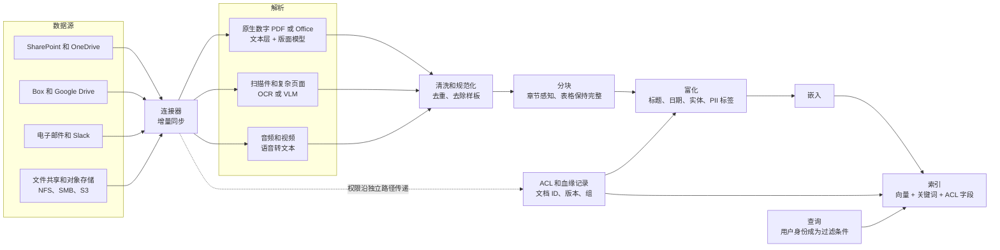
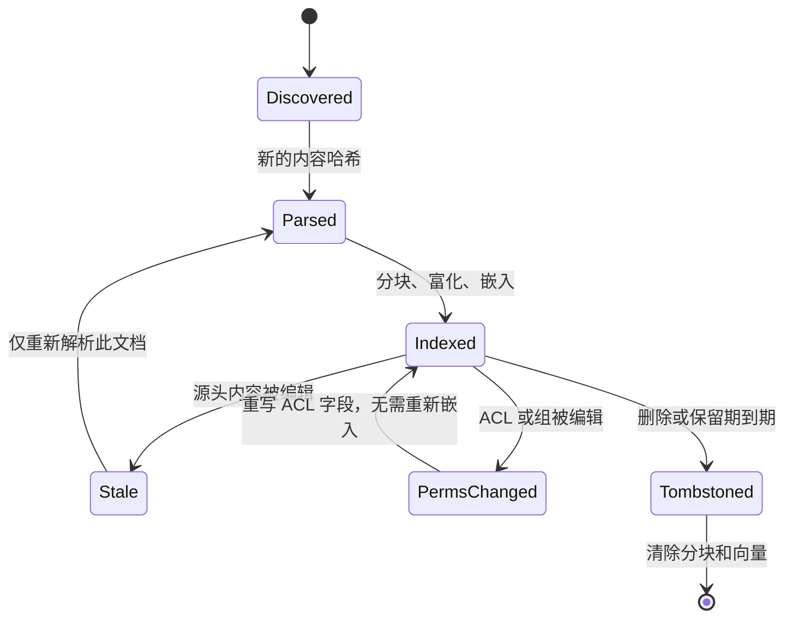

# 17. 非结构化数据处理
> **深度：** L2 · **阅读时间：** 约 14 分钟 · **最后核实：** 2026-11-01 · **前置阅读：** [第 16 章 — AI 数据生命周期](ch16-ai-data-lifecycle.md)

## 要点速览（TL;DR）

- 企业的大部分知识存在于合同、演示文稿、电子邮件、扫描件和录音之中，而不在表格里。常被引用的"80–90% 为非结构化数据"只是一条经验法则。它可追溯到 1998 年的一项说法，其现代版本是一份由 Box 赞助的 IDC 报告（2023 年 8 月），该报告将这一比例定在约 90%。[^idc-box][^grimes] 应将其视为方向正确、但测量基础薄弱的数字。
- 要把一个文件变成 AI 系统可检索的内容，需要一条七步数据管道（pipeline）：数据摄取（ingestion）、[解析](../glossary.md#document-parsing)、清洗、[分块](../glossary.md#chunking)、富化、[嵌入（向量）（embedding）](../glossary.md#embedding)和建立索引。解析和分块决定回答质量；建立索引已接近商品化。
- 解析已分化为三个层级。廉价 OCR 的成本约为每 1,000 页 $1–2；版面感知解析约为每 1,000 页 $10；由[视觉语言模型](../glossary.md#vision-language-model)驱动的智能体式（agentic）解析约为每 1,000 页 $10–60。以上均为截至 2026 年末的标价。[^textract][^gdocai][^mistral-ocr3][^llamaparse][^reducto-r1] 对典型语料库而言，所选方法比所选供应商更重要。
- 企业真正的难题不在解析，而在于 **[ACL 传播](../glossary.md#acl-propagation)**（即每个分块都携带源文件的权限）和 **[增量同步](../glossary.md#incremental-sync)**（即索引能追踪编辑、权限变更和删除，而无需重新处理全部内容）。Microsoft 自己发布的 Copilot 过度共享指南表明，当源头权限混乱时会出现什么问题。[^m365]
- 有四类参与者在争夺这一层：独立初创公司（Unstructured、LlamaIndex、Reducto）、超大规模云厂商的文档 AI API、将解析作为 SQL 函数提供的数据平台（Databricks `ai_parse_document`、Snowflake `AI_PARSE_DOCUMENT`），以及内容与存储平台（Box、Glean、NetApp AIDE、VAST、Everpure Data Stream）。存储厂商基于数据引力（data gravity）的论据最强，但在交付数据处理软件方面的记录最短。

## 为何重要（商业 + Everpure 视角）

结构化数据背后有五十年的工具积累：模式（schema）、SQL、数据仓库（data warehouse）和商业智能（BI）。非结构化数据则大多只有文件共享、搜索框和记录保留策略。实际上，它就是 **[暗数据](../glossary.md#dark-data)**。Veritas 在 2016 年对 2,550 名 IT 负责人开展的 Databerg 调查发现，受访者将 52% 的存储数据归为"暗"数据（即价值未知），另有 33% 被归为冗余、过时或无关紧要（ROT）。[^veritas] 唯一一次著名的大规模变现此类数据的尝试——HP 于 2011 年以 $10.3B 收购 Autonomy——最终以 $8.8B 的减值告终。[^hp-autonomy] 高管们由此学会把"释放你的非结构化数据"视为一个危险信号。

生成式 AI 改变了经济账。语言模型能读合同，但前提是有人先把 PDF 转换成结构正确的干净文本，切分成可检索的片段，并记住谁有权查看每个片段。这项准备工作如今已成为[检索增强生成（RAG）](../glossary.md#retrieval-augmented-generation)（[第 19 章](ch19-retrieval-architectures.md)）和智能体（agent）的瓶颈。每个主要平台都在进入这一领域。Snowflake 于 2024 年 11 月收购 Datavolo 以实现多模态数据摄取。[^datavolo] Databricks 于 2025 年将文档解析作为 SQL 函数推出。[^dbx-parse] Box 于 2026 年 1 月将元数据提取产品化。[^box-extract]

对 Everpure 而言，要点很简单。这些文件大多已经存放在文件存储和对象存储（object storage）上，其中很多在本地部署，因此处理层是存储厂商天然的相邻领域。Everpure 在 2026 年的举措符合这一解读：它完成了对 1touch 的收购（披露的现金对价为 $125M），用于数据发现和数据分类，[^everpure-1touch] 并推出了 **Data Stream**，借助 NVIDIA GPU 在 FlashBlade 上对数据进行向量化，并在流层级实施访问控制。[^everpure-ds] 悬而未决的问题是：存储厂商能可信地拥有管道中的哪些步骤，又应把哪些留给合作伙伴。

## 工作原理

### 第 1 步 — 数据摄取：连接器，而非副本

数据管道始于连接 SharePoint 和 OneDrive、Box、Google Drive、Confluence、电子邮件和 Slack 的[连接器](../glossary.md#connector)，以及 NFS/SMB 共享和 S3 存储桶。每个连接器有三项任务：拉取内容；拉取**元数据**，例如所有者、路径、修改时间和版本；拉取**权限**，即源系统的[访问控制列表](../glossary.md#access-control-list)、组成员关系和共享链接。第三项任务是团队最容易低估的。Glean 正是在这一层上建立起业务的，它将每个应用的身份和权限同步到自己的索引中，并在查询时将每条结果过滤为用户在源系统中可见的内容。[^glean-docs]

### 第 2 步 — 解析：从字节到结构化文本

解析将文件转化为有序文本加结构。方法取决于输入。

- **原生数字 PDF 和 Office 文件。** 这些文件本身已包含文本层，因此提取既便宜又精确。问题不在字符，而在结构。PDF 存储的是位于坐标上的字形，而不是段落。双栏版式、页眉、脚注和跨页表格都需要 **[版面分析](../glossary.md#layout-analysis)** 来恢复标题、表格单元格和 **[阅读顺序](../glossary.md#reading-order)**。
- **扫描件、传真和照片。** 这些需要[光学字符识别](../glossary.md#optical-character-recognition)（OCR）。OCR 是概率性的，会为每个单词返回置信度分数，数据管道可据此将低置信度页面路由给更强的模型或人工处理。
- **复杂页面。** 图表、嵌套表格、手写体和表单越来越多地交给**视觉语言模型（VLM）**处理，它读取渲染后的页面图像并直接输出 Markdown 或 JSON。IBM 开源的 Granite-Docling 用一个 258M 参数的模型实现了这一点（2025 年 9 月）。[^docling] Mistral OCR 3 以每 1,000 页 $2 的 API 提供这一能力。[^mistral-ocr3] Reducto 和 LlamaParse 会将每一页路由给能处理该页的最便宜模型。[^reducto-r1][^llamaparse]
- **音频和视频。** 语音转文本生成带说话人标签和时间戳的转录稿，时间戳所起的作用相当于文档中的页码。

VLM 解析有一种已知的失败模式。传统 OCR 引擎会把无法识别的字符弄成乱码；而生成式模型则可能写出一个看似合理、但页面上从未出现过的数字。因此，生产级数据管道会保留边界框、页面引用和置信度分数，使任何提取出的值都能追溯回像素。

> **类比：半导体。** 解析相当于晶圆厂的**晶圆 ID 读取**。当批次 ID 来自 MES 数据库时，它是精确的，就像原生数字文本层。当光学读取器必须识别被工艺过程磨损的激光刻印标记时，读取是概率性的，就像 OCR。晶圆厂通过置信度阈值、重复读取和操作员兜底来处理。版面分析对应自动光学检测，在那里，知道某个特征位于晶粒上的*哪个位置*与读出它同样重要。在这两种场景中，误读的代价都会在流程后段显现，而那时更难追溯。

### 第 3–4 步 — 清洗与分块

清洗会去除样板内容（每页重复出现的页眉、页脚、法律免责声明），对几乎相同的版本去重，并统一编码。随后，**分块**将文档切分为若干单元，每个单元都会得到一个嵌入向量，并争夺模型提示词中的一个位置。

基本权衡在于精确度与上下文。小分块与查询匹配得更精准，但会丢失周边事实：比如一个只写"供应商"却未点名的条款，或一个与表头分离的表格行。大分块保留上下文，但会稀释嵌入向量，并用无关文本填满提示词。**[分块重叠](../glossary.md#chunk-overlap)**通常为 10–20%（从业者惯例，并非标准），它以部分文本被存储和嵌入两次为代价，缓解边界问题。

> **类比：内存层级。** 选择分块大小就是选择**缓存行或块大小**。行太小，标签和元数据开销占主导，空间局部性丧失：每次访问只取回一个事实，而不带其相邻内容。行太大，每次未命中都会拖入程序从不使用的字节，缓存能容纳的有用行也更少。重叠的作用类似对相邻行的预取。按章节感知的分块就像把内存分配对齐到页边界，使一个逻辑对象不会横跨两行。

关于哪种策略更优，证据很少且依赖于语料库。NVIDIA 公布的测试发现，在其数据集上，按页分块的平均端到端准确率最高（0.648），基于 token 的切分在 0.603 到 0.645 之间。该测试集主要是分页报告，且 NVIDIA 并未进行完整的网格搜索。[^nvidia-chunk] Jina AI 于 2024 年 9 月提出的 **[延迟分块](../glossary.md#late-chunking)**颠倒了操作顺序：它先用长上下文模型对整篇文档做嵌入，再将 token 向量池化为分块向量，从而使代词保留其指代对象。[^late-chunk]

### 第 5 步 — 富化元数据，并携带 ACL

每个分块在嵌入之前都需要附加元数据：文档标题、章节路径、页码、日期、作者、提取出的实体（当事方、金额、产品名称）、一个[数据分类](../glossary.md#data-classification)标签，以及针对个人身份信息的 [PII](../glossary.md#personally-identifiable-information) 标签（[第 15 章](../02-pipelines-and-governance/ch15-governance-security-privacy.md)）。最重要的是，它需要**源 ACL 以及稳定的文档 ID 和版本**。查询时，检索器在排序*之前*按调用者身份过滤候选项，这就是[权限感知检索](../glossary.md#permission-aware-retrieval)。在生成之后再过滤就太晚了，因为模型已经读过受限文本。

*图 17.1 — 内容和权限从源头沿不同路径传递，并在索引中重新汇合。如果 ACL 路径断裂，RAG 系统仍能运行，但会泄露数据。*

> **类比：内存层级。** ACL 传播就像**让每条缓存行都携带安全属性**。安全世界位或内存标签必须跟随数据从 DRAM 进入 L3、L2 和 L1。如果某一级在复制缓存行时丢掉了标签，即使其他每一级都正确执行，隔离也会悄无声息地失效。分块索引就是又一级副本，而 ACL 就是它的标签。

### 第 6–7 步 — 嵌入和索引，然后保持更新

嵌入和索引在[第 18 章](ch18-embeddings-and-vector-search.md)中讨论。本章要讲的是**保持索引同步**。企业内容一直在变化：文件被编辑，文件夹被重新共享给新的组，员工离职，或文档依保留规则被删除。只追加新内容的数据管道最终会提供过时或已撤销权限的内容。好的数据管道会以不同方式处理四类事件，如图 17.2 所示。

*图 17.2 — 增量同步是针对每个文档的状态机。权限变更只应付出元数据更新的代价，而不是重新嵌入。删除必须触及每一个派生副本。*

有两件事让这变得困难。第一是**权限频繁变动**。组成员关系的变化频率远高于文档本身，而许多数据源（SharePoint 共享链接、嵌套组、继承的文件夹权限）无法低成本地回答"自时间 T 以来发生了什么变化"。第二是**删除时的扇出**。一份被删除的 PDF 可能已产生 70 个分块、70 个向量、一份摘要和若干缓存答案，而隐私监管机构也会把其中每一个副本视为该数据本身。为每个文档计算[内容哈希](../glossary.md#content-hash)，以及从文档到分块的数据血缘（[第 13 章](../02-pipelines-and-governance/ch13-data-quality-observability-lineage.md)），是最低限度的机制。Microsoft 针对 Microsoft 365 Copilot 的过度共享蓝图给出了一个实用警示：其第一步是在上线*之前*修复 SharePoint 权限并限制对过度共享站点的发现，因为助手会忠实地遵循它找到的任何 ACL。[^m365]
