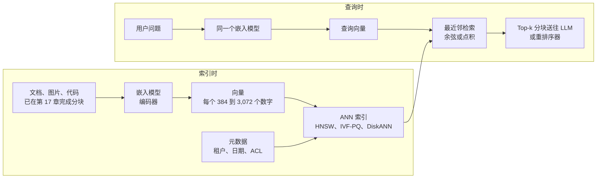
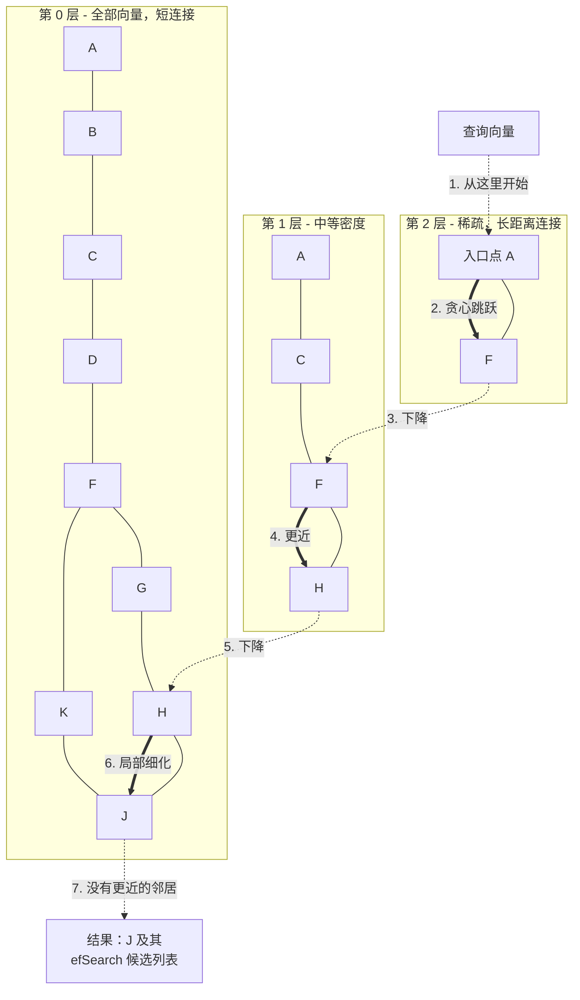
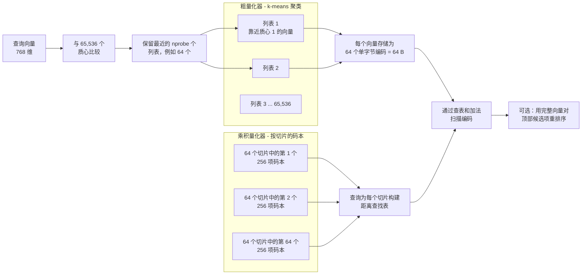
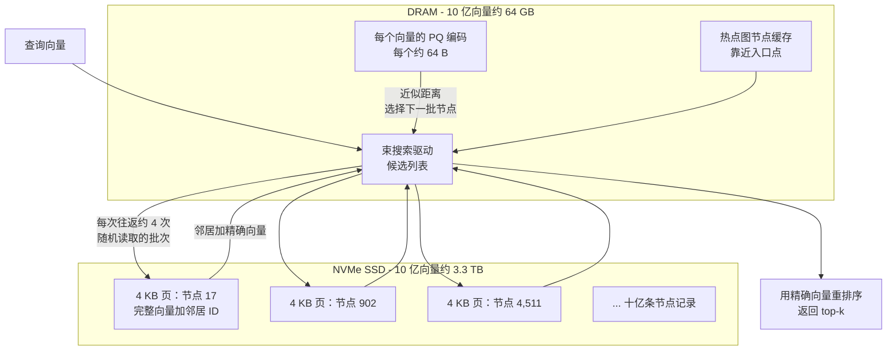
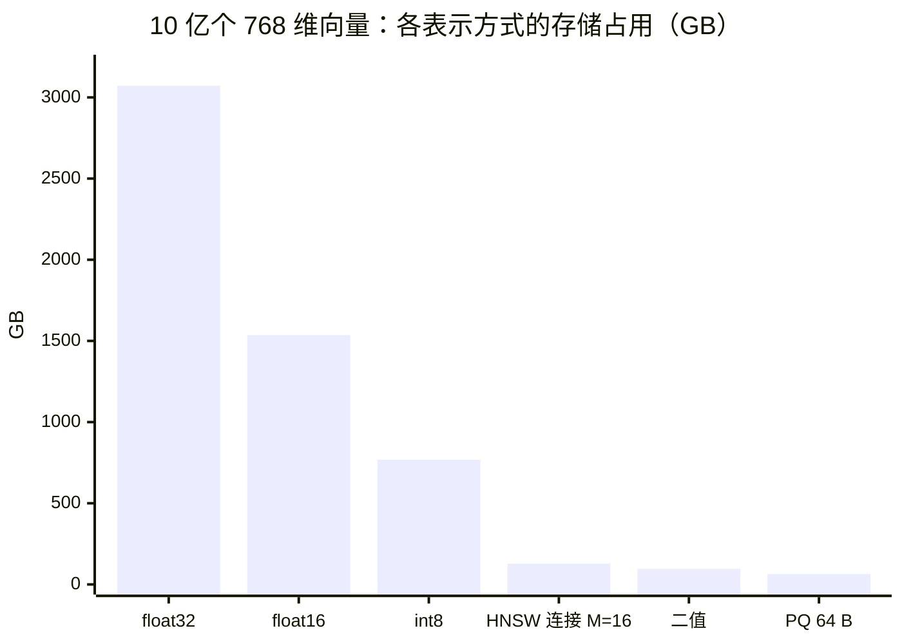

# 18. 嵌入与向量检索
> **深度：** L2 · **阅读时间：** 约 19 分钟 · **最后核实：** 2026-11-01 · **前置阅读：** [第 17 章 — 非结构化数据处理](ch17-unstructured-data-processing.md)，[第 2 章 — 数据模型](../01-data-systems-foundations/ch02-data-models.md)

## 要点速览（TL;DR）

- [嵌入（向量）（embedding）](../glossary.md#embedding)模型将一段文本、一张图片或一个代码文件转换为约 384 到 3,072 维空间中的一个点，其位置使语义相近的内容彼此靠近。于是检索就变成了几何问题：找到离查询点最近的那些点，按余弦相似度或点积打分。
- 精确检索要把查询与每一个已存储的向量逐一比较，规模一大就太慢。生产系统使用[近似最近邻（ANN）](../glossary.md#approximate-nearest-neighbor)索引，以少量[召回率](../glossary.md#recall-at-k)损失换取 100 倍甚至更高的加速。主要类别包括图（[HNSW](../glossary.md#hnsw)、[DiskANN](../glossary.md#diskann)）、聚类（[IVF](../glossary.md#ivf)）和压缩（[乘积量化](../glossary.md#product-quantization)）。
- 内存是硬约束。十亿个 768 维 float32 向量在任何索引结构之前就要占用约 3.1 TB。这种规模的内存内 HNSW 索引需要多台大内存服务器。DiskANN 在 DRAM 中保留一份 64 GB 的压缩副本，而把完整向量和图放在 NVMe 闪存上。仅就介质成本而言，在相近召回率下便宜 25 倍以上（示意性估算，见下文）。
- 市场已经分化。专用向量数据库（vector database）（Pinecone、Weaviate、Qdrant、Milvus/Zilliz、Chroma、LanceDB、turbopuffer、Vespa）与 Postgres、MongoDB、Oracle、SQL Server、Elasticsearch、Redis、Databricks、Snowflake 中"作为功能的向量"竞争，而自 2025 年 12 月起，Amazon S3 本身也加入了竞争。[^s3v] 自 2023 年以来，纯向量数据库公司的融资规模一直不大。
- **Everpure 视角：** 2024–2026 年的各种设计（DiskANN、SPANN/SPFresh、turbopuffer、Chroma Cloud、S3 Vectors、Milvus 2.6 分层存储）都在把向量数据从 DRAM 推向闪存和对象存储（object storage）。在 NVMe 和 S3 兼容存储上实现十亿级检索，是存储厂商一个具体的机会。

## 为何重要（商业 + Everpure 视角）

检索决定了大语言模型能读到什么。每一个 RAG 系统（[第 19 章](ch19-retrieval-architectures.md)）、每一款企业级"与你的文档对话"产品以及大多数智能体（agent）记忆设计，都始于一次向量查询。如果检索漏掉了正确的段落，模型要么在缺少它的情况下作答，要么凭空编造。因此，检索质量就成了回答质量，而买方愿意为做对这件事付费。

商业问题在于谁能获取这部分支出。2023 年，答案看起来是一个新的数据库类别：Pinecone 于 2023 年 4 月融资 $100M，媒体报道的估值为 $750M。[^pinecone-b] 到 2026 年，几乎每一家老牌数据库都已增加了向量类型和 ANN 索引。MongoDB 以媒体报道的 $220M 收购了嵌入模型公司 Voyage AI（2025 年 2 月）。[^mdb-voyage] AWS 把向量存储变成了一种 S3 存储桶类型。[^s3v] 本章的战略问题是：当这项功能无处不在时，独立向量数据库能否存活。这与[第 2 章](../01-data-systems-foundations/ch02-data-models.md)对每一种专用数据模型提出的问题相同。

对 Everpure 而言，向量是一种形态特殊的存储工作负载。一个十亿向量的语料库是数 TB 的热数据，且被随机访问。工程师曾把它放在 DRAM 中，因为没有别的介质足够快；但闪存原生的索引设计如今使 NVMe 在相近召回率下成为更便宜的层级。Everpure 于 2026 年 6 月发布的 Data Stream 借助 NVIDIA GPU 在 FlashBlade 上对选定数据进行向量化，使公司站在了这一工作负载的生产端。[^ep-ds] Zilliz 将 Pure Storage 列为 Milvus 2.6 分层存储的存储合作伙伴之一，这又使其站在了服务端。[^milvus26]

## 工作原理

### 从内容到坐标

嵌入模型是一种神经网络编码器。它接收一个输入（一个 512 token 的文本分块、一张图片、一个代码函数），输出一个定长的数字列表。对每个输入而言，列表长度都相同：OpenAI 的 text-embedding-3-small 为 1,536 个数字，text-embedding-3-large 为 3,072 个。[^openai-emb] 每个数字都是一个坐标。模型经过训练，使"发票已逾期"和"付款迟了"彼此靠近，而"发票模板"尽管共享一个关键词，却离得更远。

训练方法是**[对比学习](../glossary.md#contrastive-learning)**。模型会看到应当匹配的成对样本（一个问题和回答它的段落，或一张图片和它的说明文字），以及大量不应匹配的样本。每当一对匹配样本的距离比一对不匹配样本更远时，模型就会受到惩罚。经过数十亿次这样的比较，空间中的距离便能反映语义的相似性。没有人去设计单个维度；它们是学出来的，且没有一个维度能干净地对应某个人类概念。

相似度有两种度量方式。**[余弦相似度](../glossary.md#cosine-similarity)**是两个向量夹角的余弦值。当向量被归一化为单位长度时（大多数现代模型都这么做），**点积**就是同一个度量。在单位向量上，按两者中任一种排序都等价于按直线（欧几里得）距离排序。因此大多数数据库同时提供三种度量，由模型的文档决定用哪一种。

*图 18.1 — 文档和查询必须经过同一个模型。更换模型意味着要对整个语料库重新嵌入，这是这一层主要的切换成本。*

### 维度、量化与 Matryoshka

维度越多通常意味着检索越好，但在全精度（float32）下，每个维度每个向量要花 4 字节。一个 768 维向量为 3 KB，一个 3,072 维向量为 12 KB，这可能超过它所代表的文本分块本身的大小。有两种技术可以降低这一成本。

**[标量量化](../glossary.md#scalar-quantization)**用更少的比特存储每个坐标。从 float32 降到 int8，体积缩小 4 倍。**[二值量化](../glossary.md#binary-quantization)**每个维度只保留 1 比特（该坐标为正还是为负？），体积缩小 32 倍。Redis 在其向量集合（vector sets）文档中恰好说明了这些权衡：int8 为默认值，二值量化被描述为更快但召回率更低。[^redis] Elasticsearch 的"BBQ"索引会自动对 HNSW 应用二值量化，并称内存可减少约 32 倍。[^elastic] 实践中，系统先在压缩向量上检索出数百个候选项，再用从更便宜层级读取的全精度向量对这些候选项进行**[重新打分](../glossary.md#rescoring)**。

**[Matryoshka 嵌入](../glossary.md#matryoshka-embedding)**缩小的是向量本身。Matryoshka 表示学习（MRL，2022）以俄罗斯套娃命名，它训练模型使前 256 或 512 个坐标本身就已是可用的嵌入向量。[^mrl] 客户可以存储一个短前缀用于快速初筛，并保留完整向量用于重排序。OpenAI 的 2024 年模型、[^openai-emb] Google 的 Gemini Embedding（2025 年 7 月 GA，默认 3,072 维，推荐截断为 1,536 维和 768 维）[^gemini-emb] 以及 Voyage 4（2,048 维到 256 维）[^voyage4] 都支持这一点。Cohere 的 Embed v4 提供 256 到 1,536 维，并支持 int8 和二值输出类型。[^cohere-emb]

> **类比：半导体（量化就是 ADC 位深）。** 对嵌入向量做量化，就像为模数转换器选择位深。32 位浮点数是高分辨率采样。int8 编码是一个 8 位 ADC，每个通道保留 256 个电平，对下游任务而言几乎没有损失。二值则是一个 1 位比较器：单独使用很粗糙，但速度快，足以在精确的第二轮之前做初筛。乘积量化（见下文）更接近编解码器中的矢量量化：它依据学习得到的码本对坐标块进行编码，而不是对每个坐标单独取整。

### 精确检索与近似的必要性

精确的 **[k 最近邻](../glossary.md#k-nearest-neighbors)**（kNN）检索会把查询与每一个已存储的向量比较。对 100 万个 768 维向量而言，每次查询约需 7.7 亿次乘加运算。借助 SIMD 指令，算术本身很便宜；真正的约束是内存带宽，因为每次查询都要流式读取约 3 GB 的 float32 数据。一台内存带宽约 200 GB/s 的多核服务器需要约 15 ms（估算），而 int8 或二值编码，或者每轮批量处理多个查询，都能将其降低数倍。因此，在约 100 万–500 万向量以内（取决于维度、量化方式和查询速率），暴力检索是合理的选择。到 10 亿向量时，每次查询需流式读取约 3 TB 数据，对于交互式使用来说远远太慢。

ANN 索引避免查看大多数向量。其质量以 **recall@k** 衡量：在真实的 10 个最近邻中，索引返回了多少个？recall@10 为 0.95 意味着平均返回 10 个中的 9.5 个。每一种 ANN 设计都要在召回率、延迟和成本（内存、闪存、计算）之间进行三方权衡，每个调优参数都沿着这条前沿移动。

> **类比：晶圆良率。** recall@k 就是检索系统的良率。你可以通过更彻底的测试（更大的搜索列表、探查更多的聚类）来提高良率，代价是测试机时间。也可以购买更好的工艺（更好的索引或更好的嵌入），代价是资本投入。最后几个百分点的良率最昂贵，而经济上的目标良率，是下游缺陷（漏掉一个段落）的代价低于再多一单位测试时间的那个点。一个团队只报"99% 召回率"而不附带延迟和成本，就相当于只报良率而不报周期时间。

### HNSW：由图构成的跳表

由 Malkov 和 Yashunin 于 2016 年发表的分层可导航小世界（HNSW）图，是大多数产品中的默认索引。[^hnsw] 每个向量都是一个节点，每个节点连接到几十个近邻。检索从一个入口点开始，贪心地移向离查询更近的邻居，当没有更近的邻居时停止。在单层平面图上，这种贪心游走可能需要很多步，因此 HNSW 增加了层级。最底层包含所有节点；每个更高的层级包含一个随机的、呈指数级缩小的样本，并带有更长距离的连接。查询通过几次长跳跨越稀疏的顶层，然后下降，并在稠密的底层进行局部细化。

*图 18.2 — HNSW 检索：先在稀疏的上层进行几次长跳，再在稠密的底层进行短距离局部搜索。距离计算次数大致随语料库规模的对数增长，而非线性增长。*

三个参数决定了这一权衡。**M** 是每个节点的连接数：M 越高，召回率越好，但会增加内存和构建时间。**efConstruction** 是插入节点时构建器为寻找好邻居所付出的搜索力度。**efSearch** 是查询期间保留的候选列表大小，它是主要的运行时调节旋钮：将其从 40 提高到 400，通常可使召回率接近 0.99，代价是延迟增加数倍（具体曲线取决于数据集）。HNSW 的缺点在于内存。为获得良好性能，图和完整向量都必须驻留在 RAM 中，因为每一跳都是一次随机访问。在 M=16 时，仅底层连接就为每个向量增加约 128 字节（32 个邻居 ID，每个 4 字节）。与 3 KB 的向量相比这很小，但它无法被压缩掉。删除操作也很棘手，因为移除一个节点会在其邻居的连接列表中留下空洞。

> **类比：跳表与页表。** HNSW 是把跳表从一条有序直线推广到高维空间。跳表在链表上方保留快速通道，使一次查找只需 O(log n) 跳而非 n 跳；HNSW 的上层就是这些快速通道。它也类似多级页表：每一级都缩小你在地址空间中所处的区域，直到最后一级指向确切的页面。区别在于 HNSW 的"地址转换"是近似的：一次贪心跳跃偶尔会走错路，丢失的召回率就来自这里。

### IVF 与乘积量化：先分区，再压缩

第二个类别源自 Meta 和 INRIA 的 FAISS 谱系。[^pq][^faiss] **倒排文件索引（IVF）**在语料库上运行 k-means，找出例如 65,536 个质心，然后把每个向量分配到其最近质心的列表中。查询会与所有质心比较，选出最近的 **nprobe** 个列表（例如 8 个或 64 个），并只扫描这些列表。在 65,536 个列表、nprobe=64 的情况下，查询只触及约 0.1% 的数据。提高 nprobe 会同时提高召回率和成本。

由 Jégou、Douze 和 Schmid 于 2011 年提出的**乘积量化（PQ）**，对这些列表内部的向量进行压缩。[^pq] 它把一个 768 维向量切成 64 个子向量，每个 12 维。对每一个切片，它学习一个由 256 个代表性子向量组成的小型**[码本](../glossary.md#codebook)**。随后每个向量都以 64 个单字节编码存储（每个切片一个）：64 字节而非 3,072 字节，压缩 48 倍。距离通过"查询到码字"距离的查找表计算，因此一次扫描只需读取字节并累加表项，CPU 和 GPU 执行起来非常快。**[IVF-PQ](../glossary.md#ivf-pq)**将两者结合，是在单台机器或单块 GPU 上容纳数十亿向量的标准方法。

*图 18.3 — IVF-PQ：聚类决定去哪里找，码本决定为每个候选项打分有多便宜。召回率会损失两次，一次是跳过聚类，一次是压缩，这正是用完整向量重排序很常见的原因。*

Google 的 **ScaNN**（2020）改进了量化步骤。它使用各向异性量化，把误差预算花在对内积排序影响最小的地方。[^scann] 它既有开源版本，也作为 AlloyDB 中的 ScaNN 索引提供；Google 于 2024 年 10 月将其 GA，并声称可扩展到十亿向量以上（公司披露）。[^alloydb]

### DiskANN：内存层级的实际应用

Microsoft Research 的 DiskANN（NeurIPS 2019）探讨了当索引无法放进 RAM 时会发生什么。[^diskann] 它的图算法 **[Vamana](../glossary.md#vamana)**构建一个单层图，并在设计中刻意加入长距离边，因此一次检索所需的跳数比 HNSW 的底层更少。其布局遵循内存层级。所有向量的 PQ 压缩副本位于 DRAM 中，每个 64 字节或更少。全精度向量和图的邻居列表位于 SSD 上，并存放在一起，使一次 4 KB 读取就能同时返回某个节点的精确向量及其边。检索利用廉价的内存内编码进行导航，并发出小批量的 SSD 读取以展开最有希望的节点，然后用沿途取回的精确向量进行重排序。

*图 18.4 — DiskANN 只在 DRAM 中保留压缩编码。每次查询只触及几十个 SSD 页面，而不是流式读取数 TB 数据，这正是一台带 SSD 的服务器就能服务十亿向量的原因。*

论文的核心结果是：一台 16 核、64 GB RAM 并配一块廉价 SSD 的工作站，在十亿点的 SIFT1B 数据集上实现了超过 5,000 次/秒的查询，在 95%+ 1-recall@1 时平均延迟低于 3 ms（作者的基准测试）。[^diskann] 这些数字与简单算术一致：如果一次查询以每批 4 个的方式展开约 100 个节点，就需要约 25 次往返；按每次 NVMe 随机读取约 100 µs 计算，约为 2.5 ms（估算）。此后，Microsoft 已将 DiskANN 内置于 Azure Cosmos DB（NoSQL API 于 2024 年 11 月 GA）[^cosmos] 和 SQL Server 2025。在 SQL Server 2025 中，VECTOR 类型已 GA，DiskANN 是唯一的 ANN 索引类型，不过截至检索时，Microsoft 文档中本地部署版本的索引仍是预览功能。[^sqlserver] pgvectorscale 为 Postgres 带来了 DiskANN 风格的索引，[^pgvectorscale] Redis 8.2 则新增了 SVS-Vamana 索引类型。[^redis]

> **类比：内存层级（DiskANN 是一种缓存设计）。** DiskANN 是标签与数据的经典分离。CPU 缓存把小的标签放在快速 SRAM 中，把大量数据放在下一级。DiskANN 把小的"标签"（PQ 编码）放在 DRAM 中，用来决定哪些节点值得取回，而把完整的行（精确向量加边）放在 NAND 上。像一个好的缓存一样，它对数据进行布局，使一次取回就能带回下一步所需的全部内容，并把热点行（靠近入口点的节点）固定在更快的层级。任何对 HBM 与 DRAM 的取舍做过定价的人，都已经明白为什么这比把一切都放在最高层级更划算。

### 对象存储、SPANN 与 GPU

沿内存层级再往下一步是对象存储，在那里一次访问需要数十毫秒（最高约 100 ms），而不是约 100 µs，图遍历便不再奏效。基于聚类的设计在这里更合适。**SPANN**（Microsoft，NeurIPS 2021）把聚类质心放在内存中，把倒排列表放在磁盘上，[^spann] 而 **SPFresh**（SOSP 2023）增加了原地更新。[^spfresh] turbopuffer 的文档描述了一个基于 SPFresh 的质心索引，以对象存储为权威数据源、以 NVMe 为缓存。冷查询会先下载质心，然后以尽可能少的对象存储往返次数取回选中的聚类。[^tpuf] Chroma Cloud（2025 年 8 月）同样结合了 SPANN 和 SPFresh，并使用以对象存储为后端的预写日志（WAL）。[^chroma] 2025 年 12 月 2 日 GA 的 Amazon S3 Vectors 把这一思路推向极致：每个索引最多 20 亿个向量，每个存储桶最多 20 万亿个，AWS 称查询延迟约 100 ms，成本比替代方案最多低 90%（公司披露）。[^s3v]

在另一个极端，GPU 被用于批量构建和检索索引。NVIDIA 的 cuVS 库包含 **[CAGRA](../glossary.md#cagra)**，这是一种为 GPU 并行而设计的图索引（2023）。[^cagra] 它已集成到 FAISS、Milvus 以及 OpenSearch 的远程索引构建器中。一种常见模式是在 GPU 上几分钟内构建好图，再将其转换为 HNSW，以便在 CPU 上更低成本地提供服务。[^cuvs] GPU 最适合索引构建和重新嵌入作业，以及吞吐量极高的批量查询；典型的 RAG 查询流很少需要它们。

### 过滤与混合检索预告

真实的查询都带有条件："这个租户的、2026 年的、该用户有权查看的文档"。把这些条件应用到 ANN 检索上比听起来要难。**[预过滤](../glossary.md#pre-filtering)**先缩小候选集，再在其中检索。对幸存者做暴力检索是精确的，但当过滤条件宽泛时会很慢；只经由匹配节点遍历图则很快，但可能把图切成互不相连的孤岛。**[后过滤](../glossary.md#post-filtering)**先检索再过滤，很简单，但限制性强的过滤条件可能使 10 个结果只剩 2 个。**图内过滤**在遍历过程中检查谓词，Qdrant 的载荷感知 HNSW 和 ACORN 研究设计都是如此。[^acorn] pgvector 0.8.0 的迭代索引扫描通过持续检索直到有足够多的行通过过滤，来修补后过滤的问题。[^pgvector] 过滤选择性是"基准测试表现良好、在生产中却漏掉结果"的向量系统最常见的原因。纯向量检索还会漏掉零件编号、名称等精确词元。因此，生产系统会把它与关键词检索（[BM25](../glossary.md#bm25)）和重排序器配合使用，这就是[第 19 章](ch19-retrieval-architectures.md)讨论的[混合检索](../glossary.md#hybrid-search)模式。

## 实例演算：十亿向量的内存计算

假设有 10 亿个分块，以 768 维嵌入，大致相当于一家大型企业或一个中型网页索引的语料库。算术是精确的；价格是示意性假设，并非报价。

- 原始 float32：1,000,000,000 × 768 × 4 字节 = **3.07 TB**（约 2.8 TiB）。
- int8：768 GB。二值：96 GB。按每向量 64 字节的 PQ：**64 GB**。
- M=16 时的 HNSW 底层连接：32 × 4 字节 = 每向量 128 字节，即 **128 GB**。
- DiskANN 在 SSD 上的记录，最大度数为 64（假设）：3,072 + 256 字节 = 3,328 字节，可容纳于一个 4 KB 页面，即约 **3.3 TB** 有效载荷。如果每条记录各占一个 4 KB 扇区，磁盘占用则接近 4.1 TB；下方成本表使用的是有效载荷数字。

*图 18.5 — 压缩跨度达 48 倍，从全精度的 3,072 GB 到 PQ 的 64 GB。必须放在 DRAM 中的那部分决定了账单，因此设计问题在于这些柱子中的哪一根放在哪一个层级。算术由作者完成。*

| 设计（单副本） | DRAM | NVMe / 对象存储 | 介质成本（DRAM $8/GB，NVMe $0.12/GB） | 备注 |
|---|---|---|---|---|
| HNSW，float32，全部在 RAM 中 | 3,200 GB | — | ≈ $25,600 | 召回率最高、延迟最低；需要多台大内存节点 |
| HNSW，int8 加重新打分 | 896 GB | 3.1 TB（完整向量） | ≈ $7,500 | 2025–26 年托管服务中常见的默认方案 |
| DiskANN（PQ 在 RAM 中，图在 SSD 上） | 64 GB | 3.3 TB | ≈ $910 | 按 2019 年论文为单节点；低个位数毫秒 |
| 对象存储原生（SPFresh、S3 Vectors） | 仅缓存 | 3.3 TB 在 S3 中 | 按 S3 Standard 代理价 $0.023/GB-月计，约每月 $77 | 热查询约 100 ms，冷查询亚秒级；按查询付费。S3 Vectors 有其自己的按 GB 存储和按查询费率 [VERIFY: S3 Vectors 当前的存储和查询标价] |

*图 18.6 — 单副本的示意性介质成本（估算；DRAM 和 NVMe 价格为取整假设，请替换为当前报价；S3 Standard 标价来自 AWS）。[^s3-pricing] 在本例中，将完整向量从 DRAM 移到闪存，介质成本约降低 28 倍（$25,600 对约 $910）。将其移到对象存储，则把资本支出变成一笔很小的月租。*

生产环境还要增加副本（通常 2–3 倍）、余量和计算资源，因此绝对金额会更高。但比例关系依然成立，并解释了 2023 年以来的行业方向：把引导检索的字节留在快速内存中，把大部分数据推到闪存或对象存储上。

## 设计选择与权衡

| 算法 | 结构 | 每个 768 维向量的内存（参考值） | 查询延迟特征 | 更新与删除 | 过滤 | 常见于 |
|---|---|---|---|---|---|---|
| Flat（精确 kNN） | 无；全部扫描 | 3,072 B（float32） | 与语料库规模成线性；约 100 万–500 万以下尚可 | 简单 | 精确，任意谓词 | 无索引的 pgvector、FAISS Flat、小型应用 |
| HNSW | 多层邻近图 | 约 3,200 B（向量 + 连接）；int8 更少 | RAM 中亚毫秒到数毫秒 | 插入没问题；删除会留下墓碑 | 后过滤或图内过滤 | pgvector、Qdrant、Weaviate、Milvus、Elastic、Redis、Oracle、MongoDB |
| IVF-Flat / IVF-PQ | k-means 列表，可选 PQ 编码 | 3,072 B 或约 64 B | 数毫秒；通过 nprobe 调节 | 追加容易；数据漂移时需重新聚类 | 按列表过滤 | FAISS、Milvus、LanceDB、Oracle（IVF）、pgvector（IVFFlat） |
| ScaNN | 分区加各向异性量化 | 小（已量化） | 高 QPS 下低毫秒级 | 定期重建/重新训练 | 预过滤/后过滤 | AlloyDB、Vertex AI Vector Search、开源 |
| DiskANN / Vamana | SSD 上的单层图，PQ 在 RAM 中 | RAM 中约 64 B + SSD 上约 3.3 KB | NVMe 上低个位数毫秒 | FreshDiskANN 风格的流式更新 | 有过滤变体 | Azure Cosmos DB、SQL Server 2025、pgvectorscale |
| SPANN / SPFresh | 质心在 RAM 中，倒排列表在磁盘或对象存储上 | RAM 中仅有质心 | SSD 上毫秒级；对象存储上约 100 ms+ | 原地再平衡（SPFresh） | 按聚类过滤 | turbopuffer、Chroma Cloud |
| CAGRA（GPU） | 为 GPU 优化的固定度数图 | GPU HBM，或导出为 HNSW | 批量吞吐量极高 | 以重建为主 | 有限 | FAISS、Milvus 中的 cuVS，OpenSearch 构建 |

*图 18.7 — 没有哪种算法占绝对优势。内存负担得起时，HNSW 在延迟上胜出。在十亿规模下，IVF-PQ 和 DiskANN 在成本上胜出。对于大规模、多为冷数据、多租户的数据，"聚类放在对象存储上"的设计在成本上胜出。资料来源：本章引用的算法论文和产品文档。*

更深层的权衡在于**内存成本与漏检成本**之间。一个把前 20 个分块送往重排序器的消费级聊天机器人，可以容忍廉价索引带来的 0.90 召回率。法律或医疗检索系统则可能愿意为 0.99 付费。脱离嵌入模型、分块方式和过滤条件，这两个数字都没有多大意义。从强嵌入模型换到弱嵌入模型的团队，损失的质量往往比任何索引设置所能弥补的还要多。
