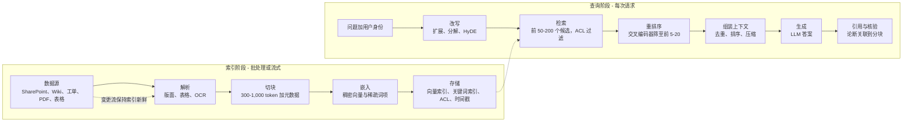
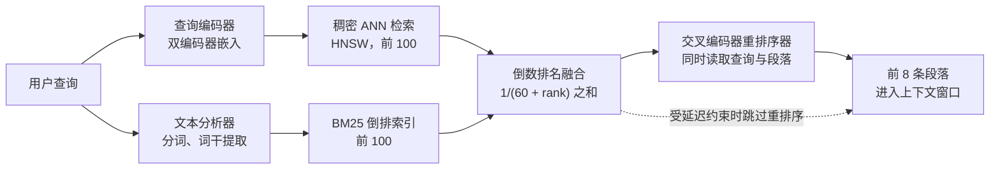
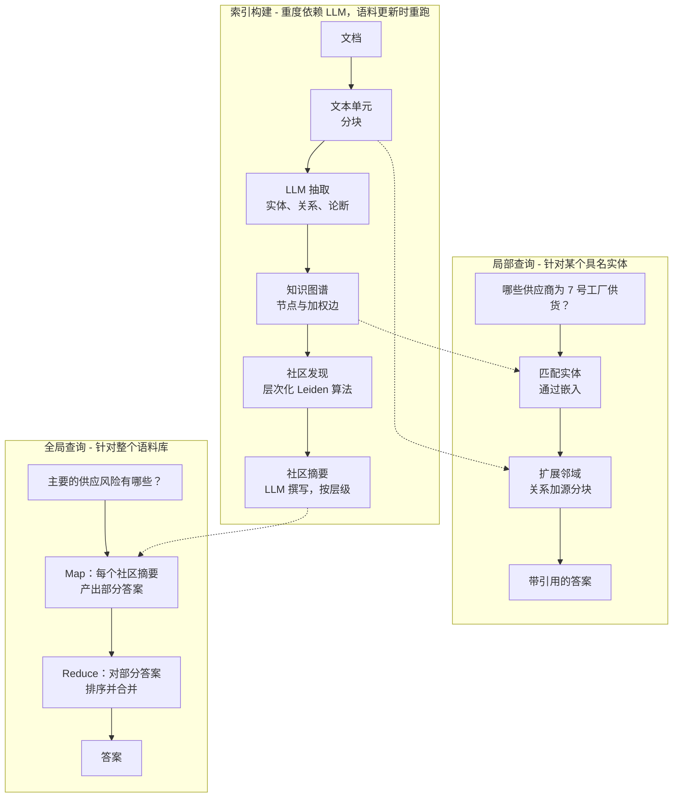
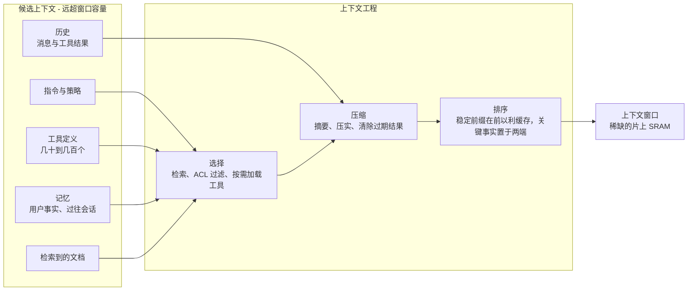
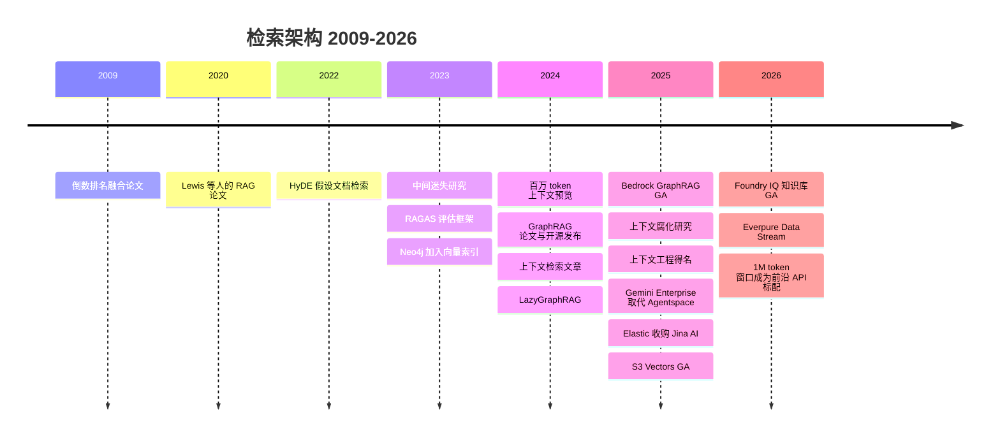

# 19. 检索架构：RAG、混合检索、GraphRAG 与上下文工程
> **深度：** L2 · **阅读时间：** 约 16 分钟 · **最后核实：** 2026-11-01 · **前置阅读：** [第 18 章 — 嵌入与向量检索](ch18-embeddings-and-vector-search.md)、[第 17 章 — 非结构化数据处理](ch17-unstructured-data-processing.md)

## 要点速览（TL;DR）

- [检索增强生成](../glossary.md#retrieval-augmented-generation)（retrieval-augmented generation，RAG）在提问时为语言模型提供恰当的文档，而不是依赖模型在训练中记住的内容。它分为两半。在**索引阶段**，数据源被解析、切块、嵌入并存储。在**查询阶段**，问题被改写，候选内容被检索并重排序，上下文被组装，模型生成带引用的答案。[^lewis2020]
- 生产系统几乎从不只用向量。[混合检索](../glossary.md#hybrid-search)（hybrid search）并行运行关键词检索（[BM25](../glossary.md#bm25)）与稠密检索，用[倒数排名融合](../glossary.md#reciprocal-rank-fusion)（reciprocal rank fusion）合并结果，再由[交叉编码器](../glossary.md#cross-encoder)（cross-encoder）[重排序器](../glossary.md#reranker)（reranker）选出最终的少数几条。在 Snowflake 的内部基准测试中，每一步都提升了质量：NDCG@10 依次为 0.22（关键词）、0.49（向量）、0.53（混合）和 0.59（混合加重排序），为厂商报告数据。[^sf-cortex]
- [GraphRAG](../glossary.md#graphrag)（Microsoft Research，2024）让 LLM 抽取实体与关系，将其聚类为社区并预先撰写摘要。这样可以回答针对整个语料库的"全局"问题——这正是分块检索的短板——但索引成本高昂。[^edge2024]
- 百万 token 级上下文窗口并没有终结 RAG。在一个示意性的 80 万 token 工作负载中，把所有内容塞进提示词，在不使用缓存时每次查询约需 $1.61，使用提示词缓存时约需 $0.17，而 RAG 约为 $0.03（按 Claude Sonnet 5.5 标价，2026 年 11 月）。长输入还会降低答案质量（"中间迷失"（lost in the middle）、"上下文腐化"（context rot））。[^anthropic-pricing][^liu2023][^context-rot]
- 2025 年出现的术语[上下文工程](../glossary.md#context-engineering)（context engineering）拓宽了视角。检索只是稀缺上下文窗口的输入之一，与指令、工具、记忆和历史并列。对这些 token 进行选择、压缩和排序，如今已是构建智能体（agent）的核心技能。[^ctx-eng] 对存储而言，其影响体现在：大型索引上的低延迟读取、源自主数据的新鲜度数据管道，以及用于卸载 [KV 缓存](../glossary.md#kv-cache)（KV cache）的新存储层级。

## 为何重要（商业 + Everpure 视角）

RAG 是大多数企业在自有数据上实际使用生成式 AI 的方式。一个在公共互联网上训练的模型，对一家公司的合同、工单、零件编号或制度一无所知。在这些数据上进行微调（fine-tuning）既慢又贵，而且无法实施权限控制。检索同时解决了这两个问题。每个答案都由用户本就有权查看的文档组装而成，在提问的那一刻检索获得，每条论断都能追溯到出处。这使检索成为企业搜索和"AI 助手"预算的主战场。企业搜索初创公司 Glean 在 2025 年 6 月的 F 轮融资中估值达 $7.2B（媒体报道），随后表示其年度经常性收入（ARR）在 2026 年 5 月达到 $300M（公司披露，媒体报道）。[^glean-tc][^glean-arr] Microsoft、Google、AWS、Databricks 和 Snowflake 都将检索作为其平台的托管功能出售。

RAG 系统的质量主要由数据而非模型决定。大多数故障可追溯到解析、切块、索引过期或权限缺失，这些都是数据工程问题（[第 17 章](ch17-unstructured-data-processing.md)、[第 13 章](../02-pipelines-and-governance/ch13-data-quality-observability-lineage.md)）。这就是为什么拥有受治理数据（目录、数据血缘、访问策略）的平台厂商主张应由它们掌控检索，也是纯向量数据库厂商受到挤压的原因（[第 18 章](ch18-embeddings-and-vector-search.md)、[第 32 章](../04-company-deep-dives/ch32-ai-native-data-companies.md)）。

对 Everpure 而言，这种关联是直接的。检索带来了三类与存储相邻的工作负载。第一类是针对超大型向量和关键词索引的低延迟随机读取。第二类是让索引与文件存储和对象存储上的主数据保持同步的持续数据管道。第三类是长上下文推理中的 KV 缓存卸载。Everpure 的 **Data Stream**（2026 年 6 月发布）已覆盖前两类：它基于 NVIDIA AI Data Platform 设计，在 FlashBlade 上将数据向量化，并提供流级访问控制。[^everpure-datastream] 其 **Key-Value Accelerator** 则瞄准第三类。[^everpure-kva] 下文的存储桥接部分列出了基于公开信息、战略团队可能评估的若干选项。

## 工作原理

### RAG 的两半

2020 年 Lewis 等人命名 RAG 的论文，将一个覆盖约 2,100 万条 Wikipedia 段落的神经检索器与一个生成模型配对。论文表明，在知识密集型问题上，获得检索段落的模型胜过了规模大得多、只能依赖记忆的模型。[^lewis2020] 企业系统保留了这种划分，但增加了许多环节。

*图 19.1 — SV-10：RAG 数据管道。索引阶段是一条数据管道。查询阶段是受延迟约束的服务路径。分块大小和候选数量为典型设计范围，并非基准测试结果。*

**索引阶段**是一条数据管道。解析把 PDF、幻灯片和 HTML 转为带结构（标题、表格、页码）的干净文本。切块（chunking）把文本拆分为可检索单元，通常为几百到约一千个 token，并附上标题、章节、负责人、日期和访问控制列表等元数据。嵌入把每个分块转为一个向量（[嵌入（向量）](../glossary.md#embedding)（embedding）；[第 18 章](ch18-embeddings-and-vector-search.md)），通常也会转为稀疏的关键词词项。存储环节把向量写入[向量索引](../glossary.md#vector-index)（vector index），把词项写入倒排索引，并将元数据保留为可过滤字段。Anthropic 2024 年关于"上下文检索"（contextual retrieval）的文章表明了索引阶段的选择有多重要。在每个分块前添加一段由 LLM 撰写、说明该分块在文档中位置的简短描述，使前 20 条检索失败率降低约 35%。加入上下文化 BM25 后降幅提高到 49%，再加入重排序器则提高到 67%（厂商基准测试）。[^contextual-retrieval]

**查询阶段**是一条有延迟预算的服务路径。问题首先被改写：用同义词扩展、拆分为子问题，或转为一个假设性答案，再用该答案的嵌入进行检索（[HyDE](../glossary.md#hyde)，Gao 等人，2022）。[^hyde] 检索按用户权限过滤后拉取一个较宽的候选集。重排序将其收窄。组装环节去除重复、对段落排序，并将其装入 token 预算。模型生成答案，最后一步检查每条被引用的段落是否真正支持引用它的句子。

> **类比：存储器层次结构。** 可以把 LLM 训练得到的权重看作一块巨大、缓慢、有损的主存。它保存着世界的压缩副本，更新一次需要完整的训练运行，并且无法设置权限。RAG 是这块主存前面的一层缓存。检索是一次**预取**（prefetch），在模型执行之前，把本次查询需要的少数几行从语料库（后备存储）拉入上下文窗口（片上 SRAM）。与任何预取器一样，它以命中率和污染程度来评判。取错了行，模型就在垃圾数据上计算。取得太多，有用的内容就会被逐出。

### 混合检索、融合与重排序

稠密向量能捕捉语义："笔记本电脑无法开机"能找到"笔记本无法启动"。但它们在精确 token 上表现较弱，例如零件编号、错误代码、法律引文和人名，而这些正是关键词检索的强项。BM25 是 Lucene 和 Elasticsearch 的标准评分函数，它会奖励在文档中频繁出现的稀有查询词。同时运行两者并合并结果，是默认的生产设计。

合并比看起来更难，因为 0.82 的余弦相似度和 14.3 的 BM25 分数处在不同量纲上。[倒数排名融合](../glossary.md#reciprocal-rank-fusion)（RRF；Cormack、Clarke 和 Büttcher，SIGIR 2009）忽略分数，只使用排名。每个文档的得分是其在所有结果列表中 1/(k + rank) 之和，原论文取 k = 60。被多个系统排在前列的文档会升至顶部。[^rrf2009] Elasticsearch、OpenSearch、Azure AI Search 以及大多数向量数据库都内置了该方法。

*图 19.2 — 混合检索。两个低成本、面向召回的检索并行运行，RRF 仅依据排名合并结果，再由一个高成本、面向精确度的重排序器对短名单重新排序。*

一个 k = 60 的 RRF 实算示例：

| 段落 | 稠密检索排名 | BM25 排名 | RRF 得分 | 融合后排名 |
|---|---|---|---|---|
| A："泵控制器出现错误 E-4471" | 7 | 1 | 1/67 + 1/61 = 0.0313 | 1 |
| B："控制器故障排查" | 1 | 9 | 1/61 + 1/69 = 0.0309 | 2 |
| C："泵维护概览" | 2 | 未检索到 | 1/62 = 0.0161 | 3 |
| D："E-4471 固件发布说明" | 未检索到 | 2 | 1/62 = 0.0161 | 3（并列） |

*图 19.3 — RRF 奖励一致性。段落 A 是一个强关键词匹配，稠密检索只把它排在第七，但因为两个系统都找到了它，它超过了稠密检索的第一名。*

[重排序器](../glossary.md#reranker)是另一类模型。检索使用[双编码器](../glossary.md#bi-encoder)（bi-encoder）：查询和文档分别嵌入，因此文档向量可以预先计算，并在毫秒级内完成检索。交叉编码器则同时读取查询和每个候选段落，输出一个相关性分数。这要准确得多，但必须在查询时逐对运行，因此只能为几十到几百个候选打分。商业选项包括 Cohere Rerank 4，经销商标价为每 1,000 次检索（每次最多 100 个文档）$2.00（Fast）到 $2.50（Pro）（媒体报道）；Voyage AI 的重排序器（MongoDB 于 2025 年以 $220M 收购 Voyage）；Jina AI 的重排序器（Elastic 于 2025 年 10 月收购 Jina）；以及 BAAI 的 BGE reranker 等开放权重模型。[^cohere-rerank][^mongodb-voyage][^elastic-jina] 重排序器通常会增加几十到几百毫秒的延迟（估算，取决于模型规模、候选数量和硬件）。

> **类比：半导体测试。** 重排序就是两阶段检测。晶圆厂不会把每颗裸片都放到昂贵的参数测试机上。先用快速的光学或电学筛查剔除明显的不良品，精密测量只留给入围名单。双编码器检索是低成本筛查，针对召回率调优，以免丢掉任何好的裸片。交叉编码器是精密测量，针对少数进入该环节的样本优化精确度。在第一阶段投入过多会损失吞吐量；跳过第二阶段则会出货边缘品。

### RAG 在哪里失效

大多数 RAG 事故是看起来像模型问题的数据问题。

| 失效模式 | 症状 | 根本原因 | 修复方法 |
|---|---|---|---|
| 切块不当 | 答案漏掉半张表格或某条款的例外情形 | 固定大小的切分割裂了结构。分块缺少文档上下文 | 结构感知的解析与切块（[第 17 章](ch17-unstructured-data-processing.md)）。添加上下文标题。使用父子检索 |
| ACL 缺失 | 用户在答案中看到薪资数据或其他客户的合同 | 索引由服务账号构建。权限未被复制，或查询时未执行 | 为每个分块存储 ACL，并在检索时按调用者身份过滤。权限变更时重新同步 |
| 索引过期 | 自信地给出答案，却引用了已被取代的制度 | 批量重建索引滞后于数据源。删除操作从未传播 | 基于变更数据捕获（CDC）或事件驱动的重建索引。将索引新鲜度作为 SLO 跟踪。执行删除 |
| 词汇不匹配 | 在零件编号、代码、人名上漏检 | 仅使用稠密检索 | BM25 与稠密检索混合，并用 RRF 融合。查询改写 |
| 中间迷失 | 相关段落已被检索到，但答案忽略了它 | 模型对长输入的开头和结尾关注度最高 | 检索更少但更好的段落。重排序。把最有力的证据放在两端 |
| 幻觉引用 | 脚注指向一份真实文档，但该文档并不支持该论断 | 模型以文本形式生成引用，未经检查 | 将引用限定为已检索分块的 ID。在展示前运行蕴含检查或 LLM 评判检查 |
| 全局性问题 | "所有事故报告的主要主题是什么？"只得到浅显的回答 | Top-k 检索只看到少数几个分块 | GraphRAG 式摘要、对语料库做 map-reduce，或智能体式多步检索 |
| 间接提示词注入 | 答案执行了隐藏在检索到的网页或邮件中的指令 | 检索文本被当作可信指令 | 将数据与指令分离。净化数据源。限制智能体在读取不可信内容后可调用的工具 |

*图 19.4 — RAG 失效模式。八种中有六种是在数据管道或索引中修复的，而不是靠更换模型。*

"中间迷失"这一结论值得强调，因为它影响上下文的组装方式。Liu 等人（2023，发表于 TACL 2024）将唯一的相关文档在 20 份检索文档中移动位置。准确率呈 U 形：文档位于开头或结尾时最高，位于中间时最低。对其中一个模型而言，中间位置的准确率甚至低于完全不提供文档时的成绩。[^liu2023] Chroma 2025 年对 18 个模型的"上下文腐化"研究发现，即使在简单任务上，可靠性也会随输入增长而下降。[^context-rot] 即使放得下，更多上下文也不是免费的。

### 智能体式 RAG

经典 RAG 检索一次然后作答。**智能体式 RAG**（agentic RAG）把检索变成模型可按需反复调用的工具：检索、阅读、发现缺口、细化查询、检索另一个数据源，并在证据充分时停止。它能处理多跳问题（"哪些使用旧合同模板的客户将在下季度续约？"），这类问题需要先做文档检索，再做一次 SQL 查询，然后再检索一次。代价是更多的模型调用、更难预测的延迟以及更难的评估。Microsoft 的 Azure AI Search 增加了"智能体式检索"（agentic retrieval）模式，用 LLM 规划子查询并并行执行；基于它构建的 Foundry IQ 知识库于 2026 年 6 月宣布正式可用（GA）。[^foundry-iq] [第 22 章](ch22-agents-and-data.md)介绍智能体一侧，包括把检索和 SQL 作为工具暴露出来的[模型上下文协议](../glossary.md#model-context-protocol)（Model Context Protocol）。

### GraphRAG 与知识图谱

Top-k 检索假设答案存在于少数几个段落中。但有些问题针对的是整个语料库："五年的审计报告中反复出现的供应商风险有哪些？"Microsoft Research 的 GraphRAG（Edge 等人，2024 年 4 月；2024 年 7 月开源）先构建结构。[^edge2024][^ms-graphrag-blog]

*图 19.5 — GraphRAG。高成本的 LLM 工作被前移到索引阶段，这样全局问题就可以依据预先撰写的社区摘要作答，而不是仅凭少数几个分块。*

代价在于成本。每个分块都要经过一次 LLM 抽取，每个社区都要由 LLM 撰写摘要，因此索引成本可能比嵌入高出几个数量级。Microsoft 自己的后续方案 LazyGraphRAG（2024 年 11 月）将摘要推迟到查询时进行。Microsoft 报告称，其索引成本与向量 RAG 相当，仅为完整 GraphRAG 的 0.1%，并在全局查询质量相当的情况下，查询成本降低了 700 倍以上（厂商基准测试）。[^lazygraphrag]

GraphRAG 是从文本中即时构建图谱。许多企业已经拥有经过整理的图谱：产品层级、供应链、组织架构图、客户账户关联。领先的[属性图](../glossary.md#property-graph)（property graph）数据库 Neo4j（[第 2 章](../01-data-systems-foundations/ch02-data-models.md)）在 2023 年加入了原生向量索引，因此一条 [Cypher](../glossary.md#cypher) 查询既能找到语义相似的分块，又能遍历它们之间的关系。[^neo4j-vector] Neo4j 报告称其 ARR 于 2024 年 11 月突破 $200M（公司披露），一笔 $50M 的投资重申了其 $2B 的估值。[^neo4j-arr] AWS 于 2025 年 3 月在 Bedrock Knowledge Bases 中正式推出 GraphRAG，底层由 Neptune Analytics 支撑。[^bedrock-graphrag] 最高层级是[本体](../glossary.md#ontology)（ontology）：对业务对象、属性、关联及允许操作的受治理模型。Palantir 的 Foundry Ontology 是最知名的商业实例。[^palantir-ontology] 其理念与语义层应用于指标的理念相同（[第 14 章](../02-pipelines-and-governance/ch14-semantic-layers-and-bi.md)）：把企业自己的定义交给模型，而不是让模型从文字中推断。

### 长上下文与检索之争

前沿模型的上下文窗口从 2023 年的 32K–100K token，在约两年内增长到 1M 或以上。Google 于 2024 年 2 月预览了 1M token 的 Gemini 1.5 Pro。[^gemini15] 到 2026 年末，Anthropic 为其当前的 Opus、Sonnet 和 Haiku 模型标注 1M token，OpenAI 为 GPT-5.5 标注约 1.05M。[^anthropic-pricing][^openai-gpt55] 一个显而易见的问题是：还要不要检索，还是干脆把整个语料库放进提示词？

**实算示例（示意）。** 一个团队拥有 800,000 token 的语料库（约 1,500 页），预计每天 10,000 个问题。每个答案 500 token。RAG 每个问题发送 10,000 个输入 token：约 8,000 个检索段落加上指令。价格采用 Anthropic 的 Claude Sonnet 5.5 标价，检索于 2026 年 11 月：每百万输入 token $2，每百万输出 token $10，缓存读取每百万 $0.20，5 分钟缓存写入为输入价格的 1.25 倍。[^anthropic-pricing][^anthropic-caching]

- *长上下文，无缓存：* 0.8M × $2 = $1.60 的输入，加 $0.005 的输出，约 **每次查询 $1.61**，即每天约 $16,000。
- *长上下文，前缀已缓存：* 0.8M × $0.20 = $0.16 加输出，约 **每次查询 $0.17**，即每天约 $1,650。每次缓存重新填充另需约 $2.00。
- *RAG：* 0.01M × $2 = $0.02，加输出，再加按 Rerank 4 Pro 价格计约 $0.0025 的一次重排序调用，约 **每次查询 $0.03**，即每天约 $275（未计索引成本）。[^cohere-rerank]

[提示词缓存](../glossary.md#prompt-caching)（prompt caching）将差距从约 57 倍缩小到约 6 倍。这是经济性上的巨大变化，也是为什么对于小型、稳定、共享的语料库，"直接用长上下文"如今已是合理答案。按 GPT-5.5 标价（每百万 token 输入 $5、缓存输入 $0.50、输出 $30），上述三个数字分别约为 $4.02、$0.42 和 $0.07。据媒体报道，超过 272K token 的提示词另有加价，这将使无缓存长上下文的数字大约翻倍。[^openai-gpt55][^gpt55-surcharge]

| 维度 | 长上下文（"塞满窗口"） | 检索（RAG） |
|---|---|---|
| 示意性单次查询成本（80 万 token 语料库，Sonnet 5.5，2026 年 11 月） | 无缓存约 $1.61；缓存命中约 $0.17 | 含重排序约 $0.03 |
| 首 token 时间 | 冷启动预填充 80 万 token 提示词需数秒到数十秒（估算）。缓存命中时很快 | 检索加重排序约增加 0.1–0.5 秒（估算），随后是一次短预填充 |
| 语料规模上限 | 约 1M token，约 1,500–2,000 页 | 实际上无上限（数十亿个分块） |
| 答案质量 | 擅长对一整套小型文档做综合。随长度增加而下降（中间迷失、上下文腐化） | 受检索召回率限制。漏检的段落无法被使用 |
| 新鲜度 | 每次变更都需重新发送或重新缓存。任何前缀修改都会使缓存失效 | 对变更的分块做增量重建索引 |
| 访问控制 | 该提示词的每个用户都能看到整个语料库，除非为每种权限组合各建一个提示词 | 按用户执行分块级 ACL 过滤 |
| 引用与审计 | 可行，但模型必须在 80 万 token 中定位证据 | 天然支持：每个答案都映射到已检索的分块 ID |
| 运维复杂度 | 低：无索引，无数据管道 | 高：解析、切块、嵌入、索引运维、评估 |
| 最佳适用场景 | 对一套合同、一个代码库或一份长报告做深入分析 | 企业知识库、用户众多、变更频繁 |

*图 19.6 — 长上下文与 RAG 对比。缓存缩小了成本差距，但检索在权限、新鲜度和规模方面的论据依然成立。实践中，团队会将二者结合：先广泛检索，再把一个大窗口交给经过重排序的结果集。*

"大海捞针"（needle in a haystack）测试把一个事实藏在长篇填充文本中，让模型去找出来，它主要衡量的是查找能力。真实任务需要模型把分散在输入各处的许多事实组合起来，而这正是长上下文准确率下滑的地方。Chroma 的研究认为，标准的长上下文基准测试混淆了输入长度与任务难度，从而美化了长窗口的表现。[^context-rot]

### 上下文工程

到 2025 年，工作单元已不再是提示词，而是整个上下文窗口。Anthropic 的工程团队在 2025 年 9 月将[上下文工程](../glossary.md#context-engineering)描述为：为智能体的每一步精选出最小的一组高信号 token，包括指令、工具定义、检索到的文档、记忆和消息历史。[^ctx-eng]

*图 19.7 — 上下文工程把检索视为争夺固定 token 预算的五类输入之一。排序有两重意义：一是影响模型注意力，二是影响稳定前缀的缓存命中。*

这三种操作对应着厂商如今已推出的功能。*选择*涵盖 RAG 和按需加载工具定义。*压缩*涵盖对早期对话轮次做摘要（"压实"（compaction））以及清除过期的工具输出。*排序*涵盖把稳定内容放在前面以命中提示词缓存，并把关键证据放在模型最关注的位置。

> **类比：片上 SRAM。** 上下文窗口的行为类似容量有限的片上 SRAM。容量在每一代模型中是固定的。放入其中的每个字节都会挤占另一个字节。性能与其说取决于原始容量，不如说取决于调度器选择让哪些内容常驻。缓存更大但替换策略糟糕的芯片，会输给缓存更小但替换策略优秀的芯片。上下文工程就是那套替换策略。KV 缓存——模型对已处理 token 保存的内部状态——就是这块 SRAM 实打实的硬件成本。当窗口变大时，溢出到 DRAM 和闪存的正是它（见存储桥接）。

### 评估检索系统

RAG 的评估分两层。检索指标，如 recall@k、NDCG 和**上下文精确度**（context precision，检索到的段落是否相关、是否排在前面？），需要一套带有已知优质段落的标注问题集。生成指标则考察答案是否**忠实**（faithful，每条论断都得到检索上下文的支持）以及是否**相关**（relevant，切中问题）。RAGAS 框架（Es 等人，2023）推广了由 LLM 计算的、无需参考答案的此类指标版本。[^ragas] [LLM 评判](../glossary.md#llm-as-judge)（LLM-as-judge）打分成本低、可扩展，但评判者存在偏差：它们偏爱更长的答案，也偏爱与自身同一模型家族的风格。优秀的团队会用几百个人工标注样本来校准评判者，并在切块器、嵌入模型或提示词发生变化时重新运行整套评估。索引变更就是一次发布，应当像发布一样接受测试。

## 设计选择与权衡

| 方案 | 擅长 | 短板 | 索引阶段成本 | 查询阶段成本 | 适用情形 |
|---|---|---|---|---|---|
| 仅 BM25 关键词 | 精确词项、代码、人名。成熟、可解释 | 同义词、改述、多语言 | 低 | 极低（毫秒级） | 针对技术标识符的检索。一个应始终保留的基线 |
| 仅稠密向量 | 语义与改述 | 稀有 token、数字、否定 | 中等（嵌入） | 低（毫秒级） | 原型。对话类内容 |
| 混合 + RRF + 重排序 | 通用质量最佳 | 组件更多。重排序器延迟 | 中等 | 中等（几十到几百毫秒） | 生产级企业 RAG 的默认方案 |
| GraphRAG / 知识图谱 | 全局与多跳问题、以实体为中心的查询 | 昂贵，重建缓慢。抽取错误会变成"事实" | 高（每个分块一次 LLM 调用） | 中到高 | 调查、研究、供应链与合规类语料 |
| 智能体式 RAG | 多步骤、多数据源问题 | 成本和延迟难以预测。更难评估 | 与底层索引相同 | 高（多次模型调用） | 可接受以分钟计耗时的分析师式任务 |
| 长上下文 | 对一套有边界的文档做深度综合 | 无缓存时的成本、权限、新鲜度、规模 | 无 | 无缓存时高，有缓存时中等 | 单个大型文档、代码库、稳定的共享语料 |

*图 19.8 — 没有哪一种检索设计能通吃。大多数生产系统在智能体之下叠加混合检索与重排序，并为特定类型的问题增加图谱或长上下文路径。*

**为备选方案构建最强版本论证（steelman）。** *支持长上下文：* 模型价格每年都在下降，缓存已为共享语料消除了大部分成本劣势，而每条 RAG 数据管道都是一个新的出错点。能把问题装进窗口的团队应当先试试这条路。*支持纯向量检索：* 现代嵌入模型能处理许多精确匹配的情形，一个索引也比两个简单。*支持 GraphRAG：* 当问题关乎关系时，无论调优得多好，分块检索回答的都是错误的问题。*反对所有方案：* 没有访问控制和新鲜度，其他一切都无从谈起。一个高度相关、却取自用户本不应看到的文档的答案，是一次安全事件，而不是质量上的胜利。

## 主要参与者

| 参与者 | 产品/服务 | 定位（2026 年 11 月） |
|---|---|---|
| Glean | 跨 SaaS 应用的企业搜索与助手，配备权限感知连接器和知识图谱 | 最大的独立厂商。估值 $7.2B（2025 年 6 月，媒体报道）。ARR $300M（2026 年 5 月，公司披露）[^glean-tc][^glean-arr] |
| Microsoft | 基于 Microsoft Graph 的 Microsoft 365 Copilot。带智能体式检索的 Azure AI Search。Foundry IQ 知识库 | Microsoft 365 用户的默认选择。权限继承自 Microsoft Graph[^foundry-iq] |
| Google | Gemini Enterprise（原 Agentspace，2025 年 10 月更名）。Vertex AI Search 与 RAG Engine（Vertex AI 于 2026 年 4 月更名为 Gemini Enterprise Agent Platform） | 发布时 Enterprise 版 $30/用户/月，Business 版 $21（媒体报道）[^gemini-ent][^vertex-rag] |
| AWS | Bedrock Knowledge Bases（向量、混合、基于 Neptune 的 GraphRAG）。S3 Vectors | 贴近 S3 数据的托管 RAG。S3 Vectors 于 2025 年 12 月 GA[^bedrock-graphrag][^s3vectors] |
| Databricks | Vector Search（现称"AI Search"）、Agent Bricks 知识助手 | 由 Unity Catalog 治理的检索。面向 10 亿以上向量的存储优化层级[^databricks-aisearch][^dais25] |
| Snowflake | Cortex Search（托管式混合检索加重排序） | 在 Snowflake 边界内完成检索。为 CoWork 智能体提供数据[^sf-cortex] |
| Elastic | Elasticsearch：BM25、向量、RRF、重排序器。Jina AI 模型（2025 年 10 月收购） | 为混合 RAG 重构平台的传统搜索引擎[^elastic-jina] |
| Neo4j | 带向量索引和 GraphRAG 库的图数据库 | 图加向量领域的领导者。ARR 超过 $200M（2024 年 11 月，公司披露）[^neo4j-arr] |
| Vectara、Coveo | RAG 即服务（Vectara）。面向电商与客服的 AI 搜索（Coveo，在多伦多证券交易所上市） | 夹在平台与 Glean 之间受挤压的专业厂商 |
| Cohere、Voyage（MongoDB）、Jina（Elastic）、BAAI | 嵌入与重排序模型 | 重排序器越来越多地被数据库厂商捆绑提供[^cohere-rerank][^mongodb-voyage] |

*图 19.9 — 检索正被平台吸收。独立厂商的生存之道在于：借助权限感知连接器横跨众多 SaaS 数据源（Glean），或掌握平台所缺乏的数据模型（Neo4j）。*

2024 年以来的趋势是，检索技术栈向已持有受治理数据的平台集中。MongoDB 收购了 Voyage AI（$220M，2025 年），Elastic 收购了 Jina AI（据其 10-Q，收购对价为 $43.4M），各自将嵌入和重排序模型纳入内部。[^mongodb-voyage][^elastic-jina] 独立企业搜索厂商的立足点在于覆盖广度。一家公司的知识分散在 Slack、Jira、Salesforce、Google Drive 和 SharePoint 中，没有哪一家平台厂商会以完整的权限保真度为其竞争对手的应用建立索引。独立厂商的看空逻辑是：Microsoft 和 Google 会把"够用"的搜索捆绑进客户早已付费的席位中。

## 历史与发展轨迹

*图 19.10 — 检索从研究附加项（2020）演变为平台功能（2025–26）。悬而未决的问题从"要不要 RAG"转向"窗口里放什么"。*

可以分为三个阶段。**2020–2022：研究阶段。** RAG 是知识密集型 NLP 的多种技术之一。**2023–2024：向量数据库热潮及其回调。** ChatGPT 使"与文档对话"成为首个企业用例。每个数据库都增加了向量类型，从业者认识到切块、混合检索和重排序比索引的选择更重要（[第 18 章](ch18-embeddings-and-vector-search.md)）。**2025–2026：智能体与上下文。** 检索成为智能体循环中的一个工具。长窗口和缓存改变了成本格局。稀缺资源从"哪些文档"转向"哪些 token"。

下一步很可能是对*结构化和非结构化数据的联合检索*，其权限和语义来自目录与语义层（[第 14 章](../02-pipelines-and-governance/ch14-semantic-layers-and-bi.md)、[第 22 章](ch22-agents-and-data.md)）。对当今 RAG 技术栈的看空逻辑是：模型自身内化了更多检索行为，这将使编排框架商品化，但不会使其下的索引或受治理数据商品化。

## 关键数字

| 指标 | 数值 | 口径 | 来源 / 日期 |
|---|---|---|---|
| RRF 常数 k | 60 | 论文默认值，至今仍是通用默认值 | Cormack 等人，SIGIR 2009[^rrf2009] |
| 混合 + 重排序的质量阶梯 | NDCG@10 0.22 → 0.49 → 0.53 → 0.59（关键词、向量、混合、+ 重排序器） | 厂商报告，内部基准测试 | Snowflake，2024[^sf-cortex] |
| 上下文检索收益 | 前 20 条检索失败率 −35% / −49% / −67%（上下文嵌入 / + BM25 / + 重排序） | 厂商基准测试 | Anthropic，2024-09[^contextual-retrieval] |
| Claude Sonnet 5.5 标价 | 每百万 token 输入 $2 / 输出 $10。缓存读取 $0.20。5 分钟缓存写入 1.25 倍 | 标价 | Anthropic 定价页，检索于 2026-11-01[^anthropic-pricing][^anthropic-caching] |
| GPT-5.5 标价 | 每百万 token 输入 $5 / 缓存 $0.50 / 输出 $30。上下文约 1.05M | 标价 | OpenAI 模型页面，检索于 2026-11-01[^openai-gpt55] |
| 示意性单次查询成本，80 万 token 语料库 | 无缓存长上下文约 $1.61；缓存约 $0.17；RAG 约 $0.03 | 基于标价的估算 | 本章，2026 年 11 月 |
| 重排序器价格 | 每 1,000 次检索 $2.00–$2.50（Rerank 4 Fast / Pro） | 媒体报道（经销商标价） | 2026[^cohere-rerank] |
| LazyGraphRAG 索引成本 | 完整 GraphRAG 的 0.1% | 厂商报告 | Microsoft Research，2024-11[^lazygraphrag] |
| Databricks 存储优化向量端点 | 超过 10 亿个 768 维向量。约增加 250 毫秒延迟 | 厂商文档 | Databricks，2026[^databricks-aisearch] |
| 70B 级模型 1M token 的 KV 缓存（FP16，GQA） | 约 330 GB | 基于公开架构的估算 | Llama 3 70B 配置[^llama3-config] |
| Glean | 估值 $7.2B（2025 年 6 月）。ARR $300M（2026 年 5 月） | 媒体报道 / 公司披露 | TechCrunch；媒体报道[^glean-tc][^glean-arr] |
| Neo4j | ARR 超过 $200M。估值 $2B | 公司披露 | Neo4j，2024-11-19[^neo4j-arr] |

*图 19.11 — 驱动检索设计的数字：融合与重排序带来可衡量的质量提升，缓存使长上下文成本变化约 10 倍，而 KV 缓存的规模正是长上下文变成存储问题的原因。*

## 存储桥接

> **存储桥接。** 检索创造了三类存储工作负载。(1) **索引服务：** 针对超出 DRAM 容量的向量索引和倒排索引的小块随机读取。DiskANN 等驻留闪存的 ANN 设计使延迟成为一个存储性能问题（[第 18 章](ch18-embeddings-and-vector-search.md)）。(2) **新鲜度：** 索引是派生数据，因此它的时效性取决于从主文件存储和对象存储出发的数据管道。存储层的变更通知、快照和权限元数据能缩短这一循环。这正是 Everpure 的 Data Stream 和 Data Intelligence（1touch）产品所占据的领域。[^everpure-datastream] (3) **KV 缓存卸载：** 70B 级模型上的 1M token 上下文约持有 330 GB 的 KV 状态（估算），超过单个 GPU 的显存。NVIDIA Dynamo 可以将 KV 块从 HBM 分层到 CPU 内存、本地 SSD 和网络存储，NVIDIA 基于 BlueField-4 的上下文内存层（CMX）则为此确立了一个 pod 级闪存层，Dell、IBM、VAST 和 WEKA 被列为支持方。[^dynamo-kv][^nvidia-cmx] Everpure 的 Key-Value Accelerator 与 Dynamo 集成，并通过 NFS 和 S3 将可复用前缀保存在 FlashBlade 上（厂商声明）。[^everpure-kva] 基于公开信息，战略团队可能评估的选项包括：从索引服务向上沿技术栈走多远、是否掌握检索数据管道的部分环节，以及如何在 NVIDIA CMX 合作伙伴生态中为 KVA 定位。闪存与协议细节请参阅姊妹篇 *Everpure Tech Atlas*。

## 对话手册

**向产品经理提问**

1. "贵司客户的 RAG 答案中，有多大比例可以追溯到经过权限过滤的源分块？在审计中如何证明？"
2. "相对于源系统，索引的新鲜度是几分钟？删除操作如何传播？"
3. "如今客户在哪些场景下选择长上下文而非检索？提示词缓存如何改变了这一构成？"

**向工程师提问**

1. "你们是否运行混合检索？如何融合各结果列表（RRF、加权分数、学习式融合）？重排序器在质量和延迟上带来了什么？"
2. "你们的评估集是什么？有多少个标注问题，跟踪哪些指标（上下文精确度、忠实度），如何校准 LLM 评判者？"
3. "当上下文增长到几十万 token 以上时，KV 缓存存放在哪里？共享前缀的命中率是多少？"

**好的回答听起来是什么样的。** 它们会给出数字："在 600 题的金标准集上 recall@50 为 0.92"、"索引滞后 p95 为 4 分钟"、"重排序增加 120 毫秒延迟和 6 个点的 NDCG"。它们把权限视为检索时的过滤器，而不是提示词中的一条指令。它们描述检索变更如何经过评估关卡后才发布，并能说明哪些类型的问题被路由到图谱、智能体式或长上下文路径。

**不要这样说**

- "长上下文窗口让 RAG 过时了。"缓存缩小了成本差距，但权限、新鲜度、规模和上下文腐化问题并未消失。
- "RAG 消除了幻觉。"它减少了幻觉并使其可核查。模型仍会误读或过度概括检索到的文本，引用也需要核验。
- "我们只需要一个更好的向量数据库。"大多数质量问题出在解析、切块、混合检索和重排序上，而不在 ANN 索引。
- "GraphRAG 是更好的 RAG。"它回答的是另一类问题，且索引成本高得多。
- "模型会遵守文档权限。"模型什么也不强制执行。访问控制必须在 token 进入窗口之前完成。

## 深入阅读

- Lewis 等人，"Retrieval-Augmented Generation for Knowledge-Intensive NLP Tasks"（NeurIPS 2020）。[^lewis2020]
- Liu 等人，"Lost in the Middle"（TACL 2024），以及附有可复现代码的 Chroma "Context Rot" 报告。[^liu2023][^context-rot]
- Edge 等人，"From Local to Global: A Graph RAG Approach to Query-Focused Summarization"，以及 LazyGraphRAG 博文。[^edge2024][^lazygraphrag]
- Anthropic，"Effective context engineering for AI agents" 与 "Contextual Retrieval"。[^ctx-eng][^contextual-retrieval]
- Es 等人，"RAGAS: Automated Evaluation of Retrieval Augmented Generation"。[^ragas]

> **深入（L3）。** ColBERT 等后期交互（late-interaction）模型介于双编码器和交叉编码器之间。它们为每个 token 而非每个分块存储一个向量，并以最大相似度之和打分。这样能以检索速度获得交叉编码器的大部分精确度，代价是索引可能大一个数量级（估算），这是对存储容量的直接权衡。

## 关键术语

- [检索增强生成](../glossary.md#retrieval-augmented-generation) — 在查询时获取相关内容并将其加入模型的提示词。
- [切块](../glossary.md#chunking) — 将文档拆分为附带元数据的可检索单元。
- [混合检索](../glossary.md#hybrid-search) — 在一次查询中结合关键词检索与稠密向量检索。
- [BM25](../glossary.md#bm25) — 标准的关键词相关性评分函数。
- [倒数排名融合](../glossary.md#reciprocal-rank-fusion) — 通过对各排名列表中的 1/(k + rank) 求和来合并列表。
- [双编码器](../glossary.md#bi-encoder) — 分别嵌入查询和文档的模型，使文档可预先建立索引。
- [交叉编码器](../glossary.md#cross-encoder) — 同时读取查询和文档以精确评估相关性的模型。
- [重排序器](../glossary.md#reranker) — 对候选短名单重新排序的第二阶段模型。
- [HyDE](../glossary.md#hyde) — 使用 LLM 撰写的假设性答案的嵌入进行检索。
- [智能体式 RAG](../glossary.md#agentic-rag) — 将检索作为智能体可迭代调用的工具暴露出来。
- [GraphRAG](../glossary.md#graphrag) — 基于 LLM 抽取的实体图谱及预写社区摘要的 RAG。
- [知识图谱](../glossary.md#knowledge-graph) — 以图的形式存储的实体及带类型的关系。
- [本体](../glossary.md#ontology) — 对业务对象、属性、关联和操作的受治理模型。
- [中间迷失](../glossary.md#lost-in-the-middle) — 模型对长输入中间部分信息利用不足的倾向。
- [上下文腐化](../glossary.md#context-rot) — 模型可靠性随输入长度增长而下降。
- [提示词缓存](../glossary.md#prompt-caching) — 以折扣价格和更低延迟复用已处理的提示词前缀。
- [上下文工程](../glossary.md#context-engineering) — 对进入模型上下文窗口的一切内容进行选择、压缩和排序。
- [KV 缓存](../glossary.md#kv-cache) — 为已处理 token 存储的注意力键和值。
- [上下文精确度](../glossary.md#context-precision) — 按排名加权的、检索段落中相关段落所占比例。
- [忠实度](../glossary.md#faithfulness) — 答案中的论断得到检索上下文支持的程度。
- [LLM 评判](../glossary.md#llm-as-judge) — 使用一个语言模型为另一个模型的输出打分。
- [嵌入（向量）](../glossary.md#embedding) — 一种使相似事物彼此靠近的向量表示。
- [向量索引](../glossary.md#vector-index) — 用于在嵌入上进行近似最近邻（ANN）检索的结构。
- [属性图](../glossary.md#property-graph) — 节点和边都携带键值属性的图。
- [Cypher](../glossary.md#cypher) — Neo4j 的图查询语言。
- [模型上下文协议](../glossary.md#model-context-protocol) — 向智能体暴露工具和数据的开放标准。

## 资料来源

[^lewis2020]: P. Lewis et al., "Retrieval-Augmented Generation for Knowledge-Intensive NLP Tasks," NeurIPS 2020, arXiv:2005.11401, https://arxiv.org/abs/2005.11401，发布于 2020-05-22；检索于 2026-11-01。
[^liu2023]: N. F. Liu et al., "Lost in the Middle: How Language Models Use Long Contexts," arXiv:2307.03172 (Transactions of the ACL, 2024), https://arxiv.org/abs/2307.03172，发布于 2023-07-06；检索于 2026-11-01。
[^edge2024]: D. Edge et al., "From Local to Global: A Graph RAG Approach to Query-Focused Summarization," Microsoft Research, arXiv:2404.16130, https://arxiv.org/abs/2404.16130，发布于 2024-04-24；检索于 2026-11-01。
[^ms-graphrag-blog]: Microsoft Research, "GraphRAG: New tool for complex data discovery now on GitHub," https://www.microsoft.com/en-us/research/blog/graphrag-new-tool-for-complex-data-discovery-now-on-github/，发布于 2024-07-02；检索于 2026-11-01。
[^lazygraphrag]: Microsoft Research, "LazyGraphRAG: Setting a new standard for quality and cost," https://www.microsoft.com/en-us/research/blog/lazygraphrag-setting-a-new-standard-for-quality-and-cost/，发布于 2024-11-25；检索于 2026-11-01。厂商自行开展的基准测试。
[^rrf2009]: G. V. Cormack, C. L. A. Clarke, S. Büttcher, "Reciprocal Rank Fusion outperforms Condorcet and Individual Rank Learning Methods," SIGIR 2009, https://doi.org/10.1145/1571941.1572114，发布于 2009-07；检索于 2026-11-01。
[^ragas]: S. Es, J. James, L. Espinosa-Anke, S. Schockaert, "RAGAS: Automated Evaluation of Retrieval Augmented Generation," arXiv:2309.15217 (EACL 2024 demos), https://arxiv.org/abs/2309.15217，发布于 2023-09-26；检索于 2026-11-01。
[^hyde]: L. Gao, X. Ma, J. Lin, J. Callan, "Precise Zero-Shot Dense Retrieval without Relevance Labels" (HyDE), arXiv:2212.10496 (ACL 2023), https://arxiv.org/abs/2212.10496，发布于 2022-12-20；检索于 2026-11-01。
[^anthropic-pricing]: Anthropic, "Pricing" and "Models overview"（Claude Opus 5.5 每百万 token $4/$20，Sonnet 5.5 $2/$10，Haiku 5.5 $0.10/$0.50；1M token 上下文；Opus 5.5 与 Sonnet 5.5 缓存读取 $0.20/M），https://platform.claude.com/docs/en/about-claude/pricing，持续更新文档（快照日期 2026-10-06）；检索于 2026-11-01。第一方 API 标价；Bedrock 与 Vertex AI 单独定价。审阅者交叉核对（2026-11-01），对照 Anthropic 于 2026-10-06 缓存的模型与定价表：上述数字一致，Opus 5.5 和 Sonnet 5.5 在 1M 窗口内未列出长上下文加价。Haiku 5.5 的 $0.10/$0.50 适用于不超过 100K token 的提示词（超出部分为 $0.50/$2.50）。
[^anthropic-caching]: Anthropic, "Prompt caching"（5 分钟缓存写入为基础输入价格的 1.25 倍，1 小时写入为 2 倍；大多数模型的读取约为 0.1 倍），https://platform.claude.com/docs/en/build-with-claude/prompt-caching，持续更新文档；检索于 2026-11-01。
[^openai-gpt55]: OpenAI, "GPT-5.5" model page（每百万 token 输入 $5.00、缓存输入 $0.50、输出 $30.00；1,050,000 token 上下文），https://developers.openai.com/api/docs/models/gpt-5.5，持续更新文档；检索于 2026-11-01。标价。
[^gpt55-surcharge]: AI Pricing Guru, "OpenAI GPT-5.5 Launches: $5/$30 Pricing, 1M Context"（报道称超过 272K token 的提示词为每百万 token $10/$45），https://www.aipricing.guru/news/openai-gpt-5-5-launches-pricing-april-2026/，发布于 2026-04；检索于 2026-11-01。媒体报道；[VERIFY: 对照 OpenAI 定价页核实长提示词加价]。
[^gemini15]: Google, "Our next-generation model: Gemini 1.5," https://blog.google/technology/ai/google-gemini-next-generation-model-february-2024/，发布于 2024-02-15；检索于 2026-11-01。
[^cohere-rerank]: Puter Developer, "Cohere API Pricing: Full Breakdown of Costs (Jun 2026)"（Rerank 4 Fast 每 1,000 次检索 $2.00，Pro $2.50；一次检索为一个查询加最多 100 个文档），https://developer.puter.com/tutorials/cohere-api-pricing/，发布于 2026-06；Pinecone docs, "cohere-rerank-4-fast," https://docs.pinecone.io/models/cohere-rerank-4-fast，检索于 2026-11-01。媒体报道的经销商价格；[VERIFY: 核实 Cohere 官方定价页上的费率；据报道 2026 年 10 月转向按 token 计价的 Rerank 5 定价]。
[^glean-tc]: TechCrunch, "Enterprise AI startup Glean lands a $7.2B valuation," https://techcrunch.com/2025/06/10/enterprise-ai-startup-glean-lands-a-7-2b-valuation，发布于 2025-06-10；检索于 2026-11-01。媒体报道；与 `data/private_funding.csv` 一致（$150M F 轮，由 Wellington Management 领投）。
[^glean-arr]: `data/private_funding.csv`（Glean 行备注：2026 年 5 月 ARR $300M，公司披露）；与 Caplight 公司页面交叉核对，https://www.caplight.com/company/glean，检索于 2026-11-01。该公司披露数字仅见于二手来源；[VERIFY: Glean 2026 年 5 月的一手新闻稿]。
[^sf-cortex]: Snowflake, "Snowflake Cortex Search: State-of-the-Art Hybrid Search for RAG Applications," https://www.snowflake.com/en/blog/cortex-search-ai-hybrid-search/，发布于 2024；检索于 2026-11-01。内部基准测试，厂商报告。[VERIFY: 确切发布日期]
[^contextual-retrieval]: Anthropic, "Introducing Contextual Retrieval," https://www.anthropic.com/news/contextual-retrieval，发布于 2024-09-19；检索于 2026-11-01。厂商基准测试；数字与 Maginative 交叉核对，https://www.maginative.com/article/anthropics-contextual-retrieval-technique-enhances-rag-accuracy-by-67，2024-09。
[^context-rot]: K. Hong, A. Troynikov, J. Huber, "Context Rot: How Increasing Input Tokens Impacts LLM Performance," Chroma technical report, https://research.trychroma.com/context-rot，发布于 2025-07-14；代码见 https://github.com/chroma-core/context-rot；检索于 2026-11-01。
[^ctx-eng]: Anthropic Engineering, "Effective context engineering for AI agents," https://www.anthropic.com/engineering/effective-context-engineering-for-ai-agents，发布于 2025-09-29；检索于 2026-11-01。
[^foundry-iq]: Microsoft Foundry Blog，Foundry IQ 知识库正式可用公告，https://devblogs.microsoft.com/foundry/?p=2502，发布于 2026-06-02；检索于 2026-11-01。据二手来源（DZone, https://dzone.com/articles/foundry-iq-langgraph-mcp），智能体式检索在 REST API 2026-04-01 中 GA；部分知识源类型仍处于预览阶段。
[^neo4j-vector]: Neo4j, "Vector indexes" (Cypher Manual) and "GraphRAG for Python," https://neo4j.com/docs/cypher-manual/current/indexes/semantic-indexes/vector-indexes/ 及 https://neo4j.com/docs/neo4j-graphrag-python/current/，持续更新文档；检索于 2026-11-01。据 Neo4j 公司时间线（https://neo4j.com/company/），原生向量检索于 2023 年加入。
[^neo4j-arr]: Neo4j, "Neo4j Surpasses $200M in Revenue, Accelerates Leadership in GenAI-Driven Graph Technology," https://neo4j.com/press-releases/neo4j-revenue-milestone-2024/，发布于 2024-11-19；TechCrunch, https://techcrunch.com/2024/11/19/database-startup-neo4j-embraces-ai-to-supercharge-growth，2024-11-19；检索于 2026-11-01。公司披露的 ARR。
[^bedrock-graphrag]: AWS, "Amazon Bedrock Knowledge Bases supports GraphRAG now generally available," https://aws.amazon.com/about-aws/whats-new/2025/03/amazon-bedrock-knowledge-bases-graphrag-generally-available，发布于 2025-03-07；AWS Machine Learning Blog, https://aws.amazon.com/blogs/machine-learning/announcing-general-availability-of-amazon-bedrock-knowledge-bases-graphrag-with-amazon-neptune-analytics/，2025-03；检索于 2026-11-01。
[^palantir-ontology]: Palantir, "Ontology overview," Foundry documentation, https://www.palantir.com/docs/foundry/ontology/overview/，持续更新文档；检索于 2026-11-01。
[^gemini-ent]: Axios, "Google unifies its AI for business efforts with Gemini Enterprise," https://www.axios.com/2025/10/09/google-gemini-enterprise-subscription，发布于 2025-10-09；检索于 2026-11-01。媒体报道的发布定价；Agentspace 更名信息依据 `meta/research-briefing.md`。
[^vertex-rag]: Google Cloud, "Vertex AI RAG Engine overview," https://cloud.google.com/vertex-ai/generative-ai/docs/rag-engine/rag-overview，持续更新文档（区域可用性表更新于 2025-09）；检索于 2026-11-01。
[^s3vectors]: AWS News Blog, "Top announcements of AWS re:Invent 2025," https://aws.amazon.com/blogs/aws/top-announcements-of-aws-reinvent-2025，发布于 2025-12；Blocks & Files, https://www.blocksandfiles.com/ai-ml/2025/12/03/aws-piles-on-s3-upgrades-from-vector-search-to-50-tb-objects/1704690，2025-12-03；检索于 2026-11-01。
[^databricks-aisearch]: Databricks documentation, "Vector Search" and "Databricks AI Search"（存储优化端点：超过 10 亿个 768 维向量，约增加 250 毫秒延迟；产品更名为 AI Search），https://docs.databricks.com/aws/en/generative-ai/vector-search.html 及 https://docs.databricks.com/aws/en/ai-search/ai-search，持续更新文档；检索于 2026-11-01。[VERIFY: Vector Search → AI Search 更名的日期]
[^dais25]: Databricks, "Data + AI Summit 2025 announcements" (Agent Bricks), https://www.databricks.com/kr/events/dataaisummit-2025-announcements，发布于 2025-06；检索于 2026-11-01。
[^elastic-jina]: Elastic N.V., "Elastic Completes Acquisition of Jina AI," https://ir.elastic.co/News--Events/news/news-details/2025/Elastic-Completes-Acquisition-of-Jina-AI-a-Leader-in-Frontier-Models-for-Multimodal-and-Multilingual-Search/default.aspx，发布于 2025-10-09；Elastic Form 10-Q（截至 2026-07-31 的季度；收购日期 2025-10-07，收购对价 $43.4M），https://www.sec.gov/Archives/edgar/data/0001707753/000170775326000054/estc-20260731.htm；检索于 2026-11-01。GAAP 购买法会计处理。
[^mongodb-voyage]: Seeking Alpha, "MongoDB acquires Voyage AI for $220M to boost AI search," https://seekingalpha.com/news/4412466-mongodb-acquires-voyage-ai-for-220m-to-boost-ai-search，发布于 2025-02-24；检索于 2026-11-01。按 `data/ma_deals.csv` 中的记录。
[^dynamo-kv]: NVIDIA, "Dynamo Distributed KV Cache Manager," https://docs.nvidia.com/dynamo/latest/architecture/kv_cache_manager.html，持续更新文档；检索于 2026-11-01。
[^nvidia-cmx]: NVIDIA, "CMX context memory storage platform," https://www.nvidia.com/en-us/data-center/ai-storage/cmx/，持续更新文档；Blocks & Files, "Nvidia standardizes GPU cluster KV cache offload to NVMe SSDs," https://blocksandfiles.com/2026/01/06/nvidia-standardizes-gpu-cluster-kv-cache-offload-to-nvme-ssds/，发布于 2026-01-06；检索于 2026-11-01。合作伙伴名单依据行业媒体报道。
[^everpure-kva]: Everpure blog, "Pure KVA integrates NVIDIA Dynamo for scalable, low-latency LLM inference," https://blog.everpuredata.com/news-events/pure-kva-integrates-nvidia-dynamo-for-scalable-low-latency-llm-inference/，以及 "Everpure KVA Meets FlashBlade//EXA," https://blog.everpuredata.com/purely-technical/everpure-kva-meets-flashblade-exa-enterprise-kv-caching-at-neocloud-scale/，发布于 2025–2026；检索于 2026-11-01。厂商声明；[VERIFY: Dynamo 集成的 GA 日期，据报道为 2026 年 2–4 月]。
[^everpure-datastream]: Everpure via PR Newswire, "Everpure Unveils Data-Primacy Architecture for the AI Era," https://www.prnewswire.com/news-releases/everpure-unveils-data-primacy-architecture-for-the-ai-era-302803097.html，发布于 2026-06-17；检索于 2026-11-01。依据 `meta/research-briefing.md` A 节。
[^llama3-config]: Meta, Llama 3 70B `config.json`（80 层，8 个键值头，头维度 128），https://huggingface.co/meta-llama/Meta-Llama-3-70B/blob/main/config.json，发布于 2024-04-18；检索于 2026-11-01。估算：80 × 8 × 128 × 2（K 和 V）× 2 字节 ≈ 每 token 0.33 MB，因此每 1M token 约 330 GB。
