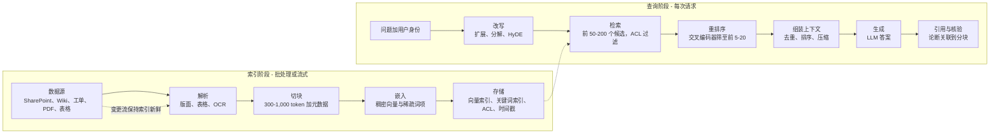
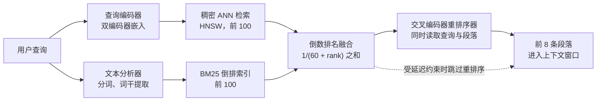

# 19. 检索架构：RAG、混合检索、GraphRAG 与上下文工程
> **深度：** L2 · **阅读时间：** 约 16 分钟 · **最后核实：** 2026-11-01 · **前置阅读：** [第 18 章 — 嵌入与向量检索](ch18-embeddings-and-vector-search.md)、[第 17 章 — 非结构化数据处理](ch17-unstructured-data-processing.md)

## 要点速览（TL;DR）

- [检索增强生成](../glossary.md#retrieval-augmented-generation)（retrieval-augmented generation，RAG）在提问时为语言模型提供恰当的文档，而不是依赖模型在训练中记住的内容。它分为两半。在**索引阶段**，数据源被解析、切块、嵌入并存储。在**查询阶段**，问题被改写，候选内容被检索并重排序，上下文被组装，模型生成带引用的答案。[^lewis2020]
- 生产系统几乎从不只用向量。[混合检索](../glossary.md#hybrid-search)（hybrid search）并行运行关键词检索（[BM25](../glossary.md#bm25)）与稠密检索，用[倒数排名融合](../glossary.md#reciprocal-rank-fusion)（reciprocal rank fusion）合并结果，再由[交叉编码器](../glossary.md#cross-encoder)（cross-encoder）[重排序器](../glossary.md#reranker)（reranker）选出最终的少数几条。在 Snowflake 的内部基准测试中，每一步都提升了质量：NDCG@10 依次为 0.22（关键词）、0.49（向量）、0.53（混合）和 0.59（混合加重排序），为厂商报告数据。[^sf-cortex]
- [GraphRAG](../glossary.md#graphrag)（Microsoft Research，2024）让 LLM 抽取实体与关系，将其聚类为社区并预先撰写摘要。这样可以回答针对整个语料库的"全局"问题——这正是分块检索的短板——但索引成本高昂。[^edge2024]
- 百万 token 级上下文窗口并没有终结 RAG。在一个示意性的 80 万 token 工作负载中，把所有内容塞进提示词，在不使用缓存时每次查询约需 $1.61，使用提示词缓存时约需 $0.17，而 RAG 约为 $0.03（按 Claude Sonnet 5.5 标价，2026 年 11 月）。长输入还会降低答案质量（"中间迷失"（lost in the middle）、"上下文腐化"（context rot））。[^anthropic-pricing][^liu2023][^context-rot]
- 2025 年出现的术语[上下文工程](../glossary.md#context-engineering)（context engineering）拓宽了视角。检索只是稀缺上下文窗口的输入之一，与指令、工具、记忆和历史并列。对这些 token 进行选择、压缩和排序，如今已是构建智能体（agent）的核心技能。[^ctx-eng] 对存储而言，其影响体现在：大型索引上的低延迟读取、源自主数据的新鲜度数据管道，以及用于卸载 [KV 缓存](../glossary.md#kv-cache)（KV cache）的新存储层级。

## 为何重要（商业 + Everpure 视角）

RAG 是大多数企业在自有数据上实际使用生成式 AI 的方式。一个在公共互联网上训练的模型，对一家公司的合同、工单、零件编号或制度一无所知。在这些数据上进行微调（fine-tuning）既慢又贵，而且无法实施权限控制。检索同时解决了这两个问题。每个答案都由用户本就有权查看的文档组装而成，在提问的那一刻检索获得，每条论断都能追溯到出处。这使检索成为企业搜索和"AI 助手"预算的主战场。企业搜索初创公司 Glean 在 2025 年 6 月的 F 轮融资中估值达 $7.2B（媒体报道），随后表示其年度经常性收入（ARR）在 2026 年 5 月达到 $300M（公司披露，媒体报道）。[^glean-tc][^glean-arr] Microsoft、Google、AWS、Databricks 和 Snowflake 都将检索作为其平台的托管功能出售。

RAG 系统的质量主要由数据而非模型决定。大多数故障可追溯到解析、切块、索引过期或权限缺失，这些都是数据工程问题（[第 17 章](ch17-unstructured-data-processing.md)、[第 13 章](../02-pipelines-and-governance/ch13-data-quality-observability-lineage.md)）。这就是为什么拥有受治理数据（目录、数据血缘、访问策略）的平台厂商主张应由它们掌控检索，也是纯向量数据库厂商受到挤压的原因（[第 18 章](ch18-embeddings-and-vector-search.md)、[第 32 章](../04-company-deep-dives/ch32-ai-native-data-companies.md)）。

对 Everpure 而言，这种关联是直接的。检索带来了三类与存储相邻的工作负载。第一类是针对超大型向量和关键词索引的低延迟随机读取。第二类是让索引与文件存储和对象存储上的主数据保持同步的持续数据管道。第三类是长上下文推理中的 KV 缓存卸载。Everpure 的 **Data Stream**（2026 年 6 月发布）已覆盖前两类：它基于 NVIDIA AI Data Platform 设计，在 FlashBlade 上将数据向量化，并提供流级访问控制。[^everpure-datastream] 其 **Key-Value Accelerator** 则瞄准第三类。[^everpure-kva] 下文的存储桥接部分列出了基于公开信息、战略团队可能评估的若干选项。

## 工作原理

### RAG 的两半

2020 年 Lewis 等人命名 RAG 的论文，将一个覆盖约 2,100 万条 Wikipedia 段落的神经检索器与一个生成模型配对。论文表明，在知识密集型问题上，获得检索段落的模型胜过了规模大得多、只能依赖记忆的模型。[^lewis2020] 企业系统保留了这种划分，但增加了许多环节。

*图 19.1 — SV-10：RAG 数据管道。索引阶段是一条数据管道。查询阶段是受延迟约束的服务路径。分块大小和候选数量为典型设计范围，并非基准测试结果。*

**索引阶段**是一条数据管道。解析把 PDF、幻灯片和 HTML 转为带结构（标题、表格、页码）的干净文本。切块（chunking）把文本拆分为可检索单元，通常为几百到约一千个 token，并附上标题、章节、负责人、日期和访问控制列表等元数据。嵌入把每个分块转为一个向量（[嵌入（向量）](../glossary.md#embedding)（embedding）；[第 18 章](ch18-embeddings-and-vector-search.md)），通常也会转为稀疏的关键词词项。存储环节把向量写入[向量索引](../glossary.md#vector-index)（vector index），把词项写入倒排索引，并将元数据保留为可过滤字段。Anthropic 2024 年关于"上下文检索"（contextual retrieval）的文章表明了索引阶段的选择有多重要。在每个分块前添加一段由 LLM 撰写、说明该分块在文档中位置的简短描述，使前 20 条检索失败率降低约 35%。加入上下文化 BM25 后降幅提高到 49%，再加入重排序器则提高到 67%（厂商基准测试）。[^contextual-retrieval]

**查询阶段**是一条有延迟预算的服务路径。问题首先被改写：用同义词扩展、拆分为子问题，或转为一个假设性答案，再用该答案的嵌入进行检索（[HyDE](../glossary.md#hyde)，Gao 等人，2022）。[^hyde] 检索按用户权限过滤后拉取一个较宽的候选集。重排序将其收窄。组装环节去除重复、对段落排序，并将其装入 token 预算。模型生成答案，最后一步检查每条被引用的段落是否真正支持引用它的句子。

> **类比：存储器层次结构。** 可以把 LLM 训练得到的权重看作一块巨大、缓慢、有损的主存。它保存着世界的压缩副本，更新一次需要完整的训练运行，并且无法设置权限。RAG 是这块主存前面的一层缓存。检索是一次**预取**（prefetch），在模型执行之前，把本次查询需要的少数几行从语料库（后备存储）拉入上下文窗口（片上 SRAM）。与任何预取器一样，它以命中率和污染程度来评判。取错了行，模型就在垃圾数据上计算。取得太多，有用的内容就会被逐出。

### 混合检索、融合与重排序

稠密向量能捕捉语义："笔记本电脑无法开机"能找到"笔记本无法启动"。但它们在精确 token 上表现较弱，例如零件编号、错误代码、法律引文和人名，而这些正是关键词检索的强项。BM25 是 Lucene 和 Elasticsearch 的标准评分函数，它会奖励在文档中频繁出现的稀有查询词。同时运行两者并合并结果，是默认的生产设计。

合并比看起来更难，因为 0.82 的余弦相似度和 14.3 的 BM25 分数处在不同量纲上。[倒数排名融合](../glossary.md#reciprocal-rank-fusion)（RRF；Cormack、Clarke 和 Büttcher，SIGIR 2009）忽略分数，只使用排名。每个文档的得分是其在所有结果列表中 1/(k + rank) 之和，原论文取 k = 60。被多个系统排在前列的文档会升至顶部。[^rrf2009] Elasticsearch、OpenSearch、Azure AI Search 以及大多数向量数据库都内置了该方法。

*图 19.2 — 混合检索。两个低成本、面向召回的检索并行运行，RRF 仅依据排名合并结果，再由一个高成本、面向精确度的重排序器对短名单重新排序。*

一个 k = 60 的 RRF 实算示例：

| 段落 | 稠密检索排名 | BM25 排名 | RRF 得分 | 融合后排名 |
|---|---|---|---|---|
| A："泵控制器出现错误 E-4471" | 7 | 1 | 1/67 + 1/61 = 0.0313 | 1 |
| B："控制器故障排查" | 1 | 9 | 1/61 + 1/69 = 0.0309 | 2 |
| C："泵维护概览" | 2 | 未检索到 | 1/62 = 0.0161 | 3 |
| D："E-4471 固件发布说明" | 未检索到 | 2 | 1/62 = 0.0161 | 3（并列） |

*图 19.3 — RRF 奖励一致性。段落 A 是一个强关键词匹配，稠密检索只把它排在第七，但因为两个系统都找到了它，它超过了稠密检索的第一名。*

[重排序器](../glossary.md#reranker)是另一类模型。检索使用[双编码器](../glossary.md#bi-encoder)（bi-encoder）：查询和文档分别嵌入，因此文档向量可以预先计算，并在毫秒级内完成检索。交叉编码器则同时读取查询和每个候选段落，输出一个相关性分数。这要准确得多，但必须在查询时逐对运行，因此只能为几十到几百个候选打分。商业选项包括 Cohere Rerank 4，经销商标价为每 1,000 次检索（每次最多 100 个文档）$2.00（Fast）到 $2.50（Pro）（媒体报道）；Voyage AI 的重排序器（MongoDB 于 2025 年以 $220M 收购 Voyage）；Jina AI 的重排序器（Elastic 于 2025 年 10 月收购 Jina）；以及 BAAI 的 BGE reranker 等开放权重模型。[^cohere-rerank][^mongodb-voyage][^elastic-jina] 重排序器通常会增加几十到几百毫秒的延迟（估算，取决于模型规模、候选数量和硬件）。

> **类比：半导体测试。** 重排序就是两阶段检测。晶圆厂不会把每颗裸片都放到昂贵的参数测试机上。先用快速的光学或电学筛查剔除明显的不良品，精密测量只留给入围名单。双编码器检索是低成本筛查，针对召回率调优，以免丢掉任何好的裸片。交叉编码器是精密测量，针对少数进入该环节的样本优化精确度。在第一阶段投入过多会损失吞吐量；跳过第二阶段则会出货边缘品。

### RAG 在哪里失效

大多数 RAG 事故是看起来像模型问题的数据问题。

| 失效模式 | 症状 | 根本原因 | 修复方法 |
|---|---|---|---|
| 切块不当 | 答案漏掉半张表格或某条款的例外情形 | 固定大小的切分割裂了结构。分块缺少文档上下文 | 结构感知的解析与切块（[第 17 章](ch17-unstructured-data-processing.md)）。添加上下文标题。使用父子检索 |
| ACL 缺失 | 用户在答案中看到薪资数据或其他客户的合同 | 索引由服务账号构建。权限未被复制，或查询时未执行 | 为每个分块存储 ACL，并在检索时按调用者身份过滤。权限变更时重新同步 |
| 索引过期 | 自信地给出答案，却引用了已被取代的制度 | 批量重建索引滞后于数据源。删除操作从未传播 | 基于变更数据捕获（CDC）或事件驱动的重建索引。将索引新鲜度作为 SLO 跟踪。执行删除 |
| 词汇不匹配 | 在零件编号、代码、人名上漏检 | 仅使用稠密检索 | BM25 与稠密检索混合，并用 RRF 融合。查询改写 |
| 中间迷失 | 相关段落已被检索到，但答案忽略了它 | 模型对长输入的开头和结尾关注度最高 | 检索更少但更好的段落。重排序。把最有力的证据放在两端 |
| 幻觉引用 | 脚注指向一份真实文档，但该文档并不支持该论断 | 模型以文本形式生成引用，未经检查 | 将引用限定为已检索分块的 ID。在展示前运行蕴含检查或 LLM 评判检查 |
| 全局性问题 | "所有事故报告的主要主题是什么？"只得到浅显的回答 | Top-k 检索只看到少数几个分块 | GraphRAG 式摘要、对语料库做 map-reduce，或智能体式多步检索 |
| 间接提示词注入 | 答案执行了隐藏在检索到的网页或邮件中的指令 | 检索文本被当作可信指令 | 将数据与指令分离。净化数据源。限制智能体在读取不可信内容后可调用的工具 |

*图 19.4 — RAG 失效模式。八种中有六种是在数据管道或索引中修复的，而不是靠更换模型。*

"中间迷失"这一结论值得强调，因为它影响上下文的组装方式。Liu 等人（2023，发表于 TACL 2024）将唯一的相关文档在 20 份检索文档中移动位置。准确率呈 U 形：文档位于开头或结尾时最高，位于中间时最低。对其中一个模型而言，中间位置的准确率甚至低于完全不提供文档时的成绩。[^liu2023] Chroma 2025 年对 18 个模型的"上下文腐化"研究发现，即使在简单任务上，可靠性也会随输入增长而下降。[^context-rot] 即使放得下，更多上下文也不是免费的。

### 智能体式 RAG

经典 RAG 检索一次然后作答。**智能体式 RAG**（agentic RAG）把检索变成模型可按需反复调用的工具：检索、阅读、发现缺口、细化查询、检索另一个数据源，并在证据充分时停止。它能处理多跳问题（"哪些使用旧合同模板的客户将在下季度续约？"），这类问题需要先做文档检索，再做一次 SQL 查询，然后再检索一次。代价是更多的模型调用、更难预测的延迟以及更难的评估。Microsoft 的 Azure AI Search 增加了"智能体式检索"（agentic retrieval）模式，用 LLM 规划子查询并并行执行；基于它构建的 Foundry IQ 知识库于 2026 年 6 月宣布正式可用（GA）。[^foundry-iq] [第 22 章](ch22-agents-and-data.md)介绍智能体一侧，包括把检索和 SQL 作为工具暴露出来的[模型上下文协议](../glossary.md#model-context-protocol)（Model Context Protocol）。
