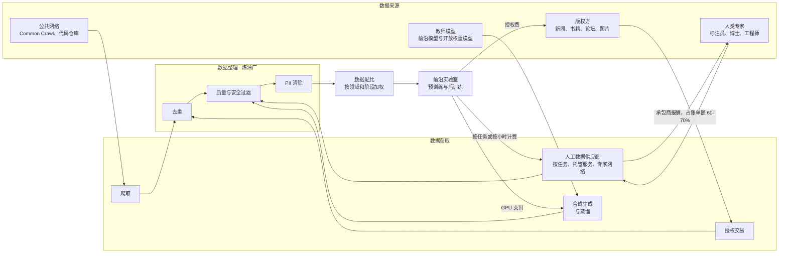

# 20. 训练数据供应链
> **深度：** L2 · **阅读时间：** 约 16 分钟 · **最后核实：** 2026-11-01 · **前置阅读：** [第 16 章 — AI 数据生命周期](ch16-ai-data-lifecycle.md)

## 要点速览（TL;DR）

- 前沿模型由四类输入渠道构建：爬取的网络数据、授权内容、人工产出的数据（标注、偏好排序、专家示范）以及由其他模型生成的合成数据（synthetic data）。每个渠道都有各自的成本曲线、法律风险和供应商结构。它们共同构成一条供应链，而数据整理（curation，包括去重、质量过滤、PII 移除、配比混合）就是位于中间的"炼油厂"。
- 人工数据正迅速向高端市场迁移。廉价的众包标注（Appen 的模式）正在萎缩。按小时出租博士、医生和资深工程师的专家网络正在快速增长。Mercor 的定价估值升至 $10B（2025 年 10 月，公司确认），[^mercor-c] Snorkel AI 升至 $3.5B（2026 年 9 月，公司披露）。[^snorkel-e] 据报道，依靠自有资金发展的 Surge AI 2024 年收入超过 $1B（媒体报道）。[^surge-reuters]
- 买方只有少数几家前沿实验室，因此供应商中立性是最重要的资产。据媒体报道，Meta 于 2025 年 6 月斥资约 $14.3B 收购 Scale AI 49% 的股份，并聘走了其 CEO。[^meta-scale] 几周之内，有报道称 Google 和 OpenAI 正在逐步终止与 Scale 的合作，Scale 裁员约 14%。[^scale-customers][^scale-layoffs] 来自一个客户的大笔投资赶走了其他客户。
- 法律背景在 2025–2026 年发生了变化。两家美国地区法院根据各自的案卷认定，用书籍训练模型可以构成合理使用（fair use）（Bartz v. Anthropic；Kadrey v. Meta，2025 年 6 月）。在 Bartz 案中，用盗版副本建立资料库是另一个问题，这让 Anthropic 付出了 $1.5B 的集体诉讼和解金，该和解于 2026 年 7 月获得最终批准。[^bartz-final][^fairuse] 如今，授权看起来不太像法律盾牌，而更像是为新鲜、难以爬取的内容支付的访问费。
- 数据整理胜过原始规模。FineWeb-Edu 从 15T token 的网络语料中只保留了"具有教育价值"的 1.3T token，在其上训练的模型在知识和推理基准测试上得分显著更高。[^fineweb] 相关工具（MinHash 去重、由 LLM 标注训练的质量分类器、NVIDIA NeMo Curator 等 GPU 数据管道）如今已是通用商品。仍然稀缺的是决定混合配比中放入什么的判断力。

## 为何重要（商业 + Everpure 视角）

算力占据了新闻头条，但数据才是区分各家前沿实验室的投入要素。每家实验室都能买到同样的 GPU。但很少有实验室能买到同样由专家撰写的推理轨迹、同样的授权档案，或同样调优过的数据配比。这就是为什么人工数据支出在三年内成长为一个数十亿美元规模的市场。大学求职网络 Handshake 在大约一年内建立了一项年化运行率约 $1B 的 AI 数据业务（公司披露的年化运行率；总账单额）。[^handshake] 这也是为什么最有价值的数据供应商看起来不太像软件公司，而更像人力派遣公司或特种材料供应商——这对如何为它们估值至关重要。

对于企业发展（corporate development）方向的读者，本章回答三个问题。这条链条中的价值在哪里沉淀？目前，价值流向稀缺的专家供给和数据整理的专业知识，而非商品化的标注。鉴于少数买家掌控了大部分需求，这些业务的持久性如何？这条链条对基础设施供应商意味着什么？

Everpure 的切入点在第三个问题。训练语料和整理后的数据集体量大、生命周期长且有版本管理。一家实验室会保存原始爬取快照、若干经过去重和过滤的衍生版本，以及每个模型检查点背后的确切配比，有时长达数年，以满足可复现性和诉讼需要。根据 Anthropic 的和解协议，该公司必须销毁其持有的盗版文件，[^bartz-final] 因此可证明的删除和数据血缘如今已是法律要求，而不仅仅是良好的数据卫生习惯。企业微调在较小规模上面临同样的问题：找到敏感数据、对其分类、清除并留存记录。这正是 Everpure 于 2026 年收购 1touch（数据发现、数据分类和语义上下文）所要承担的工作。[^everpure-1touch] 参见下文的存储桥接和[第 15 章](../02-pipelines-and-governance/ch15-governance-security-privacy.md)。

## 工作原理

### 四条渠道汇入一座炼油厂

可以把模型的训练数据看作一份物料清单。预训练（pretraining）消耗数万亿 token，主要是爬取的网络文本，加上代码、书籍和论文。后训练消耗的 token 少得多，但每个 token 的成本高得多。它们包括监督式示范、用于[人类反馈强化学习](../glossary.md#reinforcement-learning-from-human-feedback)（reinforcement learning from human feedback，RLHF）的偏好排序、由专家评分的评分细则（rubric），以及越来越多的 [RL 环境](../glossary.md#rl-environment)（RL environment）：可以自动为模型的尝试打分的模拟任务。InstructGPT 论文（2022）在早期偏好学习研究的基础上，推广了 RLHF 方法，正是这一方法催生了人工数据市场。[^instructgpt]

*图 20.1 — 训练数据供应链。资金从少数几家实验室沿链条回流。人工数据的大部分资金经由供应商流向承包商，因此供应商的真实利润是其抽成比例（take rate），而非总账单额。*

### 人工数据：从众包标注到租用博士

人工数据供应商采用三种商业模式，其差异直接体现在利润率上。

1. **按任务计费的众包平台。** 众包工人按件计酬地绘制边界框或为输出打分。这是 Appen 和 Toloka 的模式。它是一种商品：容易多源采购，价格逐年被压低。在 Google 于 2024 年 3 月终止合同后，Appen 的收入在 FY2025 降至 $230.8M（自然年财年，公司报告，较 $234.3M 下降）。只是靠中国业务 75% 的增长，才使其大致持平。[^appen] 其毛利率在较早时期约为 24%（估算）。[^scale-sacra]
2. **托管服务。** 供应商掌控工作流程、质量控制和工具，按合同出售成品数据集。这曾是 Scale AI 的模式，也是 Surge 和 Invisible 的模式。利润率更高。Scale 在规模小得多时毛利率约在 50% 以上（估算），[^scale-sacra] 据报道 Surge 自成立以来一直盈利（媒体报道）。[^surge-reuters]
3. **专家网络。** 供应商招募具备资质的人员（律师、医生、数学家、资深软件工程师），按小时向实验室收费。Mercor、Handshake AI 和 Turing 是最典型的例子。收入按总额报告：承包商报酬约占账单额的 60–70%（估算），因此净抽成约为 30–40%。[^mercor-sacra] Handshake 表示，它每月向 30,000 多人支付约 $60M（公司披露）。[^handshake]

转变的方向是从数量走向稀缺。2019 年前后，一条标注只需几美分。到 2026 年，一份针对研究生水平化学题的专家评分细则，成本就是一位化学家的小时费率。实验室愿意支付这一价格，是因为模型已经能处理简单任务，剩余的提升来自只有专家才能编写或评判的难题样本。最新的产品是 RL 环境：一个沙箱化的任务（一个带有失败测试的代码库、一张需要核对的电子表格）外加一个自动评分器。供应商只需构建一次环境，就能将访问权出售给多家实验室。这看起来更像软件而非人力派遣，这也是 Snorkel 将其新融资描述为投资一座"数据工厂"的原因。[^snorkel-e]

> **类比：半导体供应链。** 把这些供应商映射到晶圆厂的投入品上。众包标注是**大宗化学品**：可互换、多源采购、按成本定价。专家数据是**特种气体和光刻胶**：用量小，却对良率至关重要，由少数合格供应商生产，并能获得高利润率，因为实验室难以在项目进行中重新认证新的供应来源。RL 环境和评估套件则希望成为 **ASML**：一种每个客户都需要、却很少有人能造出来的可复用工具。差距在于，ASML 的护城河是数十年的物理学积累和专利壁垒，而数据供应商的护城河是招募来的劳动力队伍和一套质量流程，资金充裕的对手一年就能复制。

### 实算示例：当 $14.3B 不是一笔收购时，它买到了什么

2025 年 6 月，据媒体报道，Meta 斥资约 $14.3B 收购 Scale AI 49% 的**无投票权**股份，隐含估值约 $29B。CEO Alexandr Wang 离职去领导 Meta 的超级智能项目，Jason Droege 出任临时 CEO。[^meta-scale] 一年前，Scale 的 F 轮融资对其定价为 $13.8B（公司披露，2024 年 5 月）。[^scale-f] 以媒体报道的 2024 年收入约 $870M 计算，[^surge-bb] 隐含倍数约为过去 12 个月收入的 33 倍（估算）。

Meta 实际上买到了什么？一种有用的拆解方式：

| 组成部分 | Meta 得到了什么 | Scale 付出了什么 |
|---|---|---|
| 人才 | Wang 和一个小团队来运营其实验室（实际上是一次人才收购（acquihire）） | 创始人兼 CEO；Jason Droege 担任临时 CEO，随后任命了一位外部 CEO（Francis deSouza，2026 年 8 月生效，公司宣布）[^scale-ceo] [VERIFY: deSouza 的任命未列入整合者的已核实事实登记表] |
| 供应洞察 | 以大股东身份了解领先数据供应商的情况 | 中立性：据报道 Google 和 OpenAI 逐步终止合作[^scale-customers] |
| 交易结构 | 一笔非控股投资，普遍被解读为限制了并购审查风险（分析师判断） | 2025 年 7 月裁减约 14% 的员工和 500 名承包商[^scale-layoffs] |
| 财务 | 一笔按约 $29B 估值计量的股权 | 据报道后续洽谈的估值降至约 $20B `[VERIFY: Scale AI 2026 年约 $20B 估值的融资]` |

*图 20.2 — 一笔"人才收购加供应"交易：Meta 在不取得控制权的情况下获得了人才和影响力，而 Scale 付出的是它最宝贵的资产——中立性。*

对任何在集中市场中为供应商估值的人来说，教训正是 TSMC 赖以立业的那条原则：永远不要被某个客户控股，也不要与客户竞争。当少数几家实验室占据大部分支出时（Sacra 估计 Surge 从约 12 个客户处获得了超过 $1B 的收入），[^surge-sacra] 一家实验室持有的股份就会给其他实验室离开的理由。同样的风险也可能来自运营失误。2026 年 3 月底发生安全漏洞后，Meta 暂停了与 Mercor 的合作，OpenAI 和 Anthropic 则在评估自身受影响程度（媒体报道）。[^mercor-breach] 实验室将其数据配方视为商业机密。一个能看到多家实验室配方的供应商，既是一个供应商，也是机密的集中地。

### 合成数据：模型成为自己的供应商

[合成数据](../glossary.md#synthetic-data)是由模型生成、而非从人或现实世界采集的训练数据。其最常见的形式是[蒸馏](../glossary.md#distillation)（distillation）：一个大型"教师"模型撰写答案或推理轨迹，一个较小的"学生"模型在其上训练。NVIDIA 围绕这一点打造了一条产品线。Nemotron-4 340B Instruct 超过 98% 的对齐数据是合成的，NVIDIA 以开放模型许可证（2024 年 6 月）发布了生成器、用于为其输出打分的奖励模型以及整条数据管道。[^nemotron] 在机器人和自动驾驶领域，NVIDIA 的 Cosmos 世界模型（2025 年 1 月）可以生成符合物理规律的视频。NVIDIA 表示这些模型在 2,000 万小时的视频上训练（厂商声明）。[^cosmos] NVIDIA 还于 2025 年 3 月以未披露的价格收购了合成表格数据初创公司 Gretel，据 Wired 报道金额为九位数（媒体报道）。[^gretel]

其吸引力在于经济性。GPU 时间比专家时间便宜，而且无需招聘即可扩展。风险则是统计层面的。Shumailov 等人（*Nature*，2024 年 7 月）表明，在自身输出上递归训练的模型会发生[模型崩溃](../glossary.md#model-collapse)（model collapse）。原始分布中罕见的"尾部"最先消失，经过足够多代之后，输出会退化为重复文本。[^collapse] 实践中，实验室通过三种方式管理这一风险。它们保留一个固定的真实数据锚点。它们将合成数据添加到这个锚点上，而不是替换它。它们主要在输出可自动核验的地方使用合成数据，例如必须通过测试的代码，或答案可验证的数学题。因此，合成数据与专家数据之间更多是互补而非替代关系：专家编写高难度的种子样本和评分器，模型则将其成倍扩增。

### 授权内容与法律背景

授权交易始于 2023 年，并在 2024 年全面铺开。据报道，Reddit 以每年约 $60M 的价格将其帖子授权给 Google（2024 年 2 月，媒体报道），[^reddit-google] 并授权给 OpenAI（2024 年 5 月；每年约 $70M 为外部估算）。[^reddit-openai] 据报道，News Corp 与 OpenAI 签署了五年约 $250M 的协议（2024 年 5 月，媒体报道）。[^newscorp] 此前与 Associated Press（2023 年 7 月）、Shutterstock（2023 年 7 月）和 Axel Springer（2023 年 12 月）的交易确立了模板。各方未披露这些交易的财务条款。[^early-deals] 学术出版商也成为重要的卖方。据二手来源报道，Wiley 在其 FY2026（2025 年 5 月–2026 年 4 月）报告了约 $49M 的 AI 授权收入。[^wiley]
