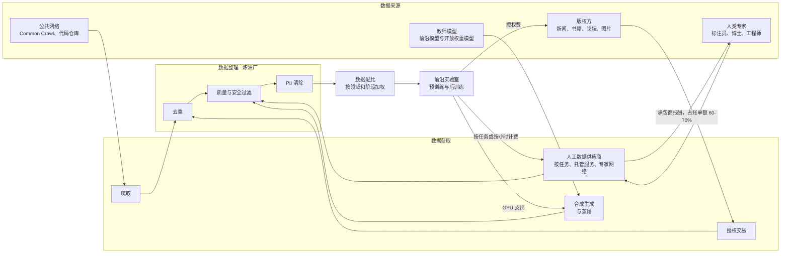
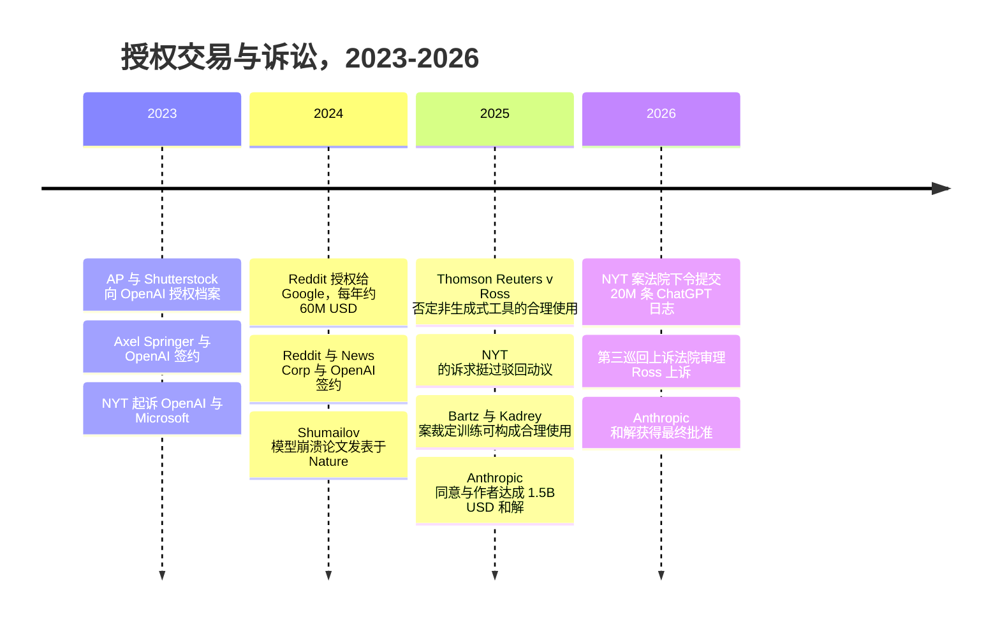
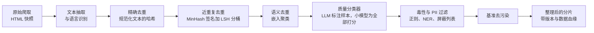
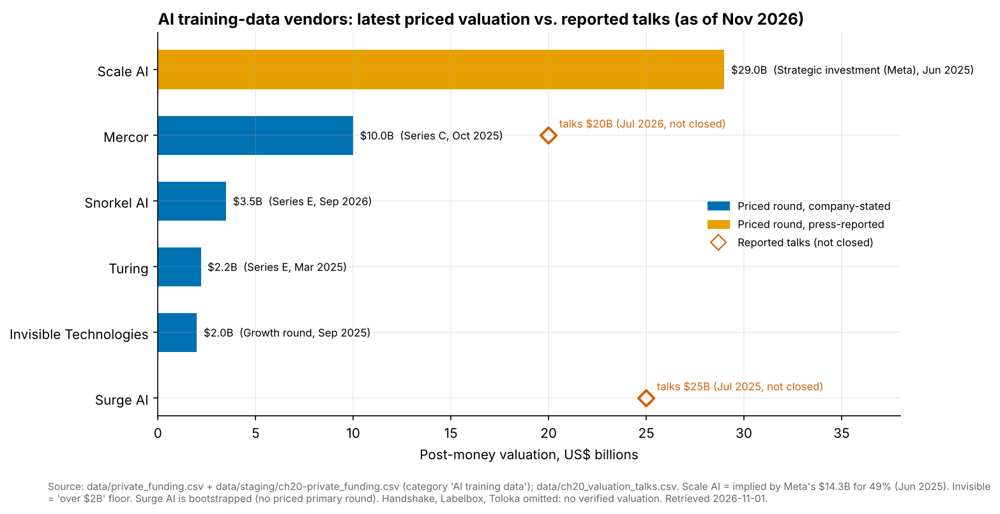

# 20. 训练数据供应链
> **深度：** L2 · **阅读时间：** 约 16 分钟 · **最后核实：** 2026-11-01 · **前置阅读：** [第 16 章 — AI 数据生命周期](ch16-ai-data-lifecycle.md)

## 要点速览（TL;DR）

- 前沿模型由四类输入渠道构建：爬取的网络数据、授权内容、人工产出的数据（标注、偏好排序、专家示范）以及由其他模型生成的合成数据（synthetic data）。每个渠道都有各自的成本曲线、法律风险和供应商结构。它们共同构成一条供应链，而数据整理（curation，包括去重、质量过滤、PII 移除、配比混合）就是位于中间的"炼油厂"。
- 人工数据正迅速向高端市场迁移。廉价的众包标注（Appen 的模式）正在萎缩。按小时出租博士、医生和资深工程师的专家网络正在快速增长。Mercor 的定价估值升至 $10B（2025 年 10 月，公司确认），[^mercor-c] Snorkel AI 升至 $3.5B（2026 年 9 月，公司披露）。[^snorkel-e] 据报道，依靠自有资金发展的 Surge AI 2024 年收入超过 $1B（媒体报道）。[^surge-reuters]
- 买方只有少数几家前沿实验室，因此供应商中立性是最重要的资产。据媒体报道，Meta 于 2025 年 6 月斥资约 $14.3B 收购 Scale AI 49% 的股份，并聘走了其 CEO。[^meta-scale] 几周之内，有报道称 Google 和 OpenAI 正在逐步终止与 Scale 的合作，Scale 裁员约 14%。[^scale-customers][^scale-layoffs] 来自一个客户的大笔投资赶走了其他客户。
- 法律背景在 2025–2026 年发生了变化。两家美国地区法院根据各自的案卷认定，用书籍训练模型可以构成合理使用（fair use）（Bartz v. Anthropic；Kadrey v. Meta，2025 年 6 月）。在 Bartz 案中，用盗版副本建立资料库是另一个问题，这让 Anthropic 付出了 $1.5B 的集体诉讼和解金，该和解于 2026 年 7 月获得最终批准。[^bartz-final][^fairuse] 如今，授权看起来不太像法律盾牌，而更像是为新鲜、难以爬取的内容支付的访问费。
- 数据整理胜过原始规模。FineWeb-Edu 从 15T token 的网络语料中只保留了"具有教育价值"的 1.3T token，在其上训练的模型在知识和推理基准测试上得分显著更高。[^fineweb] 相关工具（MinHash 去重、由 LLM 标注训练的质量分类器、NVIDIA NeMo Curator 等 GPU 数据管道）如今已是通用商品。仍然稀缺的是决定混合配比中放入什么的判断力。

## 为何重要（商业 + Everpure 视角）

算力占据了新闻头条，但数据才是区分各家前沿实验室的投入要素。每家实验室都能买到同样的 GPU。但很少有实验室能买到同样由专家撰写的推理轨迹、同样的授权档案，或同样调优过的数据配比。这就是为什么人工数据支出在三年内成长为一个数十亿美元规模的市场。大学求职网络 Handshake 在大约一年内建立了一项年化运行率约 $1B 的 AI 数据业务（公司披露的年化运行率；总账单额）。[^handshake] 这也是为什么最有价值的数据供应商看起来不太像软件公司，而更像人力派遣公司或特种材料供应商——这对如何为它们估值至关重要。

对于企业发展（corporate development）方向的读者，本章回答三个问题。这条链条中的价值在哪里沉淀？目前，价值流向稀缺的专家供给和数据整理的专业知识，而非商品化的标注。鉴于少数买家掌控了大部分需求，这些业务的持久性如何？这条链条对基础设施供应商意味着什么？

Everpure 的切入点在第三个问题。训练语料和整理后的数据集体量大、生命周期长且有版本管理。一家实验室会保存原始爬取快照、若干经过去重和过滤的衍生版本，以及每个模型检查点背后的确切配比，有时长达数年，以满足可复现性和诉讼需要。根据 Anthropic 的和解协议，该公司必须销毁其持有的盗版文件，[^bartz-final] 因此可证明的删除和数据血缘如今已是法律要求，而不仅仅是良好的数据卫生习惯。企业微调在较小规模上面临同样的问题：找到敏感数据、对其分类、清除并留存记录。这正是 Everpure 于 2026 年收购 1touch（数据发现、数据分类和语义上下文）所要承担的工作。[^everpure-1touch] 参见下文的存储桥接和[第 15 章](../02-pipelines-and-governance/ch15-governance-security-privacy.md)。

## 工作原理

### 四条渠道汇入一座炼油厂

可以把模型的训练数据看作一份物料清单。预训练（pretraining）消耗数万亿 token，主要是爬取的网络文本，加上代码、书籍和论文。后训练消耗的 token 少得多，但每个 token 的成本高得多。它们包括监督式示范、用于[人类反馈强化学习](../glossary.md#reinforcement-learning-from-human-feedback)（reinforcement learning from human feedback，RLHF）的偏好排序、由专家评分的评分细则（rubric），以及越来越多的 [RL 环境](../glossary.md#rl-environment)（RL environment）：可以自动为模型的尝试打分的模拟任务。InstructGPT 论文（2022）在早期偏好学习研究的基础上，推广了 RLHF 方法，正是这一方法催生了人工数据市场。[^instructgpt]

*图 20.1 — 训练数据供应链。资金从少数几家实验室沿链条回流。人工数据的大部分资金经由供应商流向承包商，因此供应商的真实利润是其抽成比例（take rate），而非总账单额。*

### 人工数据：从众包标注到租用博士

人工数据供应商采用三种商业模式，其差异直接体现在利润率上。

1. **按任务计费的众包平台。** 众包工人按件计酬地绘制边界框或为输出打分。这是 Appen 和 Toloka 的模式。它是一种商品：容易多源采购，价格逐年被压低。在 Google 于 2024 年 3 月终止合同后，Appen 的收入在 FY2025 降至 $230.8M（自然年财年，公司报告，较 $234.3M 下降）。只是靠中国业务 75% 的增长，才使其大致持平。[^appen] 其毛利率在较早时期约为 24%（估算）。[^scale-sacra]
2. **托管服务。** 供应商掌控工作流程、质量控制和工具，按合同出售成品数据集。这曾是 Scale AI 的模式，也是 Surge 和 Invisible 的模式。利润率更高。Scale 在规模小得多时毛利率约在 50% 以上（估算），[^scale-sacra] 据报道 Surge 自成立以来一直盈利（媒体报道）。[^surge-reuters]
3. **专家网络。** 供应商招募具备资质的人员（律师、医生、数学家、资深软件工程师），按小时向实验室收费。Mercor、Handshake AI 和 Turing 是最典型的例子。收入按总额报告：承包商报酬约占账单额的 60–70%（估算），因此净抽成约为 30–40%。[^mercor-sacra] Handshake 表示，它每月向 30,000 多人支付约 $60M（公司披露）。[^handshake]

转变的方向是从数量走向稀缺。2019 年前后，一条标注只需几美分。到 2026 年，一份针对研究生水平化学题的专家评分细则，成本就是一位化学家的小时费率。实验室愿意支付这一价格，是因为模型已经能处理简单任务，剩余的提升来自只有专家才能编写或评判的难题样本。最新的产品是 RL 环境：一个沙箱化的任务（一个带有失败测试的代码库、一张需要核对的电子表格）外加一个自动评分器。供应商只需构建一次环境，就能将访问权出售给多家实验室。这看起来更像软件而非人力派遣，这也是 Snorkel 将其新融资描述为投资一座"数据工厂"的原因。[^snorkel-e]

> **类比：半导体供应链。** 把这些供应商映射到晶圆厂的投入品上。众包标注是**大宗化学品**：可互换、多源采购、按成本定价。专家数据是**特种气体和光刻胶**：用量小，却对良率至关重要，由少数合格供应商生产，并能获得高利润率，因为实验室难以在项目进行中重新认证新的供应来源。RL 环境和评估套件则希望成为 **ASML**：一种每个客户都需要、却很少有人能造出来的可复用工具。差距在于，ASML 的护城河是数十年的物理学积累和专利壁垒，而数据供应商的护城河是招募来的劳动力队伍和一套质量流程，资金充裕的对手一年就能复制。

### 实算示例：当 $14.3B 不是一笔收购时，它买到了什么

2025 年 6 月，据媒体报道，Meta 斥资约 $14.3B 收购 Scale AI 49% 的**无投票权**股份，隐含估值约 $29B。CEO Alexandr Wang 离职去领导 Meta 的超级智能项目，Jason Droege 出任临时 CEO。[^meta-scale] 一年前，Scale 的 F 轮融资对其定价为 $13.8B（公司披露，2024 年 5 月）。[^scale-f] 以媒体报道的 2024 年收入约 $870M 计算，[^surge-bb] 隐含倍数约为过去 12 个月收入的 33 倍（估算）。

Meta 实际上买到了什么？一种有用的拆解方式：

| 组成部分 | Meta 得到了什么 | Scale 付出了什么 |
|---|---|---|
| 人才 | Wang 和一个小团队来运营其实验室（实际上是一次人才收购（acquihire）） | 创始人兼 CEO；Jason Droege 担任临时 CEO，随后任命了一位外部 CEO（Francis deSouza，2026 年 8 月生效，公司宣布）[^scale-ceo] [VERIFY: deSouza 的任命未列入整合者的已核实事实登记表] |
| 供应洞察 | 以大股东身份了解领先数据供应商的情况 | 中立性：据报道 Google 和 OpenAI 逐步终止合作[^scale-customers] |
| 交易结构 | 一笔非控股投资，普遍被解读为限制了并购审查风险（分析师判断） | 2025 年 7 月裁减约 14% 的员工和 500 名承包商[^scale-layoffs] |
| 财务 | 一笔按约 $29B 估值计量的股权 | 据报道后续洽谈的估值降至约 $20B `[VERIFY: Scale AI 2026 年约 $20B 估值的融资]` |

*图 20.2 — 一笔"人才收购加供应"交易：Meta 在不取得控制权的情况下获得了人才和影响力，而 Scale 付出的是它最宝贵的资产——中立性。*

对任何在集中市场中为供应商估值的人来说，教训正是 TSMC 赖以立业的那条原则：永远不要被某个客户控股，也不要与客户竞争。当少数几家实验室占据大部分支出时（Sacra 估计 Surge 从约 12 个客户处获得了超过 $1B 的收入），[^surge-sacra] 一家实验室持有的股份就会给其他实验室离开的理由。同样的风险也可能来自运营失误。2026 年 3 月底发生安全漏洞后，Meta 暂停了与 Mercor 的合作，OpenAI 和 Anthropic 则在评估自身受影响程度（媒体报道）。[^mercor-breach] 实验室将其数据配方视为商业机密。一个能看到多家实验室配方的供应商，既是一个供应商，也是机密的集中地。

### 合成数据：模型成为自己的供应商

[合成数据](../glossary.md#synthetic-data)是由模型生成、而非从人或现实世界采集的训练数据。其最常见的形式是[蒸馏](../glossary.md#distillation)（distillation）：一个大型"教师"模型撰写答案或推理轨迹，一个较小的"学生"模型在其上训练。NVIDIA 围绕这一点打造了一条产品线。Nemotron-4 340B Instruct 超过 98% 的对齐数据是合成的，NVIDIA 以开放模型许可证（2024 年 6 月）发布了生成器、用于为其输出打分的奖励模型以及整条数据管道。[^nemotron] 在机器人和自动驾驶领域，NVIDIA 的 Cosmos 世界模型（2025 年 1 月）可以生成符合物理规律的视频。NVIDIA 表示这些模型在 2,000 万小时的视频上训练（厂商声明）。[^cosmos] NVIDIA 还于 2025 年 3 月以未披露的价格收购了合成表格数据初创公司 Gretel，据 Wired 报道金额为九位数（媒体报道）。[^gretel]

其吸引力在于经济性。GPU 时间比专家时间便宜，而且无需招聘即可扩展。风险则是统计层面的。Shumailov 等人（*Nature*，2024 年 7 月）表明，在自身输出上递归训练的模型会发生[模型崩溃](../glossary.md#model-collapse)（model collapse）。原始分布中罕见的"尾部"最先消失，经过足够多代之后，输出会退化为重复文本。[^collapse] 实践中，实验室通过三种方式管理这一风险。它们保留一个固定的真实数据锚点。它们将合成数据添加到这个锚点上，而不是替换它。它们主要在输出可自动核验的地方使用合成数据，例如必须通过测试的代码，或答案可验证的数学题。因此，合成数据与专家数据之间更多是互补而非替代关系：专家编写高难度的种子样本和评分器，模型则将其成倍扩增。

### 授权内容与法律背景

授权交易始于 2023 年，并在 2024 年全面铺开。据报道，Reddit 以每年约 $60M 的价格将其帖子授权给 Google（2024 年 2 月，媒体报道），[^reddit-google] 并授权给 OpenAI（2024 年 5 月；每年约 $70M 为外部估算）。[^reddit-openai] 据报道，News Corp 与 OpenAI 签署了五年约 $250M 的协议（2024 年 5 月，媒体报道）。[^newscorp] 此前与 Associated Press（2023 年 7 月）、Shutterstock（2023 年 7 月）和 Axel Springer（2023 年 12 月）的交易确立了模板。各方未披露这些交易的财务条款。[^early-deals] 学术出版商也成为重要的卖方。据二手来源报道，Wiley 在其 FY2026（2025 年 5 月–2026 年 4 月）报告了约 $49M 的 AI 授权收入。[^wiley]

*图 20.3 — 先有交易，后有判决。2025 年的判决保护了"训练"这一用途，但没有保护以盗版方式获取数据。*

这些判决沿着一条清晰的界线分开。在 *Bartz v. Anthropic* 案（2025 年 6 月）中，Alsup 法官认定用书籍进行训练属于合理使用。他将有关下载数百万份盗版副本以及保留永久资料库的诉求移交审判。在数日后判决的 *Kadrey v. Meta* 案中，Chhabria 法官同样作出有利于 Meta 的裁决。但他的理由较为狭窄：他暗示，"市场稀释"（market dilution，即 AI 生成的书籍挤占人类作品）的证据可能会赢得未来的案件。[^fairuse] 2025 年 2 月，*Thomson Reuters v. Ross* 案对一款与其数据来源相竞争的非生成式法律研究工具作出了相反的判决。该案已上诉至第三巡回上诉法院，口头辩论定于 2026 年 6 月。[^ross] Anthropic 以 $1.5B 了结了盗版风险，覆盖约 480,000 部作品，每部约 $3,000。最终批准于 2026 年 7 月 20 日作出，和解仅豁免截至 2025 年 8 月 25 日的行为。[^bartz-final] *New York Times v. OpenAI* 案于 2025 年 3 月挺过了驳回动议，2026 年仍处于证据开示阶段，尚未查到审判日期。[^nyt]

> **类比：知识产权授权。** 如今的内容交易大多是**一次性付清的授权**（paid-up license）：为获取访问权支付固定年费，类似于解决专利纠纷的交叉授权。版权方想要的是 Qualcomm 和 Arm 所拥有的模式——与每件售出产品挂钩的**持续版税**（running royalty），在这个市场中意味着与每次回答的查询或每次展示的引用挂钩。合理使用判决削弱了"大棒"（禁令威胁），因此授权的价值如今取决于"胡萝卜"：无法自由爬取的新鲜、结构化内容。这就是为什么掌控其 API 和实时数据访问权的 Reddit，据报道能够在 2025 年寻求第二轮交易。[^reddit-next]

### 规模化数据整理：去重、质量、PII

原始网络文本大多是重复内容、模板化文字和垃圾信息。数据整理通过一系列固定阶段将其转化为训练数据，成本最低的阶段最先执行。

*图 20.4 — 典型的去重与过滤数据管道。每个阶段处理单个文档的成本都高于前一阶段，因此先运行低成本阶段，以缩减进入高成本阶段的数据量。*

**精确去重**对每个规范化后的文档计算哈希并丢弃重复项。**近重复**检测使用 [MinHash](../glossary.md#minhash)：每个文档被压缩为一个简短签名，签名的重合度可以估算文档之间词片段（word-shingle）的重合度（[Jaccard 相似度](../glossary.md#jaccard-similarity)（Jaccard similarity））。随后，[局部敏感哈希](../glossary.md#locality-sensitive-hashing)（locality-sensitive hashing，LSH）对签名进行分桶，只比较可能匹配的项。这一点很重要，因为重复无处不在。Lee 等人发现，C4 语料库中一个 61 个单词的句子重复了 60,000 多次，并证明去重可以减少模型对训练内容的记忆性输出并加快训练。[^lee-dedup] **语义去重**更进一步。它对文档做嵌入、聚类，即使措辞不同，也能移除含义几乎相同的内容。SemDeDup 论文报告称，从一个大型图文数据集中移除了约一半的数据，而模型质量几乎没有损失。[^semdedup]

**质量分类器**是需要判断力的环节。FineWeb-Edu 使用 Llama-3-70B-Instruct 为一部分网页样本的教育价值打分，在这些分数上训练了一个小型分类器，再将其运行于完整的 15T token FineWeb 语料库。保留下来的 1.3T token 在 MMLU 和 ARC 等知识与推理密集型基准测试上训练出了明显更好的模型。[^fineweb] DataComp 将同一理念变成了一个基准：它固定模型和训练预算，让各团队只在过滤方法上竞争。[^datacomp] 最后，PII 清除和毒性过滤会移除电子邮件、电话号码和身份证件号码，以及侮辱性内容。在企业微调中，这正是数据治理工具（[第 15 章](../02-pipelines-and-governance/ch15-governance-security-privacy.md)）与训练数据管道交汇之处。

输出结果进入[数据配比](../glossary.md#data-mixture)（data mixture）：在每个训练阶段赋予网络、代码、数学、书籍和合成数据的权重。实验室通常会提高稀缺高质量数据源的权重，并把最好的数据留到训练的最后阶段。数据配比是实验室最严守的机密之一，这也是 Mercor 安全漏洞令客户警觉的部分原因。

> **类比：缺陷筛查。** 去重数据管道就是文本的**晶圆检测**。精确哈希相当于晶粒与数据库比对：成本低，对所有对象运行，只能捕获完全一致的匹配。MinHash-LSH 相当于抽样检测：一种针对误报预算调校的概率性检查。质量分类器则是**良率分档**（yield binning）：每个文档都能通过，但会落入某个等级档位，由数据配比决定每一档用多少。和晶圆厂一样，筛查的成本相对于它所保护的价值很低。一次训练若把 20% 的 GPU 小时浪费在重复 token 上，就好比让光刻机去处理已知的坏晶圆。

> **深入（L3）。** 若有 *b* 个 LSH 频带、每个频带 *r* 行，那么 Jaccard 相似度为 *s* 的两个文档至少在一个频带中碰撞的概率为 1 − (1 − s^r)^b。这条 S 形曲线让工程师可以设定阈值（通常在 0.7–0.8 左右），并在召回率与算力之间权衡。NVIDIA 的 NeMo Curator 借助 RAPIDS 在 GPU 上运行 MinHash、LSH 和连通分量分组。NVIDIA 声称，一次 4.5 TB 的 RedPajama 模糊去重从 CPU 上的 37 小时降至四个 DGX A100 节点上的 3 小时，并将结果概括为快 20 倍、便宜 5 倍（厂商声明）。注意，从 37 小时降到 3 小时约为 12 倍，因此 20 倍的标题数字大概基于不同的基线或配置。[^curator] `[VERIFY: 20 倍数字背后的 NeMo Curator 基准基线]` FineWeb 的开源 `datatrove` 库以及 Spark、Ray 或 Daft 作业可以在 CPU 上完成同样的工作。

## 设计选择与权衡

| 渠道 | 单位成本 | 扩展依赖 | 法律 / 伦理风险 | 质量上限 | 谁掌控供给 |
|---|---|---|---|---|---|
| 爬取的网络数据 | 最低（爬取加数据整理算力） | 算力与存储 | 训练方面合理使用对其有利（2025 年判决），但 robots.txt 和输出相关诉求仍悬而未决 | 受限于网络的平均水平；需要大量过滤 | 无人掌控，但越来越多的网站屏蔽爬虫 |
| 授权内容 | 固定费用；已报道的最大交易约每年 $50M–$70M（媒体报道或外部估算） | 签约的版权方数量 | 签约后风险低；授权范围很重要 | 对新鲜、结构化内容而言较高 | 拥有访问控制权的版权方（Reddit、新闻机构、出版商） |
| 人工 / 专家数据 | 每 token 成本最高；专家按小时计费 | 招聘 | 承包商身份认定、数据安全（Mercor 安全漏洞） | 前沿推理方面最高 | 少数供应商；劳动力队伍就是护城河 |
| 合成 / 蒸馏数据 | GPU 时间 | 算力 | 服务条款限制使用竞争对手的输出进行训练；崩溃风险 | 受限于教师模型加验证器 | 拥有最佳教师模型和评分器的一方 |

*图 20.5 — 每个渠道都在成本与掌控力之间权衡。实验室会混合使用全部四种；战略问题在于，哪一种将成为下一代模型的约束瓶颈。*

主张减少购买人工数据的最强版本论证是：合成生成加上自动验证器将持续压低人类撰写 token 的占比。反方观点是：仍然需要有人来编写高难度的种子问题，并为难以自动评判的领域（法律、医学、战略）打分，因此市场会转向更稀缺的专家，而不是消失。2025 年之后，支持授权的最强版本论证变弱了。训练本身看起来站得住脚，因此授权如今买到的是新鲜度和访问权，而非法律上的安宁。*NYT v. OpenAI* 案中的一项严厉判决，或未来案件中的市场稀释证据，都可能逆转这一局面。

## 主要参与者

| 供应商 | 模式 | 客户（公开报道） | 最新融资 / 估值（口径，日期） | 状态，2026 年 11 月 | 利润率概况 | 差异化 |
|---|---|---|---|---|---|---|
| Scale AI | 托管服务，正转向企业和政府应用 | Meta（持股 49%）；据报道 Google、OpenAI 于 2025 年逐步终止合作[^scale-customers] | Meta 以 $14.3B 购入 49% 隐含约 $29B（媒体报道，2025 年 6 月）[^meta-scale] | 新任 CEO Francis deSouza 自 2026 年 8 月起任职[^scale-ceo] | 较早时期毛利率约 50% 以上（估算）[^scale-sacra] | 规模、工具、政府业务；中立性已失 |
| Surge AI | 托管式专家服务 | 十余家前沿实验室客户（估算）[^surge-sacra] | 无定价的一级融资；2025 年 7 月报道称以 $15B–$25B 洽谈融资（媒体报道）[^surge-bbg] | 自有资金发展；2024 年收入超过 $1B（媒体报道）[^surge-reuters] | 盈利（媒体报道） | 质量声誉；独立性 |
| Mercor | 专家网络，按小时计费 | OpenAI、Anthropic；Meta 于 2026 年 4 月暂停合作[^mercor-breach] | $10B C 轮（公司确认，2025 年 10 月）；[^mercor-c] 2026 年约 $20B 洽谈（媒体报道）[^mercor-2026] | CEO 声称 2026 年年中年化运行率超过 $2B（媒体报道）[^mercor-2026] | 承包商报酬约占账单额 60–70%（估算）[^mercor-sacra] | 由 AI 驱动招募具备资质的专家 |
| Handshake AI | 源自校园求职网络的专家网络 | 前沿实验室（估算）[^handshake] | `[VERIFY: 最新估值]` | 2026 年 4 月年化运行率约 $1B（公司披露，总额）[^handshake] | 净额约为总额的 40%（估算）[^handshake] | 内置学生与博士供给 |
| Turing | 专家编程数据加企业服务 | OpenAI 及其他 LLM 实验室[^turing] | $111M E 轮，估值 $2.2B（公司披露，2025 年 3 月）[^turing] | 私营，增长中 | `[VERIFY]` | 用于代码与智能体数据的大型软件工程师人才库 |
| Invisible Technologies | 托管服务加企业 AI 运营 | 实验室与企业[^invisible] | $100M，估值超过 $2B（公司披露的下限，2025 年 9 月）[^invisible] | 私营 | `[VERIFY]` | 重流程的托管劳动力队伍 |
| Snorkel AI | 程序化标注软件，现扩展至专家数据与评估 | 企业与前沿实验室[^snorkel-e] | $350M E 轮，估值 $3.5B（公司披露，2026 年 9 月）[^snorkel-e] | 年化运行率约 $375M（公司披露）[^snorkel-e] | 软件加服务的混合模式 `[VERIFY]` | 弱监督知识产权；用于评估和 RL 的"数据工厂" |
| Labelbox | 标注软件加专家网络 | `[VERIFY]` | `[VERIFY: 最近一轮融资及估值]` | 私营 | 平台业务为软件利润率 `[VERIFY]` | 被实验室和企业在内部使用的工具层 |
| Toloka | 众包加专家市场 | `[VERIFY]` | $72M，由 Bezos Expeditions 领投（媒体报道，2025 年 5 月）[^toloka] | 私营；从 Nebius 集团分拆 `[VERIFY]` | 平台抽成比例 `[VERIFY]` | 全球众包，多语言覆盖 |
| Appen（ASX: APX） | 按任务计费的众包与托管项目 | 失去 Google（2024 年 3 月）；中国业务增长[^appen] | 上市公司；FY2025 收入 $230.8M（公司报告）[^appen] | 扭亏转型中；FY2026 指引 $270M–$300M[^appen] | 较早时期毛利率约 24%（估算）；[^scale-sacra] FY2025 净亏损 $21.8M[^appen] | 商品化标注的规模；中国 |

*图 20.6 — 人工数据供应商，从托管服务到专家网络再到商品化众包依次排列。估值跟随供给的稀缺性，而非员工人数。*

*图 20.7 — 已定价的估值集中在 $2B 到 $10B 之间，Scale 是一个一次性的战略性估值。最大的数字（Surge、Mercor 的下一轮）是洽谈，而非已完成的融资。资料来源：`data/private_funding.csv`、本章暂存数据行及 `data/ch20_valuation_talks.csv`。*

**数据整理与合成工具。** NVIDIA 覆盖 GPU 一端：用于文本和视频整理的 NeMo Curator、用于合成生成的 Nemotron 和 Cosmos，以及负责表格数据合成的 Gretel 团队。[^curator][^nemotron][^cosmos][^gretel] Hugging Face 托管开放数据集（FineWeb 等）以及 `datatrove` 工具。[^fineweb] Databricks 和 Anyscale（Ray）是通用的 CPU 和 GPU 批处理引擎。Daft 是一个较新的多模态数据框引擎。实验室内部的数据管道仍是所有"供应商"中最大的一个。对这些数据集进行版本管理和服务的 MLOps 平台见[第 21 章](ch21-ml-platforms-feature-stores-llmops.md)，AI 原生数据公司见[第 32 章](../04-company-deep-dives/ch32-ai-native-data-companies.md)。

## 历史与发展轨迹

- **2009–2019：众包时代。** ImageNet 式的标注让众包标注成为一门生意。Appen 和 Scale（成立于 2016 年）依靠计算机视觉和自动驾驶业务成长起来。
- **2022：RLHF 创造了新产品。** InstructGPT 表明，少量人类偏好数据就能显著改变模型行为。实验室开始购买排序和示范数据，而不再是边界框。[^instructgpt]
- **2023–2024：授权与诉讼同时开始。** 继 OpenAI 的首批档案交易和 NYT 诉讼（2023 年 12 月）之后，Reddit、News Corp 等在 2024 年相继跟进。[^reddit-google][^newscorp] Scale 以 $13.8B 估值融资（2024 年 5 月）。[^scale-f] Google 终止了与 Appen 的合同（2024 年 3 月）。[^appen]
- **2025：专家化转向与 Meta–Scale 冲击。** Turing（$2.2B，3 月）、Snorkel（$1.3B，5 月）、Toloka（$72M，5 月）、Invisible（超过 $2B，9 月）和 Mercor（$10B，10 月）均完成融资。[^turing][^snorkel-d][^toloka][^invisible][^mercor-c] Meta 在 6 月入股 Scale，将客户推向了 Surge、Mercor 等公司。[^meta-scale][^scale-customers] NVIDIA 收购了 Gretel（3 月）。[^gretel] 合理使用判决于 6 月作出，Anthropic 与作者达成和解。[^fairuse][^bartz-final]
- **2026：规模扩张及其压力。** Handshake 报告年化运行率约 $1B（4 月）。[^handshake] Mercor 安全漏洞暴露了供应商集中带来的安全风险（4 月）。[^mercor-breach] Anthropic 和解获得最终批准（7 月）。Scale 聘请了一位外部 CEO，并向企业应用倾斜（7 月）。[^scale-ceo] Snorkel 估值增至三倍，达到 $3.5B（9 月）。[^snorkel-e]

**发展轨迹。** 预计会出现三个转变。第一，从出售劳动力转向出售可复用资产：可以授权给多家实验室的环境、评估和评分器。第二，买方在多家供应商之间分散采购，并把专家网络内化，从而压缩抽成比例。第三，行业整合，模型和云厂商收购数据整理与合成数据能力，正如 NVIDIA 收购 Gretel 那样。并购视角见[第 39 章](../05-business-and-economics/ch39-ma-history.md)。

## 关键数字

| 指标 | 数值 | 口径 | 来源 / 日期 |
|---|---|---|---|
| Meta 入股 Scale AI | 约 $14.3B 购入 49%，无投票权；隐含约 $29B | 媒体报道 | 2025 年 6 月[^meta-scale] |
| Scale AI F 轮 | $1B，估值 $13.8B | 公司披露 | 2024 年 5 月[^scale-f] |
| 交易后 Scale AI 裁员 | 约 14% 的员工（约 200 人）加 500 名承包商 | 媒体报道 | 2025 年 7 月[^scale-layoffs] |
| Surge AI 2024 年收入 | 超过 $1B，自有资金发展 | 媒体报道 | 2025 年 7 月[^surge-reuters] |
| Mercor C 轮 | $350M，估值 $10B | 公司确认 | 2025 年 10 月[^mercor-c] |
| Mercor 年化运行率 | 约 $450M（2025 年 9 月）至声称超过 $2B（2026 年年中） | 媒体报道，总额 | 2025–2026[^mercor-rr][^mercor-2026] |
| Snorkel AI E 轮 | $350M，估值 $3.5B；年化运行率约 $375M | 公司披露 | 2026 年 9 月[^snorkel-e] |
| Handshake AI 年化运行率 | 约 $1B；每月向 30K 多名专家支付约 $60M | 公司披露，总额 | 2026 年 4 月[^handshake] |
| Appen FY2025 收入 | $230.8M（FY2024 为 $234.3M）；净亏损 $21.8M | 公司报告，自然年财年 | 2026 年 2 月[^appen] |
| Anthropic 作者和解 | $1.5B；每部作品约 $3,000；约 480K 部作品 | 法院批准 | 2026 年 7 月 20 日最终批准[^bartz-final] |
| Reddit–Google 授权 | 每年约 $60M | 媒体报道 | 2024 年 2 月[^reddit-google] |
| News Corp–OpenAI | 5 年约 $250M | 媒体报道 | 2024 年 5 月[^newscorp] |
| FineWeb / FineWeb-Edu | 15T token / 1.3T token | 论文 | 2024 年 6 月[^fineweb] |
| Nemotron-4 340B 对齐数据 | 超过 98% 为合成数据 | 厂商技术报告 | 2024 年 6 月[^nemotron] |
| NeMo Curator GPU 去重 | 比 CPU 快 20 倍、便宜 5 倍（标题数字；所引 37 小时 → 3 小时约为 12 倍） | 厂商声明 | NVIDIA 博客[^curator] |

*图 20.8 — 需要记住的数字。注意其中经过审计的寥寥无几：这个市场依靠媒体报道和公司披露的年化运行率运转，而且大多是未扣除承包商报酬的总额。*

## 存储桥接

> **存储桥接。** 训练语料是一个有特殊要求的数据湖。它达到 PB 级规模、一次写入，但在每次训练运行中会被多次重读。每个衍生版本（去重后、过滤后、配比后）都必须保留，并与其所供给的模型检查点绑定，既为了可复现性，也为了诉讼保全。Anthropic 和解协议中销毁盗版文件的要求表明，删除也必须是可证明的。快照、不可变版本管理、数据血缘元数据和快速并行读取是其中涉及的存储层能力。Everpure 基于 1touch 的数据智能（数据发现、数据分类、敏感数据上下文）可以对应企业微调数据集的 PII 清除和溯源阶段。这是基于公开信息、战略团队可能评估的一个选项。AI 存储细节请参阅姊妹篇 *Everpure Tech Atlas*。

## 对话手册

**向产品经理提问**

1. "贵司训练数据支出中，人工数据、授权和合成生成各占多大比例？自 2024 年以来这一构成发生了怎样的变化？"
2. "每条工作流你们认证了多少家数据供应商？如果最大的供应商接受了一家竞争实验室的战略投资，你们会怎么做？"
3. "对于授权内容，你们是在为训练权付费、为检索和引用付费，还是两者兼有？是否有交易按使用次数定价？"

**向工程师提问**

1. "你们运行什么样的去重技术栈（精确、MinHash-LSH、语义）？最终确定的 Jaccard 阈值和频带配置是什么？"
2. "你们如何构建和验证质量分类器？如何针对所报告的基准进行去污染？"
3. "你们如何对语料和配比做版本管理，以便复现某个检查点，或证明某项下架请求已被执行？"

**好的回答听起来是什么样的。** 它们会给出大致百分比的构成和多供应商政策（"任何供应商在一个项目中的占比都不超过约 30%"）。在引用供应商规模时，它们会区分总账单额与净抽成。在数据整理方面，它们会说出阈值和消融实验（"我们在 1B token 的代理模型上测试了分类器的截断值"），并把数据血缘视为必需品，而非锦上添花。

**不要这样说**

- "Meta 收购了 Scale AI。"它买的是 49% 的无投票权股份。这一区别既解释了交易结构，也解释了客户的出走。
- "Mercor 的收入有 $2B。"那是声称的总额年化运行率，尚未扣除 60–70% 的承包商报酬（估算）。
- "法院说了 AI 训练属于合理使用，就这么定了。"是两家地区法院基于具体事实这样认定的。盗版并未被豁免，*NYT v. OpenAI* 案悬而未决，而 *Ross* 案的判决方向相反。
- "合成数据会让人工数据过时。"模型崩溃和对验证器的需求使人类仍留在环路中。工作转向了更难的任务，而不是消失了。
- "数据越多越好。"FineWeb-Edu 表明，语料库中 9% 的切片就能胜过整体。

## 深入阅读

- Penedo 等人，*The FineWeb Datasets*（NeurIPS 2024），对去重和质量过滤最清晰的公开消融研究。[^fineweb]
- Lee 等人，*Deduplicating Training Data Makes Language Models Better*（2021），[^lee-dedup] 以及 Abbas 等人，*SemDeDup*（2023）。[^semdedup]
- Gadre 等人，*DataComp*（2023），以数据为中心的基准测试。[^datacomp]
- Shumailov 等人，*Nature*（2024），关于模型崩溃。[^collapse]
- NVIDIA，*Nemotron-4 340B Technical Report*（2024），关于合成对齐数据管道。[^nemotron]

## 关键术语

- [人类反馈强化学习](../glossary.md#reinforcement-learning-from-human-feedback) — 利用从人类偏好排序中学习到的奖励信号来调优模型。
- [RL 环境](../glossary.md#rl-environment) — 带有自动评分器的沙箱化任务，供模型在强化学习中练习。
- [专家网络](../glossary.md#expert-network) — 按小时出租具备资质的专家来编写或评判训练数据的供应商。
- [合成数据](../glossary.md#synthetic-data) — 由模型生成、而非从人或现实世界采集的训练数据。
- [蒸馏](../glossary.md#distillation) — 在较大教师模型的输出上训练较小的学生模型。
- [模型崩溃](../glossary.md#model-collapse) — 模型在模型生成的数据上递归训练、丢失真实分布尾部后出现的退化。
- [MinHash](../glossary.md#minhash) — 一种紧凑签名，其重合度可估算两个文档的 Jaccard 相似度。
- [Jaccard 相似度](../glossary.md#jaccard-similarity) — 两个集合交集的大小除以并集的大小。
- [局部敏感哈希](../glossary.md#locality-sensitive-hashing) — 把相似项放入同一个桶的哈希方法，使得只需比较可能匹配的项。
- [语义去重](../glossary.md#semantic-deduplication) — 利用嵌入聚类移除含义几乎相同的文档。
- [质量分类器](../glossary.md#quality-classifier) — 为文档有用性打分的小模型，用于过滤语料库。
- [数据配比](../glossary.md#data-mixture) — 训练每个阶段所用各数据源的比例。
- [基准去污染](../glossary.md#benchmark-decontamination) — 从训练数据中移除评估题目，以免分数虚高。
- [合理使用](../glossary.md#fair-use) — 美国版权法中的抗辩事由，综合权衡使用的目的、作品性质、使用数量和市场影响。
- [人才收购](../glossary.md#acquihire) — 主要目的是招揽团队而非收购业务的交易。

## 资料来源

[^meta-scale]: TechCrunch, "Scale AI confirms 'significant' investment from Meta, says CEO Alexandr Wang is leaving," https://techcrunch.com/2025/06/13/scale-ai-confirms-significant-investment-from-meta-says-ceo-alexandr-wang-is-leaving/，发布于 2025-06-13；CNBC via NBC Chicago, https://www.nbcchicago.com/news/business/money-report/scale-ais-alexandr-wang-confirms-departure-for-meta-as-part-of-14-3-billion-deal/3767336/，发布于 2025-06；DeepLearning.AI, The Batch, https://www.deeplearning.ai/the-batch/meta-invests-14-3-billion-in-scale-ai-hires-ceo-alexandr-wang，发布于 2025-06；检索于 2026-11-01。$14.3B 和约 $29B 为媒体报道数字（与 `data/private_funding.csv` 一致）。
[^scale-f]: `data/private_funding.csv` 中的记录 "Scale AI, 2024-05-21, Series F, $1,000M at $13.8B (company-stated, Accel)"，来源 https://www.silicon.co.uk/cloud/ai/surge-ai-funding-620404；检索于 2026-11-01。
[^scale-layoffs]: TechRepublic, "Scale AI Lays Off Hundreds After $14.3B Meta Investment"（援引 Bloomberg），https://www.techrepublic.com/article/news-scale-ai-layoffs/，发布于 2025-07；Storyboard18, https://www.storyboard18.com/how-it-works/scale-ai-lays-off-14-of-staff-following-metas-14-3-bn-investment-75048.htm，发布于 2025-07；检索于 2026-11-01。媒体报道。
[^scale-customers]: UPI，Scale AI 裁员与客户流失报道，https://www.upi.com/Top_News/US/2025/07/16/4661752702358/，发布于 2025-07-16；TipRanks（援引 Reuters），https://www.tipranks.com/news/meta-backed-scale-ai-cuts-14-of-its-workforce，发布于 2025-07；检索于 2026-11-01。OpenAI 否认该决定与 Meta 有关。媒体报道。
[^scale-ceo]: Scale AI, "Scale appoints new CEO," https://scale.com/blog/scale-appoints-new-ceo，发布于 2026-07-30；Quartz, https://qz.com/scale-ai-francis-desouza-ceo-google-cloud-073026，发布于 2026-07-30；检索于 2026-11-01。
[^scale-sacra]: Sacra, "Scale: the $290M/year Mechanical Turk of machine learning," https://sacra.com/research/scale-ai-mechanical-turk/，约发布于 2022 `[VERIFY: 日期]`；检索于 2026-11-01。Scale（约 50% 以上）、Appen（约 24%）和 TELUS International（约 21%）的毛利率为分析师对较早时期的估算。
[^surge-bb]: Ben's Bites，对一篇媒体报道的摘要：Surge AI 告诉员工其 2024 年收入为 $1B，而 Scale 为 $870M，https://news.bensbites.com/posts/42121-a-look-at-scale-ai-rival-surge-ai-which-raised-no-outside-capital-told-staff-it-had-1b-in-2024-revenue-vs-scales-870m-and-has-always-been-profitable，发布于 2025 `[VERIFY: 原始媒体及日期]`；检索于 2026-11-01。媒体报道。
[^surge-reuters]: Seeking Alpha, "Surge AI, rival of Scale AI, pursues $1B in first capital raise: report"（援引 Reuters），https://seekingalpha.com/news/4464337-surge-ai-rival-of-scale-ai-pursues-1b-in-first-capital-raise-report，发布于 2025-07；检索于 2026-11-01。收入与盈利情况为媒体报道。
[^surge-bbg]: Bloomberg, "Scale Rival Surge AI in Talks for Funding at $25 Billion Value," https://www.bloomberg.com/news/articles/2025-07-30/scale-rival-surge-ai-in-talks-for-funding-at-25-billion-value，发布于 2025-07-30；检索于 2026-11-01。仅为洽谈，未确认完成。
[^surge-sacra]: Sacra, "Surge AI," https://sacra.com/research/surge-ai，持续更新文档；检索于 2026-11-01。客户数量与收入为估算。
[^mercor-c]: TechCrunch, "Mercor quintuples valuation to $10B with $350M Series C," https://techcrunch.com/2025/10/27/mercor-quintuples-valuation-to-10b-with-350m-series-c/，发布于 2025-10-27；检索于 2026-11-01。公司确认。
[^mercor-rr]: TechCrunch, "Sources: AI training startup Mercor eyes $10B+ valuation on $450 million run rate," https://techcrunch.com/2025/09/09/sources-ai-training-startup-mercor-eyes-10b-valuation-on-450m-run-rate/，发布于 2025-09-09；检索于 2026-11-01。媒体报道。
[^mercor-2026]: Crypto Briefing, "Nvidia explores investment in AI data supplier Mercor valued at $20B"（援引 Bloomberg），https://cryptobriefing.com/nvidia-mercor-ai-data-investment/，发布于 2026 `[VERIFY: 日期]`；AI Weekly, https://aiweekly.co/alerts/mercor-books-614m-in-h1-2026-leaning-on-openai-anthropic，发布于 2026；检索于 2026-11-01。超过 $2B 的年化运行率由 CEO Brendan Foody 在 X 上发布（媒体报道）；$20B 的融资仅为洽谈。
[^mercor-sacra]: Sacra, "Mercor," https://sacra.com/c/mercor/，持续更新文档；Enterprise DNA（援引 Sacra），https://enterprisedna.co/resources/ai-map/data；检索于 2026-11-01。承包商报酬占总额 60–70% 为估算。
[^mercor-breach]: TechCrunch, "After data breach, $10B-valued startup Mercor is having a month," https://techcrunch.com/2026/04/09/after-data-breach-10b-valued-startup-mercor-is-having-a-month，发布于 2026-04-09；The Next Web, https://thenextweb.com/news/meta-mercor-breach-ai-training-secrets-risk，发布于 2026-04-04（最早由 WIRED 报道）；检索于 2026-11-01。
[^handshake]: Dealroom, "Handshake's ARR crosses $1B as AI training revenue surges," https://dealroom.co/news/127345-handshakes-arr-crosses-1b-as-ai-training-revenue-surges/，发布于 2026-04-14；Sacra, "Handshake," https://sacra.com/c/handshake/（估算：2026 年 4 月总额年化运行率约 $1.1B，净额约 $450M）；Handshake 招聘启事，提及约 $1B 年化运行率以及每月向 30K 多人支付约 $60M，https://careers.base10.vc/companies/joinhandshake-com/jobs/87622264-software-engineer-handshake-ai；检索于 2026-11-01。
[^turing]: Turing, "Turing gears up to power next wave of AGI with $111 million in Series E," https://www.turing.com/press/turing-111-million-series-e，发布于 2025-03-06；TechCrunch, https://techcrunch.com/2025/03/06/turing-a-key-coding-provider-for-openai-and-other-llm-producers-raises-111m-at-a-2-2b-valuation，发布于 2025-03-06；检索于 2026-11-01。
[^invisible]: Business Wire, "Invisible Technologies Raises $100 Million to Power the Next Generation of AI Infrastructure for the Enterprise," https://businesswire.com/news/home/20250916425748/en/，发布于 2025-09-16；Bloomberg（转载），"Scale AI Rival Invisible Technologies Valued at Over $2 Billion," https://news.bloombergtax.com/daily-tax-report-international/scale-ai-rival-invisible-technologies-valued-at-over-2-billion，发布于 2025-09-17；检索于 2026-11-01。
[^snorkel-d]: Snorkel AI, "Snorkel AI raises $100 million to build better evaluators for AI models," https://snorkel.ai/press/snorkel-ai-raises-100-million-to-build-better-evaluators-for-ai-models/，发布于 2025-05；检索于 2026-11-01。公司披露估值 $1.3B，由 Addition 领投。
[^snorkel-e]: Snorkel AI, "Snorkel AI raises $350M to scale the data factory for frontier AI," https://snorkel.ai/press/snorkel-ai-raises-350m-to-scale-the-data-factory-for-frontier-ai/，发布于 2026-09-22；TechCrunch, "Snorkel AI triples valuation to $3.5B as demand for AI training data booms," https://techcrunch.com/2026/09/22/snorkel-ai-triples-valuation-to-3-5b-as-demand-for-ai-training-data-booms，发布于 2026-09-22；检索于 2026-11-01。年化运行率为公司披露（约 $375M；Reuters 报道为超过 $350M）。
[^toloka]: Techleap Finder, "Bezos invests $72M in Toloka expansion," https://finder.techleap.nl/news/feed/bezos-invests-72m-in-toloka-expansion，发布于 2025-05；检索于 2026-11-01。二手来源。
[^appen]: Appen Limited，FY2025 业绩公告（ASX），https://announcements.asx.com.au/asxpdf/20260225/pdf/06wq7ntr51bhgl.pdf，发布于 2026-02-25；检索于 2026-11-01。自然年财年；数字以美元计；Google 合同自 2024 年 3 月起终止。
[^gretel]: TechCrunch, "Nvidia reportedly acquires synthetic data startup Gretel," https://techcrunch.com/2025/03/19/nvidia-reportedly-acquires-synthetic-data-startup-gretel，发布于 2025-03-19；检索于 2026-11-01。价格未披露；Wired 报道为九位数（与 `data/ma_deals.csv` 一致）。
[^nemotron]: NVIDIA, "Nemotron-4 340B Technical Report," arXiv:2406.11704, https://arxiv.org/html/2406.11704v1，发布于 2024-06；NVIDIA blog, https://blogs.nvidia.com/blog/nemotron-4-synthetic-data-generation-llm-training，发布于 2024-06-14；检索于 2026-11-01。
[^cosmos]: NVIDIA, "NVIDIA Launches Cosmos World Foundation Model Platform to Accelerate Physical AI Development," https://investor.nvidia.com/news/press-release-details/2025/NVIDIA-Launches-Cosmos-World-Foundation-Model-Platform-to-Accelerate-Physical-AI-Development/default.aspx，发布于 2025-01-06；TechCrunch, https://techcrunch.com/2025/01/06/nvidia-releases-its-own-brand-of-world-models，发布于 2025-01-06；检索于 2026-11-01。训练数据相关数字为厂商声明。
[^collapse]: I. Shumailov et al., "AI models collapse when trained on recursively generated data," *Nature* 631, 755–759, https://www.nature.com/articles/s41586-024-07566-y，发布于 2024-07；检索于 2026-11-01。
[^reddit-google]: Engadget（援引 Reuters），"Reddit is licensing its content to Google to help train its AI models," https://engadget.com/reddit-is-licensing-its-content-to-google-to-help-train-its-ai-models-200013007.html，发布于 2024-02-22；检索于 2026-11-01。媒体报道。
[^reddit-openai]: Search Engine Land, "OpenAI may pay Reddit $70M for licensing deal," https://searchengineland.com/openai-may-pay-reddit-70m-for-licensing-deal-451882，发布于 2025 `[VERIFY: 日期]`；检索于 2026-11-01。为估算，并非已披露的条款。
[^reddit-next]: Bloomberg, "Reddit Seeks to Strike Next AI Content Pact With Google, OpenAI," https://www.bloomberg.com/news/articles/2025-09-17/reddit-seeks-to-strike-next-ai-content-pact-with-google-openai，发布于 2025-09-17；检索于 2026-11-01。
[^newscorp]: SiliconANGLE, "OpenAI strikes deal with News Corp to access Wall Street Journal content," https://siliconangle.com/2024/05/22/openai-strikes-deal-news-corp-access-wall-street-journal-content/，发布于 2024-05-22；检索于 2026-11-01。五年约 $250M 最早由 WSJ 报道；媒体报道。
[^early-deals]: 2025 年以前的公告，本次会话中未重新打开（审阅者依据 2025 年以前的知识）：Associated Press 与 OpenAI 的内容授权与技术协议，宣布于 2023-07-13；Shutterstock 与 OpenAI 的六年期训练数据协议，宣布于 2023-07-11；Axel Springer 与 OpenAI 的合作，宣布于 2023-12-13。各方未披露条款；后续媒体报道中的任何数字均为媒体报道的估算。
[^wiley]: CASRAI, "Scholarly publisher AI licensing deals 2026," https://www.casrai.org/news/scholarly-publisher-ai-licensing-deals-2026，发布于 2026；检索于 2026-11-01。对 Wiley FY2026 业绩的二手摘要 `[VERIFY: 对照 Wiley 10-K]`。
[^bartz-final]: JURIST, "Judge approves record $1.5 billion AI copyright settlement involving Anthropic," https://www.jurist.org/news/2026/07/judge-approves-record-1-5-billion-settlement-involving-anthropic/，发布于 2026-07；Authors Guild, "Court grants final approval to Anthropic copyright settlement," https://authorsguild.org/news/court-grants-final-approval-anthropic-copyright-settlement/，发布于 2026-07；检索于 2026-11-01。
[^fairuse]: McKool Smith, "AI Infringement Case Updates" (Kadrey v. Meta; Bartz v. Anthropic), https://www.mckoolsmith.com/newsroom-ailitigation-14，发布于 2025-07；ChatGPT Is Eating the World, "The fair use triangle: state of fair use in AI training 2025," https://chatgptiseatingtheworld.com/2025/10/06/the-fair-use-triangle-state-of-fair-use-in-ai-training-2025-no-more-decisions-until-mid-to-late-2026/，发布于 2025-10-06；检索于 2026-11-01。
[^ross]: McKool Smith, "Thomson Reuters v. Ross Intelligence: The 'Fair Use' Shot Heard Around The Litigation World," https://www.mckoolsmith.com/newsroom-ailitigation-10，发布于 2025-02；Florida State University College of Law, "First AI Copyright Appeal's Reach Hinges on Market Impact Issue," https://law.fsu.edu/sites/default/files/2026-06/First%20AI%20Copyright%20Appeal%E2%80%99s%20Reach%20Hinges%20on%20Market%20Impact%20Issue.pdf，发布于 2026-06；检索于 2026-11-01。第三巡回上诉法院案号 No. 25-02153；结果 `[VERIFY]`。
[^nyt]: NPR via WHRO, "Judge allows New York Times copyright case against OpenAI to go forward," https://www.whro.org/2025-03-26/judge-allows-new-york-times-copyright-case-against-openai-to-go-forward，发布于 2025-03-26；ChatAI Guide, "OpenAI lawsuits 2026," https://chatai.guide/news/openai-lawsuits-2026/，发布于 2026（2026 年 1 月 5 日的日志提交令）；检索于 2026-11-01。
[^fineweb]: G. Penedo et al., "The FineWeb Datasets: Decanting the Web for the Finest Text Data at Scale," arXiv:2406.17557, https://arxiv.org/abs/2406.17557，发布于 2024-06-25；NeurIPS 2024 Datasets and Benchmarks, https://proceedings.neurips.cc/paper_files/paper/2024/hash/370df50ccfdf8bde18f8f9c2d9151bda-Abstract-Datasets_and_Benchmarks_Track.html；检索于 2026-11-01。
[^curator]: NVIDIA Technical Blog, "Curating Trillion-Token Datasets: Introducing NVIDIA NeMo Data Curator," https://developer.nvidia.com/blog/curating-trillion-token-datasets-introducing-nemo-data-curator/，发布于 2023 `[VERIFY: 日期]`；检索于 2026-11-01。速度与成本数字为厂商声明。
[^lee-dedup]: K. Lee et al., "Deduplicating Training Data Makes Language Models Better," arXiv:2107.06499, https://arxiv.org/abs/2107.06499，发布于 2021-07；检索于 2026-11-01（依据既有知识；因搜索预算耗尽而未重新抓取）。
[^semdedup]: A. Abbas et al., "SemDeDup: Data-efficient learning at web-scale through semantic deduplication," arXiv:2303.09540, https://arxiv.org/abs/2303.09540，发布于 2023-03；检索于 2026-11-01（未重新抓取）。论文摘要报告称从 LAION-440M 中移除了 50% 的数据，性能损失极小（2025 年以前的来源；审阅者已依据已发表摘要确认）。
[^datacomp]: S. Y. Gadre et al., "DataComp: In search of the next generation of multimodal datasets," arXiv:2304.14108, https://arxiv.org/abs/2304.14108，发布于 2023-04；检索于 2026-11-01（未重新抓取）。
[^everpure-1touch]: World Wide Technology（转载 Pure Storage 新闻稿），"Pure Storage rebrands to Everpure and announces intent to acquire 1touch," https://www.wwt.com/news/pure-storage-rebrands-to-everpure-and-announces-intent-to-acquire-1touch，发布于 2026-02-23；Cleary Gottlieb, "Everpure Completes Acquisition of 1touch," https://www.clearygottlieb.com/news-and-insights/news-listing/everpure-completes-acquisition-of-1touch，发布于 2026-05-11；检索于 2026-11-01。
[^instructgpt]: L. Ouyang et al., "Training language models to follow instructions with human feedback," arXiv:2203.02155, https://arxiv.org/abs/2203.02155，发布于 2022-03；检索于 2026-11-01（未重新抓取）。
