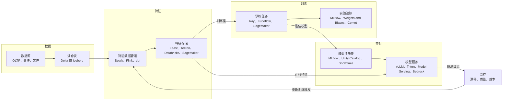
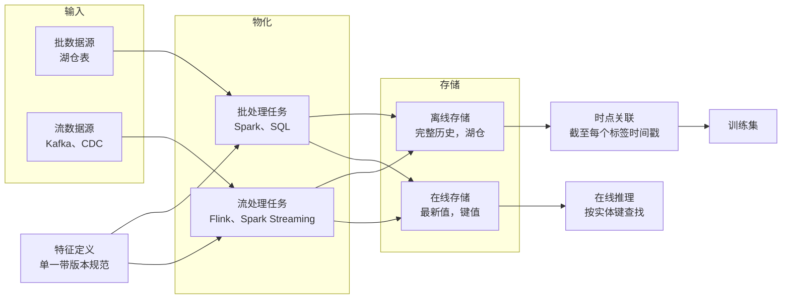
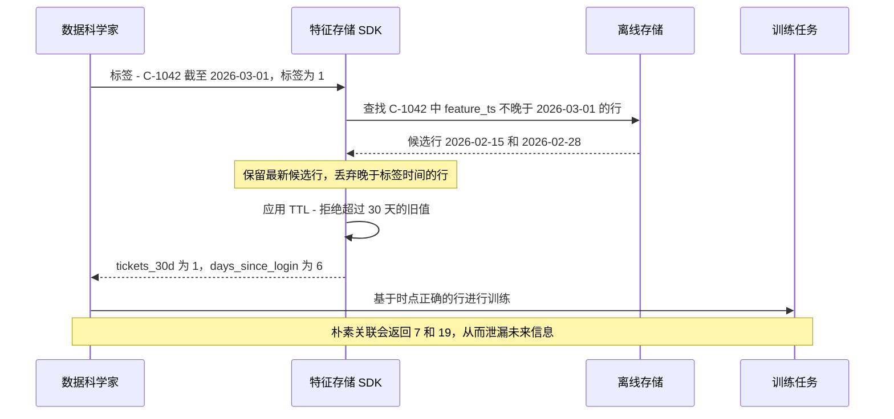
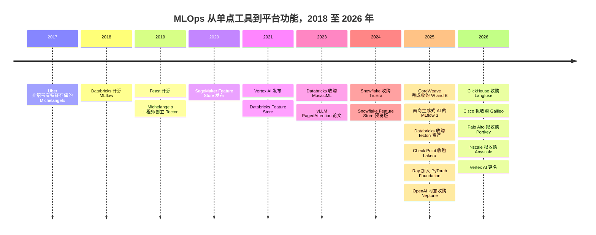

# 21. 机器学习平台、特征存储与 LLMOps
> **深度：** L2 · **阅读时间：** 约 15 分钟 · **最后核实：** 2026-11-01 · **前置阅读：** [第 16 章 — AI 数据生命周期](ch16-ai-data-lifecycle.md)

## 要点速览（TL;DR）

- 生产环境中的机器学习，本质上主要是数据工程，模型只是处于中间的一环。经典生命周期依次为：数据 → 特征 → 训练 → 注册表 → 服务 → 监控，而 [MLOps](../glossary.md#mlops) 就是让这一闭环可重复运行的方法论。Databricks 于 2018 年开源的 MLflow 已成为这一闭环事实上的默认记录系统。Databricks 表示，在 2025 年 6 月 MLflow 3 发布前后，MLflow 月下载量已超过 30M（公司披露）。[^mlflow3]
- [特征存储（feature store）](../glossary.md#feature-store)解决的是一个代价高昂的问题：确保模型在训练时看到的特征值，与其在生产环境中将看到的特征值一致。它将离线存储（历史数据，位于湖仓一体之上）与在线存储（最新值，位于键值数据库中）配对，并通过[时点关联（point-in-time join）](../glossary.md#point-in-time-join)生成训练集，从而避免未来数据泄漏到过去。
- [LLMOps](../glossary.md#llmops) 是面向生成式 AI 的同一闭环，只是名词变了：提示词取代特征，[追踪（trace）](../glossary.md#llm-trace)取代预测日志，[评估（eval）](../glossary.md#llm-evaluation)和 [LLM 作为评判者（LLM-as-judge）](../glossary.md#llm-as-judge)取代准确率指标，此外请求路径中还加入了护栏和网关。
- 独立的 MLOps 品类已被吸收。CoreWeave 收购 Weights & Biases（约 $1.7B，媒体报道，2025 年 5 月完成交割）；Databricks 收购 Tecton 的资产（2025 年 8 月）；OpenAI 同意收购 Neptune（2025 年 12 月）；ClickHouse 收购 Langfuse（2026 年 1 月）；Cisco 正在收购 Galileo，Palo Alto Networks 正在收购 Portkey（均于 2026 年 4 月宣布）；Nscale 同意以媒体报道的约 $1.65B 收购 Anyscale（2026 年 7 月）。[^wandb][^tecton-dbx][^neptune][^langfuse][^galileo][^portkey][^nscale]
- 收购方可分为三类：数据平台（模型需要数据）、GPU 云（向技术栈上层延伸），以及安全或可观测性厂商（LLM 请求路径是一个新的控制点）。仍保持独立的公司，是那些拥有开源切入点并处于全新生成式 AI 品类中的企业，例如 LangChain、Braintrust、Arize 和 Inferact（vLLM）。

## 为何重要（商业 + Everpure 视角）

对战略团队而言，这一层是近期工具品类被其下方平台吸收的最清晰案例。2018 年至 2022 年间，投资者为机器学习生命周期中的每一个环节分别资助了一家独立公司：实验追踪、特征存储、模型监控、数据标注和编排。到 2026 年，这些环节大多已成为 Databricks、Snowflake、超大规模云厂商或 GPU 云内部的功能。这一模式之所以重要，是因为同样的压力如今正作用于 LLMOps 工具、AI 网关，以及更下一层的与存储相邻的数据服务。

经济逻辑可以解释这一点。MLOps 工具建立在平台已持有的数据之上。特征存储是一组受治理的表加上一层缓存；模型注册表是一个目录条目；监控任务是对预测日志的定时查询。当平台掌握了表、目录和计算资源时，它就能以更低的边际成本提供上述每一项功能——通常捆绑在按用量计费之中——并让数据治理贯穿所有功能。[第 25 章](../04-company-deep-dives/ch25-databricks.md)和[第 26 章](../04-company-deep-dives/ch26-snowflake.md)中的数据引力（data gravity）论点在此直接适用。

对 Everpure 而言，有三点值得关注。第一，这一层**呈突发式的高存储负载**：训练检查点、特征表历史和模型制品体量大、带版本，且集中一次性写入。第二，特征表和模型制品越来越多地以开放表和对象的形式存放在 S3 兼容存储上，并由 Unity Catalog 等目录管理，这正是[第 7 章](../01-data-systems-foundations/ch07-open-table-formats.md)中"存储桶位于他人目录之下"的问题。第三，LLMOps 公司的收购方（安全和可观测性厂商）表明，谁处于 AI 请求路径之中，谁就能销售数据治理。Everpure 基于 1touch 的 Data Intelligence 在数据进入 AI 数据管道之前对其进行分类，在同一路径的数据侧占据了一个相邻位置。

## 工作原理

### 经典机器学习生命周期

Google 2015 年那篇关于"隐藏技术债"的论文指出，模型代码只是一个小方框，周围环绕着规模大得多的数据采集、特征提取、服务和监控系统。[^sculley] Uber 的 Michelangelo 平台（2017 年公开介绍）是第一个被广泛效仿的设计，它把这些环节整合进一个内部产品，其中就包括特征存储。[^michelangelo] 后来的大多数工具，都是一个或多个 Michelangelo 环节的商业化版本。

*图 21.1 — 机器学习生命周期是一个闭环，其六个阶段中有四个属于数据管理。这正是数据平台能够吸收其中大部分环节的原因。*

每个阶段都会产出一个带版本的制品，供下一阶段使用。特征数据管道产出特征表。训练产出模型文件及元数据：参数、指标，以及背后的代码和数据版本。[实验追踪（experiment tracking）](../glossary.md#experiment-tracking)为每一次运行记录这些元数据，使团队能够比较 200 次训练运行并复现最优结果。[模型注册表（model registry）](../glossary.md#model-registry)将选定版本逐级推进（候选、预发布、生产），并保留审计轨迹。服务环节将已注册版本加载到一个端点之后。监控环节将线上输入和输出与训练基线进行比较，并标记[数据漂移（data drift）](../glossary.md#data-drift)。

MLflow 从一开始就涵盖了追踪、模型打包格式和注册表。Databricks 于 2018 年 6 月将其作为开源项目发布，后来该项目转入 Linux Foundation。[^mlflow-launch] **MLflow 3**（2025 年 6 月）是面向生成式 AI 的重写版本。它新增了基于 OpenTelemetry 的追踪功能，集成了 20 多个生成式 AI 库；新增了基于生产追踪数据构建的数据集、由 LLM 评判者执行的评估；还新增了一个 `LoggedModel` 实体，用于跨多次运行（而非在单次运行内部）追踪某个模型或智能体的版本。[^mlflow3][^mlflow-docs] 这一设计选择值得注意：Databricks 并没有另建一个 LLMOps 产品，而是扩展了已经承载机器学习记录系统的那个工具。

### 特征存储：解决什么问题

**特征**是由原始数据计算得出的模型输入，例如"过去 30 天内的支持工单数"或"距上次登录的天数"。特征在生产环境中会引发三个反复出现的问题。

1. **[训练/服务偏差（training/serving skew）](../glossary.md#training-serving-skew)。** 数据科学家在 notebook 中用 pandas 基于夜间快照计算 `tickets_30d`；工程师则在线上 API 中用 Java 和流式计数器重新实现它。两个版本在边界情况上（时区、迟到事件、什么算作一张工单）存在分歧，于是模型在生产环境中性能下降，却不会抛出任何错误。
2. **时点正确性。** 一条训练样本对应过去的某个时刻。附加到它上面的每一个特征，都必须是在那个时刻可以获知的值，而不是今天的值。如果弄错，就会泄漏未来信息并夸大离线准确率（见下文的实例）。
3. **复用与延迟。** 可能有五十个模型都需要 `tickets_30d`。如果没有共享定义，每个团队都会各自计算；而在线路径需要在个位数毫秒内给出响应，这是数据仓库查询做不到的。

特征存储用"一个定义、两个存储"同时解决了这三个问题。特征以代码形式只定义一次。物化任务将其计算并写入**[离线存储（offline store）](../glossary.md#offline-store)**——保留带时间戳的完整历史（如今通常是湖仓一体上的 Delta 或 Iceberg 表）；同时写入**[在线存储（online store）](../glossary.md#online-store)**——只在 Redis 或 DynamoDB 等低延迟键值数据库中保存每个实体的最新值。训练通过时点关联从离线存储读取历史数据；服务则按键从在线存储读取最新值。由于两者由同一个数据管道产出，偏差是在设计层面被消除的，而不是靠测试去发现。

*图 21.2 — 一个定义同时供给两个存储。离线存储为训练回答"当时的情况是什么？"，在线存储为服务回答"现在的情况是什么？"。两个答案在构造上即保持一致。*

> **类比：半导体。** 训练/服务偏差相当于机器学习版的**流片前与流片后相关性（pre-silicon versus post-silicon correlation）**问题。设计团队基于模型（SPICE 网表、liberty 文件、仿真）完成时序和功耗签核，然后测量真实芯片，找出模型出错的工艺角。两个领域的解决办法相同：让模型与生产共享同一份特征化数据。特征存储就是这份共享的特征化数据。同理，特征注册表类似于**标准单元库**：每个单元（特征）只需特征化一次，带版本管理，并在众多设计（模型）中复用。没有人会为每一颗芯片重新推导 NAND2 的时序，也不应有人为每一个模型重新实现 `tickets_30d`。

### 实例：流失模型与泄漏的关联

一家订阅制企业希望预测哪些客户会在未来 30 天内取消订阅。每条训练样本是一个（客户，预测日期）对，并附带标签：该客户是否在该日期之后 30 天内取消？以客户 C-1042 为例。预测日期为 2026 年 3 月 1 日，该客户于 3 月 15 日取消，因此标签为 1。

`support_tickets_30d` 的特征表在每次重新计算该值时都会写入一行带时间戳的记录：

| 客户 | feature_ts | support_tickets_30d | days_since_login |
|---|---|---|---|
| C-1042 | 2026-02-15 | 1 | 3 |
| C-1042 | 2026-02-28 | 1 | 6 |
| C-1042 | 2026-03-14 | 5 | 16 |
| C-1042 | 2026-03-20 | 7 | 19 |

*图 21.3 — 单个客户的示意性特征历史（假设数据）。3 月 14 日取消流程启动后的数值是流失的症状，而不是流失的预测因子。*

**朴素关联**会把最新一行附加到每条训练样本上：7 张工单、距上次登录 19 天。模型于是学到"7 张工单意味着流失"。这本身没错，但这些工单是在取消流程中、也就是预测日期之后提交的。离线准确率看起来非常好。而在生产环境中，3 月 1 日在线存储显示该客户只有 1 张工单，模型看不出任何异常，客户就此流失。这就是[数据泄漏（data leakage）](../glossary.md#data-leakage)，也是测试表现良好的模型在生产中失败的最常见原因。

**时点关联**则为每条训练样本附加时间戳不晚于预测日期的最近一行特征。对于 3 月 1 日，就是 2 月 28 日那一行：1 张工单、6 天。离线准确率会下降，但它此时能如实反映生产环境中的准确率。

*图 21.4 — 时点关联是对每一行标签做一次"截至某时"（as-of）查找，再加上一个新鲜度上限。特征存储把它设为默认行为，这正是其大部分价值所在。*

Feast 的文档准确描述了这一行为：对每个实体行，它从该行的时间戳向前回溯扫描，取最新值，并丢弃早于特征视图存活时间（TTL）的值。[^feast-pit] 在大规模下这一关联代价高昂，因为数百万条标签行中的每一条都需要在一张大型历史表中做范围查找。这就是特征存储要按时间和实体进行分区的原因，也是湖仓厂商主张它应当在历史数据所在之处运行的原因。

> **深入（L3）。** 如果没有特征存储，同样的关联在 SQL 中就是对标签与特征的并集做窗口运算：对每个 `(customer, label_ts)`，将满足 `feature_ts <= label_ts` 的特征行按 `feature_ts DESC` 排名并保留排名第 1 的行，再过滤 `label_ts - feature_ts <= INTERVAL '30 days'`。有些引擎原生提供 `ASOF JOIN` 来完成这一操作。手工实现的团队还常会踩到另外两个坑：事件时间与摄取时间之别（一行数据计算得晚但时间戳标得早，仍然会造成泄漏），以及聚合窗口在标签时间*之后*才结束的特征。

### LLMOps：同样的闭环，新的名词

生成式 AI 保留了这个闭环，但改变了在其中流动的东西。大多数企业并不训练基础模型。它们构建的是这样的应用：以提示词、检索到的上下文（[第 19 章](ch19-retrieval-architectures.md)）和工具来调用模型，并常常串联成智能体（[第 22 章](ch22-agents-and-data.md)）。被管理的单元也相应地发生了变化。

- **提示词成为带版本的制品。** 提示词注册表存储带版本的模板，并将每个版本与评估结果关联，就像模型注册表对权重所做的那样。
- **追踪取代预测日志。** 一条[追踪](../glossary.md#llm-trace)记录一次请求的每一个步骤：提示词、检索调用、工具调用、模型响应、token 数、延迟和成本。大多数工具如今都输出与 OpenTelemetry 兼容的 span，这就是通用可观测性厂商（Datadog、Splunk）和分析型数据库（ClickHouse）也能在此竞争的原因。
- **评估取代准确率指标。** 离线评估让应用在一个由精选问题和参考答案组成的[黄金数据集（golden set）](../glossary.md#golden-set)上运行。由于自由文本没有唯一正确答案，通常由第二个模型按照评分细则为输出打分。这就是 LLM 作为评判者：成本低、可扩展，但其本身必须以人工标注为基准进行校准。在线评估则以同样方式为抽样的生产追踪打分。
- **护栏和网关位于请求路径之中。** [护栏（guardrails）](../glossary.md#guardrails)检查输入和输出中是否存在提示词注入、数据泄漏、有害内容或违反策略的回答。[AI 网关（AI gateway）](../glossary.md#ai-gateway)是位于多个模型提供商之前的代理，负责路由、故障转移、限流、凭证、缓存和支出上限。
- **模型服务变成 GPU 效率问题。** 开放权重模型运行在 vLLM 等推理引擎上，其 PagedAttention 设计以分页方式管理键值缓存，就像操作系统管理虚拟内存一样。[^vllm-paper] NVIDIA 将引擎打包为 NIM 微服务。托管 API（Bedrock、Microsoft Foundry、Databricks Model Serving）则将引擎完全隐藏。

| 品类 | 功能 | 代表性工具 | 现状 / 归属（2026 年 11 月） |
|---|---|---|---|
| 实验追踪 | 记录运行、参数、指标、制品 | MLflow；Weights & Biases；Comet（Opik）；Neptune | MLflow 开源（由 Databricks 主导）；W&B 自 2025 年 5 月起归 CoreWeave 所有[^wandb]；Neptune 于 2025 年 12 月同意被 OpenAI 收购，对外服务逐步关停[^neptune] |
| 追踪与可观测性 | 采集 LLM 与智能体追踪、成本、延迟 | LangSmith；Langfuse；Arize Phoenix；Datadog LLM Observability；Galileo；TruLens；MLflow Tracing | LangChain 保持独立（$1.25B，2025 年 10 月）[^langchain]；Langfuse 归 ClickHouse 所有（2026 年 1 月）[^langfuse]；Arize 保持独立（$70M C 轮，2025 年 2 月）[^arize]；Galileo 归入 Cisco/Splunk（2026 年）[^galileo]；TruLens 经由 TruEra 归入 Snowflake（2024 年）[^truera] |
| 评估 | 黄金数据集、LLM 作为评判者、回归测试 | Braintrust；MLflow evaluation；LangSmith；Arize；Agent Bricks | Braintrust 保持独立（$80M B 轮，媒体报道估值 $800M，2026 年 2 月）[^braintrust] |
| 护栏与 AI 安全 | 拦截注入、泄漏、不安全输出 | NeMo Guardrails；Guardrails AI；Lakera；Protect AI | NeMo Guardrails 开源（NVIDIA）[^tool-docs]；Lakera 归 Check Point 所有（媒体报道约 $300M，2025 年）[^lakera]；Protect AI 归 Palo Alto Networks 所有（收购对价 $634.5M，2025 年 7 月完成交割）[^protectai] |
| AI 网关 | 路由、故障转移、密钥、支出上限 | LiteLLM；Portkey；Databricks Unity AI Gateway；云原生网关 | LiteLLM 开源[^tool-docs]；Portkey 归入 Palo Alto Networks（2026 年 4 月宣布）[^portkey]；Unity AI Gateway 于 DAIS 2026 发布[^unity-gw] |
| 模型服务 | 在 GPU 上高效运行模型 | vLLM；SGLang；NVIDIA NIM 与 Triton；TGI；Databricks Model Serving；Bedrock | vLLM 由 PyTorch Foundation 托管，由 Inferact 商业化（$150M 种子轮，2026 年 1 月）[^ray-pt][^inferact]；Hugging Face TGI 进入维护模式[^tgi] |
| 微调 | 用领域数据适配开放权重模型 | Mosaic AI；Snowflake Cortex Training；Bedrock 自定义模型；超大规模云厂商调优服务 | 已捆绑进数据平台和云；Cortex Training 于 Summit 2026 发布[^sf-summit] |

*图 21.5 — 每个 LLMOps 品类都有一个开源锚点；在七个品类中至少有四个（实验追踪、追踪、护栏、网关），领先的独立公司在 2024 年至 2026 年间被收购。*

> **类比：半导体。** LLM 评估就是**流片后验证（post-silicon validation）**。芯片不是因为 RTL 仿真正确就能出货；只有当验证套件在真实芯片上覆盖了足够多的规格、且覆盖率指标指明了缺口所在时，芯片才会出货。黄金数据集就是测试程序，LLM 作为评判者是一台自动测试机，其自身准确率必须与参考标准（人工评分员）进行相关性校准，而在线评估则相当于现场返修分析。两个领域的难点都在于覆盖率：一个 500 道题的黄金数据集如果漏掉了客户实际遇到的边界情况，那么 98% 的通过率意义不大。

### 平台如何吸收 MLOps

**Databricks** 拥有最完整的自研技术栈。MLflow 是追踪和评估层。特征工程、模型和函数都在 [Unity Catalog](../glossary.md#unity-catalog) 中治理，因此一张特征表就是一张带主键的 Delta 表，并带有到使用它的模型的数据血缘，在线服务由 Databricks 托管。[^dbx-fs] Mosaic AI（来自 2023 年的 MosaicML 交易）和 Agent Bricks 覆盖模型服务、微调和智能体评估。继 2025 年 4 月规模较小的 Fennel 特征工程交易之后，Databricks 于 2025 年 8 月收购了 Tecton 的实时特征技术，用于为智能体提供新鲜上下文。[^tecton-dbx] 在 DAIS 2026 上，Databricks 新增了 Unity AI Gateway，用于治理智能体流量和 AI 支出。[^unity-gw]

**Snowflake** 在其治理边界内构建了同样的组件。Snowflake ML 包括一个支持从批数据源和流数据源增量刷新的 Feature Store、一个可接收在其他地方训练的模型的 Model Registry，以及用于漂移和性能监控的 ML Observability。[^sf-ml] Cortex 提供托管模型、智能体，并自 Summit 2026 起提供托管微调（Cortex Training）。[^sf-summit] TruEra（2024 年）提供了评估和可观测性能力。[^truera]

**超大规模云厂商**将整个生命周期捆绑进各自的 AI 平台：AWS 上的 Amazon SageMaker（含 SageMaker Feature Store）和 Bedrock；[^tool-docs] Google Cloud 上的 Vertex AI（2026 年 4 月更名为 Gemini Enterprise Agent Platform）；[^geap] 以及 Azure 上的 Azure Machine Learning 加 Microsoft Foundry（在 Ignite 2025 上由 Azure AI Foundry 更名而来）。[^foundry]

**开源计算保持中立。** Anyscale 背后的分布式计算框架 Ray 于 2025 年 10 月加入 PyTorch Foundation，与 PyTorch 和 vLLM 并列。[^ray-pt] Kubeflow 仍是 Kubernetes 原生的选择，Feast 则是它常见的特征存储搭档，并由 Red Hat 打包进 OpenShift AI。[^rh-feast] 但开放治理并没有保护这些项目背后的厂商：Anyscale 本身就同意出售给 GPU 云厂商 Nscale。[^nscale]

## 设计选择与权衡

| 决策 | 方案 A | 方案 B | A 胜出的情形 | B 胜出的情形 |
|---|---|---|---|---|
| 机器学习平台 | 数据平台原生（Databricks、Snowflake） | 最佳组合技术栈（W&B、Feast、Arize、LiteLLM） | 数据已在平台上；跨特征和模型的数据治理与数据血缘最为重要 | 多云、多平台环境；需要深度实验体验的研究型团队 |
| 特征存储 | 湖仓原生（特征表 = 受治理的表） | 专用特征平台（Tecton 式、Hopsworks） | 批量和近实时特征；成本控制 | 低于 10 ms、高 QPS 且含复杂窗口聚合的流式特征（反欺诈、广告） |
| 在线存储 | 由平台托管 | 自带（Redis、DynamoDB、Cassandra） | 组件更少 | 已有低延迟基础设施和 SLA |
| LLM 追踪 | 与框架绑定（LangSmith、MLflow） | 以中立的 OpenTelemetry 接入通用可观测性（Datadog、Splunk、ClickHouse） | 深度智能体调试和评估工作流 | 应用与 AI 遥测统一视图；由安全团队负责 |
| 模型服务 | 托管 API（Bedrock、Foundry、Cortex） | 在自有 GPU 上自托管引擎（vLLM、NIM） | 需求波动大；前沿闭源模型 | 开放权重上的稳定高负载；数据驻留；GPU 成本控制 |
| 评估 | 大规模 LLM 作为评判者 | 在较小数据集上进行人工评审 | 每次发布的回归测试 | 校准评判者；高风险领域 |

*图 21.6 — 反复出现的权衡是集成与专精之间的取舍。集成在数据治理和成本上胜出；专精在延迟和规模的极端场景下胜出。*

最佳组合方案的最强版本论证是成立的。平台型特征存储在批量特征上最强。基于流的滑动窗口实时反欺诈和广告排序特征很难做，这正是 Databricks 选择收购 Tecton 而非自建的原因。Weights & Biases 之所以保住了一批忠实的研究用户，是因为其实验体验和报告功能优于各平台的版本。反方观点是：大多数企业模型并非延迟敏感型，而买方（通常是 CDO 而非机器学习研究员）更看重统一的治理模型，而非更好的 UI。

## 主要参与者

| 参与者 | 在这一层中的角色 | 定位（2026 年 11 月） |
|---|---|---|
| Databricks | MLflow、Unity Catalog 特征与模型、Mosaic AI、Agent Bricks、Tecton | 自研生命周期最完整；MLflow 作为开放标准（[第 25 章](../04-company-deep-dives/ch25-databricks.md)）[^mlflow3][^tecton-dbx] |
| Snowflake | Snowflake ML（Feature Store、Model Registry、ML Observability）、Cortex | 生命周期位于治理边界之内；以 TruEra 提供评估（[第 26 章](../04-company-deep-dives/ch26-snowflake.md)）[^sf-ml][^truera] |
| AWS / Google / Microsoft | SageMaker 与 Bedrock / Gemini Enterprise Agent Platform / Azure ML 与 Foundry | 与计算和模型捆绑；2025–2026 年间更名，转向"智能体平台"[^geap][^foundry] |
| CoreWeave、Nscale | 收购了 W&B 和 Anyscale 的 GPU 云 | 新兴云厂商向技术栈上层延伸，以增加软件利润率和客户黏性[^wandb][^nscale] |
| LangChain、Braintrust、Arize | 独立 LLMOps（追踪、评估） | 以开源或开发者为切入点；2025–2026 年融资充裕[^langchain][^braintrust][^arize] |
| Palo Alto、Check Point、Cisco | 安全与可观测性领域的收购方 | 收购 Protect AI、Portkey、Lakera、Galileo，以掌控 AI 请求路径[^protectai][^portkey][^lakera][^galileo] |
| Feast、Kubeflow、Ray、vLLM | 开源锚点 | 由基金会托管或社区治理；商业所有者会变，项目会延续[^ray-pt][^rh-feast] |

*图 21.7 — MLOps 工具的所有权已转移到平台、GPU 云和安全厂商手中。开源项目是其中稳定的一层。*

## 历史与发展轨迹

*图 21.8 — 日期依据本节所引资料及 [^history]。每一波工具都被不同类型的收购方买下：2023–2025 年是数据平台，2025–2026 年则是 GPU 云、安全厂商和可观测性厂商。*

**第一阶段：内部平台（2015–2019 年）。** 大型消费互联网公司自建内部平台（Uber 的 Michelangelo、Airbnb 的 Bighead、Google 的 TFX），因为当时市面上没有现成产品。[^michelangelo][^sculley] MLflow 和 Feast 正是在这一时期作为开源的通用化方案诞生的。[^mlflow-launch]

**第二阶段：单点工具热潮（2019–2022 年）。** 风险资本为每个环节资助一家公司。Weights & Biases 于 2023 年以 $1.25B 估值融资（媒体报道）。2022 年，Tecton 的媒体报道估值约为 $900M，Anyscale 的媒体报道估值约为 $1.4B。[^wandb-round][^tecton-dbx][^nscale] 超大规模云厂商在 2020–2021 年推出了特征存储和统一机器学习平台。[^history]

**第三阶段：生成式 AI 重置与吸收（2023–2026 年）。** 大语言模型让许多经典 MLOps 不再那么核心（需要训练的定制模型变少），同时催生了新需求（追踪、评估、护栏、网关）。数据平台收购了最贴近数据的部分：MosaicML、TruEra、Tecton。GPU 云收购了面向开发者的部分：W&B 和 Anyscale。前沿实验室为内部使用收购工具并关停对外服务：OpenAI–Neptune。[^neptune] 安全和可观测性厂商收购了请求路径：Protect AI、Lakera、Portkey、Galileo。Langfuse 出售给 ClickHouse 表明，LLM 追踪不过是又一张高吞吐量的遥测表。[^langfuse]

**下一步走向。** LLMOps 各品类正沿着经典 MLOps 的老路前进，只是把七年压缩成了三年。预计评估和追踪将成为智能体平台的功能（[第 22 章](ch22-agents-and-data.md)），网关将与安全产品合并，而存活下来的独立公司将是那些掌握某项开源标准的企业。MLflow 的地位值得关注：如果它成为跨厂商默认的、兼容 OpenTelemetry 的追踪与评估格式，Databricks 就将掌握这一标准，正如它曾掌握 Delta Lake 一样。

> **类比：金融。** 应将这些收购理解为**把功能整合进平台的"汇总式收购"（roll-up）**，其定价依据的是战略价值而非独立价值。W&B 的媒体报道价格约 $1.7B，约为其上一轮私募估值 $1.25B 的 1.4 倍；[^wandb][^wandb-round] Anyscale 的媒体报道价格约 $1.65B，比媒体报道的 2022 年 $1.38B 估值高出约 20%（本书自行计算）。[^nscale] 对品类领先者而言，这些溢价幅度并不大。其他标的，例如 Tecton（资产交易）和 Neptune（对外部客户停止服务），则体现了人才收购（acquihire）的经济逻辑。对尽职调查的启示是：一个建立在平台数据之上的工具，其潜在收购方可能只有五家左右，这就限制了退出倍数。

## 关键数字

| 指标 | 数值 | 口径 | 来源 / 日期 |
|---|---|---|---|
| MLflow 月下载量 | >30M | 公司披露（Databricks） | Databricks 博客，2025-06[^mlflow3] |
| MLflow 3 追踪集成数 | 20+ 个生成式 AI 库 | 公司披露 | Databricks 博客，2025-06[^mlflow3] |
| CoreWeave–Weights & Biases | 约 $1.7B；2025-05-05 完成交割 | 媒体报道（The Information） | CoreWeave IR；`data/ma_deals.csv`[^wandb] |
| W&B 上一轮私募估值 | $1.25B（2023 年） | 媒体报道 | `data/private_funding.csv`[^wandb-round] |
| Databricks–Tecton | 未披露金额的资产收购；2025-08-22 宣布 | 未披露 | Databricks 博客；Fenwick[^tecton-dbx] |
| OpenAI–Neptune | <$400M，以股票支付 | 媒体报道（The Information） | VKTR / Reuters 报道，2025-12[^neptune] |
| Nscale–Anyscale | 约 $1.65B；约 200 名员工 | 媒体报道（Bloomberg 消息源） | TechCrunch，2026-07-30[^nscale] |
| Palo Alto–Protect AI | 总收购对价 $634.5M | GAAP（10-K，截至 2025-07-31 的财年） | PANW 10-K[^protectai] |
| Check Point–Lakera | 约 $300M | 媒体报道 | SecurityWeek，2025-09[^lakera] |
| LangChain B 轮 | $125M，投后估值 $1.25B | 公司宣布融资；估值为媒体报道 | SiliconANGLE，2025-10-20[^langchain] |
| Braintrust B 轮 | $80M，投后估值 $800M | 媒体报道（CEO 向 Axios 透露） | Axios Pro，2026-02-17[^braintrust] |
| Inferact（vLLM）种子轮 | $150M，估值 $800M | 媒体报道 | TechCrunch，2026-01-22[^inferact] |
| 训练检查点，使用 Adam 的 70B 参数模型 | 每个检查点约 1 TB | 估算（权重、fp32 主副本和优化器状态合计约 14 字节/参数） | 依据 ZeRO 论文的核算推导[^zero] |

*图 21.9 — 交易价格集中在 $0.3B 到 $1.7B 之间：金额不小，但与收购它们的平台相比规模很小。检查点这一行说明了为什么这一层会触及存储预算。*

## 存储桥接

> **存储桥接。** 这一层以突发方式写入。同步训练检查点在写入时会让所有 GPU 暂停，而每个 70B 参数模型约需写入 1 TB（估算），因此检查点带宽会直接转化为 GPU 空闲时间。特征存储增加了位于对象存储上、长期保留、按时间分区的历史表；注册表则增加了大量带版本的模型制品，在发布过程中由服务集群同时读取。基于公开信息，战略团队可能评估的选项包括：将 FlashBlade 认证为 Unity Catalog 和 Snowflake 外部卷之下的离线存储及制品存储，以及将 Everpure Data Intelligence 的数据分类功能定位于特征数据集和评估数据集的上游。检查点 I/O 模式和性能细节参见配套的 *Everpure Tech Atlas*。

## 对话手册

**向产品经理提问**

1. "您客户的特征表、模型制品和检查点在物理上存放在哪里？每一项的目录条目归谁所有：数据平台、机器学习平台，还是客户自己？"
2. "客户从您这里购买哪些 LLMOps 功能（追踪、评估、网关、护栏），又从其数据平台或云厂商那里获得哪些？自 2025–2026 年的一系列收购以来，这一格局有何变化？"
3. "当客户从经典机器学习转向智能体时，他们在您这一层的支出是增加还是减少？"

**向工程师提问**

1. "您如何保证训练集的时点正确性？使用事件时间还是摄取时间，TTL 设为多少？"
2. "您如何在生产环境中检测训练/服务偏差：是否记录服务时的特征值，并与离线重算结果进行比对？"
3. "您的 LLM 评判者是如何以人工标注为基准进行校准的？黄金数据集有多大、多新？"

**好的回答听起来是什么样的。** 具体且量化："特征表是 Unity Catalog 中带时间戳键的 Delta 表；我们记录服务时的特征值，并每天与离线值做差异比对；在一个 1,000 条样本的数据集上，我们的评判者与人工评分员的一致率约为 N%，该数据集每月从生产追踪中刷新。"好的回答会坦承平台的薄弱之处，通常是低延迟流式特征或多云追踪。

**不要这样说**

- "特征存储已死。"独立品类确实整合了，但其功能转移到了 Databricks、Snowflake 和各大云厂商之中。时点正确性对每一个表格类模型仍然重要。
- "LLM 不需要 MLOps。"它们需要的更多。只是对象变成了提示词、追踪和评估，而不是权重和准确率指标。
- "Weights & Biases 是 Databricks 的交易。"收购它的是 GPU 云厂商 CoreWeave。
- "MLflow 是 Databricks 的产品。"它是 Linux Foundation 旗下的开源项目，由 Databricks 主导。托管版 MLflow 才是产品。
- "离线准确率高就证明模型有效。"如果没有时点关联，这可能只证明了模型能读取未来。

## 深入阅读

- Sculley 等，"Hidden Technical Debt in Machine Learning Systems"（NeurIPS 2015），MLOps 的奠基性论文。[^sculley]
- Feast 关于时点关联和 TTL 的文档，对应图 21.4 中的机制。[^feast-pit]
- Kwon 等，"Efficient Memory Management for LLM Serving with PagedAttention"（SOSP 2023），解释 vLLM 为何胜出。[^vllm-paper]
- Rajbhandari 等，"ZeRO"（2019），介绍大模型训练的内存与检查点核算。[^zero]
- 相关章节：[第 16 章](ch16-ai-data-lifecycle.md)介绍完整的 AI 数据闭环，[第 20 章](ch20-training-data-supply-chain.md)介绍训练数据，[第 13 章](../02-pipelines-and-governance/ch13-data-quality-observability-lineage.md)介绍数据可观测性——LLM 追踪正越来越像它。

## 关键术语

- [MLOps](../glossary.md#mlops) — 使机器学习生命周期可重复、受治理且可监控的实践与工具。
- [LLMOps](../glossary.md#llmops) — 面向 LLM 应用改造的 MLOps：提示词、追踪、评估、护栏和网关。
- [特征存储](../glossary.md#feature-store) — 只定义一次特征，并向训练和推理提供一致特征值的系统。
- [离线存储](../glossary.md#offline-store) — 特征存储中完整的、带时间戳的历史数据，用于构建训练集。
- [在线存储](../glossary.md#online-store) — 特征存储中保存最新特征值的低延迟键值副本。
- [时点关联](../glossary.md#point-in-time-join) — 将每一行标签与其时间戳时刻已知的最新特征值进行关联。
- [训练/服务偏差](../glossary.md#training-serving-skew) — 训练中与生产中所见特征值之间的不一致。
- [数据泄漏](../glossary.md#data-leakage) — 预测时不可获得的信息进入训练数据，从而夸大离线准确率。
- [实验追踪](../glossary.md#experiment-tracking) — 记录每次训练运行的参数、指标、代码和制品，以便比较和复现。
- [模型注册表](../glossary.md#model-registry) — 带有数据血缘、阶段和审批的模型版本目录。
- [数据漂移](../glossary.md#data-drift) — 线上输入的分布相对于训练数据发生的变化。
- [LLM 追踪](../glossary.md#llm-trace) — 对一次 LLM 或智能体请求中每一步骤、token 数、延迟和成本的记录。
- [LLM 评估](../glossary.md#llm-evaluation) — 对 LLM 应用输出进行的系统化评分，可在测试集上离线进行，也可在生产样本上在线进行。
- [LLM 作为评判者](../glossary.md#llm-as-judge) — 使用一个语言模型按照评分细则为另一个模型的输出打分。
- [黄金数据集](../glossary.md#golden-set) — 经过精选、带版本的测试集，包含输入及参考答案。
- [护栏](../glossary.md#guardrails) — 拦截不安全、泄漏或违反策略的 LLM 行为的输入和输出检查。
- [AI 网关](../glossary.md#ai-gateway) — 位于模型提供商之前的代理，用于路由、密钥、限流、缓存和支出控制。
- [Unity Catalog](../glossary.md#unity-catalog) — Databricks 用于表、特征、模型和函数的治理目录。

## 资料来源

[^mlflow3]: Databricks, "MLflow 3.0: Unified AI Experimentation, Observability, and Governance," https://www.databricks.com/blog/mlflow-30-unified-ai-experimentation-observability-and-governance，发布 2025-06（Data + AI Summit 2025）；检索 2026-11-01。月下载量数字为公司披露；二手资料引用的 33M–60M 未予采用。
[^mlflow-docs]: MLflow project, "MLflow 3" documentation (LoggedModel, GenAI tracing and evaluation), https://mlflow.org/docs/3.0.1/mlflow-3，发布 2025-06；检索 2026-11-01。Databricks, "Install MLflow 3," https://docs.databricks.com/aws/mlflow/mlflow-3-install，持续更新文档；检索 2026-11-01。
[^mlflow-launch]: Databricks, "Introducing MLflow: an Open Source Machine Learning Platform," https://www.databricks.com/blog/2018/06/05/introducing-mlflow-an-open-source-machine-learning-platform.html，发布 2018-06-05；检索 2026-11-01（2025 年前的资料，本次未重新打开）。MLflow 于 2020 年加入 Linux Foundation（2025 年前的已有知识）。
[^sculley]: D. Sculley et al., "Hidden Technical Debt in Machine Learning Systems," NeurIPS 2015, https://papers.nips.cc/paper/5656-hidden-technical-debt-in-machine-learning-systems，发布 2015-12；检索 2026-11-01（2025 年前的资料）。
[^michelangelo]: Uber Engineering, "Meet Michelangelo: Uber's Machine Learning Platform," https://www.uber.com/blog/michelangelo-machine-learning-platform/，发布 2017-09-05；检索 2026-11-01（2025 年前的资料）。
[^feast-pit]: Feast, "Point-in-time joins" (concepts documentation), https://docs.feast.dev/getting-started/concepts/point-in-time-joins，持续更新文档；检索 2026-11-01。Feast 博客（2026 年的文章，包括 2026-06-01 的原生 MLflow 集成），https://feast.dev/blog；检索 2026-11-01。
[^rh-feast]: Red Hat, "Feast: the open source feature store for AI" (OpenShift AI 2.20 technology preview), https://www.redhat.com/de/blog/feast-open-source-feature-store-ai，发布 2025；检索 2026-11-01。Red Hat Developer, "Improve RAG retrieval training with Feast and Kubeflow Trainer," https://developers.redhat.com/articles/2025/12/16/improve-rag-retrieval-training-feast-kubeflow-trainer，发布 2025-12-16；检索 2026-11-01。
[^tecton-dbx]: Databricks, "Tecton is joining Databricks to power real-time data for personalized AI agents," https://databricks.com/blog/tecton-joining-databricks-power-real-time-data-personalized-ai-agents，发布 2025-08-22；Fenwick, "Fenwick Represents Databricks in Acquisition of the Assets of Tecton," https://www.fenwick.com/insights/experience/fenwick-represents-databricks-in-acquisition-of-the-assets-of-tecton，发布 2025-08/09；均检索 2026-11-01。交易条款未披露；部分标题中的"$900M"是 Tecton 此前的估值，而非交易价格。Fennel（2025 年 4 月）依据 `data/ma_deals.csv` 及第 25 章。
[^dbx-fs]: Databricks, "Feature engineering and serving" (feature tables in Unity Catalog, online feature serving), https://docs.databricks.com/aws/en/machine-learning/feature-store/，持续更新文档；检索 2026-11-01。
[^sf-ml]: Snowflake, "Snowflake ML: End-to-End Machine Learning" (Feature Store, Model Registry, ML Observability), https://docs.snowflake.com/en/developer-guide/snowpark-ml，持续更新文档；Snowflake blog, "Build and Manage ML Features for Production-Grade Pipelines with Snowflake Feature Store," https://snowflake.com/en/blog/build-manage-production-ml-snowflake-feature-store，发布 2024；均检索 2026-11-01。
[^sf-summit]: Flexera, "Snowflake Summit 2026 recap," https://www.flexera.com/blog/perspectives/snowflake-summit-2026/，发布 2026-06；SELECT, https://select.dev/posts/snowflake-summit-2026-product-announcement-recap，发布 2026-06；均检索 2026-11-01（二手资料；经由 `meta/research-briefing.md`）。
[^unity-gw]: SiliconANGLE, "Key takeaways from day two of Databricks Data + AI Summit," https://siliconangle.com/2026/06/17/key-takeaways-day-two-databricks-data-ai-summit/，发布 2026-06-17；Databricks, "What's new with Unity Catalog at Data + AI Summit 2026," https://www.databricks.com/blog/whats-new-unity-catalog-data-ai-summit-2026，发布 2026-06；均检索 2026-11-01。
[^geap]: HPCwire/AIwire, "Google Unveils Gemini Enterprise Agent Platform," https://www.hpcwire.com/aiwire/2026/04/23/google-unveils-gemini-enterprise-agent-platform/，发布 2026-04-23；检索 2026-11-01。在 Google Cloud Next '26（2026-04-22）上作为 Vertex AI 的继任者发布；据报道现有 API 保持不变（二手资料）。
[^foundry]: Directions on Microsoft, "Microsoft Ignite 2025: Ten Things You Need to Know," https://www.directionsonmicrosoft.com/microsoft-ignite-2025-ten-things-you-need-to-know/，发布 2025-11-18；检索 2026-11-01。
[^wandb]: CoreWeave, "CoreWeave Completes Acquisition of Weights & Biases," https://investors.coreweave.com/news/news-details/2025/CoreWeave-Completes-Acquisition-of-Weights--Biases/default.aspx，发布 2025-05-05；检索 2026-11-01。约 $1.7B 的价格为媒体报道（The Information，经由 Maginative），记录于 `data/ma_deals.csv`。
[^wandb-round]: `data/private_funding.csv`，Weights & Biases C-2 轮（2023-08-09），投后估值 $1.25B，媒体报道（来源：multiples.vc，聚合网站）；检索 2026-11-01。
[^neptune]: OpenAI, "OpenAI to acquire Neptune," https://openai.com/index/openai-to-acquire-neptune/，发布 2025-12；VKTR, "OpenAI buys Neptune for under $400M," https://www.vktr.com/ai-news/openai-buys-neptune-for-under-400m-in-ai-governance-push/，发布 2025-12；Notes from Poland, https://notesfrompoland.com/2025/12/04/openai-to-acquire-polish-founded-startup/，发布 2025-12-04；均检索 2026-11-01。价格（<$400M，股票支付）为媒体报道，源自 The Information；据报道对外服务于 2026-03-04 前终止。
[^langfuse]: ClickHouse, "ClickHouse acquires Langfuse," https://clickhouse.com/blog/clickhouse-acquires-langfuse-open-source-llm-observability，发布 2026-01-16；检索 2026-11-01（与 `data/ma_deals.csv` 一致）。
[^truera]: btw.media, "Snowflake acquires TruEra," https://btw.media/en/snowflake-acquires-truera，发布 2024-05；检索 2026-11-01（与 `data/ma_deals.csv` 一致）。
[^galileo]: Network World, "Cisco to acquire Galileo for AI observability," https://www.networkworld.com/article/4156855/cisco-to-acquire-galileo-for-ai-observability.html，发布 2026-04；Futurum Group, "Cisco to Acquire Galileo," https://futurumgroup.com/insights/cisco-to-acquire-galileo-ai-agent-observability-cant-run-at-human-speed/，发布 2026-04；均检索 2026-11-01。2026-04-09 宣布，条款未披露；2026-05-22 完成交割一说仅见于二手资料。
[^portkey]: Palo Alto Networks, "Palo Alto Networks to Acquire Portkey to Secure the Rise of AI Agents," https://investors.paloaltonetworks.com/news-releases/news-release-details/palo-alto-networks-acquire-portkey-secure-rise-ai-agents，发布 2026-04-30；检索 2026-11-01。条款未披露；预计于 PANW 2026 财年第四季度（2026 年 5–7 月）完成交割。
[^protectai]: Palo Alto Networks, Form 10-K for fiscal year ended 2025-07-31, https://www.sec.gov/Archives/edgar/data/1327567/000132756725000027/panw-20250731.htm，发布 2025-08/09；以及 "Palo Alto Networks Completes Acquisition of Protect AI," https://investors.paloaltonetworks.com/news-releases/news-release-details/palo-alto-networks-completes-acquisition-protect-ai/，发布 2025-07-22；均检索 2026-11-01。
[^lakera]: SecurityWeek, "Check Point to Acquire AI Security Firm Lakera," https://www.securityweek.com/check-point-to-acquire-ai-security-firm-lakera/，发布 2025-09；Globes, https://en.globes.co.il/en/article-1001521951，发布 2025-09；均检索 2026-11-01。约 $300M 为媒体报道；Check Point 未披露。
[^nscale]: TechCrunch, "Nscale buys Anyscale as it seeks to own more of the AI compute stack," https://techcrunch.com/2026/07/30/nscale-buys-anyscale-as-it-seeks-to-own-more-of-the-ai-compute-stack/，发布 2026-07-30；The Star (wire), https://www.thestar.com.my/tech/tech-news/2026/07/30/ai-cloud-provider-nscale-to-buy-software-startup-anyscale，发布 2026-07-30；均检索 2026-11-01。约 $1.65B 源自一位 Bloomberg 消息源（媒体报道）；双方未披露条款；预计于 2026 年下半年完成交割。Runtime Wire 报道此前估值为 $1.38B（2022 年）；另一篇报道称">$1B"。
[^ray-pt]: Anyscale, "Ray by Anyscale joins PyTorch Foundation," https://www.anyscale.com/blog/ray-by-anyscale-joins-pytorch-foundation，发布 2025-10-22；HPCwire/AIwire, "PyTorch Foundation Welcomes Ray," https://www.hpcwire.com/aiwire/2025/10/23/pytorch-foundation-welcomes-ray-to-deliver-a-unified-open-source-ai-compute-stack/，发布 2025-10-23；均检索 2026-11-01。报道指出该基金会同时托管 vLLM。
[^inferact]: TechCrunch, "Inference startup Inferact lands $150M to commercialize vLLM," https://techcrunch.com/2026/01/22/inference-startup-inferact-lands-150m-to-commercialize-vllm/，发布 2026-01-22；Bloomberg, https://www.bloomberg.com/news/articles/2026-01-22/andreessen-backed-inferact-raises-150-million-in-seed-round，发布 2026-01-22；均检索 2026-11-01。投后估值 $800M 为媒体报道；由 a16z 和 Lightspeed 领投。
[^tgi]: Hugging Face, "Text Generation Inference" documentation (maintenance-mode notice recommending vLLM, SGLang and local engines), https://huggingface.co/docs/text-generation-inference/index，持续更新文档；检索 2026-11-01。
[^langchain]: SiliconANGLE, "AI agent tooling provider LangChain raises $125M at $1.25B valuation," https://siliconangle.com/2025/10/20/ai-agent-tooling-provider-langchain-raises-125m-1-25b-valuation，发布 2025-10-20；Fortune, https://fortune.com/2025/10/20/exclusive-early-ai-darling-langchain-is-now-a-unicorn-with-a-fresh-125-million-in-funding/，发布 2025-10-20；均检索 2026-11-01。由 IVP 领投。
[^braintrust]: Axios Pro, "AI observability startup Braintrust raises $80M at $800M valuation," https://www.axios.com/pro/enterprise-software-deals/2026/02/17/ai-observability-braintrust-80-million-800-million，发布 2026-02-17；检索 2026-11-01。由 Iconiq 领投；估值出自 CEO 之口，未见于公司自身的新闻稿。
[^arize]: Arize AI, "Arize AI raises $70M Series C," https://arize.com/blog/arize-ai-raises-70m-series-c/，发布 2025-02-20；TechCrunch, https://techcrunch.com/2025/02/20/arize-ai-hopes-it-has-first-mover-advantage-in-ai-observability，发布 2025-02-20；均检索 2026-11-01。由 Adams Street Partners 领投；估值未披露。
[^vllm-paper]: W. Kwon et al., "Efficient Memory Management for Large Language Model Serving with PagedAttention," SOSP 2023, https://arxiv.org/abs/2309.06180，发布 2023-09-12；检索 2026-11-01（2025 年前的资料）。
[^zero]: S. Rajbhandari et al., "ZeRO: Memory Optimizations Toward Training Trillion Parameter Models," https://arxiv.org/abs/1910.02054，发布 2019-10-04；检索 2026-11-01。该论文按混合精度 Adam 每参数 16 字节计算（2 字节 fp16 权重、2 字节 fp16 梯度、12 字节 fp32 权重和动量）；不含梯度的检查点约为每参数 14 字节，因此 70B × 14 B ≈ 0.98 TB（估算）。
[^tool-docs]: 产品与项目文档，均为持续更新文档，检索 2026-11-01：NVIDIA NeMo Guardrails, https://github.com/NVIDIA/NeMo-Guardrails；Guardrails AI, https://github.com/guardrails-ai/guardrails；LiteLLM, https://github.com/BerriAI/litellm；Amazon SageMaker Feature Store, https://docs.aws.amazon.com/sagemaker/latest/dg/feature-store.html；Amazon Bedrock, https://aws.amazon.com/bedrock/；Vertex AI Feature Store, https://cloud.google.com/vertex-ai/docs/featurestore/latest/overview；NVIDIA NIM, https://docs.nvidia.com/nim/；Datadog LLM Observability, https://docs.datadoghq.com/llm_observability/；Comet Opik, https://github.com/comet-ml/opik。
[^history]: 2025 年前的产品发布公告，本次未重新打开；检索 2026-11-01：Google Cloud, "Introducing Feast: an open source feature store for machine learning," https://cloud.google.com/blog/products/ai-machine-learning/introducing-feast-an-open-source-feature-store-for-machine-learning，发布 2019-01；AWS, "Introducing Amazon SageMaker Feature Store," https://aws.amazon.com/about-aws/whats-new/2020/12/introducing-amazon-sagemaker-feature-store/，发布 2020-12；Google Cloud, "Google Cloud launches Vertex AI, unified platform for MLOps," https://cloud.google.com/blog/products/ai-machine-learning/google-cloud-launches-vertex-ai-unified-platform-for-mlops，发布 2021-05-18。Databricks Feature Store（2021 年）和 Snowflake Feature Store 预览版（Summit 2024）依据 [^dbx-fs] 和 [^sf-ml] 中所引的厂商文档。
