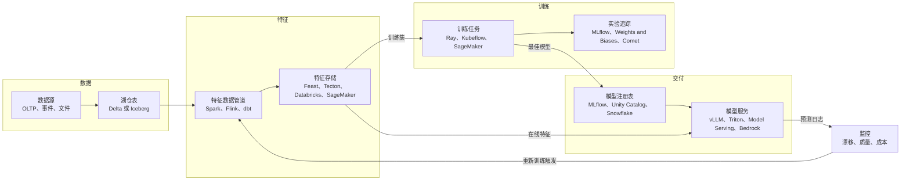
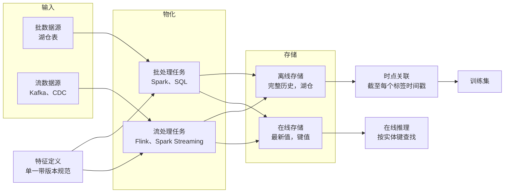
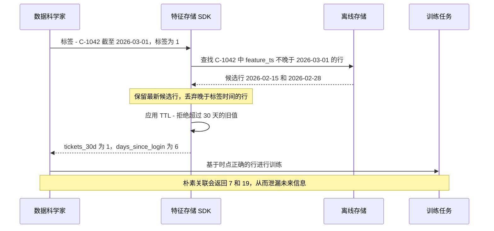

# 21. 机器学习平台、特征存储与 LLMOps
> **深度：** L2 · **阅读时间：** 约 15 分钟 · **最后核实：** 2026-11-01 · **前置阅读：** [第 16 章 — AI 数据生命周期](ch16-ai-data-lifecycle.md)

## 要点速览（TL;DR）

- 生产环境中的机器学习，本质上主要是数据工程，模型只是处于中间的一环。经典生命周期依次为：数据 → 特征 → 训练 → 注册表 → 服务 → 监控，而 [MLOps](../glossary.md#mlops) 就是让这一闭环可重复运行的方法论。Databricks 于 2018 年开源的 MLflow 已成为这一闭环事实上的默认记录系统。Databricks 表示，在 2025 年 6 月 MLflow 3 发布前后，MLflow 月下载量已超过 30M（公司披露）。[^mlflow3]
- [特征存储（feature store）](../glossary.md#feature-store)解决的是一个代价高昂的问题：确保模型在训练时看到的特征值，与其在生产环境中将看到的特征值一致。它将离线存储（历史数据，位于湖仓一体之上）与在线存储（最新值，位于键值数据库中）配对，并通过[时点关联（point-in-time join）](../glossary.md#point-in-time-join)生成训练集，从而避免未来数据泄漏到过去。
- [LLMOps](../glossary.md#llmops) 是面向生成式 AI 的同一闭环，只是名词变了：提示词取代特征，[追踪（trace）](../glossary.md#llm-trace)取代预测日志，[评估（eval）](../glossary.md#llm-evaluation)和 [LLM 作为评判者（LLM-as-judge）](../glossary.md#llm-as-judge)取代准确率指标，此外请求路径中还加入了护栏和网关。
- 独立的 MLOps 品类已被吸收。CoreWeave 收购 Weights & Biases（约 $1.7B，媒体报道，2025 年 5 月完成交割）；Databricks 收购 Tecton 的资产（2025 年 8 月）；OpenAI 同意收购 Neptune（2025 年 12 月）；ClickHouse 收购 Langfuse（2026 年 1 月）；Cisco 正在收购 Galileo，Palo Alto Networks 正在收购 Portkey（均于 2026 年 4 月宣布）；Nscale 同意以媒体报道的约 $1.65B 收购 Anyscale（2026 年 7 月）。[^wandb][^tecton-dbx][^neptune][^langfuse][^galileo][^portkey][^nscale]
- 收购方可分为三类：数据平台（模型需要数据）、GPU 云（向技术栈上层延伸），以及安全或可观测性厂商（LLM 请求路径是一个新的控制点）。仍保持独立的公司，是那些拥有开源切入点并处于全新生成式 AI 品类中的企业，例如 LangChain、Braintrust、Arize 和 Inferact（vLLM）。

## 为何重要（商业 + Everpure 视角）

对战略团队而言，这一层是近期工具品类被其下方平台吸收的最清晰案例。2018 年至 2022 年间，投资者为机器学习生命周期中的每一个环节分别资助了一家独立公司：实验追踪、特征存储、模型监控、数据标注和编排。到 2026 年，这些环节大多已成为 Databricks、Snowflake、超大规模云厂商或 GPU 云内部的功能。这一模式之所以重要，是因为同样的压力如今正作用于 LLMOps 工具、AI 网关，以及更下一层的与存储相邻的数据服务。

经济逻辑可以解释这一点。MLOps 工具建立在平台已持有的数据之上。特征存储是一组受治理的表加上一层缓存；模型注册表是一个目录条目；监控任务是对预测日志的定时查询。当平台掌握了表、目录和计算资源时，它就能以更低的边际成本提供上述每一项功能——通常捆绑在按用量计费之中——并让数据治理贯穿所有功能。[第 25 章](../04-company-deep-dives/ch25-databricks.md)和[第 26 章](../04-company-deep-dives/ch26-snowflake.md)中的数据引力（data gravity）论点在此直接适用。

对 Everpure 而言，有三点值得关注。第一，这一层**呈突发式的高存储负载**：训练检查点、特征表历史和模型制品体量大、带版本，且集中一次性写入。第二，特征表和模型制品越来越多地以开放表和对象的形式存放在 S3 兼容存储上，并由 Unity Catalog 等目录管理，这正是[第 7 章](../01-data-systems-foundations/ch07-open-table-formats.md)中"存储桶位于他人目录之下"的问题。第三，LLMOps 公司的收购方（安全和可观测性厂商）表明，谁处于 AI 请求路径之中，谁就能销售数据治理。Everpure 基于 1touch 的 Data Intelligence 在数据进入 AI 数据管道之前对其进行分类，在同一路径的数据侧占据了一个相邻位置。

## 工作原理

### 经典机器学习生命周期

Google 2015 年那篇关于"隐藏技术债"的论文指出，模型代码只是一个小方框，周围环绕着规模大得多的数据采集、特征提取、服务和监控系统。[^sculley] Uber 的 Michelangelo 平台（2017 年公开介绍）是第一个被广泛效仿的设计，它把这些环节整合进一个内部产品，其中就包括特征存储。[^michelangelo] 后来的大多数工具，都是一个或多个 Michelangelo 环节的商业化版本。

*图 21.1 — 机器学习生命周期是一个闭环，其六个阶段中有四个属于数据管理。这正是数据平台能够吸收其中大部分环节的原因。*

每个阶段都会产出一个带版本的制品，供下一阶段使用。特征数据管道产出特征表。训练产出模型文件及元数据：参数、指标，以及背后的代码和数据版本。[实验追踪（experiment tracking）](../glossary.md#experiment-tracking)为每一次运行记录这些元数据，使团队能够比较 200 次训练运行并复现最优结果。[模型注册表（model registry）](../glossary.md#model-registry)将选定版本逐级推进（候选、预发布、生产），并保留审计轨迹。服务环节将已注册版本加载到一个端点之后。监控环节将线上输入和输出与训练基线进行比较，并标记[数据漂移（data drift）](../glossary.md#data-drift)。

MLflow 从一开始就涵盖了追踪、模型打包格式和注册表。Databricks 于 2018 年 6 月将其作为开源项目发布，后来该项目转入 Linux Foundation。[^mlflow-launch] **MLflow 3**（2025 年 6 月）是面向生成式 AI 的重写版本。它新增了基于 OpenTelemetry 的追踪功能，集成了 20 多个生成式 AI 库；新增了基于生产追踪数据构建的数据集、由 LLM 评判者执行的评估；还新增了一个 `LoggedModel` 实体，用于跨多次运行（而非在单次运行内部）追踪某个模型或智能体的版本。[^mlflow3][^mlflow-docs] 这一设计选择值得注意：Databricks 并没有另建一个 LLMOps 产品，而是扩展了已经承载机器学习记录系统的那个工具。

### 特征存储：解决什么问题

**特征**是由原始数据计算得出的模型输入，例如"过去 30 天内的支持工单数"或"距上次登录的天数"。特征在生产环境中会引发三个反复出现的问题。

1. **[训练/服务偏差（training/serving skew）](../glossary.md#training-serving-skew)。** 数据科学家在 notebook 中用 pandas 基于夜间快照计算 `tickets_30d`；工程师则在线上 API 中用 Java 和流式计数器重新实现它。两个版本在边界情况上（时区、迟到事件、什么算作一张工单）存在分歧，于是模型在生产环境中性能下降，却不会抛出任何错误。
2. **时点正确性。** 一条训练样本对应过去的某个时刻。附加到它上面的每一个特征，都必须是在那个时刻可以获知的值，而不是今天的值。如果弄错，就会泄漏未来信息并夸大离线准确率（见下文的实例）。
3. **复用与延迟。** 可能有五十个模型都需要 `tickets_30d`。如果没有共享定义，每个团队都会各自计算；而在线路径需要在个位数毫秒内给出响应，这是数据仓库查询做不到的。

特征存储用"一个定义、两个存储"同时解决了这三个问题。特征以代码形式只定义一次。物化任务将其计算并写入**[离线存储（offline store)](../glossary.md#offline-store)**——保留带时间戳的完整历史（如今通常是湖仓一体上的 Delta 或 Iceberg 表）；同时写入**[在线存储（online store）](../glossary.md#online-store)**——只在 Redis 或 DynamoDB 等低延迟键值数据库中保存每个实体的最新值。训练通过时点关联从离线存储读取历史数据；服务则按键从在线存储读取最新值。由于两者由同一个数据管道产出，偏差是在设计层面被消除的，而不是靠测试去发现。

*图 21.2 — 一个定义同时供给两个存储。离线存储为训练回答"当时的情况是什么？"，在线存储为服务回答"现在的情况是什么？"。两个答案在构造上即保持一致。*

> **类比：半导体。** 训练/服务偏差相当于机器学习版的**流片前与流片后相关性（pre-silicon versus post-silicon correlation）**问题。设计团队基于模型（SPICE 网表、liberty 文件、仿真）完成时序和功耗签核，然后测量真实芯片，找出模型出错的工艺角。两个领域的解决办法相同：让模型与生产共享同一份特征化数据。特征存储就是这份共享的特征化数据。同理，特征注册表类似于**标准单元库**：每个单元（特征）只需特征化一次，带版本管理，并在众多设计（模型）中复用。没有人会为每一颗芯片重新推导 NAND2 的时序，也不应有人为每一个模型重新实现 `tickets_30d`。

### 实例：流失模型与泄漏的关联

一家订阅制企业希望预测哪些客户会在未来 30 天内取消订阅。每条训练样本是一个（客户，预测日期）对，并附带标签：该客户是否在该日期之后 30 天内取消？以客户 C-1042 为例。预测日期为 2026 年 3 月 1 日，该客户于 3 月 15 日取消，因此标签为 1。

`support_tickets_30d` 的特征表在每次重新计算该值时都会写入一行带时间戳的记录：

| 客户 | feature_ts | support_tickets_30d | days_since_login |
|---|---|---|---|
| C-1042 | 2026-02-15 | 1 | 3 |
| C-1042 | 2026-02-28 | 1 | 6 |
| C-1042 | 2026-03-14 | 5 | 16 |
| C-1042 | 2026-03-20 | 7 | 19 |

*图 21.3 — 单个客户的示意性特征历史（假设数据）。3 月 14 日取消流程启动后的数值是流失的症状，而不是流失的预测因子。*

**朴素关联**会把最新一行附加到每条训练样本上：7 张工单、距上次登录 19 天。模型于是学到"7 张工单意味着流失"。这本身没错，但这些工单是在取消流程中、也就是预测日期之后提交的。离线准确率看起来非常好。而在生产环境中，3 月 1 日在线存储显示该客户只有 1 张工单，模型看不出任何异常，客户就此流失。这就是[数据泄漏（data leakage）](../glossary.md#data-leakage)，也是测试表现良好的模型在生产中失败的最常见原因。

**时点关联**则为每条训练样本附加时间戳不晚于预测日期的最近一行特征。对于 3 月 1 日，就是 2 月 28 日那一行：1 张工单、6 天。离线准确率会下降，但它此时能如实反映生产环境中的准确率。

*图 21.4 — 时点关联是对每一行标签做一次"截至某时"（as-of）查找，再加上一个新鲜度上限。特征存储把它设为默认行为，这正是其大部分价值所在。*

Feast 的文档准确描述了这一行为：对每个实体行，它从该行的时间戳向前回溯扫描，取最新值，并丢弃早于特征视图存活时间（TTL）的值。[^feast-pit] 在大规模下这一关联代价高昂，因为数百万条标签行中的每一条都需要在一张大型历史表中做范围查找。这就是特征存储要按时间和实体进行分区的原因，也是湖仓厂商主张它应当在历史数据所在之处运行的原因。

> **深入（L3）。** 如果没有特征存储，同样的关联在 SQL 中就是对标签与特征的并集做窗口运算：对每个 `(customer, label_ts)`，将满足 `feature_ts <= label_ts` 的特征行按 `feature_ts DESC` 排名并保留排名第 1 的行，再过滤 `label_ts - feature_ts <= INTERVAL '30 days'`。有些引擎原生提供 `ASOF JOIN` 来完成这一操作。手工实现的团队还常会踩到另外两个坑：事件时间与摄取时间之别（一行数据计算得晚但时间戳标得早，仍然会造成泄漏），以及聚合窗口在标签时间*之后*才结束的特征。

### LLMOps：同样的闭环，新的名词

生成式 AI 保留了这个闭环，但改变了在其中流动的东西。大多数企业并不训练基础模型。它们构建的是这样的应用：以提示词、检索到的上下文（[第 19 章](ch19-retrieval-architectures.md)）和工具来调用模型，并常常串联成智能体（[第 22 章](ch22-agents-and-data.md)）。被管理的单元也相应地发生了变化。

- **提示词成为带版本的制品。** 提示词注册表存储带版本的模板，并将每个版本与评估结果关联，就像模型注册表对权重所做的那样。
- **追踪取代预测日志。** 一条[追踪](../glossary.md#llm-trace)记录一次请求的每一个步骤：提示词、检索调用、工具调用、模型响应、token 数、延迟和成本。大多数工具如今都输出与 OpenTelemetry 兼容的 span，这就是通用可观测性厂商（Datadog、Splunk）和分析型数据库（ClickHouse）也能在此竞争的原因。
- **评估取代准确率指标。** 离线评估让应用在一个由精选问题和参考答案组成的[黄金数据集（golden set）](../glossary.md#golden-set)上运行。由于自由文本没有唯一正确答案，通常由第二个模型按照评分细则为输出打分。这就是 LLM 作为评判者：成本低、可扩展，但其本身必须以人工标注为基准进行校准。在线评估则以同样方式为抽样的生产追踪打分。
- **护栏和网关位于请求路径之中。** [护栏（guardrails）](../glossary.md#guardrails)检查输入和输出中是否存在提示词注入、数据泄漏、有害内容或违反策略的回答。[AI 网关（AI gateway）](../glossary.md#ai-gateway)是位于多个模型提供商之前的代理，负责路由、故障转移、限流、凭证、缓存和支出上限。
- **模型服务变成 GPU 效率问题。** 开放权重模型运行在 vLLM 等推理引擎上，其 PagedAttention 设计以分页方式管理键值缓存，就像操作系统管理虚拟内存一样。[^vllm-paper] NVIDIA 将引擎打包为 NIM 微服务。托管 API（Bedrock、Microsoft Foundry、Databricks Model Serving）则将引擎完全隐藏。

| 品类 | 功能 | 代表性工具 | 现状 / 归属（2026 年 11 月） |
|---|---|---|---|
| 实验追踪 | 记录运行、参数、指标、制品 | MLflow；Weights & Biases；Comet（Opik）；Neptune | MLflow 开源（由 Databricks 主导）；W&B 自 2025 年 5 月起归 CoreWeave 所有[^wandb]；Neptune 于 2025 年 12 月同意被 OpenAI 收购，对外服务逐步关停[^neptune] |
| 追踪与可观测性 | 采集 LLM 与智能体追踪、成本、延迟 | LangSmith；Langfuse；Arize Phoenix；Datadog LLM Observability；Galileo；TruLens；MLflow Tracing | LangChain 保持独立（$1.25B，2025 年 10 月）[^langchain]；Langfuse 归 ClickHouse 所有（2026 年 1 月）[^langfuse]；Arize 保持独立（$70M C 轮，2025 年 2 月）[^arize]；Galileo 归入 Cisco/Splunk（2026 年）[^galileo]；TruLens 经由 TruEra 归入 Snowflake（2024 年）[^truera] |
| 评估 | 黄金数据集、LLM 作为评判者、回归测试 | Braintrust；MLflow evaluation；LangSmith；Arize；Agent Bricks | Braintrust 保持独立（$80M B 轮，媒体报道估值 $800M，2026 年 2 月）[^braintrust] |
| 护栏与 AI 安全 | 拦截注入、泄漏、不安全输出 | NeMo Guardrails；Guardrails AI；Lakera；Protect AI | NeMo Guardrails 开源（NVIDIA）[^tool-docs]；Lakera 归 Check Point 所有（媒体报道约 $300M，2025 年）[^lakera]；Protect AI 归 Palo Alto Networks 所有（收购对价 $634.5M，2025 年 7 月完成交割）[^protectai] |
| AI 网关 | 路由、故障转移、密钥、支出上限 | LiteLLM；Portkey；Databricks Unity AI Gateway；云原生网关 | LiteLLM 开源[^tool-docs]；Portkey 归入 Palo Alto Networks（2026 年 4 月宣布）[^portkey]；Unity AI Gateway 于 DAIS 2026 发布[^unity-gw] |
| 模型服务 | 在 GPU 上高效运行模型 | vLLM；SGLang；NVIDIA NIM 与 Triton；TGI；Databricks Model Serving；Bedrock | vLLM 由 PyTorch Foundation 托管，由 Inferact 商业化（$150M 种子轮，2026 年 1 月）[^ray-pt][^inferact]；Hugging Face TGI 进入维护模式[^tgi] |
| 微调 | 用领域数据适配开放权重模型 | Mosaic AI；Snowflake Cortex Training；Bedrock 自定义模型；超大规模云厂商调优服务 | 已捆绑进数据平台和云；Cortex Training 于 Summit 2026 发布[^sf-summit] |

*图 21.5 — 每个 LLMOps 品类都有一个开源锚点；在七个品类中至少有四个（实验追踪、追踪、护栏、网关），领先的独立公司在 2024 年至 2026 年间被收购。*

> **类比：半导体。** LLM 评估就是**流片后验证（post-silicon validation）**。芯片不是因为 RTL 仿真正确就能出货；只有当验证套件在真实芯片上覆盖了足够多的规格、且覆盖率指标指明了缺口所在时，芯片才会出货。黄金数据集就是测试程序，LLM 作为评判者是一台自动测试机，其自身准确率必须与参考标准（人工评分员）进行相关性校准，而在线评估则相当于现场返修分析。两个领域的难点都在于覆盖率：一个 500 道题的黄金数据集如果漏掉了客户实际遇到的边界情况，那么 98% 的通过率意义不大。

### 平台如何吸收 MLOps

**Databricks** 拥有最完整的自研技术栈。MLflow 是追踪和评估层。特征工程、模型和函数都在 [Unity Catalog](../glossary.md#unity-catalog) 中治理，因此一张特征表就是一张带主键的 Delta 表，并带有到使用它的模型的数据血缘，在线服务由 Databricks 托管。[^dbx-fs] Mosaic AI（来自 2023 年的 MosaicML 交易）和 Agent Bricks 覆盖模型服务、微调和智能体评估。继 2025 年 4 月规模较小的 Fennel 特征工程交易之后，Databricks 于 2025 年 8 月收购了 Tecton 的实时特征技术，用于为智能体提供新鲜上下文。[^tecton-dbx] 在 DAIS 2026 上，Databricks 新增了 Unity AI Gateway，用于治理智能体流量和 AI 支出。[^unity-gw]

**Snowflake** 在其治理边界内构建了同样的组件。Snowflake ML 包括一个支持从批数据源和流数据源增量刷新的 Feature Store、一个可接收在其他地方训练的模型的 Model Registry，以及用于漂移和性能监控的 ML Observability。[^sf-ml] Cortex 提供托管模型、智能体，并自 Summit 2026 起提供托管微调（Cortex Training）。[^sf-summit] TruEra（2024 年）提供了评估和可观测性能力。[^truera]

**超大规模云厂商**将整个生命周期捆绑进各自的 AI 平台：AWS 上的 Amazon SageMaker（含 SageMaker Feature Store）和 Bedrock；[^tool-docs] Google Cloud 上的 Vertex AI（2026 年 4 月更名为 Gemini Enterprise Agent Platform）；[^geap] 以及 Azure 上的 Azure Machine Learning 加 Microsoft Foundry（在 Ignite 2025 上由 Azure AI Foundry 更名而来）。[^foundry]

**开源计算保持中立。** Anyscale 背后的分布式计算框架 Ray 于 2025 年 10 月加入 PyTorch Foundation，与 PyTorch 和 vLLM 并列。[^ray-pt] Kubeflow 仍是 Kubernetes 原生的选择，Feast 则是它常见的特征存储搭档，并由 Red Hat 打包进 OpenShift AI。[^rh-feast] 但开放治理并没有保护这些项目背后的厂商：Anyscale 本身就同意出售给 GPU 云厂商 Nscale。[^nscale]
