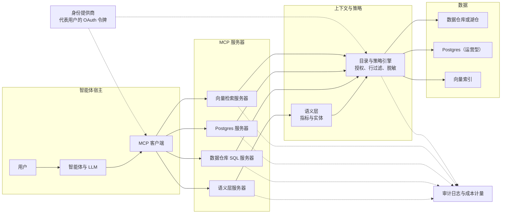
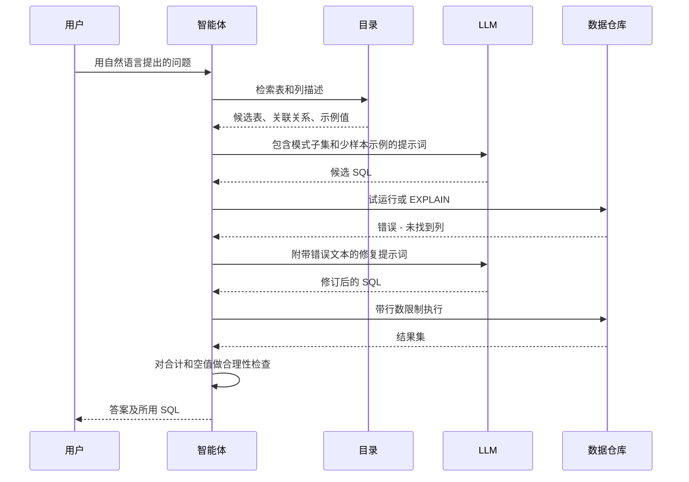
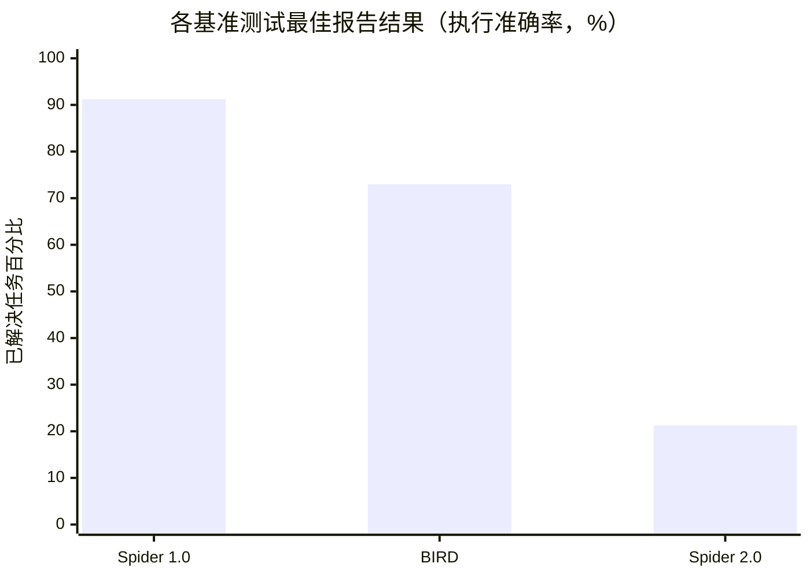
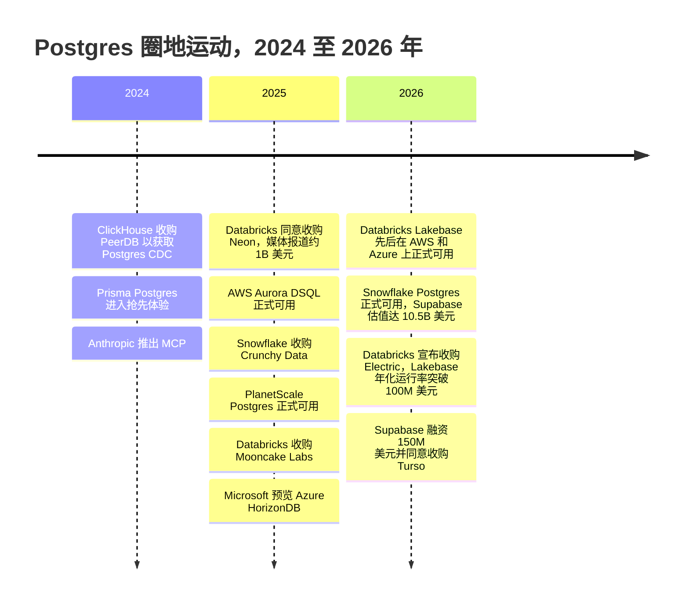

# 22. 智能体与数据
> **深度：** L2 · **阅读时间：** 约 18 分钟 · **最后核实：** 2026-11-01 · **前置阅读：** [第 19 章 — 检索架构](ch19-retrieval-architectures.md)、[第 14 章 — 语义层与商业智能](../02-pipelines-and-governance/ch14-semantic-layers-and-bi.md)

<a id="tldr"></a>
## 要点速览（TL;DR）

- AI 智能体（agent）访问数据有三种方式：自己编写 SQL（[文本转 SQL（text-to-SQL）](../glossary.md#text-to-sql)）、调用受治理的工具（例如语义层指标 API），或检索文档和记忆（见[第 19 章](ch19-retrieval-architectures.md)）。大多数生产系统会在同一个协议之后融合这三种方式。
- 文本转 SQL 在学术基准测试上看似接近解决，但在真实的数据库模式上远未解决。Spider 2.0 论文（2025 年）将当时在 Spider 1.0（91.2%）和 BIRD（73.0%）上公布的最佳结果，与其自身最佳配置在企业风格的 Spider 2.0 上仅 21.3% 的结果进行了对比。[^spider2] 解决之道在于上下文，而非更大的模型：用于模式链接的目录、承载业务含义的语义层，以及一个测试并修复查询的闭环。
- [模型上下文协议（Model Context Protocol）](../glossary.md#model-context-protocol)（MCP）已成为将智能体接入数据的标准方式。Anthropic 于 2024 年 11 月推出该协议。OpenAI、Google 和 Microsoft 于 2025 年采用了它，Anthropic 又于 2025 年 12 月将其捐赠给 Linux Foundation 旗下的 [Agentic AI Foundation](../glossary.md#agentic-ai-foundation)。[^mcp-launch][^mcp-adopt][^mcp-donate] 如今每一家主要数据平台都提供 MCP 服务器。
- 数据治理才是真正的产品。难点在于[身份传递（identity propagation）](../glossary.md#identity-propagation)（智能体*以*特定用户的身份行事）、最小权限工具、行过滤、审计和成本限制。最主要的安全风险，是隐藏在智能体所读取数据中的[提示词注入（prompt injection）](../glossary.md#prompt-injection)。
- 智能体还会*创建*数据库。Neon 表示，其平台上超过 80% 的数据库是由智能体创建的（公司披露，2025 年 5 月）；这一说法帮助引发了一场 Postgres 圈地运动：Databricks–Neon（Lakebase）、Snowflake–Crunchy Data（Snowflake Postgres）、估值 $10.5B 的 Supabase，以及超大规模云厂商推出的新 Postgres 服务。[^neon-dbx][^supabase-f]

<a id="why-this-matters-business--everpure-lens"></a>
## 为何重要（商业 + Everpure 视角）

二十年来，企业数据的消费者一直是人：编写 SQL 的分析师，或打开仪表盘的高管。智能体改变了需求的形态。一个人每天可能运行 30 次查询；而一个处理研究任务的智能体可以在几分钟内发出数百次查询，每次规模都很小，许多是试探性的，还有许多在出错后重试。访问模式从少量大规模扫描，转变为一大群小型、对延迟敏感、需经策略检查的调用。这改变了平台销售的东西（受治理的端点而非席位），也改变了基础设施必须承受的负载。

商业利益从交易流中可见一斑。Databricks 为 Neon 支付了约 $1B（媒体报道），其 Lakebase Postgres 产品线在大约一年内年化收入运行率就突破了 $100M（公司披露）。[^neon-dbx][^dbx-q2] Snowflake 收购了 Crunchy Data。Supabase 的估值在八个月内大约翻了一番，达到 $10.5B（媒体报道的投后估值）。[^supabase-f] Snowflake、Databricks 和 Google 各自推出了正式可用（GA）的 MCP 服务器或将其作为重磅发布。[^sf-mcp][^dbx-mcp][^bq-mcp] 这一切背后的论点是：谁控制了智能体通往数据的路径，谁就控制了未来十年的数据消费。

对 Everpure 而言，由此引出两点。第一，智能体工作负载会成倍增加元数据查找、小块读取和短生命周期的数据库副本。即时分支依赖于[写时复制（copy-on-write）](../glossary.md#copy-on-write)快照，而这正是存储的原生领地（见下文"存储桥接"）。第二，缺少语义上下文，智能体就会失败：某一列是什么含义、是否包含个人数据、谁可以查看。这正是 Everpure 收购 1touch（2026 年 5 月完成交割）所公开表述的目的——发现、分类数据并为其添加语义上下文。[^1touch] 基于公开信息，战略团队可能评估的一个选项是：通过 MCP 对外提供这种数据分类能力，使智能体平台在查询时即可调用。

<a id="how-it-works"></a>
## 工作原理

<a id="the-access-path-from-agent-to-bytes"></a>
### 访问路径：从智能体到字节

图 22.1 展示了参考路径。智能体*宿主*（Claude、ChatGPT、Microsoft Copilot 或企业自研应用）运行一个 MCP *客户端*。客户端连接到多个 MCP *服务器*，每个服务器封装一个系统。运行良好的服务器不会直接访问表，而是先经过语义层——它将"按区域划分的净收入"这样的请求转换为 SQL——再经过目录，在任何字节被移动之前执行授权、行过滤和脱敏。身份和审计贯穿整个路径，因此每一次查询都可以追溯到一个人类主体以及代表其行事的智能体。



*图 22.1 — SV-11：智能体从不直接接触表；每个请求都要经过 MCP 服务器、语义层和目录的策略引擎，身份与审计贯穿整个路径。*

<a id="text-to-sql-why-benchmarks-flatter-it"></a>
### 文本转 SQL：为何基准测试会美化它

文本转 SQL 是指由大语言模型（LLM）将自然语言问题转换为 SQL。一个生产系统包含四个阶段，如图 22.2 所示。**[模式链接（schema linking）](../glossary.md#schema-linking)**在成千上万的表和列中找出少数相关的那些，通常是通过检索目录描述和列名的嵌入（向量）来实现。**少样本提示（few-shot prompting）**加入经过验证的"问题–SQL"示例对，理想情况下来自同一领域。**生成**阶段产出候选 SQL，通常是多个候选。随后，**[自我修正循环（self-correction loop）](../glossary.md#self-correction-loop)**对每个候选进行编译或试运行，将任何错误反馈给模型，检查结果是否合理（行数、空值、合计），并在给出答案之前修复查询。



*图 22.2 — 文本转 SQL 循环：大部分准确率提升来自更好的模式链接和"执行–修复"循环，而不是 SQL 的初稿。*

基准测试讲述了一个值得警惕的故事。Spider 1.0（2018 年）使用小型、干净、单一数据库的模式，领先系统如今在其上已超过 90%。BIRD（2023 年）加入了更大、更杂乱的数据库以及"证据"提示。在 BIRD 公开排行榜上，Google 于 2026 年 6 月报告 Gemini-SQL2 的执行准确率为 80.04%，Huawei 于 2026 年 9 月报告其 DataGallery 系统达到 82.39%。排行榜列出的人类基线为 92.96%。[^bird-gemini][^bird-huawei] 在 ICLR 2025 上发表的 [Spider 2.0](../glossary.md#spider-2-0) 使用了基于 BigQuery、Snowflake 及其他引擎的 632 个真实企业工作流任务，其数据库经常超过 1,000 列。论文中的最佳配置——在智能体框架中运行的 OpenAI o1-preview——只解决了 21.3%。论文将其与 Spider 1.0 上的 91.2% 和 BIRD 上的 73.0% 进行对比；这两个数字对应的是当时排行榜上的领先系统，而不是 o1-preview 在这些基准上的运行结果。[^spider2] 2026 年的第三方快照显示，Spider 2.0-Lite 的最佳得分在 45–53% 区间（厂商报告，子集各不相同）。[^spider2-repo]

图 22.3 按照 Spider 2.0 论文的呈现方式展示了这一差距。各柱来自不同系统，因此应将图表理解为"每个基准上可获得的最佳结果"，而不是同一模型的三种评分。



*图 22.3 — 随着数据库模式接近企业真实情况，准确率急剧下降。Spider 1.0 和 BIRD 的柱为 Spider 2.0 论文所引用的排行榜领先结果；Spider 2.0 的柱为搭配智能体框架的 o1-preview（arXiv v2，2025 年 3 月）。*

真实企业环境中的准确率还要更低，原因是任何基准测试都无法完全捕捉的。数据库模式中有成千上万张表，名字形如 `F_ACCT_USG_D2`。同一个概念存在于三个地方，新鲜度各不相同。业务逻辑——例如财务日历、哪些账户算作"企业级"、退款是否与收入相抵——没有被写在任何模型能读取的地方。而且错误答案看起来与正确答案一模一样：一个通过一对多关联重复计数的查询，返回的是一个自信满满的数字，而不是报错。

解决办法是给模型提供上下文，而不是指望它自行推断。第 14 章已介绍过相关证据。data.world 2023 年的研究发现，GPT-4 在原始 SQL 表上正确回答了 16.7% 的企业问题，而在语义表示上的正确率为 54.2%。dbt Labs 由厂商自行开展的 2026 年更新报告称，在其语义层已建模的范围内，正确率达到 98–100%。[^dw-bench][^dbt-bench] 实践中，最好的系统两者兼用：对重复出现的问题（指标、标准维度）使用语义层；对长尾问题则回退到带目录上下文、经认证示例查询和修复循环的文本转 SQL。它们会展示生成的 SQL，以便人工核查。

> **深入（L3）。** 大规模模式链接是一个检索问题。团队将表和列描述、示例值以及历史查询日志做嵌入，然后检索 top-k 候选。有些团队还会从查询历史中挖掘关联路径，使模型即使在没有声明外键的情况下，也能知道 `orders.cust_id` 与 `customers.id` 关联。候选生成通常会采样多个 SQL 草稿，并按自洽性（self-consistency）挑选，也就是选择多数草稿一致的结果。Spider 2.0 的代码仓库包含 Snowflake、SQLite 和 dbt 项目三种变体（分别为 547、547 和 68 个任务），专门用于测试这类数据管道。[^spider2-repo]

<a id="mcp-the-bus-between-agents-and-systems"></a>
### MCP：智能体与系统之间的总线

MCP 定义了三种角色。**宿主**是用户与之交互的应用。**客户端**是宿主内部的连接器，与每个服务器各保持一个会话。**[MCP 服务器（MCP server）](../glossary.md#mcp-server)**封装一个系统，例如数据仓库、CRM 或文件存储。服务器对外暴露三种原语。**工具**是模型可以调用的函数（`run_query`、`list_metrics`）。**资源**是宿主可以读入上下文的数据（一张表的描述、一份文档）。**提示词**是用户可以调用的可复用模板。本地服务器通过标准输入/输出通信；远程服务器使用可流式 HTTP（streamable HTTP）。规范演进很快。2025 年 6 月的修订版将远程 MCP 服务器归类为 OAuth 2.1 资源服务器：它们需发布受保护资源元数据，并且必须验证专门为其签发的令牌；客户端则须通过资源指示符（resource indicators）指明目标服务器。2025 年 11 月的修订版进一步完善了授权机制，例如客户端向服务器注册的方式。[^mcp-auth][^keycloak] 另有报道称存在一个日期为 2026 年 7 月的修订版 [VERIFY: 2026-07-28 MCP 规范修订版的内容与状态]。

| 要素 | 是什么 | 数据平台示例 | 由谁控制 |
|---|---|---|---|
| 宿主 | 用户工作所在的应用 | Claude、ChatGPT、Copilot、Cursor、内部门户 | 最终用户或 IT 部门 |
| 客户端 | 宿主内部针对每个服务器的连接器 | 到 Snowflake 服务器的会话 | 宿主厂商 |
| 服务器 | 对单一系统的封装 | Snowflake 托管、Databricks 托管、BigQuery 远程、Postgres、MongoDB 服务器 | 数据平台厂商或客户 |
| 工具 | 带 JSON schema 的可调用函数 | `query_metrics`、`execute_sql`、`vector_search` | 服务器作者 |
| 资源 | 可读取的上下文 | 表文档、语义模型、文件 | 服务器作者 |
| 提示词 | 可复用模板 | "解释这个指标" | 服务器作者 |
| 授权 | 按用户和服务器签发的 OAuth 2.1 令牌 | 限定于分析师角色、受众绑定到单一服务器的令牌 | 身份提供商与服务器 |

*图 22.4 — MCP 的角色与原语：协议标准化的是"插头"，而每个工具的权限范围由服务器作者决定，数据治理的成败正取决于此。*

对一项行业标准而言，其采用速度异常之快。OpenAI 于 2025 年 3 月宣布支持，Google 在 2025 年 5 月前将 MCP 加入 Gemini API 和 SDK，Microsoft 则在 2025 年 5 月的 Build 大会上承诺在 Windows 和 Azure 全面支持 MCP。[^mcp-adopt] 2025 年 12 月 9 日，Anthropic 将 MCP 捐赠给 Agentic AI Foundation（一个与 Block 和 OpenAI 共同发起的定向基金），当时援引的数据是 SDK 月下载量超过 97M 次、活跃服务器超过 10,000 个（公司披露）。[^mcp-donate] 数据厂商随即跟进。Snowflake 的托管 MCP 服务器于 2025 年 11 月 4 日正式可用（GA），在基于角色的访问控制下对外提供 Cortex Analyst 和 Cortex Search。Databricks 于 2025 年 6 月推出面向 Unity Catalog 函数、向量检索和 Genie 的托管 MCP 服务器；其文档将其列为公开预览版（Public Preview）。Google 在 Next '26 上将远程 BigQuery MCP 服务器推至 GA。AWS 随 Aurora DSQL 提供了一个 MCP 服务器。[^sf-mcp][^dbx-mcp][^bq-mcp][^dsql]

> **类比：PCIe 与 USB。** MCP 之于智能体，正如 PCIe 或 USB 之于计算机。在 USB 出现之前，每种外设都需要自己的端口和驱动程序；此后，任何合规设备都能与任何合规主机配合工作，外设市场随之爆发。MCP 对"N 个宿主乘以 M 个系统"的集成问题起到了同样的作用：只需编写一个服务器，所有合规的智能体都能使用它。这个类比同样揭示了其局限。总线标准保证设备能够通信，但不保证设备可信，这就是系统后来加入 IOMMU 的原因。MCP 同样只标准化了连接，而将信任问题留给身份、策略和工具设计。

MCP 将智能体连接到工具和数据。Google 的 **[Agent2Agent 协议（Agent2Agent protocol）](../glossary.md#agent2agent-protocol)**（A2A）于 2025 年 4 月推出、2025 年 6 月移交给 Linux Foundation，它将智能体连接到*其他智能体*：例如采购智能体将一个子任务交给供应商的智能体，并支持任务状态和能力发现。[^a2a] 两者是互补关系。对数据团队而言，当下重要的是 MCP，因为智能体正是通过它访问受治理的数据。

<a id="risks-the-lethal-trifecta"></a>
### 风险：致命三要素

MCP 安全领域的标志性案例出现在 2025 年 7 月。研究人员展示：一个连接到 Supabase MCP 服务器、且持有可绕过行级安全的服务角色凭证的编码智能体，可以被一张客户支持工单中的文本所操控。该工单指示智能体将一张私有令牌表复制到攻击者可读取的位置。[^willison] Simon Willison 将这一模式命名为[致命三要素（lethal trifecta）](../glossary.md#lethal-trifecta)：一个智能体同时具备访问私有数据的权限、接触不可信内容的途径，以及向外发送数据的渠道。任何一个同时具备这三点的 MCP 服务器都可被利用。Supabase 的应对措施——默认采用只读且限定于项目范围的模式——移除了其中一个要素。[^willison]

| 风险 | 如何发生 | 控制措施 |
|---|---|---|
| 间接提示词注入 | 隐藏在智能体所读取的行、文档或工单中的指令 | 将检索到的数据视为不可信；默认只读；写入或发送前须经人工批准 |
| 工具权限过宽 | 一个以服务账号或管理员身份运行的 `execute_sql` 工具 | 范围窄、类型明确的工具（指标而非原始 SQL）；每个工具使用最小权限角色 |
| 数据外泄 | 私有数据加上外发渠道（电子邮件、网页抓取、issue 评论） | 打破三要素：出口允许列表；不在同一会话中混用不可信输入与外发工具 |
| 混淆代理与令牌透传 | 服务器转发或复用一个并非为其签发的高权限令牌 | 受众绑定的 OAuth 令牌；规范强制要求的令牌验证；禁止透传 |
| 工具投毒与静默更新 | 第三方服务器的工具描述中携带隐藏指令，或在批准后发生变更 | 私有注册表与允许列表；锁定服务器版本；审查工具清单 |
| 成本与负载失控 | 智能体循环发出数千次查询或全表扫描 | 按智能体限流、查询成本上限、数据仓库预算、AI 网关 |
| 审计缺口 | 查询以共享的服务身份出现 | 身份传递；每次调用同时记录用户身份和智能体身份 |

*图 22.5 — MCP 风险与控制措施：大多数失败源于工具权限范围和身份，而非协议本身，因此控制措施应落在服务器设计和策略层。*

<a id="governed-access-who-is-the-agent"></a>
### 受治理的访问：智能体是谁？

数据治理的核心问题表述起来很简单：当智能体运行一次查询时，适用的是谁的权限？弱的答案是一个拥有广泛权限的共享服务账号，这会让行级安全形同虚设，审计日志也毫无用处。强的答案是**身份传递**：用户完成认证，身份提供商通过[代表用户流程（on-behalf-of flow）](../glossary.md#on-behalf-of-flow)签发一个同时标明用户（主体，subject）和智能体（行为者，actor）的令牌，所有下游系统都执行*该用户*的授权。Microsoft 于 2025 年 5 月 Build 大会上发布的 Entra Agent ID，为智能体赋予了各自的目录身份及已声明的委托权限，并在签发的令牌中将智能体标记为行为者。[^entra] 其他身份厂商也在构建同样的模式。这就是业界所说的[智能体身份（agentic identity）](../glossary.md#agentic-identity)：智能体是一等主体，但其权限永远不会超过它所服务的人类用户。

身份之上是[第 15 章](../02-pipelines-and-governance/ch15-governance-security-privacy.md)和[第 8 章](../01-data-systems-foundations/ch08-catalogs-and-metastores.md)中介绍的策略层。[基于属性的访问控制（attribute-based access control）](../glossary.md#attribute-based-access-control)（ABAC）依据标签应用规则，因此一个标记为 `pii` 的列，对于任何不具备隐私授权属性的主体都会被脱敏。[行级安全（row-level security）](../glossary.md#row-level-security)按用户所在区域或负责的业务范围过滤行。审计记录哪个智能体代表谁运行了哪条查询。成本控制是一项较新的需求，用于限制智能体每个任务可花费的金额。Databricks 的 Unity AI Gateway 和 Snowflake 收购 Natoma（智能体与 MCP 治理，2026 年 5 月报道）表明，各平台正将智能体流量视为需要计量和监管的对象。[^dbx-q2][^natoma]

> **类比：特权环与 IOMMU。** CPU 在 ring 3 中运行用户代码，在 ring 0 中运行内核。用户进程无法读取另一个进程的内存，因为内存管理单元会依据该进程的页表检查每一次访问。IOMMU 将同样的规则扩展到设备，使执行直接内存访问（DMA）的网卡只能触及为其映射的页面。身份传递就是智能体的 IOMMU。智能体是总线上的一个强大设备，但它的每个请求都要经过转换，并对照其所服务用户的页表（这里即权限授予）进行检查。共享服务账号则相当于允许设备对任意地址做 DMA。

<a id="agent-memory-a-cache-hierarchy-for-context"></a>
### 智能体记忆：上下文的缓存层级

智能体需要超出单个提示词范围的记忆。上下文窗口容纳当前任务；任何需要更长时间保留的内容都必须写出并在之后调回。商业化的记忆层在 2025 年涌现。Mem0 为其记忆 API 融资 $24M（种子轮加 A 轮，2025 年 10 月），该 API 从对话中提取事实，并以向量和图的形式存储。[^mem0] Zep 的开源 Graphiti 引擎构建时序知识图谱，记录每条事实在何时为真；其 2025 年 1 月的论文报告在两项记忆基准测试上超越了 MemGPT（作者报告）。[^zep] Letta 是 MemGPT 研究项目的商业化继承者，让智能体自行管理分层记忆块。ChatGPT、Claude 和 Gemini 也都提供用户级记忆功能，这使得记忆既是独立产品，也是平台功能。

| 记忆类型 | 保存内容 | 典型存储 | 生命周期 | 示例 | 缓存层级类比 |
|---|---|---|---|---|---|
| 工作记忆（上下文窗口） | 当前指令、最近几轮对话、工具结果 | 模型上下文与 KV 缓存 | 数秒至一个会话 | 所有 LLM | 寄存器与 L1 |
| 会话缓冲 | 汇总后的对话状态、检查点 | 键值存储或 Postgres | 数小时至数天 | 框架检查点器 | L2/L3 缓存 |
| 语义长期记忆 | 事实与偏好（"用户偏好 EMEA 视图"） | 向量索引，常为 pgvector | 数周至数月 | Mem0、平台记忆功能 | DRAM |
| 时序/关系记忆 | 实体、关系、事实成立的时间 | 知识图谱 | 数月，带版本 | Zep/Graphiti | 带时间戳的 DRAM |
| 过程记忆 | 指令、技能、习得的工作流 | 文件、提示词、代码仓库 | 长期 | Letta 记忆块、技能文件 | 固件或微码 |
| 记录系统 | 企业的真实数据 | 数据仓库、湖仓、Postgres | 数年，受治理 | 通过 MCP 工具访问，而非记忆 | NAND 闪存 |

*图 22.6 — 智能体记忆是一个层级结构：顶部是小而快、易失的上下文，底部是受治理的记录系统，面临与 CPU 缓存相同的提升、驱逐和一致性问题。*

> **类比：存储层级。** 上下文窗口是寄存器和 L1：极小、极快，任务结束即被清空。向量记忆是 DRAM：容量大得多、访问更慢，需要通过显式加载（检索）来填充。数据仓库是 NAND：海量且持久，只能通过控制器（MCP 服务器和目录）访问。设计问题都是熟悉的那些：哪些内容要预取到上下文中，窗口满时驱逐什么，以及在源数据变化时如何保持缓存事实的一致性。如果账户已被重新分配，记忆中仍写着"Acme 的负责人是 Dana"，那就是一条过期的缓存行。记忆应当缓存*指针和偏好*；业务事实则应从受治理的数据源重新读取。

<a id="worked-example-which-enterprise-customers-usage-dropped-more-than-20-last-month-and-who-are-their-account-owners"></a>
### 实例："哪些企业客户上个月的用量下降超过 20%，他们的客户经理是谁？"

Priya 是 EMEA 区域的一名收入运营经理，她在公司的智能体宿主中提出了这个问题。场景是示意性的，但其机制是标准的。

1. **认证。** Priya 通过单点登录完成登录。当智能体首次调用语义层 MCP 服务器时，身份提供商签发一个 OAuth 令牌，将 Priya 标记为主体、智能体标记为行为者，且仅对该服务器有效。
2. **通过语义层消除歧义。** 智能体调用 `list_metrics`，找到经认证的指标 `product_usage_units`（按月，已剔除内部测试账户）和维度 `customer.segment`。"上个月"解析为最近一个完整的财务月，其定义由语义层给出。如果语义层提供了两个用量指标，智能体应当询问 Priya 指的是哪一个，而不是自行猜测。
3. **受治理的查询。** 智能体调用 `query_metrics`，获取细分市场为 Enterprise 的客户在最近两个月的用量。语义层生成 SQL，目录应用 Priya 的行过滤器（区域 = EMEA）。她只能看到 EMEA 的客户，智能体也无法扩大这一范围。
4. **计算与护栏。** 智能体计算环比变化，并筛选出降幅超过 20% 的客户。一个好的智能体还会应用最低基数过滤，避免一个从 10 个单位降到 7 个单位的客户排在榜首，并在回答中说明这一规则。
5. **从第二个系统获取客户经理。** 客户经理信息存放在 CRM 中，在同一委托身份下通过第二个 MCP 服务器访问。ABAC 规则对客户经理的电话号码（标记为 `pii`）进行脱敏，但显示姓名和电子邮件地址。
6. **审计与成本。** 每次调用都会记录 Priya 的身份、智能体身份、所用工具、生成的 SQL 以及计算成本。该任务始终控制在每个会话的查询预算之内。
7. **回答。** 智能体返回一张包含客户、用量变化和客户经理的表格，展示其使用的指标定义和 SQL，并提出可以代为起草邮件——由于这属于写操作，需要 Priya 明确批准。

```sql
-- 由语义层生成，而非由 LLM 编写（示意）
SELECT c.customer_id, c.name,
       SUM(CASE WHEN u.fiscal_month = :prev THEN u.units END) AS prev_units,
       SUM(CASE WHEN u.fiscal_month = :last THEN u.units END) AS last_units
FROM analytics.usage_monthly u
JOIN analytics.customers c ON c.customer_id = u.customer_id
WHERE c.segment = 'Enterprise' AND u.is_internal = FALSE
  AND c.region = 'EMEA'          -- 由针对该用户的行级策略注入
GROUP BY 1, 2;
```

这个例子的要点在于智能所在的位置。LLM 负责选择工具并组织答案；而定义、财务日历、区域过滤和脱敏都来自受治理的层级——它们为仪表盘提供的也会是同样的结果。

<a id="agents-as-database-builders-the-postgres-renaissance"></a>
### 智能体作为数据库构建者：Postgres 的复兴

智能体与数据的第二个故事关乎创建数据库，而非查询数据库。AI 编码工具和应用构建器会为每一个原型、每一次测试运行或每一条工作分支启动一个新的 Postgres 数据库。Neon 的架构恰好适合这种需求。它将 Postgres 计算与存储服务分离，后者由"safekeeper"（持久化的预写日志）和一个将数据页保存在对象存储上的 page server 组成。[^neon-arch] 这使得创建新数据库或[数据库分支（database branch）](../glossary.md#database-branching)成为一次元数据操作——一个只需数秒的写时复制分叉。空闲的计算资源可以[缩容至零（scale to zero）](../glossary.md#scale-to-zero)，因此一个被遗忘的原型几乎不产生成本。Databricks 在 2025 年 5 月同意收购 Neon 时援引了 Neon 的遥测数据：该平台上超过 80% 的数据库是由 AI 智能体创建的（公司披露）。[^neon-dbx]

为什么是 Postgres，而不是某种新东西？原因有四。其生态系统极其庞大（驱动程序、ORM、托管服务、人才）。pgvector 等扩展让一个引擎就能处理事务、JSON 和向量。LLM 写出的 Postgres SQL 质量很高，因为这种方言在公开代码和文档中占主导地位。而宽松的许可证意味着任何人都可以基于它构建服务，无需与厂商谈判。反方观点是：Postgres 单写入者、每连接一个进程的设计，并不是为成千上万个微小、突发的租户而构建的。下表中的每一家厂商都对 Postgres 之下的各层进行了重新设计，以解决这一问题。

| 产品 | 所有者 | 架构 | 分支 | 缩容至零 | 计价单位 | 现状（2026 年 11 月） |
|---|---|---|---|---|---|---|
| Neon | Databricks（2025 年收购，媒体报道约 $1B） | Postgres 计算层，位于 safekeeper 加对象存储上的 page server 之上 | 支持，写时复制，数秒 | 支持 | 计算小时数加存储 | GA；Lakebase 的技术基础 |
| Databricks Lakebase | Databricks | 平台内的 Neon 架构，由 Unity Catalog 治理 | 支持，零拷贝 | 支持（高可用模式下不支持） | Databricks 消费单位（n.v.） | 2026 年 2 月在 AWS 上 GA，2026 年 3 月在 Azure 上 GA；年化运行率 >$100M（公司披露） |
| Snowflake Postgres | Snowflake（Crunchy Data，据 10-Q 为现金 $164.5M） | 托管 Postgres，镜像同步至 Snowflake | n.v. | n.v. | Snowflake credits（n.v.） | 2026 年 6 月 Summit 上 GA |
| Supabase | 独立（投后估值 $10.5B，2026 年 6 月） | 每个项目一个 Postgres，外加认证、存储、函数、实时功能 | 支持，与 Git 关联的预览分支（n.v.） | 免费项目空闲时暂停（n.v.） | 按项目计算档位加用量 | GA；正在收购 Turso |
| Amazon Aurora DSQL | AWS | 分布式、多区域双活、兼容 Postgres | 不支持 | 无服务器；按使用付费 | 分布式处理单元加存储 | 2025 年 5 月 GA |
| Google AlloyDB | Google | 兼容 Postgres，分离式存储，列式引擎 | 克隆（n.v.） | 不支持 | vCPU 小时数加存储 | GA（2022 年）；向 BigQuery 的实时复制于 2026 年 4 月 GA |
| Azure HorizonDB | Microsoft | 横向扩展、兼容 Postgres，分离式存储；最高 3,072 vCores、128 TB | n.v. | n.v. | n.v. | 自 2025 年 11 月起预览 |
| PlanetScale Postgres | 独立 | 基于本地 NVMe（"Metal"）并带副本的 Postgres | Postgres 版本 n.v. | 不支持 | 按集群按月（Metal 起价 $50） | 2025 年 GA |
| Xata | 独立（核心采用 Apache 2.0） | 在写时复制存储卷上运行的未经修改的 Postgres | 支持，并带 PII 匿名化 | n.v. | n.v. | GA；开源核心 |
| Prisma Postgres | Prisma | 运行在 unikernel 和 microVM 上的 Postgres | n.v. | 按用量计费，无空闲计算（n.v.） | 按操作计费（n.v.） | 已可用于生产（2024 年 10 月抢先体验） |
| Turso | 正被 Supabase 收购 | 兼容 SQLite，每租户一个数据库，嵌入式副本 | n.v. | n.v. | n.v. | 交易于 2026 年 10 月宣布 |

*图 22.7 — 面向智能体的 Postgres：差异化要素在于分支、缩容至零和按使用计费，而这些都依赖于存算分离。"n.v." = 本版未核实 [VERIFY: 标记为 n.v. 的单元格]。[^neon-dbx][^lakebase-ga][^dbx-q2][^ma-csv][^sf-postgres][^supabase-f][^dsql][^alloydb][^horizondb][^planetscale][^xata][^prisma][^turso]*

<a id="design-choices-and-trade-offs"></a>
## 设计选择与权衡

| 方法 | 灵活性 | 企业数据上的准确率 | 数据治理 | 每个问题的成本 | 最适用于 |
|---|---|---|---|---|---|
| 直接基于数据库模式的原始文本转 SQL | 最高 | 低（Spider 2.0 类任务：约 20–50%） | 弱，除非传递了身份 | 中等；重试多 | 由能读懂 SQL 的专家进行探索 |
| 带目录上下文、示例和修复循环的文本转 SQL | 高 | 中 | 若以用户身份运行则良好 | 较高（多次 LLM 和试运行调用） | 长尾分析问题 |
| 语义层工具（指标 API） | 仅限已建模指标 | 范围内高；范围外拒绝回答 | 强；定义与策略集中管理 | 低 | 反复出现的 KPI、高管问题 |
| 专用任务工具（`get_account_health`） | 最低 | 对该任务最高 | 最强；代码路径经过审查 | 最低 | 高频、高风险工作流 |
| 基于文档和记忆的检索 | 中 | 取决于分块和排序（见第 19 章） | 需要按文档设置权限 | 低至中等 | 政策、合同、工单 |

*图 22.8 — 准确率与灵活性的权衡：智能体自己编写的越多，它能回答的就越多，但可信度就越低；生产设计会将每个问题路由到能回答它的最窄工具。*

原始文本转 SQL 的最强版本论证是：模型在不断进步。从论文发表到 2026 年的快照，Spider 2.0-Lite 的得分大约翻了一番；而语义层只能覆盖已有人建模的内容。这一点说得没错。但准确率并不是唯一的约束。即使模型能写出 SQL，数据治理和可审计性也更青睐范围窄的工具，因为经过审查的工具会以可预测的方式失败。可能的终局是分层的：前一百个问题用窄工具，指标用语义层访问，其余一切用受监督的文本转 SQL。

在数据库方面，权衡在于托管平台的引力与独立性之间。Lakebase 和 Snowflake Postgres 承诺运营数据无需数据管道即可落入分析平台。Databricks 将统一后的版本称为 LTAP，并称其即将推出（见[第 23 章](ch23-real-time-analytics-htap.md)）。Supabase 和 Neon 式的独立厂商承诺的是开发者体验和可移植性。超大规模云厂商承诺的是规模和采购的简便性。

<a id="whos-who"></a>
## 主要参与者

- **智能体宿主与模型厂商：** Anthropic（MCP 发起者）、OpenAI、Google（Gemini Enterprise，A2A 发起者）、Microsoft（Copilot、Entra Agent ID）。全部支持 MCP。
- **提供 MCP 服务器的数据平台：** Snowflake（托管 MCP 于 2025 年 11 月 GA；CoWork 智能体）、Databricks（托管 MCP 服务器、Genie、Agent Bricks、Unity AI Gateway）、Google BigQuery（远程 MCP 服务器 GA）、AWS（覆盖多种数据库的 MCP 服务器，包括 Aurora DSQL）、MongoDB 以及 Postgres 社区服务器。见[第 25 章](../04-company-deep-dives/ch25-databricks.md)和[第 29 章](../04-company-deep-dives/ch29-operational-database-vendors.md)。
- **语义层与上下文层：** dbt/Fivetran、Cube、AtScale、ThoughtSpot、Looker，以及各平台原生的语义层（见[第 14 章](../02-pipelines-and-governance/ch14-semantic-layers-and-bi.md)）。
- **智能体记忆：** Mem0、Zep（Graphiti）、Letta，以及各大助手内置的记忆功能。
- **面向智能体的 Postgres：** Neon/Lakebase、Snowflake Postgres、Supabase（含 Turso）、Aurora DSQL、AlloyDB、Azure HorizonDB、PlanetScale、Xata、Prisma Postgres；Databricks 还收购了 Mooncake Labs（Postgres 转列式），并宣布收购 Electric（PGlite，供智能体沙箱使用的本地 Postgres）。[^ma-csv]

<a id="history-and-trajectory"></a>
## 历史与发展轨迹



*图 22.9 — 在 24 个月内，每一家主要数据平台都收购或自建了 Postgres 服务，其定价依据是这样一种论断：如今创建大多数新数据库的是智能体，而不是人。资料来源：data/ma_deals.csv 及本章脚注；交易背景见[第 39 章](../05-business-and-economics/ch39-ma-history.md)。*

文本转 SQL 的研究可以追溯到 20 世纪 70 年代，但现代时期始于 2018 年的 Spider 1.0。到 2023 年，LLM 已将 Spider 1.0 的准确率推高到 90% 以上，这促使了更难基准测试的出现：2023 年的 BIRD 和 Spider 2.0（2024 年 11 月预印本，ICLR 2025）。[^spider2] 与此同时，厂商从"与你的数据对话"演示（2023 年），发展到以语义层为基础的助手（2024–2025 年），再到有正式命名的智能体产品：Databricks 的 Genie One、Snowflake 的 CoWork（在 Summit 2026 上由 Snowflake Intelligence 更名而来），以及 Google 的 Gemini Enterprise。[^dbx-q2]

MCP 的发展轨迹是：2024 年 11 月发布，2025 年春季被 OpenAI、Google 和 Microsoft 采用，2025 年 6 月重构授权机制，2025 年 12 月转入 Linux Foundation 实行中立治理。[^mcp-launch][^mcp-adopt][^mcp-auth][^mcp-donate] 2026 年的主线是智能体治理向数据平台集中（Unity AI Gateway、Snowflake–Natoma），以及针对提示词注入事件的安全加固。

未来两年的三个判断。(1) 在主要平台上，智能体流量将超过人类查询流量，定价将跟随智能体（按任务或按受治理调用计费），而非按席位计费。(2) MCP 服务器将在每个企业内部整合为少数几个受治理的网关，因为安全团队不会批准数百个未经审查的服务器。(3) 运营型与分析型 Postgres 将在共享存储上融合，分支将被视为基本预期。看空逻辑是：智能体在杂乱数据上的准确率陷入停滞，企业将智能体限制在只读仪表盘范围内，而 Postgres 圈地运动最终被证明是为那些永远不会成为生产工作负载的"氛围编程"（vibe-coding）原型付了高价。

<a id="numbers-that-matter"></a>
## 关键数字

| 指标 | 数值 | 口径 | 来源 / 日期 |
|---|---|---|---|
| Spider 1.0 / BIRD / Spider 2.0 最佳报告结果（Spider 2.0：o1-preview 搭配智能体框架） | 91.2% / 73.0% / 21.3% | 学术论文（前两项为其引用的排行榜结果） | Lei 等，arXiv v2，2025-03[^spider2] |
| BIRD 最高提交系统 | 执行准确率 82.39%（Huawei DataGallery） | 厂商报告的排行榜结果 | Technology Magazine，2026-09[^bird-huawei] |
| BIRD 人类基线 | 92.96% | 排行榜参考值 | BIRD 排行榜[^bird-huawei] |
| GPT-4 基于 SQL 与基于语义表示 | 16.7% 对 54.2% | 厂商开展的研究 | data.world，2023-11[^dw-bench] |
| 捐赠时 MCP SDK 月下载量 | >97M | 公司披露 | Anthropic，2025-12-09[^mcp-donate] |
| 捐赠时活跃 MCP 服务器数 | >10,000 | 公司披露 | Anthropic，2025-12-09[^mcp-donate] |
| Neon 上由智能体创建的数据库占比 | >80% | 公司披露的遥测数据 | Databricks/Neon，2025-05[^neon-dbx] |
| Databricks–Neon 价格 | 约 $1B | 媒体报道 | TechRepublic，2025-05[^neon-dbx] |
| Snowflake–Crunchy Data | 现金 $164.5M（媒体报道约 $250M） | GAAP（10-Q 披露） | Snowflake 10-Q，2025-12[^ma-csv] |
| Lakebase 收入年化运行率 | >$100M | 公司披露的年化运行率 | Databricks，2026-08-13[^dbx-q2] |
| Supabase 估值 | 投后估值 $10.5B（$500M F 轮） | 媒体报道 | Orrick，2026-06[^supabase-f] |
| Mem0 融资 | $24M（种子轮 + A 轮） | 媒体报道 | TechCrunch，2025-10-28[^mem0] |
| Azure HorizonDB 规模 | 最高 3,072 vCores、128 TB；吞吐量"最高可达"开源 Postgres 的 3 倍 | 公司披露（预览版） | Microsoft，2025-11[^horizondb] |

*图 22.10 — 关键数字：干净基准与企业基准之间约 70 个百分点的准确率差距，一个月下载量约 100M 的协议，以及以智能体创建的数据库为定价依据的 Postgres 交易。*

<a id="storage-bridge"></a>
## 存储桥接

> **存储桥接。** 由智能体构建的应用，将数据库分支变成了一项存储功能。Neon 通过在 page server（将数据页保存在对象存储上）中分叉元数据来创建分支。Xata 则对底层存储卷做写时复制快照，并在其上启动一个全新的 Postgres，完全不修改 Postgres 本身。[^neon-arch][^xata] 无论哪种方式，分支的速度和成本都取决于快照与克隆路径，以及在成千上万个短生命周期租户下的元数据性能。这与企业级存储阵列用于即时克隆的能力是同一种能力。与此同时，受治理的智能体查询以大量小型、随机且对延迟敏感的读取形式到达。快照与克隆机制参见配套的 *Everpure Tech Atlas*。战略选项见[第 45 章](../06-history-and-future/ch45-storage-moving-up-the-stack.md)。

<a id="conversation-playbook"></a>
## 对话手册

**向产品经理提出的三个问题**

1. "当智能体查询您的平台时，查询是以谁的身份运行的？审计日志是否同时显示用户和智能体？"好的回答会描述一个代表用户（on-behalf-of）的令牌，执行用户的行过滤器，并在日志中有单独的行为者字段。弱的回答会提到每个智能体一个服务账号。
2. "智能体的问题中有多大比例经由语义层，又有多大比例是自由形式的 SQL？您如何衡量在*您自己*的问题上的准确率？"好的回答会提到一个基于真实问题和已验证答案构建的内部评估集，而不是 Spider 或 BIRD 的分数。
3. "您的环境中批准了多少个 MCP 服务器？谁来审查新的服务器？"好的回答会描述一个注册表或网关、锁定的版本以及安全审查。"开发者需要什么就装什么"是一个危险信号。

**向工程师提出的三个问题**

1. "您的 MCP 工具中，哪些可以写入、发送或从互联网抓取内容？是否有任何会话能将这些工具与不可信输入结合在一起？"好的回答：团队能说出致命三要素，并展示每种配置移除了哪一个要素。
2. "您的文本转 SQL 数据管道如何进行模式链接和修复？"好的回答：基于目录描述和查询日志的检索、试运行验证、结果合理性检查，以及向用户展示 SQL。
3. "对于由智能体创建的数据库，分支创建时间是多少？一个空闲分支的成本是多少？"好的回答会给出以秒计的时间和接近于零的空闲计算成本，并清楚分支是在 page server 层还是在存储卷层完成的。

**好的回答听起来是什么样的：**对身份流程的描述具体，对自身数据上的准确率坦诚，并专注于收窄而非放宽工具权限。

**"不要这样说"**

- "文本转 SQL 已经解决了；模型得分超过 90%。"那是 Spider 1.0。在企业风格的 Spider 2.0 上，论文中最好的系统得分约为 21%。
- "MCP 是安全的"或"MCP 是不安全的"。MCP 是一项连接标准。安全性取决于服务器权限范围、身份和策略。
- "智能体有自己的管理员账号，所以它什么都能回答。"这恰恰是会击穿行级安全的混淆代理模式。
- "智能体记忆会取代数据仓库。"记忆缓存的是上下文。受治理的事实应当从记录系统重新读取。
- "智能体创建了所有数据库中的 80%。"那是 Neon 在 2025 年针对其自身平台的公司披露数字，而不是行业统计数据。

<a id="going-deeper"></a>
## 深入阅读

- 阅读 Spider 2.0 论文的错误分析；模式链接和方言错误是失败的主要原因。[^spider2]
- 阅读 MCP 授权规范，追踪远程服务器如何验证受众绑定的令牌。[^mcp-auth]
- Simon Willison 关于致命三要素的文章，是从业者对智能体数据外泄问题最清晰的论述。[^willison]
- Neon 的架构文档解释了 safekeeper、page server 和写时复制分支。[^neon-arch]

<a id="key-terms"></a>
## 关键术语

- [文本转 SQL](../glossary.md#text-to-sql) — 由 LLM 将自然语言问题翻译为 SQL 查询。
- [模式链接](../glossary.md#schema-linking) — 在生成 SQL 之前，从大型数据库模式中选出相关的表、列和关联关系。
- [自我修正循环](../glossary.md#self-correction-loop) — 执行或试运行生成的 SQL，并将错误反馈给模型以进行修复。
- [执行准确率（execution accuracy）](../glossary.md#execution-accuracy) — 基准测试指标：生成的 SQL 返回结果与参考查询相同的问题所占比例。
- [Spider 2.0](../glossary.md#spider-2-0) — 2024–2025 年的文本转 SQL 基准测试，包含基于大型云端数据库模式的 632 个真实企业工作流任务。
- [BIRD 基准测试](../glossary.md#bird-benchmark) — 采用大型、杂乱数据库并附带外部知识提示的文本转 SQL 基准测试。
- [模型上下文协议](../glossary.md#model-context-protocol) — 将 AI 智能体连接到工具和数据的开放标准，现由 Agentic AI Foundation 治理。
- [MCP 服务器](../glossary.md#mcp-server) — 封装单一系统，并向 MCP 客户端暴露工具、资源和提示词的服务。
- [Agentic AI Foundation](../glossary.md#agentic-ai-foundation) — 自 2025 年 12 月起治理 MCP 的 Linux Foundation 定向基金。
- [Agent2Agent 协议](../glossary.md#agent2agent-protocol) — 源自 Google、现归 Linux Foundation 的开放协议，用于智能体将任务委托给其他智能体。
- [提示词注入](../glossary.md#prompt-injection) — 嵌入在 LLM 所读取内容中的恶意指令，导致其做出违背用户利益的行为。
- [致命三要素](../glossary.md#lethal-trifecta) — 单个智能体同时具备私有数据访问、不可信输入和外发渠道这一危险组合。
- [身份传递](../glossary.md#identity-propagation) — 在每一跳中传递最终用户的身份，使下游系统执行该用户的权限。
- [代表用户流程](../glossary.md#on-behalf-of-flow) — 一种 OAuth 令牌交换，服务借此获取代表特定用户行事的令牌。
- [智能体身份](../glossary.md#agentic-identity) — 将 AI 智能体视为一个独立、可审计的主体，其权限永远不超过它所服务的用户。
- [基于属性的访问控制](../glossary.md#attribute-based-access-control) — 依据用户和数据的属性及标签进行评估的访问规则。
- [行级安全](../glossary.md#row-level-security) — 过滤特定用户可见行的策略。
- [智能体记忆（agent memory）](../glossary.md#agent-memory) — 智能体存储在上下文窗口之外、并在后续步骤或会话中调回的信息。
- [数据库分支](../glossary.md#database-branching) — 为测试或智能体工作即时创建数据库的写时复制分叉。
- [缩容至零](../glossary.md#scale-to-zero) — 释放空闲数据库的全部计算资源，使其在下一次请求之前只产生存储成本。
- [写时复制](../glossary.md#copy-on-write) — 在版本之间共享未修改的数据，只写入被修改的块或文件。

<a id="sources"></a>
## 资料来源

[^spider2]: Fangyu Lei et al., "Spider 2.0: Evaluating Language Models on Real-World Enterprise Text-to-SQL Workflows," ICLR 2025 (oral), arXiv:2411.07763v2, https://arxiv.org/abs/2411.07763v2，发布 2025-03-17（v1 2024-11）；检索 2026-11-01。
[^spider2-repo]: xlang-ai, "Spider2" GitHub repository (Spider 2.0-Snow, -Lite, -DBT), https://github.com/xlang-ai/Spider2，无日期（持续更新）；检索 2026-11-01。2026 年 Spider 2.0-Lite 快照：Interfaze leaderboard, https://interfaze.ai/leaderboards/spider-2-lite，以及 BenchLM, https://benchlm.ai/benchmarks/spider2lite，2026（第三方，厂商报告）；检索 2026-11-01。
[^bird-gemini]: The Decoder, "Google Research's Gemini-SQL2 tops text-to-SQL benchmarks by a wide margin," https://the-decoder.com/google-researchs-gemini-sql2-tops-text-to-sql-benchmarks-by-a-wide-margin/，发布 2026-06；检索 2026-11-01（媒体报道；公司声称）。
[^bird-huawei]: Technology Magazine, "Huawei DataGallery Tops Benchmark for Enterprise Text2SQL AI," https://technologymagazine.com/news/huawei-datagallery-tops-benchmark-for-enterprise-text2sql-ai，发布 2026-09；检索 2026-11-01。人类基线依据 BIRD 排行榜，https://bird-bench.github.io/，无日期；检索 2026-11-01。
[^dw-bench]: Juan Sequeda, Dean Allemang, Bryon Jacob (data.world), "A Benchmark to Understand the Role of Knowledge Graphs on Large Language Model's Accuracy for Question Answering on Enterprise SQL Databases," arXiv:2311.07509, https://arxiv.org/abs/2311.07509，发布 2023-11-13；检索 2026-11-01。
[^dbt-bench]: dbt Labs, "Semantic Layer vs. Text-to-SQL: 2026 benchmark update," https://docs.getdbt.com/blog/semantic-layer-vs-text-to-sql-2026，发布 2026-04；检索 2026-11-01。由厂商开展；11 个问题，每个模型运行 20 次。
[^mcp-launch]: Anthropic, "Introducing the Model Context Protocol," https://www.anthropic.com/news/model-context-protocol，发布 2024-11-25；检索 2026-11-01（2025 年前的已有知识；未重新抓取）。
[^mcp-adopt]: The New Stack, "Google embraces MCP," https://thenewstack.io/google-embraces-mcp，发布 2025-05；Gizmodo Japan, "MCP officially implemented on Windows," https://www.gizmodo.jp/2025/05/mcp-officially-implemented-on-windows.html，发布 2025-05；TimeWell, "OpenAI and MCP," https://timewell.jp/en/columns/openai-to-mcp，2025（二手资料；将 OpenAI 的支持日期定为 2025-03-26）；检索 2026-11-01。
[^mcp-donate]: Anthropic, "Donating the Model Context Protocol and establishing the Agentic AI Foundation," https://anthropic.com/news/donating-the-model-context-protocol-and-establishing-of-the-agentic-ai-foundation，发布 2025-12-09；检索 2026-11-01。下载量和服务器数量经 API Evangelist 佐证，https://blogs.apievangelist.com/blogs/mcp-2025-12-09-mcp-joins-the-agentic-ai-foundation/，2025-12-09。
[^mcp-auth]: Model Context Protocol, "Specification 2025-06-18: Authorization," https://modelcontextprotocol.io/specification/2025-06-18/basic/authorization，发布 2025-06-18；以及 "Specification 2025-11-25," https://modelcontextprotocol.io/specification/2025-11-25，发布 2025-11-25；检索 2026-11-01（根据搜索结果摘要；未重新抓取）。
[^keycloak]: Keycloak, "Integrating with Model Context Protocol (MCP)," https://www.keycloak.org/securing-apps/mcp-authz-server，无日期；检索 2026-11-01。
[^sf-mcp]: Snowflake documentation, "Nov 04, 2025: Snowflake-managed MCP server (General availability)," https://docs.snowflake.com/release-notes/2025/other/2025-11-04-cortex-agents-mcp，发布 2025-11-04；Snowflake blog, "Introducing Snowflake Managed MCP Servers for Secure, Governed Data Agents," https://www.snowflake.com/en/blog/managed-mcp-servers-secure-data-agents/，发布 2025-10；检索 2026-11-01。
[^dbx-mcp]: Databricks blog, "Announcing managed MCP servers with Unity Catalog and Mosaic AI integration," https://www.databricks.com/en/blog/announcing-managed-mcp-servers-unity-catalog-and-mosaic-ai-integration，发布 2025-06；Databricks docs, "Managed MCP servers," https://docs.databricks.com/aws/en/generative-ai/mcp/managed-mcp.html，无日期（标注为 Public Preview）；检索 2026-11-01。
[^bq-mcp]: G-gen (Google Cloud partner), "Next '26 What's new in BigQuery," https://blog.g-gen.co.jp/entry/next-26-whats-new-in-bigquery，发布 2026-04（日文；二手资料）；检索 2026-11-01。经由 `meta/research-briefing.md`。
[^dsql]: AWS via Business Wire, "AWS Announces the General Availability of Amazon Aurora DSQL, the Fastest Distributed SQL Database," https://www.businesswire.com/news/home/20250527678337/en/，发布 2025-05-27；检索 2026-11-01。
[^a2a]: SD Times, "Google's Agent2Agent protocol finds new home at the Linux Foundation," https://sdtimes.com/ai/googles-agent2agent-protocol-finds-new-home-at-the-linux-foundation/，发布 2025-06；检索 2026-11-01。
[^willison]: Simon Willison, "Supabase MCP can leak your entire SQL database," https://simonwillison.net/2025/Jul/6/supabase-mcp-lethal-trifecta/，发布 2025-07-06；检索 2026-11-01。
[^entra]: Microsoft Learn (Azure China mirror), "What is Microsoft Entra Agent ID?," https://docs.azure.cn/en-us/entra/agent-id/what-is-microsoft-entra-agent-id，无日期；检索 2026-11-01。Build 2025 发布日期依据二手报道；各来源对 GA 日期说法不一 [VERIFY: Entra Agent ID 的 GA 日期]。
[^natoma]: `meta/research-briefing.md`，Snowflake 部分（Natoma 收购由一家可信度较低的聚合网站于 2026-05-28 前后报道；Investor Day 2026 摘要），检索 2026-11-01 [VERIFY: Snowflake 关于 Natoma 的新闻稿]。
[^mem0]: TechCrunch, "Mem0 raises $24M from YC, Peak XV and Basis Set to build the memory layer for AI apps," https://techcrunch.com/2025/10/28/mem0-raises-24m-from-yc-peak-xv-and-basis-set-to-build-the-memory-layer-for-ai-apps，发布 2025-10-28；检索 2026-11-01。
[^zep]: Preston Rasmussen et al. (Zep), "Zep: A Temporal Knowledge Graph Architecture for Agent Memory," arXiv:2501.13956, https://arxiv.org/abs/2501.13956，发布 2025-01；检索 2026-11-01（作者报告的基准测试结果）。
[^neon-dbx]: TechRepublic, "Databricks to Acquire Neon in $1 Billion Deal to Boost AI-Driven Databases," https://www.techrepublic.com/article/news-databricks-neon-acquisition/，发布 2025-05；Constellation Research, "Databricks acquires Neon, sees Postgres scaling key to agentic AI," https://www.constellationr.com/insights/news/databricks-acquires-neon-sees-postgres-scaling-key-agentic-ai，发布 2025-05；检索 2026-11-01。>80% 这一数字为 Databricks/Neon 公司披露的遥测数据。
[^neon-arch]: Neon documentation, "Architecture overview," https://neon.tech/docs/introduction/architecture-overview，无日期；检索 2026-11-01（2025 年前的已有知识；未重新抓取）。
[^lakebase-ga]: Databricks blog, "Databricks Lakebase is generally available," https://databricks.com/blog/databricks-lakebase-generally-available，发布 2026-02；Databricks blog, "Azure Databricks Lakebase is generally available," https://www.databricks.com/blog/azure-databricks-lakebase-generally-available，发布 2026-03；Microsoft Azure Updates AZ557991, https://mc.merill.net/message/AZ557991，2026-03；检索 2026-11-01。
[^dbx-q2]: Databricks press release, "Databricks Grows >80% YoY, Surpasses $7B Revenue Run-Rate…," https://www.databricks.com/company/newsroom/press-releases/databricks-grows-80-yoy-surpasses-7b-revenue-run-rate-scales，发布 2026-08-13；检索 2026-11-01（公司披露，未经审计）。产品名称（Genie One、Unity AI Gateway、LTAP、CoWork）依据 `meta/research-briefing.md`。
[^ma-csv]: 本书数据集 `data/ma_deals.csv`（相关行：Databricks–Neon；Snowflake–Crunchy Data，引用 Snowflake 截至 2025-10-31 季度的 10-Q，https://www.sec.gov/Archives/edgar/data/1640147/000164014725000211/snow-20251031.htm；Databricks–Mooncake Labs；Databricks–Electric，InfoWorld 2026-08-11；ClickHouse–PeerDB，TechCrunch 2024-07-30），检索 2026-11-01。
[^sf-postgres]: Flexera, "Snowflake Summit 2026 recap," https://www.flexera.com/blog/perspectives/snowflake-summit-2026/，发布 2026-06；检索 2026-11-01（二手资料；经由 `meta/research-briefing.md`）。
[^supabase-f]: Orrick, "Supabase Raises $500 Million at $10.5 Billion Valuation to Accelerate Lead in Agentic Infrastructure," https://www.orrick.com/en/News/2026/06/Supabase-Raises-500-Million-at-10-5-Billion-Valuation-to-Accelerate-Lead-in-Agentic-Infrastructure，发布 2026-06；检索 2026-11-01。本书数据集 `data/private_funding.csv`。
[^turso]: SiliconANGLE, "Database startup Supabase raises $150M, acquires Turso," https://siliconangle.com/2026/10/02/database-startup-supabase-raises-150m-acquires-turso/，发布 2026-10-02；检索 2026-11-01。
[^alloydb]: Google Cloud documentation, "AlloyDB for PostgreSQL overview," https://cloud.google.com/alloydb/docs/overview，无日期；检索 2026-11-01（2025 年前的已有知识；未重新抓取）。向 BigQuery 的复制于 Next '26 上 GA，依据 G-gen，https://blog.g-gen.co.jp/entry/next-26-whats-new-in-bigquery，2026-04。
[^horizondb]: Microsoft Tech Community, Azure Database for PostgreSQL blog, "Announcing Azure HorizonDB," https://techcommunity.microsoft.com/blog/adforpostgresql/-/4469710，发布 2025-11；The New Stack, "Microsoft's Azure HorizonDB takes on Aurora, AlloyDB," https://thenewstack.io/microsofts-azure-horizondb-takes-on-aurora-alloydb/，发布 2025-11；检索 2026-11-01。
[^planetscale]: PlanetScale blog, "PlanetScale for Postgres is now GA," https://planetscale.com/blog/planetscale-for-postgres-is-generally-available，发布 2025；PlanetScale blog, "$50 PlanetScale Metal is GA for Postgres," https://planetscale.com/blog/50-dollar-planetscale-metal-is-ga-for-postgres，2025–2026；InfoQ, https://infoq.com/news/2025/10/planetscale-metal-postgres，发布 2025-10；检索 2026-11-01。
[^xata]: Xata documentation, "Branching," https://xata.io/docs/core-concepts/branching，无日期；Xata blog, "Introducing Xata OSS: Postgres platform with branching, now Apache 2.0," https://xata.io/blog/open-source-postgres-branching-copy-on-write，无日期；检索 2026-11-01。
[^prisma]: Prisma blog, "Prisma Postgres: Building a Modern PostgreSQL Service Using Unikernels & MicroVMs," https://prisma.io/blog/announcing-prisma-postgres-early-access，发布 2024-10-29；检索 2026-11-01。
[^1touch]: World Wide Technology（转载 Pure Storage 新闻稿），"Pure Storage rebrands to Everpure and announces intent to acquire 1touch," https://www.wwt.com/news/pure-storage-rebrands-to-everpure-and-announces-intent-to-acquire-1touch，发布 2026-02-23；Cleary Gottlieb, "Everpure Completes Acquisition of 1touch," https://www.clearygottlieb.com/news-and-insights/news-listing/everpure-completes-acquisition-of-1touch，发布 2026-05-11；检索 2026-11-01。
