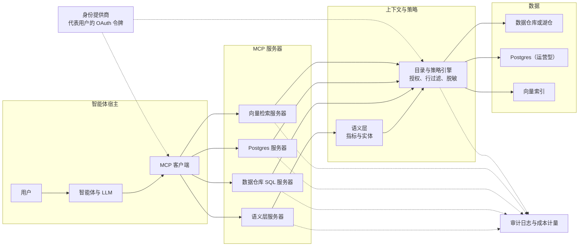
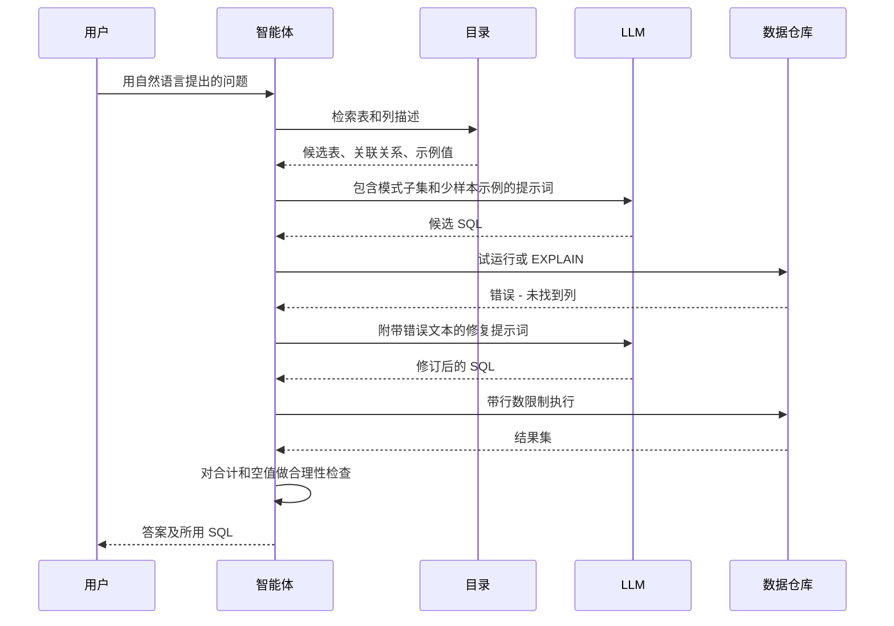
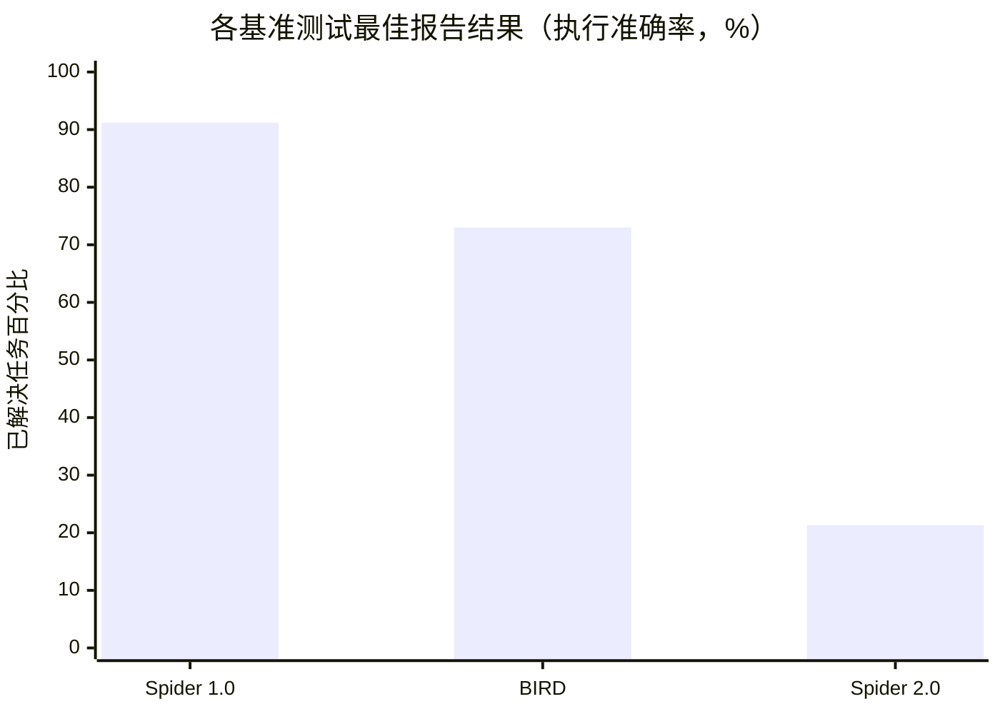

# 22. 智能体与数据
> **深度：** L2 · **阅读时间：** 约 18 分钟 · **最后核实：** 2026-11-01 · **前置阅读：** [第 19 章 — 检索架构](ch19-retrieval-architectures.md)、[第 14 章 — 语义层与商业智能](../02-pipelines-and-governance/ch14-semantic-layers-and-bi.md)

## 要点速览（TL;DR）

- AI 智能体（agent）访问数据有三种方式：自己编写 SQL（[文本转 SQL（text-to-SQL）](../glossary.md#text-to-sql)）、调用受治理的工具（例如语义层指标 API），或检索文档和记忆（见[第 19 章](ch19-retrieval-architectures.md)）。大多数生产系统会在同一个协议之后融合这三种方式。
- 文本转 SQL 在学术基准测试上看似接近解决，但在真实的数据库模式上远未解决。Spider 2.0 论文（2025 年）将当时在 Spider 1.0（91.2%）和 BIRD（73.0%）上公布的最佳结果，与其自身最佳配置在企业风格的 Spider 2.0 上仅 21.3% 的结果进行了对比。[^spider2] 解决之道在于上下文，而非更大的模型：用于模式链接的目录、承载业务含义的语义层，以及一个测试并修复查询的闭环。
- [模型上下文协议（Model Context Protocol）](../glossary.md#model-context-protocol)（MCP）已成为将智能体接入数据的标准方式。Anthropic 于 2024 年 11 月推出该协议。OpenAI、Google 和 Microsoft 于 2025 年采用了它，Anthropic 又于 2025 年 12 月将其捐赠给 Linux Foundation 旗下的 [Agentic AI Foundation](../glossary.md#agentic-ai-foundation)。[^mcp-launch][^mcp-adopt][^mcp-donate] 如今每一家主要数据平台都提供 MCP 服务器。
- 数据治理才是真正的产品。难点在于[身份传递（identity propagation）](../glossary.md#identity-propagation)（智能体*以*特定用户的身份行事）、最小权限工具、行过滤、审计和成本限制。最主要的安全风险，是隐藏在智能体所读取数据中的[提示词注入（prompt injection）](../glossary.md#prompt-injection)。
- 智能体还会*创建*数据库。Neon 表示，其平台上超过 80% 的数据库是由智能体创建的（公司披露，2025 年 5 月）；这一说法帮助引发了一场 Postgres 圈地运动：Databricks–Neon（Lakebase）、Snowflake–Crunchy Data（Snowflake Postgres）、估值 $10.5B 的 Supabase，以及超大规模云厂商推出的新 Postgres 服务。[^neon-dbx][^supabase-f]

## 为何重要（商业 + Everpure 视角）

二十年来，企业数据的消费者一直是人：编写 SQL 的分析师，或打开仪表盘的高管。智能体改变了需求的形态。一个人每天可能运行 30 次查询；而一个处理研究任务的智能体可以在几分钟内发出数百次查询，每次规模都很小，许多是试探性的，还有许多在出错后重试。访问模式从少量大规模扫描，转变为一大群小型、对延迟敏感、需经策略检查的调用。这改变了平台销售的东西（受治理的端点而非席位），也改变了基础设施必须承受的负载。

商业利益从交易流中可见一斑。Databricks 为 Neon 支付了约 $1B（媒体报道），其 Lakebase Postgres 产品线在大约一年内年化收入运行率就突破了 $100M（公司披露）。[^neon-dbx][^dbx-q2] Snowflake 收购了 Crunchy Data。Supabase 的估值在八个月内大约翻了一番，达到 $10.5B（媒体报道的投后估值）。[^supabase-f] Snowflake、Databricks 和 Google 各自推出了正式可用（GA）的 MCP 服务器或将其作为重磅发布。[^sf-mcp][^dbx-mcp][^bq-mcp] 这一切背后的论点是：谁控制了智能体通往数据的路径，谁就控制了未来十年的数据消费。

对 Everpure 而言，由此引出两点。第一，智能体工作负载会成倍增加元数据查找、小块读取和短生命周期的数据库副本。即时分支依赖于[写时复制（copy-on-write）](../glossary.md#copy-on-write)快照，而这正是存储的原生领地（见下文"存储桥接"）。第二，缺少语义上下文，智能体就会失败：某一列是什么含义、是否包含个人数据、谁可以查看。这正是 Everpure 收购 1touch（2026 年 5 月完成交割）所公开表述的目的——发现、分类数据并为其添加语义上下文。[^1touch] 基于公开信息，战略团队可能评估的一个选项是：通过 MCP 对外提供这种数据分类能力，使智能体平台在查询时即可调用。

## 工作原理

### 访问路径：从智能体到字节

图 22.1 展示了参考路径。智能体*宿主*（Claude、ChatGPT、Microsoft Copilot 或企业自研应用）运行一个 MCP *客户端*。客户端连接到多个 MCP *服务器*，每个服务器封装一个系统。运行良好的服务器不会直接访问表，而是先经过语义层——它将"按区域划分的净收入"这样的请求转换为 SQL——再经过目录，在任何字节被移动之前执行授权、行过滤和脱敏。身份和审计贯穿整个路径，因此每一次查询都可以追溯到一个人类主体以及代表其行事的智能体。

*图 22.1 — SV-11：智能体从不直接接触表；每个请求都要经过 MCP 服务器、语义层和目录的策略引擎，身份与审计贯穿整个路径。*

### 文本转 SQL：为何基准测试会美化它

文本转 SQL 是指由大语言模型（LLM）将自然语言问题转换为 SQL。一个生产系统包含四个阶段，如图 22.2 所示。**[模式链接（schema linking）](../glossary.md#schema-linking)**在成千上万的表和列中找出少数相关的那些，通常是通过检索目录描述和列名的嵌入（向量）来实现。**少样本提示（few-shot prompting）**加入经过验证的"问题–SQL"示例对，理想情况下来自同一领域。**生成**阶段产出候选 SQL，通常是多个候选。随后，**[自我修正循环（self-correction loop）](../glossary.md#self-correction-loop)**对每个候选进行编译或试运行，将任何错误反馈给模型，检查结果是否合理（行数、空值、合计），并在给出答案之前修复查询。

*图 22.2 — 文本转 SQL 循环：大部分准确率提升来自更好的模式链接和"执行–修复"循环，而不是 SQL 的初稿。*

基准测试讲述了一个值得警惕的故事。Spider 1.0（2018 年）使用小型、干净、单一数据库的模式，领先系统如今在其上已超过 90%。BIRD（2023 年）加入了更大、更杂乱的数据库以及"证据"提示。在 BIRD 公开排行榜上，Google 于 2026 年 6 月报告 Gemini-SQL2 的执行准确率为 80.04%，Huawei 于 2026 年 9 月报告其 DataGallery 系统达到 82.39%。排行榜列出的人类基线为 92.96%。[^bird-gemini][^bird-huawei] 在 ICLR 2025 上发表的 [Spider 2.0](../glossary.md#spider-2-0) 使用了基于 BigQuery、Snowflake 及其他引擎的 632 个真实企业工作流任务，其数据库经常超过 1,000 列。论文中的最佳配置——在智能体框架中运行的 OpenAI o1-preview——只解决了 21.3%。论文将其与 Spider 1.0 上的 91.2% 和 BIRD 上的 73.0% 进行对比；这两个数字对应的是当时排行榜上的领先系统，而不是 o1-preview 在这些基准上的运行结果。[^spider2] 2026 年的第三方快照显示，Spider 2.0-Lite 的最佳得分在 45–53% 区间（厂商报告，子集各不相同）。[^spider2-repo]

图 22.3 按照 Spider 2.0 论文的呈现方式展示了这一差距。各柱来自不同系统，因此应将图表理解为"每个基准上可获得的最佳结果"，而不是同一模型的三种评分。

*图 22.3 — 随着数据库模式接近企业真实情况，准确率急剧下降。Spider 1.0 和 BIRD 的柱为 Spider 2.0 论文所引用的排行榜领先结果；Spider 2.0 的柱为搭配智能体框架的 o1-preview（arXiv v2，2025 年 3 月）。*

真实企业环境中的准确率还要更低，原因是任何基准测试都无法完全捕捉的。数据库模式中有成千上万张表，名字形如 `F_ACCT_USG_D2`。同一个概念存在于三个地方，新鲜度各不相同。业务逻辑——例如财务日历、哪些账户算作"企业级"、退款是否与收入相抵——没有被写在任何模型能读取的地方。而且错误答案看起来与正确答案一模一样：一个通过一对多关联重复计数的查询，返回的是一个自信满满的数字，而不是报错。

解决办法是给模型提供上下文，而不是指望它自行推断。第 14 章已介绍过相关证据。data.world 2023 年的研究发现，GPT-4 在原始 SQL 表上正确回答了 16.7% 的企业问题，而在语义表示上的正确率为 54.2%。dbt Labs 由厂商自行开展的 2026 年更新报告称，在其语义层已建模的范围内，正确率达到 98–100%。[^dw-bench][^dbt-bench] 实践中，最好的系统两者兼用：对重复出现的问题（指标、标准维度）使用语义层；对长尾问题则回退到带目录上下文、经认证示例查询和修复循环的文本转 SQL。它们会展示生成的 SQL，以便人工核查。

> **深入（L3）。** 大规模模式链接是一个检索问题。团队将表和列描述、示例值以及历史查询日志做嵌入，然后检索 top-k 候选。有些团队还会从查询历史中挖掘关联路径，使模型即使在没有声明外键的情况下，也能知道 `orders.cust_id` 与 `customers.id` 关联。候选生成通常会采样多个 SQL 草稿，并按自洽性（self-consistency）挑选，也就是选择多数草稿一致的结果。Spider 2.0 的代码仓库包含 Snowflake、SQLite 和 dbt 项目三种变体（分别为 547、547 和 68 个任务），专门用于测试这类数据管道。[^spider2-repo]
