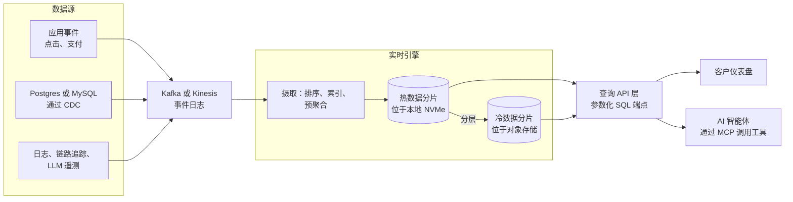
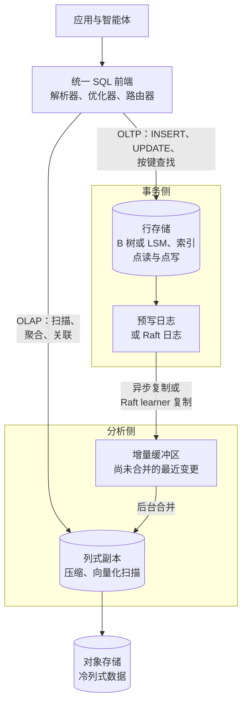
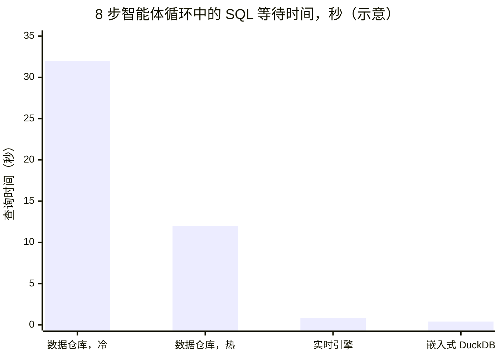
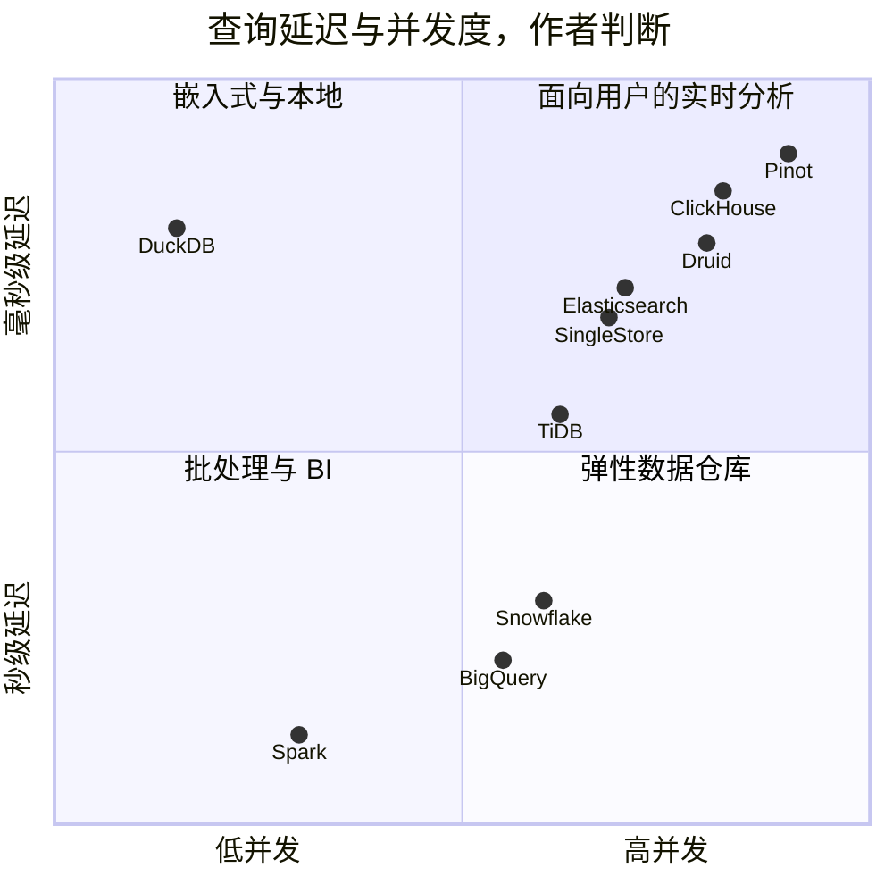
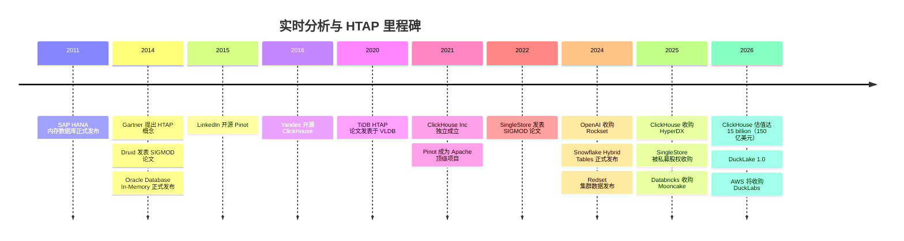

# 23. 实时分析与 HTAP
> **深度：** L2 · **阅读时间：** 约 15 分钟 · **最后核实：** 2026-11-01 · **前置阅读：** [第 5 章 — 分析引擎](../01-data-systems-foundations/ch05-analytical-engines.md)

## 要点速览（TL;DR）

- **[实时分析（real-time analytics）](../glossary.md#real-time-analytics)** 指的是对仅产生数秒的数据执行亚秒级查询，并同时服务数千个并发调用方。这些调用方包括面向客户的仪表盘、可观测性控制台、广告技术竞价系统，以及越来越多的 AI 智能体（agent）。而数据仓库上的一条商业智能（BI）查询需要数秒到数分钟，服务的是数十名分析师。工作不同，引擎也不同。
- 领先的引擎（ClickHouse、Apache Druid、Apache Pinot）之所以快，是因为**在写入时完成工作**：数据落地时即进行排序、预聚合和建立索引，使每次读取只需触及几 KB 到几 MB 的数据。ClickHouse 披露其 **ARR 超过 $250M**（公司披露，2026 年 5 月），估值为 **$15B**（媒体报道，2026 年 1 月）。[^ch-arr][^ch-seriesd]
- **[HTAP](../glossary.md#htap)**（混合事务分析处理，hybrid transactional/analytical processing）将事务和分析放进同一系统，通常的做法是用行存储承接写入，再用一个持续复制的列存储承接扫描，两者共用一个 SQL 前端。SingleStore、TiDB、Oracle Database In-Memory、SAP HANA、AlloyDB、Snowflake Hybrid Tables，以及如今的"Postgres 内嵌 DuckDB"，都采用了这一思路的不同版本。
- **大多数查询都很小。** MotherDuck 对 Amazon 公开的 Redshift 集群数据进行解读后发现，只有约 0.03% 的查询扫描超过 10 TB。[^md-redshift][^redset] 这正是 DuckDB 这类进程内引擎的立论依据；2026 年 8 月，AWS 同意收购 DuckDB 的母公司 DuckLabs（条款未披露）。[^aws-duck]
- 智能体让延迟和单次查询成本变得更加重要。一个发出八条相互依赖查询的智能体，要承受八次引擎延迟；而且智能体以机器速率产生流量。这有利于那些为"大量低成本查询"而定价和设计的引擎，而不是为"少量昂贵查询"设计的引擎。

## 为何重要（商业视角 + Everpure 视角）

分析市场已经按工作负载形态分化。云数据仓库（[第 5 章](../01-data-systems-foundations/ch05-analytical-engines.md)、[第 26 章](../04-company-deep-dives/ch26-snowflake.md)）针对少数人类用户的灵活查询进行了优化。围绕 **[面向用户的分析（user-facing analytics）](../glossary.md#user-facing-analytics)**，另一个市场已经成长起来："谁看过你的主页"面板、支付应用里的商户仪表盘、可观测性工具里的日志搜索框。这些产品在每次页面加载背后都放了一条分析查询。ClickHouse 的收入轨迹是这种分化最清晰的财务信号。该公司表示，2026 年 5 月其 ARR 突破 $250M，同比增长超过两倍，并且自 1 月 D 轮融资以来新增了 1,000 多家客户（公司披露）。[^ch-arr] 其估值从 2025 年 5 月的 $6.35B 升至八个月后的 $15B（均为媒体报道）。[^ch-seriesc][^ch-seriesd]

AI 智能体带来了第三类消费者。当智能体回答"上周东北地区的流失率为什么上升？"时，它会发出一串 SQL 工具调用，每一条都依赖上一条的结果（[第 22 章](ch22-agents-and-data.md)）。支撑这些调用的引擎需要具备数据仓库级别的 SQL 能力，以及实时级别的延迟和成本。例如，ClickHouse 在 2026 年 5 月的大会上发布了由 Claude 驱动的智能体；而 Databricks、Snowflake 和 AWS 自 2025 年以来都收购了 Postgres 或嵌入式分析资产，部分原因正在于此。[^ch-arr][^mooncake][^aws-duck]

对 Everpure 而言，这些引擎的存储画像很有特点。它们**受延迟约束，而不仅仅受吞吐量约束**：热数据集放在本地 NVMe 上以实现毫秒级读取，而大部分数据放在对象存储（object storage）上（ClickHouse Cloud 的 SharedMergeTree 将所有表数据保存在共享对象存储中）。[^ch-smt] 基于公开信息，战略团队可能评估的选项包括：验证兼容 S3 的本地部署对象存储作为自管 ClickHouse、Druid 或 Pinot 集群的共享层，以及将高速闪存定位为这些引擎所依赖的缓存层。

## 工作原理

### 两种截然不同的查询预算

数据仓库 BI 查询与实时查询同时在四个维度上存在差异。这就是为什么一个引擎很少能同时把两者都服务好。

| 维度 | 数据仓库 BI | 实时分析 |
|---|---|---|
| 延迟目标 | 数秒到数分钟 | 10–500 ms，以 p99 衡量 |
| 并发度 | 数十名分析师 | 数千名用户或智能体，每秒数百到数千条查询 |
| 数据新鲜度 | 每小时或每天批量加载 | 事件发生后数秒 |
| 查询形态 | 即席、宽表关联、探索式 | 已知模式，按少数键过滤，在时间窗口上做聚合 |

*图 23.1 — 实时查询不是更快的数据仓库查询，而是一份不同的契约（作者对典型目标的归纳）。*

关键词是 **p99**。面向用户的产品是由其最慢的常见查询，即 **[尾延迟（tail latency）](../glossary.md#tail-latency)** 来评判的。一个平均 80 ms、但在冷缓存时飙升到 4 秒的仪表盘，用户会觉得它是坏的。实时引擎的设计目标是在负载下把尾部延迟压紧。

### 数据管道：从事件到 API

*图 23.2 — 典型的实时分析数据管道：事件经由 Kafka 流入，引擎在数据到达时建立索引，一个轻量的 API 层同时服务应用和智能体。*

事件通过 Kafka 这样的日志（[第 11 章](../02-pipelines-and-governance/ch11-streaming-and-event-platforms.md)）到达，或者通过来自业务数据库的 **[变更数据捕获（change data capture，CDC）](../glossary.md#change-data-capture)** 到达。ClickHouse 在 2024 年 7 月收购 PeerDB，正是为了这条从 Postgres 到 ClickHouse 的路径。[^ch-peerdb] 引擎持续摄取数据，并在数秒内让新行可被查询。在它前面是一个 API 层，把经批准的 SQL 查询转换为端点。这就是 Tinybird 的全部产品，构建在托管 ClickHouse 之上。[^tinybird] 为仪表盘供数的同一组端点，也可以作为工具暴露给智能体。

### ClickHouse 如何做到亚秒级：MergeTree

ClickHouse 起源于 Yandex 内部，最初是一个网站分析产品的引擎，2021 年成为独立公司。[^ch-paper][^ch-inc] 其核心表引擎 **[MergeTree](../glossary.md#mergetree)** 借鉴了 **[LSM 树（LSM-tree）](../glossary.md#lsm-tree)** 的写入路径。每个插入批次被写成一个不可变、有序、列式的"分片"（part）。后台线程把小分片合并成更大的分片，与 LSM 压缩（compaction）的做法完全相同。

读取路径依赖于 **[稀疏主索引（sparse primary index）](../glossary.md#sparse-primary-index)**。分片中的行按表的排序键排序，例如 `(customer_id, event_time)`。ClickHouse 并不为每一行建立索引，而是记录每个 **[颗粒（granule）](../glossary.md#granule)** 起始处的键值；颗粒默认是 8,192 行的数据块。[^ch-sparse] 一张十亿行的表只需要大约 122,000 个索引条目，小到可以常驻内存。查询某个客户最近一小时的数据时，会在该索引上做二分查找，只读取少数可能匹配的颗粒，并用向量化代码只解压所需的列（[第 5 章](../01-data-systems-foundations/ch05-analytical-engines.md)）。

另外两项机制补全了这幅图景。ClickHouse 中的 **[物化视图（materialized view）](../glossary.md#materialized-view)** 是插入触发器：行到达时就被聚合进第二张小得多的表，于是"每个商户每分钟的收入"只在写入时计算一次，而不是每次页面加载都计算。**跳数索引**（skipping indexes，即按颗粒块维护的 min/max、集合和布隆过滤器）让针对非键列的查询也能跳过数据。

> **深入（L3）。** ClickHouse 的 VLDB 2024 论文描述了完整的技术栈：分片合并、稀疏索引、投影（projection，即与表并存的备选排序方式），以及向量化执行器。[^ch-paper] 在 ClickHouse Cloud 中，**[SharedMergeTree](../glossary.md#sharedmergetree)** 取代了副本间的数据复制。所有分片都存放在对象存储中，元数据通过 ClickHouse Keeper 协调；文档称一张表可以拥有数百个无状态副本，而无需分片。[^ch-smt]

> **类比：在线量测。** 晶圆厂不会等到产线末端的电性测试才发现某个刻蚀工序发生了漂移。它会在工艺进行中在线测量关键尺寸，以便修正下一批次。数据仓库 BI 就像产线末端测试：准确、全面，但已来不及修正这一批。实时分析则是在线量测：一组范围更窄、预先选定的测量，在工艺运行时进行，成本低到可以对每片晶圆都做。

### 段式引擎：Druid 与 Pinot

Apache Druid 源自 Metamarkets，用于广告技术报表。其 SIGMOD 2014 论文描述了两类节点：实时节点会立即为流数据建立索引，历史节点则提供从深度存储加载的不可变 **[段（segment）](../glossary.md#segment)**。[^druid-paper] Apache Pinot 由 LinkedIn 为面向会员的功能而构建，2015 年开源，后来被 Uber 采用，并于 2021 年成为 Apache 顶级项目。[^pinot-tlp] 两个引擎都按时间把数据分区成段，对每个维度建立位图索引和倒排索引，并把段推送到对象存储作为持久副本。Pinot 的标志性 **[星树索引（star-tree index）](../glossary.md#star-tree-index)** 为选定的维度组合预先计算聚合结果，以存储空间换取高度可预测的延迟。相应的商业厂商是 Imply（Druid）和 StarTree（Pinot）：前者于 2025 年 9 月围绕名为 Lumi 的"可观测性数据仓库"重新定位；后者最近一次披露定价的融资是 2022 年 $47M 的 B 轮。[^imply-lumi][^startree]

Rockset 走了第三条路：**[融合索引（converged indexing）](../glossary.md#converged-index)**。每个文档的每个字段都以三种方式存储——行索引、列索引和搜索索引——构建在 RocksDB 之上，并把 SST 文件卸载到 S3。[^rockset-arch] 这种设计以写放大为代价换取了查询灵活性。OpenAI 于 2024 年 6 月 21 日宣布收购 Rockset，用于支撑其检索基础设施；按月付费的客户必须在 2024 年 9 月 30 日前迁出该服务。[^rockset] 对买方而言，教训很具体：一个实时引擎可能会消失在收购方体内，而开源是一个退出选项。

### HTAP：一个系统，两个引擎

HTAP 这一概念由 Gartner 于 2014 年命名，[^htap-gartner] 它彻底去掉了数据管道：直接在事务数据库本身上、针对仅有毫秒级时延的数据运行分析。实践中，每一个成功的 HTAP 设计都在一个逻辑数据库之下保留**两种物理格式**。

*图 23.3 — 通用 HTAP 架构：优化器把点操作路由到行存储，把扫描路由到持续复制的列存储，因此两者看到的数据几乎相同，而无需单独的数据管道。*

各种变体的差异在于列式副本放在哪里、新鲜度如何：

- **SingleStore** 在同一引擎中同时保留内存行存储和基于磁盘的列存储。其 SIGMOD 2022 论文描述了一种同时服务两种模式的"通用存储"（universal storage）表。[^s2-paper] Vector Capital 于 2025 年 9 月同意对 SingleStore 进行成长型收购（条款未披露；Bloomberg 援引的数字约为 $500M，媒体报道）。[^singlestore]
- **TiDB**（PingCAP）把行存放在 TiKV（一个基于 Raft 复制的键值存储）中，并增加了 **TiFlash** 列式副本，这些副本以无投票权的 learner 身份加入每个 Raft 组。因此，分析可以读取一致的、接近最新的快照，而不会拖慢写入法定多数（quorum）。[^tidb-paper]
- **Oracle Database In-Memory**（2014 年 7 月随 Database 12.1.0.2 正式发布）和 **SAP HANA**（2011 年 6 月正式发布）把双格式、内存列式处理带给了企业级老牌厂商（基于 2025 年前的知识，未重新抓取）。
- **AlloyDB**（Google 的 Postgres 兼容服务）增加了一个列式引擎，即从行表自动填充的内存列缓存。Google 称其在分析查询上最高可提速 100 倍（厂商声明，类 TPC-H 测试）。[^alloydb]
- **Snowflake Hybrid Tables**（Unistore 功能）从数据仓库一侧切入 HTAP，增加了一个用于点操作的行存储。该功能于 2024 年 11 月在 AWS 上正式发布。[^sf-hybrid]
- **Postgres 加嵌入式列引擎**是 2025–26 年的模式。pg_duckdb（由 MotherDuck、Hydra 和 DuckDB Labs 开发，2024 年 10 月发布测试版）在 Postgres 进程内运行 DuckDB。[^pgduckdb] Databricks 于 2025 年 10 月为 Lakebase 收购了 Mooncake Labs，即 pg_mooncake（Postgres 到列式镜像）背后的团队。[^mooncake] AWS 于 2026 年秋季在 Aurora PostgreSQL 内推出了由 DuckDB 驱动的分析功能，使一条查询可以把实时表与 S3 中的 Iceberg 和 Parquet 数据进行关联。[^aurora-duck]

坦率的评估是："真正的"HTAP——两种工作负载共用一种存储格式——基本上已经失败。胜出的是**以托管复制实现的 HTAP**：两种格式、一个产品，由厂商把复制延迟隐藏起来（[第 1 章](../01-data-systems-foundations/ch01-data-stack-map.md) 把跨产品的版本称为零 ETL）。

> **类比：统一内存。** 独立 GPU 与 CPU 隔着 PCIe，所以数据必须先复制，加速器才能处理。这就是硬件语境下的 ETL。统一内存芯片（Apple 的 M 系列、AMD 的 MI300A、NVIDIA 的一致性 Grace-Hopper 互联）让 CPU 和 GPU 寻址同一块内存，省去了复制，但迫使两者共享带宽。HTAP 做的是同样的权衡。复制步骤消失了，但 OLTP 和 OLAP 如今要争夺同一个系统的内存、CPU 和 I/O，一次繁重的扫描就可能抬高一笔支付写入的 p99。厂商的应对方式与芯片设计师一样：分区和服务质量（QoS）控制。

### DuckDB 与"小数据"论

DuckDB 是一个 **[进程内数据库（in-process database）](../glossary.md#in-process-database)**：像 SQLite 一样作为库链接进应用，但拥有向量化列式引擎（[第 5 章](../01-data-systems-foundations/ch05-analytical-engines.md)）。没有服务器、没有网络跳转，也没有集群。它的前提是大多数分析数据都能放进一台机器，而 MotherDuck 已经把这一理念打造成了自己的品牌。

证据比轶事更有说服力。Amazon 关于 Redshift 集群的 VLDB 2024 论文发布了"Redset"，即来自 200 个预置集群和 200 个无服务器集群的三个月查询统计。论文发现，查询高度重复，其属性遵循长尾分布，涉及的表也少于 TPC-DS 的假设。[^redset] MotherDuck 对 Redset 的分析发现，只有约 0.03% 的查询扫描超过 10 TB。即使针对大于 10 TB 的表，平均每条查询也只读取了表的约 0.5%。[^md-redshift] 需要注意几点保留意见。Redset 只是一家厂商的集群群，字节数是剪枝之后的扫描量，而且少数大查询仍然消耗了不成比例的计算资源。MotherDuck 自己的解读认为大查询约占执行时间的 6%，而这个结论出自一家与答案有利害关系的厂商。即便如此，**"[小数据（small data）](../glossary.md#small-data)"描述的是中位数查询**，而中位数查询正是智能体和仪表盘所产生的查询。

在商业上，DuckDB 生态发展迅速。托管 DuckDB 服务 MotherDuck 于 2023 年 9 月完成 $52.5M 的 B 轮融资，据报道投后估值为 $400M。[^motherduck] DuckLake 是一种把湖元数据保存在 SQL 数据库中的表格式，于 2026 年 4 月发布 1.0 版。[^ducklake] 随后在 2026 年 8 月 26 日，Amazon 签署了收购 DuckDB 背后公司 DuckLabs 的最终协议（条款未披露）。该项目本身在独立的 DuckDB Foundation 下继续采用 MIT 许可证。[^aws-duck]

> **类比：嵌入式加速器。** 数据仓库是一台独立的设备：数据经过链路传到一个大型共享引擎，结果再传回来。DuckDB 则是集成在晶粒上的加速模块：更小，但传输成本为零，前面也没有排队。对于能放进本地内存的工作负载，片上模块胜过总线另一端更快的芯片，因为互联和调度延迟占了主导。

### 智能体为何改变了经济性

智能体同时抬高了延迟和成本两方面的赌注。

**延迟会成倍放大。** 智能体的工具调用通常是串行的，因为每条查询都依赖上一条的答案。下面的算例仅作示意，并非基准测试。

*图 23.4 — 在八次相互依赖的工具调用中，4 s、1.5 s、100 ms 和 50 ms 的单次查询延迟（作者假设）分别累积为 32 s、12 s、0.8 s 和 0.4 s 的纯等待时间，这还没算上任何模型推理时间。*

假设模型推理每步再增加 1.5 s（假设），那么热数据仓库的循环端到端需要 24 s，实时引擎的循环约 13 s。瓶颈变成了模型而不是数据库，而这正是瓶颈应该在的位置。

**单次查询成本决定了谁负担得起智能体流量。** 为便于说明，假设一个 SaaS 产品向 1,000 个并发用户开放分析功能，智能体每秒产生约 167 条查询，每月约 4.33 亿条查询。按名义上每节点小时 $1 计算计算成本。一条在 8 节点集群上运行 2 s 的数据仓库查询消耗 16 节点秒，约 $0.0044。一个实时引擎在 2 个节点上 50 ms 就给出答案（因为稀疏索引把扫描剪枝到只剩几个颗粒），消耗 0.1 节点秒，约 $0.00003。按月计算，大约是 **$1.9M 对 $12K**，比例约为 160 倍。结果缓存、预热资源池和最小计费增量会大幅改变实际数字，但方向不会改变：当查询数量多、规模小且重复时，按索引剪枝并在写入时预聚合的引擎会胜出——而这恰恰是 Redset 所揭示的真实工作负载的样子。[^redset]

## 设计选择与权衡

实时领域的三角关系是**新鲜度、查询速度和成本：三者只能选其二**，并要选择在哪里付出代价。

| 选择 | 收益 | 代价 | 对替代方案的最强版本论证 |
|---|---|---|---|
| 在写入时建立索引和预聚合 | 毫秒级读取，单次查询成本低 | 摄取 CPU、汇总表的存储、僵化的查询模式 | 数据仓库能回答没人预料到的问题 |
| **[反规范化（denormalization）](../glossary.md#denormalization)** 为宽表 | 读取时无需关联；p99 可预测 | 维度变化时需重新处理；数据重复 | 星型模型让每个维度只保留一个版本；现代引擎的关联性能很好 |
| 仅追加的列式分片 | 摄取快，压缩效果好 | **[更新插入（upsert）](../glossary.md#upsert)** 和删除代价高：在合并之前，行要被重写或屏蔽 | 行存储可原地更新；HTAP 正是为此保留了行存储 |
| 读时合并式更新（ReplacingMergeTree、Pinot upsert 表、Druid 重新索引） | 接受更新而无需在写入时重写数据 | 合并前查询会看到重复数据，或在读取时付出 `FINAL` 式去重的代价 | 轻量删除和 **[删除向量（deletion vector）](../glossary.md#deletion-vector)** 缩小了差距（[第 7 章](../01-data-systems-foundations/ch07-open-table-formats.md)） |
| 单一产品中的 HTAP | 无数据管道；数据最新 | OLTP 和 OLAP 争用资源；规模通常小于专用数据仓库 | 分离的系统能隔离故障并独立扩展 |
| 本地 NVMe 热数据层 | 尾延迟最低 | 扩缩容时需重新平衡；容量与计算绑定 | 对象存储加缓存提供弹性，p99 只略高一些 |

*图 23.5 — 每一种实时设计都把工作从读取时移到写入时；问题在于你负担得起哪些写入和哪些更新。*

更新插入值得特别强调，因为实时项目往往就卡在这里。列式分片是不可变的，所以更新一行意味着写入一个新版本、稍后再进行协调。ClickHouse 的 ReplacingMergeTree 只有在后台合并之后才会只保留最新版本。在此之前，查询必须在读取时去重，或者容忍重复。ClickHouse Cloud 此后增加了轻量更新。[^ch-smt-blog] 更新流量大的团队（例如订单状态或库存）通常把这类状态保存在 Postgres 中，再把变更流式传入分析引擎，这就是"通过数据管道实现的 HTAP"。

### 引擎比较

| 引擎 | 架构 | 延迟目标 | 并发度 | 更新支持 | 开源 / 许可证 | 商业厂商及现状 |
|---|---|---|---|---|---|---|
| ClickHouse | 列式 MergeTree、稀疏索引、向量化；云上为基于对象存储的 SharedMergeTree | 数十到数百 ms | 高（每集群数百以上 QPS） | 以追加为主；Replacing/Collapsing 引擎、轻量删除和更新 | 是，Apache 2.0 | ClickHouse Inc.；$15B（媒体报道，2026 年 1 月）；ARR >$250M（公司披露，2026 年 5 月）[^ch-seriesd][^ch-arr] |
| Apache Druid | 按时间分区的段、位图索引、深度存储 | 亚秒级 | 高 | 批量重新索引；流式更新插入支持有限 | 是，Apache 2.0 | Imply；转向 Lumi 可观测性数据仓库（2025 年 9 月）[^imply-lumi] |
| Apache Pinot | 带倒排索引和星树索引的段 | p99 数十 ms | 非常高（面向用户） | 基于主键的 upsert 表 | 是，Apache 2.0 | StarTree；$47M B 轮（2022 年）[^startree] |
| Rockset | 基于 RocksDB-Cloud 的行、列和搜索融合索引 | 亚秒级 | 高 | 原生文档更新 | 否 | 被 OpenAI 收购（2024 年 6 月）；对外服务于 2024 年 9 月关停[^rockset] |
| Tinybird | 托管 ClickHouse 之上的 API 层 | 亚秒级 | 高 | 同 ClickHouse | CLI 和工具开源；服务为专有 | $30M B 轮（2024 年 6 月）[^tinybird] |
| Elasticsearch / OpenSearch | Lucene 倒排索引，近实时刷新 | 搜索和过滤为亚秒级 | 高 | 文档更新（内部重新索引） | Elastic：多种许可证；OpenSearch：Apache 2.0 | Elastic（上市公司）；OpenSearch 归属 Linux Foundation |
| SingleStore | HTAP：内存行存储加列式通用存储 | ms（OLTP）到亚秒级（OLAP） | 高 | 完整的事务更新 | 否（工具为源码可用） | Vector Capital 成长型收购（2025 年 9 月）[^singlestore] |
| TiDB | HTAP：TiKV 行存储加 TiFlash Raft-learner 列式副本 | ms（OLTP），秒级（OLAP） | 高 | 完整 ACID | 是，Apache 2.0 | PingCAP [VERIFY: 最新融资] |
| Snowflake Hybrid Tables | 数据仓库内部的行存储 | 点查为 ms 级；扫描走数据仓库 | 中等 | 带索引的完整 ACID | 否 | Snowflake（上市公司）；2024 年 11 月在 AWS 上正式发布[^sf-hybrid] |
| DuckDB / MotherDuck | 进程内向量化列式；MotherDuck 将其作为服务运行 | ms 到秒级，单节点 | 按进程（一个应用或一个用户） | 单个数据库文件内完整 ACID | 是，MIT（DuckDB Foundation） | DuckLabs 将被 AWS 收购（2026 年 8 月）；MotherDuck 投后 $400M（2023 年）[^aws-duck][^motherduck] |

*图 23.6 — 实时引擎用写入时索引换取速度；HTAP 引擎用双格式换取新鲜度；DuckDB 通过去掉服务器换取简单性。*

### 定位图

*图 23.7 — 作者对典型部署的定位，并非基准测试结果：实时引擎占据右上角，DuckDB 占据低并发下的速度优势，数据仓库则通过增加集群来扩展并发，延迟停留在秒级。*

## 主要参与者

- **实时 OLAP：** ClickHouse 是规模领先者。它正通过收购构建一个更广泛的平台：PeerDB 用于 Postgres CDC（2024 年 7 月），HyperDX 用于其 ClickStack 可观测性界面（2025 年 3 月），Langfuse 用于 LLM 可观测性（2026 年 1 月）。[^ch-peerdb][^ch-hyperdx][^ch-langfuse] 一些信息汇总网站还列出了 LibreChat（2025 年 11 月）和 RunReveal（2026 年 9 月）[VERIFY: ClickHouse 收购 LibreChat 和 RunReveal 的交易]。Imply（Druid）和 StarTree（Pinot）是规模较小的专业厂商。Tinybird 销售面向开发者的 API 层。Firebolt 以自研引擎瞄准低延迟分析（见[第 31 章](../04-company-deep-dives/ch31-analytical-engine-challengers-legacy.md)）。
- **搜索型分析：** Elastic 和 OpenSearch 主导日志和安全分析，但如今正受到列式引擎（ClickStack、Imply Lumi）的挑战，后者认为日志不过是宽表而已。
- **HTAP：** SingleStore（自 2025 年起由私募股权持有）、PingCAP/TiDB、Oracle、SAP、Google AlloyDB、Snowflake Unistore。
- **以 Postgres 为中心的分析：** Databricks Lakebase 与 Mooncake、Snowflake Postgres（Crunchy Data）、内嵌 DuckDB 的 AWS Aurora、pg_duckdb。[^mooncake][^aurora-duck][^pgduckdb]
- **进程内：** DuckDB（DuckDB Foundation；DuckLabs 即将归入 AWS）、MotherDuck，以及基于 DataFusion 和 Polars 的替代方案。
- **已退出：** Rockset（2024 年归入 OpenAI）。[^rockset]

## 历史与发展轨迹

*图 23.8 — 发展脉络从内存 HTAP 一体机，到开源实时引擎，再到 2025–26 年的整合期，各平台纷纷收购嵌入式分析和 Postgres 资产。*

有三个阶段尤为突出。**2010–2015 年：** HTAP 是老牌厂商的故事，SAP 和 Oracle 利用大容量 DRAM 在事务数据上运行分析，Gartner 为其命名。[^htap-gartner] **2015–2022 年：** 互联网公司开源了它们为面向用户的分析而构建的引擎（Druid、Pinot、ClickHouse），风险投资支持的厂商围绕这些引擎成立。[^druid-paper][^pinot-tlp][^ch-paper] **2023–2026 年：** 整合与融合。Rockset 被吸收，SingleStore 归入私募股权，ClickHouse 以成长型估值倍数融资，超大规模云厂商和湖仓一体（lakehouse）厂商则通过收购进入嵌入式分析领域。[^rockset][^singlestore][^ch-seriesd][^aws-duck]

发展轨迹指向**分析成为每个业务数据库的一项功能**：一个嵌入 Postgres 的列式引擎，镜像到对象存储上的开放表格式（open table format）。对独立实时厂商的看空逻辑是：Postgres 和湖仓内部"够用"的分析能力覆盖了大多数需求。看多逻辑则是：智能体流量恰恰是高并发、对延迟要求苛刻的工作负载，而在这类负载上，专业厂商在成本上仍能领先 10 倍甚至更多。

## 关键数字

| 指标 | 数值 | 口径 | 来源/日期 |
|---|---|---|---|
| ClickHouse ARR | >$250M，同比增长超过两倍；>4,000 家客户 | 公司披露 | Business Wire，2026-05-27[^ch-arr] |
| ClickHouse 估值 | $15B（$400M D 轮） | 媒体报道 | Bloomberg，2026-01-16[^ch-seriesd] |
| ClickHouse 前次估值 | $6.35B（2025 年 5 月） | 媒体报道 | Bloomberg，2025-05-29[^ch-seriesc] |
| ClickHouse 默认颗粒大小 | 每个索引条目 8,192 行 | 文档 | ClickHouse 文档，日期不详[^ch-sparse] |
| Redset 中扫描 >10 TB 的查询 | 约 0.03% | 厂商对公开数据集的分析 | MotherDuck，2024[^md-redshift] |
| Redset 范围 | 200 个预置 + 200 个无服务器集群，3 个月 | 论文（Amazon 作者） | PVLDB 17(11)，2024[^redset] |
| MotherDuck B 轮 | $52.5M，投后估值约 $400M | 媒体报道 | The Register，2023-09-21[^motherduck] |
| AlloyDB 列式提速 | 分析查询最高比标准 Postgres 快 100 倍 | 厂商声明的基准测试 | Google Cloud，2022[^alloydb] |
| Rockset 迁出截止日 | 按月付费客户为 2024-09-30 | 公司披露 | Rockset，2024-06-21[^rockset] |
| 示意性智能体循环 SQL 等待时间 | 32 s（冷数据仓库）对 0.8 s（实时引擎），8 步 | 估算（作者假设） | 本章，图 23.4 |
| 示意性月度计算成本，167 QPS | 约 $1.9M 对约 $12K | 估算（作者假设） | 本章，算例 |

## 存储桥接

> **存储桥接。** 实时引擎是对延迟最敏感的分析类存储租户。它们需要**本地 NVMe** 来存放热分片和索引，使 p99 保持在毫秒级；需要**对象存储**来存放持久的大部分数据，如 ClickHouse Cloud 的 SharedMergeTree 或 Druid 和 Pinot 的深度存储。[^ch-smt] 决定用户可见延迟的是分层策略和缓存命中率，而不是原始吞吐量。闪存和对象协议的细节见[第 24 章](ch24-data-meets-compute-and-storage.md)以及配套的 *Everpure Tech Atlas*。

## 对话手册

**向产品经理提的问题**

1. "你们的查询量中，面向用户或由智能体生成的部分与分析师生成的部分各占多少？过去一年这一结构发生了怎样的变化？"
2. "对于每秒 500 条、每条 20 ms 的查询负载，你们如何定价？计费单位是计算时间、查询次数还是扫描的数据量？客户每百万条查询要付多少钱？"
3. "当客户需要更新或删除数据（GDPR、订单状态）时，你们支持的模式是什么？这种情况有多频繁地迫使他们另外保留一个 Postgres？"

**向工程师提的问题**

1. "峰值并发下你们的 p99 是多少——不是空闲集群上的中位数？在合并或摄取高峰期间它会怎样变化？"
2. "读取中有多大比例命中本地 NVMe，多大比例落到对象存储？缓存未命中时的延迟惩罚是多少？"
3. "针对 HTAP：从行存储到列存储的复制延迟在 p99 下是多少？你们如何防止一次繁重的扫描影响 OLTP 延迟？"

**好的回答听起来是什么样的：** 在明确负载条件下给出具体的百分位数字；清楚说明哪些查询模式快（按键过滤、时间窗口）、哪些不快（即席多路关联）；并坦诚交代更新方案。好的 HTAP 回答会量化延迟并描述资源隔离，而不只是声称"实时"。

**不要这样说**

- "Snowflake 或 Databricks 直接就能做实时。" 它们可以服务部分低延迟工作负载，但其成本和并发模型是为数量更少、规模更大的查询设计的。请对方给出每秒数百条查询下的 p99。
- "HTAP 意味着数据只有一份。" 几乎每个生产环境中的 HTAP 系统都保留一份行副本和一份列副本；产品只是把复制隐藏了起来。
- "列存储做不了更新。" 它们可以，通过读时合并、轻量删除和行存储侧表实现，但更新的代价高于追加，而且最新结果可能出现重复。
- "Rockset 证明了实时分析是条死胡同。" 它证明的是：一家闭源厂商可能被收购，从而让客户失去依托。这个品类仍在增长（ClickHouse 的 ARR）。[^ch-arr]
- "DuckDB 只是笔记本电脑上的玩具。" 它是一个嵌入式引擎，如今已进入多个 Postgres 服务，并有 AWS 收购协议作为背书。[^aws-duck][^aurora-duck]

## 深入阅读

> **深入（L3）。** 阅读 ClickHouse 的 VLDB 2024 论文以了解 MergeTree 和稀疏索引设计，阅读 TiDB 的 VLDB 2020 论文以了解 Raft-learner 列式副本，阅读 SingleStore 的 SIGMOD 2022 论文以了解单引擎双格式设计。[^ch-paper][^tidb-paper][^s2-paper] 关于"小数据"之争，可下载 Redset 自行复现扫描量分布，再与 MotherDuck 的解读进行比较。[^redset][^md-redshift]

## 关键术语

- [实时分析（Real-time analytics）](../glossary.md#real-time-analytics) — 在高并发下对秒级新鲜度的数据执行亚秒级分析查询。
- [面向用户的分析（User-facing analytics）](../glossary.md#user-facing-analytics) — 嵌入在产品中、由其终端用户而非内部分析师查询的分析。
- [尾延迟（Tail latency）](../glossary.md#tail-latency) — 最慢那部分请求的延迟（例如 p99），它决定了用户感知到的响应速度。
- [HTAP](../glossary.md#htap) — 在新鲜数据上同时服务事务型和分析型工作负载的单一系统。
- [列式副本（Columnar replica）](../glossary.md#columnar-replica) — 行存储数据的列格式副本，通过复制保持最新，用于分析型读取。
- [MergeTree](../glossary.md#mergetree) — ClickHouse 的表引擎，由在后台合并的有序、不可变列式分片组成。
- [稀疏主索引（Sparse primary index）](../glossary.md#sparse-primary-index) — 每个行块（而非每一行）对应一个条目的索引。
- [颗粒（Granule）](../glossary.md#granule) — ClickHouse 读取数据的最小单位，默认 8,192 行。
- [SharedMergeTree](../glossary.md#sharedmergetree) — ClickHouse Cloud 的 MergeTree 变体，将所有数据保存在共享对象存储上。
- [物化视图（Materialized view）](../glossary.md#materialized-view) — 随源数据变化而保持更新的已存储查询结果。
- [段（Segment）](../glossary.md#segment) — Druid 或 Pinot 中按时间分区、不可变且带索引的数据文件。
- [星树索引（Star-tree index）](../glossary.md#star-tree-index) — Pinot 针对选定维度组合的预聚合索引。
- [融合索引（Converged index）](../glossary.md#converged-index) — Rockset 的做法，把每个字段同时存入行索引、列索引和搜索索引。
- [进程内数据库（In-process database）](../glossary.md#in-process-database) — 作为库在应用进程内部运行的数据库引擎。
- [小数据（Small data）](../glossary.md#small-data) — 认为大多数分析查询所涉及的数据都能放进一台机器的论点。
- [更新插入（Upsert）](../glossary.md#upsert) — 插入一行；若已存在相同键的行，则更新该行。
- [反规范化（Denormalization）](../glossary.md#denormalization) — 存储预先关联、冗余的数据，以避免读取时进行关联。
- [变更数据捕获（Change data capture）](../glossary.md#change-data-capture) — 将已提交的数据库变更作为事件流发出。
- [LSM 树（LSM-tree）](../glossary.md#lsm-tree) — 一种写优化结构，先缓冲写入，再在后台合并有序数据段。
- [删除向量（Deletion vector）](../glossary.md#deletion-vector) — 标记已删除行的位图，使文件无需立即重写。

## 资料来源

[^ch-arr]: ClickHouse via Business Wire, "ClickHouse Tops $250M ARR and 4,000 Customers, Launches Claude-Powered Agents at Open House 2026," https://www.businesswire.com/news/home/20260527813115/en/ （另见 https://clickhouse.com/blog/clickhouse-tops-250m-arr-and-4000-customers），发布 2026-05-27；检索 2026-11-01。公司披露的 ARR。Sacra 对 2026 年 8 月 ARR 约 $350M 的估算属于第三方估算，本文未采用。
[^ch-seriesd]: Bloomberg, "ClickHouse Lands $15 Billion Valuation in AI Database Race," https://bloomberg.com/news/articles/2026-01-16/clickhouse-lands-15-billion-valuation-in-ai-database-race，发布 2026-01-16；Business Wire 新闻稿见 https://www.standard-journal.com/ap/business/article_fc7656bf-059e-533c-9dae-7646b95fb9eb.html，2026-01-16；检索 2026-11-01（经由 `data/private_funding.csv`）。
[^ch-seriesc]: Bloomberg, "Khosla-Led Deal Values Data Startup ClickHouse at $6.35 Billion," https://bloomberg.com/news/articles/2025-05-29/khosla-led-deal-values-data-startup-clickhouse-at-6-35-billion，发布 2025-05-29；检索 2026-11-01（经由 `data/private_funding.csv`）。
[^ch-smt]: ClickHouse documentation, "SharedMergeTree," https://clickhouse.com/docs/cloud/reference/shared-merge-tree，日期不详；检索 2026-11-01。
[^ch-smt-blog]: ClickHouse blog, "ClickHouse Cloud boosts performance with SharedMergeTree and lightweight updates," https://clickhouse.com/blog/clickhouse-cloud-boosts-performance-with-sharedmergetree-and-lightweight-updates，发布 2023 [VERIFY: 确切日期]；检索 2026-11-01。
[^ch-sparse]: ClickHouse documentation, "A practical introduction to primary indexes in ClickHouse," https://clickhouse.com/docs/guides/best-practices/sparse-primary-indexes，日期不详；检索 2026-11-01。默认 `index_granularity` = 8,192。
[^ch-paper]: R. Schulze, T. Schreiber, I. Yatsishin, R. Dahimene, A. Milovidov, "ClickHouse — Lightning Fast Analytics for Everyone," PVLDB 17(12): 3731–3744, https://www.vldb.org/pvldb/vol17/p3731-schulze.pdf，发布 2024；检索 2026-11-01。
[^ch-inc]: ClickHouse via Business Wire, "ClickHouse, Inc. Announces Incorporation, Along With $50M In Series A Funding," https://businesswire.com/news/home/20210920005219/en/，发布 2021-09-20；检索 2026-11-01。
[^ch-peerdb]: TechCrunch, "Real-time database startup ClickHouse acquires PeerDB to expand its Postgres support," https://techcrunch.com/2024/07/30/real-time-database-startup-clickhouse-acquires-peerdb-to-expand-its-postgres-support，发布 2024-07-30；检索 2026-11-01（经由 `data/ma_deals.csv`）。
[^ch-hyperdx]: ClickHouse blog, "ClickHouse acquires HyperDX: the future of open-source observability," https://clickhouse.com/blog/clickhouse-acquires-hyperdx-the-future-of-open-source-observability，发布 2025-03-13；检索 2026-11-01（经由 `data/ma_deals.csv`）。
[^ch-langfuse]: ClickHouse blog, "ClickHouse acquires Langfuse," https://clickhouse.com/blog/clickhouse-acquires-langfuse-open-source-llm-observability，发布 2026-01-16；检索 2026-11-01（经由 `data/ma_deals.csv`）。
[^tinybird]: TechCrunch, "Tinybird raises another $30 million to transform data into real-time APIs," https://techcrunch.com/2024/06/17/tinybird-raises-another-30-million-to-transform-data-into-real-time-apis，发布 2024-06-17；Tinybird blog, "Announcing Tinybird Series B," https://www.tinybird.co/blog/announcing-tinybird-series-b，2024-06-17；检索 2026-11-01。TechCrunch 所称约 $240M 的估值仅依据一个匿名信源（媒体报道）。
[^druid-paper]: F. Yang, E. Tschetter, X. Léauté, N. Ray, G. Merlino, D. Ganguli, "Druid: A Real-time Analytical Data Store," SIGMOD 2014, http://static.druid.io/docs/druid.pdf （DOI 10.1145/2588555.2595631），发布 2014-06；检索 2026-11-01。
[^pinot-tlp]: Apache Software Foundation, "The Apache Software Foundation Announces Apache Pinot as a Top-Level Project," https://news.apache.org/?p=3676，发布 2021 [VERIFY: 月份；不同来源给出 2021 年 8 月或 12 月]；LinkedIn Engineering, "Pinot joins Apache Incubator," https://engineering.linkedin.com/blog/2019/03/pinot-joins-apache-incubator，2019-03；检索 2026-11-01。
[^imply-lumi]: Imply via Business Wire, "Imply Launches Imply Lumi: The Industry's First Observability Warehouse," https://www.businesswire.com/news/home/20250908960771/en，发布 2025-09-08；检索 2026-11-01。"首个"为公司自称。
[^startree]: StarTree, "StarTree lands $47 million in Series B funding," https://startree.ai/blog/startree-lands-47-million-in-series-b-funding-to-accelerate-adoption-of-real-time，发布 2022-08；BigDATAwire, "StarTree uncorks $47 million for Pinot," https://www.hpcwire.com/bigdatawire/2022/08/29/startree-uncorks-47-million-for-pinot/，2022-08-29；检索 2026-11-01。
[^rockset-arch]: Rockset, "Rockset: The design and implementation of a data system for low-latency queries for search and analytics," Strata Data Conference 2019 presentation, https://conferences.oreilly.com/strata/strata-ca-2019/ （PDF 位于活动资料中），发布 2019-03；M. Heller, "Rockset review: Real-time SQL for operational data," InfoWorld, https://www.infoworld.com/article/3446026/rockset-review-real-time-sql-for-operational-data.html，2019；检索 2026-11-01。
[^rockset]: Rockset blog, "OpenAI Acquires Rockset," https://rockset.com/blog/openai-acquires-rockset，发布 2024-06-21；TechCrunch, "OpenAI buys Rockset to bolster its enterprise AI," https://techcrunch.com/2024/06/21/openai-buys-rockset-to-bolster-its-enterprise-ai，2024-06-21；检索 2026-11-01。迁出截止日依据搜索结果中概述的 Rockset 客户 FAQ；条款未披露。
[^htap-gartner]: Gartner, "Hybrid Transaction/Analytical Processing Will Foster Opportunities for Dramatic Business Innovation" (M. Pezzini, D. Feinberg, N. Rayner, R. Edjlali)，发布 2014-01-28（付费内容；经由 Wikipedia 引用，https://en.wikipedia.org/wiki/Hybrid_transactional/analytical_processing）；检索 2026-11-01。二手来源。
[^s2-paper]: A. Prout et al., "Cloud-Native Transactions and Analytics in SingleStore," SIGMOD 2022, https://dl.acm.org/doi/10.1145/3514221.3526055，发布 2022-06；检索 2026-11-01。
[^singlestore]: SingleStore via Business Wire, "SingleStore Announces Growth Buyout Led by Vector Capital," https://www.businesswire.com/news/home/20250910281594/fr （英文原版日期为 2025-09-10），发布 2025-09-10；Bloomberg, "Google- and Dell-Backed SingleStore Nears Sale to Vector Capital," https://www.bloomberg.com/news/articles/2025-09-10/google-and-dell-backed-singlestore-nears-sale-to-vector-capital，2025-09-10；检索 2026-11-01。约 $500M 为媒体报道（Bloomberg 信源）；二手来源报道交易于 2025 年 10 月完成 [VERIFY]。
[^tidb-paper]: D. Huang et al., "TiDB: A Raft-based HTAP Database," PVLDB 13(12): 3072–3084, https://www.vldb.org/pvldb/vol13/p3072-huang.pdf，发布 2020；检索 2026-11-01。
[^alloydb]: Google Cloud blog, "AlloyDB for PostgreSQL under the hood: Columnar engine," https://cloud.google.com/blog/products/databases/alloydb-for-postgresql-columnar-engine，发布 2022 [VERIFY: 确切日期]；AlloyDB Omni Installation Guide, https://cloud.google.com/alloydb/docs/omni/pdfs/AlloyDB_Omni_Installation_Guide.pdf，日期不详；检索 2026-11-01。提速数据为厂商声明。
[^sf-hybrid]: Snowflake press release, "Snowflake's Unistore Unifies Transactional and Analytical Data with the General Availability of Hybrid Tables," https://www.businesswire.com/news/home/20241112313046/en/，发布 2024-11-12；检索 2026-11-01。
[^pgduckdb]: BigDATAwire, "MotherDuck Launches Beta Extension to Enhance PostgreSQL with DuckDB Analytics," https://www.hpcwire.com/bigdatawire/2024/10/28/motherduck-launches-beta-extension-to-enhance-postgresql-with-duckdb-analytics/，发布 2024-10-28；检索 2026-11-01。据报道 1.0 版于 2025 年 9 月前后发布 [VERIFY: 通过 github.com/duckdb/pg_duckdb releases 核实日期]。
[^mooncake]: Databricks blog, "Mooncake Labs joins Databricks to accelerate the vision of Lakebase," https://www.databricks.com/blog/mooncake-labs-joins-databricks-accelerate-vision-lakebase，发布 2025-10-01；检索 2026-11-01（经由 `data/ma_deals.csv`）。
[^aurora-duck]: AWS documentation, "How Aurora PostgreSQL analytics works," https://docs.aws.amazon.com/AmazonRDS/latest/AuroraUserGuide/aurora-analytics-how-it-works.html，日期不详；AWS News Blog, "Amazon Aurora PostgreSQL now supports direct querying of Apache Iceberg and Parquet data in your data lake," https://aws.amazon.com/blogs/aws/amazon-aurora-postgresql-now-supports-direct-querying-of-apache-iceberg-and-parquet-data-in-your-data-lake/，2026 [VERIFY: 日期]；SiliconANGLE 报道，https://siliconangle.com/?p=848849，2026-09-30；检索 2026-11-01。
[^aws-duck]: Amazon, "AWS to acquire DuckLabs, the Amsterdam-based company behind DuckDB," https://www.aboutamazon.com/news/company-news/aws-ducklabs，发布 2026-08-26；The Register, "AWS buys DuckLabs, the people behind the popular in-process OLAP database," https://www.theregister.com/databases/2026/08/26/aws-buys-ducklabs-the-people-behind-the-popular-in-process-olap-database/5292590，2026-08-26；检索 2026-11-01。条款未披露；交割状态尚未得到一手来源确认 [VERIFY]。
[^ducklake]: DuckDB blog, "DuckLake 1.0," https://duckdb.org/2026/04/13/ducklake-10.html，发布 2026-04-13；检索 2026-11-01（经由 `meta/research-briefing.md`）。
[^motherduck]: The Register, "MotherDuck funding," https://theregister.com/2023/09/21/motherduck_funding/，发布 2023-09-21；检索 2026-11-01。$400M 投后估值为媒体报道。
[^redset]: A. van Renen, D. Horn, P. Pfeil et al., "Why TPC Is Not Enough: An Analysis of the Amazon Redshift Fleet," PVLDB 17(11), https://vldb.org/pvldb/vol17/p3694-saxena.pdf，发布 2024；数据集见 https://github.com/amazon-science/redset；检索 2026-11-01。
[^md-redshift]: MotherDuck blog, "Redshift Files: The Hunt for Big Data," https://motherduck.com/blog/redshift-files-hunt-for-big-data/，发布 2024 [VERIFY: 确切日期]；检索 2026-11-01。厂商对公开 Redset 数据的分析；数字依据搜索结果中的概述。
