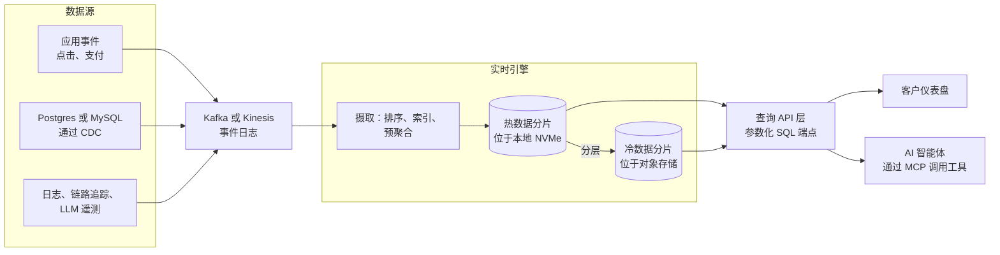
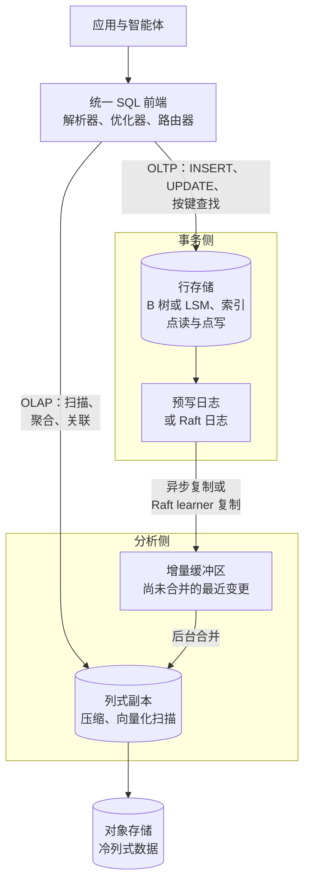

# 23. 实时分析与 HTAP
> **深度：** L2 · **阅读时间：** 约 15 分钟 · **最后核实：** 2026-11-01 · **前置阅读：** [第 5 章 — 分析引擎](../01-data-systems-foundations/ch05-analytical-engines.md)

## 要点速览（TL;DR）

- **[实时分析（real-time analytics）](../glossary.md#real-time-analytics)** 指的是对仅产生数秒的数据执行亚秒级查询，并同时服务数千个并发调用方。这些调用方包括面向客户的仪表盘、可观测性控制台、广告技术竞价系统，以及越来越多的 AI 智能体（agent）。而数据仓库上的一条商业智能（BI）查询需要数秒到数分钟，服务的是数十名分析师。工作不同，引擎也不同。
- 领先的引擎（ClickHouse、Apache Druid、Apache Pinot）之所以快，是因为**在写入时完成工作**：数据落地时即进行排序、预聚合和建立索引，使每次读取只需触及几 KB 到几 MB 的数据。ClickHouse 披露其 **ARR 超过 $250M**（公司披露，2026 年 5 月），估值为 **$15B**（媒体报道，2026 年 1 月）。[^ch-arr][^ch-seriesd]
- **[HTAP](../glossary.md#htap)**（混合事务分析处理，hybrid transactional/analytical processing）将事务和分析放进同一系统，通常的做法是用行存储承接写入，再用一个持续复制的列存储承接扫描，两者共用一个 SQL 前端。SingleStore、TiDB、Oracle Database In-Memory、SAP HANA、AlloyDB、Snowflake Hybrid Tables，以及如今的"Postgres 内嵌 DuckDB"，都采用了这一思路的不同版本。
- **大多数查询都很小。** MotherDuck 对 Amazon 公开的 Redshift 集群数据进行解读后发现，只有约 0.03% 的查询扫描超过 10 TB。[^md-redshift][^redset] 这正是 DuckDB 这类进程内引擎的立论依据；2026 年 8 月，AWS 同意收购 DuckDB 的母公司 DuckLabs（条款未披露）。[^aws-duck]
- 智能体让延迟和单次查询成本变得更加重要。一个发出八条相互依赖查询的智能体，要承受八次引擎延迟；而且智能体以机器速率产生流量。这有利于那些为"大量低成本查询"而定价和设计的引擎，而不是为"少量昂贵查询"设计的引擎。

## 为何重要（商业视角 + Everpure 视角）

分析市场已经按工作负载形态分化。云数据仓库（[第 5 章](../01-data-systems-foundations/ch05-analytical-engines.md)、[第 26 章](../04-company-deep-dives/ch26-snowflake.md)）针对少数人类用户的灵活查询进行了优化。围绕 **[面向用户的分析（user-facing analytics）](../glossary.md#user-facing-analytics)**，另一个市场已经成长起来："谁看过你的主页"面板、支付应用里的商户仪表盘、可观测性工具里的日志搜索框。这些产品在每次页面加载背后都放了一条分析查询。ClickHouse 的收入轨迹是这种分化最清晰的财务信号。该公司表示，2026 年 5 月其 ARR 突破 $250M，同比增长超过两倍，并且自 1 月 D 轮融资以来新增了 1,000 多家客户（公司披露）。[^ch-arr] 其估值从 2025 年 5 月的 $6.35B 升至八个月后的 $15B（均为媒体报道）。[^ch-seriesc][^ch-seriesd]

AI 智能体带来了第三类消费者。当智能体回答"上周东北地区的流失率为什么上升？"时，它会发出一串 SQL 工具调用，每一条都依赖上一条的结果（[第 22 章](ch22-agents-and-data.md)）。支撑这些调用的引擎需要具备数据仓库级别的 SQL 能力，以及实时级别的延迟和成本。例如，ClickHouse 在 2026 年 5 月的大会上发布了由 Claude 驱动的智能体；而 Databricks、Snowflake 和 AWS 自 2025 年以来都收购了 Postgres 或嵌入式分析资产，部分原因正在于此。[^ch-arr][^mooncake][^aws-duck]

对 Everpure 而言，这些引擎的存储画像很有特点。它们**受延迟约束，而不仅仅受吞吐量约束**：热数据集放在本地 NVMe 上以实现毫秒级读取，而大部分数据放在对象存储（object storage）上（ClickHouse Cloud 的 SharedMergeTree 将所有表数据保存在共享对象存储中）。[^ch-smt] 基于公开信息，战略团队可能评估的选项包括：验证兼容 S3 的本地部署对象存储作为自管 ClickHouse、Druid 或 Pinot 集群的共享层，以及将高速闪存定位为这些引擎所依赖的缓存层。

## 工作原理

### 两种截然不同的查询预算

数据仓库 BI 查询与实时查询同时在四个维度上存在差异。这就是为什么一个引擎很少能同时把两者都服务好。

| 维度 | 数据仓库 BI | 实时分析 |
|---|---|---|
| 延迟目标 | 数秒到数分钟 | 10–500 ms，以 p99 衡量 |
| 并发度 | 数十名分析师 | 数千名用户或智能体，每秒数百到数千条查询 |
| 数据新鲜度 | 每小时或每天批量加载 | 事件发生后数秒 |
| 查询形态 | 即席、宽表关联、探索式 | 已知模式，按少数键过滤，在时间窗口上做聚合 |

*图 23.1 — 实时查询不是更快的数据仓库查询，而是一份不同的契约（作者对典型目标的归纳）。*

关键词是 **p99**。面向用户的产品是由其最慢的常见查询，即 **[尾延迟（tail latency）](../glossary.md#tail-latency)** 来评判的。一个平均 80 ms、但在冷缓存时飙升到 4 秒的仪表盘，用户会觉得它是坏的。实时引擎的设计目标是在负载下把尾部延迟压紧。

### 数据管道：从事件到 API

*图 23.2 — 典型的实时分析数据管道：事件经由 Kafka 流入，引擎在数据到达时建立索引，一个轻量的 API 层同时服务应用和智能体。*

事件通过 Kafka 这样的日志（[第 11 章](../02-pipelines-and-governance/ch11-streaming-and-event-platforms.md)）到达，或者通过来自业务数据库的 **[变更数据捕获（change data capture，CDC）](../glossary.md#change-data-capture)** 到达。ClickHouse 在 2024 年 7 月收购 PeerDB，正是为了这条从 Postgres 到 ClickHouse 的路径。[^ch-peerdb] 引擎持续摄取数据，并在数秒内让新行可被查询。在它前面是一个 API 层，把经批准的 SQL 查询转换为端点。这就是 Tinybird 的全部产品，构建在托管 ClickHouse 之上。[^tinybird] 为仪表盘供数的同一组端点，也可以作为工具暴露给智能体。

### ClickHouse 如何做到亚秒级：MergeTree

ClickHouse 起源于 Yandex 内部，最初是一个网站分析产品的引擎，2021 年成为独立公司。[^ch-paper][^ch-inc] 其核心表引擎 **[MergeTree](../glossary.md#mergetree)** 借鉴了 **[LSM 树（LSM-tree）](../glossary.md#lsm-tree)** 的写入路径。每个插入批次被写成一个不可变、有序、列式的"分片"（part）。后台线程把小分片合并成更大的分片，与 LSM 压缩（compaction）的做法完全相同。

读取路径依赖于 **[稀疏主索引（sparse primary index）](../glossary.md#sparse-primary-index)**。分片中的行按表的排序键排序，例如 `(customer_id, event_time)`。ClickHouse 并不为每一行建立索引，而是记录每个 **[颗粒（granule）](../glossary.md#granule)** 起始处的键值；颗粒默认是 8,192 行的数据块。[^ch-sparse] 一张十亿行的表只需要大约 122,000 个索引条目，小到可以常驻内存。查询某个客户最近一小时的数据时，会在该索引上做二分查找，只读取少数可能匹配的颗粒，并用向量化代码只解压所需的列（[第 5 章](../01-data-systems-foundations/ch05-analytical-engines.md)）。

另外两项机制补全了这幅图景。ClickHouse 中的 **[物化视图（materialized view）](../glossary.md#materialized-view)** 是插入触发器：行到达时就被聚合进第二张小得多的表，于是"每个商户每分钟的收入"只在写入时计算一次，而不是每次页面加载都计算。**跳数索引**（skipping indexes，即按颗粒块维护的 min/max、集合和布隆过滤器）让针对非键列的查询也能跳过数据。

> **深入（L3）。** ClickHouse 的 VLDB 2024 论文描述了完整的技术栈：分片合并、稀疏索引、投影（projection，即与表并存的备选排序方式），以及向量化执行器。[^ch-paper] 在 ClickHouse Cloud 中，**[SharedMergeTree](../glossary.md#sharedmergetree)** 取代了副本间的数据复制。所有分片都存放在对象存储中，元数据通过 ClickHouse Keeper 协调；文档称一张表可以拥有数百个无状态副本，而无需分片。[^ch-smt]

> **类比：在线量测。** 晶圆厂不会等到产线末端的电性测试才发现某个刻蚀工序发生了漂移。它会在工艺进行中在线测量关键尺寸，以便修正下一批次。数据仓库 BI 就像产线末端测试：准确、全面，但已来不及修正这一批。实时分析则是在线量测：一组范围更窄、预先选定的测量，在工艺运行时进行，成本低到可以对每片晶圆都做。

### 段式引擎：Druid 与 Pinot

Apache Druid 源自 Metamarkets，用于广告技术报表。其 SIGMOD 2014 论文描述了两类节点：实时节点会立即为流数据建立索引，历史节点则提供从深度存储加载的不可变 **[段（segment）](../glossary.md#segment)**。[^druid-paper] Apache Pinot 由 LinkedIn 为面向会员的功能而构建，2015 年开源，后来被 Uber 采用，并于 2021 年成为 Apache 顶级项目。[^pinot-tlp] 两个引擎都按时间把数据分区成段，对每个维度建立位图索引和倒排索引，并把段推送到对象存储作为持久副本。Pinot 的标志性 **[星树索引（star-tree index）](../glossary.md#star-tree-index)** 为选定的维度组合预先计算聚合结果，以存储空间换取高度可预测的延迟。相应的商业厂商是 Imply（Druid）和 StarTree（Pinot）：前者于 2025 年 9 月围绕名为 Lumi 的"可观测性数据仓库"重新定位；后者最近一次披露定价的融资是 2022 年 $47M 的 B 轮。[^imply-lumi][^startree]

Rockset 走了第三条路：**[融合索引（converged indexing）](../glossary.md#converged-index)**。每个文档的每个字段都以三种方式存储——行索引、列索引和搜索索引——构建在 RocksDB 之上，并把 SST 文件卸载到 S3。[^rockset-arch] 这种设计以写放大为代价换取了查询灵活性。OpenAI 于 2024 年 6 月 21 日宣布收购 Rockset，用于支撑其检索基础设施；按月付费的客户必须在 2024 年 9 月 30 日前迁出该服务。[^rockset] 对买方而言，教训很具体：一个实时引擎可能会消失在收购方体内，而开源是一个退出选项。

### HTAP：一个系统，两个引擎

HTAP 这一概念由 Gartner 于 2014 年命名，[^htap-gartner] 它彻底去掉了数据管道：直接在事务数据库本身上、针对仅有毫秒级时延的数据运行分析。实践中，每一个成功的 HTAP 设计都在一个逻辑数据库之下保留**两种物理格式**。

*图 23.3 — 通用 HTAP 架构：优化器把点操作路由到行存储，把扫描路由到持续复制的列存储，因此两者看到的数据几乎相同，而无需单独的数据管道。*

各种变体的差异在于列式副本放在哪里、新鲜度如何：

- **SingleStore** 在同一引擎中同时保留内存行存储和基于磁盘的列存储。其 SIGMOD 2022 论文描述了一种同时服务两种模式的"通用存储"（universal storage）表。[^s2-paper] Vector Capital 于 2025 年 9 月同意对 SingleStore 进行成长型收购（条款未披露；Bloomberg 援引的数字约为 $500M，媒体报道）。[^singlestore]
- **TiDB**（PingCAP）把行存放在 TiKV（一个基于 Raft 复制的键值存储）中，并增加了 **TiFlash** 列式副本，这些副本以无投票权的 learner 身份加入每个 Raft 组。因此，分析可以读取一致的、接近最新的快照，而不会拖慢写入法定多数（quorum）。[^tidb-paper]
- **Oracle Database In-Memory**（2014 年 7 月随 Database 12.1.0.2 正式发布）和 **SAP HANA**（2011 年 6 月正式发布）把双格式、内存列式处理带给了企业级老牌厂商（基于 2025 年前的知识，未重新抓取）。
- **AlloyDB**（Google 的 Postgres 兼容服务）增加了一个列式引擎，即从行表自动填充的内存列缓存。Google 称其在分析查询上最高可提速 100 倍（厂商声明，类 TPC-H 测试）。[^alloydb]
- **Snowflake Hybrid Tables**（Unistore 功能）从数据仓库一侧切入 HTAP，增加了一个用于点操作的行存储。该功能于 2024 年 11 月在 AWS 上正式发布。[^sf-hybrid]
- **Postgres 加嵌入式列引擎**是 2025–26 年的模式。pg_duckdb（由 MotherDuck、Hydra 和 DuckDB Labs 开发，2024 年 10 月发布测试版）在 Postgres 进程内运行 DuckDB。[^pgduckdb] Databricks 于 2025 年 10 月为 Lakebase 收购了 Mooncake Labs，即 pg_mooncake（Postgres 到列式镜像）背后的团队。[^mooncake] AWS 于 2026 年秋季在 Aurora PostgreSQL 内推出了由 DuckDB 驱动的分析功能，使一条查询可以把实时表与 S3 中的 Iceberg 和 Parquet 数据进行关联。[^aurora-duck]

坦率的评估是："真正的"HTAP——两种工作负载共用一种存储格式——基本上已经失败。胜出的是**以托管复制实现的 HTAP**：两种格式、一个产品，由厂商把复制延迟隐藏起来（[第 1 章](../01-data-systems-foundations/ch01-data-stack-map.md) 把跨产品的版本称为零 ETL）。

> **类比：统一内存。** 独立 GPU 与 CPU 隔着 PCIe，所以数据必须先复制，加速器才能处理。这就是硬件语境下的 ETL。统一内存芯片（Apple 的 M 系列、AMD 的 MI300A、NVIDIA 的一致性 Grace-Hopper 互联）让 CPU 和 GPU 寻址同一块内存，省去了复制，但迫使两者共享带宽。HTAP 做的是同样的权衡。复制步骤消失了，但 OLTP 和 OLAP 如今要争夺同一个系统的内存、CPU 和 I/O，一次繁重的扫描就可能抬高一笔支付写入的 p99。厂商的应对方式与芯片设计师一样：分区和服务质量（QoS）控制。

### DuckDB 与"小数据"论

DuckDB 是一个 **[进程内数据库（in-process database）](../glossary.md#in-process-database)**：像 SQLite 一样作为库链接进应用，但拥有向量化列式引擎（[第 5 章](../01-data-systems-foundations/ch05-analytical-engines.md)）。没有服务器、没有网络跳转，也没有集群。它的前提是大多数分析数据都能放进一台机器，而 MotherDuck 已经把这一理念打造成了自己的品牌。

证据比轶事更有说服力。Amazon 关于 Redshift 集群的 VLDB 2024 论文发布了"Redset"，即来自 200 个预置集群和 200 个无服务器集群的三个月查询统计。论文发现，查询高度重复，其属性遵循长尾分布，涉及的表也少于 TPC-DS 的假设。[^redset] MotherDuck 对 Redset 的分析发现，只有约 0.03% 的查询扫描超过 10 TB。即使针对大于 10 TB 的表，平均每条查询也只读取了表的约 0.5%。[^md-redshift] 需要注意几点保留意见。Redset 只是一家厂商的集群群，字节数是剪枝之后的扫描量，而且少数大查询仍然消耗了不成比例的计算资源。MotherDuck 自己的解读认为大查询约占执行时间的 6%，而这个结论出自一家与答案有利害关系的厂商。即便如此，**"[小数据（small data）](../glossary.md#small-data)"描述的是中位数查询**，而中位数查询正是智能体和仪表盘所产生的查询。

在商业上，DuckDB 生态发展迅速。托管 DuckDB 服务 MotherDuck 于 2023 年 9 月完成 $52.5M 的 B 轮融资，据报道投后估值为 $400M。[^motherduck] DuckLake 是一种把湖元数据保存在 SQL 数据库中的表格式，于 2026 年 4 月发布 1.0 版。[^ducklake] 随后在 2026 年 8 月 26 日，Amazon 签署了收购 DuckDB 背后公司 DuckLabs 的最终协议（条款未披露）。该项目本身在独立的 DuckDB Foundation 下继续采用 MIT 许可证。[^aws-duck]

> **类比：嵌入式加速器。** 数据仓库是一台独立的设备：数据经过链路传到一个大型共享引擎，结果再传回来。DuckDB 则是集成在晶粒上的加速模块：更小，但传输成本为零，前面也没有排队。对于能放进本地内存的工作负载，片上模块胜过总线另一端更快的芯片，因为互联和调度延迟占了主导。
