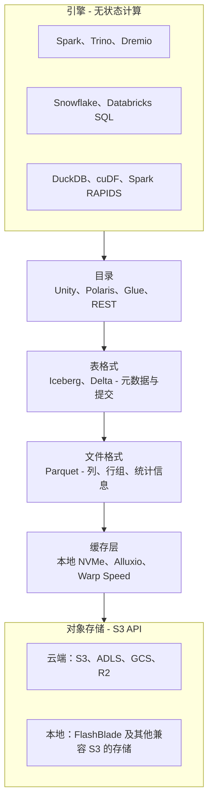
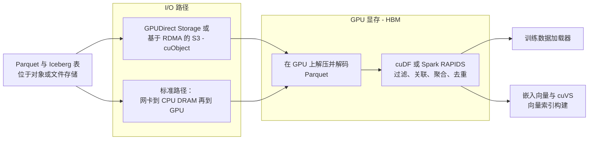
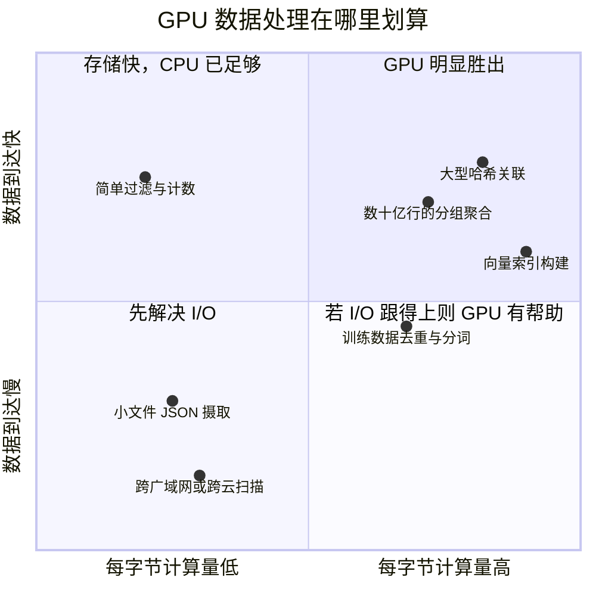
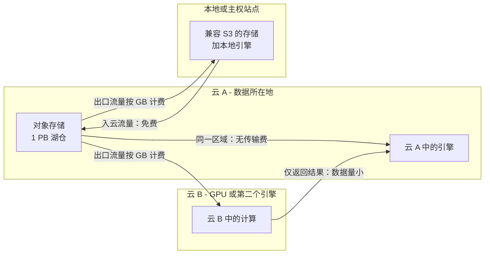
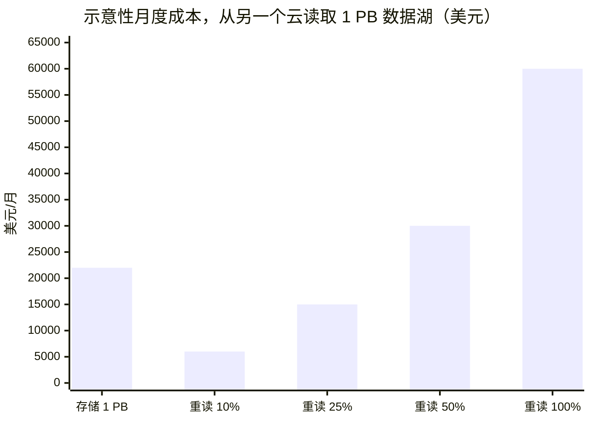

# 24. 数据栈与计算和存储的交汇点
> **深度：** L2 · **阅读时间：** 约 16 分钟 · **最后核实：** 2026-11-01 · **前置阅读：** [第 5 章 — 分析引擎](../01-data-systems-foundations/ch05-analytical-engines.md)、[第 7 章 — 开放表格式](../01-data-systems-foundations/ch07-open-table-formats.md)

## 要点速览（TL;DR）

- 每一个现代数据平台都是一组构建在 **对象存储（object storage）** 之上的软件层（引擎、目录、表格式、文件格式、缓存）。存储层在厂商架构图中是隐形的，但其语义（一致性、条件写入、请求计费、LIST 速度）决定了上层是否正确、是否负担得起。
- **GPU 正在进入数据处理领域**，而不仅仅用于模型训练。NVIDIA 的 RAPIDS 库（cuDF、cuML、cuVS）以及 RAPIDS Accelerator for Apache Spark 在 GPU 上运行数据框（dataframe）、SQL 和向量索引构建，大多无需修改代码。GPU 在大型关联、聚合和索引构建上胜出；而当作业在等待存储或网络时——这种情况很常见——GPU 就会失去优势。
- 过去五年间，S3 的 API 获得了一系列数据库特性：强读后写一致性（2020 年 12 月）、"不存在才创建"与比较并交换式写入（2024 年 8 月和 11 月）、低延迟层（S3 Express One Zone）、托管 Iceberg（S3 Tables）以及原生向量（S3 Vectors，2025 年 12 月正式发布）。任何兼容 S3 的存储，包括本地部署的存储，如今都以这一标准来衡量。
- **数据引力（data gravity）是有价格的。** AWS 第一档的互联网出口流量费（egress fees）标价约为 $0.09/GB。[^s3-pricing] 每月从另一个云重新读取数据湖的很大一部分，其成本可能超过存储成本。监管机构已对此有所削减（2024 年的迁出费用豁免、2025 年受欧盟《数据法案》推动的多云费用下调），但稳态的跨云读取仍然收费。
- 战略上的答案是**把计算带到数据所在之处**：联邦查询、零拷贝（zero-copy）共享、缓存，以及在数据已经所在位置运行的引擎，包括本地部署的 Iceberg 湖仓一体（lakehouse）。这为 Everpure 的 FlashBlade 这类兼容 S3 的本地平台打开了机会，也是存储厂商（NetApp–DataPelago、Everpure–Data Stream）如今纷纷在其阵列旁收购或自建计算能力的原因。

## 为何重要（商业视角 + Everpure 视角）

本书第 1 部分自上而下地描述了数据栈：引擎（[第 5 章](../01-data-systems-foundations/ch05-analytical-engines.md)）、文件格式、表格式（[第 7 章](../01-data-systems-foundations/ch07-open-table-formats.md)）和目录。本章则自下而上地审视：这些层对其下方的硬件提出了什么要求，以及当它们交汇时，资金流向何处。

有三项变化使这一接口在 2026 年具有商业重要性。第一，存算分离（separation of storage and compute）让对象存储成为分析的记录系统，因此存储 API 如今已成为数据库的一部分。第二，AI 工作负载把 GPU 放到了数据管道旁边。一个在等待 ETL 的 GPU 集群，浪费的是数据中心里最昂贵的资本。第三，出口流量费定价、主权规则以及回迁兴趣意味着，数据*放在哪里*再次成为一项战略决策，而不是默认选项。

对 Everpure（原 Pure Storage；NYSE: P，原 PSTG）而言，正是在这一层，存储公司要么沦为一个商品化的存储桶，要么成为数据平台的参与者。Everpure 的公开动作指向第二条路径。这些动作包括：与 Dremio 和 Starburst 合作的 FlashBlade 参考架构、Databricks Storage Ecosystem 的首发合作伙伴身份（2026 年 6 月），以及 Data Stream——一个基于 FlashBlade 加 NVIDIA GPU 的向量化数据管道。[^dremio-pure][^starburst-ep][^storage-eco][^data-stream] 后续章节将基于公开信息，阐述战略团队可能评估的选项。

## 工作原理

### 湖仓一体是构建在对象存储上的一组层

一条[湖仓](../glossary.md#lakehouse)查询在触及磁盘之前要穿过六个层。每一层都会给存储带来一种不同类型的负载。

*图 24.1 — 每个引擎都通过目录、表格式和文件格式访问相同的字节。存储看到的是两种截然不同的流量：来自目录层和表格式层的小型、对延迟敏感的元数据调用，以及来自文件层的大规模并行范围读取。*

流量的这种分化很重要。一条 Iceberg 查询首先读取一个元数据 JSON 文件、一个清单列表和若干清单文件：都是小对象，串行读取，延迟起主导作用。随后它扇出为数千个针对 Parquet 文件的并行字节范围 GET 请求，此时总吞吐量起主导作用。一次提交会增加一次条件写入。维护作业（压缩、快照过期）则带来成批的 LIST 和 DELETE 调用。一个只针对大规模顺序流调优的存储系统，在基准测试里看起来很快，在湖仓里却会很慢。

### S3 API 如今承诺了什么

S3 于 2006 年推出时，是一个具有最终一致性的简单键值存储。表格式不得不绕开这一点：S3 上的 Delta Lake 最初需要借助外部 DynamoDB 锁才能安全提交。2020 年以来的四项变化，把这个 API 变成了数据库可以在其上构建的东西。

1. **强读后写一致性**（2020 年 12 月）。一次成功的写入对随后的每次读取和 LIST 都立即可见，且不额外收费。[^s3-consistency] 这消除了 Spark 和 Hive 作业中一整类"文件未找到"和列表过时的缺陷。
2. **条件写入。** 2024 年 8 月，S3 增加了 `If-None-Match`（仅在不存在时创建）。2024 年 11 月，它又增加了 `If-Match`，即只有在对象的 ETag 未改变时才会成功的写入。[^s3-cond][^s3-ifmatch] 两者结合，在存储 API 本身中提供了一个[比较并交换（compare-and-swap）](../glossary.md#compare-and-swap)原语。如今，一条 Delta 日志条目或一个目录指针文件无需单独的锁服务即可安全提交，这让"无目录"或存储原生的提交变得切实可行。
3. **低延迟层。** S3 Express One Zone（2023 年 11 月）把数据存放在单个可用区的"目录存储桶"（directory buckets）中，AWS 声称可实现个位数毫秒级的访问。[^s3-express] AWS 于 2025 年 4 月下调了其价格：存储降价 31%，PUT 降价 55%，GET 降价 85%。[^s3-express-cut] 它是一种存储类别，而不是自动缓存，但各团队把它用作表和训练数据分片的托管热数据层。
4. **感知表与向量的存储。** S3 Tables（2024 年 12 月）是带有自动压缩功能的托管 Iceberg。S3 Vectors（2025 年 12 月正式发布）每个索引最多可存储 20 亿个向量，AWS 称查询耗时约 100 ms，厂商还声称成本比替代方案最多低 90%。[^s3tables][^s3-vectors]

> **类比：半导体。** S3 的演进类似于指令集架构获得原子操作。早期的多处理器只有加载和存储指令，软件在其之上以高昂代价构建锁。在 ISA 中加入比较并交换指令后，无锁结构变得廉价。条件写入就是 S3 的 CAS 指令。如今每个"兼容 S3"的存储都必须在竞争条件下正确实现它，否则表提交会在无声无息中损坏数据。

### 请求计费：为什么小文件很昂贵

对象存储既按字节收费，也按请求收费。这改变了数据工程师设计数据管道的方式。在 S3 Standard 上，前 50 TB 的存储标价约为 $0.023/GB-月。PUT 和 LIST 请求每 1,000 次 $0.005，GET 每 1,000 次 $0.0004。[^s3-pricing] S3 每次 LIST 调用最多返回 1,000 个键，每个前缀每秒支持约 3,500 次写入和 5,500 次读取。[^s3-list][^s3-perf]

**算例（估算）。** 一个流处理作业写入 4 KB 的微批文件：每月十亿个，约 4 TB。存储 4 TB 每月约 $92。而写入十亿个对象仅 PUT 费用就约 $5,000，是存储账单的 50 多倍。读回它们还要再花 $400 的 GET 费用。在其上规划一条查询需要一百万页 LIST。同样的 4 TB 若写成 512 MB 的 Parquet 文件（约 8,000 个对象），请求费用只需几美分。这就是为什么[第 7 章](../01-data-systems-foundations/ch07-open-table-formats.md)中的小文件问题既是性能问题，也是财务问题。本地部署的对象存储通常不按请求计费，但它们要在元数据 IOPS 和 CPU 上付出同样的代价。

### GPU 加速的数据处理

GPU 是从 AI 一侧进入数据栈的。训练或嵌入（向量）数据管道的大部分实际耗时都花在 ETL 上：解码 Parquet、过滤、与元数据关联、去重、分词。如果这些工作在 CPU 上运行而 GPU 在等待，数据中心里最昂贵的资产就会闲置。NVIDIA 的答案是 RAPIDS，一组与流行的 Python 和 JVM 数据 API 相对应的 CUDA 库。

- **[cuDF](../glossary.md#cudf)** 是基于 Arrow 列式布局构建的 GPU 数据框。其 **pandas 加速器模式**（`cudf.pandas`，RAPIDS 23.10，2023 年 11 月）拦截 pandas 调用，把能在 GPU 上运行的部分放到 GPU 上，其余部分回退到 CPU。NVIDIA 发布时宣称的"近 150 倍"来自 Grace Hopper 系统上的一个 5 GB 基准测试，因此应视为最佳情况。该模式现已列为正式发布。[^cudf-pandas][^cudf-ga]
- **cuML** 把同样的零代码修改方法带给了 scikit-learn、UMAP 和 HDBSCAN。它以测试版形式在 cuML 25.02 中发布，并在 2025 年 3 月的 GTC 上展示，厂商报告 scikit-learn 算法最高可提速 50 倍。[^cuml-accel]
- **RAPIDS Accelerator for Apache Spark** 是一个插件，把 Spark SQL 和 DataFrame 算子替换为 GPU 版本，无需修改用户代码。在 GTC 2025 上，NVIDIA 增加了 **Project Aether**，这是一套为 GPU 对 Spark 作业进行资格评估、测试和调优的工具。NVIDIA 援引的客户成果包括澳大利亚联邦银行（Commonwealth Bank of Australia，成本降低 80% 以上）和 FINRA（在一个工作负载上提速 14 倍、节省 90% 成本，于 AWS re:Invent 2025 展示）。这些均为厂商或客户针对选定工作负载的声明。[^aether][^finra]
- **[cuVS](../glossary.md#cuvs)** 是 GPU 向量检索库（CAGRA 图索引、IVF-PQ 等）。它已集成到 Faiss、Milvus、Weaviate 和 OpenSearch 中。OpenSearch 自己的基准测试（1,000 万个向量，768 维）把索引构建时间从约 274 分钟缩短到 29 分钟，约 9.4 倍。[^cuvs] 这正是 GPU 数据处理与[第 18 章](ch18-embeddings-and-vector-search.md)的交汇点：构建索引是批量计算作业，而服务查询通常仍留在 CPU 上。
- **带 GPU 后端的引擎。** IBM 和 NVIDIA 为 **Velox** 增加了 cuDF 后端；Velox 是 Meta 的 C++ 执行引擎，位于 Presto C++ 之下，并通过 Apache **Gluten** 位于 Spark 之下。NVIDIA 报告在单个 DGX B200 节点上类 TPC-H 查询约快 12 倍，IBM 援引的雀巢（Nestlé）案例是提速 5 倍、成本降低 83%（厂商声明）。[^velox-gpu] Presto 于 2026 年 6 月开始发布每夜构建的 GPU 镜像。[^presto-gpu] 这条路径很重要，因为现有引擎无需用户迁移到新产品即可获得 GPU 执行能力。

GPU 数据管道的数据路径如下：

*图 24.2 — 只有当字节足够快地到达 HBM 时，GPU 数据处理才划算。GPUDirect Storage 和基于 RDMA 的 S3 跳过了 CPU 中转缓冲区；没有它们，CPU、其 DRAM 和 PCIe 会先于 GPU 成为瓶颈。*

[GPUDirect Storage](../glossary.md#gpudirect-storage) 通过 DMA 将数据从 NVMe 或网络文件系统直接移入 GPU 显存，跳过经由主机 DRAM 的一次复制。2026 年，NVIDIA 通过 **cuObject** 把这一思路扩展到对象存储。它让 S3 控制路径仍走 HTTP，但通过 RDMA 传输有效载荷，并且需要同时修改客户端 SDK 和存储服务器。[^cuobject] 对存储厂商而言，这是一道新的认证门槛："兼容 S3"可能很快也意味着"兼容基于 RDMA 的 S3"。

### GPU 何时有用、何时无用

有用的判断标准是[算术强度（arithmetic intensity）](../glossary.md#arithmetic-intensity)：作业每读取一个字节所做的工作量。

*图 24.3 — 当作业每字节执行大量操作、且存储能跟上供数时，GPU 才划算。对远程数据做过滤加计数是 I/O 受限的：更快的处理器只是等得更快而已。*

一个算例可以说明原因（示意性假设）。[^assump] 假设一个 GPU 节点有两个 400 Gb/s 的网络端口，那么它最多能从存储拉取约 100 GB/s。因此，一次 10 TB 的扫描仅数据到达就至少需要 100 秒。如果查询只是简单的过滤和求和，一个具有相同网络带宽的 CPU 集群也会在大致相同的时间内完成，因为两者都不受计算约束。如果查询要关联三张大表、进行混洗（shuffle）和聚合，它会在内存中多次触及每个字节，此时 GPU 的内存带宽（HBM 每秒数 TB）就让它与 CPU 拉开差距。上文引用的厂商提速数据都来自第二类作业，而大多数仪表盘查询属于第一类。

此外还有三项限制。GPU 显存相对于数据量很小，因此大型作业会溢出到主机内存或磁盘。算子覆盖不完整，一个不受支持的函数就会迫使回退到 CPU，可能抵消全部收益。而且 GPU 稀缺：花在 ETL 上的一个 GPU 小时，就是没有用于训练或推理的一个 GPU 小时——这就是为什么经济性往往更有利于把 GPU 用于*紧邻* AI 工作的 ETL。

> **类比：内存墙。** 这就是芯片设计中熟悉的屋顶线（roofline）模型。性能的上限取决于峰值计算能力与"内存带宽 × 算术强度"两者中的较低者。CPU 上的分析会撞上带宽屋顶，这正是列式格式和向量化执行存在的原因（[第 5 章](../01-data-systems-foundations/ch05-analytical-engines.md)）。迁移到 GPU 会同时抬高两个屋顶，但仅限于已在 HBM 中的数据。业界一旦发现某个工作负载在内存上受带宽约束，就会把它迁移到加速器上，然后又不得不重建 I/O 路径，以免存储成为新的屋顶。

### 缓存层：对象存储前面的 SRAM

存算分离意味着每次扫描都要穿过网络。缓存弥合了这一差距。

| 缓存 | 所在位置 | 存放内容 | 关键行为 |
|---|---|---|---|
| Databricks 磁盘缓存 | 每个工作节点的本地 SSD | 远程 Parquet/Delta 文件的副本 | 在有 SSD 的环境中默认开启；最多使用一半本地 SSD；工作节点被移除时缓存丢失[^dbx-cache] |
| Snowflake 仓库缓存 | 虚拟仓库的本地 SSD/内存 | 最近查询读取过的表数据 | 仓库挂起时被清除，因此自动挂起是在用积分换取缓存热度[^sf-cache] |
| Starburst Warp Speed | Trino 工作节点上的 SSD | 索引（位图、树、Lucene 文本）和缓存的列数据 | 自主运行；厂商声称查询最高快 7 倍，预览期平均提升 40%[^warp] |
| Alluxio | 跨计算节点 NVMe 的分布式层 | 来自对象存储的热文件，用于分析和 AI 训练 | 跨云和本地的读穿透缓存；用于在训练期间持续为 GPU 供数[^alluxio] |
| S3 Express One Zone | 单可用区目录存储桶 | 由应用选定的热对象 | 托管、按请求计费的层；非自动[^s3-express-cut] |

*图 24.4 — 缓存存在于每个层级，从单节点 SSD 到托管存储层。决定交互式查询延迟的往往是缓存命中率，而不是对象存储的原始速度。*

> **类比：存储层次结构。** 本地 NVMe 缓存之于对象存储，就像 SRAM 缓存之于 DRAM，也像 GPU 中 HBM 之于主机内存。它们把一个小的工作集放在靠近计算的地方。命中率高时能隐藏延迟，访问随机时则毫无帮助。当计算是弹性的，它们也会"变冷"：一个挂起的 Snowflake 仓库会丢失其缓存，就像一个断电的核心丢失其 L2 缓存。

### 数据引力与出口流量费

[数据引力](../glossary.md#data-gravity)是指大型数据集把计算和应用吸引到自身周围的倾向。云定价让这种倾向变得显性。入口流量免费、存储便宜，但把数据移出（到互联网或另一个云）是计量收费的。AWS 第一档的互联网出口流量费标价约为 $0.09/GB，自 2021 年起每月前 100 GB 免费。[^s3-pricing][^aws-100gb]

*图 24.5 — 出口流量费是不对称的：字节流入云免费，流出收费。在数据所在之处运行计算、只移动结果，就可以避开计费表。*

*图 24.6 — 按这些假设，每月从另一个云重新读取约三分之一的数据湖，其成本就与存储成本相当。估算：存储按混合费率约 $0.022/GB-月，出口流量按阶梯折扣后的混合费率约 $0.06/GB；并非报价。*[^assump][^s3-pricing]

出口流量计费表在两方面有所松动，但并未消失。第一是**迁出豁免**。在监管压力下，Google（2024 年 1 月）、AWS（2024 年 3 月）和 Microsoft 对将*全部*数据迁出的客户免除了出口流量费。这些豁免有助于一次性迁移，而不是稳定的多云架构。[^aws-exit][^eu-egress] 第二是**欧盟《数据法案》**（EU Data Act），其主要义务自 2025 年 9 月起适用，要求切换费用在 2027 年 1 月前降至零。[^eu-data-act] 在此之前，Google 于 2025 年 9 月在欧盟和英国针对符合条件的多云流量推出了免费的"Data Transfer Essentials"。Microsoft 改为在欧盟按成本价收取传输费用，AWS 则允许欧盟客户在符合条件的情况下申请降低费率。[^eu-egress] 在这些计划之外，Cloudflare R2 以出口流量零收费建立了自己的业务（存储 $0.015/GB-月，无带宽费用），这给超大规模云厂商对读取密集、多消费方数据所能收取的费用设定了上限。[^r2]

> **类比：数据中心规模的内存墙。** 在芯片中，从 DRAM 搬运一个字节所耗的能量远高于对它执行一次算术运算。在云中，跨越服务商边界搬运一个字节的成本，高于把它存储数周。两种情况下的工程应对是一样的：让工作集保持在本地，移动结果而非输入，把计算放在内存旁边。

### 把计算带到数据所在之处

有四种模式可以避免搬运字节：

- **查询联邦**（query federation）把查询下推到持有数据的系统，只返回结果（Trino/Starburst 连接器、Databricks Lakehouse Federation、BigQuery Omni 式跨云引擎）。
- **零拷贝共享**就地授予对表的访问权限（Snowflake 共享、Delta Sharing/OpenSharing），因此消费方支付计算费用，但不产生副本（[第 9 章](../02-pipelines-and-governance/ch09-pipeline-patterns.md)）。
- **在数据所在之处运行的引擎。** 开放表格式让 Trino、Spark、Dremio 或 DuckDB 能在本地针对兼容 S3 存储上的 Iceberg 运行，同时这些表通过 REST 目录对云端引擎可见。
- **存储层内部的计算。** 存储厂商正在阵列旁增加处理能力。NetApp 收购了 DataPelago（2026 年 7 月，条款未披露），其 Nucleus 引擎可就地对数据执行 CPU/GPU 处理，厂商声称成本最多可降低 80%。[^datapelago] Everpure 的 Data Stream 在 FlashBlade 上借助 NVIDIA GPU 对数据进行向量化，基于 NVIDIA AI Data Platform 参考设计。[^data-stream][^aidp]

### 本地部署与主权湖仓

三股力量让本地分析重新焕发活力。**主权**：AWS 于 2026 年 1 月在勃兰登堡推出了由欧盟居民员工运营的 European Sovereign Cloud。这表明连超大规模云厂商如今也把本地化当作一项卖点。[^aws-esc] **AI 工厂**：在本地构建 GPU 集群的企业希望训练和检索数据位于同一网络结构上，而不是隔着广域网。**回迁**：一项由 Cloudera 委托进行的调查（2026 年 8 月）发现，66% 的受访者在过去 12 个月中把部分 AI 工作负载从公有云迁回本地或私有云。考虑到调查的出资方，应将其视为方向性信号。[^cloudera-survey]

本地湖仓如今使用与云端湖仓相同的组件：Iceberg 表、Parquet 文件、一个 Iceberg REST 目录（Polaris、Nessie 或厂商目录），以及作为引擎的 Trino、Starburst、Dremio 或 Spark，全部运行在兼容 S3 的对象存储上。Cloudera 把这一模式作为混合数据平台来销售。SAP 对 Dremio 的收购（2026 年 5 月宣布，约 2026 年 7 月完成）把主要的本地 Iceberg 引擎之一纳入了一家应用软件巨头。云数据仓库在边缘处做出了调整。自 2022 年的预览版以来，Snowflake 一直支持基于兼容 S3 的本地存储的外部表，并提供一套供厂商自我认证的公开测试套件。Databricks 于 2026 年 6 月推出的 Storage Ecosystem 让工作区能够通过 OpenSharing 就地查询合作伙伴存储上的 Delta 和 Iceberg 表。[^sf-onprem][^sf-s3compat][^storage-eco]

### 湖仓对对象存储的要求

下表列出的是要求，而不是产品宣称。它是评估任何对象存储（无论云端还是本地）作为湖仓底座的检查清单。

| 要求 | 为何对数据栈重要 | 如何评估 |
|---|---|---|
| 单客户端吞吐量与总吞吐量 | 扫描扇出到数百个工作节点；最慢的数据流决定查询时间 | 用 Spark/Trino 通过范围 GET 读取 Parquet，测量单客户端和全集群的 GB/s，而不仅仅是合成的顺序读取 |
| 小对象与 HEAD/GET 延迟 | Iceberg 在任何扫描开始之前要串行读取元数据 JSON 和清单文件 | 并发负载下 4–64 KB GET 和 HEAD 的 p50/p99 延迟 |
| 大规模 LIST 性能 | 维护作业、孤立文件清理和 Hive 风格的表要列出数百万个键 | 在单个前缀中列出 1,000 万个键所需时间，包括并发写入场景以及 1,000 键分页 |
| 强一致性 | 提交和读取方必须立即看到最新元数据 | 并发下的读后写和写后列测试，包括覆盖写入和删除 |
| 条件写入 | `If-None-Match` 和 `If-Match` 为 Delta、Iceberg 和目录实现无锁提交 | 运行并发提交测试；确认恰好只有一个胜出者，并返回正确的 412 响应 |
| 元数据操作与删除 | 快照过期和压缩会批量删除和重写文件 | 批量 DELETE 速率、分段上传行为、元数据扩展是否独立于容量 |
| 多租户与隔离 | 许多引擎和团队共享一套存储桶资产 | 嘈杂邻居测试、按租户的 QoS、与目录凭证分发兼容的存储桶策略和限定范围凭证 |
| API 兼容深度 | 引擎使用的 S3 SDK 功能远不止 GET/PUT | 运行厂商测试套件（例如 Snowflake 的 S3 兼容套件）和引擎认证 |
| 规模化下的数据效率 | 数据湖会增长到 PB 级，且大多为冷 Parquet | 纠删码开销、每可用 TB 的有效成本、重建对扫描吞吐量的影响 |
| GPU 数据路径 | AI 数据管道把相同的表读入 GPU | GPUDirect Storage 或基于 RDMA 的 S3 支持，以及实测进入 GPU 显存的 GB/s |

*图 24.7 — 湖仓同时在十个维度上对对象存储施压。其中大多数涉及元数据、延迟和正确性，而非峰值吞吐量。*

## 设计选择与权衡

| 选项 | 运作方式 | 优势 | 劣势 | 适用场景 |
|---|---|---|---|---|
| 搬运数据（复制或 ETL） | 复制到计算所在的云 | 简单；本地性能 | 出口流量费、重复存储、副本过时、治理漂移 | 一次性迁移或小规模热数据子集 |
| 联邦查询 | 把查询下推到数据源；返回结果 | 无副本；数据新鲜 | 跨源关联慢；依赖数据源的能力 | 偶发的跨系统查询 |
| 零拷贝共享 | 就地授予表访问权限 | 无副本；受治理 | 同区域才经济；跨区域又会引入复制 | 合作伙伴数据交换、多引擎访问 |
| 在计算旁缓存 | 把热工作集放在本地 NVMe 上 | 快；透明 | 冷启动、失效、随机访问时浪费容量 | 针对重复数据集的交互式 BI |
| 在数据处计算（本地或存储内） | 在表所在之处运行引擎或 GPU 处理 | 无出口流量费；满足主权要求；GPU 就近 | 运维负担；托管服务更少 | 受监管数据、本地 AI 工厂、超大型数据湖 |
| 用 GPU 加速引擎 | 把 CPU 算子替换为 GPU 算子 | 关联和聚合上收益巨大 | GPU 成本高且稀缺；I/O 受限的作业收益甚微 | 为 AI 供数的 ETL、大型批量数据转换、向量索引构建 |

*图 24.8 — 把远处的数据与计算结合起来，没有免费的办法。每个选项在出口流量费、新鲜度、运维投入和 GPU 支出之间做出不同的权衡。*

反对本地和存储内计算的最强论据在于运维。托管云服务负责升级、扩展、目录操作和表维护。大多数企业低估了这些工作，而 S3 Tables 如今已能自动执行压缩。反对 GPU 加速的最强论据是，大多数企业 SQL 要么受 I/O 约束，要么规模很小。一个调优良好、文件布局合理的 CPU 引擎，往往能以更低的成本达到与 GPU 相当的效果。

## 主要参与者

| 工具或厂商 | 功能 | 现状（2026 年） | 备注 |
|---|---|---|---|
| NVIDIA RAPIDS cuDF / `cudf.pandas` | GPU 数据框；带 CPU 回退的 pandas 加速 | 开源；加速器模式已正式发布[^cudf-ga] | 也是 Polars GPU 引擎的后端 |
| NVIDIA cuML（`cuml.accel`） | GPU 版 scikit-learn、UMAP、HDBSCAN | 自 25.02 起提供零代码修改模式（发布时为测试版）[^cuml-accel] | 覆盖范围因算法而异 |
| RAPIDS Accelerator for Apache Spark | 用于 Spark SQL/DataFrames 的 GPU 插件 | 已发布；Project Aether 迁移工具（需申请）[^aether] | 可运行于 EMR、Dataproc、Databricks 和本地 Spark |
| NVIDIA cuVS | GPU 向量索引构建与检索 | 已集成于 Faiss、Milvus、Weaviate、OpenSearch[^cuvs] | 最大收益在索引构建 |
| Velox + cuDF；Gluten | 经由 Velox 为 Presto C++ 和 Spark 提供 GPU 后端 | 已进入 Velox 主线；Presto GPU 每夜构建自 2026 年 6 月起[^velox-gpu][^presto-gpu] | 就地加速现有引擎 |
| Voltron Data Theseus | 分布式 GPU SQL 引擎 | Accenture 于 2025 年 2 月投资[^voltron]；[VERIFY: Voltron Data 在 2026 年的运营状况] | 2025 年以来公开消息很少 |
| HEAVY.AI（HeavyDB） | GPU 原生 SQL 数据库（前身为 MapD/OmniSci） | 据报道于 2025 年被 NVIDIA 收购；文档现位于 NVIDIA 网站[^heavy] [VERIFY: NVIDIA 收购 HEAVY.AI 的交易条款和日期] | 小众：地理空间和可视化分析 |
| NetApp DataPelago（Nucleus） | 存储层的 CPU/GPU 数据处理 | 2026 年 7 月被 NetApp 收购[^datapelago] | 存储厂商的直接先例 |
| Alluxio、Starburst Warp Speed | 缓存与索引层 | 商业产品[^alluxio][^warp] | 隐藏对象存储延迟 |
| AWS S3 / Express / Tables / Vectors | 参考对象 API 及其类数据库扩展 | 正式发布[^s3tables][^s3-vectors][^s3-express-cut] | 设定了兼容性标准 |
| Cloudflare R2 | 零出口流量费的兼容 S3 存储 | 正式发布[^r2] | 对出口流量定价形成压力 |
| Everpure FlashBlade | 本地统一文件与 S3 对象平台 | Dremio 和 Starburst 参考架构；Databricks Storage Ecosystem 首发合作伙伴；基于 NVIDIA 的 Data Stream[^dremio-pure][^starburst-ep][^storage-eco][^data-stream] | 见存储桥接 |

*图 24.9 — GPU 数据工具如今覆盖数据框、Spark、向量检索和现有 SQL 引擎。更不起眼的趋势是存储厂商在自己的产品中加入计算能力。*
