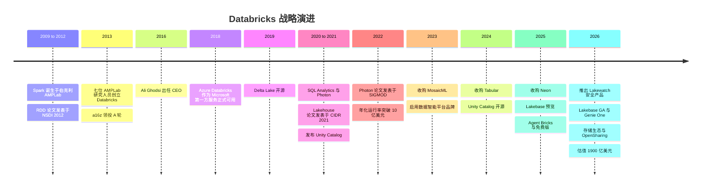
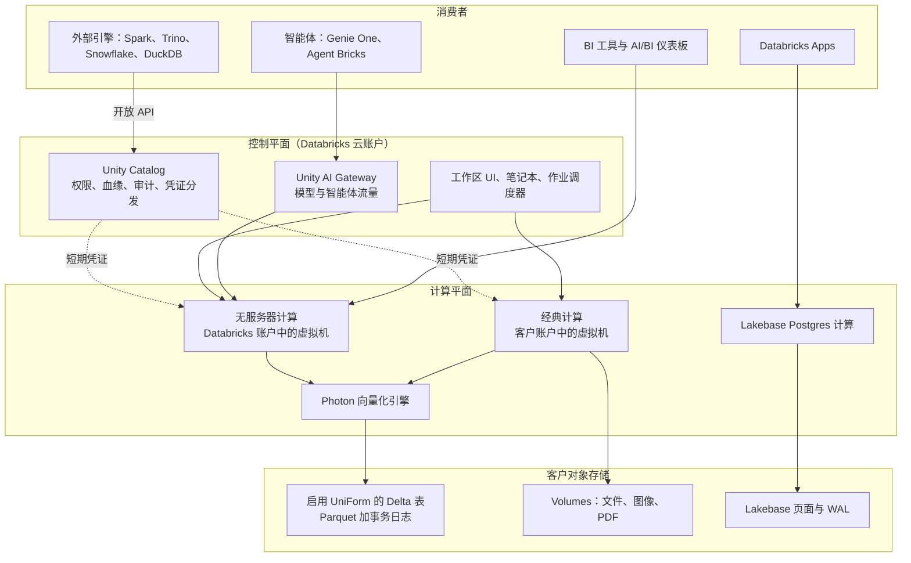
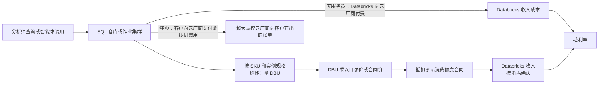
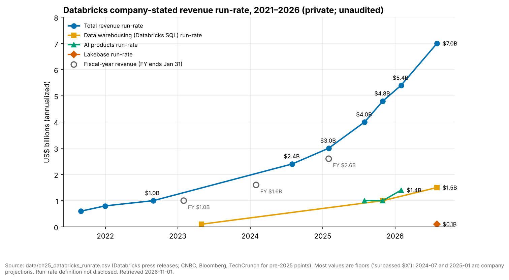
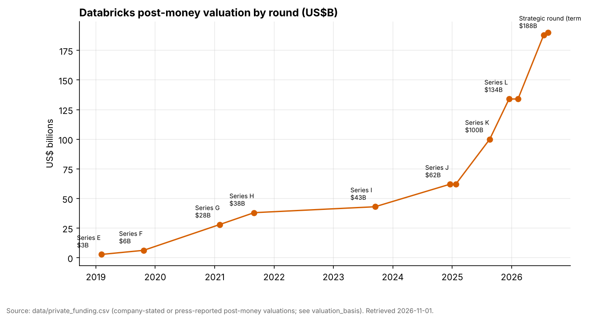
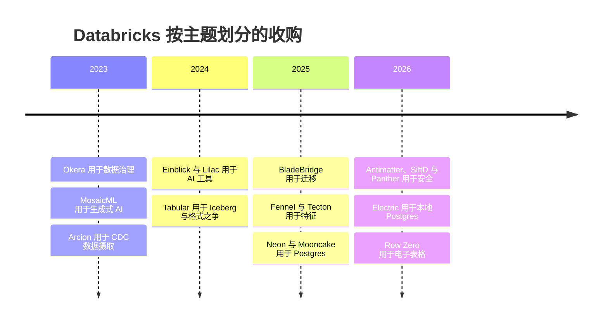
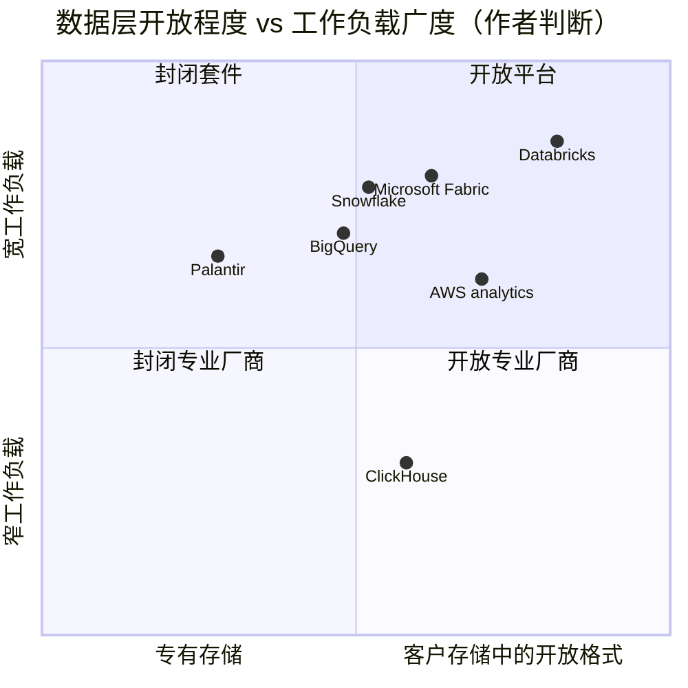

# 25. Databricks
> **状态：** 私营 · **总部：** 加利福尼亚州旧金山 · **成立：** 2013 · **最新估值/市值：** $190B 投后估值（公司披露，融资于 2026-08-13 完成交割） · **最后核实：** 2026-11-01

## 要点速览（TL;DR）

- **它是什么。** Databricks 销售一套托管式数据与 AI 平台，该平台构建于存放在客户自有云对象存储中的开放格式之上。它起步于"托管版 Apache Spark"，如今已是数据仓库、ETL 工具、数据治理目录、ML/智能体平台，并自 2025 年起成为一款运营型 Postgres 数据库（Lakebase）。其[湖仓一体（lakehouse）](../glossary.md#lakehouse)的核心主张是：一份数据、多个引擎、一个治理层。
- **规模。** 公司称，在其财年第二季度（2026 年 5–7 月）**收入年化运行率突破 $7B，同比增长 >80%**。公司还提到数据仓库业务超过 $1.5B、AI 产品超过 $1.4B（截至 2026 年 1 月）、Lakebase 超过 $100M，净收入留存率（NRR）超过 140%。以上全部为**公司披露的、未经审计的年化运行率**。Databricks 为私营公司，不公布 GAAP 财务报表。[^db-7b][^db-54]
- **估值。** 一轮 $5B 的融资于 2026-08-13 完成交割，**投后估值 $190B（1900 亿美元）**，约为其披露年化运行率的 **27x**。Snowflake 的交易倍数为 **16.9x EV/未来 12 个月收入**（2026-10-30）。两个倍数**不可直接比较**：Databricks 的倍数是私募投后*股权*价值除以未经审计、由公司自行定义的*年化运行率*；而 Snowflake 的倍数是公开市场*企业价值*除以由业绩指引推导的 GAAP 收入（见下文估值桥接）。Databricks 在 20 个月内从 $62B 升至 $190B。[^db-7b][^comps-sf]
- **控制点是 Unity Catalog，而非文件格式。** Databricks 于 2024 年收购 Tabular（Iceberg 创始人创办的公司，媒体报道约 $2B），平息了格式之争。如今它在开放数据之上叠加的数据治理、无服务器计算和 AI 智能体层面展开竞争。这也意味着它与每一家转售其产品的超大规模云厂商形成竞争。[^tabular]
- **Everpure 视角。** Databricks 基本只在云端运行，但在 2026 年 6 月，它推出了基于 [OpenSharing](../glossary.md#opensharing) 协议的 **Storage Ecosystem（存储生态）**，从而可以治理和查询本地部署的对象数据。**Everpure 被列为首发合作伙伴**，其面向 FlashBlade/FlashArray 对象存储的 OpenSharing 连接器处于私有预览阶段。这是迄今为止两家公司之间最具体的公开连接点。[^storage-eco][^everpure-os]

## 概览表

| 项目 | 数值 | 依据 / 日期 |
|---|---|---|
| 创始人 | Ali Ghodsi、Andy Konwinski、Ion Stoica、Matei Zaharia、Patrick Wendell、Reynold Xin、Arsalan Tavakoli-Shiraji（七位联合创始人均来自 UC Berkeley 的 AMPLab） | 公开记录[^wiki] |
| CEO | Ali Ghodsi（自 2016 年起任 CEO；此前任工程副总裁） | 公开记录[^wiki]；截至 2026-11-01 未发现变动 |
| 总部 / 成立 | 加利福尼亚州旧金山 / 2013 | 公开记录[^wiki] |
| 财年 | 截至 1 月 31 日（Q4 = 11 月–次年 1 月；Q2 = 5–7 月） | 公司披露[^db-j] |
| 收入年化运行率 | **>$7B**，同比 >80%（财年 Q2，2026 年 5–7 月） | 公司披露的年化运行率，未经审计[^db-7b] |
| 最近披露的全年收入 | 约 $2.6B（截至 2025 年 1 月的财年） | 公司披露，经 CNBC 媒体报道[^cnbc-25] |
| 分业务年化运行率 | 数据仓库 >$1.5B（2026 年 7 月）；AI 产品 >$1.4B（2026 年 1 月）；Lakebase >$100M（2026 年 7 月） | 公司披露的年化运行率[^db-7b][^db-54][^constellation] |
| 净收入留存率 | >140%（2025–26 年每次更新均如此表述） | 公司披露的 KPI，未披露定义[^db-54] |
| 大客户 | >800 家年化运行率 >$1M；>70 家 >$10M（2026 年 1 月） | 公司披露[^db-54] |
| 客户 | >20,000 家组织；>60% 的财富 500 强 | 公司披露（官网）[^cust] |
| 盈利能力 | 按过去 12 个月口径调整后 FCF 为正（自截至 2025 年 1 月的 Q4 起；2026 年 8 月再次确认） | 公司披露，非 GAAP（"调整后"），未给出金额[^db-j][^db-54][^db-7b] |
| 毛利率 | 非 GAAP 订阅毛利率 >80%（2024 年 10 月所在季度） | 公司披露，非 GAAP[^db-j] |
| 员工 | 约 10,000–12,000 人 | 基于 LinkedIn/Wikipedia 的估算；非公司披露 [VERIFY: 公司披露的员工人数][^wiki] |
| 已融股权资金 | 从 A 轮到 2026 年 8 月一轮累计约 $25B，另有约 $5.25B 债务（2025 年 1 月）和约 $2B 债务额度（2026 年 2 月） | 本书对 `data/private_funding.csv` 各行的加总；其中很大一部分用于员工流动性 |
| 最新估值 | $190B 投后估值（2026 年 8 月 13 日；Coatue 领投） | 公司披露[^db-7b] |
| 知名投资者 | a16z、NEA、Thrive、Insight、Coatue、T. Rowe Price、Franklin Templeton、GIC、MGX、Blackstone；战略投资者 Microsoft、AWS、CapitalG、Salesforce Ventures、NVIDIA、Meta | `data/private_funding.csv`（参与方名单部分待 [VERIFY]）[^funding] |

*图 25.1 — Databricks 的每一个关键指标都是公司披露的下限（"超过 $X"），且基于未披露的年化运行率定义。应将其视为方向上可靠、但未经审计的数据。*

## 起源与战略演进

**伯克利时期。** Apache [Spark](../glossary.md#apache-spark) 约于 2009 年起源于 Matei Zaharia 在 UC Berkeley AMPLab 的博士项目。它是 Hadoop MapReduce 的一个更快的内存计算后继者。其核心思想是弹性分布式数据集（RDD）：把中间结果保存在集群内存中，并记录数据转换的血缘，这样丢失的分区可以重新计算，而无需复制。2012 年关于 RDD 的 NSDI 论文获得最佳论文奖。[^nsdi] 七位 AMPLab 研究人员——包括 Zaharia 的导师 Ion Stoica 和研究员 Ali Ghodsi——于 2013 年创立 Databricks，将 Spark 商业化。Andreessen Horowitz 领投了约 $14M 的 A 轮。[^wiki][^funding] Stoica 担任首任 CEO。Ghodsi 于 2016 年接任，至今仍执掌公司。

**第一幕：Spark 即服务（2013–2018）。** 首款产品是 AWS 上面向 Spark 的托管笔记本和集群管理器。这是一门"便利性"生意：开源 Spark 免费，Databricks 收费的是把它运行好。其战略洞见在于**绝不像 Cloudera 和 Hortonworks 销售 Hadoop 那样销售发行版**。Databricks 只以云服务形式运行，这使用量可计量、可计费。2017–18 年的交易使 Azure Databricks 成为由 Microsoft 销售和计费的第一方 Microsoft 服务，为公司带来了凭一己之力无法建立的企业渠道。[^wiki]

**第二幕：Delta Lake 与湖仓论点（2019–2021）。** S3 上的数据湖（data lake）便宜但不可靠。它没有事务（transaction），因此失败的作业会留下写了一半的文件，也没有模式约束。[Delta Lake](../glossary.md#delta-lake) 通过在 Parquet 文件旁边增加一个由 JSON 提交组成的事务日志解决了这一问题，从而在对象存储（object storage）上实现了 ACID 事务。Databricks 在 VLDB 2020 论文中描述了它，并于 2019 年将其开源。[^delta-vldb] 随后，Armbrust、Ghodsi、Xin 和 Zaharia 在 CIDR 2021 发表的论文《Lakehouse》提出，数据仓库（data warehouse）将被"开放格式数据湖 + 元数据层、缓存和快速引擎"所取代。论文展示了一个基于 Parquet 的原型，在 TPC-DS 上可与云数据仓库相竞争。[^cidr] 这篇论文是此后一切的思想纲领，也是与 Snowflake 长期竞争的根源（见[第 27 章](ch27-databricks-vs-snowflake.md)）。

**第三幕：成为数据仓库（2020–2023）。** 一个论点需要一个引擎。Databricks SQL（2020 年以"SQL Analytics"之名推出）为 BI 用户提供了 SQL 端点。**Photon** 是一个向量化的 C++ 执行引擎，让它变得快速。SIGMOD 2022 的 Photon 论文报告称，相比此前基于 Spark 的运行时，平均提速约 3x、最大提速 >10x，并获得了该会议的最佳工业论文奖。[^photon][^sigmod-award] Databricks SQL 于 2023 年 4 月突破 $100M ARR（媒体报道）。[^bbg-2023] 到截至 2026 年 7 月的季度，公司称数据仓库已是年化运行率超过 $1.5B 的业务。[^constellation]

**第四幕：掌控数据治理（2021–2024）。** [Unity Catalog](../glossary.md#unity-catalog) 于 2021 年发布。它在各工作区之间集中管理权限、数据血缘和审计，后来又扩展到治理文件、ML 模型和函数。2024 年 6 月，Databricks 将其开源（现归属 Linux Foundation），并收购了由 Apache Iceberg 创始人创办的 Tabular。[^uc-oss][^tabular] 这两步合在一起表明，格式选择（Delta vs. [Iceberg](../glossary.md#apache-iceberg)）将不再锁定客户，竞争因此上移到目录层（见[第 7 章](../01-data-systems-foundations/ch07-open-table-formats.md)和[第 8 章](../01-data-systems-foundations/ch08-catalogs-and-metastores.md)）。

**第五幕：数据智能与智能体（2023–2026）。** 以 $1.3B 收购 MosaicML（2023）带来了模型训练的专业能力，并演变为 Mosaic AI。[^mosaic] 2023 年 12 月，平台更名为 **Data Intelligence Platform（数据智能平台）**，意指能够理解组织自身数据与语义的 AI。[^dip] Data + AI Summit（DAIS）2025 新增了 **Lakebase**（来自约 $1B Neon 交易的无服务器 Postgres）、**Agent Bricks**（构建并评估智能体）、**Databricks One**（面向业务用户的前端）、**Lakeflow Designer**（无代码 ETL）以及 Free Edition（免费版）。[^dais25][^neon] DAIS 2026（旧金山，6 月 15–18 日）以智能体为核心。会上宣布 Lakebase 正式可用（GA），并推出了从 AI/BI Genie 演化而来的"智能体式同事" **Genie One**。此外还新增了用于治理模型与智能体流量的 **Unity AI Gateway**、品牌名为 **Lakehouse//RT** 的实时引擎、已宣布但尚未交付的 **LTAP**（运营数据与分析数据共用一份副本），以及 **OpenSharing**——Delta Sharing 在 Linux Foundation 下的后继协议，扩展到模型、智能体技能和非结构化数据。[^dais26][^uc-dais26][^opensharing]

*图 25.2 — 每一幕都扩大了可在同一份开放格式数据上运行的工作负载范围：先是 Spark 作业，然后是 SQL，再到数据治理、模型，最后是运营型数据库和智能体。*

## 产品与技术

### 一张图看懂架构

Databricks 将其系统划分为**[控制平面（control plane）](../glossary.md#control-plane)**和**[计算平面（compute plane）](../glossary.md#compute-plane)**。控制平面运行在 Databricks 自己的云账户中，承载 Web UI、笔记本、作业调度器、集群管理器、查询优化器（query optimizer）服务以及 Unity Catalog 元数据服务。计算平面是实际处理数据的地方，分为两种形态。[^arch-docs]

- **经典计算（Classic compute）**在**客户的**云账户（其 VPC 或 VNet）中运行虚拟机。客户直接向 AWS、Azure 或 Google 支付这些虚拟机费用，并另行向 Databricks 支付软件费。数据永远不会离开客户的网络边界，这正是银行青睐它的原因。
- **[无服务器计算（serverless compute）](../glossary.md#serverless-compute)**运行在 **Databricks** 云账户内、位于同一区域的计算平面中，通过安全网络连接到客户的存储。Databricks 维护预热的机器池，因此启动只需数秒而非数分钟。它按一个全包价格计费。

在两者之下，数据以 Parquet 文件加 Delta 事务日志的形式存放在客户的**对象存储**中（S3、ADLS、GCS，以及作为官方文档支持的[外部位置（external location）](../glossary.md#external-location)的 Cloudflare R2）。[^extloc] **UniForm** 在 Delta 日志旁同时写入与 Iceberg 兼容的元数据，因此 Iceberg 引擎无需复制即可读取同一批文件。Unity Catalog 居于中间。每个访问表的引擎——无论是 Databricks 自己的引擎，还是通过 Unity Catalog 开放 API 读取的外部引擎——都要向它申请权限，并获得仅限于其可读文件范围的短期凭证。

*图 25.3 — 湖仓架构：Databricks 托管"大脑"（控制平面、Unity Catalog），计算要么运行在客户账户中（经典），要么运行在 Databricks 账户中（无服务器），而数据本身始终以开放文件的形式留在客户的对象存储中。*

> **类比：统一内存。** 传统的两层架构（数据湖加一个独立的数据仓库）就像 CPU 和拥有独立显存的独立 GPU。每个作业都要跨越边界付出一次类似 PCIe 的拷贝代价，而且两份副本会逐渐失去同步。湖仓是统一内存设计，类似 Apple M 系列或 NVIDIA Grace Hopper。对象存储中只有一份物理副本，多个处理器（SQL、Spark、ML、智能体）对其寻址，一致性由表格式的事务日志而非拷贝来保证。代价也与统一内存相同：你用任一单一工作负载上的峰值性能（经过调优的专有数据仓库格式）换取更少的数据移动和单一事实来源。

### 各组件如何工作（L2）

**Delta Lake 与 UniForm。** 一张 Delta 表是一个由 Parquet 数据文件组成的文件夹，外加一个 `_delta_log` 文件夹，其中存放按编号排列的 JSON 提交文件和定期检查点。写入方通过原子地创建下一条日志条目来提交。读取方从日志重建表状态，由此获得快照隔离和对旧版本的"时间旅行（历史版本查询）"。UniForm 从同样的提交生成 Iceberg 元数据，因此一张物理表可同时服务两个生态。[^delta-vldb] [第 7 章](../01-data-systems-foundations/ch07-open-table-formats.md)深入讲解了元数据树。

**Photon。** Spark 最初的引擎运行在 Java 虚拟机上，通过生成的代码逐行处理数据。Photon 是一个 C++ 引擎，以**列式批次**处理数据，采用 CPU 可以向量化（SIMD）的紧凑循环。它接入 Spark 优化器之下，因此不受支持的算子会回退到旧路径。[^photon] [第 5 章](../01-data-systems-foundations/ch05-analytical-engines.md)概述了[向量化执行（vectorized execution）](../glossary.md#vectorized-execution)。在 Photon 为可选项的场景下，它的 DBU 费率更高，这使性能也成为一个定价杠杆。

**Unity Catalog。** 它采用三级命名空间（`catalog.schema.table`），治理表、视图、卷（文件）、ML 模型和函数。它会根据在 Databricks 上运行的查询自动记录列级数据血缘，并向引擎分发临时云凭证。开源版本支持 Iceberg REST 目录协议，因此非 Databricks 引擎也可以使用它。在 DAIS 2026 上，Databricks 新增了 Domains 和 Unity AI Gateway，后者将同一权限模型扩展到 LLM 调用和智能体工具使用。[^uc-dais26] 从战略上看，这是最重要的产品。谁掌握了权限、血缘和语义，谁就掌握了客户。

**Lakebase。** Neon 的设计将 Postgres 拆分为无状态计算节点和一个存储服务。预写日志（WAL）记录发送到由"safekeeper"组成的法定多数（quorum），"pageserver"则将页面物化并分层存入对象存储。这使数据库的创建成本很低，可缩容至零，并支持分支（写时复制），非常适合会临时创建一次性数据库的 AI 智能体。[^neon] Databricks 押注的是：写入 Lakebase 的运营数据可以无需单独的变更数据捕获（CDC）数据管道就出现在湖仓中，而 2026 年宣布的 LTAP 正是这一押注的终极形态。[^dais26]

> **深入（L3）。** 在 Lakebase 写入时，Postgres 计算节点将 WAL 流式发送到 safekeeper（一个 Paxos 风格的法定多数），在法定多数持久化后确认提交；pageserver 随后将 WAL 重放为页面镜像，并作为不可变的层文件上传到对象存储。由于历史以层的形式保留，一个"分支"只是指向某个 LSN（日志序列号）的新时间线指针，无需复制任何数据。Mooncake Labs（2025 年收购）增加了将 Postgres 表以列式方式镜像到 Iceberg/Delta 的能力，这是 LTAP 所依托的桥梁。[^mooncake]

**其余产品面。** **Lakeflow** 涵盖数据摄取（Lakeflow Connect，包括通过收购 Arcion 获得的 CDC 技术）、**Lakeflow Spark Declarative Pipelines**（前身为 Delta Live Tables，后为 Lakeflow Declarative Pipelines；2025 年 11 月更名）和编排（Jobs）。**Mosaic AI** 和 **Agent Bricks** 覆盖模型服务、微调、向量检索、评估和智能体构建。**Genie** 将自然语言问题转化为基于 Unity Catalog 元数据、受治理的 SQL。**Databricks Apps** 托管内部数据应用。**Lakewatch**（2026）与 Panther 将湖仓重新包装为安全分析存储，即 SIEM。[^lakewatch][^panther] [第 22 章](../03-ai-data-stack/ch22-agents-and-data.md)解释了为何智能体会提升目录和运营型数据库的价值。

## 盈利模式

### DBU

Databricks 以 **[Databricks Units（DBU）](../glossary.md#dbu)** 计费，这是一种按小时消耗、按秒计费的标准化处理能力单位。每种实例类型每小时消耗固定数量的 DBU，因此更大的虚拟机消耗更多。每个 **SKU**（工作负载类型）的每 DBU 美元单价不同。据第三方整理，2026 年 AWS 美国区的代表性目录价大致为：**Jobs 计算约 $0.15/DBU**、**All-Purpose（交互式）计算约 $0.55**、**Serverless SQL 约 $0.70**。Azure 列出的 Premium Jobs 为每 DBU 小时 $0.30、All-Purpose 为 $0.55，均不含虚拟机费用。[^pricing] 经谈判的企业合同通常是多年期承诺消费额度协议，按实际消耗逐步抵扣，因此目录价是上限。SKU 阶梯鼓励将工作从交互式笔记本（昂贵）迁移到定时作业（便宜），同时也对便利性收取溢价：无服务器，以及面向 BI 并发的 SQL。

### 一次查询如何变成收入

*图 25.4 — 收入追踪的是消耗量，而非席位数。在经典计算下，同一查询产生一笔较薄的 Databricks 费用外加一份独立的云账单；在无服务器下，则产生一笔较大的全包 Databricks 费用，云成本计入 Databricks 的 COGS。*

**算例（示意，按目录价）。** 假设一个夜间 ETL 作业消耗 60 个 DBU。在经典 Jobs 计算上，Databricks 收费约 60 × $0.15 = **$9**，客户另行向 AWS 支付 EC2 时长费用。现在把类似工作放到约 $0.70/DBU 的 Serverless SQL 上运行：60 个 DBU 约需 **$42**，而这一张发票同时涵盖软件以及 Databricks 代客户向 AWS 租用的虚拟机。无服务器 DBU 价格更高，是因为基础设施已包含在内。单个工作负载的收入上升；毛利率百分比下降，因为 Databricks 现在需在 COGS 中承担 EC2 成本。但毛利润金额仍可能上升，因为 Databricks 将众多客户装箱式调度到预热池上，并赚取利用率差。

> **类比：半导体与授权费。** 在经典计算下，DBU 的作用就像 **Arm 授权费**。客户通过购买自己的云虚拟机来"流片"算力，而 Databricks 对其软件编排的每一个 DBU 工作量收取单位费用，毛利率极高。无服务器则让 Databricks 部分转型为**代工厂加 IP 供应商**。它现在购买"晶圆"（云虚拟机）并转售成品算力。单位收入上升，毛利率百分比下降，成败取决于机群利用率，这与代工厂如出一辙。分析师应当问半导体投资者在任何"授权到产品"转型中都会问的问题：产品结构的变化所增加的毛利润金额，是否快于其对毛利率百分比的稀释？

### 毛利率与渠道经济学

唯一由公司披露的利润率数据点是截至 2024 年 10 月的季度**非 GAAP 订阅毛利率超过 80%**。[^db-j] PitchBook 的估值研究（由 Morningstar 转载）将 80% 视为*乐观*的稳态情景，意味着基准情景低于此值。[^ms] Snowflake 一直在自有云账户中运行全部计算，其报告的非 GAAP 产品毛利率约为 75%（Q2 FY2027）。[^sf-q2] 这是判断全面无服务器化的 Databricks 可能落在何处的一个有用参照。另外两个利润率驱动因素：

- **超大规模云厂商云市场与第一方转售。** Azure Databricks 由 Microsoft 销售和计费。在 AWS 和 Google Cloud 上，Databricks 大量通过云市场成交，因此采购可抵扣客户的云承诺消费。这种联合销售模式能加快成交，但要付出收入分成，并使每家超大规模云厂商同时成为渠道伙伴和竞争对手（见[第 40 章](../05-business-and-economics/ch40-gtm-partnerships.md)）。
- **免费迁移工具即获客成本。** 收购 BladeBridge（2025）后，Databricks 将其数据仓库迁移工具（Lakebridge）对迁移到 Databricks SQL 的场景免费开放。[^bladebridge] 这是为争夺 Teradata、Redshift 和 Snowflake 工作负载而进行的补贴。

[第 35 章](../05-business-and-economics/ch35-business-models.md)更广泛地比较了按用量计费与订阅模式。

## 财务数据

Databricks 是私营公司，因此**没有 GAAP 财务报表**。以下每个数字都属于以下几类之一：**公司披露的年化运行率**（通常表述为"超过 $X"）、经媒体转述的公司披露财年收入，或公司向投资者给出的预测。年化运行率的计算方法（是季度收入 × 4 还是期末月 × 12，以及如何处理已承诺但尚未消耗的额度）尚未披露。财年截至 1 月 31 日。[^db-j]

*图 25.5 — 年化运行率在五年内增长约 12x，增速从约 50%（2025 年年中）重新加速至 >80%（2026 年年中）。年化运行率是基于未披露定义的下限，其中两个点为前瞻性预测。来源：`data/ch25_databricks_runrate.csv`。*

| 期末 | 披露项 | 数值 | 披露增速 | 依据 | 来源 |
|---|---|---|---|---|---|
| 约 2021 年 8 月 | ARR | 约 $600M | 不适用 | 媒体报道 | [^tc-2023] |
| 2022 年 8 月 | 收入年化运行率 | >$1B | 不适用 | 公司披露 | [^tc-2023] |
| 2023 年 1 月（财年） | 财年收入 | 约 $1B | 约 60% | 公司披露，媒体报道 | [^bbg-2023] |
| 2024 年 1 月（财年） | 财年收入 | $1.6B | >50% | 公司披露，媒体报道 | [^cnbc-24] |
| 2024 年 7 月 | 年化运行率（预测） | $2.4B | 约 60% | 公司预测，媒体报道 | [^cnbc-24] |
| 2025 年 1 月 | 年化运行率（预测）及财年收入 | >$3B；财年约 $2.6B | >60%（Q3） | 公司披露的预测；财年数据为媒体报道 | [^db-j][^cnbc-25] |
| 2025 年 7 月 | 年化运行率 | >$4B；AI >$1B | >50% | 公司披露 | [^db-4b] |
| 2025 年 10 月 | 年化运行率 | >$4.8B；数据仓库 >$1B；AI >$1B | >55% | 公司披露 | [^db-48] |
| 2026 年 1 月 | 年化运行率 | >$5.4B；AI >$1.4B | >65% | 公司披露 | [^db-54] |
| 2026 年 7 月 | 年化运行率 | >$7B；数据仓库 >$1.5B；Lakebase >$100M | >80% | 公司披露 | [^db-7b][^constellation] |

*图 25.6 — 披露历史。披露节奏与融资同步：几乎每个新数字都伴随着一轮新融资发布。*

**这些数字能对得上吗？** 大致可以。在 >$7B 基础上 >80% 的增速，意味着一年前的基数不超过约 $3.9B；如果两个数字都略高于各自的下限，这与 2025 年同季度披露的">$4B"一致。同样，$5.4B 上 >65% 的增速意味着一年前 ≤$3.3B，与 2025 年 1 月">$3B"的预测一致。内部算术自洽，这是一个好迹象，但这仍不等于审计。CNBC 报道的截至 2025 年 1 月财年约 $2.6B 收入明显低于约 $3B 的期末年化运行率。对一家增速约 60% 的企业而言，这种差距很正常，因为全年收入滞后于期末运行率。[^cnbc-25]

**其他披露指标。** 净收入留存率在 2025–26 年每次更新中均为">140%"。这是一个按客户群组计算的指标（去年客户今年的消费 ÷ 他们去年的消费），Databricks 未披露其定义，也未说明按美元还是按 DBU 计算。[^db-54] Snowflake 按已披露的过去 12 个月产品收入口径报告的数字为 126%。[^sf-q2] 截至 2026 年 1 月，Databricks 有超过 800 家客户年化运行率 >$1M、超过 70 家 >$10M；而 Snowflake 在 2026 年 7 月有 828 家客户过去 12 个月产品收入超过 $1M，因此两者的大客户基数现已相当。但定义不同：Databricks 统计的是年化*运行率* >$1M 的客户，而 Snowflake 统计的是*过去*十二个月的 GAAP 产品收入。对于快速增长的客户，运行率门槛比过去 12 个月门槛更容易达到，因此相对于 Snowflake，Databricks 的数字被美化了。[^db-54][^sf-q2] 自截至 2025 年 1 月的季度起，自由现金流（FCF）按过去 12 个月口径为正，但未给出金额。[^db-j]

**融资与估值。** 据本书对 `data/private_funding.csv` 的加总，从 2013 年到 2026 年 8 月，Databricks 共募集约 $25B 股权资金，另有债务融资。2024 年以来的各轮融资明确部分用于为员工提供流动性并支付 RSU 预扣税，作为 IPO 的替代。[^db-j][^db-48]

*图 25.7 — 估值在 2021 年峰值后横盘两年（H 轮 $38B → I 轮 $43B），随后随着增长重新加速和 AI 需求到来，在 20 个月内从 $62B 增至 $190B，翻了约三倍。来源：`data/private_funding.csv`。*

| 日期 | 轮次 | 金额 | 投后估值 | 领投方 | 来源 |
|---|---|---|---|---|---|
| 2013 年 9 月 | A 轮 | 约 $14M | 未披露 | Andreessen Horowitz | [^funding] |
| 2019 年 2 月 | E 轮 | $250M | $2.75B | Andreessen Horowitz | [^funding] |
| 2019 年 10 月 | F 轮 | $400M | $6.2B | Andreessen Horowitz | [^funding] |
| 2021 年 2 月 | G 轮 | $1B | $28B | Franklin Templeton | [^funding] |
| 2021 年 8 月 | H 轮 | $1.6B | $38B | Morgan Stanley Counterpoint Global | [^funding] |
| 2023 年 9 月 | I 轮 | >$500M | $43B | T. Rowe Price | [^funding] |
| 2024 年 12 月–2025 年 1 月 | J 轮（另加 $5.25B 债务） | $10B 股权 | $62B | Thrive Capital | [^db-j][^db-j-close] |
| 2025 年 8–9 月 | K 轮 | $1B | >$100B | a16z、Insight、MGX、Thrive、WCM | [^db-4b] |
| 2025 年 12 月–2026 年 2 月 | L 轮（另加约 $2B 债务额度） | 约 $5B | $134B | Insight、Fidelity、J.P. Morgan AM | [^db-48][^db-54] |
| 2026 年 8 月 | 战略轮 | $5B | $190B | Coatue | [^db-7b] |

*图 25.8 — 融资历史（部分轮次；因篇幅省略 B–D 轮）。J 轮以来每一轮的规模相对于公司需求都很大，因为为员工提供流动性是明示的目的之一。*

> **类比：估值。** 以 $190B 估值对应 >$7B 年化运行率，Databricks 的定价约为**当前年化运行率的 27x**。Snowflake 的交易倍数为 **16.9x EV/未来 12 个月收入**（EV $106.31B ÷ 未来 12 个月收入 $6.30B，截至 2026-10-30，未来 12 个月收入基于 FY2027 业绩指引），或约为其 Q2 FY2027 总收入年化值（$1.55B × 4）的 17x。[^comps-sf][^sf-q2] 要做同口径比较，需将 Databricks 向前滚动。若年化运行率在未来一年增长 50%，从 $7B 增至 $10.5B，则未来 12 个月收入大致为中点，约 $8.75B，倍数约为 **22x 未来 12 个月收入**（本书估算）。按每个百分点增速计算，Databricks 约为 0.34x（27 ÷ 80），Snowflake 约为 0.48x（16.9 ÷ 35）。在这一粗略的增长调整口径下，这一私募估值相对 Snowflake *并不*昂贵。但有三项调整方向相反。(1) $190B 是**投后股权价值**而非 EV，且由通常附带清算优先权的优先股定价，因此高估了普通股的价值。(2) 相对于过去期间的数字，年化运行率会美化快速增长的公司。(3) 债务（一笔 $2.75B 定期贷款加循环信贷额度及后续额度）未被扣除。Palantir 约 70x EV/过去 12 个月收入（70.3x；过去 12 个月口径而非未来 12 个月），过去 12 个月增速约 79%（2026-10-30），表明在 AI 叙事强劲时，公开市场愿为可比增速支付高得多的价格。[^comps-pltr]

## 客户与市场进入

Databricks 称有超过 20,000 家组织使用其产品，包括超过 60% 的财富 500 强。[^cust] 收入集中于大型企业：>800 家客户的年化运行率 >$1M，>70 家 >$10M。[^db-54] 传统买方是**数据工程与数据科学**团队，而非 BI 团队。这在历史上恰好是 Snowflake 的镜像——后者是从 SQL 分析师和财务部门切入的。两家公司都花了五年时间进攻对方的大本营买方。

**市场进入（GTM）机制。** 其模式是以承诺消费额度合同为基础的企业直销，叠加"先落地、再扩张"的按用量计费模式。公司收入的增长来自客户运行更多工作负载，而不是签下更多席位，因此客户成功团队和解决方案架构师（即"现场工程"，历史上由联合创始人 Arsalan Tavakoli-Shiraji 领导的职能）实际上承担着销售职能。超大规模云厂商渠道颇为特殊。在 Azure 上，Microsoft 将 Databricks 作为第一方服务销售和计费。在 AWS 和 Google Cloud 上，云市场交易让客户可以抵扣云承诺消费。庞大的系统集成商生态（Accenture、Deloitte 以及众多专注于 Databricks 的精品服务商）负责从 Hadoop、Teradata 和本地数据仓库的迁移。

**免费层与开发者漏斗**在 2025–26 年进一步扩大。到 DAIS 2026 时，Free Edition 用户已超过 500,000，现已包含 Lakebase、Agent Bricks 和无服务器 GPU（公司披露，经活动回顾转述）。[^dais26] Lakebase 面向的是新的买方——应用开发者，而收购 Electric（PGlite）将漏斗推进到本地开发和智能体沙箱。[^electric] Data + AI Summit 本身在 2026 年吸引了约 30,000 名参会者（媒体报道），使其成为一个重要的销售活动。[^dais26]

## 并购与投资

Databricks 是数据平台市场上最活跃的连续收购者。`data/ma_deals.csv` 列出了 16 笔交易，其中仅 2026 年就有五笔。几乎全部是未披露金额的补强型收购，每笔填补平台的一个空白，且主要以价值不断上涨的私募股票支付。这种"货币"优势一直是公司低调的战略武器之一。更广泛的交易全景见[第 39 章](../05-business-and-economics/ch39-ma-history.md)。

| 日期 | 标的 | 金额 | 交易逻辑 | 整合结果 |
|---|---|---|---|---|
| 2023 年 5 月 | Okera | 未披露 | 以 AI 为中心的数据访问治理 | 并入 Unity Catalog[^okera] |
| 2023 年 6 月 | MosaicML | $1.3B（含留任激励；主要为股票） | 生成式 AI 训练平台及团队 | 成为 Mosaic AI；打造 DBRX 模型（2024）；品牌现正并入 Agent Bricks [VERIFY: Mosaic AI 品牌现状][^mosaic] |
| 2023 年 10 月 | Arcion | 约 $100M | 来自运营型数据库的 CDC 复制 | 并入 Lakeflow Connect[^arcion] |
| 2024 年 1–3 月 | Einblick、Lilac | 未披露 | AI 笔记本与非结构化数据整理团队 | 助手/笔记本；Mosaic AI[^einblick][^lilac] |
| 2024 年 6 月 | Tabular | 约 $2B（媒体报道；WSJ 称 $1–2B） | Iceberg 创始团队；终结格式之争 | Iceberg/Delta 融合；UniForm；Iceberg v3 工作[^tabular] |
| 2025 年 2 月 | BladeBridge | 未披露 | 数据仓库代码转换 | 免费迁移工具（Lakebridge）[^bladebridge] |
| 2025 年 4 月 | Fennel | 未披露 | 增量特征工程 | 团队并入工程部门[^fennel] |
| 2025 年 5 月 | Neon | 约 $1B（媒体报道） | 面向智能体的无服务器 Postgres | Lakebase 的基础（2026 年 GA；年化运行率 >$100M）[^neon][^db-7b] |
| 2025 年 8 月 | Tecton | 未披露（资产收购） | 面向智能体的实时特征服务 | 并入 Mosaic AI / Agent Bricks 特征服务[^tecton] |
| 2025 年 10 月 | Mooncake Labs | 未披露 | Postgres 到列式存储的镜像 | 并入 Lakebase / LTAP[^mooncake] |
| 2026 年 3 月 | Antimatter、SiftD.ai | 未披露 | 安全及安全 AI 团队 | Lakewatch 智能体式 SIEM[^lakewatch] |
| 2026 年 6 月 | Panther | 未披露 | 云 SIEM | "安全湖仓"；据报道约于 2026 年 8 月完成交割[^panther] |
| 2026 年 8 月 | Electric（PGlite） | 未披露 | 嵌入式/本地 Postgres 与同步 | 已宣布；尚未有完成交割的报道[^electric] |
| 2026 年 9 月 | Row Zero | 未披露 | 云端电子表格前端 | 已完成交割；公司称正在物色更多交易[^rowzero] |

*图 25.9 — 交易表。其模式是：对每一个相邻工作负载都"买而非建"，并以 Unity Catalog 作为共同的集成点。*

*图 25.10 — 收购序列从 AI 人才（2023）转向格式控制（2024），再到运营型数据库（2025），以及安全和终端用户界面（2026）。*

**哪些成功了。** MosaicML 和 Neon 是最明确的成功案例。前者发展成一条 AI 产品线，公司称其到 2026 年 1 月已突破 $1.4B 年化运行率，不过该数字涵盖所有 AI 产品，而不仅是源自 Mosaic 的收入。[^db-54] 后者成为 Lakebase，在交易宣布约 14 个月后年化运行率突破 $100M。[^db-7b] Tabular 是最具战略意义的交易。为一家仅融资约 $37M 的公司支付约 $2B，是对期权价值的防御性收购：它阻止了 Snowflake（同一周宣布了 Polaris 目录）联合 Iceberg 社区对抗 Delta。[^tabular] Antimatter、SiftD、Panther 和 Electric 时间太短，尚难判断。

**投资。** Databricks Ventures 在其生态中进行少数股权投资；例如，它参与了 Sigma Computing 2026 年的 E 轮融资。[^funding] 公司自身也已成为战略投资的对象。Microsoft、NVIDIA 和 Meta 均持有其股份，这使其三家最重要的供应商和渠道与其成功利益一致。[^funding]

## 竞争地位

Databricks 同时在四条战线上竞争。**Snowflake** 是争夺分析与 AI 平台预算的正面对手。**超大规模云厂商**既转售 Databricks，也打造替代品。**Palantir** 争夺"基于企业数据的 AI"这一面向高管的叙事和预算。ClickHouse 等**专业引擎**则在其更快或更便宜的特定工作负载上发起进攻。

| 维度 | Databricks | Snowflake | Microsoft Fabric | Google BigQuery | AWS（Redshift、SageMaker、S3 Tables） | Palantir | ClickHouse |
|---|---|---|---|---|---|---|---|
| 大本营买方 | 数据工程、ML | SQL 分析师、财务 | Microsoft 365 / Power BI 存量客户 | GCP 原生分析团队 | AWS 开发者 | 高管层、运营、政府 | 实时 / 可观测性工程师 |
| 存储模式 | 客户对象存储中的 Delta + UniForm | 托管专有格式；Iceberg 表已 GA | OneLake（基于 Delta），可快捷连接到其他存储 | 托管存储；BigLake/Iceberg | S3 Tables（托管 Iceberg） | 基于已连接数据源的 Ontology | MergeTree；对象存储分层 |
| 目录 / 控制点 | Unity Catalog（开源） | Horizon；Apache Polaris（已捐赠） | OneLake 目录；Purview | Knowledge Catalog（原 Dataplex） | Glue / SageMaker Catalog | Ontology | 极简 |
| 计价单位 | 按 SKU 计的 DBU（按用量计费） | Credits（按用量计费） | 容量单位（预留） | Slots 或扫描字节数 | 实例小时 / 无服务器 RPU | 大型企业合同 | 云端按用量 / 开源 |
| 运营型数据库 | Lakebase（Neon） | Snowflake Postgres（Crunchy） | Fabric SQL DB、Cosmos DB | AlloyDB、Spanner | Aurora、DSQL | 不适用 | 不适用 |
| 智能体 / AI 叙事 | Agent Bricks、Genie One、AI Gateway | CoWork（原 Snowflake Intelligence）、Cortex | Fabric IQ、Copilot | Gemini Enterprise、数据智能体 | Bedrock、SageMaker | AIP | MCP / Langfuse |
| 最新规模指标 | >$7B 年化运行率，>80% 增速（公司披露） | Q2 FY2027 收入 $1.55B，+35%（GAAP） | 包含在 Microsoft 内；未单独披露 | 包含在 Google Cloud 内；未单独披露 | 包含在 AWS 内；未单独披露 | 过去 12 个月收入约 $6.2B，增速约 79%（GAAP） | 估值 $15B（2026 年 1 月，媒体报道） |
| *可比性说明* | *年化运行率（公司自定义，未经审计）* | *季度 GAAP 总收入* | | | | *过去 12 个月 GAAP 收入* | *私募估值，非收入* |

*图 25.11 — 竞争矩阵。来源：Snowflake Q2 FY2027 财报新闻稿；`data/public_comps.csv`；超大规模云厂商活动总结；Bloomberg 关于 ClickHouse 的报道。[^sf-q2][^comps-pltr][^ignite][^next26][^reinvent][^clickhouse]*

*图 25.12 — 定位（作者判断，并非实测数据）。所有厂商都在向右上方移动，这正是开放格式本身已不再能使 Databricks 形成差异化的原因。*

**对比 Snowflake。** Snowflake 盈利能力更强且完全公开披露：Q2 FY2027 GAAP 收入 +35%，非 GAAP 产品毛利率约 75%，NRR 126%。[^sf-q2] 按其自身披露口径，Databricks 的增速是 Snowflake 的两倍多，拥有更强的 ML 和工程业务，并且现在宣称其数据仓库业务已超过 $1.5B。Snowflake 几乎对每一步都作出了回应：以 Iceberg 表和 Polaris 目录对抗 Unity Catalog，以 Crunchy Data 和 Snowflake Postgres 对抗 Neon 和 Lakebase，以 Openflow 对抗 Lakeflow，以 CoWork 对抗 Genie。[第 26 章](ch26-snowflake.md)和[第 27 章](ch27-databricks-vs-snowflake.md)给出了完整比较。

**对比超大规模云厂商。** 这是结构性风险。Microsoft 将 Azure Databricks 作为第一方服务销售，参与了 2026 年 2 月完成交割的那轮投资，同时也在力推 **Fabric**：以 OneLake 作为单一存储，Fabric 数据库已 GA，Fabric IQ 语义处于预览阶段。[^funding][^ignite] Fabric 被捆绑进大多数企业已经拥有的 Power BI 资产中。Google 的 **BigQuery** 在 Next '26 上新增了跨云湖仓查询，以及来自 Spanner、AlloyDB 和 Cloud SQL 的原生复制。[^next26] AWS 将 **S3 Tables**（托管 Iceberg）和 S3 Vectors 变成原生存储功能，把"对象存储上的开放表"这一层纳入了存储服务本身。[^reinvent] Databricks 的防御是多云中立性加上更快的产品迭代节奏。每家超大规模云厂商都更愿意自己攫取这部分利润，但无论如何，它们都能赚到底层的计算和存储收入。

**对比 Palantir 与专业厂商。** Palantir（过去 12 个月收入约 $6.2B，过去 12 个月增速约 79%，截至 2026-10-30 约 70x EV/过去 12 个月收入）向高管销售 Ontology 和运营型 AI 应用。它与 Genie 和 Agent Bricks 在应用层的重叠，多于与数据仓库的重叠。[^comps-pltr] ClickHouse（估值 $15B，2026 年 1 月）凭借性价比赢得实时和可观测性工作负载，而 Lakehouse//RT 以及 Panther/Lakewatch 的安全布局显然正瞄准这一细分市场。[^clickhouse][^dais26]

## 制胜原因 / 看多逻辑

1. **规模化下增长仍在加速。** 报告增速从约 50%（$4B 收入年化运行率，2025 年年中）升至 >80%（$7B 年化运行率，2026 年年中），二者均为公司披露。[^db-4b][^db-7b] 极少有软件公司在超过 $5B 规模后还能重新加速。只要这些数字大致准确，AI 工作负载的顺风就是真实的，并且已体现在消耗量中。
2. **它掌握了 AI 数据的控制点。** Unity Catalog 治理表、文件、模型、函数，并自 2026 年起治理 AI 网关流量。智能体需要受治理的上下文和权限，而已经掌握数据血缘和访问策略的公司，自然是执行这些规则的地方。这使 AI 成为第二条增长腿，而非平台的替代品。
3. **开放格式降低销售摩擦。** "你的数据以开放格式留在你自己的存储桶里"有助于通过安全审查，并降低客户感知到的锁定风险，从而缩短企业销售周期。锁定转移到了目录、数据管道和团队技能上，这些地方黏性更强但更不易察觉。
4. **平台广度推高净收入留存。** 每个新产品（SQL、Lakeflow、Lakebase、Apps、Lakewatch）都是同一合同上的又一块"电表"。在这一规模下 >140% 的净收入留存率意味着，仅现有客户每年就带来约 40% 的增长。[^db-54]
5. **资本与"货币"优势。** $190B 的私募股票"货币"，且无需接受季度审视，支撑了"买而非建"策略（16 笔交易）以及通过要约收购留住人才。公开市场的对手若要做到这一点，就必须在众目睽睽之下稀释股东权益。
6. **按增长调整后的估值站得住脚。** 每个百分点增速约 0.34x 投后价值/年化运行率，而 Snowflake 约为每个百分点 0.48x EV/未来 12 个月收入（分子和分母均不同，因此仅供参考）；再加上 Palantir 的交易倍数接近 70x EV/过去 12 个月收入，看多者可以主张 $190B 已经计入了大幅减速（见上文估值桥接）。

## 风险 / 看空逻辑与待解问题

1. **倍数所假设的增长和利润率未经审计。** 在约 27x 年化运行率下，这一价格需要多年 40%+ 的增长*以及*成熟软件公司的利润率。PitchBook 的分析（由 Morningstar 转载）估计其经营价值更接近 **$68.7B**，折价 64%，并发现即便在 80% 毛利率的乐观情景下也只能达到约 $182B。[^ms] 年化运行率的定义未披露，而 S-1 可能重塑整体图景。
2. **无服务器稀释毛利率。** 随着工作负载迁移到无服务器，云基础设施成本进入 COGS。对一个自行运行全部计算的平台而言，Snowflake 约 75% 的非 GAAP 产品毛利率是现实的归宿，而这低于 Databricks 在 2024 年引用的 >80% 订阅毛利率。[^db-j][^sf-q2] 与 Snowflake、BigQuery 和 Fabric 在 SQL 上的价格竞争会带来进一步压力。
3. **开放格式是一把双刃剑。** 帮助赢单的开放性，同样让更换引擎变得更便宜。如果客户的表可被 Iceberg 读取并在开放目录中治理，那么 Snowflake、Trino、DuckDB 或某个超大规模云厂商的引擎都可以竞标每一个工作负载。Databricks 收购 Tabular 部分是为了管理这一风险，而 AWS S3 Tables 表明超大规模云厂商可以从底层将表这一层商品化。[^reinvent]
4. **Microsoft 既是伙伴也是对手。** Azure Databricks 是一个主要渠道，但 Fabric 被捆绑进 Databricks 无法匹敌的存量客户群中。Microsoft 销售薪酬侧重点的变化，可能悄然改变销售线索的流向。没有公开数据显示 Azure 在 Databricks 收入中的占比 [VERIFY: Azure 在收入中的占比]。
5. **流动性悬置与股权激励费用。** 连续多轮融资为员工要约收购和 RSU 预扣税提供了资金。[^db-j][^db-48] 这表明股权激励费用（SBC）很高，而"FCF 为正"的说法并未扣除这部分。任何 IPO 都会带来规模极大的员工持股解禁。Ghodsi 称 2026 年是"上市的糟糕年份"（媒体报道），他暗示的最早窗口是 2027 年。截至 Morningstar 那篇文章发布时，尚无提交保密 S-1 的报道。[^ipo][^ms]
6. **整合广度与聚焦度。** 2026 年在安全、Postgres 和电子表格领域的五笔交易拉长了产品战线。Lakewatch 使 Databricks 与 Splunk/Cisco、CrowdStrike 和 Palo Alto 正面交锋，而这些厂商在安全领域的积累远比它深厚。
7. **需持续跟踪的待解问题。** 年化运行率的确切定义是什么？无服务器在 DBU 中的占比是多少，无服务器的毛利率是多少？有多少收入来自 Azure？LTAP 能否交付？Lakebase 是蚕食外部 Postgres 还是带来新增工作负载？S-1 何时提交？

## 与 Everpure 的相关性

> **存储桥接。** Databricks 将对象存储视为商品化的基础层：基于 S3 兼容 API 的 Delta/Iceberg 文件，由 Unity Catalog 决定谁可以读取。性能来自 Photon、缓存和文件布局，而非存储阵列，因此存储厂商的议价筹码在于数据*存放在哪里*（本地、主权环境、靠近 GPU）以及元数据，而不在于为 Databricks SQL 提供的原始吞吐量。有关 S3 语义和 FlashBlade 对象性能，请参见配套的 *Everpure Tech Atlas*。

**Databricks 能在本地部署运行吗？** 不能作为一款产品运行。Databricks 是运行在 AWS、Azure 和 Google Cloud 上的云服务。其官方外部位置文档涵盖云对象存储和 Cloudflare R2，社区讨论帖则描述了将 Unity Catalog 指向 MinIO 等本地 S3 兼容存储的做法——可行但不受官方支持。[^extloc] 混合访问在过去意味着配对集成（例如 2023 年的 Dell ECS 集成）或联邦查询。[^dell-ecs] 这一情况在 2026 年 6 月发生了变化。Databricks 推出了 **Storage Ecosystem（存储生态）**，存储厂商在其对象存储旁运行托管的 **OpenSharing** 服务器。Databricks 工作区随后即可在本地原位发现、治理和查询 Delta 与 Iceberg 表，无需复制。首发合作伙伴为 **Everpure、MinIO 和 Qumulo**。Cohesity、Commvault、HPE、NetApp、Nutanix、Rubrik 和 VAST Data 被列为后续加入者。[^storage-eco] Everpure 自己的博客描述了一款**自 2026 年 6 月 9 日起处于私有预览**的 **OpenSharing 连接器**。它指向 FlashBlade 或 FlashArray 对象存储上的存储桶，并为 Databricks 提供对其中 Iceberg 和 Delta 表的受控访问。[^everpure-os] 各方来源对成熟度的说法不一：Databricks 的页面将其列为首发合作伙伴服务，而 Everpure 的博客称其为预览版。我们未找到正式可用的公告 [VERIFY: Everpure OpenSharing 连接器 GA 状态]。

**基于公开信息，战略团队可能评估的选项：**

| 选项 | 含义 | 为何可能重要 | 注意事项 |
|---|---|---|---|
| 将 OpenSharing 连接器推进至 GA 并联合销售 | 让"受监管数据留在 Everpure 上，由 Databricks 治理和查询"成为受支持、联合营销的模式 | 将 Databricks 在主权/混合场景的短板转化为 Everpure 的连带销售；在 10 家存储厂商中占得先机 | 存储合作伙伴之间的切换成本低；差异化必须来自性能、数据服务和支持 |
| 将 Data Intelligence（1touch）与 Unity Catalog 集成 | 把 Everpure 的数据发现与分类标签推送到 Unity Catalog，并将 Unity Catalog 策略回传 | Everpure 基于 1touch 的 Data Intelligence 已将 Databricks 列为连接器目标，双向元数据连接可深化这一关系[^1touch] | Unity Catalog 自身也在增加分类功能；存在重叠而非互补的风险 |
| 将 FlashBlade 定位为靠近 GPU 的湖仓表本地落地区 | FlashBlade 上的 Iceberg/Delta 表通过 OpenSharing 为 Data Stream 和 Databricks 供数 | 与 Everpure 的"数据优先"以及 NVIDIA AI Data Platform 相关工作相契合 | Databricks 的增长引擎是云端无服务器，因此本地部署仍是少数场景 |
| 关注 Lakebase 的存储层 | Neon 式 Postgres 将页面分层到对象存储 | 智能体创建的数据库会成倍扩大对象存储占用；混合版 Lakebase 将需要本地对象存储 | 尚无公开的本地 Lakebase 计划；属推测 |

*图 25.13 — 合作选项（仅基于公开信息）。竞争风险是间接的：如果 Unity Catalog 成为企业的元数据控制点，存储侧的"数据智能"就必须与之互操作，而不是取而代之。*

存储厂商向技术栈上层延伸的更广泛趋势见[第 45 章](../06-history-and-future/ch45-storage-moving-up-the-stack.md)，数据引力（data gravity）与出口流量费（egress fees）的经济学见[第 24 章](../03-ai-data-stack/ch24-data-meets-compute-and-storage.md)。

## 对话手册

**向 Databricks 产品经理或高管提出的三个问题**

1. "现在有多大比例的 DBU 运行在无服务器上？无服务器 SQL 的毛利率与经典 Jobs 计算相比如何？" *好的回答*会给出方向和机制，例如预热池带来的利用率和 Photon 的效率可以抵消云 COGS，并承认产品结构变化会稀释毛利率百分比，同时增加毛利润金额。
2. "对于基于 OpenSharing 的存储合作伙伴，Unity Catalog 在本地治理的是什么：权限、血缘、审计，还是三者全部？共享服务器的 SLA 由谁负责？" *好的回答*会区分目录负责执行的内容与存储合作伙伴负责运营的内容，并说明支持的表格式和查询路径（下推还是全量扫描）。
3. "你们如何定义所披露的收入年化运行率？净收入留存率按美元还是按 DBU 计算？" *好的回答*会说明算法：季度 × 4 还是期末月 × 12。在这一问题上的回避本身就是一个数据点。

**向 Databricks 工程师或合作伙伴架构师提出的三个问题**

1. "当外部引擎读取 S3 兼容存储上的 Unity Catalog 表时，凭证如何分发？在非 AWS 端点上会怎样？" *好的回答：* 具体描述临时凭证的作用域，以及端点和签名要求。
2. "使用 UniForm 时，目前哪些 Iceberg 特性（删除向量、v3 类型）可被第三方引擎读取？Delta 提交后元数据生成的延迟是多少？" *好的回答：* 具体说明版本，以及异步与同步元数据写入的区别。
3. "Lakebase 将页面和 WAL 存放在哪里？该存储层能否放在客户管理的对象存储上？" *好的回答：* 清楚解释 safekeeper/pageserver 的拆分；如果确实不行，坦诚回答"目前不行"。

**好的回答听起来是什么样的。** 它们使用公司自己的单位（DBU、年化运行率、SKU），区分经典计算与无服务器，并把 Unity Catalog 而非 Delta 视为战略资产。它们会点明权衡取舍，例如无服务器改善了用户体验但带来了 COGS，而不是罗列发布名称。

**不要这样说**

- "Databricks 的收入是 $7B。" *这是公司披露的年化运行率下限，并非 GAAP 收入；最近披露的财年收入约为 $2.6B（截至 2025 年 1 月的财年）。*
- "Databricks 就是 Spark。" *Spark 如今只是多个引擎之一；Photon、Lakebase 和无服务器 SQL 承担了大量工作。*
- "Delta vs. Iceberg 才是主战场。" *这场争夺在 2024 年已基本平息（Tabular、UniForm）；真正的争夺层是目录。*
- "Databricks 可以本地部署运行。" *它是云服务；本地数据通过合作伙伴和 OpenSharing 访问，而不是通过本地安装的 Databricks。*
- "Everpure 与 Databricks 没有任何关系。" *Everpure 是 2026 年 6 月 Storage Ecosystem 的指定首发合作伙伴（连接器处于私有预览）。*
- "$190B 是它的市值。" *这是由优先股定价的私募投后估值。*

## 关键术语

- [湖仓一体（Lakehouse）](../glossary.md#lakehouse) — 在对象存储中的开放文件之上实现数据仓库级别的管理和性能。
- [Delta Lake](../glossary.md#delta-lake) — Databricks 的开放表格式（open table format）：Parquet 文件加 JSON 事务日志。
- [UniForm](../glossary.md#uniform) — Delta 的一项功能，同时写入与 Iceberg 兼容的元数据，使其他引擎可以读取同一张表。
- [Apache Iceberg](../glossary.md#apache-iceberg) — 源自 Netflix 的开放表格式；Databricks 通过收购 Tabular 化解了这一竞争标准。
- [Photon](../glossary.md#photon) — Databricks 的向量化 C++ 查询引擎。
- [向量化执行（Vectorized execution）](../glossary.md#vectorized-execution) — 按批次处理列数据，使 CPU 能够使用 SIMD 指令。
- [Unity Catalog](../glossary.md#unity-catalog) — Databricks 面向数据和 AI 资产的治理目录（2024 年开源）。
- [控制平面（Control plane）](../glossary.md#control-plane) — 由厂商托管、负责管理、调度和治理工作的服务。
- [计算平面（Compute plane）](../glossary.md#compute-plane) — 实际处理数据的地方（经典模式在客户账户中，无服务器模式在厂商账户中）。
- [无服务器计算（Serverless compute）](../glossary.md#serverless-compute) — 由厂商管理、即时可用、全包计费的计算资源。
- [DBU](../glossary.md#dbu) — Databricks Unit，驱动计费的处理计量单位。
- [收入年化运行率（Revenue run-rate）](../glossary.md#revenue-run-rate) — 将当期收入年化后的数值；并非经审计的年度收入。
- [净收入留存率（Net revenue retention）](../glossary.md#net-revenue-retention) — 去年客户群组今年的消费 ÷ 他们一年前的消费。
- [Lakebase](../glossary.md#lakebase) — Databricks 基于 Neon 构建的无服务器 Postgres。
- [OpenSharing](../glossary.md#opensharing) — Linux Foundation 旗下的协议（Delta Sharing 的后继者），用于跨平台共享数据和 AI 资产。
- [Delta Sharing](../glossary.md#delta-sharing) — Databricks 早期用于跨组织共享实时表的开放协议。
- [外部位置（External location）](../glossary.md#external-location) — 将存储路径与凭证绑定的 Unity Catalog 对象。
- [Apache Spark](../glossary.md#apache-spark) — 诞生于伯克利 AMPLab 的分布式处理引擎。
- [Agent Bricks](../glossary.md#agent-bricks) — Databricks 用于构建、评估和优化 AI 智能体的工具。
- [Genie](../glossary.md#genie) — Databricks 的自然语言分析智能体（自 2026 年起为 Genie One）。
- [Lakeflow](../glossary.md#lakeflow) — Databricks 的数据摄取、数据管道与编排套件。
- [清算优先权（Liquidation preference）](../glossary.md#liquidation-preference) — 在出售公司时，优先股股东先于普通股股东获得偿付的权利。
- [要约收购（Tender offer）](../glossary.md#tender-offer) — 由公司或投资者组织、向员工和持有人购买现有股份的行为。

## 资料来源

[^db-7b]: Databricks, "Databricks Grows >80% YoY, Surpasses $7B Revenue Run-Rate, Scales Lakebase, Genie and Unity AI Gateway," https://www.databricks.com/company/newsroom/press-releases/databricks-grows-80-yoy-surpasses-7b-revenue-run-rate-scales, 发布 2026-08-13；与 IT Brief 交叉核对，https://itbrief.com.au/story/databricks-tops-usd-7-billion-run-rate-after-funding, 2026-08；检索 2026-11-01。公司披露的年化运行率，未经审计。
[^db-54]: Databricks via Cision/AAP, "Databricks Grows >65% YoY, Surpasses $5.4 Billion Revenue Run-Rate, Doubles Down on Lakebase and Genie," https://www.aap.com.au/aapreleases/cision20260209ae83222, 发布 2026-02-09（另见 https://databricks.com/company/newsroom/press-releases/databricks-grows-65-yoy-surpasses-5-4-billion-revenue-run-rate）；检索 2026-11-01。公司披露。
[^db-48]: Databricks via Cision/AAP, "Databricks Grows >55% YoY, Surpasses $4.8B Revenue Run-Rate, and is Raising >$4B Series L at $134B Valuation," https://www.aap.com.au/aapreleases/cision20251216ae48422, 发布 2025-12-16；Reuters via Yahoo Finance, https://finance.yahoo.com/news/data-analytics-firm-databricks-valued-133536194.html, 2025-12-16；检索 2026-11-01。
[^db-4b]: Databricks, "Databricks Surpasses $4B Revenue Run-Rate, Exceeding $1B AI Revenue Run-Rate," https://www.databricks.com/company/newsroom/press-releases/databricks-surpasses-4b-revenue-run-rate-exceeding-1b-ai-revenue, 发布 2025-09-08；检索 2026-11-01。
[^db-j]: Databricks via Cision/AAP, "Databricks is Raising $10B Series J Investment at $62B Valuation," https://www.aap.com.au/aapreleases/cision20241217ae81438, 发布 2024-12-17；检索 2026-11-01。以下信息的来源：财年截至 1 月 31 日、截至 2024-10-31 的季度增速 >60%、非 GAAP 订阅毛利率 >80%，以及预计 Q4 FCF 为正。
[^db-j-close]: TechCrunch, "Databricks closes $15.3B financing at $62B valuation, Meta joins as strategic investor," https://techcrunch.com/2025/01/22/databricks-closes-15-3b-financing-at-62b-valuation-meta-joins-as-strategic-investor, 发布 2025-01-22；检索 2026-11-01。
[^cnbc-24]: CNBC (syndicated by NBC DFW), "Databricks tells investors annualized revenue will reach $2.4 billion at midway point of year," https://www.nbcdfw.com/news/business/money-report/databricks-tells-investors-annualized-revenue-will-reach-2-4-billion-at-midway-point-of-year/3566774/, 发布 2024-06；检索 2026-11-01。媒体报道的公司表态。
[^cnbc-25]: CNBC (syndicated by NBC San Diego), "Databricks says annualized revenue will reach $3.7 billion by next month," https://www.nbcsandiego.com/news/business/money-report/databricks-says-annualized-revenue-will-reach-3-7-billion-by-next-month/3845982/, 发布 2025-06；检索 2026-11-01。媒体报道。
[^tc-2023]: TechCrunch, "Databricks is proof that strong unicorns can grow their way out of a market correction," https://techcrunch.com/2023/06/21/databricks-is-proof-that-strong-unicorns-can-grow-their-way-out-of-a-market-correction, 发布 2023-06-21；检索 2026-11-01。媒体报道的 ARR 时间线。
[^bbg-2023]: Bloomberg Law, "Databricks Says Annual Revenue Jumped 60% to Top $1 Billion," https://news.bloomberglaw.com/capital-markets/databricks-says-annual-revenue-jumped-60-to-top-1-billion, 发布 2023（年中；未记录确切日期）；SiliconANGLE, https://siliconangle.com/2023/06/13/databricks-hits-1b-revenue-milestone-doubles-ai/, 2023-06-13；检索 2026-11-01。
[^constellation]: Constellation Research, "Databricks hits $7 billion revenue run rate in Q2, $190 billion valuation," https://www.constellationr.com/insights/news/databricks-hits-7-billion-revenue-run-rate-q2-190-billion-valuation, 发布 2026-08；The Next Web, https://thenextweb.com/news/databricks-closes-5-billion-round-at-190-billion-valuation, 2026-08；检索 2026-11-01。
[^ms]: Morningstar (republishing PitchBook analysis by Harrison Rolfes), "Ahead of an IPO, the Math Behind Databricks' $190 Billion Valuation Doesn't Add Up," https://www.morningstar.com/stocks/ahead-an-ipo-math-behind-databricks-190-billion-valuation-doesnt-add-up, 发布 2026（2026-08-13 之后；未记录确切日期）；检索 2026-11-01。数据取自该文章的搜索摘要。
[^ipo]: Let's Data Science (summarising Bloomberg Television interview), "Databricks CEO Says Company Won't Go Public This Year," https://letsdatascience.com/news/databricks-ceo-says-company-wont-go-public-this-year-e4312233, 发布 2026-06；检索 2026-11-01。二手来源 [VERIFY: Bloomberg TV 原始视频片段]。
[^funding]: AI Data Atlas 数据集 `data/private_funding.csv`（16 行 Databricks 数据；各行来源包括 Databricks 新闻稿、VentureBeat 2019-10-22、Global Venturing 2021-08、Kirkland & Ellis 2025-12、FinSMEs 2026-08、TechCrunch 2026-07-17），as_of 2026-11-01。
[^comps-sf]: AI Data Atlas 数据集 `data/public_comps.csv`，Snowflake 行（EV $106.31B，未来 12 个月收入 $6.30B，16.9x；stockanalysis.com 及 Snowflake Q2 FY2027 财报新闻稿），截至 2026-10-30；检索 2026-11-01。
[^comps-pltr]: AI Data Atlas 数据集 `data/public_comps.csv`，Palantir 行（EV $433.23B，过去 12 个月收入 $6.16B，70.3x，过去 12 个月增速 79%；stockanalysis.com），截至 2026-10-30；检索 2026-11-01。
[^sf-q2]: Snowflake via Business Wire, "Snowflake Reports Financial Results for the Second Quarter of Fiscal 2027," https://secure.businesswire.com/news/home/20260902386235/en/Snowflake-Reports-Financial-Results-for-the-Second-Quarter-of-Fiscal-2027, 发布 2026-09-02；检索 2026-11-01。GAAP 收入；非 GAAP 产品毛利率；NRR 为公司 KPI。FY2027 = 2026 年 2 月–2027 年 1 月。
[^cust]: Databricks, "Customers," https://www.databricks.com/customers, 无日期；检索 2026-11-01。公司披露。
[^wiki]: Wikipedia, "Databricks," https://en.wikipedia.org/wiki/Databricks, 访问于 2026-11-01（创始人、成立年份、CEO 沿革；2026 年约 10,000 名员工以及 2025 年 9 月 LinkedIn 显示的 12.3K 均为估算）；检索 2026-11-01。
[^nsdi]: Zaharia et al., "Resilient Distributed Datasets: A Fault-Tolerant Abstraction for In-Memory Cluster Computing," USENIX NSDI 2012, https://www.usenix.org/conference/nsdi12/technical-sessions/presentation/zaharia, 发布 2012-04；检索 2026-11-01。
[^delta-vldb]: Armbrust et al., "Delta Lake: High-Performance ACID Table Storage over Cloud Object Stores," PVLDB 13(12), https://www.vldb.org/pvldb/vol13/p3411-armbrust.pdf, 发布 2020-08；检索 2026-11-01。
[^cidr]: Armbrust, Ghodsi, Xin, Zaharia, "Lakehouse: A New Generation of Open Platforms that Unify Data Warehousing and Advanced Analytics," CIDR 2021, https://www.cidrdb.org/cidr2021/papers/cidr2021_paper17.pdf, 发布 2021-01；检索 2026-11-01。
[^photon]: Behm et al., "Photon: A Fast Query Engine for Lakehouse Systems," SIGMOD 2022, https://www.databricks.com/wp-content/uploads/2022/07/Photon-A-Fast-Query-Engine-for-Lakehouse-Systems.pdf, 发布 2022-06；检索 2026-11-01。
[^sigmod-award]: BigDATAwire, "Databricks Scores ACM SIGMOD Awards for Spark and Photon," https://www.bigdatawire.com/2022/06/30/databricks-scores-acm-sigmod-awards-for-spark-and-photon, 发布 2022-06-30；检索 2026-11-01。
[^uc-oss]: Databricks, "Open Sourcing Unity Catalog" (Data + AI Summit 2024 session deck), https://microsites.databricks.com/sites/default/files/dais/2024/D245274B_%5BFINAL%5D%20Open%20Sourcing%20Unity%20Catalog_1718322467076001AcxH.pdf, 发布 2024-06；检索 2026-11-01。
[^tabular]: TechCrunch, "Databricks reportedly paid $2 billion in Tabular acquisition," https://techcrunch.com/2024/08/14/databricks-reportedly-paid-2-billion-in-tabular-acquisition, 发布 2024-08-14；检索 2026-11-01。媒体报道；WSJ 给出的区间为 $1–2B，见 `data/ma_deals.csv`。
[^mosaic]: Databricks, "Databricks Completes Acquisition of MosaicML," https://www.databricks.com/company/newsroom/press-releases/databricks-completes-acquisition-mosaicml, 发布 2023-07-19；检索 2026-11-01。
[^dip]: Databricks blog, "Welcome to the data intelligence era," https://www.databricks.com/blog/welcome-data-intelligence-era, 发布 2023-12；检索 2026-11-01。
[^dais25]: Databricks, "Data + AI Summit 2025 announcements," https://www.databricks.com/kr/events/dataaisummit-2025-announcements, 发布 2025-06；检索 2026-11-01。
[^dais26]: Flexera, "Databricks Data + AI Summit 2026 recap: Genie One, LTAP, Lakehouse RT and every major launch," https://www.flexera.com/blog/perspectives/databricks-data-ai-summit-2026-recap-genie-one-ltap-lakehouse-rt-and-every-major-launche/, 发布 2026-06；Atlan, https://atlan.com/know/ai-agent/databricks/databricks-data-ai-summit-2026-announcements/, 2026-06；检索 2026-11-01。二手回顾资料；GA 状态以这些回顾为准。
[^uc-dais26]: Databricks blog, "What's new with Unity Catalog at Data + AI Summit 2026," https://www.databricks.com/blog/whats-new-unity-catalog-data-ai-summit-2026, 发布 2026-06；检索 2026-11-01。
[^opensharing]: Databricks, "Databricks Announces OpenSharing," https://www.databricks.com/company/newsroom/press-releases/databricks-announces-opensharing, 发布 2026-06；The New Stack, https://thenewstack.io/databricks-opensharing-ai-agents/, 2026-06；检索 2026-11-01。
[^storage-eco]: Databricks blog, "Announcing the Databricks Storage Ecosystem: Governing the Enterprise Data Estate Wherever It Lives," https://www.databricks.com/blog/announcing-databricks-storage-ecosystem-governing-enterprise-data-estate-wherever-it-lives, 发布 2026-06-10；StorageNewsletter, https://www.storagenewsletter.com/2026/06/24/announcing-the-databricks-storage-ecosystem-governing-the-enterprise-data-estate-wherever-it-lives/, 2026-06-24；检索 2026-11-01。
[^everpure-os]: Everpure blog, "Everpure OpenSharing Connector," https://blog.everpuredata.com/products/everpure-opensharing-connector/, 发布 2026-06；检索 2026-11-01。厂商自述；自 2026-06-09 起处于私有预览。
[^extloc]: Databricks documentation, "Create an external location to connect cloud storage to Databricks," https://docs.databricks.com/aws/en/connect/unity-catalog/external-locations, 无日期；Databricks Community, "Setup Unity Catalog external location to MinIO," https://community.databricks.com/t5/administration-architecture/setup-unity-catalog-external-location-to-minio/m-p/65125, 无日期；检索 2026-11-01。
[^dell-ecs]: Databricks blog, "Hybrid cloud solutions: Databricks and Dell ECS storage," https://databricks.com/blog/hybrid-cloud-solutions-databricks-and-dell-ecs-storage, 发布 2023；检索 2026-11-01。
[^arch-docs]: Databricks documentation, "Databricks architecture overview"（控制平面、经典与无服务器计算平面）, https://docs.databricks.com/aws/en/getting-started/overview, 无日期；检索 2026-11-01。
[^pricing]: CloudForecast, "Databricks Pricing Guide (2026): DBU Costs, Tiers & How to Cut Your Bill," https://www.cloudforecast.io/guides/databricks-pricing-costs-guide/, 发布 2026；Espresso AI, "Databricks Pricing Explained: DBUs, SKUs, and What You Pay," https://espresso.ai/guides/databricks-pricing-explained, 2026；检索 2026-11-01。第三方整理的目录价；权威来源为 https://www.databricks.com/product/pricing。
[^neon]: TechRepublic, "Databricks to Acquire Neon in $1 Billion Deal," https://www.techrepublic.com/article/news-databricks-neon-acquisition/, 发布 2025-05-15；检索 2026-11-01。金额为媒体报道。
[^mooncake]: Databricks blog, "Mooncake Labs joins Databricks to accelerate vision for Lakebase," https://www.databricks.com/blog/mooncake-labs-joins-databricks-accelerate-vision-lakebase, 发布 2025-10-01；检索 2026-11-01。
[^arcion]: TechCrunch, "After $43B valuation, Databricks acquires data replication startup Arcion for $100M," https://techcrunch.com/2023/10/23/after-43b-valuation-databricks-acquires-data-replication-startup-arcion-for-100m, 发布 2023-10-23；检索 2026-11-01。
[^okera]: Futurum Group, "Databricks Acquires Okera," https://futurumgroup.com/insights/databricks-acquires-okera, 发布 2023-05；检索 2026-11-01。
[^einblick]: BigDATAwire, "Databricks acquires team behind AI startup Einblick," https://bigdatawire.com/2024/01/31/databricks-aquiresteam-behind-ai-startup-einblick, 发布 2024-01-31；检索 2026-11-01。
[^lilac]: InfoWorld, "Databricks acquires Lilac AI," https://www.infoworld.com/article/3714681/databricks-acquires-lilac-ai-to-boost-data-quality-for-llm-training.html, 发布 2024-03；检索 2026-11-01。
[^bladebridge]: Databricks, "Databricks Acquires BladeBridge Technology and Talent," https://www.databricks.com/company/newsroom/press-releases/databricks-acquires-bladebridge-technology-and-talent, 发布 2025-02；检索 2026-11-01。
[^fennel]: SiliconANGLE, "Databricks buys feature engineering startup Fennel," https://siliconangle.com/2025/04/17/databricks-buys-feature-engineering-startup-fennel-enhance-ai-model-development/, 发布 2025-04-17；检索 2026-11-01。
[^tecton]: Fenwick, "Fenwick Represents Databricks in Acquisition of the Assets of Tecton," https://www.fenwick.com/insights/experience/fenwick-represents-databricks-in-acquisition-of-the-assets-of-tecton, 发布 2025-08/09；Reuters via TradingView, https://tr.tradingview.com/news/reuters.com,2025:newsml_L6N3UE0R1:0-databricks-to-buy-sequoia-backed-tecton-in-ai-agent-push, 2025-08；检索 2026-11-01。
[^lakewatch]: SiliconANGLE, "Databricks introduces Lakewatch SIEM, acquires two cybersecurity startups," https://siliconangle.com/2026/03/24/databricks-introduces-lakewatch-siem-acquires-two-cybersecurity-startups/, 发布 2026-03-24；TechCrunch, https://techcrunch.com/2026/03/24/databricks-buys-two-startups-lakewatch-antimatter-siftd-ai-security/, 2026-03-24；检索 2026-11-01。
[^panther]: Databricks, "Databricks Agrees to Acquire Panther, Further Establishing Security…," https://www.databricks.com/company/newsroom/press-releases/databricks-agrees-acquire-panther-further-establishing-security, 发布 2026-06-16；检索 2026-11-01。
[^electric]: InfoWorld, "Databricks acquires Electric to bring local Postgres databases to agentic apps," https://www.infoworld.com/article/4209184/databricks-acquires-electric-to-bring-local-postgres-databases-to-agentic-apps.html, 发布 2026-08-11；检索 2026-11-01。
[^rowzero]: TechCrunch, "Databricks buys Row Zero and is scouting for more startups to acquire," https://techcrunch.com/2026/09/24/databricks-buys-row-zero-and-is-scouting-for-more-startups-to-acquire/, 发布 2026-09-24；检索 2026-11-01。
[^clickhouse]: Bloomberg, "ClickHouse Lands $15 Billion Valuation in AI Database Race," https://bloomberg.com/news/articles/2026-01-16/clickhouse-lands-15-billion-valuation-in-ai-database-race, 发布 2026-01-16；检索 2026-11-01。媒体报道。
[^ignite]: Microsoft Azure blog, "Azure at Microsoft Ignite 2025: all the intelligent cloud news explained," https://azure.microsoft.com/en-us/blog/azure-at-microsoft-ignite-2025-all-the-intelligent-cloud-news-explained/, 发布 2025-11；检索 2026-11-01。
[^next26]: G-gen, "Next '26: What's new in BigQuery," https://blog.g-gen.co.jp/entry/next-26-whats-new-in-bigquery, 发布 2026-04；检索 2026-11-01。二手来源（Google Cloud 合作伙伴）。
[^reinvent]: AWS News Blog, "Top announcements of AWS re:Invent 2025," https://aws.amazon.com/blogs/aws/top-announcements-of-aws-reinvent-2025, 发布 2025-12；检索 2026-11-01。
[^1touch]: Techzine, "Stop vectorizing garbage: inside Everpure's smart AI data pipeline," https://www.techzine.eu/blogs/infrastructure/144105/stop-vectorizing-garbage-inside-everpures-smart-ai-data-pipeline/, 发布 2026-06；Computer Weekly, https://www.computerweekly.com/news/366644438/Everpure-aims-to-bridge-AI-data-gap-with-Universal-Data-Intelligence, 2026-06；检索 2026-11-01。
