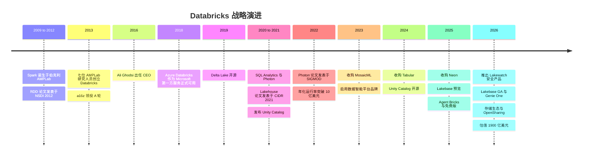
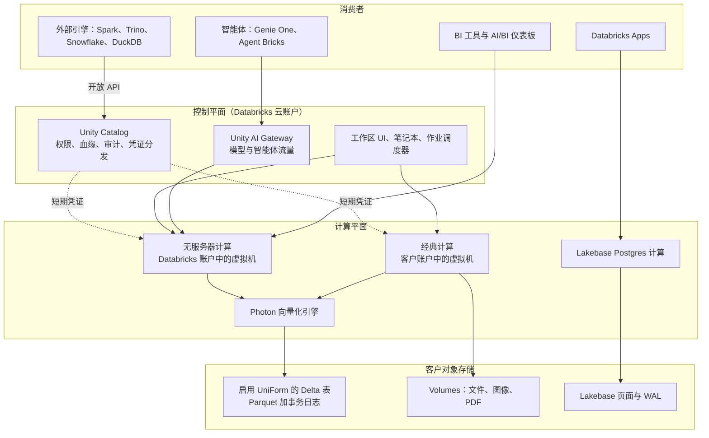
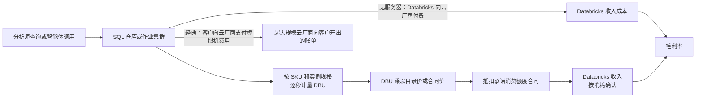

# 25. Databricks
> **状态：** 私营 · **总部：** 加利福尼亚州旧金山 · **成立：** 2013 · **最新估值/市值：** $190B 投后估值（公司披露，融资于 2026-08-13 完成交割） · **最后核实：** 2026-11-01

## 要点速览（TL;DR）

- **它是什么。** Databricks 销售一套托管式数据与 AI 平台，该平台构建于存放在客户自有云对象存储中的开放格式之上。它起步于"托管版 Apache Spark"，如今已是数据仓库、ETL 工具、数据治理目录、ML/智能体平台，并自 2025 年起成为一款运营型 Postgres 数据库（Lakebase）。其[湖仓一体（lakehouse）](../glossary.md#lakehouse)的核心主张是：一份数据、多个引擎、一个治理层。
- **规模。** 公司称，在其财年第二季度（2026 年 5–7 月）**收入年化运行率突破 $7B，同比增长 >80%**。公司还提到数据仓库业务超过 $1.5B、AI 产品超过 $1.4B（截至 2026 年 1 月）、Lakebase 超过 $100M，净收入留存率（NRR）超过 140%。以上全部为**公司披露的、未经审计的年化运行率**。Databricks 为私营公司，不公布 GAAP 财务报表。[^db-7b][^db-54]
- **估值。** 一轮 $5B 的融资于 2026-08-13 完成交割，**投后估值 $190B（1900 亿美元）**，约为其披露年化运行率的 **27x**。Snowflake 的交易倍数为 **16.9x EV/未来 12 个月收入**（2026-10-30）。两个倍数**不可直接比较**：Databricks 的倍数是私募投后*股权*价值除以未经审计、由公司自行定义的*年化运行率*；而 Snowflake 的倍数是公开市场*企业价值*除以由业绩指引推导的 GAAP 收入（见下文估值桥接）。Databricks 在 20 个月内从 $62B 升至 $190B。[^db-7b][^comps-sf]
- **控制点是 Unity Catalog，而非文件格式。** Databricks 于 2024 年收购 Tabular（Iceberg 创始人创办的公司，媒体报道约 $2B），平息了格式之争。如今它在开放数据之上叠加的数据治理、无服务器计算和 AI 智能体层面展开竞争。这也意味着它与每一家转售其产品的超大规模云厂商形成竞争。[^tabular]
- **Everpure 视角。** Databricks 基本只在云端运行，但在 2026 年 6 月，它推出了基于 [OpenSharing](../glossary.md#opensharing) 协议的 **Storage Ecosystem（存储生态）**，从而可以治理和查询本地部署的对象数据。**Everpure 被列为首发合作伙伴**，其面向 FlashBlade/FlashArray 对象存储的 OpenSharing 连接器处于私有预览阶段。这是迄今为止两家公司之间最具体的公开连接点。[^storage-eco][^everpure-os]

## 概览表

| 项目 | 数值 | 依据 / 日期 |
|---|---|---|
| 创始人 | Ali Ghodsi、Andy Konwinski、Ion Stoica、Matei Zaharia、Patrick Wendell、Reynold Xin、Arsalan Tavakoli-Shiraji（七位联合创始人均来自 UC Berkeley 的 AMPLab） | 公开记录[^wiki] |
| CEO | Ali Ghodsi（自 2016 年起任 CEO；此前任工程副总裁） | 公开记录[^wiki]；截至 2026-11-01 未发现变动 |
| 总部 / 成立 | 加利福尼亚州旧金山 / 2013 | 公开记录[^wiki] |
| 财年 | 截至 1 月 31 日（Q4 = 11 月–次年 1 月；Q2 = 5–7 月） | 公司披露[^db-j] |
| 收入年化运行率 | **>$7B**，同比 >80%（财年 Q2，2026 年 5–7 月） | 公司披露的年化运行率，未经审计[^db-7b] |
| 最近披露的全年收入 | 约 $2.6B（截至 2025 年 1 月的财年） | 公司披露，经 CNBC 媒体报道[^cnbc-25] |
| 分业务年化运行率 | 数据仓库 >$1.5B（2026 年 7 月）；AI 产品 >$1.4B（2026 年 1 月）；Lakebase >$100M（2026 年 7 月） | 公司披露的年化运行率[^db-7b][^db-54][^constellation] |
| 净收入留存率 | >140%（2025–26 年每次更新均如此表述） | 公司披露的 KPI，未披露定义[^db-54] |
| 大客户 | >800 家年化运行率 >$1M；>70 家 >$10M（2026 年 1 月） | 公司披露[^db-54] |
| 客户 | >20,000 家组织；>60% 的财富 500 强 | 公司披露（官网）[^cust] |
| 盈利能力 | 按过去 12 个月口径调整后 FCF 为正（自截至 2025 年 1 月的 Q4 起；2026 年 8 月再次确认） | 公司披露，非 GAAP（"调整后"），未给出金额[^db-j][^db-54][^db-7b] |
| 毛利率 | 非 GAAP 订阅毛利率 >80%（2024 年 10 月所在季度） | 公司披露，非 GAAP[^db-j] |
| 员工 | 约 10,000–12,000 人 | 基于 LinkedIn/Wikipedia 的估算；非公司披露 [VERIFY: 公司披露的员工人数][^wiki] |
| 已融股权资金 | 从 A 轮到 2026 年 8 月一轮累计约 $25B，另有约 $5.25B 债务（2025 年 1 月）和约 $2B 债务额度（2026 年 2 月） | 本书对 `data/private_funding.csv` 各行的加总；其中很大一部分用于员工流动性 |
| 最新估值 | $190B 投后估值（2026 年 8 月 13 日；Coatue 领投） | 公司披露[^db-7b] |
| 知名投资者 | a16z、NEA、Thrive、Insight、Coatue、T. Rowe Price、Franklin Templeton、GIC、MGX、Blackstone；战略投资者 Microsoft、AWS、CapitalG、Salesforce Ventures、NVIDIA、Meta | `data/private_funding.csv`（参与方名单部分待 [VERIFY]）[^funding] |

*图 25.1 — Databricks 的每一个关键指标都是公司披露的下限（"超过 $X"），且基于未披露的年化运行率定义。应将其视为方向上可靠、但未经审计的数据。*

## 起源与战略演进

**伯克利时期。** Apache [Spark](../glossary.md#apache-spark) 约于 2009 年起源于 Matei Zaharia 在 UC Berkeley AMPLab 的博士项目。它是 Hadoop MapReduce 的一个更快的内存计算后继者。其核心思想是弹性分布式数据集（RDD）：把中间结果保存在集群内存中，并记录数据转换的血缘，这样丢失的分区可以重新计算，而无需复制。2012 年关于 RDD 的 NSDI 论文获得最佳论文奖。[^nsdi] 七位 AMPLab 研究人员——包括 Zaharia 的导师 Ion Stoica 和研究员 Ali Ghodsi——于 2013 年创立 Databricks，将 Spark 商业化。Andreessen Horowitz 领投了约 $14M 的 A 轮。[^wiki][^funding] Stoica 担任首任 CEO。Ghodsi 于 2016 年接任，至今仍执掌公司。

**第一幕：Spark 即服务（2013–2018）。** 首款产品是 AWS 上面向 Spark 的托管笔记本和集群管理器。这是一门"便利性"生意：开源 Spark 免费，Databricks 收费的是把它运行好。其战略洞见在于**绝不像 Cloudera 和 Hortonworks 销售 Hadoop 那样销售发行版**。Databricks 只以云服务形式运行，这使用量可计量、可计费。2017–18 年的交易使 Azure Databricks 成为由 Microsoft 销售和计费的第一方 Microsoft 服务，为公司带来了凭一己之力无法建立的企业渠道。[^wiki]

**第二幕：Delta Lake 与湖仓论点（2019–2021）。** S3 上的数据湖（data lake）便宜但不可靠。它没有事务（transaction），因此失败的作业会留下写了一半的文件，也没有模式约束。[Delta Lake](../glossary.md#delta-lake) 通过在 Parquet 文件旁边增加一个由 JSON 提交组成的事务日志解决了这一问题，从而在对象存储（object storage）上实现了 ACID 事务。Databricks 在 VLDB 2020 论文中描述了它，并于 2019 年将其开源。[^delta-vldb] 随后，Armbrust、Ghodsi、Xin 和 Zaharia 在 CIDR 2021 发表的论文《Lakehouse》提出，数据仓库（data warehouse）将被"开放格式数据湖 + 元数据层、缓存和快速引擎"所取代。论文展示了一个基于 Parquet 的原型，在 TPC-DS 上可与云数据仓库相竞争。[^cidr] 这篇论文是此后一切的思想纲领，也是与 Snowflake 长期竞争的根源（见[第 27 章](ch27-databricks-vs-snowflake.md)）。

**第三幕：成为数据仓库（2020–2023）。** 一个论点需要一个引擎。Databricks SQL（2020 年以"SQL Analytics"之名推出）为 BI 用户提供了 SQL 端点。**Photon** 是一个向量化的 C++ 执行引擎，让它变得快速。SIGMOD 2022 的 Photon 论文报告称，相比此前基于 Spark 的运行时，平均提速约 3x、最大提速 >10x，并获得了该会议的最佳工业论文奖。[^photon][^sigmod-award] Databricks SQL 于 2023 年 4 月突破 $100M ARR（媒体报道）。[^bbg-2023] 到截至 2026 年 7 月的季度，公司称数据仓库已是年化运行率超过 $1.5B 的业务。[^constellation]

**第四幕：掌控数据治理（2021–2024）。** [Unity Catalog](../glossary.md#unity-catalog) 于 2021 年发布。它在各工作区之间集中管理权限、数据血缘和审计，后来又扩展到治理文件、ML 模型和函数。2024 年 6 月，Databricks 将其开源（现归属 Linux Foundation），并收购了由 Apache Iceberg 创始人创办的 Tabular。[^uc-oss][^tabular] 这两步合在一起表明，格式选择（Delta vs. [Iceberg](../glossary.md#apache-iceberg)）将不再锁定客户，竞争因此上移到目录层（见[第 7 章](../01-data-systems-foundations/ch07-open-table-formats.md)和[第 8 章](../01-data-systems-foundations/ch08-catalogs-and-metastores.md)）。

**第五幕：数据智能与智能体（2023–2026）。** 以 $1.3B 收购 MosaicML（2023）带来了模型训练的专业能力，并演变为 Mosaic AI。[^mosaic] 2023 年 12 月，平台更名为 **Data Intelligence Platform（数据智能平台）**，意指能够理解组织自身数据与语义的 AI。[^dip] Data + AI Summit（DAIS）2025 新增了 **Lakebase**（来自约 $1B Neon 交易的无服务器 Postgres）、**Agent Bricks**（构建并评估智能体）、**Databricks One**（面向业务用户的前端）、**Lakeflow Designer**（无代码 ETL）以及 Free Edition（免费版）。[^dais25][^neon] DAIS 2026（旧金山，6 月 15–18 日）以智能体为核心。会上宣布 Lakebase 正式可用（GA），并推出了从 AI/BI Genie 演化而来的"智能体式同事" **Genie One**。此外还新增了用于治理模型与智能体流量的 **Unity AI Gateway**、品牌名为 **Lakehouse//RT** 的实时引擎、已宣布但尚未交付的 **LTAP**（运营数据与分析数据共用一份副本），以及 **OpenSharing**——Delta Sharing 在 Linux Foundation 下的后继协议，扩展到模型、智能体技能和非结构化数据。[^dais26][^uc-dais26][^opensharing]

*图 25.2 — 每一幕都扩大了可在同一份开放格式数据上运行的工作负载范围：先是 Spark 作业，然后是 SQL，再到数据治理、模型，最后是运营型数据库和智能体。*

## 产品与技术

### 一张图看懂架构

Databricks 将其系统划分为**[控制平面（control plane）](../glossary.md#control-plane)**和**[计算平面（compute plane）](../glossary.md#compute-plane)**。控制平面运行在 Databricks 自己的云账户中，承载 Web UI、笔记本、作业调度器、集群管理器、查询优化器（query optimizer）服务以及 Unity Catalog 元数据服务。计算平面是实际处理数据的地方，分为两种形态。[^arch-docs]

- **经典计算（Classic compute）**在**客户的**云账户（其 VPC 或 VNet）中运行虚拟机。客户直接向 AWS、Azure 或 Google 支付这些虚拟机费用，并另行向 Databricks 支付软件费。数据永远不会离开客户的网络边界，这正是银行青睐它的原因。
- **[无服务器计算（serverless compute）](../glossary.md#serverless-compute)**运行在 **Databricks** 云账户内、位于同一区域的计算平面中，通过安全网络连接到客户的存储。Databricks 维护预热的机器池，因此启动只需数秒而非数分钟。它按一个全包价格计费。

在两者之下，数据以 Parquet 文件加 Delta 事务日志的形式存放在客户的**对象存储**中（S3、ADLS、GCS，以及作为官方文档支持的[外部位置（external location）](../glossary.md#external-location)的 Cloudflare R2）。[^extloc] **UniForm** 在 Delta 日志旁同时写入与 Iceberg 兼容的元数据，因此 Iceberg 引擎无需复制即可读取同一批文件。Unity Catalog 居于中间。每个访问表的引擎——无论是 Databricks 自己的引擎，还是通过 Unity Catalog 开放 API 读取的外部引擎——都要向它申请权限，并获得仅限于其可读文件范围的短期凭证。

*图 25.3 — 湖仓架构：Databricks 托管"大脑"（控制平面、Unity Catalog），计算要么运行在客户账户中（经典），要么运行在 Databricks 账户中（无服务器），而数据本身始终以开放文件的形式留在客户的对象存储中。*

> **类比：统一内存。** 传统的两层架构（数据湖加一个独立的数据仓库）就像 CPU 和拥有独立显存的独立 GPU。每个作业都要跨越边界付出一次类似 PCIe 的拷贝代价，而且两份副本会逐渐失去同步。湖仓是统一内存设计，类似 Apple M 系列或 NVIDIA Grace Hopper。对象存储中只有一份物理副本，多个处理器（SQL、Spark、ML、智能体）对其寻址，一致性由表格式的事务日志而非拷贝来保证。代价也与统一内存相同：你用任一单一工作负载上的峰值性能（经过调优的专有数据仓库格式）换取更少的数据移动和单一事实来源。

### 各组件如何工作（L2）

**Delta Lake 与 UniForm。** 一张 Delta 表是一个由 Parquet 数据文件组成的文件夹，外加一个 `_delta_log` 文件夹，其中存放按编号排列的 JSON 提交文件和定期检查点。写入方通过原子地创建下一条日志条目来提交。读取方从日志重建表状态，由此获得快照隔离和对旧版本的"时间旅行（历史版本查询）"。UniForm 从同样的提交生成 Iceberg 元数据，因此一张物理表可同时服务两个生态。[^delta-vldb] [第 7 章](../01-data-systems-foundations/ch07-open-table-formats.md)深入讲解了元数据树。

**Photon。** Spark 最初的引擎运行在 Java 虚拟机上，通过生成的代码逐行处理数据。Photon 是一个 C++ 引擎，以**列式批次**处理数据，采用 CPU 可以向量化（SIMD）的紧凑循环。它接入 Spark 优化器之下，因此不受支持的算子会回退到旧路径。[^photon] [第 5 章](../01-data-systems-foundations/ch05-analytical-engines.md)概述了[向量化执行（vectorized execution）](../glossary.md#vectorized-execution)。在 Photon 为可选项的场景下，它的 DBU 费率更高，这使性能也成为一个定价杠杆。

**Unity Catalog。** 它采用三级命名空间（`catalog.schema.table`），治理表、视图、卷（文件）、ML 模型和函数。它会根据在 Databricks 上运行的查询自动记录列级数据血缘，并向引擎分发临时云凭证。开源版本支持 Iceberg REST 目录协议，因此非 Databricks 引擎也可以使用它。在 DAIS 2026 上，Databricks 新增了 Domains 和 Unity AI Gateway，后者将同一权限模型扩展到 LLM 调用和智能体工具使用。[^uc-dais26] 从战略上看，这是最重要的产品。谁掌握了权限、血缘和语义，谁就掌握了客户。

**Lakebase。** Neon 的设计将 Postgres 拆分为无状态计算节点和一个存储服务。预写日志（WAL）记录发送到由"safekeeper"组成的法定多数（quorum），"pageserver"则将页面物化并分层存入对象存储。这使数据库的创建成本很低，可缩容至零，并支持分支（写时复制），非常适合会临时创建一次性数据库的 AI 智能体。[^neon] Databricks 押注的是：写入 Lakebase 的运营数据可以无需单独的变更数据捕获（CDC）数据管道就出现在湖仓中，而 2026 年宣布的 LTAP 正是这一押注的终极形态。[^dais26]

> **深入（L3）。** 在 Lakebase 写入时，Postgres 计算节点将 WAL 流式发送到 safekeeper（一个 Paxos 风格的法定多数），在法定多数持久化后确认提交；pageserver 随后将 WAL 重放为页面镜像，并作为不可变的层文件上传到对象存储。由于历史以层的形式保留，一个"分支"只是指向某个 LSN（日志序列号）的新时间线指针，无需复制任何数据。Mooncake Labs（2025 年收购）增加了将 Postgres 表以列式方式镜像到 Iceberg/Delta 的能力，这是 LTAP 所依托的桥梁。[^mooncake]

**其余产品面。** **Lakeflow** 涵盖数据摄取（Lakeflow Connect，包括通过收购 Arcion 获得的 CDC 技术）、**Lakeflow Spark Declarative Pipelines**（前身为 Delta Live Tables，后为 Lakeflow Declarative Pipelines；2025 年 11 月更名）和编排（Jobs）。**Mosaic AI** 和 **Agent Bricks** 覆盖模型服务、微调、向量检索、评估和智能体构建。**Genie** 将自然语言问题转化为基于 Unity Catalog 元数据、受治理的 SQL。**Databricks Apps** 托管内部数据应用。**Lakewatch**（2026）与 Panther 将湖仓重新包装为安全分析存储，即 SIEM。[^lakewatch][^panther] [第 22 章](../03-ai-data-stack/ch22-agents-and-data.md)解释了为何智能体会提升目录和运营型数据库的价值。

## 盈利模式

### DBU

Databricks 以 **[Databricks Units（DBU）](../glossary.md#dbu)** 计费，这是一种按小时消耗、按秒计费的标准化处理能力单位。每种实例类型每小时消耗固定数量的 DBU，因此更大的虚拟机消耗更多。每个 **SKU**（工作负载类型）的每 DBU 美元单价不同。据第三方整理，2026 年 AWS 美国区的代表性目录价大致为：**Jobs 计算约 $0.15/DBU**、**All-Purpose（交互式）计算约 $0.55**、**Serverless SQL 约 $0.70**。Azure 列出的 Premium Jobs 为每 DBU 小时 $0.30、All-Purpose 为 $0.55，均不含虚拟机费用。[^pricing] 经谈判的企业合同通常是多年期承诺消费额度协议，按实际消耗逐步抵扣，因此目录价是上限。SKU 阶梯鼓励将工作从交互式笔记本（昂贵）迁移到定时作业（便宜），同时也对便利性收取溢价：无服务器，以及面向 BI 并发的 SQL。

### 一次查询如何变成收入

*图 25.4 — 收入追踪的是消耗量，而非席位数。在经典计算下，同一查询产生一笔较薄的 Databricks 费用外加一份独立的云账单；在无服务器下，则产生一笔较大的全包 Databricks 费用，云成本计入 Databricks 的 COGS。*

**算例（示意，按目录价）。** 假设一个夜间 ETL 作业消耗 60 个 DBU。在经典 Jobs 计算上，Databricks 收费约 60 × $0.15 = **$9**，客户另行向 AWS 支付 EC2 时长费用。现在把类似工作放到约 $0.70/DBU 的 Serverless SQL 上运行：60 个 DBU 约需 **$42**，而这一张发票同时涵盖软件以及 Databricks 代客户向 AWS 租用的虚拟机。无服务器 DBU 价格更高，是因为基础设施已包含在内。单个工作负载的收入上升；毛利率百分比下降，因为 Databricks 现在需在 COGS 中承担 EC2 成本。但毛利润金额仍可能上升，因为 Databricks 将众多客户装箱式调度到预热池上，并赚取利用率差。

> **类比：半导体与授权费。** 在经典计算下，DBU 的作用就像 **Arm 授权费**。客户通过购买自己的云虚拟机来"流片"算力，而 Databricks 对其软件编排的每一个 DBU 工作量收取单位费用，毛利率极高。无服务器则让 Databricks 部分转型为**代工厂加 IP 供应商**。它现在购买"晶圆"（云虚拟机）并转售成品算力。单位收入上升，毛利率百分比下降，成败取决于机群利用率，这与代工厂如出一辙。分析师应当问半导体投资者在任何"授权到产品"转型中都会问的问题：产品结构的变化所增加的毛利润金额，是否快于其对毛利率百分比的稀释？

### 毛利率与渠道经济学

唯一由公司披露的利润率数据点是截至 2024 年 10 月的季度**非 GAAP 订阅毛利率超过 80%**。[^db-j] PitchBook 的估值研究（由 Morningstar 转载）将 80% 视为*乐观*的稳态情景，意味着基准情景低于此值。[^ms] Snowflake 一直在自有云账户中运行全部计算，其报告的非 GAAP 产品毛利率约为 75%（Q2 FY2027）。[^sf-q2] 这是判断全面无服务器化的 Databricks 可能落在何处的一个有用参照。另外两个利润率驱动因素：

- **超大规模云厂商云市场与第一方转售。** Azure Databricks 由 Microsoft 销售和计费。在 AWS 和 Google Cloud 上，Databricks 大量通过云市场成交，因此采购可抵扣客户的云承诺消费。这种联合销售模式能加快成交，但要付出收入分成，并使每家超大规模云厂商同时成为渠道伙伴和竞争对手（见[第 40 章](../05-business-and-economics/ch40-gtm-partnerships.md)）。
- **免费迁移工具即获客成本。** 收购 BladeBridge（2025）后，Databricks 将其数据仓库迁移工具（Lakebridge）对迁移到 Databricks SQL 的场景免费开放。[^bladebridge] 这是为争夺 Teradata、Redshift 和 Snowflake 工作负载而进行的补贴。

[第 35 章](../05-business-and-economics/ch35-business-models.md)更广泛地比较了按用量计费与订阅模式。
