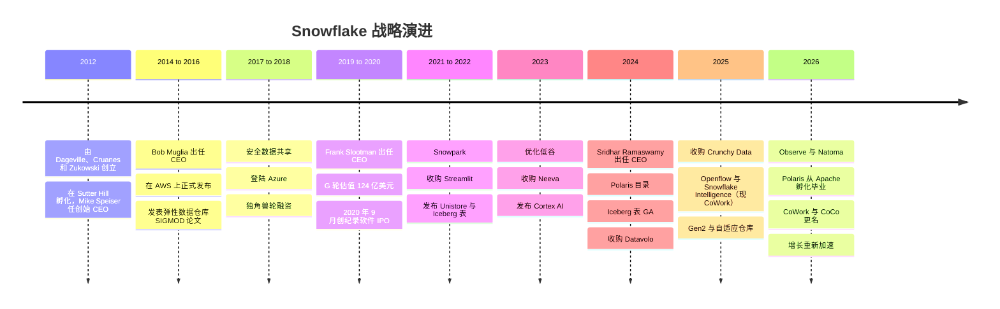
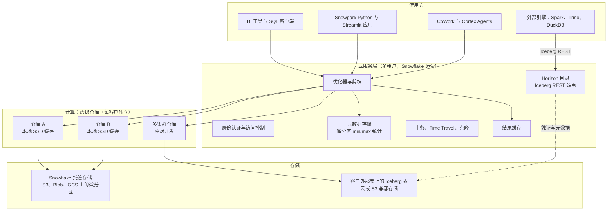
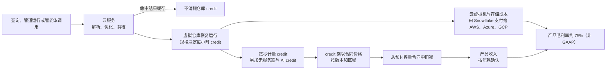
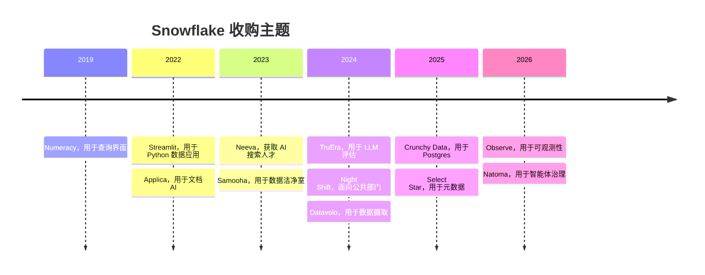

# 26. Snowflake
> **状态：** 上市公司（NYSE: SNOW） · **总部：** 无正式总部；主要执行办公室位于蒙大拿州 Bozeman（据 SEC 文件）；主要工程中心位于旧金山湾区 · **成立：** 2012 · **最新估值/市值：** 市值约 $107.9B，企业价值约 $106.3B，**16.9x EV/未来 12 个月收入**（2026-10-30 收盘；未来 12 个月收入取自 FY2027 指引） · **最后核实：** 2026-11-01

## 要点速览（TL;DR）

- **公司是什么。** Snowflake 销售全托管的云数据平台。它起步于一款基于公有云对象存储（object storage）、实现存算分离（separation of storage and compute）的 SQL 数据仓库（data warehouse）。如今它自我定位为"AI Data Cloud"：数据仓库、数据共享与云市场、Python 与应用运行时、Iceberg 湖仓一体（lakehouse）、Postgres、数据摄取（ingestion）、可观测性（observability）以及 AI 智能体（agent），全部通过同一个按用量计费的计量单位——**credit（积分）**——结算。
- **规模与增长势头。** **Q2 FY2027**（2026 年 5–7 月）产品收入约 **$1.49B**，**同比增长 37%**。这是连续第三个季度加速，FY2026 全年增速为 29%（GAAP）。净收入留存率（NRR）为 **126%**，年消费超过 $1M 的客户有 **828 家**（公司披露）。FY2027 产品收入指引已两次上调，至 **$6.07B（+36%）**。[^sf-q2][^sf-q1]
- **盈利能力之争的焦点是股权激励。** Q2 FY2027 非 GAAP 营业利润率为 **15.3%**，但 GAAP 营业利润率为 **−17.0%**。股权激励费用（SBC）**在 FY2026 占收入的 34%**，超过当年约 $1.19B 的调整后自由现金流。[^sf-q2][^sf-10k26]
- **战略转向：从"拥有存储"到"拥有计算与数据治理"。** Snowflake 最初的护城河是其专有托管存储。如今，Iceberg 表、其捐赠给 Apache 的 Polaris 目录（catalog），以及 Horizon 的 Iceberg REST 端点，使客户可以把数据保存在开放格式中。Snowflake 押注：赢得更多工作负载（尤其是 AI）所带来的收益，足以抵消其放弃的存储收入和锁定效应。[^polaris-tlp][^horizon-irc]
- **Everpure 视角。** Snowflake 的计算只运行在公有云中，但它可以通过外部 stage 和 Iceberg 外部卷（external volume），读写 AWS、Azure、GCP 之外的 **S3 兼容存储**上的数据。这使本地部署的对象存储成为一个受支持、尽管相对小众的数据源。更具战略意义的交集在于元数据：Everpure 的 Data Intelligence（1touch）将 Snowflake 列为连接器目标，而 Snowflake 的 Horizon 目录希望成为分类标签的归属地。[^sf-s3compat][^1touch]

## 概览表

| 项目 | 数值 | 口径 / 日期 |
|---|---|---|
| 创始人 | Benoît Dageville、Thierry Cruanes（均曾任职于 Oracle）、Marcin Żukowski（MonetDB/X100 论文合著者，Vectorwise 联合创始人） | 公开记录[^snowflake16][^x100] |
| CEO | Sridhar Ramaswamy（自 2024 年 2 月起；此前在 Neeva 交易后领导 Snowflake AI；更早时执掌 Google 广告业务） | 公司披露[^sf-ceo] |
| 历任 CEO | Mike Speiser（创始 CEO，Sutter Hill，2012–2014）；Bob Muglia（2014–2019）；Frank Slootman（2019–2024） | 公开记录[^sf-ceo] [VERIFY: 确切交接日期] |
| CFO | Brian Robins 于 2025 年接替长期担任 CFO 的 Mike Scarpelli | [VERIFY: 任命日期及 Scarpelli 的顾问角色，需对照 8-K] |
| 财年 | 截至 1 月 31 日。FY2027 = 2026 年 2 月–2027 年 1 月；Q2 FY2027 = 2026 年 5–7 月 | 公司文件[^sf-10k26] |
| 最近一季 | 产品收入约 $1.49B（+37%）；总收入 $1,546.8M（+35%） | GAAP，Q2 FY2027[^sf-q2] |
| 最近完整财年 | 产品收入 $4,472.3M（+29%）；总收入 $4,683.9M | GAAP，FY2026[^sf-q4] |
| 指引 | FY2027 产品收入 $6.07B（+36%）；Q3 FY2027 $1,588–1,593M（+37–38%） | 公司指引，2026-09-02[^sf-q2] |
| 净收入留存率 | 126%（过去 12 个月） | 公司披露 KPI，Q2 FY2027[^sf-q2] |
| 过去 12 个月产品收入 >$1M 的客户 | 828（同比 +27%） | 公司披露 KPI，Q2 FY2027[^sf-q2] |
| RPO | 约 $9.0B（低于 FY2026 年末的 $9.77B） | GAAP，Q2 FY2027[^sf-q2][^sf-q4] |
| 产品毛利率 | 非 GAAP 74.7%；GAAP 70.9%；FY2027 非 GAAP 指引 74% | Q2 FY2027[^sf-q2] |
| 营业利润率 | 非 GAAP 15.3%；GAAP −17.0% | Q2 FY2027[^sf-q2] |
| 自由现金流 | FY2026 调整后 FCF 利润率 25.5%（约 $1.19B）；FY2027 指引 23% | 非 GAAP[^sf-q4][^comps-sf] |
| 股权激励费用 | FY2026 为 $1,599.5M（占收入 34%） | GAAP，10-K[^sf-10k26] |
| 员工 | 截至 2025 年 1 月 31 日约 7,800 名全职员工 | 10-K FY2025 [VERIFY: FY2026 10-K 员工人数] |
| IPO 前融资 | A–G 轮合计约 $1.4B；最后一次私募估值 $12.4B（2020 年 2 月） | `data/private_funding.csv`[^funding] |
| 主要投资者 | Sutter Hill（创始孵化）、Redpoint、Altimeter、ICONIQ、Madrona、Dragoneer、Salesforce Ventures；Berkshire Hathaway 与 Salesforce 在 IPO 同时认购股份 | `data/private_funding.csv`；IPO 招股书[^funding][^sf-ipo] |
| 市值 | 市值约 $107.9B；EV 约 $106.3B；EV/未来 12 个月收入 16.9x | 2026-10-30 收盘，stockanalysis.com，经 `data/public_comps.csv`[^comps-sf] |

*图 26.1 — 概览。与 Databricks 不同，Snowflake 几乎所有数字都是经审计的 GAAP 数据或有明确定义的 KPI。悬而未决的问题在于方向（开放格式、AI 毛利率、股权激励），而非数字本身的含义。*

## 起源与战略演进

**创业洞见（2012）。** 2012 年，两位 Oracle 数据库架构师 Benoît Dageville 和 Thierry Cruanes 与 Marcin Żukowski 联手。Żukowski 合著了提出向量化执行（vectorized execution）的 MonetDB/X100 论文，并联合创办了 Vectorwise。[^x100] 他们的判断是：为云而生的数据仓库，应当与 Teradata 或 Oracle Exadata 截然不同。那些系统把数据绑定在每个节点内部的磁盘上，即所谓"无共享"（shared-nothing）架构。Snowflake 则把每张表的持久副本放在云对象存储中（最先是 Amazon S3），并按需启动计算集群来查询。公司由 **Sutter Hill Ventures** 孵化，其合伙人 **Mike Speiser** 出任创始 CEO。几年前，Sutter Hill 曾以同样的"孵化并委派 CEO"模式孵化了 Pure Storage（即现在的 Everpure）[VERIFY: Speiser 在 Pure Storage 的创始角色]。[^funding] Sutter Hill 于 2012 年 8 月领投了约 $5M 的 A 轮。[^funding]

**第一幕：打造弹性数据仓库（2012–2018）。** 产品于 2014 年在 **Bob Muglia**（前微软服务器与工具业务负责人）带领下结束隐身状态，并于 2015 年在 AWS 上正式发布（GA）。[^snowflake16] SIGMOD 2016 论文《The Snowflake Elastic Data Warehouse》阐述了下一节所述的设计，论证云的核心价值在于弹性，而非单纯的速度。[^snowflake16] 两项功能定义了早期的业务基本盘。**安全数据共享**（2017）让一个 Snowflake 账户可以实时查询另一个账户的表，而无需复制文件。[^sf-sharing-2017] 登陆 **Microsoft Azure**（2018）以及后来的 **Google Cloud**，使 Snowflake 成为多云数据仓库——这是任何一家超大规模云厂商都无法令人信服地占据的位置。融资随业务增长而来：2018 年 1 月以 $1.5B 估值融资 $263M，九个月后以约 $3.95B 估值融资 $450M。[^funding]

**第二幕：Slootman 的规模化与创纪录的 IPO（2019–2021）。** 2019 年，董事会以 **Frank Slootman** 替换了 Muglia。Slootman 曾执掌 Data Domain（重复数据删除存储，后被 EMC 收购）和 ServiceNow。他带来了以销售执行为核心的文化，不久后又从 ServiceNow 引入 CFO Mike Scarpelli。[^sf-ceo] 2020 年 2 月 $479M 的 G 轮使公司估值达到 $12.4B。[^funding] Snowflake 于 **2020 年 9 月**在 NYSE 上市，发行价 **每股 $120**，高于已上调的定价区间，募资约 **$3.4B**，成为有记录以来规模最大的软件 IPO。Berkshire Hathaway 和 Salesforce 各通过同步私募认购了 $250M 股票。首日开盘价接近 $245。[^sf-ipo] FY2021 和 FY2022 的产品收入均实现翻倍以上增长（GAAP），净收入留存率在 FY2022 达到 **178%** 的峰值。[^sf-10k-hist]

**第三幕：成为平台（2020–2023）。** 只能运行 SQL 的数据仓库，其在数据预算中的份额是有上限的。因此，Snowflake 推出了 **Snowpark**（2020 年；后来支持 Python），让数据工程师可以在 Snowflake 内运行 DataFrame 代码；随后收购 **Streamlit**（$800M，2022 年 3 月）用于 Python 数据应用；接着推出 **Native App Framework**，让第三方可以销售在客户账户内运行的应用。**Unistore / Hybrid Tables**（2022 年发布）增加了用于轻量事务处理的行存储。[^streamlit] 2022–2023 年的"优化"低谷考验了这一模式。客户在利率冲击期间削减用量，年度产品收入增速从 106%（FY2022）降至 38%（FY2024），NRR 从 178% 降至 131%。[^sf-10k-hist]

**第四幕：AI Data Cloud 与开放格式（2023–2026）。** 2023 年 5 月，Snowflake 以 $185.4M 现金收购 AI 搜索初创公司 **Neeva**。2024 年 2 月，Neeva 创始人 **Sridhar Ramaswamy** 接替 Slootman 出任 CEO。[^neeva][^sf-ceo] 这次 CEO 更替表明 AI 将成为下一个增长引擎。在 Ramaswamy 领导下，Snowflake 推出了 **Cortex AI**（平台内的 LLM 函数、搜索与智能体），使 **Iceberg 表**正式可用，并发布了 **Polaris** 目录（2024 年 6 月）。随后它通过收购进入相邻工作负载：**Datavolo**（数据摄取，2024）、**Crunchy Data**（Postgres，2025）、**Select Star**（元数据，2025）、**Observe**（可观测性，2026）和 **Natoma**（智能体治理，2026）。[^sf-polaris][^datavolo][^crunchy][^sf-observe][^natoma] 在 2026-06-02 的 Summit 上，Snowflake 将其智能体产品 **Snowflake Intelligence** 更名为 **Snowflake CoWork**，将编码智能体 **Cortex Code** 更名为 **CoCo**。[^sf-cowork] 增长已连续三个季度重新加速，Q2 FY2027 达到 37%。[^sf-q2]

*图 26.2 — 每一幕都扩大了计量范围。Snowflake 从 SQL 分析扩展到共享、Python 与应用，再到 AI、Postgres、数据摄取和可观测性，全部以同样的 credit 计费。*

*图 26.3 — 在 2020 年 9 月 IPO 前的最后两轮融资中，私募估值每轮大约翻了三倍。IPO 定价超过 G 轮估值的两倍，而首笔成交价约为 IPO 价格的两倍。来源：`data/private_funding.csv`。*

> **类比：估值。** 这次 IPO 是关于入场价格的一课。以 $120 发行价买入并持有至 $306（2026-10-30）的投资者获得约 2.6 倍回报，年化约 17%（作者计算）。以首日约 $245 开盘价买入的投资者，六年获得约 1.25 倍回报，年化约 4%。FY2021 至 FY2026 间，公司产品收入增长约 8 倍。股价却横盘，因为 IPO 当日的估值倍数已经提前透支了大部分增长。[^sf-ipo][^comps-sf][^sf-10k-hist]

## 产品与技术

### 一张图看懂架构（SV-5）

SIGMOD 2016 论文描述了三层架构，这一设计十年后依然成立。[^snowflake16]

1. **存储。** 所有表数据都以 Snowflake 专有的列式格式保存在云厂商的对象存储（S3、Azure Blob、Google Cloud Storage）中。表被切分为不可变的 **[微分区（micro-partition）](../glossary.md#micro-partition)**，每个包含 50–500 MB 未压缩数据，按列存储并压缩。对每个微分区，Snowflake 记录各列的最小值和最大值、不同值的数量以及其他统计信息。[^sf-mp]
2. **计算。** **[虚拟仓库（virtual warehouse）](../glossary.md#virtual-warehouse)** 是 Snowflake 为单个客户配置的一组云虚拟机集群。它按"T 恤尺码"分级，每升一级节点数和每小时消耗的 credit 都翻倍。仓库对持久数据而言是无状态的：它们在本地 SSD 上缓存表文件，空闲时可在数秒内挂起，并可设为"多集群"（随并发上升增加相同集群）。每个团队可以在同一份数据上拥有自己的仓库，因此财务团队的月末结账不再拖慢数据科学团队。
3. **云服务。** 一个由 Snowflake 在每个区域运行一份的共享多租户层。它负责身份认证与访问控制（access control）、查询优化器（query optimizer）、事务管理，最重要的是**元数据**。SIGMOD 论文描述该元数据存储构建在事务型键值存储 FoundationDB 之上。由于服务层掌握每个微分区的统计信息，它可以在仓库接触存储之前就规划查询并决定读取哪些文件。[^snowflake16]

*图 26.4 — Snowflake 的存算分离。服务层持有元数据并负责规划，仓库按需执行扫描，数据要么位于 Snowflake 托管的对象存储中，要么（自 2024 年起）位于客户自有卷上的开放 Iceberg 表中。*

### 一条查询如何实际运行（L2）

假设一位分析师查询 2026 年 7 月各区域的销售额。查询到达云服务层，由其进行解析和优化。首先检查**结果缓存（result cache）**：如果最近运行过相同的查询且底层数据未变，Snowflake 直接返回已存储的结果，无需启动仓库。持久化结果保留 24 小时，每次复用都会重置计时。[^sf-cache] 否则，优化器会查阅微分区元数据。日期范围与 2026 年 7 月不重叠的微分区会被**剪枝（pruned）**，即根本不被读取。在聚簇良好的表上，选择性强的过滤条件可以跳过绝大多数文件。剩余的文件列表交给一个仓库。各节点通过一致性哈希分配文件，因此同一节点倾向于看到相同的文件，其**本地 SSD 缓存**保持"热"状态。空闲节点会从慢节点"窃取"文件以平衡负载。[^snowflake16] 引擎本身是列式、向量化的，承袭 Żukowski 的 X100 一脉，详见[第 5 章](../01-data-systems-foundations/ch05-analytical-engines.md)。

> **类比：半导体（缓存标签与区域映射）。** 微分区剪枝相当于把 CPU 缓存的**标签比对（tag check）**应用到数据湖上。处理器在从 DRAM 取缓存行之前，总会先把地址与一个小而快的标签阵列比对。Snowflake 在从 S3 取微分区之前，也总会先把查询谓词与服务层中的 min/max 元数据比对。存储层次可以清晰对应：元数据存储是标签阵列，仓库的本地 SSD 是 L2/L3 缓存，S3 则是以 NAND 为后盾的 DRAM——便宜、海量但延迟高。与芯片设计一样，性能主要来自命中率和"不去取"，而不是更快的后端存储。这一通用技术称为**[区域映射（zone map）](../glossary.md#zone-map)**，详见[第 5 章](../01-data-systems-foundations/ch05-analytical-engines.md)。

### 不可变性衍生出的功能

由于微分区从不原地修改，一个表版本就只是元数据存储中的一组微分区指针。三项标志性功能几乎由此"免费"获得。

- **[时间旅行（Time Travel）](../glossary.md#time-travel)。** 旧的微分区会在保留期内保存：默认一天，Enterprise 版及以上最长 90 天。用户可以按某个较早的时间戳"as of"查询表，或恢复已删除的表。此外还有七天的 **Fail-safe** 期，可在 Time Travel 到期后由 Snowflake 支持团队协助恢复数据。[^sf-tt]
- **[零拷贝克隆（zero-copy cloning）](../glossary.md#zero-copy-cloning)。** `CREATE TABLE dev CLONE prod` 只复制指针列表。克隆体与原表共享微分区，直到任一方写入时才创建新的微分区（写时复制）。一个 100 TB 的生产数据库可以在数秒内克隆用于测试，在克隆体发生分化之前不产生额外存储成本。[^sf-tt]
- **[安全数据共享（secure data sharing）](../glossary.md#zero-copy-data-sharing)。** 提供方授予另一账户对特定对象的读取权限。使用方用自己的仓库查询并自付计算费用，在同一区域内不复制任何文件。跨区域和跨云共享需要复制，Snowflake 对 Marketplace 上架数据会自动完成复制。[^sf-sharing] 这一功能演化为 **Snowflake Marketplace**（数据提供方在此出售天气、金融和消费者等实时数据集），以及**数据洁净室（data clean room）**（来自对 Samooha 的收购）。[^samooha]

> **存储桥接。** Snowflake 的托管存储本身就是构建在对象存储之上的日志结构、写时复制设计，与存储工程师熟悉的阵列快照和克隆机制非常接近。区别在于，"阵列控制器"是一个多租户元数据服务，而"介质"是 S3。关于阵列快照与对象存储在持久性和性能上的差异，参见配套的 *Everpure Tech Atlas*。

### 从数据仓库到"AI Data Cloud"：新增了什么，为什么

| 层级 | 产品（截至 2026 年 11 月状态） | 功能 | 战略目的 |
|---|---|---|---|
| 可编程性 | **Snowpark**（Python、Java、Scala）；**Streamlit in Snowflake**；**Native App Framework** | 在 Snowflake 的治理边界内运行 DataFrame 代码、机器学习和应用 | 争夺过去运行在 Spark 上的数据工程和应用工作负载 |
| 事务型 | **Hybrid Tables**（Unistore）；**Snowflake Postgres**（来自 Crunchy Data；Summit 2026 上 GA），支持 Postgres 到 Snowflake 的镜像 | 面向运营数据的行存储和完整 Postgres | 回应 Databricks Lakebase；拥有智能体构建应用的记录系统[^sf-summit26][^sf-pg-mirror] |
| 开放格式 | **Iceberg 表**（托管或由外部编目；Iceberg v3 于 2026 年 5 月 GA）；带 Iceberg REST 端点的 **Horizon Catalog**；**Apache Polaris**（已捐赠；2026 年成为 Apache 顶级项目） | 让 Snowflake 与其他引擎读写同一批开放表 | 化解湖仓一体阵营的"锁定"质疑[^iceberg-v3][^horizon-irc][^polaris-tlp] |
| 数据摄取 | **Openflow**（来自 Datavolo，基于 Apache NiFi；2025 年 GA，第二代运行时 2026 年 9 月 GA）；Snowpipe Streaming | 批量、流式和非结构化数据摄取，包括自带 VPC 部署 | 不再为每一个流入的字节向 Fivetran 类工具支付"过路费"[^openflow-ga][^datavolo] |
| AI | **Cortex AI** 函数与 **AISQL**（在 SQL 中调用 LLM）；Cortex Search；**Cortex Agents**；**Snowflake CoWork**（原 Snowflake Intelligence）；**CoCo**（原 Cortex Code） | 在受治理的数据旁运行托管 LLM；智能体回答业务问题 | 让 AI 支出经由 credit 流入，而不是绕过 Snowflake[^sf-cowork][^sf-summit25] |
| 语义 | **语义视图（semantic view）**（DDL 对象）；与 Salesforce、dbt Labs 等共同发起的 **Open Semantic Interchange（OSI）** 规范 | 编码可供智能体和 BI 工具复用的指标定义 | 让 Snowflake 成为业务含义的归属地（[第 14 章](../02-pipelines-and-governance/ch14-semantic-layers-and-bi.md)）[^sf-sv][^osi-launch][^osi-v1] |
| 计算 | **Gen2 仓库**（厂商宣称核心分析快约 2.1 倍）；**自适应仓库**（按查询自动定规格，2025 年预览） | 更快的硬件与自动规格调整 | 以牺牲短期收入为代价，提升相对 Databricks SQL 和 BigQuery 的性价比[^sf-summit25] |
| 可观测性 | **Observe**（2026 年 2 月完成交割） | 在 Snowflake 上存储日志、指标和链路追踪 | 遥测数据也只是数据，而且量极大[^sf-observe] |

*图 26.5 — 产品地图。每一项新增都把一个原本在别处运行的工作负载拉到 credit 计量之下。状态依据 Snowflake 文档和 Summit 回顾；来自二手回顾的 GA 说法已在资料来源中注明。*

**开放格式转向解析。** 2022 年之前，交易逻辑很简单：把数据加载进 Snowflake 的存储，Snowflake 让它快速、受治理且可共享。Databricks 的湖仓一体论点（[第 25 章](ch25-databricks.md)）恰恰攻击了这一交易：为什么要把数据放进某一家厂商的格式？Snowflake 的回应分三步。第一，**Iceberg 表**：数据以 Parquet 加 Iceberg 元数据的形式写入客户自有存储桶中的"外部卷"。第二，**Polaris** 目录：2024 年 6 月发布并捐赠给 Apache，2026 年初毕业成为顶级项目（ASF 公告 2026-03-05）。第三，**Horizon** 开放 Iceberg REST 端点，使外部引擎可以读取受 Snowflake 治理的表，计划于 2026 年起按每百万次调用 0.5 credit 收取请求费用。[^sf-polaris][^polaris-tlp][^horizon-irc] [第 7 章](../01-data-systems-foundations/ch07-open-table-formats.md)和[第 8 章](../01-data-systems-foundations/ch08-catalogs-and-metastores.md)讲解了格式与目录。

收入逻辑是一笔交换。Snowflake 的存储一直是低毛利的转手业务（见下文），因此失去它损失的毛利很少。真正利害攸关的是**锁定**。以 Snowflake 格式存储的数据只能由 Snowflake 的计算查询，而以 Iceberg 存储的数据任何引擎都能查询。Snowflake 押注：对开放数据说"是"所赢得的计算量，多于输给那些如今能读取同一批表的引擎的量。早期证据（产品收入重新加速、NRR 稳定在 126%）支持这一押注。但这并非定论，因为 AI 工作负载同时到来，使归因变得模糊。[^sf-q2]

> **深入（L3）。** 对于 Snowflake 托管的 Iceberg 表，Snowflake 充当目录。它将 Parquet 数据文件和 Iceberg 元数据（metadata JSON、manifest list、manifest）写入外部卷，并通过更新自身指针完成提交。外部引擎通过 Horizon Iceberg REST 端点读取，该端点下发限定范围的存储凭证。对于外部管理的表（例如在 Polaris 或 AWS Glue 中编目的表），Snowflake 是读取方，负责刷新其对元数据的视图。双方都要写入时，需要一个唯一的权威目录，这就是为什么真正的设计决策是目录选择而非文件格式（[第 8 章](../01-data-systems-foundations/ch08-catalogs-and-metastores.md)）。[^horizon-irc]

## 盈利模式

### Credit、存储与数据传输

Snowflake 对三类项目计费。[^sf-cost]

1. **计算，以 credit 计。** 仓库按规格每小时消耗 credit：X-Small 1、Small 2、Medium 4、Large 8，逐级翻倍，直到 6X-Large 的 512。按秒计费，每次仓库恢复运行时最低计 60 秒。无服务器功能（Snowpipe 数据摄取、自动聚簇、搜索优化、物化视图维护、Openflow、Cortex AI 函数）也按各功能的特定费率以 credit 计费。Cortex AI 函数按每百万 token 定价并折算为 credit。云服务层在当日仓库 credit 的 10% 以内免费，超出部分计费。
2. **存储，按每 TB 每月计，** 采用接近云厂商自身对象存储价格的统一费率，预购容量可享折扣。Snowflake 在存储上赚得很少。它是把数据留在计算计量表旁边的诱饵。
3. **数据传输，** 按字节计，适用于数据离开某一区域或云的情形（复制、跨区域共享、卸载到另一个云）。

**每 credit 价格**取决于**版本**（Standard、Enterprise、Business Critical、Virtual Private Snowflake）、云和区域。长期以来，前三个版本在美国按需购买的标价约为每 credit $2、$3 和 $4 [VERIFY: 各区域当前标价]。[^sf-cost] 更高版本买到的是功能而非速度：更长的 Time Travel、多集群仓库、列脱敏（masking）与行访问策略、客户自管密钥、私有连接。这使版本阶梯成为一种数据治理与合规的追加销售。

| 仓库规格 | 每小时 credit | 按 $3/credit 的示意每小时成本（Enterprise，标价） | 典型用途 |
|---|---|---|---|
| X-Small | 1 | $3 | 开发、轻量仪表盘 |
| Medium | 4 | $12 | 部门级 BI |
| Large | 8 | $24 | 重度数据转换（ELT）作业 |
| 2X-Large | 32 | $96 | 大型关联、历史回填 |
| 6X-Large | 512 | $1,536 | 罕见；超大批处理 |

*图 26.6 — credit 阶梯（标价示意，作者计算；协议价格更低）。每升一级，节点数和 credit 都翻倍，因此一条并行良好的查询在高一级规格上快一倍完成，成本不变。客户购买的是时间，而不是容量。*

### 一条查询如何变成收入

*图 26.7 — 收入在 credit 被消耗时确认，而不是在合同签署时确认。每一条命中结果缓存或剪枝良好的查询，都是 Snowflake 主动放弃的收入，这就是为什么效率既是卖点也是逆风。*

**合同与收入确认。** 多数大客户签署**容量合同（capacity contract）**：承诺在一到数年内购买一定金额的 credit，通常按年预先开票。其他客户按需使用、事后付费。Snowflake 仅在 credit 被消耗时确认产品收入，而不是在现金到账时。根据部分合同，若客户续约时购买更多，未使用的容量可以**结转（roll over）**至续约合同。[^sf-10k26] 已签署但尚未消耗的承诺计入**[剩余履约义务（RPO）](../glossary.md#remaining-performance-obligations)**。因此，RPO 衡量的是承诺，产品收入衡量的是使用，二者之间的差距揭示了客户行为。

> **类比：金融（预付公用事业与特许权使用费）。** 容量合同的运作方式类似带有"电量储存"的**照付不议（take-or-pay）公用事业费率**。客户以协商费率预付一整块电量，公用事业公司只在电表转动时确认收入，若客户以更大规模续约，未用电量可以结转。对分析师而言，产品收入就像对客户自身分析活动收取的**使用量特许权使用费**。它在下行期（2022–2023）比按席位计费的 SaaS 波动更大，在上行期也更陡峭，因为没有席位数来限制它。应当像公用事业一样建模：存量客户 × 使用强度 × 价格，而不是看新签订单。

### 毛利率与云账单

Snowflake 在其于 AWS、Azure 和 Google 开设的自有账户中运行每个仓库。因此，云基础设施是其最大的收入成本，它与每家云厂商都签订了多年期承诺消费额度（committed spend）协议 [VERIFY: 10-K 附注中当前的云采购承诺]。[^sf-10k26] Q2 FY2027 非 GAAP 产品毛利率（gross margin）为 **74.7%**，低于一年前的 76.4%。GAAP 产品毛利率为 70.9%。管理层将 FY2027 指引定为 **74%**，低于年初水平，理由是工作负载结构向 AI 转移。这些工作负载带有更高的 GPU 和第三方模型成本。[^sf-q2] 毛利率的驱动因素包括：来自云厂商的规模折扣、仓库利用率（空闲时间是客户的成本，但服务层是 Snowflake 的成本）、引擎效率以及 AI 占比。

### 效率逆风

Snowflake 不断推出让客户现有查询更便宜的改进。更快的引擎、更好的剪枝、压缩优化和更新的云实例，都会减少每条查询消耗的 credit。**Gen2 仓库**（2025）是最新的例子，厂商宣称核心分析快约 2.1 倍。[^sf-summit25] 短期内，每一项此类改进都会减少不变工作负载所产生的收入。Snowflake 过去也公开承认过这一点，曾在 FY2023 指引中量化了性能改进带来的预期收入逆风 [VERIFY: 管理层 2022 年 3 月提到的约 $97M FY2023 数字]。在 **2022–2023 年优化周期**中，客户自己走得更远：缩短数据保留期、设置激进的自动挂起、调整仓库规格，并将部分数据转换移到别处。叠加宏观放缓，年度产品收入增速在两年内从 106% 降至 38%。[^sf-10k-hist]

> **类比：摩尔定律与价格弹性。** 几十年来 DRAM 和 NAND 的每比特成本持续下降，但存储器收入却在增长，因为更便宜的比特解锁了新用途：需求是价格弹性的。Snowflake 的效率提升也是同样的押注。如果一条查询的成本减半，客户会不会运行两倍以上的查询、保留更多历史数据、并让 AI 智能体指向这些数据？弹性大于 1 意味着效率会滞后地推动收入增长；小于 1 则会使收入萎缩。2022–2023 年体现了这种滞后。2025–2026 年随着 AI 智能体和新工作负载到来的重新加速，是 Snowflake 在当前价格水平下弹性大于 1 的第一个有力证据。发出大量机器生成查询的智能体，是能想象到的弹性最高的客户。

## 财务数据

除标注为非 GAAP 或公司披露 KPI 者外，所有数字均为 GAAP。Snowflake 将**产品收入**（按用量计费部分，Q2 FY2027 约占总收入的 96%）与**专业服务及其他收入**分开披露。产品收入是投资者建模的那一行。[^sf-q2]

*图 26.8 — FY2020 至 FY2026 产品收入增长约 18 倍（GAAP）。增速从三位数放缓至 FY2025 的约 30%，随后保持在该水平。财年截至 1 月 31 日；FY2026 = 2025 年 2 月–2026 年 1 月。来源：`data/company_financials.csv`。*

**重新加速。** 季度产品收入增速从约 30%（Q4 FY2026，2025 年 11 月–2026 年 1 月）升至 34%（Q1 FY2027）和 **37%**（Q2 FY2027）。Q3 指引为 37–38%。[^sf-q4][^sf-q1][^sf-q2] FY2027 产品收入指引从 $5.66B（2 月）上调至 $5.84B（5 月），再到 **$6.07B**（9 月），+36%。该指引意味着下半年产品收入约 $3.25B，因此在 Q3 中值 $1.59B 之后，Q4 FY2027 约为 $1.66B。这相对 Q4 FY2026 约 $1.23B 的增速约为 35%，即出现放缓——鉴于当前趋势，这一假设显得保守（作者计算）。[^sf-q2][^sf-q4] Snowflake 的指引历来基于当季观察到的用量趋势编制，因此在用量加速时往往会被超越。

*图 26.9 — 净收入留存率在 FY2022 达到 178% 的峰值，在 2022–2023 年优化周期中大幅下滑，过去两年稳定在 125–126%。NRR 是公司披露的过去 12 个月 KPI。来源：`data/company_financials.csv`。*

**把 NRR 当作同期群分析来读。** Snowflake 将 NRR 定义为：一年前即为客户者在过去 12 个月的产品收入，除以这些客户在此前 12 个月的产品收入。它是一个按金额计算的同期群比率，且由于是滚动口径，变化较慢。NRR 稳定在 126% 而增长加速，意味着以下两种情况之一或兼而有之：新客户贡献更多（新客户收入），和/或最近几个季度的扩张尚未完全进入滚动窗口。下图将产品收入增速与 NRR 减 100 进行比较。在 FY2021–FY2022，新客户在扩张之上额外贡献了约 30–50 个百分点。从 FY2024 到 Q4 FY2026，差距缩小至 4–7 个百分点。Q2 FY2027 差距再次扩大到约 11 个百分点，这是新工作负载和新客户正在推动加速的最清晰信号（作者计算）。[^sf-q2]

*图 26.10 — 增长与留存同步。自 FY2024 起，存量客户扩张（NRR − 100）解释了 Snowflake 的大部分增长，而 2026 年的加速在其之上拉开了更大差距，与新工作负载和新客户的贡献相符。来源：`data/company_financials.csv`（作者图表）。*

*图 26.11 — RPO 从 FY2021 到 FY2026 增长约 7.5 倍，随后在用量加速的同时连续两个季度回落。客户消耗大额承诺的速度快于签署新承诺的速度，这对近期收入是利好，对日后的续约周期则是一个问题。注意"FY2026"与"Q4 FY2026"两根柱是同一个数据点。来源：`data/company_financials.csv`。*

**RPO 与 cRPO。** FY2026 年末 $9.77B 的 RPO 包含了管理层所称的公司历史上最大的一份合同，因此环比降至 $9.21B（Q1）和约 $9.0B（Q2），部分反映了高基数。[^sf-q1][^sf-q2] 约 $9.0B 的 RPO 约覆盖 1.4 年的未来 12 个月收入（$6.3B，作者计算）。Snowflake 还披露其预计在 12 个月内确认的 RPO 部分，即当期 RPO（cRPO），这是更干净的领先指标 [VERIFY: Q2 FY2027 cRPO 占比或金额]。值得关注的模式是：大客户在承诺耗尽时是否会提前、以更大规模续约。这一现象在 FY2021–FY2022 出现过，而它在 FY2023–FY2024 的缺失则是优化的第一个信号。

**GAAP 与非 GAAP。** Snowflake 在非 GAAP 口径下稳健盈利，在 GAAP 口径下仍然亏损。两者差异几乎全部来自**股权激励费用（SBC）**，另有收购无形资产摊销和股权奖励相关的雇主薪资税。

*图 26.12 — GAAP 与非 GAAP 营业利润率差距在 FY2026 约为 41 个百分点，在 Q2 FY2027 约为 32 个百分点，其中大部分来自股权激励。SBC 占收入比重正在下降（40.8% → 34.1%），因为收入增速快于 SBC（+29% 对 +8%），但它仍超过年度自由现金流。来源：`data/company_financials.csv`（作者图表）。*

关键数字：

- **SBC：** FY2025 为 $1,479.3M（占收入 40.8%），FY2026 为 $1,599.5M（34.1%）。[^sf-10k26]
- **自由现金流：** FY2026 非 GAAP 调整后 FCF 约 $1,192.7M（利润率 25.5%）。现金流具有季节性，因为年度账单在 Q4（FCF 利润率 61%）和 Q1 收回，而 Q2 FY2027 仅为 6.0%（$92.3M）。FY2027 指引为 23%。[^sf-q4][^sf-q2][^comps-sf]
- **FCF 减 SBC：** FY2026 约为 **−$0.4B**（$1,192.7M − $1,599.5M，作者计算）。按将 SBC 视为真实成本的股东盈余口径，Snowflake 尚未为股东创造正现金。
- **稀释与回购：** 自 2023 年以来，Snowflake 在数十亿美元的授权额度下回购股票，主要用于抵消 SBC 稀释，并于 2024 年发行了约 $2.3B 可转换票据 [VERIFY: 授权规模、FY2026 回购金额、可转债条款，需对照 10-K]。仅用于抵消稀释的回购，更应被视为薪酬的现金成本，而非资本回报。

> **类比：估值。** 按 **16.9x EV/未来 12 个月收入**（EV $106.31B ÷ $6.30B，2026-10-30，未来 12 个月收入以 FY2027 指引代替）计算，Snowflake 每个增长百分点的成本约为 0.48x（16.9 ÷ 35）。Databricks 的私募估值按其自身披露口径约为 0.34x（[第 25 章](ch25-databricks.md)），但该数字是投后*股权*价值除以未经审计、由公司自行定义的*年化运行率*，而 Snowflake 的是*企业价值*除以基于指引的 GAAP 收入，因此这一比较只是参考性的，并非同口径。此处的未来 12 个月分母是 FY2027 指引（2026 年 2 月–2027 年 1 月），这一替代值低估了真正的前瞻收入，因而略微高估了倍数。按 FCF 计，FY2027 指引（约 $6.3B 的 23% ≈ $1.45B）使 EV/FCF 接近 **73x**，若按 SBC 调整则为无穷大（作者估算）。[^comps-sf][^sf-q2] 因此，看多逻辑取决于 SBC 强度下降带来的利润率扩张。在 FY2027 规模下，SBC 每让出 5 个百分点的收入占比，每年价值约 $0.3B。

## 客户与市场进入

**谁在购买。** Snowflake 的客户集中于大型企业。截至 Q2 FY2027，过去 12 个月产品收入超过 $1M 的客户有 **828** 家（同比 +27%），而 FY2021 年末为 77 家（公司披露 KPI）。[^sf-q2][^sf-10k-hist] 公司每季度还会披露客户中福布斯全球 2000 强企业的数量，并表示这些客户贡献了很大一部分收入 [VERIFY: Q2 FY2027 福布斯全球 2000 强客户数及客户总数]。传统上，其核心买家是 **SQL 分析与财务/BI** 部门，恰好是 Databricks 数据工程和数据科学客户群的镜像。整个 2020 年代，两家公司都在侵入对方的买家阵地（[第 27 章](ch27-databricks-vs-snowflake.md)）。

**与用量挂钩的销售。** 由于收入按消耗确认，销售团队的工作并不在签约时结束。Snowflake 将销售薪酬转向用量，按使用量而非仅按订单向销售代表付酬，并组建了庞大的解决方案工程团队来"落地工作负载"（迁移一个数据集市、搭建一条数据管道、上线一个智能体）[VERIFY: 薪酬调整的时间与结构]。代价是，基于订单的上行空间（多年期超大单）对销售代表的重要性下降，因此 RPO 可能落后于收入，正如 2026 年的情况。

**超大规模云厂商渠道。** Snowflake 上架于 AWS、Azure 和 Google Cloud 云市场（marketplace）。通过云市场的采购计入客户的云承诺消费额度，从而消除了一项预算障碍。AWS 是 Snowflake 收入的主要底层云 [VERIFY: 10-K 中按云划分的收入占比]。因此，超大规模云厂商同时是 Snowflake 的供应商（云 COGS）、渠道（云市场）和竞争对手（BigQuery、Redshift、Fabric）（[第 28 章](ch28-hyperscaler-data-platforms.md)、[第 40 章](../05-business-and-economics/ch40-gtm-partnerships.md)）。

**合作伙伴生态。** 系统集成商（大型全球 SI 以及专注 Snowflake 的精品咨询公司）负责从 Teradata、Oracle 和 Hadoop 迁移。现代数据栈厂商（Fivetran、dbt Labs、Sigma、Hex、Coalesce）都是在 Snowflake 之上成长起来的。**Snowflake Ventures** 投资了其中许多公司，例如 Coalesce 的 B 轮（2024）和 Hex 的 C 轮（2025）。[^coalesce][^hex] Marketplace 和 Native Apps 让 ISV 可以在客户的 Snowflake 账户内销售，因此平台也从合作伙伴的收入中分得一杯羹。Openflow、Snowflake Postgres 和 dbt Projects on Snowflake 表明，Snowflake 如今正在吸收一些过去由合作伙伴销售的功能。[^openflow-ga][^dbt-sf] 应用厂商也成为了一种渠道。在 2025-11-04 的 SAP TechEd 上，SAP 将 Snowflake 列为 SAP Business Data Cloud 的解决方案扩展，形式为 **SAP Snowflake**（由 SAP 管理的 Snowflake 产品，计划于 2026 年 Q1 GA）和 **SAP BDC Connect for Snowflake**（零拷贝共享，计划于 2026 年上半年推出）。这是 SAP 继 SAP Databricks（2025 年 2 月）和 Google BigQuery（2025 年 10 月）之后的第三项此类合作，因此它弥补了相对 Databricks 的差距，而非建立领先 [VERIFY: SAP Snowflake 与 BDC Connect 在 2026 年的交付状态]。[^sap-sf]

**活动与 TAM。** 一年一度的 Summit（6 月，旧金山）同时也是产品发布会和投资者日。据报道，在 2026 年投资者日上，管理层将其总可服务市场（TAM）测算为目前约 $225B、未来增长至超过 $460B（公司披露，来自一份质量较弱的电话会纪要摘要）[VERIFY: Snowflake IR 演示材料中的数字]。[^tam]

## 并购与投资

Snowflake 的并购规模比 Databricks 小，且更多由人才和功能驱动。它收购过一个大品牌（Streamlit），以及一连串补强型交易，每一笔都为平台增加一个计量点。请注意最近两笔交易中的**"媒体报道与文件披露差异"**：10-Q 和 10-K 中的数字是购买会计法下的对价，低于媒体报道。

| 日期 | 标的 | 金额 | 交易逻辑 | 整合结果 |
|---|---|---|---|---|
| 2019 年 3 月 | Numeracy | 未披露 | SQL 查询界面 | 成为 Snowsight 界面的基础[^numeracy] |
| 2022 年 3 月 | Streamlit | $800M（已披露；主要为股票） | 开源 Python 数据应用框架 | Streamlit in Snowflake；仍保持开源[^streamlit] |
| 2022 年 8 月 | Applica | 未披露 | 文档理解 AI 团队 | 支撑 Document AI[^applica] |
| 2023 年 5 月 | Neeva | $185.4M 现金（10-Q） | AI 搜索人才 | 创始人 Ramaswamy 于 2024 年 2 月出任 CEO[^neeva] |
| 2023 年 12 月 | Samooha | 未披露 | 跨云数据洁净室 | Snowflake Data Clean Rooms[^samooha] |
| 2024 年 5 月 | TruEra | 未披露 | LLM/ML 评估与可观测性（TruLens） | Cortex AI 可观测性 [VERIFY: 交易日期][^truera] |
| 2024 年 9 月 | Night Shift Development | 未披露 | 美国公共部门分析 | 设立专门的公共部门业务单元[^nightshift] |
| 2024 年 11 月 | Datavolo | 未披露 | 基于 Apache NiFi 的多模态数据摄取 | 成为 Openflow[^datavolo] |
| 2025 年 6 月 | Crunchy Data | $164.5M（10-Q），媒体报道约 $250M（WSJ） | 企业级 Postgres | Snowflake Postgres，2026 年 GA[^crunchy][^crunchy-tc] |
| 2025 年 11 月 | Select Star | 未披露 | 元数据发现与数据血缘（lineage） | 并入 Horizon[^selectstar] |
| 2026 年 1 月 | Observe | $596.2M 初步对价（10-K），媒体报道约 $1B | 基于 Snowflake 存储的可观测性；Snowflake 此前已持股 | 2026-02-02 完成交割；Observe CEO Jeremy Burton 退出 Snowflake 董事会[^sf-observe] |
| 2026 年 5 月 | Natoma Labs | 声明对价约 $110M，主要为股票（10-Q） | 面向智能体工具访问的企业级 MCP 网关 | 已宣布；交割未确认 [VERIFY][^natoma] |

*图 26.13 — 交易表。Snowflake 的模式是买下一项能力，再用 credit 对其重新计量。文件披露的购买对价（10-Q/10-K）是 GAAP 数字；媒体数字往往更高，因为其中包含留任激励、对赌支付（earn-out）或标题企业价值。*

*图 26.14 — 交易序列从用户体验（2019–2022）转向 AI 人才与协作（2023），再转向新的数据工作负载（2024–2026）。每一笔交易几乎都一对一地回应了 Databricks 的某个动作。*

**成功之处。** **Neeva** 是公司历史上影响最深远的交易，看重的是人才而非技术：它带来了现任 CEO 和 AI 战略议程。**Streamlit** 为 Snowflake 提供了可信的开发者界面，至今仍是被广泛使用的开源项目。**Datavolo → Openflow** 在约六个月内从收购变为 GA 产品，整合速度很快。[^datavolo][^openflow-ga] **Crunchy Data** 在一年内实现了 Snowflake Postgres GA，并提供通往分析表的镜像数据管道。[^sf-pg-mirror] **Observe** 是近期最大的一笔押注。它把增长最快的数据类型——遥测数据——转化为 Snowflake 的存储和计算，但这也让 Snowflake 在一个买家根深蒂固的市场中与 Datadog、Splunk/Cisco 和 ClickHouse 正面竞争。现在下结论为时尚早。

**投资。** Snowflake Ventures 在其生态系统中持有少数股权（Atlas 融资数据集记录了 Coalesce 和 Hex 的融资轮次）。[^coalesce][^hex] 大部分大额投资投向那些产品能带动 Snowflake 用量的公司。

## 竞争地位

Snowflake 在四条战线上竞争。**Databricks** 是争夺企业分析与 AI 平台预算的正面对手（[第 25 章](ch25-databricks.md)、[第 27 章](ch27-databricks-vs-snowflake.md)）。**超大规模云厂商**（BigQuery、Redshift、Microsoft Fabric）把替代品捆绑进云账单。ClickHouse 等**专业引擎**凭借性价比赢得实时和可观测性工作负载。每当数据存放在 Iceberg 中，**开放引擎**（Trino、DuckDB、Spark）就会获得议价能力。

| 维度 | Snowflake | Databricks | Google BigQuery | AWS Redshift | Microsoft Fabric | ClickHouse |
|---|---|---|---|---|---|---|
| 核心买家 | SQL 分析师、财务、BI | 数据工程、机器学习 | GCP 原生分析团队 | 以 AWS 为中心的构建者 | Microsoft 365 / Power BI 存量用户 | 实时与可观测性工程师 |
| 存储模式 | 托管专有格式；Iceberg 表 GA | 客户存储中的 Delta + UniForm | 托管存储；BigLake Iceberg | 托管存储（RA3）；S3 Tables 支持 Iceberg | OneLake（基于 Delta） | MergeTree；对象存储分层 |
| 目录 / 控制点 | Horizon；Apache Polaris（已捐赠） | Unity Catalog（开源） | Knowledge Catalog（原 Dataplex） | Glue / SageMaker Catalog | OneLake catalog；Purview | 极简 |
| 计价单位 | Credit（按用量） | 按 SKU 计的 DBU | Slot 或扫描字节数 | 节点小时或无服务器 RPU | 容量单位（预留） | 云服务按用量；开源 |
| 多云 | AWS、Azure、GCP | AWS、Azure、GCP | GCP（通过 Omni 跨云） | 仅 AWS | 仅 Azure | 三家均支持（云服务） |
| 运营型数据库 | Snowflake Postgres；Hybrid Tables | Lakebase（Neon） | AlloyDB、Spanner | Aurora、DSQL | Fabric SQL DB | 不适用 |
| 智能体 / AI 叙事 | CoWork、Cortex Agents、CoCo | Agent Bricks、Genie One | Gemini、数据智能体 | Bedrock、SageMaker | Copilot、Fabric IQ | MCP、Langfuse |
| 最新规模指标 | Q2 FY2027 收入 $1.55B，+35%（GAAP） | 年化运行率 >$7B，>80%（公司披露） | 未单独披露 | 未单独披露 | 未单独披露 | 估值 $15B（2026 年 1 月，媒体报道） |
| *可比性说明* | *季度 GAAP 总收入（×4 ≈ $6.2B）* | *年化运行率，公司自定义，未经审计；不可与 GAAP 收入直接比较* | | | | *私募估值，非收入* |

*图 26.15 — 竞争矩阵。Snowflake 的独特资产是多云中立性、共享网络和易于运维。其独特短板是默认情况下数据并不存放在客户自有存储中。来源：Snowflake 和 Databricks 新闻稿；超大规模云厂商活动摘要；Bloomberg 关于 ClickHouse 的报道。[^sf-q2][^db-7b][^next26][^reinvent][^ignite][^clickhouse]*

**对比 Databricks。** 双方的竞争已经趋同。如今每家都提供数据仓库、带治理目录的开放表格式（open table format）、Postgres、数据摄取、智能体和语义层（semantic layer）。Snowflake 的优势在于运维简单（无需调优集群）、庞大的 SQL 分析师存量用户群、共享网络以及经审计的盈利能力。Databricks 的优势在于增长（按其披露口径超过 Snowflake 的两倍）、数据工程与机器学习业务，以及 Snowflake 后来才采纳的"你的存储桶、开放格式"叙事。两家的大客户基数如今相近：Snowflake 有 828 家客户过去 12 个月产品收入超过 $1M（2026 年 7 月），Databricks 则有">800"家客户年化运行率超过 $1M（2026 年 1 月）。两者定义不同，且对快速增长的客户而言，年化运行率门槛更容易达到，因此相对 Snowflake 而言，Databricks 的数字有所美化。[^sf-q2][^db-54] 许多大型企业同时使用两者，真正的竞争在于**下一个工作负载落在哪个平台上**。

**对比超大规模云厂商。** BigQuery 是 Snowflake 在架构上最直接的同类（无服务器、存算分离），并被捆绑在 Google Cloud 承诺中。Redshift 主要在以 AWS 为中心的客户中竞争，而 AWS 通过 **S3 Tables**（托管 Iceberg）把开放表层直接推进到了存储本身。[^s3tables][^reinvent] **Microsoft Fabric** 是捆绑威胁：许多企业早已拥有 OneLake 加 Power BI 容量许可。[^ignite] Snowflake 的防线是中立性：一家使用两三朵云的跨国企业可以获得统一的治理与共享平面。如果开放格式让每家云的原生引擎都能廉价地查询同一批 Iceberg 表，这道防线就会削弱。

**对比专业厂商。** ClickHouse（估值 $15B，2026 年 1 月，媒体报道）在亚秒级、高并发和可观测性工作负载上胜出，而在这些场景中 Snowflake 的仓库模式成本高昂。[^clickhouse] Observe 交易和 Snowpipe Streaming 是 Snowflake 的回应。DuckDB 等嵌入式引擎是长尾威胁：大量中小型工作负载根本不再需要云数据仓库。

## 制胜原因 / 看多逻辑

1. **增长在大体量上重新加速。** 在约 $6B 的基数上，产品收入增速从 29%（FY2026）升至 37%（Q2 FY2027），指引两次上调。收入超过 $5B 后还能重新加速的软件公司寥寥无几。在 126% 的稳定 NRR 之上，AI 工作负载、Postgres 和新数据类型似乎正在增加用量。[^sf-q2]
2. **AI 让数据平台更有价值，而不是更没价值。** 智能体需要受治理、建模良好的数据、语义层和访问控制。Snowflake 已经为客户掌握了其最重要的结构化数据中的这些要素，因此 CoWork 和 Cortex Agents 把现有数据转化为更多查询，而更多查询就是更多 credit。
3. **开放格式转向正在奏效。** 通过拥抱 Iceberg 并捐赠 Polaris，Snowflake 消除了竞争性交易中最有力的反对理由。早期证据（收入加速）表明，它赢得的计算多于失去的存储。
4. **经营杠杆真实可见。** 非 GAAP 营业利润率从 10.5%（FY2026）升至 15.3%（Q2 FY2027）。SBC 占收入比重在一年内从 41% 降至 34%。如果 SBC 继续降至 20–25%，而毛利率维持在 75% 左右，GAAP 盈利将在几年内到来（作者判断）。[^sf-q2][^sf-10k26]
5. **相对增长而言估值并不苛刻。** 以约 17x EV/未来 12 个月收入（2026-10-30）对应 35% 以上的增长，Snowflake 在标题口径上明显低于 Databricks 约 27x 的私募估值，更远低于 Palantir（70.3x EV/*过去 12 个月*收入，2026-10-30），而且其数字经过审计。但按增长调整后，它*并不*比 Databricks 便宜（每个增长百分点约 0.48x 对约 0.34x，口径不可比），因此看多逻辑依赖的是经审计的质量与持久性，而非折价。[^comps-sf][^comps-pltr]

## 风险 / 看空逻辑与待解问题

1. **开放格式让客户可以自带引擎。** 一旦客户数据以 Iceberg 格式存放在其自有存储桶中、由中立目录治理，每个工作负载都可以被竞标。Trino、DuckDB、Spark、Databricks 和各家超大规模云厂商都能查询同一批表。Snowflake 过去的锁定来自存储。未来的锁定必须来自 Horizon 数据治理（governance）、语义视图和智能体，这些更具黏性，但意志坚定的买家也更容易复制。全部影响要到下一轮大客户续约时才会显现。
2. **AI 增长以毛利率为代价。** 由于 AI 工作负载占比上升，FY2027 非 GAAP 产品毛利率指引被下调至 74%。[^sf-q2] AI 推理带有 Snowflake 无法控制的 GPU 和第三方模型成本。如果 AI 占到用量的三分之一且毛利率低得多，综合毛利率将持续下滑，毛利增长将落后于收入增长。
3. **股权激励是真实成本。** $1.6B 的 SBC 超过了 FY2026 的调整后自由现金流。GAAP 营业利润率仍为 −17%。多头指向不断下降的比率。空头则指出，为抵消稀释而进行的回购消耗了大部分自由现金流，因此每股价值创造小于非 GAAP 数字所暗示的水平。[^sf-10k26]
4. **效率逆风可能卷土重来。** Gen2 和自适应仓库的设计目标就是减少每条查询的 credit。如果 AI 驱动的需求停滞，效率提升将表现为收入下降，正如 2022–2023 年那样。
5. **超大规模云厂商的挤压。** Snowflake 从销售 BigQuery、Redshift 和 Fabric 的公司那里购买计算资源。这些对手可以捆绑和补贴，并且决定着 Snowflake 最大的投入成本。
6. **Databricks 的势头。** 一个增速超过其两倍、拥有 $190B 估值作为收购"货币"的私营竞争对手，正在争夺同一份平台预算（[第 25 章](ch25-databricks.md)）。
7. **待解问题。** AI 占用量的比例是多少，其毛利率又是多少？重新加速中有多少来自少数超大客户？随着 FY2026 那份创纪录的合同被消耗，cRPO 会重新加速吗？Observe 多快能产生贡献？经历 2025–2026 年的高管变动后，领导层梯队如何 [VERIFY: CRO 与产品领导层变动]？

## 与 Everpure 的相关性

> **存储桥接。** Snowflake 把存储视为其元数据层之下的商品。托管存储是由 Snowflake 运营的云对象存储，而 Iceberg 表则位于指向客户自有存储桶的"外部卷"上。性能来自剪枝和仓库的 SSD 缓存，而不是存储阵列，因此存储厂商的筹码在于位置（本地部署、主权、靠近 GPU）和元数据，而非原始吞吐量。关于 S3 语义和 FlashBlade 对象存储性能，参见配套的 *Everpure Tech Atlas*。

**Snowflake 能否使用本地部署存储？** Snowflake 的计算只运行在 AWS、Azure 和 Google Cloud 区域中，不存在本地部署版 Snowflake。但它可以访问这些云之外的 **S3 兼容存储**。Snowflake 文档记载了基于 S3 兼容端点的外部 stage 和外部表，其 Iceberg 外部卷也可以指向 S3 兼容存储 [VERIFY: S3 兼容外部卷的 GA 状态及支持厂商列表]。[^sf-s3compat][^sf-extvol] 实践中，位于云区域的 Snowflake 仓库通过网络读取保存在本地对象存储上的 Iceberg 或 Parquet 数据。这适用于出于数据主权（data sovereignty）或成本原因必须留在本地、但仍偶尔需要云端分析的数据。延迟、带宽和出口流量费（egress fees）的经济性使其仅限于选择性查询，而非大规模扫描。据报道，在 2022 年宣布这一能力时，包括 Pure Storage 在内的存储厂商位列 Snowflake 的 S3 兼容合作伙伴之中 [VERIFY: Pure Storage–Snowflake 2022 年公告及当前认证状态]。与 Databricks 2026 年 6 月的 Storage Ecosystem（Everpure 是其指名的首发合作伙伴）不同，本次梳理未发现 2026 年 Snowflake 与 Everpure 的联合公告（[第 25 章](ch25-databricks.md)）。

**两家公司的交汇点。** Everpure 的 **Data Intelligence**（1touch 技术的产品化版本，2026 年 6 月发布）将 Snowflake 列为其数据发现（discovery）与数据分类（classification）的连接器目标之一。[^1touch] Snowflake 的 **Horizon** 目录凭借 Select Star 的发现能力和基于标签的策略，希望成为分类信息的归属地。这既是合作也是竞争。如果 Everpure 的分类结果流入 Horizon 标签，Snowflake 就负责执行。如果双方各自独立分类，客户就会面对两个事实来源。

**基于公开信息，战略团队可能评估的选项：**

| 选项 | 含义 | 为何可能重要 | 注意事项 |
|---|---|---|---|
| 将 FlashBlade 认证为 Snowflake Iceberg 表的 S3 兼容外部卷 | 发布经过测试的"FlashBlade 上的 Iceberg，由 Snowflake 查询"参考架构 | 为受监管客户提供一个主权落地区，Snowflake、Databricks（通过 OpenSharing）、Starburst 和 Dremio/SAP 均可读取：存储作为中立层 | Snowflake 计算仍在云端；网络和出口流量费限制重度使用；存储厂商之间的切换成本低 |
| 将 Data Intelligence 与 Horizon 标签集成 | 把 Everpure 的分类结果推送至 Horizon（及 Unity Catalog），并回拉策略 | 使 Everpure 成为跨平台的分类权威来源，而非一个与之竞争的控制台 | Horizon 和 Select Star 正在增加原生分类；必须证明对非结构化数据和本地数据的覆盖更好 |
| 将本地 Iceberg 定位为多引擎"中立区" | 推广在 Everpure 上保存一份 Iceberg 副本，由 Polaris 或其他开放目录治理，供任意引擎查询 | 与 Snowflake 自身的开放格式宣传以及数据主权需求一致 | 数据位于 Snowflake 托管存储时 Snowflake 赚得最多，因此其联合营销意愿可能有限 |
| 探索遥测与可观测性 | 将 Everpure 阵列遥测导出至基于 Snowflake 的 Observe，或导出至客户自己的 Snowflake 账户 | Snowflake 正在其存储之上构建可观测性业务；基础设施遥测是天然的数据源 | 带有推测性；双方均无公开的兴趣信号 |

*图 26.16 — 合作选项（仅基于公开信息）。现实路径是互操作（外部卷、目录标签），而非深度联合销售（co-sell）。Snowflake 的经济模式偏好数据存放在其托管存储中，而 Databricks 在争取存储厂商方面行动更快。*

更广泛的"存储向上层栈延伸"模式见[第 45 章](../06-history-and-future/ch45-storage-moving-up-the-stack.md)，数据引力（data gravity）与出口流量费见[第 24 章](../03-ai-data-stack/ch24-data-meets-compute-and-storage.md)。

## 对话手册

**向 Snowflake 产品经理、高管或合作伙伴团队提出的三个问题**

1. "目前有多大比例的 credit 来自 AI（Cortex 函数、智能体、CoWork），与 SQL 仓库相比，这部分用量的毛利率如何？" *好的回答*会给出方向和机制，例如模型托管成本、GPU 利用率以及自有模型与第三方模型的组合，并承认 AI 会稀释毛利率百分比，但会增加毛利金额。
2. "当客户把表从托管存储迁移到其自有卷上的 Iceberg 后，一年后他们的用量会怎样？" *好的回答*会引用同期群证据（计算上升、存储收入下降），而不是空泛地断言开放终将胜出。
3. "你们如何决定是否推出像 Gen2 这样会削减客户账单的性能改进？" *好的回答*会谈到价格弹性、竞争赢单率和工作负载迁移，而不仅仅是客户好感。

**向 Snowflake 工程师或解决方案架构师提出的三个问题**

1. "对于位于 AWS、Azure 和 GCP 之外的 S3 兼容外部卷上的 Iceberg 表，支持哪些操作（读、写、Snowflake 托管目录），以及适用哪些端点、TLS 和签名要求？" *好的回答：* 具体的支持状态，以及一份点名的已测试存储厂商列表。
2. "Iceberg 表上的剪枝与原生微分区相比如何运作：Snowflake 使用的是 Iceberg manifest 统计信息、自身元数据，还是两者兼用？" *好的回答：* 清楚说明统计信息存放在哪里，以及聚簇和压缩合并（compaction）如何维护。
3. "当外部引擎通过 Iceberg REST 端点读取受 Horizon 治理的表时，脱敏和行访问策略是否会被执行，还是只执行表级授权？" *好的回答：* 坦诚说明哪些策略会传递到第三方引擎、哪些不会。

**好的回答听起来是什么样。** 他们使用 Snowflake 自己的单位（credit、仓库规格、版本、产品收入、NRR、RPO）。他们把托管存储与 Iceberg 区分开，把目录（Horizon、Polaris）与格式区分开。他们把效率视为一项带有收入权衡的定价决策。他们无需提示就能区分 GAAP 与非 GAAP。

**不要这样说**

- "Snowflake 的收入是订阅（subscription）收入。" *它是按 credit 使用确认的按用量计费收入；容量合同是承诺，而非订阅。*
- "Snowflake 是盈利的。" *仅在非 GAAP 口径下（营业利润率 15.3%，Q2 FY2027）；GAAP 营业利润率为 −17%。*
- "Snowflake 靠存储赚钱。" *存储几乎是转手业务；计算 credit 才是核心业务。*
- "Polaris 是 Snowflake 的目录。" *Polaris 是 Apache 顶级项目；Snowflake 的专有目录是 Horizon。*
- 把"Snowflake Intelligence"或"Cortex Code"当作现用名称。*自 2026-06-02 起，它们分别叫 Snowflake CoWork 和 CoCo。*
- "Snowflake 可以本地部署运行。" *不能；它可以从云区域读取本地的 S3 兼容存储。*
- "Snowflake 花 $1B 收购了 Observe。" *那是媒体数字；10-K 显示初步对价为 $596.2M。*

## 关键术语

- [存算分离（separation of storage and compute）](../glossary.md#separation-of-storage-and-compute) — 持久数据存放在对象存储中，由独立、弹性的计算集群读取。
- [虚拟仓库（virtual warehouse）](../glossary.md#virtual-warehouse) — Snowflake 的计算集群，按翻倍阶梯定规格，按秒以 credit 计费。
- [云服务层（cloud services layer）](../glossary.md#cloud-services-layer) — Snowflake 负责元数据、优化、安全和事务的共享层。
- [微分区（micro-partition）](../glossary.md#micro-partition) — Snowflake 不可变的 50–500 MB 列式存储单元，带有逐列 min/max 元数据。
- [剪枝（pruning）](../glossary.md#pruning) — 跳过那些元数据表明不可能匹配查询过滤条件的数据文件。
- [区域映射（zone map）](../glossary.md#zone-map) — 用于跳过数据的逐块 min/max 摘要；微分区元数据的通用形式。
- [结果缓存（result cache）](../glossary.md#result-cache) — Snowflake 存储近期查询结果的地方，在数据未变化时无需计算即可复用。
- [时间旅行（time travel）](../glossary.md#time-travel) — 查询或恢复表在较早某一时间点的状态。
- [Fail-safe](../glossary.md#fail-safe) — Time Travel 到期后，Snowflake 为期七天、仅限支持团队操作的恢复期。
- [零拷贝克隆（zero-copy cloning）](../glossary.md#zero-copy-cloning) — 通过复制元数据指针而非数据来创建表或数据库的副本。
- [零拷贝数据共享（zero-copy data sharing）](../glossary.md#zero-copy-data-sharing) — 授予另一账户对数据的实时查询权限而无需复制数据。
- [数据洁净室（data clean room）](../glossary.md#data-clean-room) — 各方在看不到彼此原始记录的情况下分析合并数据的环境。
- [Snowflake credit](../glossary.md#snowflake-credit) — Snowflake 的计算用量单位；每 credit 价格取决于版本和区域。
- [容量合同（capacity contract）](../glossary.md#capacity-contract) — 在一定期限内消耗一定金额 credit 的预付承诺。
- [剩余履约义务（remaining performance obligations）](../glossary.md#remaining-performance-obligations) — 已签约但尚未确认的收入；对 Snowflake 而言即未消耗的容量承诺。
- [净收入留存率（net revenue retention）](../glossary.md#net-revenue-retention) — 去年客户同期群今年的支出 ÷ 其一年前的支出。
- [效率逆风（efficiency headwind）](../glossary.md#efficiency-headwind) — 按用量计费厂商的性能提升削减了客户同等工作的账单而损失的收入。
- [股权激励费用（stock-based compensation）](../glossary.md#stock-based-compensation) — 以股权形式支付的员工薪酬，在 GAAP 下计为费用，在非 GAAP 结果中剔除。
- [Snowpark](../glossary.md#snowpark) — Snowflake 在平台内运行 Python、Java 和 Scala 代码的运行时。
- [混合表（hybrid table）](../glossary.md#hybrid-table) — Snowflake 面向低延迟事务访问的行式表类型（Unistore）。
- [Apache Iceberg](../glossary.md#apache-iceberg) — Snowflake 通过 Iceberg 表支持的开放表格式。
- [外部卷（external volume）](../glossary.md#external-volume) — 将 Iceberg 表指向客户自有对象存储的 Snowflake 对象。
- [Apache Polaris](../glossary.md#apache-polaris) — 由 Snowflake 创建并捐赠给 Apache 的开源 Iceberg REST 目录。
- [Horizon Catalog](../glossary.md#horizon-catalog) — Snowflake 专有的数据治理、发现与目录层。
- [Iceberg REST 目录（Iceberg REST catalog）](../glossary.md#iceberg-rest-catalog) — 引擎用于查找和提交 Iceberg 表的标准 API。
- [Cortex AI](../glossary.md#cortex-ai) — Snowflake 托管的 LLM 函数、搜索和智能体服务。
- [Snowflake CoWork](../glossary.md#snowflake-cowork) — Snowflake 面向业务用户的智能体助手（原 Snowflake Intelligence）。
- [Openflow](../glossary.md#openflow) — Snowflake 基于 Apache NiFi 的数据摄取服务，来自对 Datavolo 的收购。
- [Gen2 仓库（Gen2 warehouse）](../glossary.md#gen2-warehouse) — Snowflake 新一代仓库，硬件和软件都更快。
- [语义视图（semantic view）](../glossary.md#semantic-view) — 保存业务指标和维度定义的数据库对象。
- [Open Semantic Interchange](../glossary.md#open-semantic-interchange) — 用于交换语义层定义的多厂商规范。

