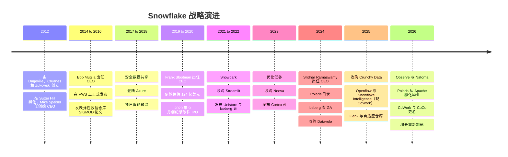
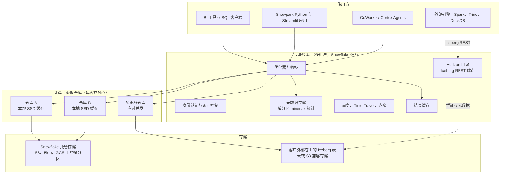
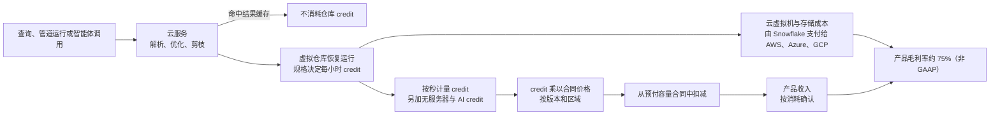

# 26. Snowflake
> **状态：** 上市公司（NYSE: SNOW） · **总部：** 无正式总部；主要执行办公室位于蒙大拿州 Bozeman（据 SEC 文件）；主要工程中心位于旧金山湾区 · **成立：** 2012 · **最新估值/市值：** 市值约 $107.9B，企业价值约 $106.3B，**16.9x EV/未来 12 个月收入**（2026-10-30 收盘；未来 12 个月收入取自 FY2027 指引） · **最后核实：** 2026-11-01

## 要点速览（TL;DR）

- **公司是什么。** Snowflake 销售全托管的云数据平台。它起步于一款基于公有云对象存储（object storage）、实现存算分离（separation of storage and compute）的 SQL 数据仓库（data warehouse）。如今它自我定位为"AI Data Cloud"：数据仓库、数据共享与云市场、Python 与应用运行时、Iceberg 湖仓一体（lakehouse）、Postgres、数据摄取（ingestion）、可观测性（observability）以及 AI 智能体（agent），全部通过同一个按用量计费的计量单位——**credit（积分）**——结算。
- **规模与增长势头。** **Q2 FY2027**（2026 年 5–7 月）产品收入约 **$1.49B**，**同比增长 37%**。这是连续第三个季度加速，FY2026 全年增速为 29%（GAAP）。净收入留存率（NRR）为 **126%**，年消费超过 $1M 的客户有 **828 家**（公司披露）。FY2027 产品收入指引已两次上调，至 **$6.07B（+36%）**。[^sf-q2][^sf-q1]
- **盈利能力之争的焦点是股权激励。** Q2 FY2027 非 GAAP 营业利润率为 **15.3%**，但 GAAP 营业利润率为 **−17.0%**。股权激励费用（SBC）**在 FY2026 占收入的 34%**，超过当年约 $1.19B 的调整后自由现金流。[^sf-q2][^sf-10k26]
- **战略转向：从"拥有存储"到"拥有计算与数据治理"。** Snowflake 最初的护城河是其专有托管存储。如今，Iceberg 表、其捐赠给 Apache 的 Polaris 目录（catalog），以及 Horizon 的 Iceberg REST 端点，使客户可以把数据保存在开放格式中。Snowflake 押注：赢得更多工作负载（尤其是 AI）所带来的收益，足以抵消其放弃的存储收入和锁定效应。[^polaris-tlp][^horizon-irc]
- **Everpure 视角。** Snowflake 的计算只运行在公有云中，但它可以通过外部 stage 和 Iceberg 外部卷（external volume），读写 AWS、Azure、GCP 之外的 **S3 兼容存储**上的数据。这使本地部署的对象存储成为一个受支持、尽管相对小众的数据源。更具战略意义的交集在于元数据：Everpure 的 Data Intelligence（1touch）将 Snowflake 列为连接器目标，而 Snowflake 的 Horizon 目录希望成为分类标签的归属地。[^sf-s3compat][^1touch]

## 概览表

| 项目 | 数值 | 口径 / 日期 |
|---|---|---|
| 创始人 | Benoît Dageville、Thierry Cruanes（均曾任职于 Oracle）、Marcin Żukowski（MonetDB/X100 论文合著者，Vectorwise 联合创始人） | 公开记录[^snowflake16][^x100] |
| CEO | Sridhar Ramaswamy（自 2024 年 2 月起；此前在 Neeva 交易后领导 Snowflake AI；更早时执掌 Google 广告业务） | 公司披露[^sf-ceo] |
| 历任 CEO | Mike Speiser（创始 CEO，Sutter Hill，2012–2014）；Bob Muglia（2014–2019）；Frank Slootman（2019–2024） | 公开记录[^sf-ceo] [VERIFY: 确切交接日期] |
| CFO | Brian Robins 于 2025 年接替长期担任 CFO 的 Mike Scarpelli | [VERIFY: 任命日期及 Scarpelli 的顾问角色，需对照 8-K] |
| 财年 | 截至 1 月 31 日。FY2027 = 2026 年 2 月–2027 年 1 月；Q2 FY2027 = 2026 年 5–7 月 | 公司文件[^sf-10k26] |
| 最近一季 | 产品收入约 $1.49B（+37%）；总收入 $1,546.8M（+35%） | GAAP，Q2 FY2027[^sf-q2] |
| 最近完整财年 | 产品收入 $4,472.3M（+29%）；总收入 $4,683.9M | GAAP，FY2026[^sf-q4] |
| 指引 | FY2027 产品收入 $6.07B（+36%）；Q3 FY2027 $1,588–1,593M（+37–38%） | 公司指引，2026-09-02[^sf-q2] |
| 净收入留存率 | 126%（过去 12 个月） | 公司披露 KPI，Q2 FY2027[^sf-q2] |
| 过去 12 个月产品收入 >$1M 的客户 | 828（同比 +27%） | 公司披露 KPI，Q2 FY2027[^sf-q2] |
| RPO | 约 $9.0B（低于 FY2026 年末的 $9.77B） | GAAP，Q2 FY2027[^sf-q2][^sf-q4] |
| 产品毛利率 | 非 GAAP 74.7%；GAAP 70.9%；FY2027 非 GAAP 指引 74% | Q2 FY2027[^sf-q2] |
| 营业利润率 | 非 GAAP 15.3%；GAAP −17.0% | Q2 FY2027[^sf-q2] |
| 自由现金流 | FY2026 调整后 FCF 利润率 25.5%（约 $1.19B）；FY2027 指引 23% | 非 GAAP[^sf-q4][^comps-sf] |
| 股权激励费用 | FY2026 为 $1,599.5M（占收入 34%） | GAAP，10-K[^sf-10k26] |
| 员工 | 截至 2025 年 1 月 31 日约 7,800 名全职员工 | 10-K FY2025 [VERIFY: FY2026 10-K 员工人数] |
| IPO 前融资 | A–G 轮合计约 $1.4B；最后一次私募估值 $12.4B（2020 年 2 月） | `data/private_funding.csv`[^funding] |
| 主要投资者 | Sutter Hill（创始孵化）、Redpoint、Altimeter、ICONIQ、Madrona、Dragoneer、Salesforce Ventures；Berkshire Hathaway 与 Salesforce 在 IPO 同时认购股份 | `data/private_funding.csv`；IPO 招股书[^funding][^sf-ipo] |
| 市值 | 市值约 $107.9B；EV 约 $106.3B；EV/未来 12 个月收入 16.9x | 2026-10-30 收盘，stockanalysis.com，经 `data/public_comps.csv`[^comps-sf] |

*图 26.1 — 概览。与 Databricks 不同，Snowflake 几乎所有数字都是经审计的 GAAP 数据或有明确定义的 KPI。悬而未决的问题在于方向（开放格式、AI 毛利率、股权激励），而非数字本身的含义。*

## 起源与战略演进

**创业洞见（2012）。** 2012 年，两位 Oracle 数据库架构师 Benoît Dageville 和 Thierry Cruanes 与 Marcin Żukowski 联手。Żukowski 合著了提出向量化执行（vectorized execution）的 MonetDB/X100 论文，并联合创办了 Vectorwise。[^x100] 他们的判断是：为云而生的数据仓库，应当与 Teradata 或 Oracle Exadata 截然不同。那些系统把数据绑定在每个节点内部的磁盘上，即所谓"无共享"（shared-nothing）架构。Snowflake 则把每张表的持久副本放在云对象存储中（最先是 Amazon S3），并按需启动计算集群来查询。公司由 **Sutter Hill Ventures** 孵化，其合伙人 **Mike Speiser** 出任创始 CEO。几年前，Sutter Hill 曾以同样的"孵化并委派 CEO"模式孵化了 Pure Storage（即现在的 Everpure）[VERIFY: Speiser 在 Pure Storage 的创始角色]。[^funding] Sutter Hill 于 2012 年 8 月领投了约 $5M 的 A 轮。[^funding]

**第一幕：打造弹性数据仓库（2012–2018）。** 产品于 2014 年在 **Bob Muglia**（前微软服务器与工具业务负责人）带领下结束隐身状态，并于 2015 年在 AWS 上正式发布（GA）。[^snowflake16] SIGMOD 2016 论文《The Snowflake Elastic Data Warehouse》阐述了下一节所述的设计，论证云的核心价值在于弹性，而非单纯的速度。[^snowflake16] 两项功能定义了早期的业务基本盘。**安全数据共享**（2017）让一个 Snowflake 账户可以实时查询另一个账户的表，而无需复制文件。[^sf-sharing-2017] 登陆 **Microsoft Azure**（2018）以及后来的 **Google Cloud**，使 Snowflake 成为多云数据仓库——这是任何一家超大规模云厂商都无法令人信服地占据的位置。融资随业务增长而来：2018 年 1 月以 $1.5B 估值融资 $263M，九个月后以约 $3.95B 估值融资 $450M。[^funding]

**第二幕：Slootman 的规模化与创纪录的 IPO（2019–2021）。** 2019 年，董事会以 **Frank Slootman** 替换了 Muglia。Slootman 曾执掌 Data Domain（重复数据删除存储，后被 EMC 收购）和 ServiceNow。他带来了以销售执行为核心的文化，不久后又从 ServiceNow 引入 CFO Mike Scarpelli。[^sf-ceo] 2020 年 2 月 $479M 的 G 轮使公司估值达到 $12.4B。[^funding] Snowflake 于 **2020 年 9 月**在 NYSE 上市，发行价 **每股 $120**，高于已上调的定价区间，募资约 **$3.4B**，成为有记录以来规模最大的软件 IPO。Berkshire Hathaway 和 Salesforce 各通过同步私募认购了 $250M 股票。首日开盘价接近 $245。[^sf-ipo] FY2021 和 FY2022 的产品收入均实现翻倍以上增长（GAAP），净收入留存率在 FY2022 达到 **178%** 的峰值。[^sf-10k-hist]

**第三幕：成为平台（2020–2023）。** 只能运行 SQL 的数据仓库，其在数据预算中的份额是有上限的。因此，Snowflake 推出了 **Snowpark**（2020 年；后来支持 Python），让数据工程师可以在 Snowflake 内运行 DataFrame 代码；随后收购 **Streamlit**（$800M，2022 年 3 月）用于 Python 数据应用；接着推出 **Native App Framework**，让第三方可以销售在客户账户内运行的应用。**Unistore / Hybrid Tables**（2022 年发布）增加了用于轻量事务处理的行存储。[^streamlit] 2022–2023 年的"优化"低谷考验了这一模式。客户在利率冲击期间削减用量，年度产品收入增速从 106%（FY2022）降至 38%（FY2024），NRR 从 178% 降至 131%。[^sf-10k-hist]

**第四幕：AI Data Cloud 与开放格式（2023–2026）。** 2023 年 5 月，Snowflake 以 $185.4M 现金收购 AI 搜索初创公司 **Neeva**。2024 年 2 月，Neeva 创始人 **Sridhar Ramaswamy** 接替 Slootman 出任 CEO。[^neeva][^sf-ceo] 这次 CEO 更替表明 AI 将成为下一个增长引擎。在 Ramaswamy 领导下，Snowflake 推出了 **Cortex AI**（平台内的 LLM 函数、搜索与智能体），使 **Iceberg 表**正式可用，并发布了 **Polaris** 目录（2024 年 6 月）。随后它通过收购进入相邻工作负载：**Datavolo**（数据摄取，2024）、**Crunchy Data**（Postgres，2025）、**Select Star**（元数据，2025）、**Observe**（可观测性，2026）和 **Natoma**（智能体治理，2026）。[^sf-polaris][^datavolo][^crunchy][^sf-observe][^natoma] 在 2026-06-02 的 Summit 上，Snowflake 将其智能体产品 **Snowflake Intelligence** 更名为 **Snowflake CoWork**，将编码智能体 **Cortex Code** 更名为 **CoCo**。[^sf-cowork] 增长已连续三个季度重新加速，Q2 FY2027 达到 37%。[^sf-q2]

*图 26.2 — 每一幕都扩大了计量范围。Snowflake 从 SQL 分析扩展到共享、Python 与应用，再到 AI、Postgres、数据摄取和可观测性，全部以同样的 credit 计费。*

*图 26.3 — 在 2020 年 9 月 IPO 前的最后两轮融资中，私募估值每轮大约翻了三倍。IPO 定价超过 G 轮估值的两倍，而首笔成交价约为 IPO 价格的两倍。来源：`data/private_funding.csv`。*

> **类比：估值。** 这次 IPO 是关于入场价格的一课。以 $120 发行价买入并持有至 $306（2026-10-30）的投资者获得约 2.6 倍回报，年化约 17%（作者计算）。以首日约 $245 开盘价买入的投资者，六年获得约 1.25 倍回报，年化约 4%。FY2021 至 FY2026 间，公司产品收入增长约 8 倍。股价却横盘，因为 IPO 当日的估值倍数已经提前透支了大部分增长。[^sf-ipo][^comps-sf][^sf-10k-hist]

## 产品与技术

### 一张图看懂架构（SV-5）

SIGMOD 2016 论文描述了三层架构，这一设计十年后依然成立。[^snowflake16]

1. **存储。** 所有表数据都以 Snowflake 专有的列式格式保存在云厂商的对象存储（S3、Azure Blob、Google Cloud Storage）中。表被切分为不可变的 **[微分区（micro-partition）](../glossary.md#micro-partition)**，每个包含 50–500 MB 未压缩数据，按列存储并压缩。对每个微分区，Snowflake 记录各列的最小值和最大值、不同值的数量以及其他统计信息。[^sf-mp]
2. **计算。** **[虚拟仓库（virtual warehouse）](../glossary.md#virtual-warehouse)** 是 Snowflake 为单个客户配置的一组云虚拟机集群。它按"T 恤尺码"分级，每升一级节点数和每小时消耗的 credit 都翻倍。仓库对持久数据而言是无状态的：它们在本地 SSD 上缓存表文件，空闲时可在数秒内挂起，并可设为"多集群"（随并发上升增加相同集群）。每个团队可以在同一份数据上拥有自己的仓库，因此财务团队的月末结账不再拖慢数据科学团队。
3. **云服务。** 一个由 Snowflake 在每个区域运行一份的共享多租户层。它负责身份认证与访问控制（access control）、查询优化器（query optimizer）、事务管理，最重要的是**元数据**。SIGMOD 论文描述该元数据存储构建在事务型键值存储 FoundationDB 之上。由于服务层掌握每个微分区的统计信息，它可以在仓库接触存储之前就规划查询并决定读取哪些文件。[^snowflake16]

*图 26.4 — Snowflake 的存算分离。服务层持有元数据并负责规划，仓库按需执行扫描，数据要么位于 Snowflake 托管的对象存储中，要么（自 2024 年起）位于客户自有卷上的开放 Iceberg 表中。*

### 一条查询如何实际运行（L2）

假设一位分析师查询 2026 年 7 月各区域的销售额。查询到达云服务层，由其进行解析和优化。首先检查**结果缓存（result cache）**：如果最近运行过相同的查询且底层数据未变，Snowflake 直接返回已存储的结果，无需启动仓库。持久化结果保留 24 小时，每次复用都会重置计时。[^sf-cache] 否则，优化器会查阅微分区元数据。日期范围与 2026 年 7 月不重叠的微分区会被**剪枝（pruned）**，即根本不被读取。在聚簇良好的表上，选择性强的过滤条件可以跳过绝大多数文件。剩余的文件列表交给一个仓库。各节点通过一致性哈希分配文件，因此同一节点倾向于看到相同的文件，其**本地 SSD 缓存**保持"热"状态。空闲节点会从慢节点"窃取"文件以平衡负载。[^snowflake16] 引擎本身是列式、向量化的，承袭 Żukowski 的 X100 一脉，详见[第 5 章](../01-data-systems-foundations/ch05-analytical-engines.md)。

> **类比：半导体（缓存标签与区域映射）。** 微分区剪枝相当于把 CPU 缓存的**标签比对（tag check）**应用到数据湖上。处理器在从 DRAM 取缓存行之前，总会先把地址与一个小而快的标签阵列比对。Snowflake 在从 S3 取微分区之前，也总会先把查询谓词与服务层中的 min/max 元数据比对。存储层次可以清晰对应：元数据存储是标签阵列，仓库的本地 SSD 是 L2/L3 缓存，S3 则是以 NAND 为后盾的 DRAM——便宜、海量但延迟高。与芯片设计一样，性能主要来自命中率和"不去取"，而不是更快的后端存储。这一通用技术称为**[区域映射（zone map）](../glossary.md#zone-map)**，详见[第 5 章](../01-data-systems-foundations/ch05-analytical-engines.md)。

### 不可变性衍生出的功能

由于微分区从不原地修改，一个表版本就只是元数据存储中的一组微分区指针。三项标志性功能几乎由此"免费"获得。

- **[时间旅行（Time Travel）](../glossary.md#time-travel)。** 旧的微分区会在保留期内保存：默认一天，Enterprise 版及以上最长 90 天。用户可以按某个较早的时间戳"as of"查询表，或恢复已删除的表。此外还有七天的 **Fail-safe** 期，可在 Time Travel 到期后由 Snowflake 支持团队协助恢复数据。[^sf-tt]
- **[零拷贝克隆（zero-copy cloning）](../glossary.md#zero-copy-cloning)。** `CREATE TABLE dev CLONE prod` 只复制指针列表。克隆体与原表共享微分区，直到任一方写入时才创建新的微分区（写时复制）。一个 100 TB 的生产数据库可以在数秒内克隆用于测试，在克隆体发生分化之前不产生额外存储成本。[^sf-tt]
- **[安全数据共享（secure data sharing）](../glossary.md#zero-copy-data-sharing)。** 提供方授予另一账户对特定对象的读取权限。使用方用自己的仓库查询并自付计算费用，在同一区域内不复制任何文件。跨区域和跨云共享需要复制，Snowflake 对 Marketplace 上架数据会自动完成复制。[^sf-sharing] 这一功能演化为 **Snowflake Marketplace**（数据提供方在此出售天气、金融和消费者等实时数据集），以及**数据洁净室（data clean room）**（来自对 Samooha 的收购）。[^samooha]

> **存储桥接。** Snowflake 的托管存储本身就是构建在对象存储之上的日志结构、写时复制设计，与存储工程师熟悉的阵列快照和克隆机制非常接近。区别在于，"阵列控制器"是一个多租户元数据服务，而"介质"是 S3。关于阵列快照与对象存储在持久性和性能上的差异，参见配套的 *Everpure Tech Atlas*。

### 从数据仓库到"AI Data Cloud"：新增了什么，为什么

| 层级 | 产品（截至 2026 年 11 月状态） | 功能 | 战略目的 |
|---|---|---|---|
| 可编程性 | **Snowpark**（Python、Java、Scala）；**Streamlit in Snowflake**；**Native App Framework** | 在 Snowflake 的治理边界内运行 DataFrame 代码、机器学习和应用 | 争夺过去运行在 Spark 上的数据工程和应用工作负载 |
| 事务型 | **Hybrid Tables**（Unistore）；**Snowflake Postgres**（来自 Crunchy Data；Summit 2026 上 GA），支持 Postgres 到 Snowflake 的镜像 | 面向运营数据的行存储和完整 Postgres | 回应 Databricks Lakebase；拥有智能体构建应用的记录系统[^sf-summit26][^sf-pg-mirror] |
| 开放格式 | **Iceberg 表**（托管或由外部编目；Iceberg v3 于 2026 年 5 月 GA）；带 Iceberg REST 端点的 **Horizon Catalog**；**Apache Polaris**（已捐赠；2026 年成为 Apache 顶级项目） | 让 Snowflake 与其他引擎读写同一批开放表 | 化解湖仓一体阵营的"锁定"质疑[^iceberg-v3][^horizon-irc][^polaris-tlp] |
| 数据摄取 | **Openflow**（来自 Datavolo，基于 Apache NiFi；2025 年 GA，第二代运行时 2026 年 9 月 GA）；Snowpipe Streaming | 批量、流式和非结构化数据摄取，包括自带 VPC 部署 | 不再为每一个流入的字节向 Fivetran 类工具支付"过路费"[^openflow-ga][^datavolo] |
| AI | **Cortex AI** 函数与 **AISQL**（在 SQL 中调用 LLM）；Cortex Search；**Cortex Agents**；**Snowflake CoWork**（原 Snowflake Intelligence）；**CoCo**（原 Cortex Code） | 在受治理的数据旁运行托管 LLM；智能体回答业务问题 | 让 AI 支出经由 credit 流入，而不是绕过 Snowflake[^sf-cowork][^sf-summit25] |
| 语义 | **语义视图（semantic view）**（DDL 对象）；与 Salesforce、dbt Labs 等共同发起的 **Open Semantic Interchange（OSI）** 规范 | 编码可供智能体和 BI 工具复用的指标定义 | 让 Snowflake 成为业务含义的归属地（[第 14 章](../02-pipelines-and-governance/ch14-semantic-layers-and-bi.md)）[^sf-sv][^osi-launch][^osi-v1] |
| 计算 | **Gen2 仓库**（厂商宣称核心分析快约 2.1 倍）；**自适应仓库**（按查询自动定规格，2025 年预览） | 更快的硬件与自动规格调整 | 以牺牲短期收入为代价，提升相对 Databricks SQL 和 BigQuery 的性价比[^sf-summit25] |
| 可观测性 | **Observe**（2026 年 2 月完成交割） | 在 Snowflake 上存储日志、指标和链路追踪 | 遥测数据也只是数据，而且量极大[^sf-observe] |

*图 26.5 — 产品地图。每一项新增都把一个原本在别处运行的工作负载拉到 credit 计量之下。状态依据 Snowflake 文档和 Summit 回顾；来自二手回顾的 GA 说法已在资料来源中注明。*

**开放格式转向解析。** 2022 年之前，交易逻辑很简单：把数据加载进 Snowflake 的存储，Snowflake 让它快速、受治理且可共享。Databricks 的湖仓一体论点（[第 25 章](ch25-databricks.md)）恰恰攻击了这一交易：为什么要把数据放进某一家厂商的格式？Snowflake 的回应分三步。第一，**Iceberg 表**：数据以 Parquet 加 Iceberg 元数据的形式写入客户自有存储桶中的"外部卷"。第二，**Polaris** 目录：2024 年 6 月发布并捐赠给 Apache，2026 年初毕业成为顶级项目（ASF 公告 2026-03-05）。第三，**Horizon** 开放 Iceberg REST 端点，使外部引擎可以读取受 Snowflake 治理的表，计划于 2026 年起按每百万次调用 0.5 credit 收取请求费用。[^sf-polaris][^polaris-tlp][^horizon-irc] [第 7 章](../01-data-systems-foundations/ch07-open-table-formats.md)和[第 8 章](../01-data-systems-foundations/ch08-catalogs-and-metastores.md)讲解了格式与目录。

收入逻辑是一笔交换。Snowflake 的存储一直是低毛利的转手业务（见下文），因此失去它损失的毛利很少。真正利害攸关的是**锁定**。以 Snowflake 格式存储的数据只能由 Snowflake 的计算查询，而以 Iceberg 存储的数据任何引擎都能查询。Snowflake 押注：对开放数据说"是"所赢得的计算量，多于输给那些如今能读取同一批表的引擎的量。早期证据（产品收入重新加速、NRR 稳定在 126%）支持这一押注。但这并非定论，因为 AI 工作负载同时到来，使归因变得模糊。[^sf-q2]

> **深入（L3）。** 对于 Snowflake 托管的 Iceberg 表，Snowflake 充当目录。它将 Parquet 数据文件和 Iceberg 元数据（metadata JSON、manifest list、manifest）写入外部卷，并通过更新自身指针完成提交。外部引擎通过 Horizon Iceberg REST 端点读取，该端点下发限定范围的存储凭证。对于外部管理的表（例如在 Polaris 或 AWS Glue 中编目的表），Snowflake 是读取方，负责刷新其对元数据的视图。双方都要写入时，需要一个唯一的权威目录，这就是为什么真正的设计决策是目录选择而非文件格式（[第 8 章](../01-data-systems-foundations/ch08-catalogs-and-metastores.md)）。[^horizon-irc]

## 盈利模式

### Credit、存储与数据传输

Snowflake 对三类项目计费。[^sf-cost]

1. **计算，以 credit 计。** 仓库按规格每小时消耗 credit：X-Small 1、Small 2、Medium 4、Large 8，逐级翻倍，直到 6X-Large 的 512。按秒计费，每次仓库恢复运行时最低计 60 秒。无服务器功能（Snowpipe 数据摄取、自动聚簇、搜索优化、物化视图维护、Openflow、Cortex AI 函数）也按各功能的特定费率以 credit 计费。Cortex AI 函数按每百万 token 定价并折算为 credit。云服务层在当日仓库 credit 的 10% 以内免费，超出部分计费。
2. **存储，按每 TB 每月计，** 采用接近云厂商自身对象存储价格的统一费率，预购容量可享折扣。Snowflake 在存储上赚得很少。它是把数据留在计算计量表旁边的诱饵。
3. **数据传输，** 按字节计，适用于数据离开某一区域或云的情形（复制、跨区域共享、卸载到另一个云）。

**每 credit 价格**取决于**版本**（Standard、Enterprise、Business Critical、Virtual Private Snowflake）、云和区域。长期以来，前三个版本在美国按需购买的标价约为每 credit $2、$3 和 $4 [VERIFY: 各区域当前标价]。[^sf-cost] 更高版本买到的是功能而非速度：更长的 Time Travel、多集群仓库、列脱敏（masking）与行访问策略、客户自管密钥、私有连接。这使版本阶梯成为一种数据治理与合规的追加销售。

| 仓库规格 | 每小时 credit | 按 $3/credit 的示意每小时成本（Enterprise，标价） | 典型用途 |
|---|---|---|---|
| X-Small | 1 | $3 | 开发、轻量仪表盘 |
| Medium | 4 | $12 | 部门级 BI |
| Large | 8 | $24 | 重度数据转换（ELT）作业 |
| 2X-Large | 32 | $96 | 大型关联、历史回填 |
| 6X-Large | 512 | $1,536 | 罕见；超大批处理 |

*图 26.6 — credit 阶梯（标价示意，作者计算；协议价格更低）。每升一级，节点数和 credit 都翻倍，因此一条并行良好的查询在高一级规格上快一倍完成，成本不变。客户购买的是时间，而不是容量。*

### 一条查询如何变成收入

*图 26.7 — 收入在 credit 被消耗时确认，而不是在合同签署时确认。每一条命中结果缓存或剪枝良好的查询，都是 Snowflake 主动放弃的收入，这就是为什么效率既是卖点也是逆风。*

**合同与收入确认。** 多数大客户签署**容量合同（capacity contract）**：承诺在一到数年内购买一定金额的 credit，通常按年预先开票。其他客户按需使用、事后付费。Snowflake 仅在 credit 被消耗时确认产品收入，而不是在现金到账时。根据部分合同，若客户续约时购买更多，未使用的容量可以**结转（roll over）**至续约合同。[^sf-10k26] 已签署但尚未消耗的承诺计入**[剩余履约义务（RPO）](../glossary.md#remaining-performance-obligations)**。因此，RPO 衡量的是承诺，产品收入衡量的是使用，二者之间的差距揭示了客户行为。

> **类比：金融（预付公用事业与特许权使用费）。** 容量合同的运作方式类似带有"电量储存"的**照付不议（take-or-pay）公用事业费率**。客户以协商费率预付一整块电量，公用事业公司只在电表转动时确认收入，若客户以更大规模续约，未用电量可以结转。对分析师而言，产品收入就像对客户自身分析活动收取的**使用量特许权使用费**。它在下行期（2022–2023）比按席位计费的 SaaS 波动更大，在上行期也更陡峭，因为没有席位数来限制它。应当像公用事业一样建模：存量客户 × 使用强度 × 价格，而不是看新签订单。

### 毛利率与云账单

Snowflake 在其于 AWS、Azure 和 Google 开设的自有账户中运行每个仓库。因此，云基础设施是其最大的收入成本，它与每家云厂商都签订了多年期承诺消费额度（committed spend）协议 [VERIFY: 10-K 附注中当前的云采购承诺]。[^sf-10k26] Q2 FY2027 非 GAAP 产品毛利率（gross margin）为 **74.7%**，低于一年前的 76.4%。GAAP 产品毛利率为 70.9%。管理层将 FY2027 指引定为 **74%**，低于年初水平，理由是工作负载结构向 AI 转移。这些工作负载带有更高的 GPU 和第三方模型成本。[^sf-q2] 毛利率的驱动因素包括：来自云厂商的规模折扣、仓库利用率（空闲时间是客户的成本，但服务层是 Snowflake 的成本）、引擎效率以及 AI 占比。

### 效率逆风

Snowflake 不断推出让客户现有查询更便宜的改进。更快的引擎、更好的剪枝、压缩优化和更新的云实例，都会减少每条查询消耗的 credit。**Gen2 仓库**（2025）是最新的例子，厂商宣称核心分析快约 2.1 倍。[^sf-summit25] 短期内，每一项此类改进都会减少不变工作负载所产生的收入。Snowflake 过去也公开承认过这一点，曾在 FY2023 指引中量化了性能改进带来的预期收入逆风 [VERIFY: 管理层 2022 年 3 月提到的约 $97M FY2023 数字]。在 **2022–2023 年优化周期**中，客户自己走得更远：缩短数据保留期、设置激进的自动挂起、调整仓库规格，并将部分数据转换移到别处。叠加宏观放缓，年度产品收入增速在两年内从 106% 降至 38%。[^sf-10k-hist]

> **类比：摩尔定律与价格弹性。** 几十年来 DRAM 和 NAND 的每比特成本持续下降，但存储器收入却在增长，因为更便宜的比特解锁了新用途：需求是价格弹性的。Snowflake 的效率提升也是同样的押注。如果一条查询的成本减半，客户会不会运行两倍以上的查询、保留更多历史数据、并让 AI 智能体指向这些数据？弹性大于 1 意味着效率会滞后地推动收入增长；小于 1 则会使收入萎缩。2022–2023 年体现了这种滞后。2025–2026 年随着 AI 智能体和新工作负载到来的重新加速，是 Snowflake 在当前价格水平下弹性大于 1 的第一个有力证据。发出大量机器生成查询的智能体，是能想象到的弹性最高的客户。

